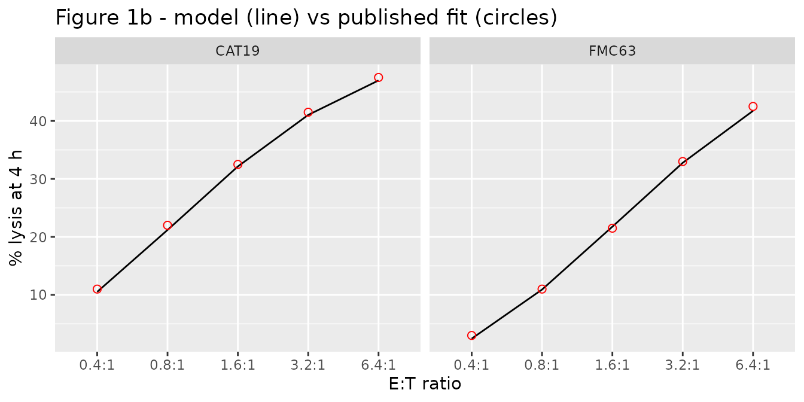
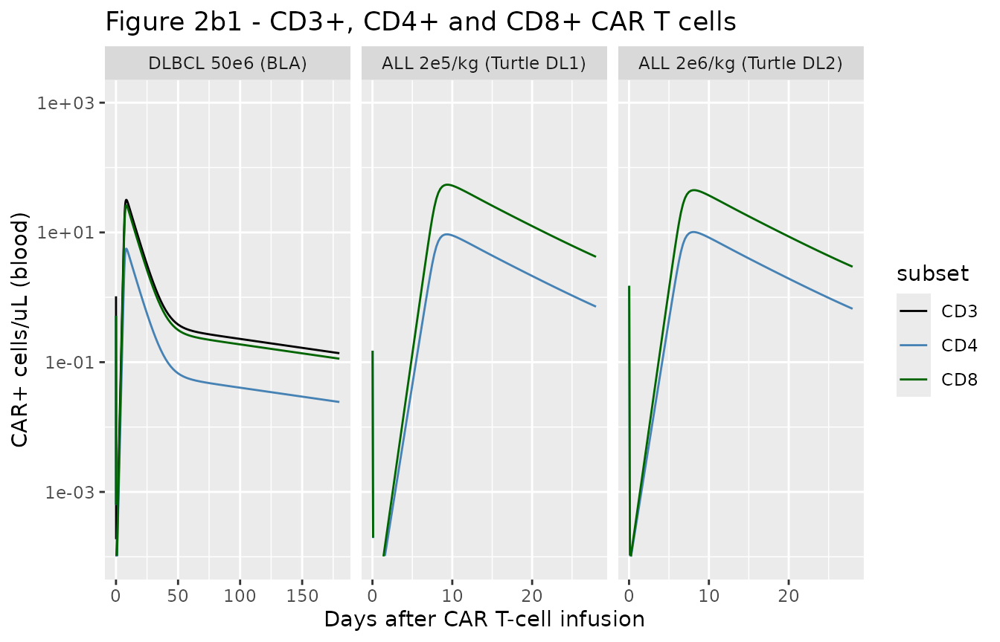
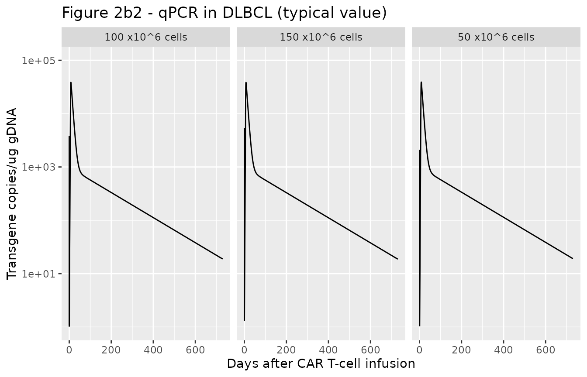
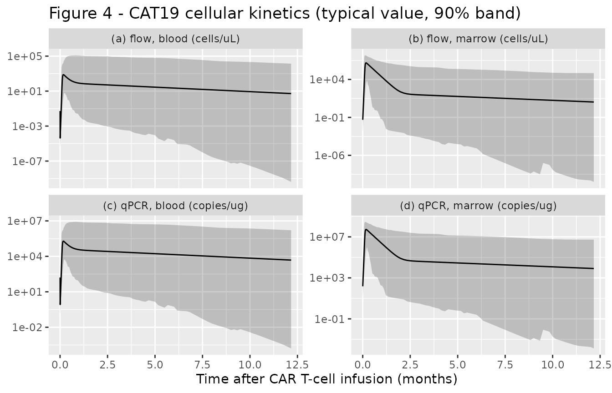
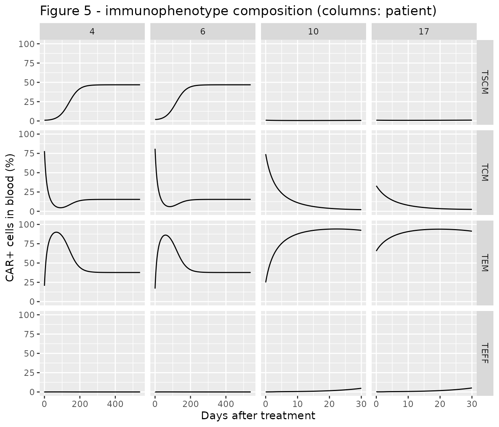

# Anti-CD19 CAR T-cell subsets and immunophenotypes, Liso-cel and CAT19 (Salem 2023)

## Model and source

- Citation: Salem AM, Mugundu GM, Singh AP (2023). Development of a
  multiscale mechanistic modeling framework integrating differential
  cellular kinetics of CAR T-cell subsets and immunophenotypes in cancer
  patients. CPT Pharmacometrics Syst Pharmacol 12(9):1285-1296.
- Article: <https://doi.org/10.1002/psp4.13009> (open access,
  PMC10508581)
- Equations: Appendix S1; Monolix model code: Appendix S2.

Salem et al. extend the multiscale cellular-kinetic / pharmacodynamic
(CK-PD) model of Singh et al. 2021
(`Singh_2021_idecabtageneVicleucel_human`) to anti-CD19 CAR T cells, in
three sequential steps. Each step is a separately fitted model, so the
paper contributes five model files:

| Step | Model | Data |
|----|----|----|
| 1 | `Salem_2023_CART_FMC63_invitro_qsp`, `Salem_2023_CART_CAT19_invitro_qsp` | 4-h cytotoxicity of FMC63- and CAT19-binder CAR T cells against SupT1 CD19+ cells |
| 2 | `Salem_2023_lisocabtageneMaraleucel_qsp` | Mean / median Liso-cel flow cytometry and qPCR in adult DLBCL and ALL |
| 2 | `Salem_2023_CART_CAT19_qsp` | Individual CAT19 flow cytometry and qPCR in 14 children with ALL |
| 3 | `Salem_2023_CART_CAT19_immunophenotype_qsp` | Step 2 CAT19 data plus immunophenotype percentages in 4 of the 14 children |

In every clinical model the infused CAR T cells distribute between blood
and bone marrow; CARs bind CD19 on tumour cells to form CAR-target
complexes; the number of complexes per CAR T cell drives Emax expansion
and the number of complexes per tumour cell drives Emax killing. Step 2
splits the product into CD4+ and CD8+ subsets with their own expansion
rates, and step 3 further splits each subset into stem-cell memory
(TSCM), central memory (TCM), effector memory (TEM) and terminal
effector (TEFF) cells.

``` r

nms <- c(
  "Salem_2023_CART_FMC63_invitro_qsp",
  "Salem_2023_CART_CAT19_invitro_qsp",
  "Salem_2023_lisocabtageneMaraleucel_qsp",
  "Salem_2023_CART_CAT19_qsp",
  "Salem_2023_CART_CAT19_immunophenotype_qsp"
)
uis <- lapply(nms, function(n) rxode2::rxode(readModelDb(n)))
#> ℹ parameter labels from comments will be replaced by 'label()'
#> ℹ parameter labels from comments will be replaced by 'label()'
#> ℹ parameter labels from comments will be replaced by 'label()'
names(uis) <- nms
```

## Population

- **In vitro (step 1).** SupT1 cells engineered to express CD19,
  cocultured with FMC63- or CAT19-binder CAR T cells at effector:target
  ratios of 0.4:1 to 6.4:1 (5000 tumour cells in 175 uL); percent lysis
  at 4 h digitised from Ghorashian et al. 2019 (Nat Med 25:1408-1414).
- **Liso-cel (step 2).** Summary-level data (Table 1 of the paper): mean
  +/- SEM blood CAR+CD4+ and CAR+CD8+ cells/uL in adult ALL after 2 x
  10^5 or 2 x 10^6 cells/kg (Turtle et al. 2016; n = 13 and 15; a 70 kg
  weight was assumed to convert the doses), and median blood
  CAR+CD3+/CD4+/CD8+ cells/uL (50 x 10^6 cells, n = 45) and median qPCR
  transgene copies/ug genomic DNA (50, 100 and 150 x 10^6 cells, n = 45,
  176 and 41) in adult DLBCL from the Breyanzi FDA review. The product
  is 1:1 CD4:CD8.
- **CAT19 (steps 2 and 3).** 14 children with relapsed / refractory
  B-ALL in the CARPALL study (Ghorashian et al. 2019) who received a
  median 1 x 10^6 CAR+ cells/kg; a 30 kg weight was assumed for
  everyone. Individual flow cytometry (n = 13) and qPCR (n = 14) in
  blood and bone marrow; the product contained a median 54.65% CD4+ and
  37.65% CD8+ CAR T cells. Immunophenotype percentages before infusion
  and up to 1080 days after it were available for 4 patients (Biasco et
  al. 2021, Nat Cancer 2:629-642): two with a highly polyclonal product
  and long persistence (patients 4 and 6) and two with low polyclonality
  and short persistence (patients 10 and 17).

``` r

lapply(uis, function(u) u$population[c("species", "n_subjects", "disease_state")])
#> $Salem_2023_CART_FMC63_invitro_qsp
#> $Salem_2023_CART_FMC63_invitro_qsp$species
#> [1] "in vitro (SupT1 CD19+ cell line)"
#> 
#> $Salem_2023_CART_FMC63_invitro_qsp$n_subjects
#> [1] NA
#> 
#> $Salem_2023_CART_FMC63_invitro_qsp$disease_state
#> [1] "SupT1 cells engineered to express CD19, cocultured with FMC63-binder anti-CD19 CAR T cells"
#> 
#> 
#> $Salem_2023_CART_CAT19_invitro_qsp
#> $Salem_2023_CART_CAT19_invitro_qsp$species
#> [1] "in vitro (SupT1 CD19+ cell line)"
#> 
#> $Salem_2023_CART_CAT19_invitro_qsp$n_subjects
#> [1] NA
#> 
#> $Salem_2023_CART_CAT19_invitro_qsp$disease_state
#> [1] "SupT1 cells engineered to express CD19, cocultured with low-affinity CAT19-binder anti-CD19 CAR T cells"
#> 
#> 
#> $Salem_2023_lisocabtageneMaraleucel_qsp
#> $Salem_2023_lisocabtageneMaraleucel_qsp$species
#> [1] "human"
#> 
#> $Salem_2023_lisocabtageneMaraleucel_qsp$n_subjects
#> [1] NA
#> 
#> $Salem_2023_lisocabtageneMaraleucel_qsp$disease_state
#> [1] "Relapsed / refractory diffuse large B-cell lymphoma (Breyanzi BLA, TRANSCEND NHL 001) and adult B-cell acute lymphoblastic leukaemia (Turtle et al. 2016)"
#> 
#> 
#> $Salem_2023_CART_CAT19_qsp
#> $Salem_2023_CART_CAT19_qsp$species
#> [1] "human"
#> 
#> $Salem_2023_CART_CAT19_qsp$n_subjects
#> [1] 14
#> 
#> $Salem_2023_CART_CAT19_qsp$disease_state
#> [1] "Relapsed / refractory paediatric B-cell acute lymphoblastic leukaemia (CARPALL study, Ghorashian et al. 2019)"
#> 
#> 
#> $Salem_2023_CART_CAT19_immunophenotype_qsp
#> $Salem_2023_CART_CAT19_immunophenotype_qsp$species
#> [1] "human"
#> 
#> $Salem_2023_CART_CAT19_immunophenotype_qsp$n_subjects
#> [1] 14
#> 
#> $Salem_2023_CART_CAT19_immunophenotype_qsp$disease_state
#> [1] "Relapsed / refractory paediatric B-cell acute lymphoblastic leukaemia (CARPALL study)"
```

## Source trace

Every `ini()` value carries an in-file comment naming its source.
Summary:

| Element | Value(s) | Source |
|----|----|----|
| In vitro binding / kill ODEs | – | Appendix S1 Eqs. 1-5; Appendix S2 Figure 1 code |
| KKillMax, KC50CAR-T in vitro (FMC63 / CAT19) | 0.24, 0.22 /h; 9.16, 0.28 complexes/cell | Table 2, in vitro |
| DTTumor, DTCAR-T, AgTumor, AgCAR, Tumor0, Vwell | 30 h, 24 h, 4000, 15000, 5000 cells, 175 uL | Table 2, in vitro |
| Kon / Koff (FMC63 / CAT19) | 2.07E5, 2.15E5 /M/s; 6.81E-5, 0.003 /s | Table 2 |
| Clinical CK ODEs (effector / memory, CD4 / CD8, blood / marrow) | – | Appendix S1 Eqs. 6-17; Appendix S2 Figure 2 code |
| Binding, expansion, kill and tumour ODEs | – | Appendix S1 Eqs. 19-42 |
| Liso-cel KmaxExpCD8 / CD4, Rm, Kelm, K12, K21, KKillMax | 2.14, 1.92, 7E-6, 0.024, 0.4, 0.15, 1.8 /day | Table 2, Liso-cel |
| EC50Exp, Kele | 10 complexes/cell, 113 /day | Table 2 (fixed from Singh 2021) |
| Disease-specific AgTumor, DTTumor, ICTumorBM, ICTumorPB (DLBCL / ALL) | 20000 / 4000; 29 / 5.8 day; 5E10 / 1.06E11; 0 / 5.5E9 cells/L | Table 2, Liso-cel |
| Kmigration, Vb, Vbm | 0.001 /day, 5 L, 1.6 L | Table 2 |
| qPCR link (Liso-cel) | ln(copies) = 7.62 + 0.85 ln(cells/uL) | Eq. 1, Table 2; Appendix S2 code 7.6204 / 0.8537 |
| CAT19 KmaxExpCD8, Rm, Kelm, K12 | 5.3, 0.000037, 0.013, 0.11 /day | Results text (Table 2 per month: 159, 0.001, 0.39, 3.3) |
| CAT19 K21, KmaxExpCD4 ratio, PCTCD8 / PCTCD4 | 0.176 /day, 1.12, 38 / 54% | Table 2, CAT19 |
| CAT19 qPCR link | intercept 7.26, slope 0.74 | Table 2, CAT19 |
| CAT19 omegas (KmaxExpCD8, PCT, Rm, Kelm, K12, K21) | 0.4, 0.5, 5.04, 1.35, 2.08, 1.08 | Table 2, CAT19 |
| Immunophenotype ODEs | – | Appendix S1 Eqs. 43-66 |
| Step 3 KmaxExpCD8, Rm1, Rm2, Rm3 | 3.44, 0.26, 0.4, 0.29 /day | Table 2, step 3 |
| Polyclonality effects on Rm1-Rm3 | x 0.08, 0.21, 0.19 | Table 2, step 3; Discussion (92%, 79%, 81% reductions) |
| Step 3 omegas (KmaxExpCD8, Rm1-3, Kelm, K12, K21) | 0.4, 0.2, 1.35, 2.08, 1.08 (all fixed) | Table 2, step 3 |

## Step 1: in vitro killing (Figure 1b)

Each well is seeded with 5000 SupT1 CD19+ cells and `E:T x 5000` CAR T
cells; lysis is read at 4 h.

``` r

et_ratio <- c(6.4, 3.2, 1.6, 0.8, 0.4)

invitro_lysis <- function(ui, ratio) {
  ids <- seq_along(ratio)
  d <- rbind(
    data.frame(id = ids, time = 0, amt = 5000, evid = 1, cmt = "tumor"),
    data.frame(id = ids, time = 0, amt = 5000 * ratio, evid = 1, cmt = "cart"),
    data.frame(id = ids, time = 4, amt = 0, evid = 0, cmt = "tumor")
  )
  d <- d[order(d$id, d$time, -d$evid), ]
  s <- as.data.frame(rxode2::rxSolve(ui, d))
  if (is.null(s$id)) s$id <- 1L
  s$lysis[match(seq_along(ratio), s$id)]
}

invitro <- data.frame(
  construct = rep(c("CAT19", "FMC63"), each = length(et_ratio)),
  et_ratio = rep(et_ratio, 2),
  simulated = c(
    invitro_lysis(uis$Salem_2023_CART_CAT19_invitro_qsp, et_ratio),
    invitro_lysis(uis$Salem_2023_CART_FMC63_invitro_qsp, et_ratio)
  ),
  # Model-fitted lines of Figure 1b, read by the maintainers at each E:T ratio.
  published_fit = c(47.5, 41.5, 32.5, 22, 11, 42.5, 33, 21.5, 11, 3)
)
invitro$diff <- invitro$simulated - invitro$published_fit

invitro |>
  dplyr::mutate(simulated = round(simulated, 1), diff = round(diff, 1)) |>
  dplyr::rename(
    "Construct" = construct, "E:T ratio" = et_ratio,
    "Simulated lysis (%)" = simulated, "Figure 1b fit (%)" = published_fit,
    "Difference (points)" = diff
  ) |>
  knitr::kable()
```

| Construct | E:T ratio | Simulated lysis (%) | Figure 1b fit (%) | Difference (points) |
|:---|---:|---:|---:|---:|
| CAT19 | 6.4 | 47.0 | 47.5 | -0.5 |
| CAT19 | 3.2 | 41.0 | 41.5 | -0.5 |
| CAT19 | 1.6 | 32.1 | 32.5 | -0.4 |
| CAT19 | 0.8 | 21.2 | 22.0 | -0.8 |
| CAT19 | 0.4 | 10.5 | 11.0 | -0.5 |
| FMC63 | 6.4 | 41.7 | 42.5 | -0.8 |
| FMC63 | 3.2 | 32.8 | 33.0 | -0.2 |
| FMC63 | 1.6 | 21.8 | 21.5 | 0.3 |
| FMC63 | 0.8 | 10.9 | 11.0 | -0.1 |
| FMC63 | 0.4 | 2.5 | 3.0 | -0.5 |

``` r


# Deterministic solve against values read off a figure: a wrong KKillMax,
# KC50 or binding constant moves the curve by many lysis points.
stopifnot(all(abs(invitro$diff) < 3))
```

``` r

# Replicates Figure 1b of Salem 2023.
invitro$et_lbl <- factor(paste0(invitro$et_ratio, ":1"), levels = paste0(rev(et_ratio), ":1"))
ggplot(invitro, aes(et_lbl)) +
  geom_line(aes(y = simulated, group = construct)) +
  geom_point(aes(y = published_fit), shape = 1, colour = "red", size = 2) +
  facet_wrap(~construct) +
  labs(
    x = "E:T ratio", y = "% lysis at 4 h",
    title = "Figure 1b - model (line) vs published fit (circles)"
  )
```



The ~33-fold lower KC50 of the low-affinity CAT19 binder offsets its
~40-fold faster dissociation, so the two constructs kill SupT1 cells
with similar potency in this assay.

## Step 2: Liso-cel in adult DLBCL and ALL (Figure 2b)

A dose is the total number of CAR+ T cells, given as one record on each
subset compartment; `f()` applies the 1:1 split.

``` r

liso <- rxode2::zeroRe(uis$Salem_2023_lisocabtageneMaraleucel_qsp)
#> Warning: No sigma parameters in the model

liso_events <- function(total_cells, times, dis_all) {
  ev <- rxode2::et(amt = total_cells, cmt = "carte_cd8_pb")
  ev <- rxode2::et(ev, amt = total_cells, cmt = "carte_cd4_pb")
  ev <- rxode2::et(ev, times, cmt = "carte_cd8_pb")
  d <- as.data.frame(ev)
  d$DIS_ALL <- dis_all
  d
}

tt_short <- sort(unique(c(seq(0, 2, by = 0.02), seq(2, 28, by = 0.25))))
tt_long <- sort(unique(c(tt_short, seq(28, 730, by = 2))))

liso_scen <- data.frame(
  scenario = c("DLBCL 50e6 (BLA)", "ALL 2e5/kg (Turtle DL1)", "ALL 2e6/kg (Turtle DL2)"),
  cells = c(50e6, 2e5 * 70, 2e6 * 70),
  dis_all = c(0, 1, 1)
)
sim_liso <- dplyr::bind_rows(lapply(seq_len(nrow(liso_scen)), function(i) {
  tt <- if (liso_scen$dis_all[i] == 0) tt_long[tt_long <= 180] else tt_short
  s <- as.data.frame(rxode2::rxSolve(liso,
    liso_events(liso_scen$cells[i], tt, liso_scen$dis_all[i]),
    atol = 1e-10, rtol = 1e-8
  ))
  s$scenario <- liso_scen$scenario[i]
  s
}))
#> ℹ omega/sigma items treated as zero: 'etalkkill_max'
#> ℹ omega/sigma items treated as zero: 'etalkkill_max'
#> ℹ omega/sigma items treated as zero: 'etalkkill_max'
sim_liso$scenario <- factor(sim_liso$scenario, levels = liso_scen$scenario)
```

``` r

# Replicates Figure 2b1 of Salem 2023 (typical-value lines).
sim_liso |>
  dplyr::filter(time > 0) |>
  dplyr::select(time, scenario, CD3 = cart_cd3_pb, CD4 = cart_cd4_pb, CD8 = cart_cd8_pb) |>
  tidyr::pivot_longer(c(CD3, CD4, CD8), names_to = "subset", values_to = "cells") |>
  dplyr::filter(!(subset == "CD3" & scenario != "DLBCL 50e6 (BLA)")) |>
  ggplot(aes(time, cells, colour = subset)) +
  geom_line() +
  scale_y_log10(limits = c(1e-4, 1e3)) +
  scale_colour_manual(values = c(CD3 = "black", CD4 = "steelblue", CD8 = "darkgreen")) +
  facet_wrap(~scenario, scales = "free_x") +
  labs(
    x = "Days after CAR T-cell infusion", y = "CAR+ cells/uL (blood)",
    title = "Figure 2b1 - CD3+, CD4+ and CD8+ CAR T cells"
  )
```



``` r

bla <- sim_liso[sim_liso$scenario == "DLBCL 50e6 (BLA)", ]
bla_peak <- max(bla$cart_cd3_pb[bla$time > 1])
bla_180 <- bla$cart_cd3_pb[which.min(abs(bla$time - 180))]
c(peak_cd3 = bla_peak, day180_cd3 = bla_180)
#>   peak_cd3 day180_cd3 
#> 31.7918128  0.1374849
# Figure 2b1 (BLA, median data and fit): CD3+ peak about 20 cells/uL near
# day 7-10 and about 0.15 cells/uL at day 180. A factor-of-two window still
# fails on a mis-transcribed expansion, conversion or elimination constant.
stopifnot(bla_peak > 10, bla_peak < 40, bla_180 > 0.075, bla_180 < 0.3)
```

The typical-value DLBCL (BLA) curve follows the published fit to within
a factor of about 1.5 (peak CD3+ 32 vs about 20 cells/uL; 0.14 vs about
0.15 cells/uL at day 180). The typical-value ALL curves sit below the
Turtle data (peak CD8+ about 50 vs 100 cells/uL at 2 x 10^5 cells/kg,
and about 40 vs 400 cells/uL at 2 x 10^6 cells/kg) because in the paper
each summary profile carries its own empirical-Bayes value of the 50%
random effect on KKillMax; a lower individual kill rate keeps more
tumour alive and so drives more expansion.

``` r

# Replicates Figure 2b2 of Salem 2023: blood qPCR in DLBCL at three dose levels.
sim_qpcr <- dplyr::bind_rows(lapply(c(50e6, 100e6, 150e6), function(d) {
  s <- as.data.frame(rxode2::rxSolve(liso, liso_events(d, tt_long, 0),
    atol = 1e-10, rtol = 1e-8
  ))
  s$dose <- paste0(d / 1e6, " x10^6 cells")
  s
}))
#> ℹ omega/sigma items treated as zero: 'etalkkill_max'
#> ℹ omega/sigma items treated as zero: 'etalkkill_max'
#> ℹ omega/sigma items treated as zero: 'etalkkill_max'
sim_qpcr |>
  dplyr::filter(time > 0) |>
  ggplot(aes(time, transgene)) +
  geom_line() +
  scale_y_log10(limits = c(1, 1e5)) +
  facet_wrap(~dose, scales = "free_x") +
  labs(
    x = "Days after CAR T-cell infusion", y = "Transgene copies/ug gDNA",
    title = "Figure 2b2 - qPCR in DLBCL (typical value)"
  )
```



Peak qPCR is nearly flat across the three doses, as in the paper,
because expansion is limited by the antigen supply in bone marrow rather
than by the dose. The typical-value curves run about two- to three-fold
above the individual Figure 2b2 fits, which again carry their own
KKillMax values; the paper’s own typical-value simulations (next
section) agree with the packaged model to within a few percent.

### Typical-value exposure across CD4:CD8 ratios and tumour burden (Appendix S1 Table S1)

Appendix S1 Table S1 reports the typical-value (“mean simulation”) Cmax
and AUC(0-28 day) of blood transgene after 50 x 10^6 Liso-cel cells in a
DLBCL patient, for CD4:CD8 product ratios from 99:1 to 1:99 at initial
bone-marrow tumour burdens of 5E9, 5E10 and 5E11 cells/L. The same grid
is simulated here and summarised with PKNCA.

Cmax is taken from day 1 onwards. At time zero the whole dose is in the
blood as effector cells, which the 113 /day effector elimination clears
within hours; that instant reads about 14,000 copies/ug gDNA for every
scenario, whereas Table S1 reports expansion peaks as low as 3603, so
the published Cmax is the expansion peak.

``` r

ratios <- data.frame(
  ratio = c("99:1", "9:1", "3:1", "1:1", "1:3", "1:9", "1:99"),
  pct_cd4 = c(99, 90, 75, 50, 25, 10, 1)
)
burdens <- c(5e9, 5e10, 5e11)
grid <- tidyr::expand_grid(ratios, tumor_bm0 = burdens)
grid$treatment <- paste0(grid$ratio, ", ", format(grid$tumor_bm0, scientific = TRUE), " cells/L")
tt_nca <- seq(0, 28, by = 0.05)

sim_s1 <- dplyr::bind_rows(lapply(seq_len(nrow(grid)), function(i) {
  s <- as.data.frame(rxode2::rxSolve(liso, liso_events(50e6, tt_nca, 0),
    params = c(
      pct_cd4 = grid$pct_cd4[i], pct_cd8 = 100 - grid$pct_cd4[i],
      tumor_bm0 = grid$tumor_bm0[i]
    ),
    atol = 1e-10, rtol = 1e-8
  ))
  s$id <- i
  s$treatment <- grid$treatment[i]
  s
}))
#> ℹ omega/sigma items treated as zero: 'etalkkill_max'
#> ℹ omega/sigma items treated as zero: 'etalkkill_max'
#> ℹ omega/sigma items treated as zero: 'etalkkill_max'
#> ℹ omega/sigma items treated as zero: 'etalkkill_max'
#> ℹ omega/sigma items treated as zero: 'etalkkill_max'
#> ℹ omega/sigma items treated as zero: 'etalkkill_max'
#> ℹ omega/sigma items treated as zero: 'etalkkill_max'
#> ℹ omega/sigma items treated as zero: 'etalkkill_max'
#> ℹ omega/sigma items treated as zero: 'etalkkill_max'
#> ℹ omega/sigma items treated as zero: 'etalkkill_max'
#> ℹ omega/sigma items treated as zero: 'etalkkill_max'
#> ℹ omega/sigma items treated as zero: 'etalkkill_max'
#> ℹ omega/sigma items treated as zero: 'etalkkill_max'
#> ℹ omega/sigma items treated as zero: 'etalkkill_max'
#> ℹ omega/sigma items treated as zero: 'etalkkill_max'
#> ℹ omega/sigma items treated as zero: 'etalkkill_max'
#> ℹ omega/sigma items treated as zero: 'etalkkill_max'
#> ℹ omega/sigma items treated as zero: 'etalkkill_max'
#> ℹ omega/sigma items treated as zero: 'etalkkill_max'
#> ℹ omega/sigma items treated as zero: 'etalkkill_max'
#> ℹ omega/sigma items treated as zero: 'etalkkill_max'
```

``` r

conc_s1 <- sim_s1 |>
  dplyr::filter(!is.na(transgene)) |>
  dplyr::select(id, time, transgene, treatment)

intervals_s1 <- data.frame(
  start = c(0, 1), end = c(28, 28),
  auclast = c(TRUE, FALSE), cmax = c(FALSE, TRUE)
)
nca_s1 <- PKNCA::pk.nca(PKNCA::PKNCAdata(
  PKNCA::PKNCAconc(conc_s1, transgene ~ time | treatment + id),
  intervals = intervals_s1
))
#> No dose information provided, calculations requiring dose will return NA.

# Appendix S1 Table S1 absolute values.
ref_s1 <- data.frame(
  treatment = grid$treatment,
  cmax = c(
    3603, 25835, 187104, 4010, 28706, 210352, 4585, 32534, 234785,
    5266, 36524, 256942, 5790, 39244, 273884, 6086, 40683, 282166,
    6232, 41363, 285982
  ),
  auclast = c(
    43903, 262801, 1804107, 48085, 292511, 2036330, 54257, 330472, 2296509,
    60584, 366141, 2515404, 65582, 390892, 2653686, 68267, 404269, 2725646,
    69639, 410692, 2758981
  )
)

tab_s1 <- ncaComparisonTable(
  nca_s1, ref_s1,
  by = "treatment",
  units = c(cmax = "copies/ug gDNA", auclast = "copies*day/ug gDNA"),
  tolerance_pct = 20
)
knitr::kable(tab_s1)
```

| NCA parameter                 | treatment           | Reference | Simulated | % diff |
|:------------------------------|:--------------------|:----------|:----------|:-------|
| Cmax (copies/ug gDNA)         | 99:1, 5e+09 cells/L | 3600      | 3850      | +7.0%  |
| Cmax (copies/ug gDNA)         | 99:1, 5e+10 cells/L | 25800     | 27600     | +6.7%  |
| Cmax (copies/ug gDNA)         | 99:1, 5e+11 cells/L | 187000    | 197000    | +5.5%  |
| Cmax (copies/ug gDNA)         | 9:1, 5e+09 cells/L  | 4010      | 4320      | +7.7%  |
| Cmax (copies/ug gDNA)         | 9:1, 5e+10 cells/L  | 28700     | 30900     | +7.8%  |
| Cmax (copies/ug gDNA)         | 9:1, 5e+11 cells/L  | 210000    | 224000    | +6.7%  |
| Cmax (copies/ug gDNA)         | 3:1, 5e+09 cells/L  | 4580      | 4940      | +7.7%  |
| Cmax (copies/ug gDNA)         | 3:1, 5e+10 cells/L  | 32500     | 34900     | +7.2%  |
| Cmax (copies/ug gDNA)         | 3:1, 5e+11 cells/L  | 235000    | 252000    | +7.3%  |
| Cmax (copies/ug gDNA)         | 1:1, 5e+09 cells/L  | 5270      | 5690      | +8.1%  |
| Cmax (copies/ug gDNA)         | 1:1, 5e+10 cells/L  | 36500     | 39100     | +7.1%  |
| Cmax (copies/ug gDNA)         | 1:1, 5e+11 cells/L  | 257000    | 278000    | +8.2%  |
| Cmax (copies/ug gDNA)         | 1:3, 5e+09 cells/L  | 5790      | 6250      | +8.0%  |
| Cmax (copies/ug gDNA)         | 1:3, 5e+10 cells/L  | 39200     | 41900     | +6.8%  |
| Cmax (copies/ug gDNA)         | 1:3, 5e+11 cells/L  | 274000    | 294000    | +7.3%  |
| Cmax (copies/ug gDNA)         | 1:9, 5e+09 cells/L  | 6090      | 6530      | +7.2%  |
| Cmax (copies/ug gDNA)         | 1:9, 5e+10 cells/L  | 40700     | 43200     | +6.3%  |
| Cmax (copies/ug gDNA)         | 1:9, 5e+11 cells/L  | 282000    | 301000    | +6.6%  |
| Cmax (copies/ug gDNA)         | 1:99, 5e+09 cells/L | 6230      | 6670      | +7.1%  |
| Cmax (copies/ug gDNA)         | 1:99, 5e+10 cells/L | 41400     | 43900     | +6.2%  |
| Cmax (copies/ug gDNA)         | 1:99, 5e+11 cells/L | 286000    | 304000    | +6.4%  |
| AUClast (copies\*day/ug gDNA) | 99:1, 5e+09 cells/L | 43900     | 37900     | -13.7% |
| AUClast (copies\*day/ug gDNA) | 99:1, 5e+10 cells/L | 263000    | 264000    | +0.3%  |
| AUClast (copies\*day/ug gDNA) | 99:1, 5e+11 cells/L | 1800000   | 1850000   | +2.7%  |
| AUClast (copies\*day/ug gDNA) | 9:1, 5e+09 cells/L  | 48100     | 42400     | -11.8% |
| AUClast (copies\*day/ug gDNA) | 9:1, 5e+10 cells/L  | 293000    | 295000    | +1.0%  |
| AUClast (copies\*day/ug gDNA) | 9:1, 5e+11 cells/L  | 2040000   | 2100000   | +3.3%  |
| AUClast (copies\*day/ug gDNA) | 3:1, 5e+09 cells/L  | 54300     | 48400     | -10.9% |
| AUClast (copies\*day/ug gDNA) | 3:1, 5e+10 cells/L  | 330000    | 333000    | +0.6%  |
| AUClast (copies\*day/ug gDNA) | 3:1, 5e+11 cells/L  | 2300000   | 2360000   | +2.8%  |
| AUClast (copies\*day/ug gDNA) | 1:1, 5e+09 cells/L  | 60600     | 55700     | -8.1%  |
| AUClast (copies\*day/ug gDNA) | 1:1, 5e+10 cells/L  | 366000    | 373000    | +1.9%  |
| AUClast (copies\*day/ug gDNA) | 1:1, 5e+11 cells/L  | 2520000   | 2610000   | +3.6%  |
| AUClast (copies\*day/ug gDNA) | 1:3, 5e+09 cells/L  | 65600     | 61000     | -6.9%  |
| AUClast (copies\*day/ug gDNA) | 1:3, 5e+10 cells/L  | 391000    | 400000    | +2.3%  |
| AUClast (copies\*day/ug gDNA) | 1:3, 5e+11 cells/L  | 2650000   | 2760000   | +3.9%  |
| AUClast (copies\*day/ug gDNA) | 1:9, 5e+09 cells/L  | 68300     | 63700     | -6.7%  |
| AUClast (copies\*day/ug gDNA) | 1:9, 5e+10 cells/L  | 404000    | 413000    | +2.1%  |
| AUClast (copies\*day/ug gDNA) | 1:9, 5e+11 cells/L  | 2730000   | 2820000   | +3.6%  |
| AUClast (copies\*day/ug gDNA) | 1:99, 5e+09 cells/L | 69600     | 65100     | -6.5%  |
| AUClast (copies\*day/ug gDNA) | 1:99, 5e+10 cells/L | 411000    | 419000    | +2.1%  |
| AUClast (copies\*day/ug gDNA) | 1:99, 5e+11 cells/L | 2760000   | 2860000   | +3.6%  |

``` r

pct_s1 <- as.numeric(gsub("[*%+]", "", tab_s1[["% diff"]]))
stopifnot(!anyNA(pct_s1), length(pct_s1) == 42)
c(median_abs = median(abs(pct_s1)), max_abs = max(abs(pct_s1)))
#> median_abs    max_abs 
#>        6.7       13.7
# Deterministic typical-value solves against the paper's own typical-value
# table. Realised: median |diff| 6.7%, maximum 13.7% (AUC at the lowest tumour
# burden). A mis-transcribed expansion, conversion, binding or qPCR constant
# shifts these exposures by tens of percent.
stopifnot(median(abs(pct_s1)) < 10, max(abs(pct_s1)) < 20)
```

All 42 exposures agree within 14%. Cmax runs a uniform 6-8% above Table
S1, and AUC agrees within 4% except at the lowest tumour burden (7-14%
below). Both patterns fit a coarser time grid in the published
simulation: a grid that steps over the expansion peak under-reads Cmax,
and one that steps over the steep post-infusion fall over-reads the
early AUC. That early contribution matters most when expansion is
smallest. The ratios to the 1:1 reference (Table S1 “Ratio” columns) are
reproduced as well: a CD8+-rich product gives higher Cmax and AUC, with
diminishing returns beyond 1:1, and a higher tumour burden drives more
expansion.

## Step 2: CAT19 in children with ALL (Figure 4)

The CAT19 model carries between-subject variability on CD8+ expansion,
the CD4 / CD8 product fractions, conversion to memory, memory
elimination and distribution. A virtual cohort of 200 children at the
source’s assumed 30 kg receives 1 x 10^6 CAR+ cells/kg.

``` r

cat19 <- uis$Salem_2023_CART_CAT19_qsp
wt <- 30
dose_cat19 <- 1e6 * wt
tt_cat19 <- sort(unique(c(seq(0, 2, by = 0.05), seq(2, 60, by = 0.5), seq(60, 365, by = 5))))

cat19_events <- function(n, times) {
  ev <- rxode2::et(amt = dose_cat19, cmt = "carte_cd8_pb")
  ev <- rxode2::et(ev, amt = dose_cat19, cmt = "carte_cd4_pb")
  ev <- rxode2::et(ev, times, cmt = "carte_cd8_pb")
  ev <- rxode2::et(ev, id = seq_len(n))
  d <- as.data.frame(ev)
  d$WT <- wt
  d
}

sim_cat19_tv <- as.data.frame(rxode2::rxSolve(rxode2::zeroRe(cat19), cat19_events(1, tt_cat19),
  atol = 1e-10, rtol = 1e-8
))
#> Warning: No sigma parameters in the model
#> ℹ omega/sigma items treated as zero: 'etalkexp_max_cd8', 'etalpct_cd8', 'etalpct_cd4', 'etalrm', 'etalkel_m', 'etalk12', 'etalk21'

rxode2::rxSetSeed(20231009)
# A few sampled non-responders (a very low Rm or K12 with a high K21) leave the
# tumour uncontrolled; it then regrows exponentially without bound (the model
# has no carrying capacity), past 1e19 cells/L in blood within the year, and
# the solver cannot follow the CAR-CD19 binding at that scale. rxode2 returns
# such a subject as all-NA; drop and count them rather than let them vanish
# silently from the percentile band.
sim_cat19 <- suppressWarnings(as.data.frame(rxode2::rxSolve(cat19, cat19_events(200, tt_cat19),
  atol = 1e-10, rtol = 1e-8
)))
#> [lsoda -- internal t + h = t (h too small for machine precision)]: 343512 warning(s) for subject(s): 77, 116, 132, 139, 142
failed_ids <- unique(sim_cat19$id[is.na(sim_cat19$cart_pb)])
n_failed <- length(failed_ids)
sim_cat19 <- sim_cat19[!sim_cat19$id %in% failed_ids, ]
n_failed
#> [1] 5
# Robust bound, not an exact count: which subjects draw the extreme etas
# depends on the rxode2 build.
stopifnot(n_failed <= 20)
```

5 of the 200 virtual children (2.5%) could not be solved to day 365 and
are left out of the band below; each is a non-responder whose tumour has
regrown far beyond any physiological burden.

``` r

# Replicates the structure of Figure 4 of Salem 2023 (blood and bone marrow,
# flow cytometry and qPCR): typical value and 5th-95th percentile band.
long_cat19 <- sim_cat19 |>
  dplyr::filter(time > 0) |>
  dplyr::select(id, time, cart_pb, cart_bm, transgene, transgene_bm) |>
  tidyr::pivot_longer(-c(id, time), names_to = "output", values_to = "value")
band <- long_cat19 |>
  dplyr::group_by(output, time) |>
  dplyr::summarise(
    q05 = quantile(value, 0.05, na.rm = TRUE),
    q50 = quantile(value, 0.50, na.rm = TRUE),
    q95 = quantile(value, 0.95, na.rm = TRUE),
    .groups = "drop"
  )
tv <- sim_cat19_tv |>
  dplyr::filter(time > 0) |>
  dplyr::select(time, cart_pb, cart_bm, transgene, transgene_bm) |>
  tidyr::pivot_longer(-time, names_to = "output", values_to = "value")
panel_lbl <- c(
  cart_pb = "(a) flow, blood (cells/uL)", cart_bm = "(b) flow, marrow (cells/uL)",
  transgene = "(c) qPCR, blood (copies/ug)", transgene_bm = "(d) qPCR, marrow (copies/ug)"
)
band$output <- factor(band$output, levels = names(panel_lbl))
tv$output <- factor(tv$output, levels = names(panel_lbl))
ggplot(band, aes(time / 30)) +
  geom_ribbon(aes(ymin = q05, ymax = q95), alpha = 0.25) +
  geom_line(aes(y = value), data = tv, colour = "black") +
  scale_y_log10() +
  facet_wrap(~output, scales = "free_y", labeller = labeller(output = panel_lbl)) +
  labs(
    x = "Time after CAR T-cell infusion (months)", y = NULL,
    title = "Figure 4 - CAT19 cellular kinetics (typical value, 90% band)"
  )
```



``` r

tv_peak_pb <- max(sim_cat19_tv$cart_pb[sim_cat19_tv$time > 1])
tv_peak_bm <- max(sim_cat19_tv$cart_bm[sim_cat19_tv$time > 1])
c(peak_blood = tv_peak_pb, peak_marrow = tv_peak_bm)
#>   peak_blood  peak_marrow 
#>     756.3528 1510751.4044
# Figure 4 (individual fits): blood peaks of roughly 10^2-10^4 cells/uL and
# marrow peaks of roughly 10^4-10^6 cells/uL within the first weeks. These
# deterministic typical values sit inside both ranges.
stopifnot(tv_peak_pb > 100, tv_peak_pb < 1e4, tv_peak_bm > 1e4, tv_peak_bm < 1e7)
# The cohort median blood exposure expands by orders of magnitude from its
# post-infusion nadir.
med_pb <- band[band$output == "cart_pb", ]
stopifnot(max(med_pb$q50) / min(med_pb$q50[med_pb$time <= 2]) > 100)
```

The CAT19 binder expands faster (KmaxExpCD8 5.3 vs 2.14 /day for
Liso-cel), converts to memory faster (Rm 0.000037 vs 0.000007 /day) and
its memory pool is eliminated more slowly (Kelm 0.013 vs 0.024 /day),
which is the paper’s mechanistic account of CAT19’s longer persistence.

## Step 3: immunophenotypes and polyclonality (Figure 5)

Each patient’s product composition (percent TSCM / TCM / TEM / TEFF
before infusion) was read by the maintainers from the time-zero points
of Figure 5; each phenotype is dosed as `dose x percentage` into its
CD8+ and CD4+ blood compartments, and `f()` applies the 38% / 54% subset
fractions. Patients 4 and 6 had a highly polyclonal product. Their
curves are shown to day 540, by which time every phenotype percentage
has reached its plateau (Figure 5 follows them to day 720-1080); see
*Long-horizon simulations* below for why.

``` r

immuno <- rxode2::zeroRe(uis$Salem_2023_CART_CAT19_immunophenotype_qsp)
#> Warning: No sigma parameters in the model

pts <- data.frame(
  patient = c("4", "6", "10", "17"),
  poly = c(1, 1, 0, 0),
  tscm = c(1, 2, 1, 1),
  tcm = c(78, 81, 74, 33),
  tem = c(20.5, 16.9, 24.9, 65.5),
  teff = c(0.5, 0.1, 0.1, 0.5),
  t_end = c(540, 540, 30, 30)
)

immuno_events <- function(p) {
  pct <- c(tscm = p$tscm, tcm = p$tcm, tem = p$tem, teff = p$teff)
  d <- dplyr::bind_rows(lapply(names(pct), function(ph) {
    data.frame(
      time = 0, amt = dose_cat19 * pct[[ph]] / 100, evid = 1,
      cmt = paste0(ph, c("_cd8_pb", "_cd4_pb"))
    )
  }))
  tt <- sort(unique(c(seq(0, 30, by = 0.25), seq(30, p$t_end, by = 5))))
  obs <- data.frame(time = tt, amt = 0, evid = 0, cmt = "tscm_cd8_pb")
  d <- dplyr::bind_rows(d, obs)
  d$id <- 1L
  d$WT <- wt
  d$POLYCLONALITY_HIGH <- p$poly
  d
}

sim_immuno <- dplyr::bind_rows(lapply(seq_len(nrow(pts)), function(i) {
  s <- as.data.frame(rxode2::rxSolve(immuno, immuno_events(pts[i, ]),
    atol = 1e-10, rtol = 1e-8
  ))
  s$patient <- pts$patient[i]
  s
}))
#> ℹ omega/sigma items treated as zero: 'etalkexp_max_cd8', 'etalrm1', 'etalrm2', 'etalrm3', 'etalkel_m', 'etalk12', 'etalk21'
#> ℹ omega/sigma items treated as zero: 'etalkexp_max_cd8', 'etalrm1', 'etalrm2', 'etalrm3', 'etalkel_m', 'etalk12', 'etalk21'
#> ℹ omega/sigma items treated as zero: 'etalkexp_max_cd8', 'etalrm1', 'etalrm2', 'etalrm3', 'etalkel_m', 'etalk12', 'etalk21'
#> ℹ omega/sigma items treated as zero: 'etalkexp_max_cd8', 'etalrm1', 'etalrm2', 'etalrm3', 'etalkel_m', 'etalk12', 'etalk21'
sim_immuno$patient <- factor(sim_immuno$patient, levels = pts$patient)
```

``` r

# Replicates Figure 5 of Salem 2023: percentage of each immunophenotype among
# blood CAR T cells.
sim_immuno |>
  dplyr::select(time, patient, TSCM = pct_tscm_pb, TCM = pct_tcm_pb, TEM = pct_tem_pb, TEFF = pct_teff_pb) |>
  tidyr::pivot_longer(c(TSCM, TCM, TEM, TEFF), names_to = "phenotype", values_to = "pct") |>
  dplyr::mutate(phenotype = factor(phenotype, levels = c("TSCM", "TCM", "TEM", "TEFF"))) |>
  ggplot(aes(time, pct)) +
  geom_line() +
  facet_grid(phenotype ~ patient, scales = "free_x") +
  coord_cartesian(ylim = c(0, 100)) +
  labs(
    x = "Days after treatment", y = "CAR+ cells in blood (%)",
    title = "Figure 5 - immunophenotype composition (columns: patient)"
  )
```



``` r

pick <- function(p, t, col) {
  s <- sim_immuno[sim_immuno$patient == p, ]
  s[[col]][which.min(abs(s$time - t))]
}
fig5 <- data.frame(
  check = c(
    "Patient 4 TSCM at day 365", "Patient 6 TSCM at day 365",
    "Patient 10 TCM at day 14", "Patient 17 TCM at day 14",
    "Patient 10 TEM at day 30", "Patient 17 TEM at day 14",
    "Patient 10 TSCM at day 30"
  ),
  simulated = c(
    pick("4", 365, "pct_tscm_pb"), pick("6", 365, "pct_tscm_pb"),
    pick("10", 14, "pct_tcm_pb"), pick("17", 14, "pct_tcm_pb"),
    pick("10", 30, "pct_tem_pb"), pick("17", 14, "pct_tem_pb"),
    pick("10", 30, "pct_tscm_pb")
  ),
  # Model-fitted lines of Figure 5, read by the maintainers.
  figure_5_fit = c(40, 30, 13, 2, 93, 96, 0)
)
fig5 |>
  dplyr::mutate(simulated = round(simulated, 1)) |>
  dplyr::rename(
    "Check" = check, "Simulated (%)" = simulated, "Figure 5 fit (%)" = figure_5_fit
  ) |>
  knitr::kable()
```

| Check                     | Simulated (%) | Figure 5 fit (%) |
|:--------------------------|--------------:|-----------------:|
| Patient 4 TSCM at day 365 |          46.8 |               40 |
| Patient 6 TSCM at day 365 |          46.8 |               30 |
| Patient 10 TCM at day 14  |           6.9 |               13 |
| Patient 17 TCM at day 14  |           5.3 |                2 |
| Patient 10 TEM at day 30  |          92.4 |               93 |
| Patient 17 TEM at day 14  |          92.9 |               96 |
| Patient 10 TSCM at day 30 |           0.7 |                0 |

``` r

# The polyclonality effect is the paper's key step-3 finding: slower
# differentiation enriches the stem-cell memory pool only in patients 4 and 6.
stopifnot(
  fig5$simulated[1] > 25, fig5$simulated[2] > 25,
  fig5$simulated[7] < 2,
  abs(fig5$simulated[5] - fig5$figure_5_fit[5]) < 10,
  abs(fig5$simulated[6] - fig5$figure_5_fit[6]) < 10
)
```

With the typical parameters the model reproduces the main features of
Figure 5: central-memory cells convert quickly to effector memory during
expansion, the low-polyclonality products (patients 10 and 17) end up
almost entirely effector memory within a month, and the highly
polyclonal products (patients 4 and 6) become progressively enriched in
stem-cell memory cells, which plateau at about 45% of blood CAR T cells
(Figure 5a fits: about 40% and 30%). The terminal-effector hump in
patients 4 and 6 (Figure 5d, up to about 25% around day 100) is **not**
reproduced: with the effector elimination rate fixed at 113 /day, blood
TEFF cells stay below 1% of CAR T cells (see Assumptions and
deviations).

## Assumptions and deviations

- **Five model files.** The step-1 in vitro fit treats FMC63 and CAT19
  in one Monolix run, but every estimated parameter and both binding
  constants are construct-specific and no random effect was estimated,
  so the joint fit separates exactly into two files. Steps 2 (Liso-cel,
  CAT19) and 3 are separate fits.
- **Cell states carried as numbers.** The Monolix code carries CAR
  T-cell pools as concentrations (cells/L) and doses “cells/L”; the
  packaged models carry them as cell numbers so a dose record is a
  number of cells. The transformation is exact (every CAR T-cell flux is
  a rate constant times a concentration times a fixed volume). Complexes
  and tumour cells stay as concentrations.
- **Dosing the CD4 / CD8 split.** The total dose is given once on the
  CD8+ and once on the CD4+ blood compartment, and `f()` applies the
  product fractions (Liso-cel 50 / 50%; CAT19 38 / 54%, Table 2). In the
  step-2 CAT19 model the 50% random effects on PCTCD8 and PCTCD4 enter
  through `f()`. In step 3 each immunophenotype is dosed the same way.
- **Memory elimination term.** Appendix S1 Eqs. 7 and 10 omit the
  elimination of memory cells from blood, but the text (“first-order
  elimination rate constant (Kelm) occurs in PB compartment only for
  both subtypes”) and the Monolix code both include it; it is included.
- **Tumour kill flux.** The kill rate
  `KKillMax x CplxTumor / (KC50 + CplxTumor)` multiplied by the tumour
  concentration is written as
  `KKillMax x Cplx x Tumor / (KC50 x Tumor + Cplx)`, which is identical
  for a non-zero tumour and gives zero (not 0/0) when the DLBCL blood
  tumour burden is zero.
- **Pre-dose switch.** The Monolix code sets tumour growth and killing
  to zero for `t <= 0`; with dosing at time zero this has no effect and
  is omitted.
- **Months to days.** Table 2 reports the step-2 CAT19 rate constants
  per month. The packaged model uses the per-day values printed in the
  Results and the step-3 table (KmaxExpCD8 5.3, Kelm 0.013, Rm 0.000037,
  K12 0.11 /day), which equal the monthly values divided by 30. The
  Discussion quotes Rm as 0.00003 /day; the Results value 0.000037 is
  used.
- **Volumes.** Table 2 prints the CAT19 volumes as “5 \* 3070” and “1.6
  \* 3070”; these are 5 x 30/70 and 1.6 x 30/70 L, the adult volumes
  scaled to the 30 kg weight assumed for every child. The packaged CAT19
  models scale both volumes by `WT/70` (as the step-3 Monolix code
  does), so `WT = 30` reproduces the paper.
- **qPCR link.** Liso-cel uses the published tisagenlecleucel
  relationship ln(copies/ug gDNA) = 7.6204 + 0.8537 ln(cells/uL) (Eq. 1;
  Table 2 rounds to 7.62 / 0.85). The CAT19 model uses its own estimates
  (7.26 / 0.74) for both blood and bone marrow (Figure 4 fits qPCR in
  both). Table 2 lists no qPCR link for step 3; the step-2 CAT19 values
  are used because the paper states that the step-3 CK parameters were
  carried over from step 2.
- **Step 3: Table 2 and Appendix S1 over the Appendix S2 code.** The
  step-3 Monolix code in Appendix S2 is an earlier iteration: it uses a
  single `rm` for every blood transition, KC50 4.05, an initial
  bone-marrow tumour burden of 7.8E10 cells/L, a qPCR link of 6.42 /
  0.823 and no polyclonality effect. The packaged model follows Table 2
  and Appendix S1 Eqs. 43-66 (separate Rm1-Rm3, KC50 0.28, 1.06E11
  cells/L, polyclonality on Rm1-Rm3). The Appendix S1 equations are
  written for one subset “applying similarly for both CD4 and CD8
  subsets”; each subset keeps its own complexes, as in step 2 and the
  code.
- **KmaxExpCD4 in step 3.** Table 2 prints “KmaxExpCD8/1.12 = 2.9”, but
  3.44 / 1.12 = 3.07; the ratio form is used.
- **Polyclonality covariate.** `POLYCLONALITY_HIGH` (1 = high clonal
  diversity of the infusion product) multiplies Rm1, Rm2 and Rm3 by
  0.08, 0.21 and 0.19, the reductions of about 92%, 79% and 81% quoted
  in the Discussion.
- **Terminal-effector fraction.** With Kele fixed at 113 /day, blood
  TEFF cells are cleared within hours and stay below 1% of blood CAR T
  cells, so the model cannot produce the 10-25% TEFF fractions of the
  Figure 5d fits for patients 4 and 6. The maintainers did not alter
  Kele; the discrepancy suggests the published fit used a different TEFF
  elimination than Table 2 reports.
- **Long-horizon simulations.** Once the CAR T cells eradicate the
  tumour (for CAT19, by about day 60, to around 1E-20 cells/L), the two
  tumour states sit at the solver’s absolute-tolerance noise. The
  exponential growth term amplifies that noise (by e^(0.065 t) for the
  10.7-day CAT19 doubling time), so a solution can drift negative, or
  seed a spurious relapse, roughly 1.5-2 years after eradication.
  Exactly when depends on the tolerances. With the step-3 model, patient
  4 to day 1080 failed to solve at some tolerance settings and drifted
  to a tumour concentration of -2E7 cells/L by day 800 at the default
  ones. Over the first 540 days the immunophenotype percentages agree to
  four significant figures across `atol` 1E-8 to 1E-12. This article
  therefore stops the CAT19 simulations at 365 days (step 2) and 540
  days (step 3). The behaviour belongs to the published equations, which
  have no floor on the tumour states, and the models are left unchanged.
- **Uncontrolled tumour growth.** The tumour model has no carrying
  capacity either. A virtual child whose sampled random effects leave
  the tumour uncontrolled (the large omegas on Rm, K12 and K21 allow
  this) sees blood tumour grow to around 1E19 cells/L within a year, and
  at that scale the solver cannot follow the CAR-CD19 binding. These few
  subjects return as NA and the Figure 4 cohort drops them, reporting
  how many.
- **Random effects.** Monolix omegas are standard deviations of
  log-normal random effects; the models encode their squares as
  variances. In the Liso-cel model the fixed 50% random effect on
  KKillMax represents the heterogeneity between the ALL and DLBCL
  summary profiles, so the per-panel Figure 2b fits (each with its own
  KKillMax) differ from the typical-value curves shown here.
- **No residual-error model.** The paper describes the error models (M3
  censoring below the LLOQ in step 2; an additive logit-normal error for
  the step-3 percentages) but does not report their estimates, so none
  is encoded. Use
  [`rxode2::zeroRe()`](https://nlmixr2.github.io/rxode2/reference/zeroRe.html)
  for typical-value trajectories.
- **Digitised targets.** The Figure 1b, 2b1, 4 and 5 comparison values
  and the step-3 product compositions were read from the published
  figures by the maintainers; Appendix S1 Table S1 values are printed.
- **Errata.** No erratum or correction was found for this article
  (EuropePMC search, October 2026).
