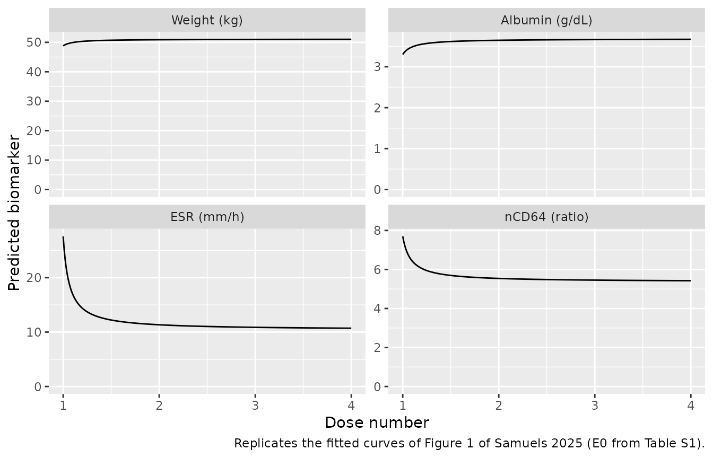
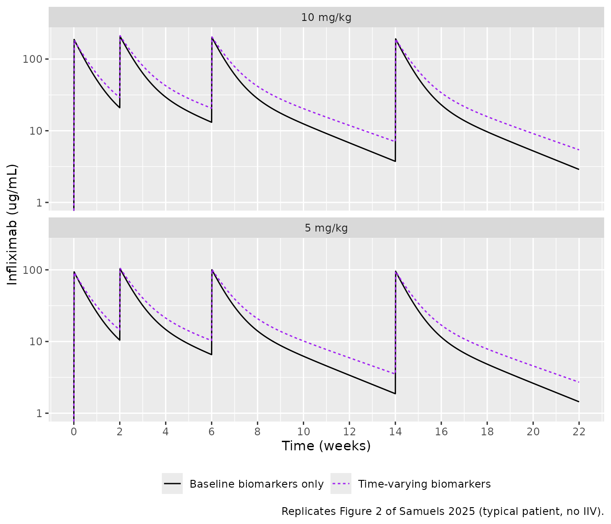
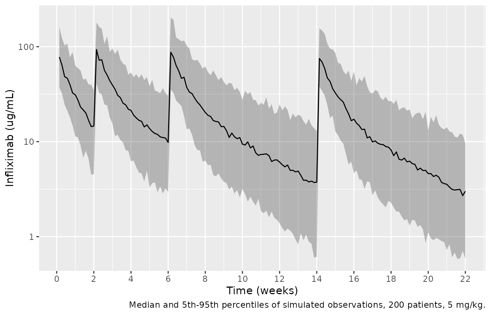

# Infliximab (Samuels 2025)

## Model and source

- Citation: Samuels A, Irie K, Mizuno T, Reifenberg J, Punt N, Vinks AA,
  Minar P. Integrating early response biomarkers in pharmacokinetic
  models: A novel method to individualize the initial infliximab dose in
  patients with Crohn’s disease. Clin Transl Sci. 2025;18(2):e70086.
  <doi:10.1111/cts.70086>. Structural model and parameter values from:
  Xiong Y, Mizuno T, Colman R, Hyams J, Noe JD, Boyle B, et
  al. Real-world infliximab pharmacokinetic study informs an electronic
  health record-embedded dashboard to guide precision dosing in children
  with Crohn’s disease. Clin Pharmacol Ther. 2021;109(6):1639-1647.
  <doi:10.1002/cpt.2148>.
- Description: Two-compartment population PK model of intravenous
  infliximab in children and young adults with Crohn’s disease, extended
  with dose-number-driven trajectories of the four clearance biomarkers
  to forecast exposure during induction and early maintenance (Samuels
  2025). The structural model, covariate exponents and variability are
  the Xiong 2021 real-world paediatric model (REFINE cohort), all held
  at the Xiong estimates: clearance scales with body weight, serum
  albumin, erythrocyte sedimentation rate (ESR), neutrophil CD64
  activity ratio and antibody-to-infliximab concentration; V1 with
  weight; Q and V2 with weight at exponents 1 and 0.586. Samuels 2025
  adds an Emax-in-dose-number function that predicts each biomarker from
  its pre-treatment value as baseline \* exp(Emax \* (n - 1) / (D50 -
  1 + n - 1)) at infusion n, with D50 held at 1.1 and Emax estimated for
  weight (+0.046), albumin (+0.110), ESR (-0.978) and nCD64 (-0.362), so
  that the model anticipates the improvement in clearance biomarkers
  that accompanies a response to induction. Holding the infusion counter
  at 1 throughout reproduces the baseline-covariates-only Xiong
  prediction. Inter-individual variability on clearance only; residual
  error additive on log-transformed concentrations.
- Article: <https://doi.org/10.1111/cts.70086> (open access; Data S1
  holds Table S1 and the NONMEM code used for the predictions)
- Structural model: Xiong 2021, <https://doi.org/10.1002/cpt.2148>

``` r

mod <- rxode2::rxode(readModelDb("Samuels_2025_infliximab"))
#> ℹ parameter labels from comments will be replaced by 'label()'
```

Samuels 2025 asks a dosing question. Infliximab clearance in children
with Crohn’s disease depends on body weight, serum albumin, the
erythrocyte sedimentation rate (ESR) and the neutrophil CD64 activity
ratio (nCD64), and those biomarkers improve as the patient responds to
induction. A dose chosen from pre-treatment values therefore
over-predicts clearance for the rest of induction. The paper fits a
log-scale Emax function of the infusion number to each biomarker and
plugs the predicted values into the Xiong 2021 population PK model,
whose parameters it holds at the published estimates.

## Population

The biomarker trajectories were estimated on 239 children and young
adults with Crohn’s disease starting infliximab in two US cohorts
(Samuels 2025 Table 1). REFINE (n = 78) was a prospective multicentre
observational study at four centres from 2014 to 2019. APPDASH (n = 161)
was a retrospective cohort at Cincinnati Children’s Hospital Medical
Center from 2019 to 2021. Mean age at the first infusion was 13.6 (SD
3.7) years and 92.1% were under 18; 40.6% were female and 86.6% White.
The mean starting dose was 7.7 (SD 2.3) mg/kg, higher in APPDASH (8.2)
than in REFINE (6.5). Mean biomarkers at the first infusion were: weight
48.3 kg, albumin 3.3 g/dL, ESR 26 mm/h and nCD64 7.2.

The PK parameters themselves are not re-estimated here. They come from
Xiong 2021, which fitted 671 peak and trough concentrations from the 78
REFINE patients.

``` r

str(readModelDb("Samuels_2025_infliximab")()$population)
#> List of 12
#>  $ species       : chr "human"
#>  $ n_subjects    : int 239
#>  $ n_studies     : int 2
#>  $ age_range     : chr "2-22 years (APPDASH inclusion criterion; REFINE enrolled children and young adults under 22)"
#>  $ age_mean      : chr "13.6 (SD 3.7) years at the first infusion; 92.1% under 18 years"
#>  $ weight_mean   : chr "48.3 (SD 20.5) kg at the first infusion"
#>  $ sex_female_pct: num 40.6
#>  $ race_ethnicity: chr "86.6% White"
#>  $ disease_state : chr "Crohn's disease starting infliximab (anti-TNF naive in REFINE); Paris location L1:L2:L3 = 31:46:162, behaviour "| __truncated__
#>  $ dose_range    : chr "intravenous infliximab, mean starting dose 7.7 (SD 2.3) mg/kg (REFINE 6.5, APPDASH 8.2 mg/kg); induction at wee"| __truncated__
#>  $ regions       : chr "United States (Cincinnati Children's Hospital Medical Center, Nationwide Children's Hospital, Medical College o"| __truncated__
#>  $ notes         : chr "Two cohorts: REFINE (prospective multicentre, n = 78, 2014-2019) and APPDASH (retrospective single-centre, n = "| __truncated__
```

## Source trace

Every value in `ini()` carries an in-file comment naming its source. In
summary:

| Element | Value | Source |
|----|----|----|
| CL (65 kg, ALB 3.5 g/dL, ESR 9 mm/h, nCD64 4.6) | 0.0138 L/h | Data S1 THETA(1); Xiong 2021 Table 2 |
| V1 (65 kg) | 2.97 L | Data S1 THETA(2); Xiong 2021 Table 2 |
| Q (65 kg) | 0.00953 L/h | Data S1 THETA(3); Xiong 2021 Table 2 (0.0095) |
| V2 (65 kg) | 2.84 L | Data S1 THETA(4); Xiong 2021 Table 2 |
| Albumin exponent on CL | -1.07 | Data S1 THETA(5); Xiong 2021 Table 2 |
| ATI exponent on CL (above 22 ng/mL) | 0.134 | Data S1 THETA(6) and `IF(ATI.LE.22)` branch; Xiong 2021 Table 2 |
| nCD64 exponent on CL | 0.168 | Data S1 THETA(7); Xiong 2021 Table 2 |
| ESR exponent on CL | 0.101 | Data S1 THETA(8); Xiong 2021 Table 2 |
| Weight exponent on CL | 0.594 | Data S1 THETA(9) ‘CLWT1’; Xiong 2021 Table 2 (see Assumptions) |
| Weight exponent on V1 | 0.55 | Data S1 THETA(10) ‘V1WT1’; Xiong 2021 Table 2 |
| Weight exponents on Q and V2 | 1 and 0.586 | Data S1 `$PK` code; Xiong 2021 Table 2 |
| Emax, weight | 0.046 | Table S1; Data S1 E2; Results; Figure 1a |
| Emax, albumin | 0.110 | Table S1; Data S1 E1; Results; Figure 1b |
| Emax, ESR | -0.978 | Table S1; Data S1 E3; Results; Figure 1c |
| Emax, nCD64 | -0.362 | Table S1; Data S1 E4; Results; Figure 1d |
| D50 | 1.1 (held) | Methods; Data S1 constant 0.1 = D50 - 1 |
| IIV on CL | 0.0629 | Data S1 OMEGA(1,1); Xiong 2021 Table 2 (25.1% CV) |
| IIV on V1, Q, V2 | 0 (omitted) | Data S1 OMEGA(2)-(4) |
| Residual SD, log scale | sqrt(0.189) = 0.4347 | Data S1 `$SIGMA`; Xiong 2021 Table 2 (0.435) |
| Trajectory equation | biomarker = E0 \* exp(Emax \* (n - 1) / (D50 - 1 + n - 1)) | Methods equation; Data S1 E1-E4 |
| CL equation | power product of the predicted biomarkers and thresholded ATI | Data S1 `$PK`; Xiong 2021 Table 2 footnote |
| Residual model | Y = log(F) + EPS | Data S1 `$ERROR` |

## Biomarker trajectories (Figure 1)

The Emax function predicts each biomarker from its pre-treatment value
at infusion number `n`. Because the D50 of 1.1 sits just above the first
infusion, nearly the whole change, 1 / 1.1 = 91% of it, is in place by
the second infusion.

``` r

theta <- rxode2::rxode(readModelDb("Samuels_2025_infliximab"))$theta
#> ℹ parameter labels from comments will be replaced by 'label()'
e0 <- c(
  "Weight (kg)" = 48.8, "Albumin (g/dL)" = 3.3,
  "ESR (mm/h)" = 27.6, "nCD64 (ratio)" = 7.7
)
emax <- c(
  "Weight (kg)" = theta[["wt_dosenum_max"]],
  "Albumin (g/dL)" = theta[["alb_dosenum_max"]],
  "ESR (mm/h)" = theta[["erythrocyte_sedimentation_rate_dosenum_max"]],
  "nCD64 (ratio)" = theta[["neutrophil_cd64_ratio_dosenum_max"]]
)
d50 <- theta[["dosenum50"]]
traj <- expand.grid(n = seq(1, 4, by = 0.01), biomarker = names(e0)) |>
  mutate(
    value = e0[as.character(biomarker)] *
      exp(emax[as.character(biomarker)] * (n - 1) / (d50 - 1 + n - 1))
  )
ggplot(traj, aes(n, value)) +
  geom_line() +
  facet_wrap(~biomarker, scales = "free_y") +
  expand_limits(y = 0) +
  labs(
    x = "Dose number", y = "Predicted biomarker",
    caption = "Replicates the fitted curves of Figure 1 of Samuels 2025 (E0 from Table S1)."
  )
```



The Results quote each Emax as an asymptotic percentage change,
`exp(Emax) - 1`. Three of the four reproduce:

``` r

pct_chk <- data.frame(
  biomarker = names(emax),
  row.names = NULL,
  paper_pct = c(4.7, 11.7, -62.4, -26.5),
  model_pct = unname(round(100 * (exp(emax) - 1), 1))
)
knitr::kable(pct_chk |>
  dplyr::rename(
    Biomarker = biomarker,
    "Results / Figure 1 (%)" = paper_pct,
    "100 * (exp(Emax) - 1) (%)" = model_pct
  ))
```

| Biomarker      | Results / Figure 1 (%) | 100 \* (exp(Emax) - 1) (%) |
|:---------------|-----------------------:|---------------------------:|
| Weight (kg)    |                    4.7 |                        4.7 |
| Albumin (g/dL) |                   11.7 |                       11.6 |
| ESR (mm/h)     |                  -62.4 |                      -62.4 |
| nCD64 (ratio)  |                  -26.5 |                      -30.4 |

``` r

stopifnot(all(abs(pct_chk$model_pct[1:3] - pct_chk$paper_pct[1:3]) < 0.2))
```

The nCD64 Emax of -0.362 gives -30.4%, not the -26.5% printed in the
Results and in the Figure 1d title. The value -0.362 is printed in three
places (Table S1, the Data S1 code and the Figure 1d title), so it is
the one encoded. The -26.5% matches neither the estimate nor the
bootstrap median (-0.404), and is treated as a typographical error in
the percentage.

## Figure 2: a 47 kg patient on 5 or 10 mg/kg

Samuels 2025 Figure 2 simulates infusions at weeks 0, 2, 6 and 14 for a
47 kg patient, with and without the predicted biomarker improvement. The
paper does not state the other pre-treatment biomarkers used, so the
Table S1 E0 values (albumin 3.3 g/dL, ESR 27.6 mm/h, nCD64 7.7) are used
here, with no antibodies to infliximab.

### How the infusion counter is set

`CYCLE` is the 1-based infusion number, and the model forms the paper’s
zero-based `INFUSION = CYCLE - 1`. The Emax equation defines a biomarker
value at each infusion visit but not between visits. Figure 2 shows the
two curves separating before the second infusion. That is the NONMEM
convention in which a record’s covariates govern the interval that ends
at that record: the interval after infusion `k` takes the biomarker
values of visit `k + 1`. In rxode2, which carries covariates forward,
the same thing is done by giving every record after infusion `k` the
value `CYCLE = k + 1`. For the baseline-only prediction, `CYCLE` stays
at 1 throughout.

``` r

dose_wk <- c(0, 2, 6, 14)
dose_h <- dose_wk * 7 * 24
inf_dur <- 2 # h; the paper does not state the infusion duration
obs_h <- sort(unique(c(seq(0, 22 * 168, by = 6), dose_h + inf_dur)))

make_events <- function(id, mgkg, scenario, wt = 47, alb_gdl = 3.3,
                        esr = 27.6, ncd64 = 7.7, ada = 0) {
  amt <- mgkg * wt
  dose <- data.frame(
    id = id, time = dose_h, amt = amt, rate = amt / inf_dur,
    evid = 1L, cmt = "central"
  )
  obs <- data.frame(
    id = id, time = obs_h, amt = 0, rate = 0, evid = 0L, cmt = "central"
  )
  ev <- dplyr::bind_rows(dose, obs) |>
    dplyr::arrange(time, dplyr::desc(evid))
  # Closing-visit convention: after infusion k, CYCLE = k + 1.
  ev$CYCLE <- if (scenario == "Time-varying biomarkers") {
    findInterval(ev$time, dose_h) + 1L
  } else {
    1L
  }
  ev$WT <- wt
  ev$ALB <- alb_gdl * 10 # g/dL -> canonical g/L
  ev$ERYTHROCYTE_SEDIMENTATION_RATE <- esr
  ev$NEUTROPHIL_CD64_RATIO <- ncd64
  ev$CONC_ADA_NGML <- ada
  ev$treatment <- paste0(mgkg, " mg/kg")
  ev$scenario <- scenario
  ev
}

scen <- c("Time-varying biomarkers", "Baseline biomarkers only")
ev_fig2 <- dplyr::bind_rows(
  make_events(1, 5, scen[1]), make_events(2, 5, scen[2]),
  make_events(3, 10, scen[1]), make_events(4, 10, scen[2])
)
sim_fig2 <- rxode2::rxSolve(
  rxode2::zeroRe(mod), ev_fig2,
  keep = c("treatment", "scenario"), returnType = "data.frame"
)
#> ℹ omega/sigma items treated as zero: 'etalcl'
#> Warning: multi-subject simulation without without 'omega'
```

``` r

ggplot(sim_fig2, aes(time / 168, Cc, linetype = scenario, colour = scenario)) +
  geom_line() +
  scale_y_log10(limits = c(1, NA)) +
  scale_x_continuous(breaks = seq(0, 22, by = 2)) +
  facet_wrap(~treatment, ncol = 1) +
  scale_colour_manual(values = c("black", "purple")) +
  labs(
    x = "Time (weeks)", y = "Infliximab (ug/mL)", colour = NULL, linetype = NULL,
    caption = "Replicates Figure 2 of Samuels 2025 (typical patient, no IIV)."
  ) +
  theme(legend.position = "bottom")
#> Warning in scale_y_log10(limits = c(1, NA)): log-10 transformation introduced
#> infinite values.
```



Troughs read from Figure 2a (5 mg/kg) by the maintainers, against the
simulation:

``` r

trough_h <- c(2, 6, 14) * 168
fig2 <- data.frame(
  week = c(2, 6, 14),
  paper_tv = c(16.0, 12.8, 4.7),
  paper_base = c(12.8, 8.6, 2.6)
)
sim_tr <- sim_fig2 |>
  dplyr::filter(treatment == "5 mg/kg", time %in% trough_h) |>
  dplyr::mutate(week = time / 168) |>
  dplyr::select(week, scenario, Cc) |>
  tidyr::pivot_wider(names_from = scenario, values_from = Cc)
fig2_cmp <- fig2 |>
  dplyr::left_join(sim_tr, by = "week") |>
  dplyr::mutate(
    paper_ratio = paper_tv / paper_base,
    sim_ratio = `Time-varying biomarkers` / `Baseline biomarkers only`
  )
knitr::kable(
  fig2_cmp |>
    dplyr::rename(
      "Week (trough)" = week,
      "Figure 2a, time-varying" = paper_tv,
      "Figure 2a, baseline only" = paper_base,
      "Model, time-varying" = `Time-varying biomarkers`,
      "Model, baseline only" = `Baseline biomarkers only`,
      "Figure 2a ratio" = paper_ratio,
      "Model ratio" = sim_ratio
    ),
  digits = 2
)
```

| Week (trough) | Figure 2a, time-varying | Figure 2a, baseline only | Model, time-varying | Model, baseline only | Figure 2a ratio | Model ratio |
|---:|---:|---:|---:|---:|---:|---:|
| 2 | 16.0 | 12.8 | 14.52 | 10.46 | 1.25 | 1.39 |
| 6 | 12.8 | 8.6 | 10.30 | 6.56 | 1.49 | 1.57 |
| 14 | 4.7 | 2.6 | 3.52 | 1.87 | 1.81 | 1.88 |

The ratio of the two predictions is the quantity the paper is about. It
depends on the Emax trajectories and the covariate exponents, not on the
dose or on the unreported baseline biomarkers, and the model reproduces
it closely. The week-2 ratio is the one most sensitive to how the
counter is stepped within the first interval, which the paper does not
describe.

``` r

stopifnot(all(abs(log(fig2_cmp$sim_ratio[2:3] / fig2_cmp$paper_ratio[2:3])) < log(1.1)))
```

Both absolute curves sit 10-30% below the figure. With linear PK and a
ratio that agrees, the gap points to lower clearance in the paper’s
typical patient, most likely from pre-treatment ESR and nCD64 values
below the Table S1 means (for example cohort medians, which the paper
does not report). Setting every biomarker to its reference value instead
puts the baseline-only troughs above the figure (15.0, 10.7 and 3.7
ug/mL), so the figure’s patient lies between the two.

## Virtual cohort and Table 3

Table 3 of Samuels 2025 compares observed troughs with population
predictions from the baseline biomarkers (scenario a) and from the
predicted trajectories (scenario b). The virtual cohort below draws
pre-treatment biomarkers and starting doses from the Table 1 means and
SDs. The doses and sampling of the real patients are not available, so
the absolute medians are approximate. The ratio of scenario b to
scenario a is the comparison that carries over.

``` r

set.seed(20250222)
n_sub <- 200
lnorm_draw <- function(n, m, s) {
  sdlog <- sqrt(log(1 + (s / m)^2))
  rlnorm(n, log(m) - sdlog^2 / 2, sdlog)
}
cohort <- data.frame(
  id = seq_len(n_sub),
  wt = pmin(pmax(lnorm_draw(n_sub, 48.3, 20.5), 15), 120),
  alb = pmin(pmax(rnorm(n_sub, 3.3, 0.61), 1.5), 5),
  esr = pmax(lnorm_draw(n_sub, 26, 24), 1),
  ncd64 = pmax(lnorm_draw(n_sub, 7.2, 4.6), 1),
  mgkg = round(pmin(pmax(rnorm(n_sub, 7.7, 2.3), 5), 10))
)

trough_events <- function(row, scenario, id) {
  amt <- row$mgkg * row$wt
  dose <- data.frame(
    id = id, time = dose_h, amt = amt, rate = amt / inf_dur,
    evid = 1L, cmt = "central"
  )
  obs <- data.frame(
    id = id, time = trough_h - 0.01, amt = 0, rate = 0,
    evid = 0L, cmt = "central"
  )
  ev <- dplyr::bind_rows(dose, obs) |>
    dplyr::arrange(time, dplyr::desc(evid))
  ev$CYCLE <- if (scenario == "b") findInterval(ev$time, dose_h) + 1L else 1L
  ev$WT <- row$wt
  ev$ALB <- row$alb * 10
  ev$ERYTHROCYTE_SEDIMENTATION_RATE <- row$esr
  ev$NEUTROPHIL_CD64_RATIO <- row$ncd64
  ev$CONC_ADA_NGML <- 0
  ev$scenario <- scenario
  ev
}
ev_cohort <- dplyr::bind_rows(lapply(seq_len(n_sub), function(i) {
  dplyr::bind_rows(
    trough_events(cohort[i, ], "a", i),
    trough_events(cohort[i, ], "b", n_sub + i)
  )
}))
sim_cohort <- rxode2::rxSolve(
  rxode2::zeroRe(mod), ev_cohort,
  keep = "scenario", returnType = "data.frame"
) |>
  dplyr::mutate(dose = c(2, 3, 4)[match(round(time), round(trough_h - 0.01))])
#> ℹ omega/sigma items treated as zero: 'etalcl'
#> Warning: multi-subject simulation without without 'omega'

tab3 <- data.frame(
  dose = c(2, 3, 4),
  observed = c(22, 19, 7.1),
  paper_a = c(12.8, 10.7, 4.9),
  paper_b = c(17.7, 16.9, 8.5)
)
sim_tab3 <- sim_cohort |>
  dplyr::group_by(dose, scenario) |>
  dplyr::summarise(median_cc = median(Cc), .groups = "drop") |>
  tidyr::pivot_wider(names_from = scenario, values_from = median_cc, names_prefix = "sim_")
sub_ratio <- sim_cohort |>
  dplyr::mutate(subj = ifelse(scenario == "b", id - n_sub, id)) |>
  dplyr::select(subj, dose, scenario, Cc) |>
  tidyr::pivot_wider(names_from = scenario, values_from = Cc) |>
  dplyr::group_by(dose) |>
  dplyr::summarise(sim_ratio = median(b / a))
tab3_cmp <- tab3 |>
  dplyr::left_join(sim_tab3, by = "dose") |>
  dplyr::left_join(sub_ratio, by = "dose") |>
  dplyr::mutate(paper_ratio = paper_b / paper_a)
knitr::kable(
  tab3_cmp |>
    dplyr::rename(
      "Trough before dose" = dose,
      "Observed median" = observed,
      "Table 3, scenario a" = paper_a,
      "Table 3, scenario b" = paper_b,
      "Model median, a" = sim_a,
      "Model median, b" = sim_b,
      "Model median ratio b/a" = sim_ratio,
      "Table 3 ratio b/a" = paper_ratio
    ),
  digits = 2,
  caption = "Median trough concentrations (ug/mL), Samuels 2025 Table 3 against the virtual cohort."
)
```

| Trough before dose | Observed median | Table 3, scenario a | Table 3, scenario b | Model median, a | Model median, b | Model median ratio b/a | Table 3 ratio b/a |
|---:|---:|---:|---:|---:|---:|---:|---:|
| 2 | 22.0 | 12.8 | 17.7 | 16.34 | 22.20 | 1.37 | 1.38 |
| 3 | 19.0 | 10.7 | 16.9 | 10.05 | 15.84 | 1.56 | 1.58 |
| 4 | 7.1 | 4.9 | 8.5 | 3.03 | 5.63 | 1.85 | 1.73 |

Median trough concentrations (ug/mL), Samuels 2025 Table 3 against the
virtual cohort. {.table}

The model’s ratio of scenario b to scenario a reproduces Table 3 closely
before the second and third infusions (1.38 and 1.58 in the paper) and
is about 7% higher before the fourth (1.73 in the paper). That
comparison sets the median of per-patient ratios here against a ratio of
medians over different patient subsets in the paper, so agreement within
10-15% is what can be expected. The absolute medians differ more,
because the virtual cohort’s doses and covariates are drawn from Table 1
summaries rather than from the patients who contributed each trough.

``` r

stopifnot(
  # Size of the paper's central effect at each of the three troughs.
  all(abs(log(tab3_cmp$sim_ratio / tab3_cmp$paper_ratio)) < log(1.15))
)
```

## Stochastic simulation

With the IIV on clearance and the log-scale residual error, 200 virtual
patients on 5 mg/kg with the time-varying biomarkers:

``` r

rxode2::rxSetSeed(20250222)
ev_vpc <- dplyr::bind_rows(lapply(seq_len(n_sub), function(i) {
  ev <- make_events(i, 5, scen[1],
    wt = cohort$wt[i], alb_gdl = cohort$alb[i],
    esr = cohort$esr[i], ncd64 = cohort$ncd64[i]
  )
  ev[ev$evid == 1L | (ev$time %% 24 == 0 & ev$time >= 24), ]
}))
sim_vpc <- rxode2::rxSolve(mod, ev_vpc, returnType = "data.frame")
vpc_sum <- sim_vpc |>
  dplyr::group_by(time) |>
  dplyr::summarise(
    p05 = quantile(sim, 0.05), p50 = quantile(sim, 0.5), p95 = quantile(sim, 0.95)
  )
ggplot(vpc_sum, aes(time / 168)) +
  geom_ribbon(aes(ymin = p05, ymax = p95), alpha = 0.3) +
  geom_line(aes(y = p50)) +
  scale_y_log10() +
  scale_x_continuous(breaks = seq(0, 22, by = 2)) +
  labs(
    x = "Time (weeks)", y = "Infliximab (ug/mL)",
    caption = "Median and 5th-95th percentiles of simulated observations, 200 patients, 5 mg/kg."
  )
```



## PKNCA

Non-compartmental analysis per dosing interval of the Figure 2
typical-patient simulations. Intervals 2 to 4 close on the week 6, 14
and 22 troughs.

``` r

conc <- sim_fig2 |>
  dplyr::filter(!is.na(Cc)) |>
  dplyr::mutate(id = paste(treatment, scenario)) |>
  dplyr::select(id, time, Cc, treatment, scenario)
doses <- ev_fig2 |>
  dplyr::filter(evid == 1L) |>
  dplyr::mutate(id = paste(treatment, scenario)) |>
  dplyr::select(id, time, amt, treatment, scenario)
o_conc <- PKNCA::PKNCAconc(conc, Cc ~ time | treatment + scenario + id)
o_dose <- PKNCA::PKNCAdose(doses, amt ~ time | treatment + scenario + id)
intervals <- data.frame(
  start = dose_h,
  end = c(dose_h[-1], 22 * 168),
  cmax = TRUE, auclast = TRUE, cmin = c(FALSE, TRUE, TRUE, TRUE)
)
nca <- PKNCA::pk.nca(PKNCA::PKNCAdata(o_conc, o_dose, intervals = intervals))
nca_tbl <- as.data.frame(nca$result) |>
  dplyr::filter(PPTESTCD %in% c("cmax", "cmin", "auclast")) |>
  dplyr::mutate(interval = paste0("week ", start / 168, "-", end / 168)) |>
  dplyr::select(treatment, scenario, interval, PPTESTCD, PPORRES) |>
  tidyr::pivot_wider(names_from = PPTESTCD, values_from = PPORRES)
knitr::kable(
  nca_tbl |>
    dplyr::rename(
      Dose = treatment, Scenario = scenario, Interval = interval,
      "Cmax (ug/mL)" = cmax, "AUClast (ug*h/mL)" = auclast,
      "Cmin (ug/mL)" = cmin
    ),
  digits = 1
)
```

| Dose | Scenario | Interval | AUClast (ug\*h/mL) | Cmax (ug/mL) | Cmin (ug/mL) |
|:---|:---|:---|---:|---:|---:|
| 10 mg/kg | Baseline biomarkers only | week 0-2 | 22641.3 | 187.5 | NA |
| 10 mg/kg | Baseline biomarkers only | week 2-6 | 33536.7 | 208.3 | 13.1 |
| 10 mg/kg | Baseline biomarkers only | week 6-14 | 36964.1 | 200.6 | 3.7 |
| 10 mg/kg | Baseline biomarkers only | week 14-22 | 32236.6 | 191.2 | 2.9 |
| 10 mg/kg | Time-varying biomarkers | week 0-2 | 25456.9 | 183.5 | NA |
| 10 mg/kg | Time-varying biomarkers | week 2-6 | 41798.8 | 212.1 | 20.6 |
| 10 mg/kg | Time-varying biomarkers | week 6-14 | 48988.5 | 203.8 | 7.0 |
| 10 mg/kg | Time-varying biomarkers | week 14-22 | 41575.3 | 190.2 | 5.4 |
| 5 mg/kg | Baseline biomarkers only | week 0-2 | 11320.6 | 93.8 | NA |
| 5 mg/kg | Baseline biomarkers only | week 2-6 | 16768.3 | 104.1 | 6.6 |
| 5 mg/kg | Baseline biomarkers only | week 6-14 | 18482.1 | 100.3 | 1.9 |
| 5 mg/kg | Baseline biomarkers only | week 14-22 | 16118.3 | 95.6 | 1.4 |
| 5 mg/kg | Time-varying biomarkers | week 0-2 | 12728.5 | 91.7 | NA |
| 5 mg/kg | Time-varying biomarkers | week 2-6 | 20899.4 | 106.1 | 10.3 |
| 5 mg/kg | Time-varying biomarkers | week 6-14 | 24494.2 | 101.9 | 3.5 |
| 5 mg/kg | Time-varying biomarkers | week 14-22 | 20787.6 | 95.1 | 2.7 |

Samuels 2025 reports no NCA parameters, so the comparison against the
paper is the Figure 2 and Table 3 trough comparison above. Two
properties of the model are checked here. Because the PK is linear, the
10 mg/kg exposures are exactly twice the 5 mg/kg ones. And the
first-interval Cmax is the same in both scenarios to within the small
change in V1 that the predicted weight gain causes.

``` r

auc_ratio <- nca_tbl |>
  dplyr::select(treatment, scenario, interval, auclast) |>
  tidyr::pivot_wider(names_from = treatment, values_from = auclast) |>
  dplyr::mutate(r = `10 mg/kg` / `5 mg/kg`)
cmax1 <- nca_tbl |>
  dplyr::filter(interval == "week 0-2", treatment == "5 mg/kg")
stopifnot(
  all(abs(auc_ratio$r - 2) < 1e-3),
  abs(cmax1$cmax[1] / cmax1$cmax[2] - 1) < 0.05
)
```

## Assumptions and deviations

- **Weight exponent on CL.** The Data S1 code has a typo in its THETA
  indices. Its non-missing-weight branch is
  `CLWT=((WT*E2)/65)**THETA(10)`, which would use the V1 weight exponent
  (0.55) on clearance. Its missing-weight branch for V1 cites
  `THETA(11)`, which the `$THETA` block (ten entries) does not define.
  The `$THETA` labels (THETA(9) ‘CLWT1’ = 0.594, THETA(10) ‘V1WT1’ =
  0.55), the missing-weight branch for CL (`E2**THETA(9)`) and the Xiong
  2021 final model (‘Weight for CL’ 0.594, ‘Weight for V1’ 0.55) all
  agree. The model therefore uses 0.594 on CL and 0.55 on V1. The
  difference is small: at 47 kg the CL weight factor is 0.825 with 0.594
  and 0.837 with 0.55.
- **Missing covariates.** The Data S1 code handles a missing biomarker
  (`-99`) by applying only the trajectory factor, for example
  `E1**THETA(5)`. That equals the full expression evaluated at the
  reference value, so a missing value should be imputed with the
  reference (65 kg, 3.5 g/dL, 9 mm/h, 4.6) rather than handled in the
  model.
- **Baseline weight on Q and V2.** As in the Data S1 code, the predicted
  weight scales CL and V1, while Q and V2 are scaled by the
  pre-treatment weight.
- **Infusion counter between visits.** The paper defines the
  trajectories at infusion visits only. The vignette applies the visit
  `k + 1` values over the interval after infusion `k`, which reproduces
  the shape of Figure 2 (see above). A user who prefers to apply visit
  `k` values until the next infusion can set `CYCLE` to the infusion
  number of the most recent infusion.
- **IIV on V1, Q and V2.** The Data S1 `$OMEGA` holds these at 0, and
  Xiong 2021 estimated IIV on CL only, so the model carries no eta for
  them.
- **Trajectory parameters.** The four Emax values were estimated by the
  authors on the biomarker data (Table S1), not on concentrations, and
  D50 was held at 1.1 because it could not be estimated. A refit of this
  model to PK data should hold the Emax values as well.
- **Antibodies to infliximab.** The ATI effect is part of the Xiong 2021
  model and of the Data S1 code. Samuels 2025 did not give it a
  trajectory, because antibodies were rare in its cohorts. All
  simulations here assume no antibodies.
- **Figure 2 inputs.** The infusion duration (2 h here) and the
  pre-treatment albumin, ESR and nCD64 of the Figure 2 patient are not
  reported. The Table S1 E0 values were used.
- **nCD64 percentage.** The Results and Figure 1d print -26.5% for the
  nCD64 Emax of -0.362, which is -30.4%. The estimate is used as
  printed.
