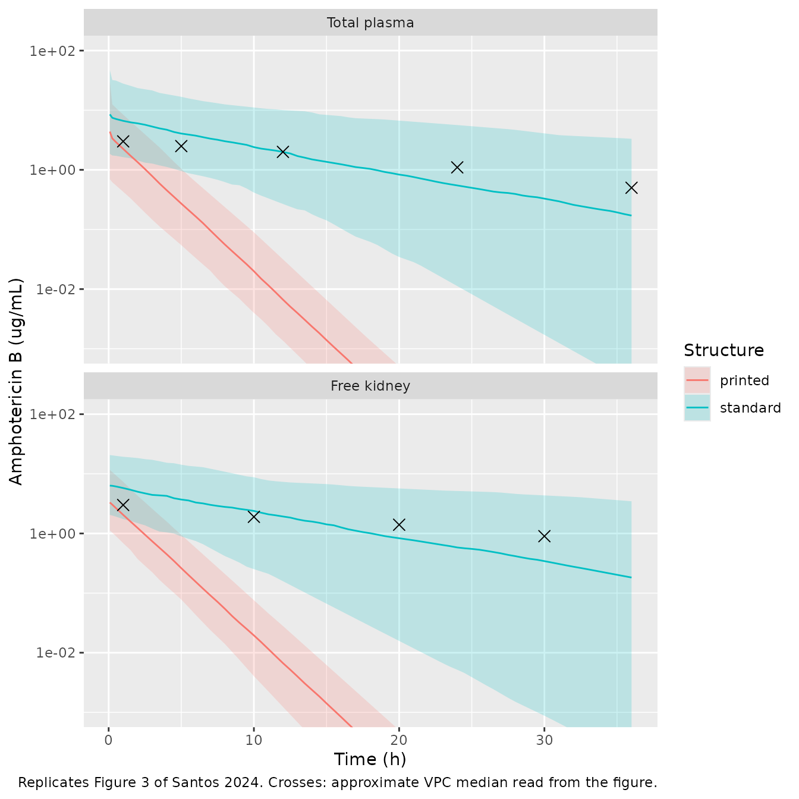

# Amphotericin B in rats (Santos 2024)

## Model and source

``` r

ui <- rxode2::rxode(readModelDb("Santos_2024_amphotericinB_rat"))
#> ℹ parameter labels from comments will be replaced by 'label()'
```

- Citation: Santos VV, Pereira LC, de Araujo JMS, Borges MAH, Brandao
  CM, Santos LO, Villarreal CF, Azeredo FJ. Amphotericin B tissue
  penetration and pharmacokinetics in healthy and Candida
  albicans-infected rats: insights from microdialysis and population
  modeling. Front Pharmacol. 2024;15:1515462.
  <doi:10.3389/fphar.2024.1515462>
- Description: Preclinical (rat). Two-compartment population PK model
  for intravenous amphotericin B deoxycholate in healthy and Candida
  albicans-infected Wistar rats, fitted jointly to total plasma and
  microdialysis free kidney concentrations, with the peripheral
  compartment representing the kidney. The ODEs are the paper’s printed
  Equations 5-6, which carry a 0.56 factor on the kidney inflow only;
  with the published estimates this structure does not conserve mass and
  does not reproduce the paper’s figures or NCA AUCs (see the vignette)
  (Santos 2024)
- Article: <https://doi.org/10.3389/fphar.2024.1515462>

Santos 2024 measured total plasma and free (microdialysis) kidney-cortex
concentrations of amphotericin B after a single 2.5 mg/kg intravenous
bolus of amphotericin B deoxycholate in healthy and *Candida
albicans*-infected Wistar rats, and fitted both matrices simultaneously
in Monolix 2024R1. The final model is two-compartment with linear
elimination from the central (plasma) compartment; the peripheral
compartment represents the kidney.

**Read the “Structure as printed” section before using this model.** The
packaged ODEs are the paper’s Equations 5-6 exactly as printed. With the
published parameter estimates that structure does not reproduce the
paper’s own figures or non-compartmental AUCs; a standard
two-compartment structure without the printed 0.56 factor reproduces the
AUCs and comes much closer to the figures. Both are simulated below.

## Population

Twelve male Wistar rats weighing 250-350 g contributed to the population
analysis: six healthy and six infected two days before the experiment by
an intravenous injection of 0.1 mL of 2.5 x 10^6 CFU/mL *C. albicans*
ATCC 10231 (Santos 2024 Methods 2.2 and 2.5). The rats were
anaesthetised with urethane and the kidney exposed so that a CMA/20
microdialysis probe could be inserted into the cortex. Each rat received
2.5 mg/kg of amphotericin B deoxycholate (Anforicin B) as an intravenous
bolus. Plasma was sampled at 0.083, 0.25, 0.5, 1, 1.5, 2, 4, 8, 12, 24
and 36 h; microdialysate was collected in 1-h intervals over 20 h and
corrected by the in vivo retrodialysis recovery (10.9% +/- 3.7%). The
data set held 266 observations (116 plasma, 150 kidney). Infection was
tested as a covariate and was not retained.

The same information is available programmatically via
`readModelDb("Santos_2024_amphotericinB_rat")()$population`.

## Source trace

| Equation / parameter | Value | Source location |
|----|----|----|
| `d/dt(central)` | `k21*A2 - k12*A1 - k10*A1` | Results, Eq. 5 |
| `d/dt(peripheral1)` | `0.56*k12*A1 - k21*A2` | Results, Eq. 6 |
| `Cc = central / vc` | total plasma | Results, Eq. 7 |
| `Ckidney = peripheral1 / vp` | free kidney | Results, Eq. 8 |
| IIV form | `P_i = P_pop * exp(eta)` | Methods 2.5, Eq. 4 |
| `lvc` (V1) | 3.3 mL/kg | Table 1 |
| `lvp` (V2) | 328.58 mL/kg | Table 1 |
| `lkel` (k10) | 8.53 1/h | Table 1 |
| `lk12` (k12) | 91.58 1/h | Table 1 |
| `lk21` (k21) | 1.07 1/h | Table 1 |
| `etalvc` | 0.87^2 = 0.7569 | Table 1, omega V1 (CV 106.18%) |
| `etalvp` | 0.67^2 = 0.4489 | Table 1, omega V2 (CV 74.71%) |
| `etalkel` | 0.54^2 = 0.2916 | Table 1, omega k10 (CV 58.74%) |
| `etalk12` | 0.57^2 = 0.3249 | Table 1, omega k12 (CV 62.34%) |
| `propSd` | 0.76 | Table 1, proportional error, plasma |
| `propSd_Ckidney` | 0.65 | Table 1, proportional error, kidney |

## Structure as printed

Equation 6 multiplies only the kidney’s gain from plasma by 0.56, while
Equation 5 removes the full `k12 * A1` from plasma:

    dA1/dt = A2*k21 - A1*k12 - A1*k10          (Eq. 5)
    dA2/dt = 0.56*A1*k12 - A2*k21              (Eq. 6)

The system therefore does not conserve mass: `0.44 * k12 = 40.3 1/h` of
the plasma-to-kidney flux leaves the system, a second elimination route
almost five times faster than `k10`. The paper does not explain the
factor. The Figure 2 caption says the kidney compartment is where
“unbound drug concentrations (fu) are of interest”, and the only 0.56
elsewhere in the paper is the measured plasma protein binding at 2 ug/mL
(56.4%), i.e. the *bound* fraction rather than the unbound fraction.

The model is packaged as printed. For comparison, the standard
two-compartment structure (no 0.56 factor) is built here by model
piping:

``` r

ui_std <- ui |>
  rxode2::model(d/dt(peripheral1) <- k12 * central - k21 * peripheral1)
```

### Closed-form AUC check

For a linear system after a bolus `D` into the central compartment,
integrating Equations 5-6 from 0 to infinity gives the central amount
integral `D / (k10 + (1 - f) * k12)` and kidney amount integral
`f * k12 / k21` times that, with `f = 0.56` as printed and `f = 1` for
the standard structure. The typical-value simulation is checked against
those expressions.

``` r

dose <- 2500 # 2.5 mg/kg in ug/kg
p <- c(vc = 3.3, vp = 328.58, kel = 8.53, k12 = 91.58, k21 = 1.07)
closed_form <- function(f) {
  a1 <- dose / (p[["kel"]] + (1 - f) * p[["k12"]])
  c(
    plasma = a1 / p[["vc"]],
    kidney = f * p[["k12"]] / p[["k21"]] * a1 / p[["vp"]]
  )
}
cf <- rbind(printed = closed_form(0.56), standard = closed_form(1))

# The initial distribution phase has a rate constant near 100 1/h, so the
# early grid must be fine for the trapezoid to resolve it.
tgrid <- sort(unique(c(seq(0, 0.2, by = 0.0005), seq(0.2, 2, by = 0.005), seq(2, 200, by = 0.1))))
ev_typ <- rbind(
  data.frame(id = 1L, time = 0, amt = dose, evid = 1L, cmt = "central", dvid = NA_integer_),
  data.frame(id = 1L, time = tgrid, amt = 0, evid = 0L, cmt = "central", dvid = 1L)
)
typ <- dplyr::bind_rows(
  printed = rxode2::rxSolve(rxode2::zeroRe(ui), ev_typ, returnType = "data.frame", useLinCmt = FALSE),
  standard = rxode2::rxSolve(rxode2::zeroRe(ui_std), ev_typ, returnType = "data.frame", useLinCmt = FALSE),
  .id = "structure"
)
#> ℹ omega/sigma items treated as zero: 'etalvc', 'etalvp', 'etalkel', 'etalk12'
#> ℹ omega/sigma items treated as zero: 'etalvc', 'etalvp', 'etalkel', 'etalk12'
trap <- function(x, y) sum(diff(x) * (head(y, -1) + tail(y, -1)) / 2)
num <- typ |>
  dplyr::group_by(structure) |>
  dplyr::summarise(plasma = trap(time, Cc), kidney = trap(time, Ckidney))
cf_tab <- data.frame(
  structure = rownames(cf),
  closed_plasma = cf[, "plasma"], numeric_plasma = num$plasma[match(rownames(cf), num$structure)],
  closed_kidney = cf[, "kidney"], numeric_kidney = num$kidney[match(rownames(cf), num$structure)]
)
cf_tab |>
  dplyr::rename(
    "Structure" = structure,
    "Plasma AUC, closed form" = closed_plasma, "Plasma AUC, ODE" = numeric_plasma,
    "Kidney AUC, closed form" = closed_kidney, "Kidney AUC, ODE" = numeric_kidney
  ) |>
  knitr::kable(digits = 2, row.names = FALSE, caption = "Typical-value AUC0-inf (ug*h/mL).")
```

| Structure | Plasma AUC, closed form | Plasma AUC, ODE | Kidney AUC, closed form | Kidney AUC, ODE |
|:---|---:|---:|---:|---:|
| printed | 15.52 | 15.52 | 7.47 | 7.47 |
| standard | 88.81 | 88.82 | 76.34 | 76.34 |

Typical-value AUC0-inf (ug\*h/mL). {.table}

``` r

# Same parameters on both sides, so the residual is the fine-grid trapezoid error only.
stopifnot(
  all(abs(cf_tab$numeric_plasma / cf_tab$closed_plasma - 1) < 0.01),
  all(abs(cf_tab$numeric_kidney / cf_tab$closed_kidney - 1) < 0.01)
)
```

As printed, the typical rat has a plasma AUC0-inf of 15.5 ug*h/mL and a
kidney AUC0-inf of 7.5 ug*h/mL, against the paper’s mean
non-compartmental values of 96.3 and 74.1 ug*h/mL in healthy rats and
59.8 and 42.3 ug*h/mL in infected rats (Results). The standard structure
gives 88.8 and 76.3 ug\*h/mL.

## Virtual cohort and simulation

The paper’s design is reproduced with 200 virtual rats per structure
(the model carries no covariates, so healthy and infected rats are
simulated alike). Plasma is observed at the paper’s sampling times; the
kidney at the hourly microdialysis collection times out to 20 h.

``` r

n_sub <- 200
t_plasma <- c(0, 0.083, 0.25, 0.5, 1, 1.5, 2, 4, 8, 12, 24, 36)
t_kidney <- c(0, 1:20)
t_obs <- sort(unique(c(t_plasma, t_kidney, seq(0, 36, by = 0.5))))
ev <- rbind(
  data.frame(id = seq_len(n_sub), time = 0, amt = dose, evid = 1L, cmt = "central", dvid = NA_integer_),
  data.frame(
    id = rep(seq_len(n_sub), each = length(t_obs)), time = rep(t_obs, n_sub),
    amt = 0, evid = 0L, cmt = "central", dvid = 1L
  )
) |>
  dplyr::arrange(id, time, dplyr::desc(evid))

rxode2::rxSetSeed(20241)
sim <- dplyr::bind_rows(
  printed = rxode2::rxSolve(ui, ev, returnType = "data.frame", useLinCmt = FALSE),
  standard = rxode2::rxSolve(ui_std, ev, returnType = "data.frame", useLinCmt = FALSE),
  .id = "structure"
)
```

## Replicate Figure 3 (VPC)

Figure 3 of Santos 2024 is a Monolix VPC. The points below are the
approximate centre of its simulated-median band, read by eye from the
figure by the maintainers; they are a visual guide, not digitised data.
The simulated percentiles here are individual predictions without
residual error, so the 5th-95th percentile band is narrower than the
VPC’s (which includes the proportional residual error of 0.76 and 0.65);
the median is comparable.

``` r

vpc_ref <- dplyr::bind_rows(
  data.frame(matrix = "Total plasma", time = c(1, 5, 12, 24, 36), conc = c(3, 2.5, 2, 1.1, 0.5)),
  data.frame(matrix = "Free kidney", time = c(1, 10, 20, 30), conc = c(3, 1.9, 1.4, 0.9))
)
pct <- sim |>
  dplyr::select(structure, id, time, `Total plasma` = Cc, `Free kidney` = Ckidney) |>
  tidyr::pivot_longer(c(`Total plasma`, `Free kidney`), names_to = "matrix", values_to = "conc") |>
  dplyr::filter(time > 0) |>
  dplyr::group_by(structure, matrix, time) |>
  dplyr::summarise(
    p05 = quantile(conc, 0.05), p50 = median(conc), p95 = quantile(conc, 0.95),
    .groups = "drop"
  ) |>
  dplyr::mutate(matrix = factor(matrix, levels = c("Total plasma", "Free kidney")))
vpc_ref$matrix <- factor(vpc_ref$matrix, levels = levels(pct$matrix))
ggplot(pct, aes(time, p50, colour = structure, fill = structure)) +
  geom_ribbon(aes(ymin = p05, ymax = p95), alpha = 0.2, colour = NA) +
  geom_line() +
  geom_point(data = vpc_ref, aes(time, conc), inherit.aes = FALSE, shape = 4, size = 3) +
  facet_wrap(~matrix, ncol = 1) +
  scale_y_log10() +
  coord_cartesian(ylim = c(1e-3, 100)) +
  labs(
    x = "Time (h)", y = "Amphotericin B (ug/mL)", colour = "Structure", fill = "Structure",
    caption = "Replicates Figure 3 of Santos 2024. Crosses: approximate VPC median read from the figure."
  )
```



``` r

med <- pct |>
  dplyr::filter(matrix == "Total plasma", time %in% c(12, 24, 36)) |>
  dplyr::select(structure, time, p50) |>
  tidyr::pivot_wider(names_from = structure, values_from = p50)
med |>
  dplyr::rename("Time (h)" = time, "Printed, median" = printed, "Standard, median" = standard) |>
  knitr::kable(digits = 10, caption = "Median simulated total plasma concentration (ug/mL).")
```

| Time (h) | Printed, median | Standard, median |
|---------:|----------------:|-----------------:|
|       12 |    0.0066581625 |        1.9931446 |
|       24 |    0.0000123171 |        0.5474445 |
|       36 |    0.0000000271 |        0.1710885 |

Median simulated total plasma concentration (ug/mL). {.table}

``` r

# Orders-of-magnitude separation on cohort medians, robust to the random draw.
stopifnot(
  med$printed[med$time == 24] < 1e-3,
  med$standard[med$time == 24] > 0.2
)
```

The printed structure (packaged) collapses: its median plasma
concentration falls below 0.01 ug/mL by 12 h and to about 1e-8 ug/mL at
36 h, whereas Figure 1 shows mean plasma concentrations near 1 ug/mL out
to 36 h and the Figure 3 VPC median is about 0.5 ug/mL at 36 h. The
standard structure follows the VPC median through about 12 h and then
falls below it (median 0.55 ug/mL at 24 h and 0.17 ug/mL at 36 h,
against roughly 1.1 and 0.5 ug/mL read from the figure), so neither
structure reproduces the VPC exactly, but the standard one is far
closer.

## PKNCA validation

The paper computed AUC0-inf with the linear trapezoidal rule for plasma
and for kidney. The same is done here on the paper’s sampling grids. The
first plasma sample was drawn at 0.083 h, and the model’s bolus
concentration at time zero (dose / V1, about 760 ug/mL) was never
observed; trapezoiding from that value would add about 30 ug*h/mL that
no sampled profile contains. The plasma AUC is therefore integrated from
the first sample (the 0-0.083 h slice of a sampled profile is under 0.5
ug*h/mL). The kidney profile starts from its true zero at the time of
dosing.

``` r

sampling <- rbind(
  data.frame(matrix = "plasma", time = setdiff(t_plasma, 0)),
  data.frame(matrix = "kidney", time = t_kidney)
)
nca_in <- sim |>
  dplyr::select(structure, id, time, plasma = Cc, kidney = Ckidney) |>
  tidyr::pivot_longer(c(plasma, kidney), names_to = "matrix", values_to = "conc") |>
  dplyr::semi_join(sampling, by = c("matrix", "time")) |>
  dplyr::filter(!is.na(conc))
dose_df <- tidyr::expand_grid(
  structure = c("printed", "standard"), matrix = c("plasma", "kidney"), id = seq_len(n_sub)
) |>
  dplyr::mutate(time = 0, amt = dose)

conc_obj <- PKNCA::PKNCAconc(nca_in, conc ~ time | structure + matrix + id)
dose_obj <- PKNCA::PKNCAdose(dose_df, amt ~ time | structure + matrix + id, route = "intravascular")
intervals <- data.frame(
  matrix = c("plasma", "kidney"), start = c(0.083, 0), end = Inf,
  aucinf.obs = TRUE, half.life = TRUE
)
nca_res <- PKNCA::pk.nca(
  PKNCA::PKNCAdata(conc_obj, dose_obj, intervals = intervals, options = list(auc.method = "linear"))
)
```

``` r

simulated <- as.data.frame(nca_res$result) |>
  dplyr::filter(PPTESTCD == "aucinf.obs") |>
  tidyr::crossing(rats = c("healthy", "infected"))
published <- data.frame(
  structure = rep(c("printed", "standard"), each = 4),
  matrix = rep(rep(c("plasma", "kidney"), each = 2), 2),
  rats = rep(c("healthy", "infected"), 4),
  aucinf.obs = rep(c(96.3, 59.8, 74.1, 42.3), 2)
)
cmp <- nlmixr2lib::ncaComparisonTable(
  simulated = simulated,
  reference = published,
  by = c("structure", "matrix", "rats"),
  units = c(aucinf.obs = "ug*h/mL"),
  tolerance_pct = 20
)
cmp |>
  dplyr::rename("Structure" = structure, "Matrix" = matrix, "Paper group" = rats) |>
  knitr::kable(
    digits = 1,
    caption = paste(
      "Median simulated AUC0-inf versus the paper's mean NCA AUC0-inf (Santos 2024 Results).",
      "* differs from the published value by more than 20%."
    )
  )
```

| NCA parameter | Structure | Matrix | Paper group | Reference | Simulated | % diff |
|:---|:---|:---|:---|:---|:---|:---|
| AUC0-∞ (obs) (ug\*h/mL) | printed | plasma | healthy | 96.3 | 7.52 | -92.2%\* |
| AUC0-∞ (obs) (ug\*h/mL) | printed | plasma | infected | 59.8 | 7.52 | -87.4%\* |
| AUC0-∞ (obs) (ug\*h/mL) | printed | kidney | healthy | 74.1 | 5.17 | -93.0%\* |
| AUC0-∞ (obs) (ug\*h/mL) | printed | kidney | infected | 42.3 | 5.17 | -87.8%\* |
| AUC0-∞ (obs) (ug\*h/mL) | standard | plasma | healthy | 96.3 | 81.2 | -15.7% |
| AUC0-∞ (obs) (ug\*h/mL) | standard | plasma | infected | 59.8 | 81.2 | +35.7%\* |
| AUC0-∞ (obs) (ug\*h/mL) | standard | kidney | healthy | 74.1 | 69.4 | -6.3% |
| AUC0-∞ (obs) (ug\*h/mL) | standard | kidney | infected | 42.3 | 69.4 | +64.1%\* |

Median simulated AUC0-inf versus the paper’s mean NCA AUC0-inf (Santos
2024 Results). \* differs from the published value by more than 20%.
{.table}

The packaged (printed) structure under-predicts the published plasma and
kidney AUCs about 8- to 14-fold. The standard structure lies between the
healthy and infected group means for both matrices; the paper’s own
kidney-to-plasma AUC ratios were 0.77 (healthy) and 0.71 (infected),
against 0.86 for the standard and 0.48 for the printed structure at
typical values. The median simulated half-life (plasma, 0-36 h) is shown
for completeness:

``` r

as.data.frame(nca_res$result) |>
  dplyr::filter(PPTESTCD == "half.life") |>
  dplyr::group_by(structure, matrix) |>
  dplyr::summarise(half_life = median(PPORRES, na.rm = TRUE), .groups = "drop") |>
  dplyr::rename("Structure" = structure, "Matrix" = matrix, "Median t1/2 (h)" = half_life) |>
  knitr::kable(digits = 2)
```

| Structure | Matrix | Median t1/2 (h) |
|:----------|:-------|----------------:|
| printed   | kidney |            1.34 |
| printed   | plasma |            1.34 |
| standard  | kidney |            6.82 |
| standard  | plasma |            6.82 |

## Assumptions and deviations

- **Equation 6 encoded as printed.** The packaged model keeps the 0.56
  factor on the kidney inflow only, as published. With the Table 1
  estimates this structure loses mass (an extra elimination route of
  `0.44 * k12`), shortens the terminal half-life to about 1.3 h, and
  does not reproduce Figure 1, Figure 3 or the reported NCA AUCs. The
  maintainers chose the printed form so that the library reflects the
  publication; the standard two-compartment alternative, which
  reproduces the paper’s AUCs and is much closer to its VPC, is one
  `model()` pipe away (shown above). A third reading, applying 0.56 to
  both the plasma loss and the kidney gain, conserves mass and matches
  the plasma AUC but roughly halves kidney exposure; it is printed
  nowhere in the paper and is not shown. No erratum had been published
  as of 2026-11-09.
- **IIV values read as standard deviations.** Table 1 labels the IIV
  column “omega2”, but the accompanying CVs (106.18%, 74.71%, 58.74%,
  62.34%) match `sqrt(exp(omega^2) - 1)` only when the printed values
  are the Monolix omega SDs (0.87 gives 106%; read as a variance it
  would give 118%). The packaged variances are the squared values.
- **Residual error read as the Monolix proportional coefficient.** Table
  1 labels the error parameters “sigma2”; by the same reading as the IIV
  block, 0.76 (plasma) and 0.65 (kidney) are encoded as proportional
  standard deviations.
- **Per-kilogram units.** Volumes are reported in mL/kg, so the dose is
  entered in ug/kg (2.5 mg/kg = 2500 ug/kg) and concentrations come out
  in ug/mL. The model has no body-weight covariate.
- **Kidney concentrations are free (unbound) interstitial
  concentrations** corrected for in vivo microdialysis recovery; plasma
  concentrations are total. Protein binding was concentration-dependent
  in vitro (56.4% at 2 ug/mL, 25.5% at 8 ug/mL in healthy rat plasma)
  but is not part of the model.
- **Infection not retained.** The *C. albicans* infection covariate did
  not improve the fit (P \> 0.05) and is documented in
  `covariatesDataExcluded`.
- **No IIV on k21**, as in the paper’s final model.
- The VPC reference points in the Figure 3 replication are approximate
  readings of the published figure, used only as a visual guide.
