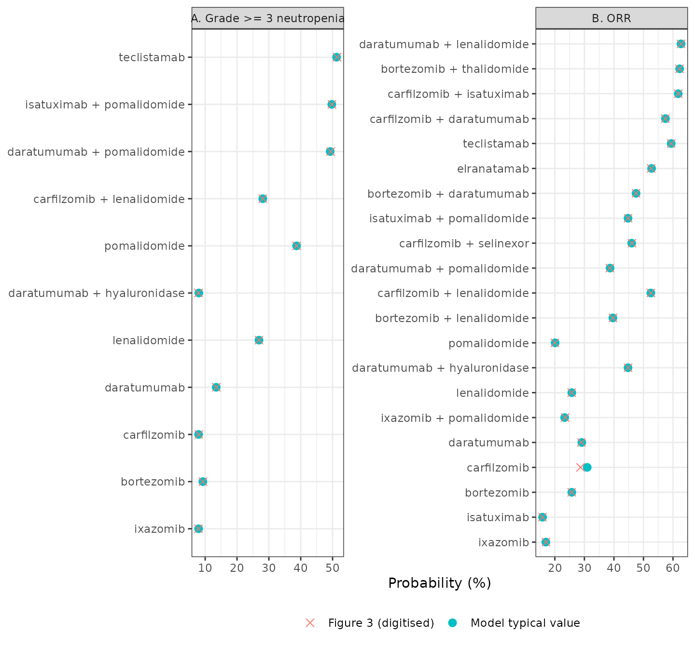
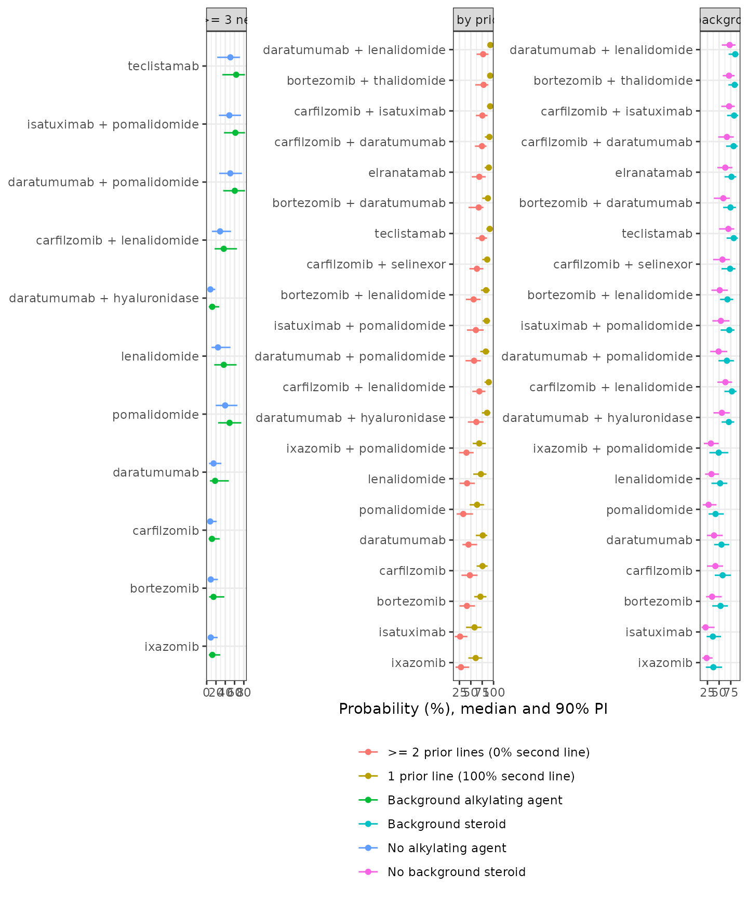

# Relapsed/refractory multiple myeloma Grade \>= 3 neutropenia and ORR MBMA (Shah 2026)

## Models and source

- Citation: Shah Z, Anderson C, McCormick K, Vallejo C, Duncan W, Hu C,
  Ratushny A, Zhou J, Kondic AG. Integrating MBMA and QSP to Identify
  Key Covariates and Predict Treatment Outcomes in Relapsed/Refractory
  Multiple Myeloma. CPT Pharmacometrics Syst Pharmacol.
  2026;15(1):e70145. <doi:10.1002/psp4.70145>. PMC12823780. Structural
  model: Methods ‘MBMA Approach’ Equations 1-3 and the Supporting
  Information Monolix code ‘Model code for ORR’. Parameter estimates:
  Supporting Information Table S4. Reference intercept: digitised from
  Figure 3B (see the logite0 comment).
- Article: <https://doi.org/10.1002/psp4.70145>

Shah et al. combined a model-based meta-analysis (MBMA) with a
quantitative systems pharmacology (QSP) model of relapsed/refractory
multiple myeloma (RRMM). The MBMA has two independent landmark
binomial-regression models, fitted in Monolix to the study-arm event
counts of published trials in the Certara CODEx RRMM database. Both are
extracted here:

| Model | Endpoint | Regimens | Covariates retained |
|----|----|----|----|
| `Shah_2026_rrmm_neutropenia_mbma` | Grade \>= 3 neutropenia incidence | 11 (lenalidomide as a linear dose-response) | background alkylating agent |
| `Shah_2026_rrmm_orr_mbma` | overall response rate (IMWG) | 21 (carfilzomib as a linear dose-response) | background corticosteroid; % of patients with exactly one prior line (Emax) |

Each model has the same structure (Equations 1-2 and the Supporting
Information Monolix code):

``` math
\mathrm{logit}(p_{ij}) = \mathrm{EFF}_0 + \mathrm{EFF}_{\mathrm{regimen}} + \text{covariate terms} + \eta^{\mathrm{study}}_i + \eta^{\mathrm{arm}}_{ij} / \sqrt{n_{ij}}
```

where the arm-level random effect is scaled by the arm size `N_ARM`, and
the observed responder (or event) count is binomial in `N_ARM` and `p`.
Every simulated `id` below is one trial arm; the output is the arm
proportion, not an individual patient’s probability.

The QSP half of the paper is not in the library. It was built in the
proprietary Thales platform, and the paper reports neither its equations
nor its parameter values; the virtual-population classifier of Equations
4-8 (the softmax assignment of virtual patients to prior-line groups) is
likewise reported without its fitted scale and location parameters.
There is nothing on the record to encode.

``` r

neut <- readModelDb("Shah_2026_rrmm_neutropenia_mbma")
orr <- readModelDb("Shah_2026_rrmm_orr_mbma")
neutUi <- rxode2::rxode(neut)
#> ℹ parameter labels from comments will be replaced by 'label()'
orrUi <- rxode2::rxode(orr)
#> ℹ parameter labels from comments will be replaced by 'label()'
```

## Population

The meta-analysis was built from published RRMM trials: 130 trials (154
arms, 17,246 patients) for Grade \>= 3 neutropenia and 192 trials (239
arms, 22,227 patients) for ORR (Results “Datasets for MBMA and QSP
Analyses”; Table 1). Arms with 10 or fewer patients and regimens
supported by fewer than three independent studies were excluded. Across
arms the mean age was about 65 years (range of arm means 48-76), about
56% of patients were male, about 67% were white, and on average 29% of
an arm’s patients had received exactly one prior line of therapy (Tables
S5-S6). Covariates with more than 40% missing data were not tested and
missing arm values were median-imputed. Prophylactic G-CSF use was not
reported consistently enough to be a covariate.

``` r

str(neutUi$population[c("n_subjects", "n_studies", "n_arms", "disease_state")])
#> List of 4
#>  $ n_subjects   : int 17246
#>  $ n_studies    : int 130
#>  $ n_arms       : int 154
#>  $ disease_state: chr "relapsed/refractory multiple myeloma (second line or later); mean 29.1% of patients per arm had exactly one pri"| __truncated__
str(orrUi$population[c("n_subjects", "n_studies", "n_arms")])
#> List of 3
#>  $ n_subjects: int 22227
#>  $ n_studies : int 192
#>  $ n_arms    : int 239
```

## Source trace

Every fixed effect is from Supporting Information Table S3 (neutropenia)
or Table S4 (ORR); random-effect SDs are from the same tables. The
structural equations are Methods Equations 1-3 and the Supporting
Information Monolix code.

| Quantity | Neutropenia model | ORR model | Source |
|----|----|----|----|
| Reference intercept `logite0` | -4 (fixed) | -5 (fixed) | back-solved from Figure 3; see Assumptions |
| Regimen effects `e_trt_<regimen>_logite0` | 10 regimens, 1.55-4.05 | 20 regimens, 3.33-5.52 | Table S3 / Table S4 |
| Lenalidomide dose slope `e_dose_lenalidomide_logite0` | 0.12 /mg | – | Table S3 ‘slope_lenalidomide’ |
| Carfilzomib intercept and dose slope | – | 3.55 and 0.024 /(mg/m^2) | Table S4 ‘inter_carfilzomib’, ‘slope_carfilzomib’ |
| Background alkylating agent `e_conmed_alkylator_logite0` | 0.44 | – | Table S3 ‘beta_backalkylating agent’ |
| Background corticosteroid `e_conmed_steroid_logite0` | – | 0.7 | Table S4 ‘beta_backsteroid’ |
| One-prior-line Emax and EC50 | – | 1.85 and 40.54% | Table S4 ‘Emax_Priortherapy1’, ‘EC50_Priortherapy1’ |
| Between-study SD (`eta_study_logite0`) | 0.59 | 0.41 | Table S3 / S4 ‘BSV’ |
| Between-arm SD for an arm of one patient (`eta_arm_logite0`) | 3.25 | 1.9 | Table S3 / S4 ‘BTAV’ |
| Arm-size scaling `eta_arm / sqrt(N_ARM)` | yes | yes | Equation 1; Monolix ‘etaBAV/sqrt(N)’ |
| Binomial likelihood | approximated, see Assumptions | approximated | Equation 3 |

The per-parameter values with their standard errors are in the `ini()`
comments of each model file:

``` r

paramTable <- function(ui, model) {
  ui$iniDf |>
    dplyr::filter(is.na(neta1)) |>
    dplyr::transmute(Model = model, Parameter = name, Estimate = est, Fixed = fix)
}
dplyr::bind_rows(
  paramTable(neutUi, "neutropenia"),
  paramTable(orrUi, "ORR")
) |>
  knitr::kable(digits = 3)
```

| Model       | Parameter                               | Estimate | Fixed |
|:------------|:----------------------------------------|---------:|:------|
| neutropenia | logite0                                 |   -4.000 | TRUE  |
| neutropenia | e_trt_bortezomib_logite0                |    1.720 | FALSE |
| neutropenia | e_trt_carfilzomib_logite0               |    1.550 | FALSE |
| neutropenia | e_trt_carfilzomib_lenalidomide_logite0  |    3.060 | FALSE |
| neutropenia | e_trt_daratumumab_logite0               |    2.140 | FALSE |
| neutropenia | e_trt_daratumumab_pomalidomide_logite0  |    3.970 | FALSE |
| neutropenia | e_trt_daratumumab_hyaluronidase_logite0 |    1.560 | FALSE |
| neutropenia | e_trt_isatuximab_pomalidomide_logite0   |    3.990 | FALSE |
| neutropenia | e_trt_ixazomib_logite0                  |    1.550 | FALSE |
| neutropenia | e_dose_lenalidomide_logite0             |    0.120 | FALSE |
| neutropenia | e_trt_pomalidomide_logite0              |    3.540 | FALSE |
| neutropenia | e_trt_teclistamab_logite0               |    4.050 | FALSE |
| neutropenia | e_conmed_alkylator_logite0              |    0.440 | FALSE |
| ORR         | logite0                                 |   -5.000 | TRUE  |
| ORR         | e_trt_bortezomib_logite0                |    3.940 | FALSE |
| ORR         | e_trt_bortezomib_lenalidomide_logite0   |    4.580 | FALSE |
| ORR         | e_trt_bortezomib_thalidomide_logite0    |    5.500 | FALSE |
| ORR         | e_trt_carfilzomib_logite0               |    3.550 | FALSE |
| ORR         | e_dose_carfilzomib_logite0              |    0.024 | FALSE |
| ORR         | e_trt_carfilzomib_lenalidomide_logite0  |    5.100 | FALSE |
| ORR         | e_trt_daratumumab_logite0               |    4.110 | FALSE |
| ORR         | e_trt_bortezomib_daratumumab_logite0    |    4.900 | FALSE |
| ORR         | e_trt_carfilzomib_daratumumab_logite0   |    5.300 | FALSE |
| ORR         | e_trt_daratumumab_lenalidomide_logite0  |    5.520 | FALSE |
| ORR         | e_trt_daratumumab_pomalidomide_logite0  |    4.540 | FALSE |
| ORR         | e_trt_daratumumab_hyaluronidase_logite0 |    4.790 | FALSE |
| ORR         | e_trt_elranatamab_logite0               |    5.110 | FALSE |
| ORR         | e_trt_isatuximab_logite0                |    3.330 | FALSE |
| ORR         | e_trt_carfilzomib_isatuximab_logite0    |    5.480 | FALSE |
| ORR         | e_trt_isatuximab_pomalidomide_logite0   |    4.790 | FALSE |
| ORR         | e_trt_ixazomib_logite0                  |    3.410 | FALSE |
| ORR         | e_trt_ixazomib_pomalidomide_logite0     |    3.810 | FALSE |
| ORR         | e_trt_lenalidomide_logite0              |    3.940 | FALSE |
| ORR         | e_trt_pomalidomide_logite0              |    3.620 | FALSE |
| ORR         | e_trt_carfilzomib_selinexor_logite0     |    4.840 | FALSE |
| ORR         | e_trt_teclistamab_logite0               |    5.380 | FALSE |
| ORR         | e_conmed_steroid_logite0                |    0.700 | FALSE |
| ORR         | emax_line_2l_pct                        |    1.850 | FALSE |
| ORR         | ec50_line_2l_pct                        |   40.540 | FALSE |

## Virtual trial arms

Each model takes one row per trial arm. Regimens are selected by
mutually exclusive `TRT_` indicators, so a helper builds a design row
with every indicator at 0 and then sets the one for the regimen.

``` r

neutRegimens <- c(
  "TRT_TECLISTAMAB", "TRT_ISATUXIMAB_POMALIDOMIDE", "TRT_DARATUMUMAB_POMALIDOMIDE",
  "TRT_POMALIDOMIDE", "TRT_CARFILZOMIB_LENALIDOMIDE", "TRT_LENALIDOMIDE",
  "TRT_DARATUMUMAB", "TRT_BORTEZOMIB", "TRT_DARATUMUMAB_HYALURONIDASE",
  "TRT_IXAZOMIB", "TRT_CARFILZOMIB"
)
orrRegimens <- c(
  "TRT_DARATUMUMAB_LENALIDOMIDE", "TRT_BORTEZOMIB_THALIDOMIDE",
  "TRT_CARFILZOMIB_ISATUXIMAB", "TRT_TECLISTAMAB", "TRT_CARFILZOMIB_DARATUMUMAB",
  "TRT_ELRANATAMAB", "TRT_CARFILZOMIB_LENALIDOMIDE", "TRT_BORTEZOMIB_DARATUMUMAB",
  "TRT_CARFILZOMIB_SELINEXOR", "TRT_ISATUXIMAB_POMALIDOMIDE",
  "TRT_DARATUMUMAB_HYALURONIDASE", "TRT_BORTEZOMIB_LENALIDOMIDE",
  "TRT_DARATUMUMAB_POMALIDOMIDE", "TRT_DARATUMUMAB", "TRT_CARFILZOMIB",
  "TRT_LENALIDOMIDE", "TRT_BORTEZOMIB", "TRT_IXAZOMIB_POMALIDOMIDE",
  "TRT_POMALIDOMIDE", "TRT_IXAZOMIB", "TRT_ISATUXIMAB"
)
regimenLabel <- function(x) {
  tolower(gsub("_", " + ", sub("^TRT_", "", x)))
}

# One row per (regimen, scenario, replicate). Every TRT_ column is 0 except
# the arm's own regimen.
buildArms <- function(regimens, scenarios, nRep = 1L) {
  grid <- tidyr::expand_grid(
    regimen = regimens,
    scenario = seq_len(nrow(scenarios)),
    rep = seq_len(nRep)
  )
  grid <- dplyr::left_join(
    grid,
    dplyr::mutate(scenarios, scenario = dplyr::row_number()),
    by = "scenario"
  )
  for (r in regimens) grid[[r]] <- as.integer(grid$regimen == r)
  grid |>
    dplyr::mutate(id = dplyr::row_number(), time = 0, evid = 0, amt = 0)
}
```

## Replicating Figure 3: typical regimen probabilities

Figure 3 plots the model-derived typical probability of each regimen,
with its 95% confidence interval from the fixed-effect standard errors.
The digitised point estimates are compared with the typical-value
(`zeroRe()`) predictions of the models with all covariates at their
reference levels (no background alkylating agent; no background steroid;
0% second-line patients). Lenalidomide is evaluated at 25 mg
(neutropenia) and carfilzomib at 27 mg/m^2 (ORR), the doses shown in
Figure 4.

``` r

# Point estimates digitised by the maintainers from Figure 3 (percent).
fig3a <- c(
  TRT_TECLISTAMAB = 51.4, TRT_ISATUXIMAB_POMALIDOMIDE = 49.8,
  TRT_DARATUMUMAB_POMALIDOMIDE = 49.4, TRT_POMALIDOMIDE = 38.7,
  TRT_CARFILZOMIB_LENALIDOMIDE = 28.1, TRT_LENALIDOMIDE = 26.9,
  TRT_DARATUMUMAB = 13.5, TRT_BORTEZOMIB = 9.3,
  TRT_DARATUMUMAB_HYALURONIDASE = 7.9, TRT_IXAZOMIB = 7.9, TRT_CARFILZOMIB = 8.0
)
fig3b <- c(
  TRT_DARATUMUMAB_LENALIDOMIDE = 62.7, TRT_BORTEZOMIB_THALIDOMIDE = 62.2,
  TRT_CARFILZOMIB_ISATUXIMAB = 61.8, TRT_TECLISTAMAB = 59.4,
  TRT_CARFILZOMIB_DARATUMUMAB = 57.4, TRT_ELRANATAMAB = 52.6,
  TRT_CARFILZOMIB_LENALIDOMIDE = 52.5, TRT_BORTEZOMIB_DARATUMUMAB = 47.5,
  TRT_CARFILZOMIB_SELINEXOR = 46.1, TRT_ISATUXIMAB_POMALIDOMIDE = 44.8,
  TRT_DARATUMUMAB_HYALURONIDASE = 44.8, TRT_BORTEZOMIB_LENALIDOMIDE = 39.7,
  TRT_DARATUMUMAB_POMALIDOMIDE = 38.6, TRT_DARATUMUMAB = 29.0,
  TRT_CARFILZOMIB = 28.7, TRT_LENALIDOMIDE = 25.7, TRT_BORTEZOMIB = 25.7,
  TRT_IXAZOMIB_POMALIDOMIDE = 23.5, TRT_POMALIDOMIDE = 20.0,
  TRT_IXAZOMIB = 17.0, TRT_ISATUXIMAB = 15.8
)
```

``` r

neutRef <- data.frame(CONMED_ALKYLATOR = 0L, DOSE_LENALIDOMIDE_MG = 25, N_ARM = 100)
neutTyp <- rxode2::rxSolve(
  rxode2::zeroRe(neut), buildArms(neutRegimens, neutRef),
  returnType = "data.frame", keep = "regimen"
)
#> ℹ parameter labels from comments will be replaced by 'label()'
#> Warning: No sigma parameters in the model
#> ℹ omega/sigma items treated as zero: 'eta_study_logite0', 'eta_arm_logite0'
#> Warning: multi-subject simulation without without 'omega'

orrRef <- data.frame(CONMED_STEROID = 0L, LINE_2L_PCT = 0, DOSE_CARFILZOMIB_MGM2 = 27, N_ARM = 100)
orrTyp <- rxode2::rxSolve(
  rxode2::zeroRe(orr), buildArms(orrRegimens, orrRef),
  returnType = "data.frame", keep = "regimen"
)
#> ℹ parameter labels from comments will be replaced by 'label()'
#> Warning: No sigma parameters in the model
#> ℹ omega/sigma items treated as zero: 'eta_study_logite0', 'eta_arm_logite0'
#> Warning: multi-subject simulation without without 'omega'

fig3 <- dplyr::bind_rows(
  data.frame(
    panel = "A. Grade >= 3 neutropenia", regimen = neutTyp$regimen,
    model = 100 * neutTyp$prob_neutropenia_grade3,
    published = unname(fig3a[neutTyp$regimen])
  ),
  data.frame(
    panel = "B. ORR", regimen = orrTyp$regimen,
    model = 100 * orrTyp$prob_orr,
    published = unname(fig3b[orrTyp$regimen])
  )
) |>
  dplyr::mutate(diff_pp = model - published)

# The model and Figure 3 differ only by digitisation error here, apart from
# carfilzomib in panel B, whose Figure 3 dose is not stated (see below).
chk3 <- dplyr::filter(fig3, !(panel == "B. ORR" & regimen == "TRT_CARFILZOMIB"))
stopifnot(
  abs(median(chk3$diff_pp)) < 0.3,
  max(abs(chk3$diff_pp)) < 1
)

fig3 |>
  dplyr::mutate(regimen = regimenLabel(regimen)) |>
  dplyr::rename(
    Panel = panel, Regimen = regimen, "Model typical (%)" = model,
    "Figure 3 digitised (%)" = published, "Difference (pp)" = diff_pp
  ) |>
  knitr::kable(digits = 1)
```

| Panel | Regimen | Model typical (%) | Figure 3 digitised (%) | Difference (pp) |
|:---|:---|---:|---:|---:|
| A. Grade \>= 3 neutropenia | teclistamab | 51.2 | 51.4 | -0.2 |
| A. Grade \>= 3 neutropenia | isatuximab + pomalidomide | 49.8 | 49.8 | 0.0 |
| A. Grade \>= 3 neutropenia | daratumumab + pomalidomide | 49.3 | 49.4 | -0.1 |
| A. Grade \>= 3 neutropenia | pomalidomide | 38.7 | 38.7 | 0.0 |
| A. Grade \>= 3 neutropenia | carfilzomib + lenalidomide | 28.1 | 28.1 | 0.0 |
| A. Grade \>= 3 neutropenia | lenalidomide | 26.9 | 26.9 | 0.0 |
| A. Grade \>= 3 neutropenia | daratumumab | 13.5 | 13.5 | 0.0 |
| A. Grade \>= 3 neutropenia | bortezomib | 9.3 | 9.3 | 0.0 |
| A. Grade \>= 3 neutropenia | daratumumab + hyaluronidase | 8.0 | 7.9 | 0.1 |
| A. Grade \>= 3 neutropenia | ixazomib | 7.9 | 7.9 | 0.0 |
| A. Grade \>= 3 neutropenia | carfilzomib | 7.9 | 8.0 | -0.1 |
| B. ORR | daratumumab + lenalidomide | 62.7 | 62.7 | 0.0 |
| B. ORR | bortezomib + thalidomide | 62.2 | 62.2 | 0.0 |
| B. ORR | carfilzomib + isatuximab | 61.8 | 61.8 | 0.0 |
| B. ORR | teclistamab | 59.4 | 59.4 | 0.0 |
| B. ORR | carfilzomib + daratumumab | 57.4 | 57.4 | 0.0 |
| B. ORR | elranatamab | 52.7 | 52.6 | 0.1 |
| B. ORR | carfilzomib + lenalidomide | 52.5 | 52.5 | 0.0 |
| B. ORR | bortezomib + daratumumab | 47.5 | 47.5 | 0.0 |
| B. ORR | carfilzomib + selinexor | 46.0 | 46.1 | -0.1 |
| B. ORR | isatuximab + pomalidomide | 44.8 | 44.8 | 0.0 |
| B. ORR | daratumumab + hyaluronidase | 44.8 | 44.8 | 0.0 |
| B. ORR | bortezomib + lenalidomide | 39.7 | 39.7 | 0.0 |
| B. ORR | daratumumab + pomalidomide | 38.7 | 38.6 | 0.1 |
| B. ORR | daratumumab | 29.1 | 29.0 | 0.1 |
| B. ORR | carfilzomib | 31.0 | 28.7 | 2.3 |
| B. ORR | lenalidomide | 25.7 | 25.7 | 0.0 |
| B. ORR | bortezomib | 25.7 | 25.7 | 0.0 |
| B. ORR | ixazomib + pomalidomide | 23.3 | 23.5 | -0.2 |
| B. ORR | pomalidomide | 20.1 | 20.0 | 0.1 |
| B. ORR | ixazomib | 16.9 | 17.0 | -0.1 |
| B. ORR | isatuximab | 15.8 | 15.8 | 0.0 |

All 31 regimens without a dose term agree with Figure 3 to within the
digitisation error. Carfilzomib in panel B is the exception by
construction: at 27 mg/m^2 the model gives 31.0%, while the Figure 3
point (28.7%) corresponds to a dose of about 22 mg/m^2; the paper does
not state which carfilzomib dose Figure 3 used. Figure 4C, which is
labelled 27 mg/m^2, matches the model at 27 mg/m^2 (next section).

``` r

ggplot2::ggplot(
  fig3 |> dplyr::mutate(regimen = regimenLabel(regimen)),
  ggplot2::aes(y = reorder(regimen, model))
) +
  ggplot2::geom_point(ggplot2::aes(x = model, colour = "Model typical value"), size = 2.5) +
  ggplot2::geom_point(ggplot2::aes(x = published, colour = "Figure 3 (digitised)"), shape = 4, size = 2.5) +
  ggplot2::facet_wrap(~panel, scales = "free") +
  ggplot2::labs(x = "Probability (%)", y = NULL, colour = NULL) +
  ggplot2::theme_bw() +
  ggplot2::theme(legend.position = "bottom")
```



## Replicating Figure 4: simulated trials by covariate

Figure 4 simulates virtual trials for each regimen with and without the
key covariates and plots the median and 90% prediction interval. Here
200 virtual trial arms of 100 patients are simulated per regimen and
scenario, drawing both the between-study and the between-arm random
effects. As in the source, ORR scenarios hold the other covariates at
their most common values: 12% second-line patients and background
steroid use.

``` r

rxode2::rxSetSeed(20261111)
nTrial <- 200L

simFig4 <- function(model, regimens, scenarios, nTrial, outcome) {
  arms <- buildArms(regimens, scenarios, nRep = nTrial)
  sim <- rxode2::rxSolve(model, arms, returnType = "data.frame", keep = c("regimen", "label"))
  sim |>
    dplyr::group_by(regimen, label) |>
    dplyr::summarise(
      median = 100 * median(.data[[outcome]]),
      lo = 100 * quantile(.data[[outcome]], 0.05),
      hi = 100 * quantile(.data[[outcome]], 0.95),
      .groups = "drop"
    )
}

fig4a <- simFig4(
  neut, neutRegimens,
  data.frame(
    label = c("No alkylating agent", "Background alkylating agent"),
    CONMED_ALKYLATOR = c(0L, 1L), DOSE_LENALIDOMIDE_MG = 25, N_ARM = 100
  ),
  nTrial, "prob_neutropenia_grade3"
)
#> ℹ parameter labels from comments will be replaced by 'label()'
fig4b <- simFig4(
  orr, orrRegimens,
  data.frame(
    label = c(">= 2 prior lines (0% second line)", "1 prior line (100% second line)"),
    CONMED_STEROID = 1L, LINE_2L_PCT = c(0, 100), DOSE_CARFILZOMIB_MGM2 = 27, N_ARM = 100
  ),
  nTrial, "prob_orr"
)
#> ℹ parameter labels from comments will be replaced by 'label()'
fig4c <- simFig4(
  orr, orrRegimens,
  data.frame(
    label = c("No background steroid", "Background steroid"),
    CONMED_STEROID = c(0L, 1L), LINE_2L_PCT = 12, DOSE_CARFILZOMIB_MGM2 = 27, N_ARM = 100
  ),
  nTrial, "prob_orr"
)
```

``` r

fig4 <- dplyr::bind_rows(
  dplyr::mutate(fig4a, panel = "A. Grade >= 3 neutropenia"),
  dplyr::mutate(fig4b, panel = "B. ORR by prior lines"),
  dplyr::mutate(fig4c, panel = "C. ORR by background steroid")
) |>
  dplyr::mutate(regimen = regimenLabel(regimen))

ggplot2::ggplot(fig4, ggplot2::aes(y = reorder(regimen, median), x = median, colour = label)) +
  ggplot2::geom_pointrange(
    ggplot2::aes(xmin = lo, xmax = hi),
    position = ggplot2::position_dodge(width = 0.6), size = 0.2
  ) +
  ggplot2::facet_wrap(~panel, scales = "free", ncol = 3) +
  ggplot2::labs(x = "Probability (%), median and 90% PI", y = NULL, colour = NULL) +
  ggplot2::theme_bw() +
  ggplot2::theme(legend.position = "bottom", legend.direction = "vertical")
```



The medians are compared below with a subset of Figure 4 medians read
off the published figure by the maintainers (to about 2 percentage
points). The model reproduces the direction and size of each covariate
shift: the alkylating agent adds about 10 points of neutropenia for the
high-incidence regimens, a 0% versus 100% second-line population moves
ORR by 15-30 points, and background steroid by about 15 points.

``` r

fig4Read <- tibble::tribble(
  ~panel, ~regimen, ~label, ~published,
  "A", "TRT_TECLISTAMAB", "No alkylating agent", 50,
  "A", "TRT_TECLISTAMAB", "Background alkylating agent", 61,
  "A", "TRT_LENALIDOMIDE", "No alkylating agent", 29,
  "A", "TRT_LENALIDOMIDE", "Background alkylating agent", 38,
  "A", "TRT_CARFILZOMIB", "No alkylating agent", 8,
  "A", "TRT_CARFILZOMIB", "Background alkylating agent", 11.5,
  "B", "TRT_DARATUMUMAB_LENALIDOMIDE", ">= 2 prior lines (0% second line)", 77,
  "B", "TRT_DARATUMUMAB_LENALIDOMIDE", "1 prior line (100% second line)", 93,
  "B", "TRT_ISATUXIMAB", ">= 2 prior lines (0% second line)", 27,
  "B", "TRT_ISATUXIMAB", "1 prior line (100% second line)", 58,
  "C", "TRT_DARATUMUMAB_LENALIDOMIDE", "No background steroid", 72,
  "C", "TRT_DARATUMUMAB_LENALIDOMIDE", "Background steroid", 84,
  "C", "TRT_BORTEZOMIB", "No background steroid", 35,
  "C", "TRT_BORTEZOMIB", "Background steroid", 52,
  "C", "TRT_CARFILZOMIB", "No background steroid", 41,
  "C", "TRT_CARFILZOMIB", "Background steroid", 58,
  "C", "TRT_ISATUXIMAB", "No background steroid", 23,
  "C", "TRT_ISATUXIMAB", "Background steroid", 37
)
simMedians <- dplyr::bind_rows(
  dplyr::mutate(fig4a, panel = "A"),
  dplyr::mutate(fig4b, panel = "B"),
  dplyr::mutate(fig4c, panel = "C")
)
cmp4 <- fig4Read |>
  dplyr::left_join(simMedians, by = c("panel", "regimen", "label")) |>
  dplyr::mutate(diff_pp = median - published)

# Simulated medians carry Monte Carlo error and the published values are
# read by eye, so assert on the centre and a robust envelope.
stopifnot(
  !anyNA(cmp4$median),
  abs(median(cmp4$diff_pp)) < 2,
  quantile(abs(cmp4$diff_pp), 0.9) < 5
)

cmp4 |>
  dplyr::mutate(regimen = regimenLabel(regimen)) |>
  dplyr::select(panel, regimen, label, published, median, diff_pp) |>
  dplyr::rename(
    Panel = panel, Regimen = regimen, Scenario = label,
    "Figure 4 median (%)" = published, "Simulated median (%)" = median,
    "Difference (pp)" = diff_pp
  ) |>
  knitr::kable(digits = 1)
```

| Panel | Regimen | Scenario | Figure 4 median (%) | Simulated median (%) | Difference (pp) |
|:---|:---|:---|---:|---:|---:|
| A | teclistamab | No alkylating agent | 50.0 | 51.0 | 1.0 |
| A | teclistamab | Background alkylating agent | 61.0 | 63.5 | 2.5 |
| A | lenalidomide | No alkylating agent | 29.0 | 24.3 | -4.7 |
| A | lenalidomide | Background alkylating agent | 38.0 | 36.8 | -1.2 |
| A | carfilzomib | No alkylating agent | 8.0 | 7.6 | -0.4 |
| A | carfilzomib | Background alkylating agent | 11.5 | 11.4 | -0.1 |
| B | daratumumab + lenalidomide | \>= 2 prior lines (0% second line) | 77.0 | 77.1 | 0.1 |
| B | daratumumab + lenalidomide | 1 prior line (100% second line) | 93.0 | 92.9 | -0.1 |
| B | isatuximab | \>= 2 prior lines (0% second line) | 27.0 | 26.4 | -0.6 |
| B | isatuximab | 1 prior line (100% second line) | 58.0 | 58.0 | 0.0 |
| C | daratumumab + lenalidomide | No background steroid | 72.0 | 72.7 | 0.7 |
| C | daratumumab + lenalidomide | Background steroid | 84.0 | 84.6 | 0.6 |
| C | bortezomib | No background steroid | 35.0 | 34.9 | -0.1 |
| C | bortezomib | Background steroid | 52.0 | 53.1 | 1.1 |
| C | carfilzomib | No background steroid | 41.0 | 42.0 | 1.0 |
| C | carfilzomib | Background steroid | 58.0 | 57.6 | -0.4 |
| C | isatuximab | No background steroid | 23.0 | 21.0 | -2.0 |
| C | isatuximab | Background steroid | 37.0 | 36.6 | -0.4 |

The width of the prediction intervals depends on the arm size through
the between-arm term (`eta_arm_logite0 / sqrt(N_ARM)`). The paper does
not state the arm size used for Figure 4, so the interval widths here
(100 patients per arm) are indicative only; the medians do not depend on
it.

## PKNCA

Not applicable. These are landmark meta-analysis models of trial-arm
probabilities with no drug concentrations, no dosing events and no time
course, so there is nothing for a noncompartmental analysis to
summarise. The typical-value comparison against Figure 3 above is the
closed-form check of the fixed effects.

## Assumptions and deviations

- **Reference intercepts (Errata).** The captions of Tables S3 and S4
  state that the reference effect `EFF0` was fixed to zero. Taken
  literally, every regimen would have a neutropenia incidence of 82-98%
  and an ORR of 97-100%, which Figures 2, 3 and 4 all contradict.
  Digitising the Figure 3 point estimates and subtracting each regimen’s
  tabulated effect gives a common intercept of -4.00 for all 11
  neutropenia regimens and -5.00 for all 20 non-dose ORR regimens, each
  to within 0.02. The models therefore fix `logite0` at -4 and -5. The
  round values suggest a fixed reference rather than an estimate; the
  paper does not say where it entered the Monolix model (as `EFF0` or as
  the typical value of the between-study effect), which makes no
  difference to the predictions.
- **Covariates missing from the printed code.** The Supporting
  Information Monolix code shows the regimen switch, the dose terms, the
  one-prior-line Emax and the random effects, but neither the background
  alkylating agent (Table S3) nor the background steroid (Table S4).
  Both are encoded as additive shifts on the logit, which is how Monolix
  applies a covariate to a normally distributed parameter and which
  reproduces the Figure 4A and 4C shifts.
- **Random effects are standard deviations.** Monolix reports random
  effects as SDs, and the Figure 4 interval widths agree with that
  reading, not with a variance reading. The between-arm SD (3.25 and
  1.9) applies to an arm of one patient and is divided by `sqrt(N_ARM)`.
- **Binomial likelihood.** The source fits the arm event count with a
  binomial likelihood (Equation 3). rxode2 cannot use a data column as
  the binomial size, so each model gives the observed arm proportion an
  additive residual with the binomial sampling SD,
  `sqrt(p * (1 - p) / N_ARM)`. This introduces no new parameter. To
  simulate an observed count, draw `rbinom(1, N_ARM, p)` from the
  predicted `p` instead.
- **Dose definitions.** The paper normalises dose intensities to the
  FDA-approved dosing frequency without listing the normalised values.
  The lenalidomide slope is applied to the daily dose in mg (25 mg
  reproduces Figure 3A exactly) and the carfilzomib slope to the dose
  per administration in mg/m^2 (27 mg/m^2 reproduces Figure 4C). The
  carfilzomib dose behind the Figure 3B point is not stated.
- **Second-line percentage.** `LINE_2L_PCT` is the source’s “percent of
  patients with 1 prior line of therapy”, supplied in percent (the EC50
  of 40.54 is on the 0-100 scale). Figure 4B is reproduced with 0%
  versus 100%.
- **Regimen coding.** Each regimen is its own indicator, and exactly one
  is 1 per arm. A combination is not the sum of its components.
  Daratumumab with rHuPH20 (subcutaneous daratumumab) is a separate
  regimen from intravenous daratumumab, as in the source.
- **Not reproduced.** The visual predictive checks of Figure 2 need the
  analysis dataset, which is not public. The QSP model (Figures 1, 5
  and 6) is not extractable (see the start of this article).
- **Arm counts.** The Results text gives 154 neutropenia arms and 239
  ORR arms; Tables S5 and S6 report 152 and 237 arms with covariate
  data. The population metadata uses the Results figures.
