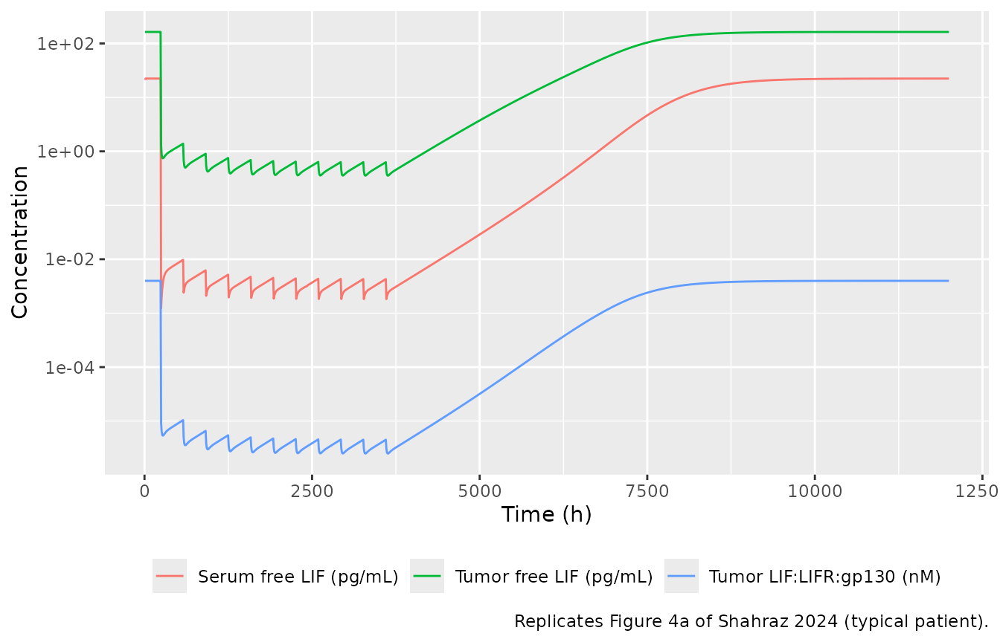
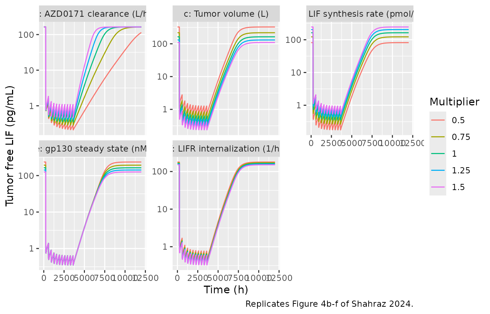
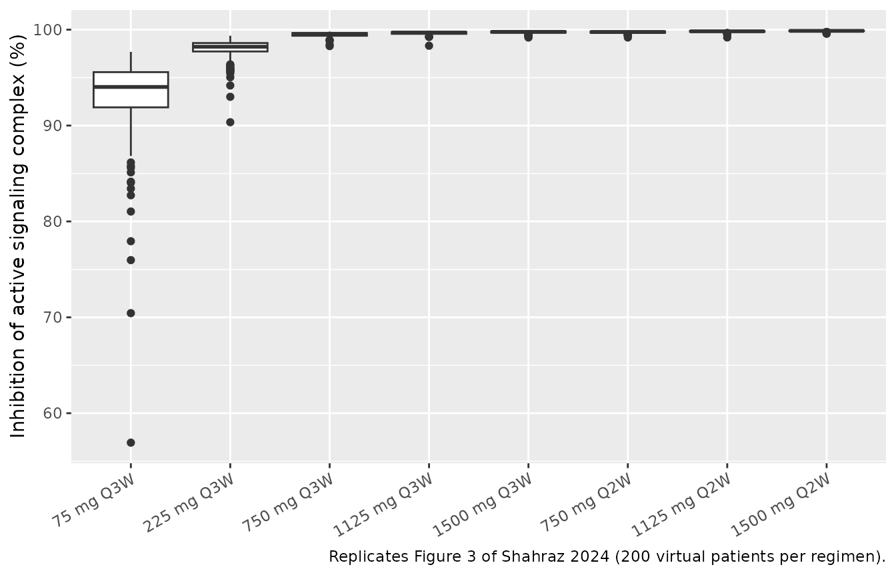

# Falbikitug (AZD0171, anti-LIF) mechanistic PK/PD (Shahraz 2024)

## Model and source

- Citation: Shahraz A, Penney M, Candido J, Opoku-Ansah G, Neubauer M,
  Eyles J, Ojo O, Liu N, Luheshi NM, Phipps A, Vishwanathan K. A
  mechanistic PK/PD model of AZD0171 (anti-LIF) to support Phase II dose
  selection. CPT Pharmacometrics Syst Pharmacol. 2024;13(10):1670-1680.
  <doi:10.1002/psp4.13204>. Parameter values from Table 1 and
  Supplementary Table S4; equations from Supplementary Table S5 (fluxes,
  ODEs and rules) and Appendix S3 (Krogh tumor-penetration flux).
- Description: QSP. Mechanistic PK/PD model of falbikitug (AZD0171), a
  humanized IgG1 anti-leukemia inhibitory factor (LIF) antibody, in
  adults with advanced solid tumors and metastatic pancreatic ductal
  adenocarcinoma (Shahraz 2024; Phase I NCT03490669 n = 41 and interim
  Phase II NCT04999969 n = 49). Three compartments: central (serum), a
  peripheral tissue compartment and a tumor compartment. AZD0171 has
  linear clearance from the central compartment, distributes to tissue
  by an intercompartmental clearance and to the tumor by a
  Krogh-cylinder permeability-diffusion flux. LIF is synthesized only in
  the tumor at a zero-order rate, eliminated from the central
  compartment with a 2 h half-life, and exchanges with tissue and tumor.
  In tissue and tumor LIF binds LIFR and gp130 independently to form the
  LIF:LIFR:gp130 signaling complex; AZD0171 binds free LIF and LIF:LIFR
  (in the central compartment free LIF only) and blocks gp130
  recruitment. LIFR and gp130 turn over to fitted / fixed steady-state
  levels, and occupied receptors internalize. All states start
  receptor-only with no LIF: like the authors (first dose at 240 h in
  Figure 4), run the drug-free system for at least 240 h before the
  first dose so that LIF and the receptor complexes reach baseline.
  Outputs: serum AZD0171 (Cc, ug/mL), serum total LIF (Ctotal_target,
  pg/mL), and tumor free LIF and signaling complex for the
  target-engagement predictions.
- Article: <https://doi.org/10.1002/psp4.13204> (open access;
  PMC11494920)

Falbikitug (AZD0171) is a humanized IgG1 antibody that binds leukemia
inhibitory factor (LIF) and blocks recruitment of gp130 to the LIF
receptor (LIFR), so the LIF:LIFR:gp130 signaling complex cannot form.
The model has a central (serum) compartment, a peripheral tissue
compartment and a tumor compartment. LIF is made only in the tumor; LIF,
AZD0171 and the AZD0171:LIF complex move between serum and tumor through
a Krogh-cylinder permeability-diffusion flux. In tissue and tumor, LIF
binds LIFR and gp130 independently, and AZD0171 binds free LIF and
LIF:LIFR.

## Population

The model was fitted in SimBiology to serum AZD0171 and serum total LIF
from 90 patients: 41 adults with advanced, unresectable solid tumors in
the Phase I dose-escalation study (NCT03490669; 75-1500 mg IV every 3
weeks), and 49 patients with first-line metastatic pancreatic ductal
adenocarcinoma in an interim cut of the Phase II study (NCT04999969;
1500 mg IV every 2 weeks with durvalumab, gemcitabine and
nab-paclitaxel). Each patient was fitted separately; Table 1 reports the
median and interquartile range of the five fitted parameters. The paper
has no demographic table; sampling schedules are in Appendix S1.

The same information is available programmatically via
`readModelDb("Shahraz_2024_falbikitug")()$population`.

## Source trace

Every `ini()` value carries an in-file comment pointing to its source.
The equations come from Supplementary Table S5 (45 fluxes, 11 printed
ODEs and 24 rules).

| Equation / parameter | Value | Source location |
|----|----|----|
| `lcl` (CL) | 0.0135 L/h | Table 1; Table S4 `CL_AZD0171` |
| `lvc` (Vc) | 3.72 L | Table 1; Table S4 `Vcentral` |
| `lq` (Q, AZD0171 and AZD0171:LIF) | 0.110 L/h | Table 1; Table S4 `Q_drug` |
| `lksyn_lif` (ksynth_LIFt) | 1.67 pmol/h | Table 1; Table S4 |
| `llifr_ss` (LIFR_ss) | 5.926 nM | Table 1; Table S4 |
| `lvp` (Vtissue) | 3.72 L, fixed | Table S4; rule 21 (Vtissue = Vcentral) |
| `v_tumor` | 0.258 L, fixed | Table S4; Methods |
| `kon_drug_lif`, `kon_lif_lifr`, `kon_lif_gp130` | 3.6 1/(nM h), fixed | Table S4 |
| `kd_drug_lif` | 0.074 nM, fixed | Table S4; koff = kon x KD = 0.2664 1/h (rule 23) |
| `koff_lif_lifr` | 11.16 1/h, fixed | Table S4 |
| `koff_lif_gp130` | 260.568 1/h, fixed | Table S4 |
| `thalf_lif` | 2 h, fixed | Table S4 (Gunawardana 2003) |
| `gp130_ss` | 25 nM, fixed | Table S4 |
| `kint_gp130` | 4.158 1/h, fixed | Table S4 |
| `kint_lifr_slow`, `kint_lifr_fast` | 0.42, 1.89 1/h, fixed | Table S4 (Hilton and Nicola 1992) |
| `r_cap`, `r_krogh`, `void_frac` | 8 um, 75 um, 0.24, fixed | Table S4; Appendix S3 |
| `mw_drug`, `mw_lif`, `mw_drug_lif` | 150, 25, 175 kDa, fixed | Table S4 |
| `gamma_qlif`, `mu_qlif` | 2.25 L/h, 2.48, fixed | Table S4 (Li 2017); Q_LIF by rule 7 |
| Diffusion and permeability | derived | Table S5 rules 1-6 (Li 2019) |
| Tumor radius | derived | Table S5 rule 8 |
| `etalcl`, `etalvc`, `etalq`, `etalksyn_lif`, `etallifr_ss` | 0.0862 each, fixed | Results: 30% CV log-normal virtual patients |
| `d/dt(central)` |  | Table S5 ODE 10 (Reactions 3, 4, 6, 38) |
| `d/dt(target)`, `d/dt(complex)` |  | assembled from Table S5 Reactions 6, 8, 9, 10, 13, 36, 43 |
| Tissue ODEs (9 states) |  | Table S5 ODEs 1-9 |
| Tumor ODEs (9 states) |  | assembled from Table S5 Reactions 1, 20-25, 32-35, 37, 39, 44-47 |
| `Cc` (ug/mL) |  | rule 11 |
| `Ctotal_target` (pg/mL) |  | rule 10 |
| Tumor free LIF, active LIFR fraction |  | rules 18, 19, 24 |

### Derived constants against Supplementary Table S4

The model computes the diffusion coefficients, permeabilities, LIF
intercompartmental clearance, tumor radius and AZD0171 dissociation rate
from the Table S5 rules. They should match the values that Table S4
prints.

``` r

mw_drug <- 150
mw_lif <- 25
mw_drug_lif <- 175
derived <- tibble::tribble(
  ~quantity, ~model, ~table_s4,
  "Diff_LIF (cm^2/h)", 114.58 * mw_lif^(-0.918) * 3600 / 1e7, 0.00215,
  "Diff_Ab (cm^2/h)", 114.58 * mw_drug^(-0.918) * 3600 / 1e7, 0.000415,
  "Diff_AbLIF (cm^2/h)", 114.58 * mw_drug_lif^(-0.918) * 3600 / 1e7, 0.00036,
  "Pcap_LIF (um/h)", (-10.43 * log(mw_lif) + 53.46) * 3600 / 1000, 71.59,
  "Pcap_Ab and Pcap_AbLIF (um/h)", (-10.43 * log(mw_drug) + 53.46) * 3600 / 1000, 4.32,
  "Q_LIF (L/h)", 2.25 * mw_lif^(-2.48) * (70 / 0.028)^0.75, 0.271,
  "Rtumor (cm)", (3 * 0.258 * 1000 / (4 * pi))^(1 / 3), 4,
  "koffAZD0171LIF (1/h)", 3.6 * 0.074, 0.2664
) |>
  mutate(pct_diff = 100 * (model - table_s4) / table_s4)

derived |>
  dplyr::rename(
    "Quantity" = quantity,
    "Model" = model,
    "Table S4" = table_s4,
    "Difference (%)" = pct_diff
  ) |>
  knitr::kable(digits = c(0, 5, 5, 1))
```

| Quantity                      |    Model | Table S4 | Difference (%) |
|:------------------------------|---------:|---------:|---------------:|
| Diff_LIF (cm^2/h)             |  0.00215 |  0.00215 |           -0.1 |
| Diff_Ab (cm^2/h)              |  0.00041 |  0.00042 |           -0.1 |
| Diff_AbLIF (cm^2/h)           |  0.00036 |  0.00036 |            0.0 |
| Pcap_LIF (um/h)               | 71.59365 | 71.59000 |            0.0 |
| Pcap_Ab and Pcap_AbLIF (um/h) |  4.31667 |  4.32000 |           -0.1 |
| Q_LIF (L/h)                   |  0.27149 |  0.27100 |            0.2 |
| Rtumor (cm)                   |  3.94921 |  4.00000 |           -1.3 |
| koffAZD0171LIF (1/h)          |  0.26640 |  0.26640 |            0.0 |

``` r


# Table S4 rounds to 2-3 significant figures (Rtumor to 4 cm), so allow the
# rounding error, and no more.
stopifnot(all(abs(derived$pct_diff[derived$quantity != "Rtumor (cm)"]) < 3))
stopifnot(abs(derived$pct_diff[derived$quantity == "Rtumor (cm)"]) < 5)
```

## Baseline (drug-free) steady state

All states start with receptors only and no LIF. The authors started
dosing at 240 h (Figure 4), so the drug-free system has time to settle;
the same 240 h run-in is used for every simulation below.

``` r

mod <- readModelDb("Shahraz_2024_falbikitug")
mod_typical <- rxode2::zeroRe(mod)
#> ℹ parameter labels from comments will be replaced by 'label()'

run_in <- 240 # h before the first dose (Figure 4)

# Event table with dose rows on the central (serum) compartment and
# observation rows carrying dvid = 1 (the model has two error endpoints).
make_events <- function(ids, amt, tau, n_dose, grid, label) {
  dose_times <- run_in + tau * (seq_len(n_dose) - 1)
  dose <- expand.grid(id = ids, time = dose_times)
  dose$amt <- amt
  dose$dur <- 1
  dose$evid <- 1L
  dose$dvid <- NA_integer_
  obs <- expand.grid(id = ids, time = grid)
  obs$amt <- 0
  obs$dur <- 0
  obs$evid <- 0L
  obs$dvid <- 1L
  dplyr::bind_rows(dose, obs) |>
    dplyr::mutate(cmt = "central", regimen = label) |>
    dplyr::arrange(id, time, dplyr::desc(evid))
}
```

``` r

base_ev <- make_events(1L, 0, 336, 1, seq(0, run_in, by = 4), "no drug")
base_sim <- as.data.frame(rxode2::rxSolve(mod_typical, events = base_ev))
#> ℹ omega/sigma items treated as zero: 'etalcl', 'etalvc', 'etalq', 'etalksyn_lif', 'etallifr_ss'
at <- function(df, t, col) df[[col]][which.min(abs(df$time - t))]

baseline <- tibble::tibble(
  quantity = c(
    "Serum free LIF (pg/mL)", "Serum total LIF (pg/mL)",
    "Tumor free LIF (pg/mL)", "Tumor LIF:LIFR:gp130 (nM)"
  ),
  t120 = c(
    at(base_sim, 120, "lif_free_serum_pgml"), at(base_sim, 120, "Ctotal_target"),
    at(base_sim, 120, "lif_free_tumor_pgml"), at(base_sim, 120, "signal_tumor")
  ),
  t240 = c(
    at(base_sim, 240, "lif_free_serum_pgml"), at(base_sim, 240, "Ctotal_target"),
    at(base_sim, 240, "lif_free_tumor_pgml"), at(base_sim, 240, "signal_tumor")
  )
)
baseline |>
  dplyr::rename("Quantity" = quantity, "At 120 h" = t120, "At 240 h" = t240) |>
  knitr::kable(digits = 5)
```

| Quantity                  |  At 120 h |  At 240 h |
|:--------------------------|----------:|----------:|
| Serum free LIF (pg/mL)    |  22.36130 |  22.36130 |
| Serum total LIF (pg/mL)   |  22.36130 |  22.36130 |
| Tumor free LIF (pg/mL)    | 163.54773 | 163.54773 |
| Tumor LIF:LIFR:gp130 (nM) |   0.00398 |   0.00398 |

``` r


# The run-in reaches steady state: nothing moves between 120 h and 240 h.
stopifnot(all(abs(baseline$t240 / baseline$t120 - 1) < 1e-4))
```

The typical patient’s baseline tumor free LIF is about 164 pg/mL. Figure
4 does not agree with itself on this value: the reference curves in
Figure 4a, 4e and 4f start near 55-60 pg/mL, while those in Figure 4b,
4c and 4d start near 300-700 pg/mL. The comparisons below therefore use
the change relative to baseline.

## Replicate Figure 4a: free LIF and signaling complex on 1500 mg Q2W

Eleven 1500 mg infusions every 2 weeks, from 240 h to 3600 h, followed
by washout.

``` r

grid_long <- sort(unique(c(seq(0, 12000, by = 8), run_in - 4)))
ev_4a <- make_events(1L, 1500, 336, 11, grid_long, "1500 mg Q2W")
sim_4a <- as.data.frame(rxode2::rxSolve(mod_typical, events = ev_4a))
#> ℹ omega/sigma items treated as zero: 'etalcl', 'etalvc', 'etalq', 'etalksyn_lif', 'etallifr_ss'

sim_4a |>
  dplyr::select(time, lif_free_serum_pgml, lif_free_tumor_pgml, signal_tumor) |>
  tidyr::pivot_longer(-time) |>
  dplyr::mutate(name = dplyr::recode(name,
    lif_free_serum_pgml = "Serum free LIF (pg/mL)",
    lif_free_tumor_pgml = "Tumor free LIF (pg/mL)",
    signal_tumor = "Tumor LIF:LIFR:gp130 (nM)"
  )) |>
  # LIF starts at zero before the run-in; drop it from the log-scale plot
  dplyr::filter(value > 0) |>
  ggplot(aes(time, value, colour = name)) +
  geom_line() +
  scale_y_log10() +
  labs(
    x = "Time (h)", y = "Concentration", colour = NULL,
    caption = "Replicates Figure 4a of Shahraz 2024 (typical patient)."
  ) +
  theme(legend.position = "bottom")
```



``` r

bl_free <- at(sim_4a, run_in - 4, "lif_free_tumor_pgml")
last_dose <- 3600
inh_free <- function(t) 100 * (1 - at(sim_4a, t, "lif_free_tumor_pgml") / bl_free)
first_cycle <- sim_4a |> dplyr::filter(time > run_in, time < run_in + 336)
post <- sim_4a |> dplyr::filter(time > last_dose)
t90 <- post$time[which(post$lif_free_tumor_pgml >= 0.9 * bl_free)[1]] - last_dose

fig4a <- tibble::tribble(
  ~quantity, ~model, ~paper,
  "Inhibition of tumor free LIF 2 weeks after the last dose (%)", inh_free(last_dose + 336), 98,
  "Inhibition of tumor free LIF 4 weeks after the last dose (%)", inh_free(last_dose + 672), 97,
  "Time of the tumor free LIF nadir after the first dose (h)",
  first_cycle$time[which.min(first_cycle$lif_free_tumor_pgml)] - run_in, 50,
  "Time from the last dose to 90% of baseline tumor free LIF (h)", t90, 3360
)
fig4a |>
  dplyr::rename("Quantity" = quantity, "Model" = model, "Paper (Results text)" = paper) |>
  knitr::kable(digits = 1)
```

| Quantity | Model | Paper (Results text) |
|:---|---:|---:|
| Inhibition of tumor free LIF 2 weeks after the last dose (%) | 99.6 | 98 |
| Inhibition of tumor free LIF 4 weeks after the last dose (%) | 99.3 | 97 |
| Time of the tumor free LIF nadir after the first dose (h) | 32.0 | 50 |
| Time from the last dose to 90% of baseline tumor free LIF (h) | 4704.0 | 3360 |

``` r


# The paper states 98% and 97% inhibition persisting 2 and 4 weeks after the
# last dose. A mis-scaled dose, KD or synthesis rate moves these by far more
# than a few percent.
stopifnot(inh_free(last_dose + 336) > 95, inh_free(last_dose + 672) > 95)
```

The model holds tumor free LIF more than 95% suppressed for 4 weeks
after the last dose, as the paper reports. Recovery to baseline takes
about 4704 h in the model against “~3360 h (140 days)” in the text; the
reference curve in Figure 4b (same regimen, CL = 0.0135 L/h) plateaus
near 8000 h, about 4400 h after the last dose, which is in line with the
model.

## Replicate Figure 4b-f: sensitivity of tumor free LIF

Each sensitive parameter is varied from -50% to +50% of its reference
value, as in Figure 4b-f.

``` r

sens <- tibble::tribble(
  ~panel, ~param, ~ref, ~log_scale,
  "b: AZD0171 clearance (L/h)", "lcl", 0.0135, TRUE,
  "c: Tumor volume (L)", "v_tumor", 0.258, FALSE,
  "d: LIF synthesis rate (pmol/h)", "lksyn_lif", 1.67, TRUE,
  "e: gp130 steady state (nM)", "gp130_ss", 25, FALSE,
  "f: LIFR internalization (1/h)", "kint_lifr_slow", 0.42, FALSE
)
mult <- c(0.5, 0.75, 1, 1.25, 1.5)

run_sens <- function(param, value, log_scale) {
  theta <- mod_typical$theta
  theta[[param]] <- if (log_scale) log(value) else value
  sim <- rxode2::rxSolve(mod_typical, events = ev_4a, params = theta)
  as.data.frame(sim)[, c("time", "lif_free_tumor_pgml")]
}

sens_sim <- dplyr::bind_rows(lapply(seq_len(nrow(sens)), function(i) {
  dplyr::bind_rows(lapply(mult, function(m) {
    run_sens(sens$param[i], sens$ref[i] * m, sens$log_scale[i]) |>
      dplyr::mutate(panel = sens$panel[i], multiplier = m)
  }))
}))

sens_sim |>
  dplyr::filter(lif_free_tumor_pgml > 0) |>
  ggplot(aes(time, lif_free_tumor_pgml, colour = factor(multiplier))) +
  geom_line() +
  scale_y_log10() +
  facet_wrap(~panel, scales = "free_y") +
  labs(
    x = "Time (h)", y = "Tumor free LIF (pg/mL)", colour = "Multiplier",
    caption = "Replicates Figure 4b-f of Shahraz 2024."
  )
```



``` r

sens_summary <- sens_sim |>
  dplyr::group_by(panel, multiplier) |>
  dplyr::summarise(
    baseline = lif_free_tumor_pgml[time == run_in - 4],
    on_drug = lif_free_tumor_pgml[time == last_dose - 8],
    t50 = time[time > last_dose & lif_free_tumor_pgml >= 0.5 * baseline][1] - last_dose,
    .groups = "drop"
  ) |>
  dplyr::mutate(inhibition = 100 * (1 - on_drug / baseline))

sens_summary |>
  dplyr::rename(
    "Panel" = panel, "Multiplier" = multiplier,
    "Baseline (pg/mL)" = baseline, "Before last dose (pg/mL)" = on_drug,
    "Inhibition (%)" = inhibition, "Last dose to 50% recovery (h)" = t50
  ) |>
  knitr::kable(digits = c(0, 2, 1, 2, 0, 1))
```

| Panel | Multiplier | Baseline (pg/mL) | Before last dose (pg/mL) | Last dose to 50% recovery (h) | Inhibition (%) |
|:---|---:|---:|---:|---:|---:|
| b: AZD0171 clearance (L/h) | 0.50 | 163.5 | 0.28 | 7656 | 99.8 |
| b: AZD0171 clearance (L/h) | 0.75 | 163.5 | 0.44 | 4952 | 99.7 |
| b: AZD0171 clearance (L/h) | 1.00 | 163.5 | 0.62 | 3632 | 99.6 |
| b: AZD0171 clearance (L/h) | 1.25 | 163.5 | 0.83 | 2864 | 99.5 |
| b: AZD0171 clearance (L/h) | 1.50 | 163.5 | 1.07 | 2360 | 99.3 |
| c: Tumor volume (L) | 0.50 | 326.6 | 1.25 | 3504 | 99.6 |
| c: Tumor volume (L) | 0.75 | 217.8 | 0.83 | 3584 | 99.6 |
| c: Tumor volume (L) | 1.00 | 163.5 | 0.62 | 3632 | 99.6 |
| c: Tumor volume (L) | 1.25 | 131.0 | 0.50 | 3664 | 99.6 |
| c: Tumor volume (L) | 1.50 | 109.3 | 0.41 | 3696 | 99.6 |
| d: LIF synthesis rate (pmol/h) | 0.50 | 81.7 | 0.31 | 3728 | 99.6 |
| d: LIF synthesis rate (pmol/h) | 0.75 | 122.6 | 0.46 | 3680 | 99.6 |
| d: LIF synthesis rate (pmol/h) | 1.00 | 163.5 | 0.62 | 3632 | 99.6 |
| d: LIF synthesis rate (pmol/h) | 1.25 | 204.6 | 0.78 | 3592 | 99.6 |
| d: LIF synthesis rate (pmol/h) | 1.50 | 245.6 | 0.93 | 3552 | 99.6 |
| e: gp130 steady state (nM) | 0.50 | 235.3 | 0.62 | 3784 | 99.7 |
| e: gp130 steady state (nM) | 0.75 | 192.9 | 0.62 | 3704 | 99.7 |
| e: gp130 steady state (nM) | 1.00 | 163.5 | 0.62 | 3632 | 99.6 |
| e: gp130 steady state (nM) | 1.25 | 142.0 | 0.62 | 3568 | 99.6 |
| e: gp130 steady state (nM) | 1.50 | 125.5 | 0.62 | 3512 | 99.5 |
| f: LIFR internalization (1/h) | 0.50 | 179.0 | 0.75 | 3528 | 99.6 |
| f: LIFR internalization (1/h) | 0.75 | 170.8 | 0.67 | 3600 | 99.6 |
| f: LIFR internalization (1/h) | 1.00 | 163.5 | 0.62 | 3632 | 99.6 |
| f: LIFR internalization (1/h) | 1.25 | 157.0 | 0.59 | 3648 | 99.6 |
| f: LIFR internalization (1/h) | 1.50 | 151.0 | 0.57 | 3656 | 99.6 |

``` r


cl_rows <- sens_summary |> dplyr::filter(grepl("^b:", panel))
other_rows <- sens_summary |> dplyr::filter(!grepl("^b:", panel))
# The paper's qualitative findings (Results), which hold exactly for this
# deterministic typical-value model:
stopifnot(
  # clearance does not change the baseline ...
  diff(range(cl_rows$baseline)) / mean(cl_rows$baseline) < 1e-3,
  # ... but lower clearance delays the rebound
  all(diff(cl_rows$t50) < 0),
  # tumor volume, LIF synthesis, gp130 and LIFR internalization move the
  # baseline but not the relative suppression at the clinical dose
  all(other_rows$inhibition > 98)
)
cl_delay_days <- (cl_rows$t50[cl_rows$multiplier == 0.5] -
  cl_rows$t50[cl_rows$multiplier == 1]) / 24
```

Halving clearance delays 50% recovery of tumor free LIF by 168 days in
the model; the paper reports a 292-day increase in “rebound time” for
the same change without defining the recovery level. The other four
parameters change the baseline but leave the relative suppression above
98%, which is the paper’s conclusion for Figure 4c-f.

## Replicate Figure 3 and Table 2: virtual-patient target engagement

The paper simulated 1350 virtual patients with the five fitted
parameters drawn log-normally with 30% CV. Here each regimen gets 200
virtual patients and 12 weeks (about 3 months) of treatment. Inhibition
is `100 * (1 - max(signal complex) / baseline signal complex)`, with the
maximum taken over the last dosing interval of the 12 weeks (the paper
gives the formula with “maximum post-baseline” and no window).

``` r

regimens <- tibble::tribble(
  ~regimen, ~amt, ~tau,
  "75 mg Q3W", 75, 504,
  "225 mg Q3W", 225, 504,
  "750 mg Q3W", 750, 504,
  "1125 mg Q3W", 1125, 504,
  "1500 mg Q3W", 1500, 504,
  "750 mg Q2W", 750, 336,
  "1125 mg Q2W", 1125, 336,
  "1500 mg Q2W", 1500, 336
)
n_per_arm <- 200
treat_end <- run_in + 12 * 168 # 12 weeks of treatment

events <- dplyr::bind_rows(lapply(seq_len(nrow(regimens)), function(i) {
  tau <- regimens$tau[i]
  grid <- sort(unique(c(
    run_in - 4,
    seq(run_in, treat_end - tau, by = 24),
    seq(treat_end - tau, treat_end, by = 4)
  )))
  make_events(
    ids = (i - 1) * n_per_arm + seq_len(n_per_arm),
    amt = regimens$amt[i], tau = tau,
    n_dose = (treat_end - run_in) / tau, grid = grid,
    label = regimens$regimen[i]
  ) |>
    dplyr::mutate(tau = tau)
}))
stopifnot(!anyDuplicated(events[, c("id", "time", "evid")]))

rxode2::rxSetSeed(20241015)
sim <- as.data.frame(rxode2::rxSolve(mod, events = events, keep = c("regimen", "tau")))
#> ℹ parameter labels from comments will be replaced by 'label()'
sim$regimen <- factor(sim$regimen, levels = regimens$regimen)
```

``` r

engagement <- sim |>
  dplyr::group_by(id, regimen) |>
  dplyr::summarise(
    baseline = signal_tumor[time == run_in - 4],
    peak = max(signal_tumor[time >= treat_end - tau[1]]),
    .groups = "drop"
  ) |>
  dplyr::mutate(inhibition = 100 * (1 - peak / baseline))

ggplot(engagement, aes(regimen, inhibition)) +
  geom_boxplot() +
  labs(
    x = NULL, y = "Inhibition of active signaling complex (%)",
    caption = "Replicates Figure 3 of Shahraz 2024 (200 virtual patients per regimen)."
  ) +
  theme(axis.text.x = element_text(angle = 30, hjust = 1))
```



``` r

published_t2 <- tibble::tribble(
  ~regimen, ~pub85, ~pub90, ~pub95,
  "75 mg Q3W", 38, 24, 10,
  "225 mg Q3W", 71, 61, 41,
  "750 mg Q3W", 89, 84, 68,
  "1125 mg Q3W", 93, 88, 76,
  "1500 mg Q3W", 95, 90, 80,
  "750 mg Q2W", 95, 91, 80,
  "1125 mg Q2W", 97, 94, 85,
  "1500 mg Q2W", 98, 95, 90
)
table2 <- engagement |>
  dplyr::group_by(regimen) |>
  dplyr::summarise(
    median_inh = median(inhibition),
    sim85 = 100 * mean(inhibition >= 85),
    sim90 = 100 * mean(inhibition >= 90),
    sim95 = 100 * mean(inhibition >= 95),
    .groups = "drop"
  ) |>
  dplyr::mutate(regimen = as.character(regimen)) |>
  dplyr::left_join(published_t2, by = "regimen")

table2 |>
  dplyr::select(regimen, median_inh, sim85, pub85, sim90, pub90, sim95, pub95) |>
  dplyr::rename(
    "Regimen" = regimen, "Median inhibition (%)" = median_inh,
    ">=85% model" = sim85, ">=85% Table 2" = pub85,
    ">=90% model" = sim90, ">=90% Table 2" = pub90,
    ">=95% model" = sim95, ">=95% Table 2" = pub95
  ) |>
  knitr::kable(digits = 1, caption = "Percent of patients reaching each level of signaling-complex inhibition after about 3 months.")
```

| Regimen | Median inhibition (%) | \>=85% model | \>=85% Table 2 | \>=90% model | \>=90% Table 2 | \>=95% model | \>=95% Table 2 |
|:---|---:|---:|---:|---:|---:|---:|---:|
| 75 mg Q3W | 94.0 | 95.5 | 38 | 90 | 24 | 36.5 | 10 |
| 225 mg Q3W | 98.2 | 100.0 | 71 | 100 | 61 | 98.5 | 41 |
| 750 mg Q3W | 99.6 | 100.0 | 89 | 100 | 84 | 100.0 | 68 |
| 1125 mg Q3W | 99.7 | 100.0 | 93 | 100 | 88 | 100.0 | 76 |
| 1500 mg Q3W | 99.8 | 100.0 | 95 | 100 | 90 | 100.0 | 80 |
| 750 mg Q2W | 99.8 | 100.0 | 95 | 100 | 91 | 100.0 | 80 |
| 1125 mg Q2W | 99.8 | 100.0 | 97 | 100 | 94 | 100.0 | 85 |
| 1500 mg Q2W | 99.9 | 100.0 | 98 | 100 | 95 | 100.0 | 90 |

Percent of patients reaching each level of signaling-complex inhibition
after about 3 months. {.table style="width:100%;"}

``` r


# Gates on what the model and paper agree on. Robust to the cohort draw: the
# medians sit far from these bounds.
stopifnot(
  # inhibition rises with dose within the Q3W regimens
  all(diff(table2$median_inh[1:5]) > 0),
  # the selected Phase II dose reaches >=95% inhibition in >=90% of patients
  table2$sim95[table2$regimen == "1500 mg Q2W"] >= 90
)
```

The model reproduces the dose dependence of Figure 3 and the paper’s
dose selection: 1500 mg Q2W inhibits the signaling complex by at least
95% in at least 90% of patients. It does not reproduce the low-dose end
of Table 2. At 75 and 225 mg Q3W the model predicts far more inhibition,
and a much narrower spread across patients, than Figure 3 and Table 2
show (Figure 3 has medians near 80% and 93%, with individual values down
to about 10% and 25%). The same gap appears for every reading of the
inhibition window the maintainers tried (trough of the last interval,
maximum after the first 24 h, value at 12 weeks), so it is not a matter
of the metric. Possible sources are recorded under Assumptions and
deviations; no parameter was adjusted.

## PKNCA: steady-state serum AZD0171

The paper reports no NCA values. For reference, the steady-state
exposure over the last dosing interval of the 12-week cohort is
summarised with PKNCA (the paper notes that steady state is reached
after four to five cycles).

``` r

sim_nca <- sim |>
  dplyr::filter(!is.na(Cc), time >= treat_end - tau) |>
  dplyr::select(id, time, Cc, regimen)

conc_obj <- PKNCA::PKNCAconc(sim_nca, Cc ~ time | regimen + id)

dose_df <- events |>
  dplyr::filter(evid == 1) |>
  dplyr::select(id, time, amt, regimen)
dose_obj <- PKNCA::PKNCAdose(dose_df, amt ~ time | regimen + id)

intervals <- regimens |>
  dplyr::transmute(
    regimen,
    start = treat_end - tau,
    end = treat_end,
    cmax = TRUE,
    cmin = TRUE,
    auclast = TRUE
  )

nca_res <- PKNCA::pk.nca(PKNCA::PKNCAdata(conc_obj, dose_obj, intervals = intervals))
nca_summary <- as.data.frame(nca_res$result) |>
  dplyr::filter(PPTESTCD %in% c("cmax", "cmin", "auclast")) |>
  dplyr::group_by(regimen, PPTESTCD) |>
  dplyr::summarise(median = median(PPORRES), .groups = "drop") |>
  tidyr::pivot_wider(names_from = PPTESTCD, values_from = median) |>
  dplyr::mutate(regimen = factor(regimen, levels = regimens$regimen)) |>
  dplyr::arrange(regimen)

nca_summary |>
  dplyr::select(regimen, cmax, cmin, auclast) |>
  dplyr::rename(
    "Regimen" = regimen,
    "Cmax (ug/mL)" = cmax,
    "Cmin (ug/mL)" = cmin,
    "AUCtau (h*ug/mL)" = auclast
  ) |>
  knitr::kable(digits = 1, caption = "Median steady-state serum AZD0171 over the last dosing interval of 12 weeks.")
```

| Regimen     | Cmax (ug/mL) | Cmin (ug/mL) | AUCtau (h\*ug/mL) |
|:------------|-------------:|-------------:|------------------:|
| 75 mg Q3W   |         24.1 |          6.2 |            5310.4 |
| 225 mg Q3W  |         71.5 |         18.1 |           15676.4 |
| 750 mg Q3W  |        241.4 |         64.8 |           54966.6 |
| 1125 mg Q3W |        369.8 |         91.9 |           80887.3 |
| 1500 mg Q3W |        493.7 |        122.5 |          107569.3 |
| 750 mg Q2W  |        289.6 |        115.8 |           55057.1 |
| 1125 mg Q2W |        443.7 |        163.3 |           77643.1 |
| 1500 mg Q2W |        563.5 |        222.3 |          107416.0 |

Median steady-state serum AZD0171 over the last dosing interval of 12
weeks. {.table}

``` r


# Linear PK in the drug: exposure scales with dose within one schedule.
q3w <- nca_summary |> dplyr::filter(grepl("Q3W", regimen))
ratio <- (q3w$auclast / q3w$auclast[1]) / (c(75, 225, 750, 1125, 1500) / 75)
stopifnot(all(abs(ratio - 1) < 0.1))
```

The median steady-state peak on 1500 mg Q2W, 564 ug/mL, lies within the
range of observed concentrations in Figure 2a (mostly below 1000 ug/mL).
The ratio check confirms that exposure is proportional to dose: LIF is
present at picomolar levels, so binding does not measurably change
AZD0171 clearance.

## Assumptions and deviations

- **Tumor and serum LIF ODEs reconstructed from the flux list.**
  Supplementary Table S5 prints all 45 fluxes, the 9 tissue ODEs and the
  serum AZD0171 ODE, but not the ODEs for serum free LIF, serum
  AZD0171:LIF or the 9 tumor species. The maintainers assembled them
  from the printed fluxes. Each flux names its reactants and appears in
  exactly one place, and the tumor block mirrors the printed tissue
  block, so the assembly has only one possible form.
- **LIF synthesis in tissue omitted.** Reaction_40
  (`ksynth_LIFt * alpha / Vtissue`) uses a coefficient `alpha` that
  Table S4 does not define. The Methods state that LIF is synthesized
  only in the tumor, so the term is set to zero.
- **Synthesis-rate units.** Table S4 gives `ksynth_LIFt` = 1.67 pmol/h,
  while the model runs in nmol and nM, so the model divides by 1000.
  Figure 4d labels the same rate 0.0017 nmol/h, which confirms the
  conversion.
- **Tumor concentrations and LIF synthesis.** Tumor species are
  concentrations per total tumor volume (the Krogh flux is multiplied by
  Vtumor where it leaves serum), but LIF synthesis enters per void
  volume, `ksynth_LIFt / (epsilon_tumor * Vtumor)` (Reaction_39). Both
  are kept as printed.
- **Total LIF uses the complex’s full molecular weight.** Rule 10
  converts serum AZD0171:LIF to pg/mL with `MW_DrugLIF` (175 kDa) rather
  than the LIF mass (25 kDa). The fitted parameters were estimated with
  this rule, so it is kept as printed.
- **Serum.** The paper says “plasma”, but the Phase I and Phase II
  assays measured AZD0171 and total LIF in serum.
- **Initial conditions.** Free LIFR and gp130 start at `LIFR_ss` and
  `gp130_ss`, and all LIF species start at zero. A 240 h drug-free
  run-in, the same as the first-dose time in Figure 4, brings the system
  to its baseline before the first dose.
- **The serum AUC state** (Table S5 ODE 11) is a bookkeeping integral
  and is not carried; use PKNCA on `Cc` instead.
- **Between-patient variability** is the 30% CV log-normal spread the
  paper used for virtual patients, applied to all five fitted parameters
  (CL, Vc, ksynth_LIFt, LIFR_ss and Q). The Results sentence counts five
  parameters but lists only four in its parenthesis, omitting CL; CL is
  the fifth fitted parameter in Table 1. The variances are fixed, not
  estimated.
- **Residual error is not reported.** The patients were fitted
  individually in SimBiology, so both proportional residual SDs are
  fixed at zero.
- **Infusion duration** is not reported; the simulations use 1-hour
  infusions, which has no visible effect at 2- to 3-week dosing
  intervals.
- **Table 2 and Figure 3 are not reproduced at low doses** (see above).
  The published virtual population is described only as “30% CV on five
  parameters”, and the extracted equations give much less spread than
  Figure 3 shows. Possible reasons are a wider sampling distribution
  than stated, a different inhibition window, or a model version
  different from the one in Table S5. The internally inconsistent
  baselines across Figure 4 panels support the last possibility. No
  parameter was tuned.
- **Preclinical CT26 mouse model not extracted.** The simplified mouse
  model (Figure S2) re-estimated AZD0171 clearance and a serum-to-tumor
  partition coefficient, but the paper reports neither value, nor the
  mouse tumor volume or LIF synthesis rate, so it cannot be built from
  the published material.
- No correction notice for this article was found in Europe PMC as of
  2026-10-30.
