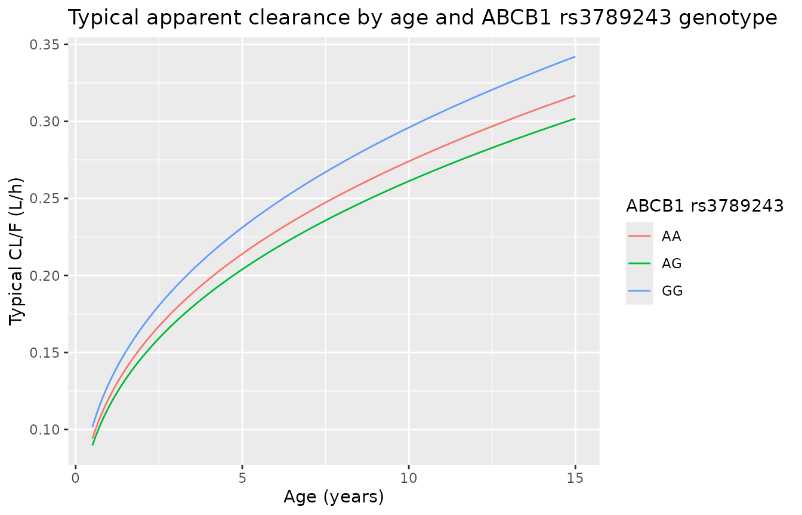
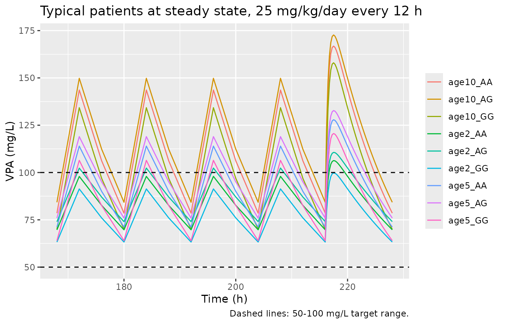
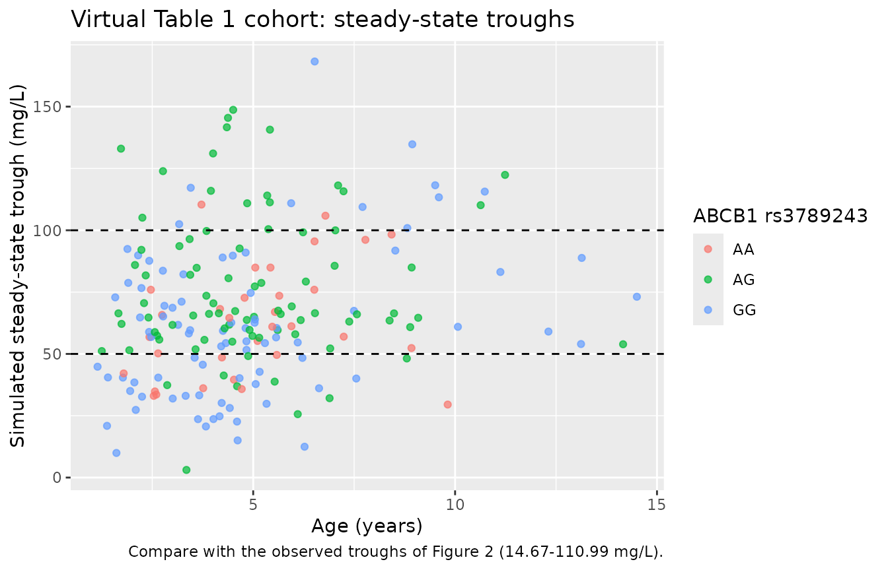
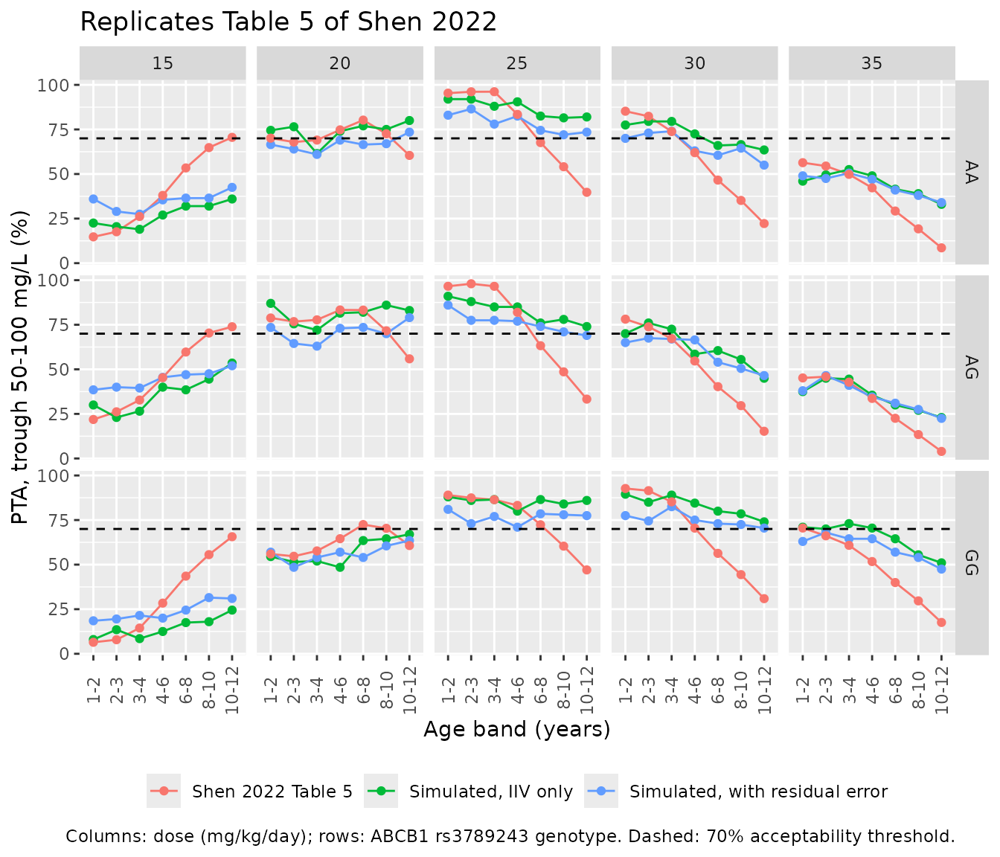
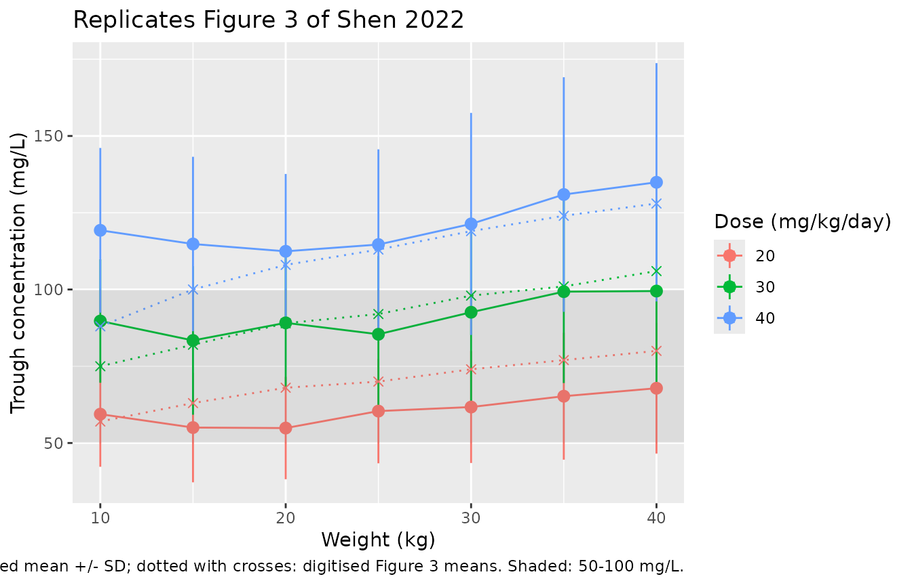

# Valproic acid (Shen 2022)

``` r

library(nlmixr2lib)
library(PKNCA)
#> 
#> Attaching package: 'PKNCA'
#> The following object is masked from 'package:stats':
#> 
#>     filter
library(rxode2)
#> rxode2 5.1.8 using 2 threads (see ?getRxThreads)
#>   no cache: create with `rxCreateCache()`
library(dplyr)
#> 
#> Attaching package: 'dplyr'
#> The following objects are masked from 'package:stats':
#> 
#>     filter, lag
#> The following objects are masked from 'package:base':
#> 
#>     intersect, setdiff, setequal, union
library(tidyr)
library(ggplot2)
```

## Model and source

``` r

mod_fn <- readModelDb("Shen_2022_valproic_acid")
mod <- rxode2::rxode2(mod_fn)
#> ℹ parameter labels from comments will be replaced by 'label()'
cat(mod$reference, "\n")
#> Shen X, Chen X, Lu J, Chen Q, Li W, Zhu J, He Y, Guo H, Xu C, Fan X. Pharmacogenetics-based population pharmacokinetic analysis and dose optimization of valproic acid in Chinese southern children with epilepsy: Effect of ABCB1 gene polymorphism. Front Pharmacol. 2022;13:1037239. doi:10.3389/fphar.2022.1037239. PMCID PMC9733833. Final-model equations 1-2 and Table 4; cohort demographics from Tables 1-2.
```

- Article: <https://doi.org/10.3389/fphar.2022.1037239>
- PMC: <https://www.ncbi.nlm.nih.gov/pmc/articles/PMC9733833/>

Shen et al. (2022) developed a one-compartment population PK model with
first-order absorption for total serum valproic acid (VPA) in Chinese
children with epilepsy. Because nearly every sample was a steady-state
morning trough, the absorption rate constant was fixed at 1.9 1/h from
the literature and inter-individual variability (IIV) was kept on
apparent clearance only. The final model (equations 1-2) is

- `CL/F = 0.214 * (AGE/5)^0.357 * 0.953^AG * 1.08^GG` (L/h), where `AG`
  and `GG` are indicators for the *ABCB1* rs3789243 heterozygous and
  homozygous variant genotypes and AA (the wild type) is the reference;
- `V/F = 3.63` L, with no covariates;
- additive residual error, SD 11.9 mg/L.

Body weight was significant on its own but was not retained because it
was highly correlated with age (r = 0.915) and age lowered the objective
function more (Table 3). Weight therefore enters the simulations below
only through the mg/kg dose.

## Population

The model was fit to 376 steady-state trough concentrations from 103
children (56 boys, 47 girls) treated at Shenzhen Baoan Women’s and
Children’s Hospital between September 2016 and January 2022 (Table 1).
Age was 5.30 +/- 3.39 years (range 0.5-15) and weight 19.9 +/- 10.6 kg
(range 6.5-52.0). VPA was given orally two or three times a day as syrup
or conventional tablets at 23.8 +/- 5.7 mg/kg/day (range 9.9-45.7).
Observed troughs were 60.54 +/- 19.32 mg/L (range 14.67-110.99). The
*ABCB1* rs3789243 genotypes were AA 14, AG 50 and GG 39 (Table 2).
Levetiracetam and oxcarbazepine were the most common co-medications;
none of the tested co-medications or the 12 genotyped SNPs other than
rs3789243 was retained.

``` r

str(mod_fn()$population, max.level = 1)
#> List of 15
#>  $ species        : chr "human"
#>  $ n_subjects     : num 103
#>  $ n_studies      : num 1
#>  $ n_observations : num 376
#>  $ age_range      : chr "0.5-15 years (Table 1); younger than 16 years by inclusion criterion."
#>  $ age_mean       : chr "5.30 years (SD 3.39; Table 1)."
#>  $ weight_range   : chr "6.5-52.0 kg (Table 1)."
#>  $ weight_mean    : chr "19.9 kg (SD 10.6; Table 1)."
#>  $ sex_female_pct : num 45.6
#>  $ race_ethnicity : Named num 100
#>   ..- attr(*, "names")= chr "Asian"
#>  $ disease_state  : chr "Children with epilepsy or an epileptic syndrome (ILAE classification) on valproic acid monotherapy or combinati"| __truncated__
#>  $ dose_range     : chr "Oral VPA two to three times daily as syrup (Depakine) or conventional tablets; 23.8 +/- 5.7 mg/kg/day, range 9."| __truncated__
#>  $ regions        : chr "China (single centre: Shenzhen Baoan Women's and Children's Hospital, September 2016 - January 2022)."
#>  $ abcb1_rs3789243: chr "AA 14, AG 50, GG 39 of 103 patients (Table 2; Hardy-Weinberg P = 0.748)."
#>  $ notes          : chr "Retrospective steady-state morning trough therapeutic-drug-monitoring samples (at least 1 week on a stable regi"| __truncated__
```

## Source trace

| Element | Value | Source location |
|----|----|----|
| Structure: one compartment, first-order absorption and elimination (ADVAN2 TRANS2) | – | Section 2.4.1 |
| `lka` | `fixed(log(1.9))` 1/h | Section 2.4.1 (“Ka was fixed at 1.9 h-1”) |
| `lcl` | `log(0.214)` L/h | Table 4, theta CL; equation 1 |
| `lvc` | `log(3.63)` L | Table 4, theta V; equation 2 |
| `e_age_cl` | 0.357 | Table 4, theta Age; equation 1 (reference age 5 years) |
| `e_snp_abcb1_rs3789243_ag_cl` | 0.953 | Table 4, theta ABCB1 AG; equation 1 |
| `e_snp_abcb1_rs3789243_gg_cl` | 1.08 | Table 4, theta ABCB1 GG; equation 1 |
| `etalcl` | 0.028161 = log(1 + 0.169^2) | Table 4, omega CL = 0.169 (footnote: omega is a CV) |
| `addSd` | 11.9 mg/L | Table 4, sigma additive |
| Genotype coding (AA reference, AG / GG indicators) | – | Text below equation 1 |
| IIV on V/F removed | – | Section 3.2 |

## Typical-value clearance across age and genotype

``` r

cl_typ <- function(age, ag, gg) {
  0.214 * (age / 5)^0.357 * 0.953^ag * 1.08^gg
}
geno <- tibble::tibble(
  genotype = c("AA", "AG", "GG"),
  SNP_ABCB1_RS3789243_AG = c(0L, 1L, 0L),
  SNP_ABCB1_RS3789243_GG = c(0L, 0L, 1L)
)
cl_curve <- tidyr::expand_grid(AGE = seq(0.5, 15, by = 0.1), geno) |>
  mutate(cl = cl_typ(AGE, SNP_ABCB1_RS3789243_AG, SNP_ABCB1_RS3789243_GG))

ggplot(cl_curve, aes(AGE, cl, colour = genotype)) +
  geom_line() +
  labs(
    x = "Age (years)", y = "Typical CL/F (L/h)", colour = "ABCB1 rs3789243",
    title = "Typical apparent clearance by age and ABCB1 rs3789243 genotype"
  )
```



## PKNCA: steady-state exposure of typical patients

Typical patients (no IIV, no residual error) aged 2, 5 and 10 years in
each genotype group receive 25 mg/kg/day as 12-hourly oral doses for 10
days. Body weight follows a smooth weight-for-age median (see the next
section). PKNCA on the last dosing interval (216-228 h) is compared with
the closed-form steady-state `AUCtau = Dose / CL` and the closed-form
one-compartment oral steady-state trough.

``` r

# Smooth infant-through-adolescent weight-for-age median (kg); about 20 kg at
# 5 years, close to the Table 1 cohort mean of 19.9 kg at a mean age of 5.3.
wt_for_age <- function(age) 3.3 + 6.2 * age / (0.35 + age) + 2.3 * age
```

``` r

mod_typ <- rxode2::zeroRe(mod)

typ <- tidyr::expand_grid(AGE = c(2, 5, 10), geno) |>
  mutate(
    id = row_number(),
    WT = wt_for_age(AGE),
    dose = 25 * WT / 2,
    treatment = paste0("age", AGE, "_", genotype)
  )

tau <- 12
dose_times <- seq(0, 216, by = tau)
ev_typ <- bind_rows(
  typ |>
    tidyr::crossing(time = dose_times) |>
    mutate(evid = 1L, amt = dose, cmt = "depot"),
  typ |>
    tidyr::crossing(time = c(seq(0, 216, by = 4), seq(216, 228, by = 0.25))) |>
    distinct(id, time, .keep_all = TRUE) |>
    mutate(evid = 0L, amt = 0, cmt = "central")
) |>
  arrange(id, time, desc(evid)) |>
  select(id, time, evid, amt, cmt, AGE, SNP_ABCB1_RS3789243_AG,
         SNP_ABCB1_RS3789243_GG, treatment)

sim_typ <- rxode2::rxSolve(mod_typ, ev_typ, keep = "treatment") |>
  as.data.frame()
#> ℹ omega/sigma items treated as zero: 'etalcl'
#> Warning: multi-subject simulation without without 'omega'

conc_ss <- sim_typ |>
  filter(!is.na(Cc), time >= 216, time <= 228) |>
  select(id, time, Cc, treatment)
dose_ss <- ev_typ |>
  filter(evid == 1L, time == 216) |>
  select(id, time, amt, treatment)

conc_obj <- PKNCAconc(conc_ss, Cc ~ time | treatment + id)
dose_obj <- PKNCAdose(dose_ss, amt ~ time | treatment + id)
intervals <- data.frame(
  start = 216, end = 228,
  cmax = TRUE, cmin = TRUE, auclast = TRUE, cav = TRUE
)
nca_res <- pk.nca(PKNCAdata(conc_obj, dose_obj, intervals = intervals))

# Closed-form one-compartment first-order-absorption steady state.
ka <- 1.9
ref_ss <- typ |>
  mutate(
    cl = cl_typ(AGE, SNP_ABCB1_RS3789243_AG, SNP_ABCB1_RS3789243_GG),
    kel = cl / 3.63,
    auclast = dose / cl,
    cmin = dose * ka / (3.63 * (ka - kel)) *
      (exp(-kel * tau) / (1 - exp(-kel * tau)) -
         exp(-ka * tau) / (1 - exp(-ka * tau)))
  ) |>
  select(treatment, auclast, cmin)

cmp <- nlmixr2lib::ncaComparisonTable(
  simulated = nca_res,
  reference = ref_ss,
  by = "treatment",
  params = c("auclast", "cmin"),
  units = c(auclast = "mg*h/L", cmin = "mg/L"),
  tolerance_pct = 2
)
knitr::kable(
  cmp,
  caption = "Steady-state PKNCA vs. closed-form one-compartment values (typical patients, 25 mg/kg/day every 12 h). * differs by > 2%."
)
```

| NCA parameter     | treatment | Reference | Simulated | % diff |
|:------------------|:----------|:----------|:----------|:-------|
| Cmin (mg/L)       | age2_AA   | 69.8      | 69.7      | -0.0%  |
| Cmin (mg/L)       | age2_AG   | 74.1      | 74.1      | -0.0%  |
| Cmin (mg/L)       | age2_GG   | 63.3      | 63.3      | -0.0%  |
| Cmin (mg/L)       | age5_AA   | 71.1      | 71.1      | -0.0%  |
| Cmin (mg/L)       | age5_AG   | 75.9      | 75.9      | -0.0%  |
| Cmin (mg/L)       | age5_GG   | 64        | 64        | -0.0%  |
| Cmin (mg/L)       | age10_AA  | 78.5      | 78.5      | -0.0%  |
| Cmin (mg/L)       | age10_AG  | 84.3      | 84.3      | -0.0%  |
| Cmin (mg/L)       | age10_GG  | 70        | 70        | +0.0%  |
| AUClast (mg\*h/L) | age2_AA   | 1070      | 1070      | -0.0%  |
| AUClast (mg\*h/L) | age2_AG   | 1120      | 1120      | -0.1%  |
| AUClast (mg\*h/L) | age2_GG   | 988       | 988       | -0.0%  |
| AUClast (mg\*h/L) | age5_AA   | 1200      | 1200      | -0.1%  |
| AUClast (mg\*h/L) | age5_AG   | 1260      | 1260      | -0.1%  |
| AUClast (mg\*h/L) | age5_GG   | 1110      | 1110      | -0.1%  |
| AUClast (mg\*h/L) | age10_AA  | 1470      | 1470      | -0.1%  |
| AUClast (mg\*h/L) | age10_AG  | 1550      | 1540      | -0.1%  |
| AUClast (mg\*h/L) | age10_GG  | 1360      | 1360      | -0.1%  |

Steady-state PKNCA vs. closed-form one-compartment values (typical
patients, 25 mg/kg/day every 12 h). \* differs by \> 2%. {.table}

``` r


nca_chk <- as.data.frame(nca_res) |>
  filter(PPTESTCD %in% c("auclast", "cmin")) |>
  select(treatment, PPTESTCD, PPORRES) |>
  tidyr::pivot_wider(names_from = PPTESTCD, values_from = PPORRES) |>
  left_join(ref_ss, by = "treatment", suffix = c("_nca", "_ref"))
# Same drawn parameters on both sides, so only numerical error separates them;
# the slowest eliminator (2 years, AG; half-life about 16 h) is over 99.9% of
# the way to steady state after 216 h.
stopifnot(
  all(abs(nca_chk$auclast_nca / nca_chk$auclast_ref - 1) < 0.01),
  all(abs(nca_chk$cmin_nca / nca_chk$cmin_ref - 1) < 0.01)
)
```

``` r

ggplot(filter(sim_typ, time >= 168), aes(time, Cc, colour = treatment)) +
  geom_line() +
  geom_hline(yintercept = c(50, 100), linetype = "dashed") +
  labs(
    x = "Time (h)", y = "VPA (mg/L)", colour = NULL,
    title = "Typical patients at steady state, 25 mg/kg/day every 12 h",
    caption = "Dashed lines: 50-100 mg/L target range."
  )
```



## Virtual cohort resembling Table 1

A stochastic cohort of 200 children approximates Table 1: age drawn
log-normally to the cohort mean and SD (5.30 +/- 3.39 years) and
restricted to 0.5-15 years, weight from the weight-for-age median with
log-normal scatter restricted to 6.5-52 kg, the Table 2 rs3789243
genotype frequencies, and a daily dose drawn from a normal distribution
(23.8 +/- 5.7 mg/kg/day) restricted to 9.9-45.7 mg/kg/day, given every
12 hours. A steady-state morning trough (with residual error) is
simulated for each child.

``` r

# set.seed() fixes the covariate draw; rxSetSeed() fixes rxode2's IIV and
# residual draws within one rxode2 build only, so the checks below assert on
# the centre of the distribution, not on its extremes.
set.seed(20221125)
rxode2::rxSetSeed(20221125)
n_subj <- 200

rtrunc_redraw <- function(n, draw, lo, hi) {
  x <- draw(n)
  bad <- x < lo | x > hi
  while (any(bad)) {
    x[bad] <- draw(sum(bad))
    bad <- x < lo | x > hi
  }
  x
}
age_sdlog <- sqrt(log(1 + (3.39 / 5.30)^2))
age_mlog <- log(5.30) - age_sdlog^2 / 2

cohort <- tibble::tibble(
  id = seq_len(n_subj),
  AGE = rtrunc_redraw(n_subj, function(n) rlnorm(n, age_mlog, age_sdlog), 0.5, 15),
  genotype = sample(c("AA", "AG", "GG"), n_subj, replace = TRUE,
                    prob = c(14, 50, 39) / 103),
  mg_kg_day = rtrunc_redraw(n_subj, function(n) rnorm(n, 23.8, 5.7), 9.9, 45.7)
) |>
  mutate(
    WT = pmin(pmax(wt_for_age(AGE) * exp(rnorm(n_subj, 0, 0.15)), 6.5), 52),
    SNP_ABCB1_RS3789243_AG = as.integer(genotype == "AG"),
    SNP_ABCB1_RS3789243_GG = as.integer(genotype == "GG"),
    dose = mg_kg_day * WT / 2
  )

knitr::kable(
  tibble::tibble(
    Characteristic = c("Age (years)", "Weight (kg)", "Daily dose (mg/kg/day)"),
    Simulated = c(
      sprintf("%.2f +/- %.2f", mean(cohort$AGE), sd(cohort$AGE)),
      sprintf("%.1f +/- %.1f", mean(cohort$WT), sd(cohort$WT)),
      sprintf("%.1f +/- %.1f", mean(cohort$mg_kg_day), sd(cohort$mg_kg_day))
    ),
    `Shen 2022 Table 1` = c("5.30 +/- 3.39", "19.9 +/- 10.6", "23.8 +/- 5.7")
  ),
  caption = "Virtual cohort vs. Table 1 (mean +/- SD)."
)
```

| Characteristic         | Simulated     | Shen 2022 Table 1 |
|:-----------------------|:--------------|:------------------|
| Age (years)            | 4.96 +/- 2.56 | 5.30 +/- 3.39     |
| Weight (kg)            | 20.4 +/- 6.6  | 19.9 +/- 10.6     |
| Daily dose (mg/kg/day) | 24.0 +/- 5.6  | 23.8 +/- 5.7      |

Virtual cohort vs. Table 1 (mean +/- SD). {.table}

``` r


# Steady-state dose at time 0 (ss = 1, ii = 12); the 12 h observation is the
# steady-state trough just before the next dose.
ev_cohort <- bind_rows(
  cohort |> mutate(time = 0, evid = 1L, amt = dose, ss = 1L, ii = 12,
                   cmt = "depot"),
  cohort |> mutate(time = 12, evid = 0L, amt = 0, ss = 0L, ii = 0,
                   cmt = "central")
) |>
  arrange(id, time) |>
  select(id, time, evid, amt, ss, ii, cmt, AGE, SNP_ABCB1_RS3789243_AG,
         SNP_ABCB1_RS3789243_GG)

sim_cohort <- rxode2::rxSolve(mod, ev_cohort) |>
  as.data.frame() |>
  filter(time == 12) |>
  left_join(cohort |> select(id, genotype, WT), by = "id")
stopifnot(!anyNA(sim_cohort$sim), nrow(sim_cohort) == n_subj)

knitr::kable(
  tibble::tibble(
    Statistic = c("Mean", "SD", "Median", "5th percentile", "95th percentile"),
    `Simulated trough (mg/L)` = c(
      mean(sim_cohort$sim), sd(sim_cohort$sim), median(sim_cohort$sim),
      quantile(sim_cohort$sim, 0.05), quantile(sim_cohort$sim, 0.95)
    ),
    `Observed (Table 1)` = c("60.54", "19.32", "--", "--", "--")
  ),
  digits = 1,
  caption = "Simulated steady-state troughs (with residual error) vs. the observed troughs of Table 1 (range 14.67-110.99 mg/L)."
)
```

| Statistic       | Simulated trough (mg/L) | Observed (Table 1) |
|:----------------|------------------------:|:-------------------|
| Mean            |                    68.1 | 60.54              |
| SD              |                    29.5 | 19.32              |
| Median          |                    63.7 | –                  |
| 5th percentile  |                    25.6 | –                  |
| 95th percentile |                   118.4 | –                  |

Simulated steady-state troughs (with residual error) vs. the observed
troughs of Table 1 (range 14.67-110.99 mg/L). {.table}

``` r


# Structural check on the centre: a mis-transcribed CL, V or age exponent
# moves the median trough by tens of percent.
stopifnot(abs(median(sim_cohort$sim) / 60.54 - 1) < 0.2)
```

The simulated median trough sits close to the observed mean, while the
simulated spread is wider than observed. That is expected: clinical
doses were titrated by therapeutic drug monitoring toward 50-100 mg/L,
whereas the virtual doses are drawn independently of each child’s
clearance.

``` r

ggplot(sim_cohort, aes(AGE, sim, colour = genotype)) +
  geom_point(alpha = 0.7) +
  geom_hline(yintercept = c(50, 100), linetype = "dashed") +
  labs(
    x = "Age (years)", y = "Simulated steady-state trough (mg/L)",
    colour = "ABCB1 rs3789243",
    title = "Virtual Table 1 cohort: steady-state troughs",
    caption = "Compare with the observed troughs of Figure 2 (14.67-110.99 mg/L)."
  )
```



## Replicate Table 5: probability of target attainment

Table 5 gives the probability that the steady-state trough falls within
50-100 mg/L for 15-35 mg/kg/day given every 12 hours, by age band and
rs3789243 genotype. The paper does not say how body weight was assigned
to each simulated child; here each child gets the weight-for-age median
for an age drawn uniformly within the band. PTA is reported both on the
individual prediction (IIV only) and with the additive residual error
added.

The model is linear in dose, so a child’s individual trough at any dose
is the trough at 25 mg/kg/day scaled by dose / 25. Each of 200 children
per age band x genotype is therefore solved once at 25 mg/kg/day, the
individual trough is scaled to the other four doses, and a fresh
additive residual (SD 11.9 mg/L) is drawn for each dose.

``` r

rxode2::rxSetSeed(20221126)
set.seed(20221126)
bands <- tibble::tibble(
  band = c("1-2", "2-3", "3-4", "4-6", "6-8", "8-10", "10-12"),
  lo = c(1, 2, 3, 4, 6, 8, 10),
  hi = c(2, 3, 4, 6, 8, 10, 12)
)
n_arm <- 200
pta_design <- tidyr::expand_grid(bands, geno, rep = seq_len(n_arm)) |>
  mutate(
    id = row_number(),
    AGE = lo + runif(n()) * (hi - lo),
    WT = wt_for_age(AGE),
    dose = 25 * WT / 2
  )

ev_pta <- bind_rows(
  pta_design |> mutate(time = 0, evid = 1L, amt = dose, ss = 1L, ii = 12,
                       cmt = "depot"),
  pta_design |> mutate(time = 12, evid = 0L, amt = 0, ss = 0L, ii = 0,
                       cmt = "central")
) |>
  arrange(id, time) |>
  select(id, time, evid, amt, ss, ii, cmt, AGE, SNP_ABCB1_RS3789243_AG,
         SNP_ABCB1_RS3789243_GG)

sim_pta25 <- rxode2::rxSolve(mod, ev_pta) |>
  as.data.frame() |>
  filter(time == 12) |>
  select(id, Cc25 = Cc) |>
  left_join(pta_design |> select(id, band, genotype), by = "id")
stopifnot(!anyNA(sim_pta25$Cc25), nrow(sim_pta25) == nrow(pta_design))

add_sd <- mod$iniDf$est[mod$iniDf$name == "addSd"]
sim_pta <- sim_pta25 |>
  tidyr::crossing(mg_kg_day = c(15, 20, 25, 30, 35)) |>
  mutate(
    ipred = Cc25 * mg_kg_day / 25,
    dv = ipred + rnorm(n(), 0, add_sd)
  )

pta_sim <- sim_pta |>
  group_by(genotype, mg_kg_day, band) |>
  summarise(
    pta_ipred = 100 * mean(ipred >= 50 & ipred <= 100),
    pta_resid = 100 * mean(dv >= 50 & dv <= 100),
    .groups = "drop"
  )

pta_paper <- tibble::tribble(
  ~genotype, ~mg_kg_day, ~`1-2`, ~`2-3`, ~`3-4`, ~`4-6`, ~`6-8`, ~`8-10`, ~`10-12`,
  "AG", 15, 21.86, 26.17, 32.77, 45.32, 59.71, 70.36, 73.89,
  "AG", 20, 78.80, 76.77, 77.75, 83.3, 83.23, 71.60, 55.89,
  "AG", 25, 96.58, 97.99, 96.56, 81.98, 63.25, 48.59, 33.29,
  "AG", 30, 78.14, 73.83, 67.23, 54.68, 40.29, 29.63, 15.26,
  "AG", 35, 45.17, 45.84, 42.79, 33.68, 22.53, 13.41, 3.95,
  "AA", 15, 14.76, 17.61, 26.17, 38.00, 53.41, 64.82, 70.56,
  "AA", 20, 70.11, 67.92, 69.04, 74.77, 80.24, 72.57, 60.44,
  "AA", 25, 95.36, 96.13, 96.16, 83.45, 67.62, 54.08, 39.74,
  "AA", 30, 85.22, 82.39, 73.83, 61.98, 46.59, 35.18, 22.22,
  "AA", 35, 56.36, 54.47, 49.82, 42.25, 29.24, 19.25, 8.60,
  "GG", 15, 6.44, 7.88, 14.43, 28.41, 43.55, 55.60, 65.66,
  "GG", 20, 55.96, 54.69, 57.69, 64.54, 72.46, 70.36, 60.70,
  "GG", 25, 89.00, 87.44, 86.43, 83.22, 72.36, 60.36, 47.03,
  "GG", 30, 92.7, 91.48, 85.21, 70.47, 56.32, 44.40, 30.92,
  "GG", 35, 70.53, 66.16, 60.82, 51.73, 39.96, 29.67, 17.57
) |>
  tidyr::pivot_longer(-c(genotype, mg_kg_day), names_to = "band",
                      values_to = "pta_paper")

pta_cmp <- pta_sim |>
  left_join(pta_paper, by = c("genotype", "mg_kg_day", "band")) |>
  mutate(band = factor(band, levels = bands$band))

pta_cmp |>
  mutate(cell = sprintf("%.0f / %.0f / %.0f", pta_ipred, pta_resid, pta_paper)) |>
  select(genotype, mg_kg_day, band, cell) |>
  arrange(band) |>
  tidyr::pivot_wider(names_from = band, values_from = cell) |>
  arrange(genotype, mg_kg_day) |>
  dplyr::rename("ABCB1 rs3789243" = genotype, "Dose (mg/kg/day)" = mg_kg_day) |>
  knitr::kable(caption = "PTA (%) by age band (years): simulated IIV-only / simulated with residual error / Shen 2022 Table 5.")
```

| ABCB1 rs3789243 | Dose (mg/kg/day) | 1-2 | 2-3 | 3-4 | 4-6 | 6-8 | 8-10 | 10-12 |
|:---|---:|:---|:---|:---|:---|:---|:---|:---|
| AA | 15 | 22 / 36 / 15 | 20 / 29 / 18 | 19 / 28 / 26 | 27 / 36 / 38 | 32 / 36 / 53 | 32 / 36 / 65 | 36 / 42 / 71 |
| AA | 20 | 74 / 66 / 70 | 76 / 64 / 68 | 62 / 61 / 69 | 74 / 69 / 75 | 77 / 66 / 80 | 75 / 67 / 73 | 80 / 74 / 60 |
| AA | 25 | 92 / 83 / 95 | 92 / 86 / 96 | 88 / 78 / 96 | 90 / 82 / 83 | 82 / 74 / 68 | 82 / 72 / 54 | 82 / 74 / 40 |
| AA | 30 | 78 / 70 / 85 | 80 / 73 / 82 | 80 / 74 / 74 | 72 / 63 / 62 | 66 / 60 / 47 | 66 / 64 / 35 | 64 / 55 / 22 |
| AA | 35 | 46 / 49 / 56 | 50 / 48 / 54 | 52 / 50 / 50 | 49 / 47 / 42 | 42 / 41 / 29 | 39 / 38 / 19 | 33 / 34 / 9 |
| AG | 15 | 30 / 38 / 22 | 23 / 40 / 26 | 26 / 40 / 33 | 40 / 46 / 45 | 38 / 47 / 60 | 44 / 48 / 70 | 54 / 52 / 74 |
| AG | 20 | 87 / 74 / 79 | 76 / 64 / 77 | 72 / 63 / 78 | 82 / 73 / 83 | 82 / 74 / 83 | 86 / 70 / 72 | 83 / 79 / 56 |
| AG | 25 | 91 / 86 / 97 | 88 / 78 / 98 | 85 / 78 / 97 | 85 / 77 / 82 | 76 / 74 / 63 | 78 / 71 / 49 | 74 / 69 / 33 |
| AG | 30 | 70 / 65 / 78 | 76 / 68 / 74 | 72 / 67 / 67 | 58 / 66 / 55 | 60 / 54 / 40 | 56 / 50 / 30 | 45 / 46 / 15 |
| AG | 35 | 38 / 38 / 45 | 45 / 46 / 46 | 44 / 41 / 43 | 36 / 34 / 34 | 30 / 31 / 23 | 27 / 28 / 13 | 23 / 22 / 4 |
| GG | 15 | 8 / 18 / 6 | 14 / 20 / 8 | 8 / 22 / 14 | 12 / 20 / 28 | 18 / 24 / 44 | 18 / 32 / 56 | 24 / 31 / 66 |
| GG | 20 | 55 / 57 / 56 | 52 / 48 / 55 | 52 / 54 / 58 | 48 / 57 / 65 | 64 / 54 / 72 | 64 / 60 / 70 | 67 / 64 / 61 |
| GG | 25 | 88 / 81 / 89 | 86 / 73 / 87 | 86 / 77 / 86 | 80 / 71 / 83 | 86 / 78 / 72 | 84 / 78 / 60 | 86 / 78 / 47 |
| GG | 30 | 90 / 78 / 93 | 85 / 74 / 91 | 89 / 82 / 85 | 84 / 75 / 70 | 80 / 73 / 56 | 78 / 72 / 44 | 74 / 70 / 31 |
| GG | 35 | 71 / 63 / 71 | 70 / 68 / 66 | 73 / 64 / 61 | 70 / 64 / 52 | 64 / 57 / 40 | 56 / 54 / 30 | 51 / 48 / 18 |

PTA (%) by age band (years): simulated IIV-only / simulated with
residual error / Shen 2022 Table 5. {.table}

``` r

pta_cmp |>
  tidyr::pivot_longer(c(pta_ipred, pta_resid, pta_paper), names_to = "source",
                      values_to = "pta") |>
  mutate(source = dplyr::recode(source, pta_ipred = "Simulated, IIV only",
                                pta_resid = "Simulated, with residual error",
                                pta_paper = "Shen 2022 Table 5")) |>
  ggplot(aes(band, pta, colour = source, group = source)) +
  geom_line() +
  geom_point() +
  geom_hline(yintercept = 70, linetype = "dashed") +
  facet_grid(genotype ~ mg_kg_day) +
  labs(
    x = "Age band (years)", y = "PTA, trough 50-100 mg/L (%)", colour = NULL,
    title = "Replicates Table 5 of Shen 2022",
    caption = "Columns: dose (mg/kg/day); rows: ABCB1 rs3789243 genotype. Dashed: 70% acceptability threshold."
  ) +
  theme(axis.text.x = element_text(angle = 90, vjust = 0.5),
        legend.position = "bottom")
```



``` r

pta_cmp <- pta_cmp |>
  mutate(age_group = ifelse(band %in% c("1-2", "2-3", "3-4", "4-6"),
                            "1-6 years", "6-12 years"))
pta_cmp |>
  group_by(age_group) |>
  summarise(
    `Median |diff|, IIV only` = median(abs(pta_ipred - pta_paper)),
    `Median |diff|, with residual` = median(abs(pta_resid - pta_paper)),
    .groups = "drop"
  ) |>
  dplyr::rename("Age bands" = age_group) |>
  knitr::kable(digits = 1, caption = "Median absolute PTA difference (percentage points) from Table 5.")
```

| Age bands  | Median \|diff\|, IIV only | Median \|diff\|, with residual |
|:-----------|--------------------------:|-------------------------------:|
| 1-6 years  |                       5.4 |                            7.4 |
| 6-12 years |                      23.7 |                           18.6 |

Median absolute PTA difference (percentage points) from Table 5.
{.table}

``` r


# Centre and robust envelope; the per-cell Monte Carlo standard error at
# n = 200 is up to 3.5 percentage points. The 1-6-year bands are checked
# tightly; the older bands depend on the unstated weight assignment (see
# Assumptions and deviations).
young <- filter(pta_cmp, age_group == "1-6 years")
stopifnot(
  median(abs(young$pta_ipred - young$pta_paper)) < 10,
  abs(median(pta_cmp$pta_ipred - pta_cmp$pta_paper)) < 10
)
```

## Replicate Figure 3: trough by body weight and dose

Figure 3 shows mean +/- SD predicted troughs for children of 10-40 kg at
20, 30 and 40 mg/kg/day. The paper does not state the age assigned to
each weight; here each weight is mapped to the age at which the
weight-for-age median equals it. The digitised Figure 3 means are
overlaid.

``` r

rxode2::rxSetSeed(20221127)
age_for_wt <- function(wt) {
  vapply(wt, function(w) uniroot(function(a) wt_for_age(a) - w,
                                  c(0.01, 25))$root, numeric(1))
}
fig3_design <- tidyr::expand_grid(
  WT = seq(10, 40, by = 5),
  mg_kg_day = c(20, 30, 40),
  rep = seq_len(100)
) |>
  mutate(
    id = row_number(),
    AGE = age_for_wt(WT),
    genotype = sample(c("AA", "AG", "GG"), n(), replace = TRUE,
                      prob = c(14, 50, 39) / 103),
    SNP_ABCB1_RS3789243_AG = as.integer(genotype == "AG"),
    SNP_ABCB1_RS3789243_GG = as.integer(genotype == "GG"),
    dose = mg_kg_day * WT / 2
  )
ev_fig3 <- bind_rows(
  fig3_design |> mutate(time = 0, evid = 1L, amt = dose, ss = 1L, ii = 12,
                        cmt = "depot"),
  fig3_design |> mutate(time = 12, evid = 0L, amt = 0, ss = 0L, ii = 0,
                        cmt = "central")
) |>
  arrange(id, time) |>
  select(id, time, evid, amt, ss, ii, cmt, AGE, SNP_ABCB1_RS3789243_AG,
         SNP_ABCB1_RS3789243_GG)

sim_fig3 <- rxode2::rxSolve(mod, ev_fig3) |>
  as.data.frame() |>
  filter(time == 12) |>
  select(id, sim) |>
  left_join(fig3_design |> select(id, WT, mg_kg_day), by = "id") |>
  group_by(WT, mg_kg_day) |>
  summarise(mean = mean(sim), sd = sd(sim), .groups = "drop")

# Means digitised by the maintainers from Figure 3 (approximate, +/- 3 mg/L).
fig3_paper <- tibble::tribble(
  ~WT, ~`20`, ~`30`, ~`40`,
  10, 57, 75, 88,
  15, 63, 82, 100,
  20, 68, 89, 108,
  25, 70, 92, 113,
  30, 74, 98, 119,
  35, 77, 101, 124,
  40, 80, 106, 128
) |>
  tidyr::pivot_longer(-WT, names_to = "mg_kg_day", values_to = "paper_mean") |>
  mutate(mg_kg_day = as.numeric(mg_kg_day))

fig3_cmp <- left_join(sim_fig3, fig3_paper, by = c("WT", "mg_kg_day"))

ggplot(fig3_cmp, aes(WT, mean, colour = factor(mg_kg_day))) +
  geom_pointrange(aes(ymin = mean - sd, ymax = mean + sd)) +
  geom_line() +
  geom_line(aes(y = paper_mean), linetype = "dotted") +
  geom_point(aes(y = paper_mean), shape = 4, size = 2) +
  annotate("rect", xmin = -Inf, xmax = Inf, ymin = 50, ymax = 100,
           alpha = 0.1) +
  labs(
    x = "Weight (kg)", y = "Trough concentration (mg/L)",
    colour = "Dose (mg/kg/day)",
    title = "Replicates Figure 3 of Shen 2022",
    caption = "Solid: simulated mean +/- SD; dotted with crosses: digitised Figure 3 means. Shaded: 50-100 mg/L."
  )
```



``` r


fig3_cmp |>
  mutate(ratio = mean / paper_mean) |>
  dplyr::rename("Weight (kg)" = WT, "Dose (mg/kg/day)" = mg_kg_day,
                "Simulated mean (mg/L)" = mean, "Simulated SD (mg/L)" = sd,
                "Figure 3 mean (mg/L)" = paper_mean,
                "Simulated / Figure 3" = ratio) |>
  knitr::kable(digits = 2, caption = "Figure 3 replication.")
```

| Weight (kg) | Dose (mg/kg/day) | Simulated mean (mg/L) | Simulated SD (mg/L) | Figure 3 mean (mg/L) | Simulated / Figure 3 |
|---:|---:|---:|---:|---:|---:|
| 10 | 20 | 59.39 | 17.14 | 57 | 1.04 |
| 10 | 30 | 89.72 | 20.10 | 75 | 1.20 |
| 10 | 40 | 119.28 | 26.83 | 88 | 1.36 |
| 15 | 20 | 55.03 | 17.83 | 63 | 0.87 |
| 15 | 30 | 83.40 | 24.19 | 82 | 1.02 |
| 15 | 40 | 114.82 | 28.41 | 100 | 1.15 |
| 20 | 20 | 54.86 | 16.67 | 68 | 0.81 |
| 20 | 30 | 89.14 | 21.44 | 89 | 1.00 |
| 20 | 40 | 112.44 | 25.19 | 108 | 1.04 |
| 25 | 20 | 60.39 | 17.00 | 70 | 0.86 |
| 25 | 30 | 85.41 | 25.49 | 92 | 0.93 |
| 25 | 40 | 114.64 | 31.01 | 113 | 1.01 |
| 30 | 20 | 61.72 | 18.23 | 74 | 0.83 |
| 30 | 30 | 92.59 | 29.05 | 98 | 0.94 |
| 30 | 40 | 121.35 | 36.17 | 119 | 1.02 |
| 35 | 20 | 65.24 | 20.67 | 77 | 0.85 |
| 35 | 30 | 99.30 | 29.77 | 101 | 0.98 |
| 35 | 40 | 130.93 | 38.20 | 124 | 1.06 |
| 40 | 20 | 67.84 | 21.28 | 80 | 0.85 |
| 40 | 30 | 99.49 | 29.64 | 106 | 0.94 |
| 40 | 40 | 134.92 | 38.82 | 128 | 1.05 |

Figure 3 replication. {.table style="width:100%;"}

``` r


# At 20 mg/kg/day the replicated means sit within 25% of Figure 3 (the
# lightest children agree closely); see Assumptions and deviations for the
# higher doses.
fig3_20 <- filter(fig3_cmp, mg_kg_day == 20)
stopifnot(abs(median(fig3_20$mean / fig3_20$paper_mean) - 1) < 0.25)
```

## Assumptions and deviations

- **Omega scale.** Table 4 prints `omega CL = 0.169` under the heading
  “IIV on CL/F (%)”, and the table footnote defines omega as the
  coefficient of variation of IIV. It is encoded as a CV of 16.9%,
  i.e. variance `log(1 + 0.169^2) = 0.0282`. Reading it as a variance
  (CV about 43%) is inconsistent with the reported eta-shrinkage: with
  an additive SD of 11.9 mg/L, about 3.7 troughs per child and a mean
  trough near 60 mg/L, a 16.9% CV implies about 15% shrinkage (reported
  12.1%), whereas a 0.169 variance implies about 3%. The base model’s
  0.302 / 13.7 mg/L / 5.8% gives the same agreement.
- **Residual error.** Table 4 lists `sigma additive = 11.9` with units
  of mg/L; it is encoded as an additive SD of 11.9 mg/L.
- **Dosing interval.** Children in the cohort were dosed two or three
  times a day; every simulation here uses 12-hourly dosing, the regimen
  the paper used for its own simulations (Section 2.6).
- **Weight assignment.** The model does not contain weight, but mg/kg
  doses do. The paper does not state how weight was assigned to
  simulated children of a given age (Table 5) or age to a given weight
  (Figure 3); a smooth weight-for-age median (about 20 kg at 5 years,
  matching the cohort) is used for both.
- **Table 5.** The paper’s PTA peaks at 96-98% for 1-4-year-olds at 25
  mg/kg/day. The additive residual SD of 11.9 mg/L alone caps PTA well
  below that for any trough distribution centred in the 50-100 mg/L
  window, so the published table was most likely computed on individual
  predictions without residual error; the IIV-only simulation is the
  closer analogue and is the one checked above. In the 1-6-year bands it
  tracks the published cells closely. In the 6-12-year bands the
  published PTA peaks at lower doses (15-20 mg/kg/day) than the
  simulation does, i.e. the paper’s older children had higher troughs
  per mg/kg. Because the trough scales with weight / CL(age), this is
  what heavier-for-age children would produce; the weight assignment is
  not stated, so the difference is reported and not adjusted.
- **Figure 3.** Figure 3’s means rise less than proportionally with dose
  (at 10 kg, 57, 75 and 88 mg/L at 20, 30 and 40 mg/kg/day, a 1.54-fold
  rise for a 2-fold dose). The final model is linear, so its troughs are
  exactly dose-proportional and the three dose curves cannot all be
  matched from equations 1-2 and Table 4: with this weight-to-age
  mapping the 20 mg/kg/day curve sits below Figure 3 for children above
  10 kg and the 40 mg/kg/day curve above it for the lightest children.
  The simulated standard deviations are of the same size as Figure 3’s
  error bars.
- **Covariates screened but not retained.** Body weight (correlated with
  age), total daily dose, sex, six co-medications and eleven other SNPs
  were screened (Table 3) and are not in the model; weight is recorded
  in the model’s `covariatesDataExcluded`.
