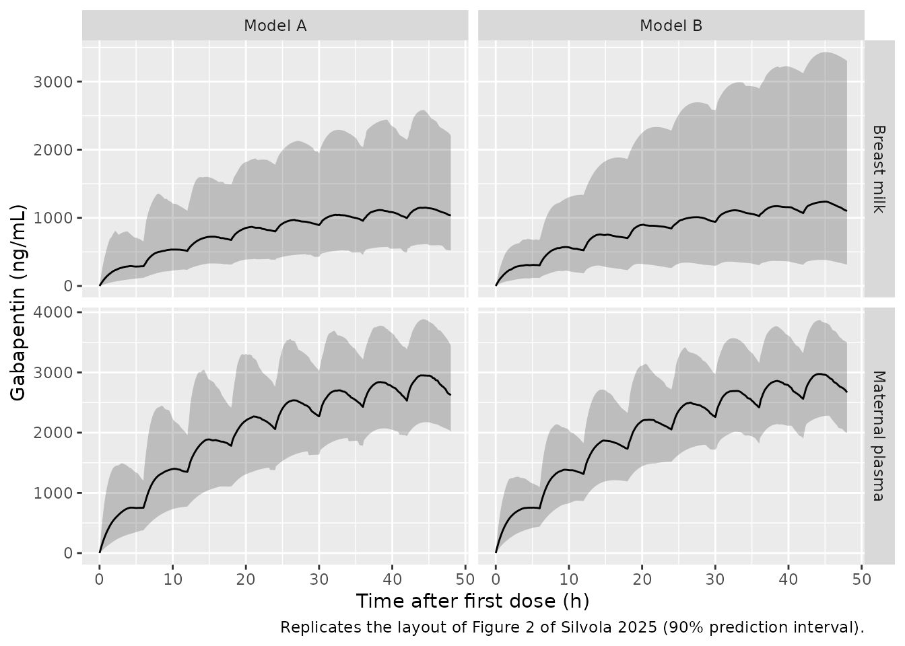
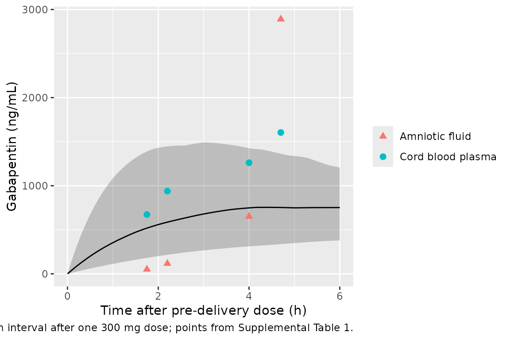

# Gabapentin in postpartum lactating women (Silvola 2025)

## Model and source

Silvola et al. fit gabapentin plasma and breast-milk concentrations from
women given gabapentin as part of an enhanced-recovery-after-surgery
(ERAS) protocol for cesarean delivery. Both final models share a
one-compartment oral plasma model and differ only in how breast milk is
linked to plasma. The authors reported both as final, carried both
through the infant-exposure simulations, and concluded that “either
model is reasonable”, so both are packaged:

- `Silvola_2025_gabapentin_mpr` (Model A): milk concentration is an
  estimated milk-to-plasma concentration ratio (MPR) times the plasma
  concentration.

- `Silvola_2025_gabapentin_milkcmt` (Model B): an explicit breast-milk
  compartment exchanging with plasma through first-order rate constants.

- Citation: Silvola R, O’Kane A, Heathman M, Marotta H, Trussel H, Ray
  B, Dowden S, Masters AR, Haas DM, Quinney SK. Population
  Pharmacokinetics and Transfer of Gabapentin When Used as a Pain
  Adjunct for Cesarean Deliveries. CPT Pharmacometrics Syst Pharmacol.
  2025;14(3):551-560. <doi:10.1002/psp4.13295>. PMCID: PMC11919262.

- Description (Model A): One-compartment oral population PK model of
  gabapentin in immediately postpartum lactating women after cesarean
  delivery (Model A of Silvola 2025), with first-order absorption and
  linear elimination. Breast-milk concentration is an algebraic
  observable equal to an estimated milk-to-plasma concentration ratio
  times the plasma concentration (no milk compartment). The absorption
  rate constant is parameterised as a multiple of each subject’s own
  elimination rate constant (ka = karatio \* CL/V, karatio bounded \>= 1
  to exclude flip-flop kinetics), so ka inherits the between-subject
  variability of CL/F and V/F. No covariates were retained. Sibling
  Silvola_2025_gabapentin_milkcmt is the authors’ Model B, which
  replaces the ratio with an explicit milk compartment.

- Description (Model B): One-compartment oral population PK model of
  gabapentin in immediately postpartum lactating women after cesarean
  delivery (Model B of Silvola 2025), with first-order absorption,
  linear elimination and a reversible breast-milk compartment. Drug
  moves between plasma and milk with first-order rate constants and is
  not eliminated from milk. The milk volume (30 mL, typical colostrum
  volume of the first 2 days postpartum) and the central-to-milk rate
  constant (1/h) were held at fixed values for identifiability; the
  milk-to-central rate constant was estimated with between-subject
  variability. The absorption rate constant is parameterised as a
  multiple of each subject’s own elimination rate constant (ka = karatio
  \* CL/V, karatio bounded \>= 1 to exclude flip-flop kinetics). No
  covariates were retained. Sibling Silvola_2025_gabapentin_mpr is the
  authors’ Model A, which replaces the milk compartment with a
  milk-to-plasma concentration ratio.

- Article: <https://doi.org/10.1002/psp4.13295> (open access,
  PMC11919262)

- Supplements: Data S1 (Model A NONMEM control stream), Data S2 (Model B
  NONMEM control stream), Data S3 (Supplemental Table 1 and Figures
  S1-S4).

## Population

Twenty-one healthy women with singleton pregnancies, aged 18 years or
older, undergoing elective or urgent cesarean delivery and planning to
breastfeed, were enrolled at a single centre in Indianapolis, Indiana
(NCT05099484, February-August 2021). Each received 300 mg oral
gabapentin before delivery and 300 mg every 6 h for 48 h afterwards.
Plasma was sampled before and 0.25, 0.5, 1, 1.5, 2, 4 and 6 h after one
postpartum dose; breast milk at least every 2 h over the same interval.
One woman taking 600 mg every 6 h was excluded from the model, leaving
125 plasma concentrations from 20 women and 35 milk concentrations from
15 women.

Table 1 (n = 21): median age 29 (19-41) years, weight 107.5 (68.5-154)
kg, BMI 35.8 (26.2-48.2), lean body mass 55.2 (39.8-71.8) kg, eGFR (2021
CKD-EPI) 151 (61-218) mL/min/1.73 m^2, gestational age at delivery 39.1
(31.1-41.3) weeks; 48% Caucasian, 48% Black/African, 5% Native
Hawaiian/Pacific Islander; 14% Hispanic. No covariate was retained in
either final model, so the virtual cohorts below need no covariate
columns.

The same information is available programmatically via
`readModelDb("Silvola_2025_gabapentin_mpr")()$population`.

## Source trace

| Equation / parameter | Model A | Model B | Source location |
|----|----|----|----|
| `lkaratio` (ka / kel) | `log(7.828)`, lower bound 0 | `log(9.904)`, lower bound 0 | Data S1/S2 `TVKA = THETA(1)*KE`, `$THETA (1, 7.67)`; back-solved from Table 2/3 KA |
| derived `ka` (1/h) | 0.43 | 0.51 | Table 2 / Table 3 ‘KA (h-1)’ |
| `lcl` (CL/F, L/h) | `log(15.6)` | `log(15.5)` | Table 2 / Table 3 |
| `lvc` (V2/F, L) | `log(284)` | `log(301)` | Table 2 / Table 3 |
| `lcmpr` (MPR) | `log(0.401)` | – | Table 2 |
| `lvmilk` (V3/F, L) | – | `fixed(log(0.03))` | Table 3; Methods 2.6 (30 mL) |
| `lk_central_milk` (K23, 1/h) | – | `fixed(log(1))` | Table 3; Methods 2.6 |
| `lk_milk_central` (K32, 1/h) | – | `log(24800)` | Table 3 |
| `etalcl` | 0.0249 | 0.029 | Table 2 / Table 3 omega^2 CL/F |
| `etalvc` | 0.163 | 0.106 | Table 2 / Table 3 omega^2 V2/F |
| `etalcmpr` | 0.153 | – | Table 2 omega^2 MPR |
| `etalk_milk_central` | – | 0.328 | Table 3 omega^2 K32 |
| `propSd` | `sqrt(0.0128)` = 0.11314 | `sqrt(0.0138)` = 0.11747 | Table 2 / Table 3 sigma^2 plasma |
| `propSd_Cmilk` | `sqrt(0.0404)` = 0.20100 | `sqrt(0.0392)` = 0.19799 | Table 2 / Table 3 sigma^2 breast milk |
| `d/dt(depot)`, `d/dt(central)` |  |  | Figure 1; Data S1/S2 `$DES` |
| `d/dt(milk)` | – | `k_central_milk * central - k_milk_central * milk` | Figure 1; Data S2 `$DES` |
| `Cmilk <- cmpr * Cc` | yes | – | Data S1 `$ERROR` `IPRED = (A(2)/S2)*MPR` |
| `Cmilk <- milk / vmilk` | – | yes | Data S2 `S3 = V3/1000` |
| Proportional error, both outputs | yes | yes | Data S1 `$ERROR`; `*prop*` in both `$PROBLEM` lines |

## Typical-value identities

Two quantities can be checked exactly against the paper before any
simulation. First, the derived absorption rate constant reported in
Tables 2 and 3 is the product of the unprinted ka:kel ratio and the
typical kel. Second, Model B with milk not eliminated equilibrates
within seconds (`k_milk_central` = 24,800/h), so its milk:plasma
concentration ratio is
`(k_central_milk / k_milk_central) * (vc / vmilk)`, which should agree
with Model A’s directly estimated MPR of 0.401.

``` r

mod_a <- readModelDb("Silvola_2025_gabapentin_mpr")
mod_b <- readModelDb("Silvola_2025_gabapentin_milkcmt")

# One subject, 300 mg every 6 h for 48 h. Observations are on the `central`
# state with dvid = 1 so every model() variable (Cc, Cmilk, ka) comes back.
make_events <- function(ids, grid) {
  doses <- tidyr::expand_grid(id = ids, time = seq(0, 42, by = 6)) |>
    mutate(amt = 300, evid = 1L, cmt = "depot", dvid = NA_integer_)
  obs <- tidyr::expand_grid(id = ids, time = grid) |>
    mutate(amt = 0, evid = 0L, cmt = "central", dvid = 1L)
  bind_rows(doses, obs) |> arrange(id, time, desc(evid))
}

ev1 <- make_events(1L, seq(0, 48, by = 0.5))
typ_a <- rxode2::rxSolve(mod_a, ev1, omega = NA, sigma = NA, returnType = "data.frame")
#> ℹ parameter labels from comments will be replaced by 'label()'
typ_b <- rxode2::rxSolve(mod_b, ev1, omega = NA, sigma = NA, returnType = "data.frame")
#> ℹ parameter labels from comments will be replaced by 'label()'

ka_a <- unique(signif(typ_a$ka, 8))
ka_b <- unique(signif(typ_b$ka, 8))
ratio_b <- with(subset(typ_b, time >= 1), Cmilk / Cc)
ratio_b_expected <- (1 / 24800) * (301 / 0.03)

data.frame(
  quantity = c("Model A typical ka (1/h)", "Model B typical ka (1/h)",
               "Model B milk:plasma ratio, simulated", "Model B ratio, closed form",
               "Model A MPR (Table 2)"),
  value = c(ka_a, ka_b, median(ratio_b), ratio_b_expected, 0.401)
) |>
  knitr::kable(digits = 4)
```

| quantity                             |  value |
|:-------------------------------------|-------:|
| Model A typical ka (1/h)             | 0.4300 |
| Model B typical ka (1/h)             | 0.5100 |
| Model B milk:plasma ratio, simulated | 0.4046 |
| Model B ratio, closed form           | 0.4046 |
| Model A MPR (Table 2)                | 0.4010 |

``` r


stopifnot(
  # Both are closed forms of the same drawn parameters, so the tolerance is
  # numerical, not statistical.
  length(ka_a) == 1, abs(ka_a / 0.43 - 1) < 1e-3,
  length(ka_b) == 1, abs(ka_b / 0.51 - 1) < 1e-3,
  all(abs(ratio_b / ratio_b_expected - 1) < 1e-3),
  # The two structural approaches agree on the ratio to about 1%.
  abs(ratio_b_expected / 0.401 - 1) < 0.02
)
```

## Virtual cohort

The paper simulated 10,000 women per model receiving 300 mg every 6 h.
Here each model gets 200 women. The between-subject random effects are
drawn in R from the published variances and passed to `rxSolve()` as
event-table columns with `omega = NA`, so the cohort, and every number
checked below, is identical on every machine regardless of solver thread
count. Each draw is rescaled to exactly mean zero and the published
variance, so that a 200-subject sample does not sit a sampling error or
two away from the 10,000-subject medians it is compared against.
Residual error is not added: Table 4 summarises individual predictions.

``` r

set.seed(20250415)
n_sub <- 200L
grid <- seq(0, 48, by = 0.1)

# Standard-normal draw with exact sample mean 0 and SD 1, scaled to omega^2.
draw_eta <- function(n, omega2) {
  z <- rnorm(n)
  (z - mean(z)) / sd(z) * sqrt(omega2)
}

etas_a <- tibble(
  id = seq_len(n_sub),
  etalcl = draw_eta(n_sub, 0.0249),
  etalvc = draw_eta(n_sub, 0.163),
  etalcmpr = draw_eta(n_sub, 0.153)
)
etas_b <- tibble(
  id = seq_len(n_sub),
  etalcl = draw_eta(n_sub, 0.029),
  etalvc = draw_eta(n_sub, 0.106),
  etalk_milk_central = draw_eta(n_sub, 0.328)
)

ev_a <- make_events(seq_len(n_sub), grid) |> left_join(etas_a, by = "id")
ev_b <- make_events(seq_len(n_sub), grid) |> left_join(etas_b, by = "id")
```

## Simulation

``` r

sim_a <- rxode2::rxSolve(mod_a, ev_a, omega = NA, sigma = NA, returnType = "data.frame") |>
  mutate(model = "Model A")
sim_b <- rxode2::rxSolve(mod_b, ev_b, omega = NA, sigma = NA, returnType = "data.frame") |>
  mutate(model = "Model B")

# The supplied etas must reach the individual parameters.
cl_a <- sim_a |> distinct(id, cl) |> left_join(etas_a, by = "id")
stopifnot(
  nrow(cl_a) == n_sub,
  all(abs(cl_a$cl / (15.6 * exp(cl_a$etalcl)) - 1) < 1e-8)
)

sim <- bind_rows(sim_a, sim_b) |>
  select(id, time, Cc, Cmilk, model)
```

## Replicate published figures

### Figure 2: plasma and breast-milk prediction intervals

Figure 2 of the paper overlays the observed data on a 90% prediction
interval for each model and matrix. The observed data are not public;
the figure below shows the 5th, 50th and 95th percentiles of the
simulated individual predictions over the 48 h regimen.

``` r

sim |>
  pivot_longer(c(Cc, Cmilk), names_to = "matrix", values_to = "conc") |>
  mutate(
    matrix = recode(matrix, Cc = "Maternal plasma", Cmilk = "Breast milk"),
    conc = conc * 1000
  ) |>
  group_by(model, matrix, time) |>
  summarise(
    Q05 = quantile(conc, 0.05),
    Q50 = median(conc),
    Q95 = quantile(conc, 0.95),
    .groups = "drop"
  ) |>
  ggplot(aes(time, Q50)) +
  geom_ribbon(aes(ymin = Q05, ymax = Q95), alpha = 0.25) +
  geom_line() +
  facet_grid(matrix ~ model, scales = "free_y") +
  labs(
    x = "Time after first dose (h)", y = "Gabapentin (ng/mL)",
    caption = "Replicates the layout of Figure 2 of Silvola 2025 (90% prediction interval)."
  )
```



### Figure 3 and Supplemental Table 1: cord blood against maternal plasma

Figure 3 compares predicted maternal plasma concentrations with the cord
blood and amniotic fluid concentrations measured after the single
pre-delivery dose (Supplemental Table 1). Cord blood at delivery should
sit at or below the maternal plasma prediction band for the
corresponding time after dose.

``` r

cord <- tibble::tribble(
  ~subject, ~time, ~amniotic, ~cord,
  104, 4.7, 2890, 1604,
  107, 2.2, 117, 939,
  110, 1.75, 51, 673,
  112, 4, 651, 1261
)

sim_a |>
  filter(time <= 6) |>
  group_by(time) |>
  summarise(
    Q05 = quantile(Cc * 1000, 0.05),
    Q50 = median(Cc * 1000),
    Q95 = quantile(Cc * 1000, 0.95),
    .groups = "drop"
  ) |>
  ggplot(aes(time, Q50)) +
  geom_ribbon(aes(ymin = Q05, ymax = Q95), alpha = 0.25) +
  geom_line() +
  geom_point(data = cord, aes(time, cord, colour = "Cord blood plasma"), size = 2) +
  geom_point(data = cord, aes(time, amniotic, colour = "Amniotic fluid"), size = 2, shape = 17) +
  labs(
    x = "Time after pre-delivery dose (h)", y = "Gabapentin (ng/mL)", colour = NULL,
    caption = "Model A maternal plasma 90% prediction interval after one 300 mg dose; points from Supplemental Table 1."
  )
```



## PKNCA validation

Table 4 of the paper reports, for each model, the median and 95%
prediction interval of the average maternal plasma and breast-milk
concentrations on day 1 (0-24 h) and day 2 (24-48 h). The average
concentration over an interval is the PKNCA parameter `cav` (AUC over
the interval divided by its length), so PKNCA is run once per matrix
with one interval per day.

``` r

doses <- bind_rows(
  ev_a |> filter(evid == 1) |> mutate(model = "Model A"),
  ev_b |> filter(evid == 1) |> mutate(model = "Model B")
) |>
  select(id, time, amt, model)

intervals <- data.frame(start = c(0, 24), end = c(24, 48), cav = TRUE, auclast = TRUE)

run_nca <- function(conc_col) {
  conc <- sim |>
    filter(!is.na(.data[[conc_col]])) |>
    select(id, time, model, conc = all_of(conc_col))
  conc_obj <- PKNCA::PKNCAconc(conc, conc ~ time | model + id)
  dose_obj <- PKNCA::PKNCAdose(doses, amt ~ time | model + id)
  res <- PKNCA::pk.nca(PKNCA::PKNCAdata(conc_obj, dose_obj, intervals = intervals))
  as.data.frame(res) |>
    mutate(day = ifelse(start == 0, "Day 1", "Day 2"))
}

nca_plasma <- run_nca("Cc") |> mutate(matrix = "Maternal plasma")
nca_milk <- run_nca("Cmilk") |> mutate(matrix = "Breast milk")
nca <- bind_rows(nca_plasma, nca_milk)
```

### Comparison against Table 4

``` r

# Table 4 medians, converted from ng/mL to mg/L (the model's units).
published <- tibble::tribble(
  ~model, ~matrix, ~day, ~cav,
  "Model A", "Maternal plasma", "Day 1", 1480,
  "Model A", "Maternal plasma", "Day 2", 2650,
  "Model A", "Breast milk", "Day 1", 582,
  "Model A", "Breast milk", "Day 2", 1060,
  "Model B", "Maternal plasma", "Day 1", 1450,
  "Model B", "Maternal plasma", "Day 2", 2640,
  "Model B", "Breast milk", "Day 1", 580,
  "Model B", "Breast milk", "Day 2", 1070
) |>
  mutate(cav = cav / 1000)

sim_cav <- nca |>
  filter(PPTESTCD == "cav") |>
  select(model, matrix, day, PPTESTCD, PPORRES)

cmp <- nlmixr2lib::ncaComparisonTable(
  simulated = sim_cav,
  reference = published,
  by = c("model", "matrix", "day"),
  units = c(cav = "mg/L"),
  tolerance_pct = 20
)
knitr::kable(cmp, caption = "Median average concentration per day: simulated (200 women) vs Table 4 (10,000 women).")
```

| NCA parameter | model   | matrix          | day   | Reference | Simulated | % diff |
|:--------------|:--------|:----------------|:------|:----------|:----------|:-------|
| Cavg (mg/L)   | Model A | Maternal plasma | Day 1 | 1.48      | 1.46      | -1.6%  |
| Cavg (mg/L)   | Model A | Maternal plasma | Day 2 | 2.65      | 2.64      | -0.4%  |
| Cavg (mg/L)   | Model A | Breast milk     | Day 1 | 0.582     | 0.556     | -4.5%  |
| Cavg (mg/L)   | Model A | Breast milk     | Day 2 | 1.06      | 1.03      | -3.1%  |
| Cavg (mg/L)   | Model B | Maternal plasma | Day 1 | 1.45      | 1.44      | -0.4%  |
| Cavg (mg/L)   | Model B | Maternal plasma | Day 2 | 2.64      | 2.64      | +0.2%  |
| Cavg (mg/L)   | Model B | Breast milk     | Day 1 | 0.58      | 0.578     | -0.3%  |
| Cavg (mg/L)   | Model B | Breast milk     | Day 2 | 1.07      | 1.08      | +1.3%  |

Median average concentration per day: simulated (200 women) vs Table 4
(10,000 women). {.table}

``` r


pct <- sim_cav |>
  group_by(model, matrix, day) |>
  summarise(sim = median(PPORRES), .groups = "drop") |>
  inner_join(published, by = c("model", "matrix", "day")) |>
  mutate(pct_diff = 100 * (sim / cav - 1))
stopifnot(
  nrow(pct) == 8,
  # A mis-transcribed CL/F, V/F, MPR or milk rate constant, or a ng/mL vs mg/L
  # slip, moves these medians by tens of percent or more. With 200 women the
  # Monte Carlo error of a median is a few percent (milk BSV is largest).
  all(abs(pct$pct_diff) < 10)
)
```

The 95% prediction intervals from the same simulation, set beside Table
4:

``` r

nca |>
  filter(PPTESTCD == "cav") |>
  group_by(model, matrix, day) |>
  summarise(
    sim = sprintf(
      "%.0f (%.0f-%.0f)", 1000 * median(PPORRES),
      1000 * quantile(PPORRES, 0.025), 1000 * quantile(PPORRES, 0.975)
    ),
    .groups = "drop"
  ) |>
  left_join(
    tibble::tribble(
      ~model, ~matrix, ~day, ~table4,
      "Model A", "Maternal plasma", "Day 1", "1480 (695-2460)",
      "Model A", "Maternal plasma", "Day 2", "2650 (1770-3660)",
      "Model A", "Breast milk", "Day 1", "582 (206-1510)",
      "Model A", "Breast milk", "Day 2", "1060 (446-2430)",
      "Model B", "Maternal plasma", "Day 1", "1450 (830-2250)",
      "Model B", "Maternal plasma", "Day 2", "2640 (1880-3600)",
      "Model B", "Breast milk", "Day 1", "580 (186-1810)",
      "Model B", "Breast milk", "Day 2", "1070 (314-3610)"
    ),
    by = c("model", "matrix", "day")
  ) |>
  rename(
    "Model" = model, "Matrix" = matrix, "Day" = day,
    "Simulated median (95% PI), ng/mL" = sim,
    "Table 4 median (95% PI), ng/mL" = table4
  ) |>
  knitr::kable()
```

| Model | Matrix | Day | Simulated median (95% PI), ng/mL | Table 4 median (95% PI), ng/mL |
|:---|:---|:---|:---|:---|
| Model A | Breast milk | Day 1 | 556 (208-1585) | 582 (206-1510) |
| Model A | Breast milk | Day 2 | 1027 (443-2406) | 1060 (446-2430) |
| Model A | Maternal plasma | Day 1 | 1456 (741-2385) | 1480 (695-2460) |
| Model A | Maternal plasma | Day 2 | 2638 (1771-3628) | 2650 (1770-3660) |
| Model B | Breast milk | Day 1 | 578 (166-1884) | 580 (186-1810) |
| Model B | Breast milk | Day 2 | 1083 (288-4044) | 1070 (314-3610) |
| Model B | Maternal plasma | Day 1 | 1444 (819-2148) | 1450 (830-2250) |
| Model B | Maternal plasma | Day 2 | 2645 (1844-3588) | 2640 (1880-3600) |

### Maternal AUC over 48 h

The Results report a mean (SD) maternal plasma AUC0-48h of 103.7 (32.2)
mg\*h/L, median 98.2, from the individual Model A estimates of the 20
women.

``` r

auc48 <- nca_plasma |>
  filter(PPTESTCD == "auclast", model == "Model A") |>
  group_by(id) |>
  summarise(auc048 = sum(PPORRES), .groups = "drop")
summary(auc48$auc048)
#>    Min. 1st Qu.  Median    Mean 3rd Qu.    Max. 
#>   53.57   85.51   99.32  100.22  116.32  153.00
stopifnot(abs(median(auc48$auc048) / 98.2 - 1) < 0.15)
```

### Infant daily dose and relative infant dose

The paper computes the infant daily dose as the day-average milk
concentration times the daily milk intake (4 mL/kg on day 1, 13 mL/kg on
day 2) and the relative infant dose as the infant daily dose over a
maternal daily dose of 12.3 mg/kg/day (1200 mg/day at 97.7 kg).

``` r

intake <- c("Day 1" = 4, "Day 2" = 13) # mL/kg/day
mdd <- 12.3 # mg/kg/day

infant <- nca_milk |>
  filter(PPTESTCD == "cav") |>
  mutate(
    idd = PPORRES * intake[day] / 1000, # mg/L x mL/kg / 1000 = mg/kg/day
    rid = 100 * idd / mdd
  ) |>
  group_by(model, day) |>
  summarise(idd = median(idd), rid = median(rid), .groups = "drop") |>
  left_join(
    tibble::tribble(
      ~model, ~day, ~idd_pub, ~rid_pub,
      "Model A", "Day 1", 0.00233, 0.0189,
      "Model A", "Day 2", 0.0137, 0.112,
      "Model B", "Day 1", 0.00232, 0.0189,
      "Model B", "Day 2", 0.0139, 0.113
    ),
    by = c("model", "day")
  )

infant |>
  rename(
    "Model" = model, "Day" = day,
    "IDD simulated (mg/kg/day)" = idd, "IDD Table 4" = idd_pub,
    "RID simulated (%)" = rid, "RID Table 4" = rid_pub
  ) |>
  knitr::kable(digits = 5)
```

| Model | Day | IDD simulated (mg/kg/day) | RID simulated (%) | IDD Table 4 | RID Table 4 |
|:---|:---|---:|---:|---:|---:|
| Model A | Day 1 | 0.00222 | 0.01807 | 0.00233 | 0.0189 |
| Model A | Day 2 | 0.01335 | 0.10854 | 0.01370 | 0.1120 |
| Model B | Day 1 | 0.00231 | 0.01881 | 0.00232 | 0.0189 |
| Model B | Day 2 | 0.01409 | 0.11451 | 0.01390 | 0.1130 |

``` r


stopifnot(all(abs(infant$idd / infant$idd_pub - 1) < 0.10))
```

The paper’s Table 4 arithmetic is itself reproducible from its milk
concentrations: 582 ng/mL x 4 mL/kg = 0.00233 mg/kg/day, and 0.00233 /
12.3 = 0.0189%, which confirms that the reported breast-milk
concentration is the day-average concentration.

## Assumptions and deviations

- **The absorption rate constant is a multiple of kel.** Both control
  streams set `TVKA = THETA(1)*KE` with `THETA(1)` bounded below by 1,
  which is how the authors constrained ka to exceed ke and excluded the
  flip-flop solution their unconstrained fit found (Results 3.1). Tables
  2 and 3 print only the derived product (0.43 and 0.51/h), so the ratio
  is back-solved as `ka / (CL/F / V2/F)`: 7.828 for Model A and 9.904
  for Model B. The packaged models keep this form, through the canonical
  `lkaratio` / `karatio` that the maintainers ratified for it, with the
  lower bound of 1 written as `c(0, log(...))` on the log scale. Because
  between-subject variability sits on CL/F and V/F, each woman’s ka
  follows her own kel; a free `lka` would give the same typical profile
  but a narrower absorption-phase spread.
- **No BSV on ka.** Data S1 carries `$OMEGA 0 FIX` for ka; the paper
  retained BSV on CL/F and V/F “but not ka”. The packaged models have no
  `etalka`.
- **Data S2 is truncated.** The published Model B control stream stops
  inside `$ERROR`, so its `$THETA`, `$OMEGA` and `$SIGMA` blocks are
  missing. Every final estimate comes from Table 3, and the proportional
  error model is taken from the `*prop*` tag in its `$PROBLEM` line and
  the complete Model A stream.
- **Figure 1 writes Model A’s milk equation on amounts**
  (`A_BreastMilk = MPR x A_c`). MPR is a concentration ratio (Figure 1
  caption, Methods 2.6) and the Data S1 `$ERROR` block computes
  `IPRED = (A(2)/S2)*MPR`, a concentration, so the packaged model uses
  `Cmilk <- cmpr * Cc`.
- **Units.** The source reports ng/mL; the models use mg dose and L
  volumes, so concentrations are in mg/L (1 mg/L = 1000 ng/mL). The
  control streams’ `S2 = V2/1000` scaling is the same conversion.
- **Dosing in the Table 4 simulation.** The paper states only “300 mg of
  gabapentin every 6 h” for 48 h. The simulation here doses at 0, 6, …,
  42 h with time zero at the first dose, and day 1 and day 2 are 0-24 h
  and 24-48
  8.  
- **Figure 3 caption** says “every 8 h”, whereas the protocol (Methods
  2.1), the Methods 2.7 simulation and the 1200 mg/day maternal dose all
  say every 6 h; the caption is taken to be a typographical error.
- **Median maternal weight.** Table 1 gives 107.5 kg for the 21 enrolled
  women, while the Table 4 footnote uses 97.7 kg to derive the maternal
  daily dose of 12.3 mg/kg/day. Neither enters the model; the 12.3
  mg/kg/day used here reproduces the paper’s relative infant doses.
- **Covariates.** Weight, BMI, eGFR and time after delivery were
  explored graphically but not retained because they destabilised the
  model; they are recorded under `covariatesDataExcluded` in both model
  files.
- **Cohort size.** 200 simulated women per model instead of the paper’s
  10,000; the medians agree within the Monte Carlo error of that sample
  size.
