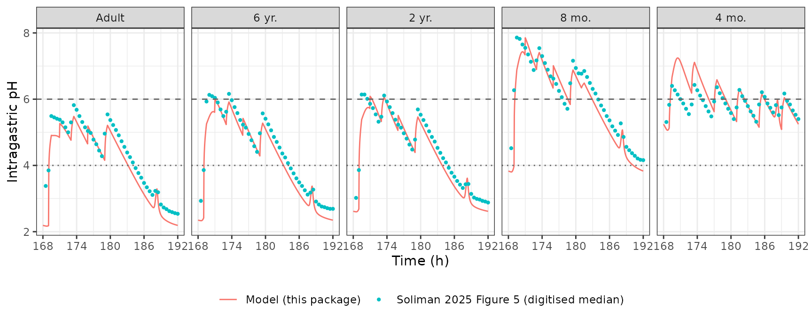

# Omeprazole intragastric pH (Soliman 2025)

## Model and source

- Citation: Soliman A, Rodriguez-Vera L, Alarcia-Lacalle A, et
  al. Leveraging Omeprazole PBPK/PD Modeling to Inform Drug-Drug
  Interactions and Specific Recommendations for Pediatric Labeling.
  Pharmaceutics. 2025;17(3):373. <doi:10.3390/pharmaceutics17030373>. PD
  model structure and the kdeg, kout, circadian and lag values from Liu
  D, Yang H, Jiang J, et al. Pharmacokinetic and Pharmacodynamic
  Modeling Analysis of Intravenous Esomeprazole in Healthy Volunteers. J
  Clin Pharmacol. 2016;56:816-826 (<doi:10.1002/jcph.733>); omeprazole
  kd from Katashima M, et al. Eur J Drug Metab Pharmacokinet.
  1998;23:19-26 (<doi:10.1007/BF03189822>), both as tabulated in Soliman
  2025 supplementary Table S1.
- Description: Semi-mechanistic intragastric-pH model for omeprazole in
  adults and children (Soliman 2025), the PD layer of the Soliman 2025
  omeprazole PBPK/PD analysis. Plasma omeprazole irreversibly
  inactivates the gastric H+/K+-ATPase (relative activity E/E0, turnover
  kdeg, second-order inactivation kd \* Cp acting after a 0.396 h lag);
  the active pump fraction scales a zero-order intragastric H+ secretion
  rate that carries a narrow night-time circadian dip, and H+ is cleared
  first-order (indirect-response model of Liu et al. 2016 for
  esomeprazole, with the omeprazole kd of Katashima et al. 1998). Meals
  dilute the gastric H+: each meal volume in mL is added to a
  dimensionless gastric-dilution state that relaxes back to 1 at the
  gastric-emptying rate kfe, and the observed H+ is the secreted H+
  divided by that state; pH is capped at 7.4. Only this PD layer is
  reproduced here: the PK layer is a GastroPlus whole-body PBPK model
  whose organ volumes, blood flows, partition coefficients and enzyme
  abundances are platform database outputs the paper does not print, so
  the omeprazole plasma concentration is supplied by the user as the
  time-varying covariate CP_OMEPRAZOLE_NGML and meals are supplied as
  dose records into the gastric_volume compartment. The baseline H+
  concentration defaults to the adult value; the paper’s pediatric
  baselines are listed in the population notes and are applied by
  overriding lrbase. No inter-individual variability or residual error
  is reported, so both are zero.
- Article: <https://doi.org/10.3390/pharmaceutics17030373> (open access,
  PMC11944414)
- Supplement:
  <https://www.mdpi.com/article/10.3390/pharmaceutics17030373/s1> (Table
  S1 lists the PD parameters; the section “Semi-mechanistic model to
  predict intragastric pH” gives Equations S1-S8)

Omeprazole is a proton-pump inhibitor: its acid-activated form binds the
gastric H+/K+-ATPase covalently, so acid suppression outlasts the plasma
exposure by days. Soliman 2025 built a GastroPlus whole-body PBPK model
of omeprazole and its hydroxy and sulphone metabolites in adults,
extrapolated it to children with CYP2C19 / CYP3A4 / CYP3A7 ontogeny, and
linked the predicted plasma concentrations to a semi-mechanistic
intragastric-pH model to compare acid suppression across ages, alone and
under a hypothetical complete CYP3A inhibition.

**Only the PD layer is packaged here.** The PBPK layer is a platform
whole-body model: organ volumes and blood flows come from the GastroPlus
PEAR physiology module, tissue partition coefficients from the Lukacova
method, and enzyme abundances from the GastroPlus database, none of
which the paper tabulates, so the PK cannot be rebuilt from the
publication. The PD layer, by contrast, is printed in full in the
supplement and depends on the PK only through the plasma concentration,
which the user supplies as the time-varying covariate
`CP_OMEPRAZOLE_NGML`. Meals enter as dose records (in mL) into the
`gastric_volume` compartment.

The PD structure is the esomeprazole model of Liu et al. (2016): the
relative pump activity `E/E0` turns over with rate `kdeg` and is
irreversibly inactivated at rate `kd * Cp`; active pumps secrete H+ at a
circadian zero-order rate `kin(t)`; H+ is cleared at `kout`; and meals
dilute the gastric contents. Soliman 2025 applied the model unchanged
across ages except for the fasting baseline H+ concentration and the
meal pattern.

## Population

The PD model was not fitted to data in Soliman 2025; it was applied to
simulated reference populations of 4 months, 8 months, 2 years, 6 years
and 37 years (100 subjects each, mean body weights 6.6, 9.11, 12.4, 23.5
and 85.27 kg; supplementary Table S6), dosed with omeprazole 20 mg once
daily (adults) or 0.7 mg/kg once daily (children) for 8 days. The PD
parameters themselves come from healthy adult volunteers (Liu 2016 for
esomeprazole, Katashima 1998 for the omeprazole `kd`). The fasting
baseline H+ falls with age from 0.79 mmol/L (pH 3.1) at 4 months to 40.1
mmol/L (pH 1.4) in adults (Table S1). The PBPK layer behind the
simulated concentrations was verified against six published clinical PK
studies (79 subjects, 0.3-45 years; main Table 1).

## Source trace

| Model element | Value | Source |
|----|----|----|
| `kdeg`, H+/K+-ATPase turnover | 0.00827 1/h | Table S1; text below Eq. S8 (Liu 2016) |
| `kinact` (paper `kd`), omeprazole inactivation | 0.00388 1/h per ng/mL | Table S1; text below Eq. S8 (Katashima 1998) |
| `rbase` (paper `BASE`), adult | 40.1 mmol/L (pH 1.4) | Table S1; supplementary text after Eq. S2 |
| `rbase`, 6 y / 2 y / 8 mo / 4 mo | 31.62 / 16.59 / 1.2 / 0.79 mmol/L | Table S1 (applied below by overriding `lrbase`) |
| `kout` | 3.83 1/h | Table S1; text after Eq. S2 |
| `amp_night` (paper `MA`) | 537 | Table S1 (text says 398; see Assumptions) |
| `width_night` (paper `MW`) | 0.0580 h | Table S1 (text says 1.25 h; see Assumptions) |
| `tpeak_night` (paper `MTmax`) | 20.1 h | Table S1 (text says 22.4 h; see Assumptions) |
| `kfe`, meal-dilution decay | 0.694 1/h | Table S1; text before Eq. S3 |
| `tlag`, plasma-to-effect lag | 0.396 h | Table S1; text below Eq. S8 |
| Meal / milk volumes | see `population$notes` | Table S1 |
| Circadian secretion `kin(0)`, `kin(t)` | – | Eqs. S1, S2 |
| Meal-dilution state | – | Eqs. S3-S5 |
| Pump activity `E/E0` | – | Eq. S6 |
| Secreted H+ | – | Eq. S7 |
| Observed H+ `H / VEf`, pH cap 7.4 | – | Eq. S8 and the paragraph above it |

Dimensional check of every ODE term (time in h):

| Equation | Term | Units |
|----|----|----|
| `d/dt(pump)` | `kdeg`, `kdeg * pump` | 1/h (pump is unitless) |
|  | `kinact * pump * CP_OMEPRAZOLE_NGML` | (1/h per ng/mL) x ng/mL = 1/h |
| `d/dt(hplus)` | `kin * pump_lag` | mmol/L/h (`kin0 = kout * rbase`) |
|  | `kout * hplus` | 1/h x mmol/L = mmol/L/h |
| `d/dt(gastric_volume)` | meal input | mL/h added to a state whose fasting value is 1 |
|  | `kfe - kfe * gastric_volume` | 1/h |
| output | `-log10(hplus / gastric_volume / 1000)` | pH (mmol/L converted to mol/L) |

The meal term adds millilitres to a dimensionless state. That is how the
paper’s equations are written, and it is the reading that reproduces the
paper’s Figure 5 (below); see Assumptions.

`delay()` needs the dense-output `dop853` solver, so every solve below
names it.

``` r

mod <- readModelDb("Soliman_2025_omeprazole")
ui <- rxode2::rxode(mod)
th <- ui$theta
kdeg <- exp(th[["lkdeg"]])
kinact <- exp(th[["lkinact"]])
kfe <- exp(th[["lkfe"]])
rbase <- exp(th[["lrbase"]])
```

## Mechanistic checks

Each of these compares a solve with a closed form that uses the same
parameters, so the agreement is numerical and the tolerances are tight.

``` r

# 1. Drug-free, fasting: H+ starts at BASE and, because the circadian dip is
#    periodic and short, is back at BASE at every multiple of 24 h.
ev0 <- data.frame(
  id = 1, time = seq(0, 96, by = 0.1), evid = 0, amt = 0,
  cmt = "hplus", CP_OMEPRAZOLE_NGML = 0
)
s0 <- as.data.frame(rxSolve(ui, ev0, method = "dop853", returnType = "data.frame"))
h_day <- s0$hplus[s0$time %in% c(0, 24, 48, 72, 96)]
stopifnot(max(abs(h_day / rbase - 1)) < 1e-4)
c(fasting_pH = -log10(rbase / 1000), dip_max_pH = max(s0$gastric_ph))
#> fasting_pH dip_max_pH 
#>   1.396856   2.109505

# 2. Constant plasma concentration: E/E0 follows
#    ss + (1 - ss) * exp(-(kdeg + kinact * C) * t), ss = kdeg / (kdeg + kinact * C)
#    (delayed by tlag in the pump_lag variable, not in the pump state).
cconst <- 2
ev1 <- data.frame(
  id = 1, time = seq(0, 600, by = 1), evid = 0, amt = 0,
  cmt = "pump", CP_OMEPRAZOLE_NGML = cconst
)
s1 <- as.data.frame(rxSolve(ui, ev1, method = "dop853", returnType = "data.frame"))
k_tot <- kdeg + kinact * cconst
ss <- kdeg / k_tot
pump_cf <- ss + (1 - ss) * exp(-k_tot * s1$time)
stopifnot(max(abs(s1$pump - pump_cf)) < 1e-6)

# 3. One 500 mL snack (bolus) at 2 h with no drug: the dilution state is
#    1 + 500 * exp(-kfe * (t - 2)) afterwards.
ev2 <- bind_rows(
  data.frame(id = 1, time = 2, evid = 1, amt = 500, cmt = "gastric_volume"),
  data.frame(id = 1, time = seq(0, 12, by = 0.25), evid = 0, amt = 0, cmt = "gastric_volume")
) |>
  arrange(time, desc(evid)) |>
  mutate(CP_OMEPRAZOLE_NGML = 0)
s2 <- as.data.frame(rxSolve(ui, ev2, method = "dop853", returnType = "data.frame"))
after <- s2$time >= 2
v_cf <- 1 + 500 * exp(-kfe * (s2$time[after] - 2))
stopifnot(max(abs(s2$gastric_volume[after] - v_cf) / v_cf) < 1e-6)

# 4. The pH output never exceeds the physiological cap of 7.4.
ev3 <- mutate(ev1, CP_OMEPRAZOLE_NGML = 5000)
s3 <- as.data.frame(rxSolve(ui, ev3, method = "dop853", returnType = "data.frame"))
stopifnot(max(s3$gastric_ph) <= 7.4)
```

## Replicating Figure 5: day-8 intragastric pH by age

Figure 5 of Soliman 2025 shows, for each age group, the simulated median
plasma omeprazole profile on day 8 (upper row) and the corresponding
median intragastric pH (lower row). The maintainers digitised both
median curves (omeprazole alone, without CYP3A inhibition) from the
published figure. The digitised concentration is the model input here;
the digitised pH is the comparison target. The concentration axis
resolves about 17 ng/mL per pixel, so small tails are approximate.

``` r

# Day-8 median plasma omeprazole (ng/mL) at hours after the 168 h dose,
# digitised from Soliman 2025 Figure 5 (upper row, solid lines).
tc <- c(
  0, 0.25, 0.5, 0.75, 1, 1.25, 1.5, 1.75, 2, 2.25, 2.5, 2.75, 3, 3.25, 3.5,
  3.75, 4, 4.5, 5, 5.5, 6, 6.5, 7, 7.5, 8, 9:24
)
cp_dig <- list(
  adult = c(0, 52, 105, 152, 203, 225, 198, 176, 153, 124, 112, 94, 80, 67, 52, 48, 37, 33, 17, 17, 17, 17, 8, rep(0, 18)),
  `6y` = c(0, 203, 451, 543, 572, 542, 479, 415, 343, 285, 238, 197, 168, 137, 118, 98, 87, 64, 50, 33, 22, 17, 17, 17, rep(0, 17)),
  `2y` = c(0, 200, 454, 578, 610, 531, 453, 390, 333, 260, 217, 180, 153, 124, 109, 90, 73, 56, 33, 22, 17, 17, rep(0, 19)),
  `8mo` = c(0, 473, 829, 950, 945, 881, 793, 696, 590, 491, 417, 356, 293, 253, 212, 185, 162, 114, 83, 55, 47, 33, 18, 17, 17, rep(0, 16)),
  `4mo` = c(0, 427, 815, 1075, 1043, 946, 841, 733, 632, 532, 450, 383, 323, 270, 228, 188, 165, 122, 83, 55, 38, 32, 17, 17, rep(0, 17))
)

# Day-8 median intragastric pH at hours after the 168 h dose, digitised from
# Soliman 2025 Figure 5 (lower row, solid lines).
tp <- seq(0.5, 24, by = 0.5)
ph_dig <- list(
  adult = c(3.38, 3.85, 5.49, 5.45, 5.41, 5.38, 5.30, 5.15, 5.00, 5.30, 5.82, 5.68, 5.49, 5.31, 5.15, 5.04, 4.98, 4.78, 4.64, 4.45, 4.28, 4.96, 5.54, 5.37, 5.22, 5.07, 4.91, 4.73, 4.56, 4.39, 4.25, 4.09, 3.92, 3.77, 3.63, 3.47, 3.34, 3.22, 3.11, 3.23, 3.19, 2.82, 2.73, 2.68, 2.62, 2.59, 2.56, 2.54),
  `6y` = c(2.93, 3.86, 5.93, 6.13, 6.09, 6.04, 5.90, 5.69, 5.49, 5.62, 6.16, 5.97, 5.76, 5.58, 5.37, 5.23, 5.14, 4.95, 4.76, 4.58, 4.41, 4.97, 5.57, 5.41, 5.24, 5.06, 4.86, 4.71, 4.54, 4.36, 4.24, 4.07, 3.91, 3.76, 3.61, 3.49, 3.38, 3.25, 3.12, 3.18, 3.27, 2.91, 2.82, 2.76, 2.74, 2.71, 2.69, 2.69),
  `2y` = c(3.02, 3.86, 6.14, 6.14, 6.01, 5.86, 5.73, 5.54, 5.32, 5.47, 6.11, 5.93, 5.76, 5.58, 5.38, 5.23, 5.14, 4.97, 4.81, 4.63, 4.48, 4.78, 5.69, 5.53, 5.37, 5.21, 5.03, 4.86, 4.72, 4.53, 4.38, 4.22, 4.09, 3.93, 3.78, 3.66, 3.53, 3.42, 3.32, 3.43, 3.44, 3.14, 3.03, 2.99, 2.97, 2.93, 2.91, 2.88),
  `8mo` = c(4.52, 6.27, 7.86, 7.82, 7.65, 7.55, 7.35, 7.13, 6.88, 7.17, 7.54, 7.30, 7.09, 6.89, 6.69, 6.62, 6.46, 6.25, 6.06, 5.86, 5.71, 6.48, 7.16, 6.94, 6.78, 6.77, 6.85, 6.67, 6.49, 6.31, 6.17, 5.99, 5.81, 5.67, 5.49, 5.36, 5.18, 5.05, 4.92, 5.27, 4.86, 4.56, 4.46, 4.37, 4.29, 4.21, 4.17, 4.16),
  `4mo` = c(5.31, 5.83, 6.40, 6.27, 6.14, 6.00, 5.87, 5.71, 5.55, 5.84, 6.43, 6.27, 6.11, 5.97, 5.79, 5.63, 5.48, 5.93, 6.36, 6.18, 6.03, 5.87, 5.71, 5.58, 5.40, 5.75, 6.28, 6.09, 5.95, 5.79, 5.63, 5.50, 5.32, 5.84, 6.21, 6.07, 5.87, 5.74, 5.60, 5.82, 5.52, 5.75, 6.17, 5.95, 5.84, 5.66, 5.53, 5.40)
)
```

The age-specific inputs are the Table S1 baseline H+ and meal pattern.
Meals and milk feeds are 30-min infusions into `gastric_volume`, snacks
are boluses, and all times are hours after each daily dose.

``` r

groups <- c("adult", "6y", "2y", "8mo", "4mo")
group_labels <- c(adult = "Adult", `6y` = "6 yr.", `2y` = "2 yr.", `8mo` = "8 mo.", `4mo` = "4 mo.")
base_mm <- c(adult = 40.1, `6y` = 31.62, `2y` = 16.59, `8mo` = 1.2, `4mo` = 0.79)

# One day's meals: time after dose (h), volume (mL), duration (h; 0 = bolus).
meals_for <- function(g) {
  vol <- switch(g,
    adult = c(540, 270, 600, 270, 630),
    `6y` = c(410, 180, 440, 180, 380),
    `2y` = c(290, 120, 360, 120, 330),
    `8mo` = c(330, 240, 330, 240, 510),
    NULL
  )
  if (g == "4mo") {
    return(data.frame(t = c(1, 5, 9, 13, 17, 21), vol = 120, dur = 0.5))
  }
  out <- data.frame(t = c(1, 3, 5, 8, 11), vol = vol, dur = c(0.5, 0, 0.5, 0, 0.5))
  if (g == "8mo") {
    out <- rbind(out, data.frame(t = 13, vol = 150, dur = 0.5))
  }
  out
}

make_events <- function(g, id) {
  day_meals <- meals_for(g)
  doses <- bind_rows(lapply(0:7, function(d) mutate(day_meals, t = t + 24 * d))) |>
    transmute(
      id = id, time = t, evid = 1, amt = vol, cmt = "gastric_volume",
      rate = ifelse(dur > 0, vol / dur, 0)
    )
  obs_t <- seq(0, 192, by = 0.05)
  # The day-8 concentration profile is repeated on every day (see Assumptions).
  cp_fun <- approxfun(tc, cp_dig[[g]], rule = 2)
  obs <- data.frame(
    id = id, time = obs_t, evid = 0, amt = 0, cmt = "gastric_volume", rate = 0
  )
  bind_rows(doses, obs) |>
    mutate(CP_OMEPRAZOLE_NGML = cp_fun(time %% 24)) |>
    arrange(time, desc(evid))
}

sim_fig5 <- bind_rows(lapply(seq_along(groups), function(i) {
  g <- groups[i]
  s <- as.data.frame(rxSolve(ui, make_events(g, i),
    params = c(lrbase = log(base_mm[[g]])), method = "dop853", returnType = "data.frame"
  ))
  s |>
    filter(time >= 168) |>
    transmute(group = g, tad = time - 168, gastric_ph, pump_lag, CP_OMEPRAZOLE_NGML)
}))
```

``` r

dig_df <- bind_rows(lapply(groups, function(g) data.frame(group = g, tad = tp, ph = ph_dig[[g]])))
lab <- function(x) factor(group_labels[x], levels = group_labels)
ggplot() +
  geom_line(data = sim_fig5, aes(tad + 168, gastric_ph, colour = "Model (this package)")) +
  geom_point(data = dig_df, aes(tad + 168, ph, colour = "Soliman 2025 Figure 5 (digitised median)"), size = 0.8) +
  geom_hline(yintercept = 4, linetype = "dotted", colour = "grey40") +
  geom_hline(yintercept = 6, linetype = "dashed", colour = "grey40") +
  facet_wrap(~ lab(group), nrow = 1) +
  scale_x_continuous(breaks = seq(168, 192, by = 6)) +
  labs(x = "Time (h)", y = "Intragastric pH", colour = NULL) +
  theme_bw() +
  theme(legend.position = "bottom")
```



Replicates the lower row of Figure 5 of Soliman 2025 (omeprazole alone).

``` r

fig5_cmp <- dig_df |>
  group_by(group) |>
  mutate(model = approx(sim_fig5$tad[sim_fig5$group == group[1]],
    sim_fig5$gastric_ph[sim_fig5$group == group[1]],
    xout = tad
  )$y) |>
  summarise(
    `Median model - figure (pH)` = round(median(model - ph), 2),
    `Median absolute difference (pH)` = round(median(abs(model - ph)), 2),
    `90th percentile absolute difference (pH)` = round(quantile(abs(model - ph), 0.9), 2),
    .groups = "drop"
  ) |>
  mutate(group = lab(group)) |>
  arrange(group) |>
  rename(`Age group` = group)
knitr::kable(fig5_cmp)
```

| Age group | Median model - figure (pH) | Median absolute difference (pH) | 90th percentile absolute difference (pH) |
|:---|---:|---:|---:|
| Adult | -0.35 | 0.35 | 0.54 |
| 6 yr. | -0.31 | 0.31 | 0.51 |
| 2 yr. | -0.26 | 0.27 | 0.33 |
| 8 mo. | -0.32 | 0.34 | 0.55 |
| 4 mo. | 0.04 | 0.18 | 0.82 |

``` r


# Structural gate: a wrong rate constant, baseline or meal volume moves the
# whole day-8 curve by a pH unit or more.
stopifnot(
  all(abs(fig5_cmp$`Median model - figure (pH)`) < 0.5),
  all(fig5_cmp$`90th percentile absolute difference (pH)` < 1.2)
)
```

The model tracks the published curves to within a few tenths of a pH
unit in every age group: the morning rise when the dose and breakfast
arrive, the saw-tooth from each meal, the narrow spike near 20 h after
the dose that is the night-time secretion dip, and the decline back to
the trough. The residual offset (the model runs slightly lower than the
figure) is expected: the figure shows the median of 100 simulated
subjects’ pH, whereas this solve feeds the median concentration through
one typical subject, and pH is a non-linear function of concentration.
In 8-month-old infants the published median reaches pH 7.9 on the
morning peak, above the 7.4 cap the paper describes; the model applies
the cap (see Assumptions).

### Alternative readings of the supplement

The supplement gives two sets of circadian values (Table S1 and the
text) and writes the meal volumes in mL. Re-running the adult panel
under the alternatives shows why the packaged choices were made.

``` r

adult_dig <- data.frame(tad = tp, ph = ph_dig$adult)
score_adult <- function(params, meal_scale = 1) {
  ev <- make_events("adult", 1) |>
    mutate(amt = amt * meal_scale, rate = rate * meal_scale)
  s <- as.data.frame(rxSolve(ui, ev, params = params, method = "dop853", returnType = "data.frame")) |>
    filter(time >= 168)
  model <- approx(s$time - 168, s$gastric_ph, xout = adult_dig$tad)$y
  night <- adult_dig$tad >= 20.5
  c(
    `pH at the 168 h trough` = round(s$gastric_ph[1], 2),
    `Median model - figure, 20.5-24 h after dose (pH)` = round(median(model[night] - adult_dig$ph[night]), 2),
    `Median absolute difference, whole day (pH)` = round(median(abs(model - adult_dig$ph)), 2)
  )
}
alt <- rbind(
  `Table S1 circadian values, meals in mL (packaged)` = score_adult(c(lrbase = log(40.1))),
  `Supplement-text circadian values (MA 398, MW 1.25 h, MTmax 22.4 h)` = score_adult(c(
    lrbase = log(40.1), lamp_night = log(398), lwidth_night = log(1.25), ltpeak_night = log(22.4)
  )),
  `Meal volumes converted to litres` = score_adult(c(lrbase = log(40.1)), meal_scale = 1 / 1000)
)
knitr::kable(alt)
```

|  | pH at the 168 h trough | Median model - figure, 20.5-24 h after dose (pH) | Median absolute difference, whole day (pH) |
|:---|---:|---:|---:|
| Table S1 circadian values, meals in mL (packaged) | 2.19 | -0.34 | 0.35 |
| Supplement-text circadian values (MA 398, MW 1.25 h, MTmax 22.4 h) | 4.38 | 2.05 | 0.32 |
| Meal volumes converted to litres | 2.15 | -0.47 | 2.09 |

Figure 5 puts the adult trough at about pH 2.5 and shows a narrow spike
near 20 h after the dose; only the Table S1 values give both. The text
values switch acid secretion off for about two hours around 22.4 h,
which holds the night-time pH near 4.5 where the figure has already
fallen below 3; over the rest of the day the two sets agree, which is
why the whole-day difference alone does not separate them. With the
meals in litres the meal jumps shrink to a few hundredths of a pH unit
and the saw-tooth of Figure 5 disappears.

## Comparison with Figure 6: day-8 daily pH summaries

Figure 6 summarises day 8 as the average daily pH and the hours per day
with pH above 4 and above 6 (median of 100 subjects; read off the
published figure by the maintainers).

``` r

fig6 <- data.frame(
  group = groups,
  avg_pub = c(4.15, 4.32, 4.42, 6.00, 5.83),
  gt4_pub = c(15.3, 15.2, 15.7, 24, 24),
  gt6_pub = c(0, 2.5, 1.6, 13.8, 8.8)
)
dt <- 0.05
fig6_cmp <- sim_fig5 |>
  filter(tad < 24) |>
  group_by(group) |>
  summarise(
    avg_sim = mean(gastric_ph),
    gt4_sim = sum(gastric_ph > 4) * dt,
    gt6_sim = sum(gastric_ph > 6) * dt,
    .groups = "drop"
  ) |>
  left_join(fig6, by = "group") |>
  mutate(group = lab(group)) |>
  arrange(group)
fig6_cmp |>
  transmute(
    group,
    avg_sim = round(avg_sim, 2), avg_pub,
    gt4_sim = round(gt4_sim, 1), gt4_pub,
    gt6_sim = round(gt6_sim, 1), gt6_pub
  ) |>
  rename(
    `Age group` = group,
    `Average pH, model` = avg_sim, `Average pH, Figure 6` = avg_pub,
    `h pH > 4, model` = gt4_sim, `h pH > 4, Figure 6` = gt4_pub,
    `h pH > 6, model` = gt6_sim, `h pH > 6, Figure 6` = gt6_pub
  ) |>
  knitr::kable()
```

| Age group | Average pH, model | Average pH, Figure 6 | h pH \> 4, model | h pH \> 4, Figure 6 | h pH \> 6, model | h pH \> 6, Figure 6 |
|:---|---:|---:|---:|---:|---:|---:|
| Adult | 4.00 | 4.15 | 14.1 | 15.3 | 0.0 | 0.0 |
| 6 yr. | 4.20 | 4.32 | 14.2 | 15.2 | 0.0 | 2.5 |
| 2 yr. | 4.38 | 4.42 | 14.8 | 15.7 | 0.7 | 1.6 |
| 8 mo. | 5.87 | 6.00 | 21.2 | 24.0 | 13.4 | 13.8 |
| 4 mo. | 6.02 | 5.83 | 24.0 | 24.0 | 10.9 | 8.8 |

``` r

stopifnot(abs(median(fig6_cmp$avg_sim - fig6_cmp$avg_pub)) < 0.5)
```

The average daily pH and the hours above pH 4 follow the published
ordering: older children and adults sit near pH 4 with roughly 15 h
above pH 4, and infants under one year stay above pH 4 for the whole
day. The hours above pH 6 are the most sensitive summary, because the
day-8 curve of the older groups only grazes pH 6 at the post-meal peaks;
there the model is a typical subject and the figure a population median.

In adults the paper cites a measured mean 24-h intragastric pH of 3.5
(SD 1.0) and 48.7 % (11.7 h) of the day above pH 4 after repeated 20 mg
doses (Kirchheiner 2009) as agreeing with its simulations.

``` r

adult <- filter(sim_fig5, group == "adult", tad < 24)
c(mean_pH = mean(adult$gastric_ph), hours_above_4 = sum(adult$gastric_ph > 4) * dt)
#>       mean_pH hours_above_4 
#>      4.001848     14.100000
```

## Assumptions and deviations

- **PD layer only.** The GastroPlus PBPK layer is not reproduced
  (platform physiology, partition coefficients and enzyme abundances are
  not printed). `CP_OMEPRAZOLE_NGML` must come from the user’s own
  omeprazole PK model or observed data. The simulations above use the
  day-8 median concentration curves digitised from Figure 5, repeated on
  days 1-7; the paper’s own PBPK profiles on the earlier days (which
  rise as omeprazole inhibits its own CYP2C19 metabolism) are not shown
  and could not be used.
- **Circadian parameters: Table S1 values used.** Supplementary Table S1
  lists `MA = 537`, `MW = 0.0580 h`, `MTmax = 20.1 h`, while the
  supplementary text quotes 398, 1.25 h and 22.4 h (the values used by
  the same group in Pippa et al. 2024). Figure 5 shows a narrow spike
  about 20 h after each dose, which only the Table S1 values produce (a
  1.25 h width gives a two-hour-wide plateau, and the text values put
  the adult trough at pH 4.4 instead of the published 2.5; see
  “Alternative readings” above). The Table S1 values are therefore taken
  as the ones the published simulations used.
- **Meal units and the stomach-volume ratio.** Equations S3-S5 add meal
  volumes in mL to a state that relaxes back to 1, and Equation S8
  divides H+ by that state. Taken literally this is dimensionally
  inconsistent, but it is the reading that reproduces the pH jumps in
  Figure 5; converting the meals to litres (as the 1 L stomach volume of
  Pippa et al. 2024 suggests) shrinks the meal jumps to a few hundredths
  of a pH unit and leaves the adult curve about 2 pH units below Figure
  5 (see “Alternative readings”). Table S1 also lists an age-specific
  stomach-volume ratio (`VEf` = 1, 0.1036, 0.04866, 0.0375, 0.0352), but
  no printed equation uses it. In an exploratory solve by the
  maintainers, using it as the fasting value of the dilution state, or
  dividing the meal volumes by it, moved the 6-year, 2-year and 8-month
  curves further from Figure 5. It is therefore not part of the model.
- **Second snack volume.** The text describes two snacks (3 h and 8 h
  after the dose) but Table S1 lists only one snack volume (“meal no.
  2”); the 8 h snack is given the same volume. Figure 5 shows a small
  rise at 8 h in the adult and child panels.
- **4-month milk feeds.** Equation S5 for 4-month-old infants omits the
  `kfe - kfe * VEf` emptying term of Equations S3-S4; without it the
  dilution would accumulate without limit, whereas Figure 5 shows a
  stable saw-tooth. The emptying term is kept for all ages.
- **pH cap.** The 7.4 upper limit on pH stated in the supplement is
  applied, although the 8-month median in Figure 5 exceeds it on the
  morning peak.
- **Lag.** The 0.396 h lag between plasma concentration and effect is
  implemented by delaying the pump-activity state rather than the
  concentration, which is equivalent because the pump equation depends
  on time only through the concentration. The `pump` output is the
  undelayed state; `pump_lag` is the one that drives H+ secretion.
- **Circadian clock.** `T` in Equation S2 is taken as the time of day in
  hours after the once-daily dose, so model time 0 must be a dosing
  time.
- **Pediatric baselines** are applied by overriding `lrbase` (above,
  through `rxSolve(params = )`); the model file carries the adult value.
- **No variability.** The paper reports no inter-individual variability
  or residual error for the PD model; its population spread came
  entirely from the PBPK layer. The additive pH error is fixed at zero.
- The CYP3A-inhibition (drug-drug interaction) arm is a PK change only;
  the same PD model applies to it with the user’s inhibited
  concentration profile.
