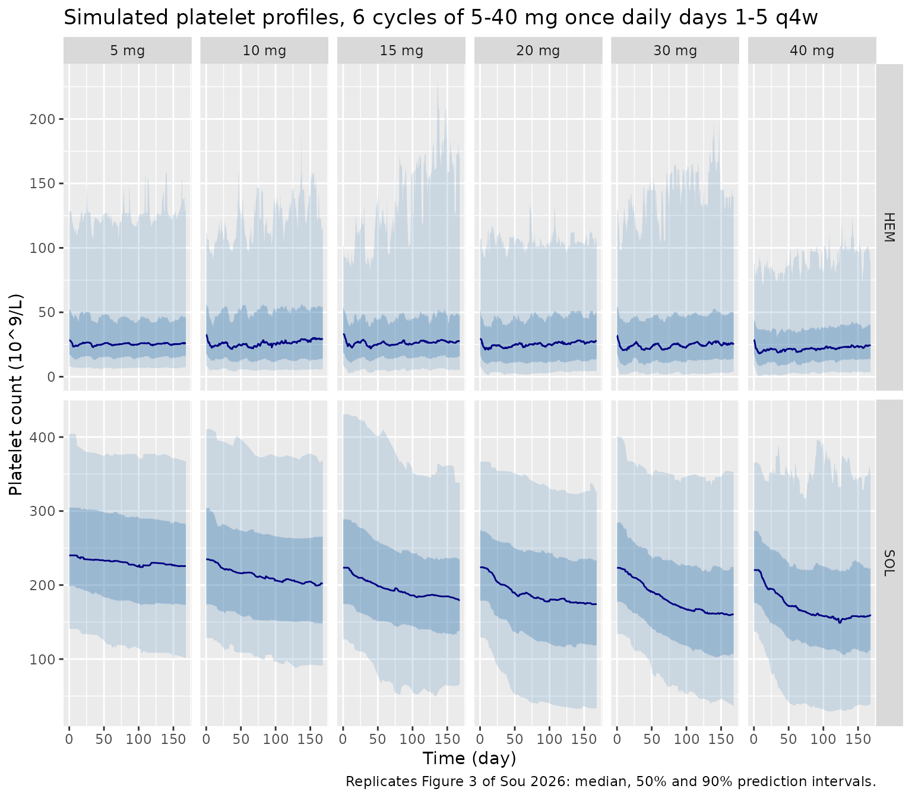
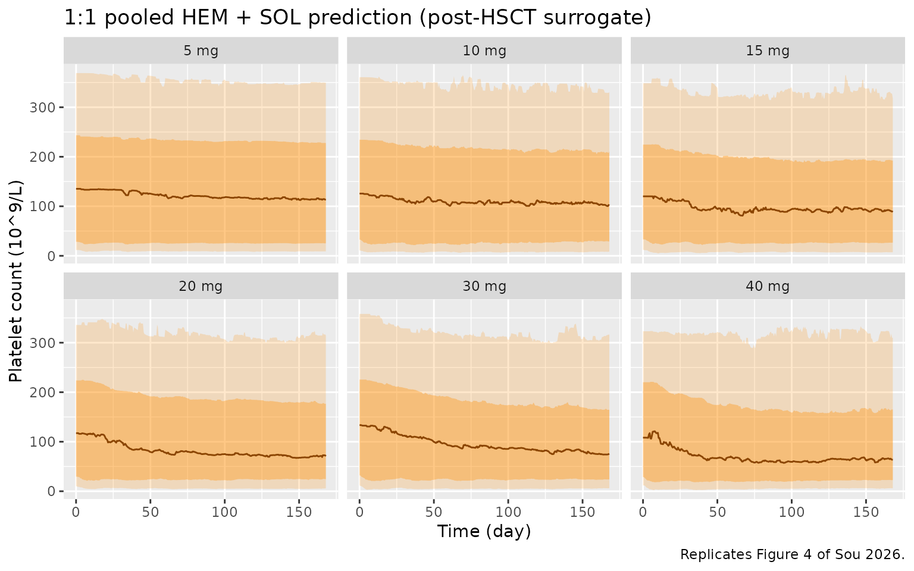
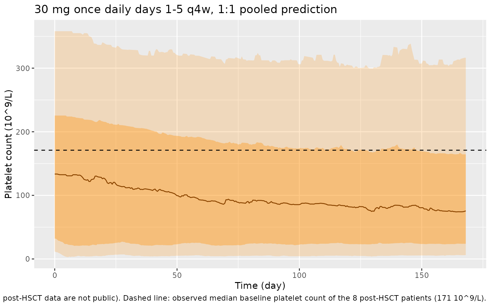

# Siremadlin (Sou 2026)

## Model and source

- Citation: Sou T, Malek K, Weber HJ. Population PK/PD Modeling for
  Evaluation of Intertwining Effects of Drug and Disease on
  Thrombocytopenia in Acute Leukemias. CPT Pharmacometrics Syst
  Pharmacol. 2026;15(3):e70210. <doi:10.1002/psp4.70210>. Model
  equations from Data S1 (Monolix model code); parameter values from
  Table 1.
- Description: Population PK/PD model for oral siremadlin (HDM201, an
  HDM2-p53 inhibitor) and platelet counts in adults with WT-p53 solid
  tumours or haematological malignancies (AML, ALL, high-risk MDS). PK:
  one-compartment disposition with linear clearance and Savic
  transit-compartment absorption (Monolix Ktr / Mtt / ka
  parameterisation), body weight on V/F. PD: Friberg-type platelet
  maturation chain (proliferating pool, three transit compartments,
  circulating platelets) with a linear siremadlin effect increasing
  apoptosis of drug-sensitive proliferating precursors, and an
  irreversible first-order transition of precursors from a
  drug-sensitive to a non-responsive subpopulation. Baseline platelet
  count and mean maturation time take separate typical values and
  separate IIV for haematological-malignancy and solid-tumour patients.
- Article: <https://doi.org/10.1002/psp4.70210> (open access; the
  Monolix model code is in Data S1)

Siremadlin (HDM201) is an oral inhibitor of the HDM2-p53 interaction
under investigation for acute myeloid leukaemia. Its p53-mediated
apoptosis of bone marrow precursors produces delayed thrombocytopenia,
which in leukaemia patients is superimposed on the disease’s own
suppression of platelet production. Sou 2026 fitted platelet counts from
solid-tumour (SOL) and haematological-malignancy (HEM) patients
together, so that the SOL patients act as a reference for the drug
effect without bone marrow disease.

## Population

The model was developed on the first-in-human phase I study CHDM201X2101
(NCT02143635): 2236 platelet observations from 153 patients, 88 with
WT-p53 advanced solid tumours (colon, melanoma, sarcoma; 1638
observations) and 65 with haematological malignancies (acute myeloid
leukaemia, acute lymphoblastic leukaemia, high-risk myelodysplastic
syndromes; 598 observations). Patients received one of four regimens:
12.5-350 mg on day 1 of a 21-day cycle; 120-200 mg on days 1 and 8 of a
28-day cycle; 15-25 mg once daily on days 1-7 of a 28-day cycle; or 1-20
mg once daily on days 1-14 of a 28-day cycle. Patients who received any
blood-product transfusion were excluded. Eight post-allogeneic-HSCT AML
patients in remission from study CHDM201K12201 (NCT05447663), treated at
30 mg once daily on days 1-5 of a 28-day cycle, served as an external
validation set. The paper does not publish a baseline-demographics
table.

The same information is available programmatically via
`readModelDb("Sou_2026_siremadlin")()$population`.

## Source trace

Every `ini()` value carries an in-file comment pointing to its source;
the table below collects them. The equations come from the Monolix code
in Data S1 and the PK structure from the Results (“Model Selection”).

| Equation / parameter | Value | Source location |
|----|----|----|
| `lktr` (Ktr) | 6.69 1/h | Table 1 |
| `lmtt` (Mtt, absorption) | 0.793 h | Table 1 |
| `lka` | 3.69 1/h | Table 1 |
| `lvc` (V/F at 70 kg) | 115 L | Table 1 (printed unit ‘L/h’ is a typo for L) |
| `lcl` (CL/F) | 5.9 L/h | Table 1 |
| `e_wt_vc` | 0.883 | Table 1 ‘beta_V_tBWKG’ |
| `lcirc0` / `lcirc0_heme` | 229 / 30.8 10^9/L | Table 1 ‘PLTZ_SOL’ / ‘PLTZ_HEM’ |
| `lmtt_plt` / `lmtt_plt_heme` | 844 / 142 h | Table 1 ‘MMTP_SOL’ / ‘MMTP_HEM’ |
| `lgamma` | 0.113 | Table 1 ‘gam’ |
| `lslope` | 0.00184 mL/ng | Table 1 ‘SLP’ |
| `lksr` | 1.31e-5 1/h | Table 1 ‘kSR’ |
| IIV (all etas) | SD column squared | Table 1 ‘IIV (in SD scale)’ |
| `etalcl + etalvc` covariance | 0.631 x 0.558 x 0.315 | Table 1 ‘corr_V_Cl’ |
| `addSd`, `propSd` | 0.559 ng/mL, 0.337 | Table 1 ‘a1’, ‘b1’ |
| `propSd_PLT` | 0.275 | Table 1 ‘b2’ |
| Transit absorption, `nn = Mtt * Ktr - 1` | n/a | Methods (Savic implementation, MTT and Ktr estimated); Data S1 `pkmodel(Ktr, Mtt, ka, V, Cl)` |
| `ktr_plt = 4 / mtt_plt`, `kprol = kcirc = ktr_plt` | n/a | Data S1 (`n = 3`, `ktrP = (n+1)/MMTPx`) |
| `edrug = slope * Cc` | n/a | Data S1 (`Edrug = SLP * Cc`) |
| `d/dt(prol)`, `d/dt(prol_res)`, `d/dt(transit1..3)`, `d/dt(circ)` | n/a | Data S1 ODEs (`ProlS`, `ProlR`, `T1..T3`, `Circ`) |
| Initial conditions (`prol_res(0) = 0`, others `circ0`) | n/a | Data S1 initial values |
| Group switch on `DIS_HEME_MALIG` | n/a | Data S1 (`if SOL==0 ... elseif SOL==1 ...`) |

## Virtual cohort

The paper simulated 1000 virtual subjects in Simulx, given 5 to 40 mg
once daily on days 1-5 of a 28-day cycle for 6 cycles. Below, 200
subjects per population per dose level (2400 in total) receive the same
regimens. Body weight is not reported for the study population and is
held at the 70 kg reference, so V/F variability comes from IIV alone.

``` r

doses <- c(5, 10, 15, 20, 30, 40)
n_per_arm <- 200L
cycle_h <- 28 * 24
n_cycles <- 6
dose_times <- as.vector(outer(24 * (0:4), cycle_h * (0:(n_cycles - 1)), "+"))
obs_times <- seq(0, cycle_h * n_cycles, by = 12)

make_cohort <- function(n, dose, heme, id_offset) {
  ids <- id_offset + seq_len(n)
  dose_rows <- tidyr::expand_grid(id = ids, time = dose_times) |>
    mutate(amt = dose, evid = 1L, cmt = "depot", dvid = NA_integer_)
  obs_rows <- tidyr::expand_grid(id = ids, time = obs_times) |>
    mutate(amt = 0, evid = 0L, cmt = "central", dvid = 1L)
  bind_rows(dose_rows, obs_rows) |>
    mutate(
      WT = 70,
      DIS_HEME_MALIG = heme,
      dose = dose,
      population = if (heme == 1) "HEM" else "SOL"
    )
}

arms <- tidyr::expand_grid(heme = c(1, 0), dose = doses)
events <- bind_rows(lapply(seq_len(nrow(arms)), function(i) {
  make_cohort(n_per_arm, arms$dose[i], arms$heme[i], id_offset = (i - 1L) * n_per_arm)
})) |>
  arrange(id, time, desc(evid))
stopifnot(!anyDuplicated(events[events$evid == 1, c("id", "time")]))
```

## Simulation

The model has two endpoints (`Cc` and `PLT`), so observation rows sit on
the `central` state with `dvid = 1`; rxode2 still returns every model
variable, including `PLT`, on those rows.

``` r

mod <- readModelDb("Sou_2026_siremadlin")
rxode2::rxSetSeed(20260226)
sim <- rxode2::rxSolve(
  mod,
  events = events,
  keep = c("dose", "population"),
  returnType = "data.frame"
)
#> ℹ parameter labels from comments will be replaced by 'label()'
#> Warning: some etas defaulted to non-mu referenced, possible parsing error: etalcirc0_heme, etalmtt_plt_heme
#> as a work-around try putting the mu-referenced expression on a simple line
stopifnot(sum(!is.finite(sim$PLT)) == 0)
```

`PLT` in the output is the individual prediction without residual error,
which is what the paper summarises as “predicted platelet levels”.

## Typical-subject behaviour

The paper reports that after one cycle a typical HEM patient reaches the
platelet nadir after about 15 days before recovering.

``` r

mod_typical <- rxode2::zeroRe(mod)
#> ℹ parameter labels from comments will be replaced by 'label()'
#> Warning: some etas defaulted to non-mu referenced, possible parsing error: etalcirc0_heme, etalmtt_plt_heme
#> as a work-around try putting the mu-referenced expression on a simple line
#> Warning: some etas defaulted to non-mu referenced, possible parsing error: etalcirc0_heme, etalmtt_plt_heme
#> as a work-around try putting the mu-referenced expression on a simple line
ev_typ <- bind_rows(
  make_cohort(1, 30, 1, 0L),
  make_cohort(1, 30, 0, 1L)
) |> arrange(id, time, desc(evid))
sim_typ <- rxode2::rxSolve(mod_typical, ev_typ, keep = "population", returnType = "data.frame")
#> ℹ omega/sigma items treated as zero: 'etalktr', 'etalmtt', 'etalka', 'etalcl', 'etalvc', 'etalcirc0', 'etalcirc0_heme', 'etalmtt_plt', 'etalmtt_plt_heme', 'etalgamma', 'etalslope', 'etalksr'
#> Warning: multi-subject simulation without without 'omega'

nadir <- sim_typ |>
  filter(time <= cycle_h) |>
  group_by(population) |>
  summarise(
    baseline = PLT[time == 0],
    nadir = min(PLT),
    nadir_day = time[which.min(PLT)] / 24,
    .groups = "drop"
  )
knitr::kable(nadir, digits = 1, caption = "Typical-subject cycle-1 nadir, 30 mg once daily days 1-5.")
```

| population | baseline | nadir | nadir_day |
|:-----------|---------:|------:|----------:|
| HEM        |     30.8 |  10.6 |      14.5 |
| SOL        |    229.0 | 214.3 |      28.0 |

Typical-subject cycle-1 nadir, 30 mg once daily days 1-5. {.table}

``` r


hem_nadir_day <- nadir$nadir_day[nadir$population == "HEM"]
stopifnot(hem_nadir_day > 12, hem_nadir_day < 18)
```

The typical SOL patient’s maturation time (844 h, 35 days) is much
longer than the HEM value (142 h, 6 days). Its nadir comes much later
and is shallower, consistent with the paper’s statement that HEM
platelet levels are “more responsive to drug effect … and a less delayed
recovery time”.

## Replicate published figures

``` r

pi_summary <- function(d) {
  d |>
    summarise(
      Q05 = quantile(PLT, 0.05),
      Q25 = quantile(PLT, 0.25),
      Q50 = median(PLT),
      Q75 = quantile(PLT, 0.75),
      Q95 = quantile(PLT, 0.95),
      .groups = "drop"
    )
}

sim |>
  group_by(population, dose, time) |>
  pi_summary() |>
  mutate(dose = factor(paste(dose, "mg"), levels = paste(doses, "mg"))) |>
  ggplot(aes(time / 24, Q50)) +
  geom_ribbon(aes(ymin = Q05, ymax = Q95), alpha = 0.2, fill = "steelblue") +
  geom_ribbon(aes(ymin = Q25, ymax = Q75), alpha = 0.35, fill = "steelblue") +
  geom_line(colour = "navy") +
  facet_grid(population ~ dose, scales = "free_y") +
  labs(
    x = "Time (day)", y = "Platelet count (10^9/L)",
    title = "Simulated platelet profiles, 6 cycles of 5-40 mg once daily days 1-5 q4w",
    caption = "Replicates Figure 3 of Sou 2026: median, 50% and 90% prediction intervals."
  )
```



``` r

# Post-HSCT patients are represented by pooling HEM and SOL predictions 1:1.
sim |>
  group_by(dose, time) |>
  pi_summary() |>
  mutate(dose = factor(paste(dose, "mg"), levels = paste(doses, "mg"))) |>
  ggplot(aes(time / 24, Q50)) +
  geom_ribbon(aes(ymin = Q05, ymax = Q95), alpha = 0.2, fill = "darkorange") +
  geom_ribbon(aes(ymin = Q25, ymax = Q75), alpha = 0.35, fill = "darkorange") +
  geom_line(colour = "darkorange4") +
  facet_wrap(~dose, nrow = 2) +
  labs(
    x = "Time (day)", y = "Platelet count (10^9/L)",
    title = "1:1 pooled HEM + SOL prediction (post-HSCT surrogate)",
    caption = "Replicates Figure 4 of Sou 2026."
  )
```



``` r

sim |>
  filter(dose == 30) |>
  group_by(time) |>
  pi_summary() |>
  ggplot(aes(time / 24, Q50)) +
  geom_ribbon(aes(ymin = Q05, ymax = Q95), alpha = 0.2, fill = "darkorange") +
  geom_ribbon(aes(ymin = Q25, ymax = Q75), alpha = 0.35, fill = "darkorange") +
  geom_line(colour = "darkorange4") +
  geom_hline(yintercept = 171, linetype = "dashed") +
  labs(
    x = "Time (day)", y = "Platelet count (10^9/L)",
    title = "30 mg once daily days 1-5 q4w, 1:1 pooled prediction",
    caption = paste(
      "Simulated part of Figure 5 of Sou 2026 (the observed post-HSCT data are not public).",
      "Dashed line: observed median baseline platelet count of the 8 post-HSCT patients (171 10^9/L)."
    )
  )
```



## Probability of thrombocytopenia (Tables 2-4)

The paper defines thrombocytopenia as at least one predicted platelet
count below the CTCAE grade threshold (grade 1 \< 100, grade 2 \< 75,
grade 3 \< 50, grade 4 \< 25 10^9/L) during the 6 cycles. Because
siremadlin only lowers platelet counts, a HEM patient whose baseline is
already below 100 stays below it after the first dose and so has a grade
1 event. That is why the HEM grade-1 probability is about 0.97 at every
dose. Table 4 (post-HSCT) is the 1:1 average of the HEM and SOL arms.

``` r

thresholds <- c(G1 = 100, G2 = 75, G3 = 50, G4 = 25)
subject_min <- sim |>
  group_by(id, population, dose) |>
  summarise(
    plt_min = min(PLT),
    plt_min_post = min(PLT[time > 0]),
    .groups = "drop"
  )
# Subject-grade cells whose classification would change if time 0 were
# excluded from the window.
n_baseline_only <- sum(vapply(
  thresholds,
  function(th) sum((subject_min$plt_min < th) != (subject_min$plt_min_post < th)),
  numeric(1)
))

prob_sim <- subject_min |>
  group_by(population, dose) |>
  summarise(
    G1 = mean(plt_min < thresholds[["G1"]]),
    G2 = mean(plt_min < thresholds[["G2"]]),
    G3 = mean(plt_min < thresholds[["G3"]]),
    G4 = mean(plt_min < thresholds[["G4"]]),
    .groups = "drop"
  )
prob_sim <- bind_rows(
  prob_sim,
  prob_sim |>
    group_by(dose) |>
    summarise(across(G1:G4, mean), .groups = "drop") |>
    mutate(population = "post-HSCT (1:1)")
)

published <- tibble::tribble(
  ~population, ~dose, ~G1, ~G2, ~G3, ~G4,
  "HEM", 5, 0.970, 0.933, 0.817, 0.545,
  "HEM", 10, 0.976, 0.951, 0.846, 0.618,
  "HEM", 15, 0.980, 0.963, 0.874, 0.677,
  "HEM", 20, 0.982, 0.970, 0.898, 0.709,
  "HEM", 30, 0.980, 0.970, 0.921, 0.740,
  "HEM", 40, 0.986, 0.980, 0.939, 0.803,
  "SOL", 5, 0.041, 0.012, 0.004, 0.000,
  "SOL", 10, 0.106, 0.057, 0.028, 0.002,
  "SOL", 15, 0.169, 0.102, 0.051, 0.022,
  "SOL", 20, 0.232, 0.152, 0.079, 0.035,
  "SOL", 30, 0.333, 0.236, 0.163, 0.067,
  "SOL", 40, 0.392, 0.303, 0.220, 0.114,
  "post-HSCT (1:1)", 5, 0.498, 0.465, 0.404, 0.268,
  "post-HSCT (1:1)", 10, 0.534, 0.497, 0.430, 0.305,
  "post-HSCT (1:1)", 15, 0.568, 0.526, 0.456, 0.344,
  "post-HSCT (1:1)", 20, 0.601, 0.554, 0.482, 0.367,
  "post-HSCT (1:1)", 30, 0.651, 0.597, 0.536, 0.398,
  "post-HSCT (1:1)", 40, 0.684, 0.636, 0.574, 0.453
)

cmp <- inner_join(
  pivot_longer(prob_sim, G1:G4, names_to = "grade", values_to = "simulated"),
  pivot_longer(published, G1:G4, names_to = "grade", values_to = "published"),
  by = c("population", "dose", "grade")
) |>
  mutate(diff = simulated - published)
stopifnot(nrow(cmp) == 72)

cmp |>
  mutate(cell = sprintf("%.3f (%.3f)", simulated, published)) |>
  select(population, dose, grade, cell) |>
  pivot_wider(names_from = grade, values_from = cell) |>
  rename(
    "Population" = population,
    "Dose (mg)" = dose,
    "Grade >= 1" = G1,
    "Grade >= 2" = G2,
    "Grade >= 3" = G3,
    "Grade >= 4" = G4
  ) |>
  knitr::kable(caption = "Simulated (published) probability of at least one thrombocytopenia event over 6 cycles. Published values: Tables 2, 3 and 4 of Sou 2026.")
```

| Population | Dose (mg) | Grade \>= 1 | Grade \>= 2 | Grade \>= 3 | Grade \>= 4 |
|:---|---:|:---|:---|:---|:---|
| HEM | 5 | 0.960 (0.970) | 0.935 (0.933) | 0.855 (0.817) | 0.620 (0.545) |
| HEM | 10 | 0.980 (0.976) | 0.935 (0.951) | 0.870 (0.846) | 0.680 (0.618) |
| HEM | 15 | 0.980 (0.980) | 0.955 (0.963) | 0.895 (0.874) | 0.690 (0.677) |
| HEM | 20 | 0.990 (0.982) | 0.960 (0.970) | 0.920 (0.898) | 0.765 (0.709) |
| HEM | 30 | 0.985 (0.980) | 0.960 (0.970) | 0.915 (0.921) | 0.770 (0.740) |
| HEM | 40 | 0.995 (0.986) | 0.985 (0.980) | 0.955 (0.939) | 0.865 (0.803) |
| SOL | 5 | 0.060 (0.041) | 0.035 (0.012) | 0.020 (0.004) | 0.010 (0.000) |
| SOL | 10 | 0.085 (0.106) | 0.045 (0.057) | 0.015 (0.028) | 0.000 (0.002) |
| SOL | 15 | 0.170 (0.169) | 0.095 (0.102) | 0.075 (0.051) | 0.030 (0.022) |
| SOL | 20 | 0.260 (0.232) | 0.205 (0.152) | 0.115 (0.079) | 0.060 (0.035) |
| SOL | 30 | 0.295 (0.333) | 0.170 (0.236) | 0.095 (0.163) | 0.055 (0.067) |
| SOL | 40 | 0.325 (0.392) | 0.225 (0.303) | 0.155 (0.220) | 0.075 (0.114) |
| post-HSCT (1:1) | 5 | 0.510 (0.498) | 0.485 (0.465) | 0.438 (0.404) | 0.315 (0.268) |
| post-HSCT (1:1) | 10 | 0.532 (0.534) | 0.490 (0.497) | 0.443 (0.430) | 0.340 (0.305) |
| post-HSCT (1:1) | 15 | 0.575 (0.568) | 0.525 (0.526) | 0.485 (0.456) | 0.360 (0.344) |
| post-HSCT (1:1) | 20 | 0.625 (0.601) | 0.583 (0.554) | 0.518 (0.482) | 0.412 (0.367) |
| post-HSCT (1:1) | 30 | 0.640 (0.651) | 0.565 (0.597) | 0.505 (0.536) | 0.413 (0.398) |
| post-HSCT (1:1) | 40 | 0.660 (0.684) | 0.605 (0.636) | 0.555 (0.574) | 0.470 (0.453) |

Simulated (published) probability of at least one thrombocytopenia event
over 6 cycles. Published values: Tables 2, 3 and 4 of Sou 2026. {.table}

With 200 subjects per arm the Monte-Carlo standard error of a
probability near 0.5 is about 0.035, and the paper’s own 1000-subject
simulation carries similar noise. The check therefore uses the centre
and a robust quantile of the 72 differences rather than the worst cell:

``` r

summary(abs(cmp$diff))
#>    Min. 1st Qu.  Median    Mean 3rd Qu.    Max. 
#> 0.00000 0.01000 0.01950 0.02469 0.03388 0.07800
stopifnot(
  # A mis-transcribed baseline, maturation time or slope shifts whole rows
  # by tens of percentage points.
  median(abs(cmp$diff)) < 0.05,
  quantile(abs(cmp$diff), 0.9) < 0.12
)
```

Across both tables the simulated HEM grade 4 probabilities sit somewhat
above Table 2 and the SOL probabilities at 30-40 mg somewhat below Table
3. The same pattern appears with 1000 subjects per arm, so it is not
only Monte-Carlo noise. Plausible causes are details of the Simulx
virtual population and output grid that the paper does not report: the
body-weight distribution, and how densely the predicted platelet profile
was sampled when looking for threshold crossings (here every 12 h). The
differences are a few percentage points, much smaller than any parameter
error would produce.

The external validation in the paper compares the observed grade \>= 3
incidence in post-HSCT patients at 30 mg (4 of 8, 50%) with the
predicted 53.6%. The pooled simulation here gives 50.5%.

## PKNCA validation

Sou 2026 reports no NCA, so the PK check is internal. After a single
dose, AUC0-inf must equal Dose / (CL/F) for every subject. A single-dose
cohort (the paper’s day-1 regimen) is simulated at each dose level with
dense sampling, and PKNCA estimates are compared with each subject’s own
`Dose / cl`. This confirms the transit-absorption input delivers the
whole dose and that `Cc` is in ng/mL.

``` r

n_pk <- 100L
pk_obs <- c(seq(0, 12, by = 0.25), seq(13, 72, by = 1), seq(76, 168, by = 4))
pk_events <- bind_rows(lapply(seq_along(doses), function(i) {
  ids <- (i - 1L) * n_pk + seq_len(n_pk)
  bind_rows(
    tibble(id = ids, time = 0, amt = doses[i], evid = 1L, cmt = "depot", dvid = NA_integer_),
    tidyr::expand_grid(id = ids, time = pk_obs) |>
      mutate(amt = 0, evid = 0L, cmt = "central", dvid = 1L)
  ) |>
    mutate(WT = 70, DIS_HEME_MALIG = 0, treatment = paste(doses[i], "mg"))
})) |>
  arrange(id, time, desc(evid))

rxode2::rxSetSeed(20260227)
sim_pk <- rxode2::rxSolve(mod, events = pk_events, keep = "treatment", returnType = "data.frame")
```

``` r

sim_nca <- sim_pk |>
  filter(!is.na(Cc)) |>
  select(id, time, Cc, treatment)
sim_nca <- bind_rows(
  sim_nca,
  sim_nca |> distinct(id, treatment) |> mutate(time = 0, Cc = 0)
) |>
  distinct(id, treatment, time, .keep_all = TRUE) |>
  arrange(id, treatment, time)

conc_obj <- PKNCA::PKNCAconc(sim_nca, Cc ~ time | treatment + id)
dose_df <- pk_events |>
  filter(evid == 1) |>
  select(id, time, amt, treatment)
dose_obj <- PKNCA::PKNCAdose(dose_df, amt ~ time | treatment + id)
intervals <- data.frame(
  start = 0, end = Inf,
  cmax = TRUE, tmax = TRUE, aucinf.obs = TRUE, half.life = TRUE
)
nca_res <- PKNCA::pk.nca(PKNCA::PKNCAdata(conc_obj, dose_obj, intervals = intervals))

nca_tbl <- as.data.frame(nca_res$result) |>
  filter(PPTESTCD %in% c("cmax", "tmax", "aucinf.obs", "half.life")) |>
  group_by(treatment, PPTESTCD) |>
  summarise(median = median(PPORRES, na.rm = TRUE), .groups = "drop") |>
  pivot_wider(names_from = PPTESTCD, values_from = median) |>
  mutate(treatment = factor(treatment, levels = paste(doses, "mg"))) |>
  arrange(treatment)
nca_tbl |>
  rename(
    "Dose" = treatment,
    "Cmax (ng/mL)" = cmax,
    "Tmax (h)" = tmax,
    "AUC0-inf (ng*h/mL)" = aucinf.obs,
    "t1/2 (h)" = half.life
  ) |>
  knitr::kable(digits = 2, caption = "Median single-dose NCA by dose (simulated, 100 subjects per dose).")
```

| Dose  | AUC0-inf (ng\*h/mL) | Cmax (ng/mL) | t1/2 (h) | Tmax (h) |
|:------|--------------------:|-------------:|---------:|---------:|
| 5 mg  |              852.81 |        39.01 |    14.66 |     2.50 |
| 10 mg |             1736.56 |        78.53 |    13.33 |     2.50 |
| 15 mg |             2672.64 |       120.60 |    13.96 |     2.50 |
| 20 mg |             3058.72 |       141.41 |    12.44 |     2.50 |
| 30 mg |             4996.74 |       217.39 |    14.33 |     2.75 |
| 40 mg |             6680.09 |       318.59 |    13.78 |     2.50 |

Median single-dose NCA by dose (simulated, 100 subjects per dose).
{.table}

``` r

cl_i <- sim_pk |> distinct(id, cl)
auc_ratio <- as.data.frame(nca_res$result) |>
  filter(PPTESTCD == "aucinf.obs") |>
  mutate(id = as.integer(id)) |>
  left_join(cl_i, by = "id") |>
  left_join(dose_df |> select(id, amt), by = "id") |>
  mutate(ratio = PPORRES / (1000 * amt / cl))
summary(auc_ratio$ratio)
#>    Min. 1st Qu.  Median    Mean 3rd Qu.    Max. 
#>  0.9997  1.0000  1.0000  1.0000  1.0000  1.0076
stopifnot(
  abs(median(auc_ratio$ratio) - 1) < 0.02,
  quantile(abs(auc_ratio$ratio - 1), 0.9) < 0.05
)
```

The typical single-dose half-life, log(2) x 115 / 5.9 = 13.5 h, is close
to the median PKNCA half-lives above.

## Assumptions and deviations

- **IIV scale.** Table 1 gives inter-individual variability “in SD
  scale” (Monolix omega). Each value was squared to give the variance
  used in `ini()`, and all parameters were taken as log-normal,
  Monolix’s default. The V-CL correlation (0.631) was converted to a
  covariance with the two SDs.
- **Body-weight reference.** The covariate is Monolix ‘tBWKG’, a
  transformed body weight. The paper states neither the transformation
  nor the reference weight. The coefficient 0.883 is encoded as a power
  exponent on `WT / 70`, i.e. `log(WT / 70)` centring with a 70 kg
  reference. The simulations hold weight at 70 kg because no weight
  distribution is published.
- **Residual error form.** The PK error has an additive (`a1`) and a
  proportional (`b1`) component, but the paper does not say which
  Monolix combined form was used. It is encoded as `combined1` (SD = a +
  b x f), Monolix’s default combined model. This matters only for
  simulated observations with residual error; every check in this
  article uses the individual predictions.
- **Concentration units.** Table 1 gives the additive PK error in ng/mL,
  so the fitted concentrations, and therefore `Cc` in
  `Edrug = SLP x Cc`, are in ng/mL. Hence `Cc = 1000 x central / vc`
  (dose in mg, V/F in L), and the slope has units mL/ng. Read against
  mg/L instead, the drug effect would be 1000-fold too small to produce
  the thrombocytopenia in Tables 2 and 3.
- **V/F unit typo.** Table 1 prints the V/F unit as ‘L/h’; it is a
  volume in L.
- **Transit absorption.** Monolix `pkmodel(Ktr, Mtt, ka, V, Cl)` uses
  the Savic transit model with `nn = Mtt x Ktr - 1` (non-integer)
  transit compartments ahead of a first-order absorption compartment. It
  is written in the integrated incomplete-gamma form (`gammap()`), which
  is exact and stays bounded when IIV pushes `nn` below zero. The
  transit term follows the most recent dose, which is exact here because
  the 0.79 h mean transit time is far shorter than the 24 h dosing
  interval.
- **Group-specific variance.** PLTZ and MMTP each have a separate
  typical value and a separate IIV variance for HEM and SOL patients.
  Both etas are declared and `DIS_HEME_MALIG` selects one, which
  reproduces Monolix’s `if SOL==0 ... elseif SOL==1` branch exactly.
  rxode2 warns that `etalcirc0_heme` and `etalmtt_plt_heme` are not
  mu-referenced. That affects only estimation efficiency if the model is
  refitted, not simulation.
- **Covariate coding.** The source carries `SOL` (1 = solid tumour); the
  model uses the canonical `DIS_HEME_MALIG = 1 - SOL`, so the unsuffixed
  typical values are the solid-tumour ones.
- **Post-HSCT prediction.** The paper’s post-HSCT prediction is not a
  separate model. It is the 1:1 pooling of HEM and SOL simulations, and
  it is reproduced here the same way.
- **kSR uncertainty.** The paper notes that kSR is poorly estimated (95%
  CI 4.22e-06 to 4.10e-05 1/h; IIV SD 4.8; shrinkage 86%) and was
  retained on mechanistic grounds. Its value is carried unchanged.
- **Threshold crossings.** The paper does not state whether the pre-dose
  baseline counts towards a thrombocytopenia event. The minimum here is
  taken over the whole window including time 0. In the cohort above,
  excluding time 0 would change 0 of the 9600 subject-by-grade
  classifications, because the drug starts lowering the count as soon as
  it is given. The predicted profile is sampled every 12 h; the paper’s
  sampling grid is not reported.
- **Errata.** EuropePMC lists no correction or comment for Sou 2026 as
  of 2026-11-12.
