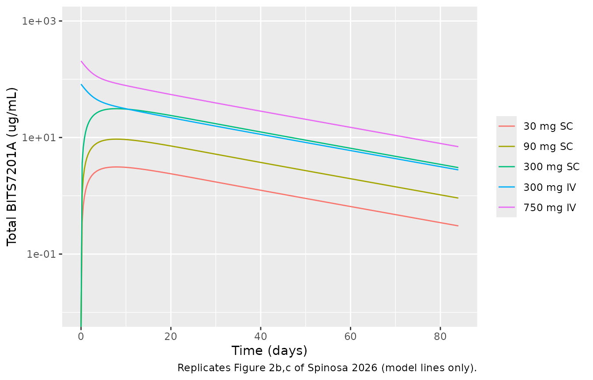
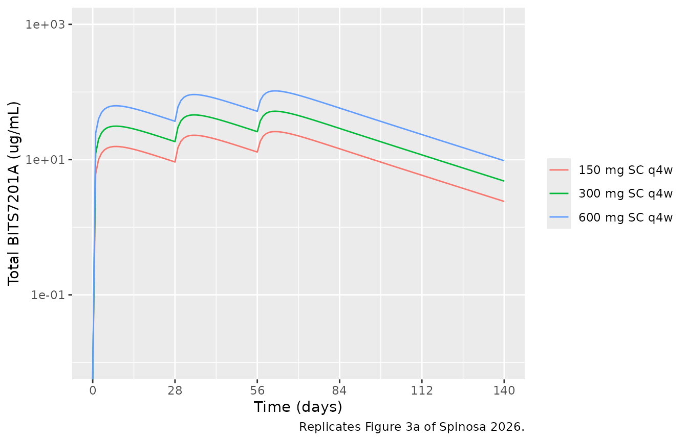
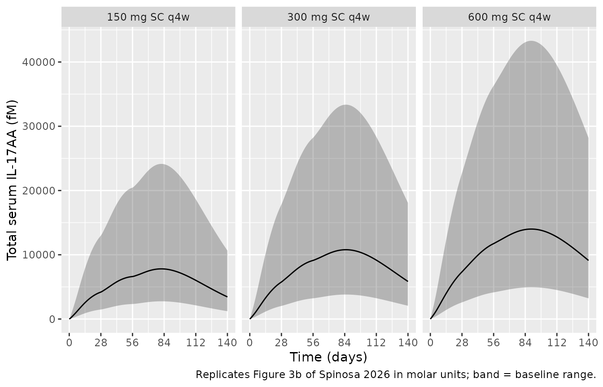
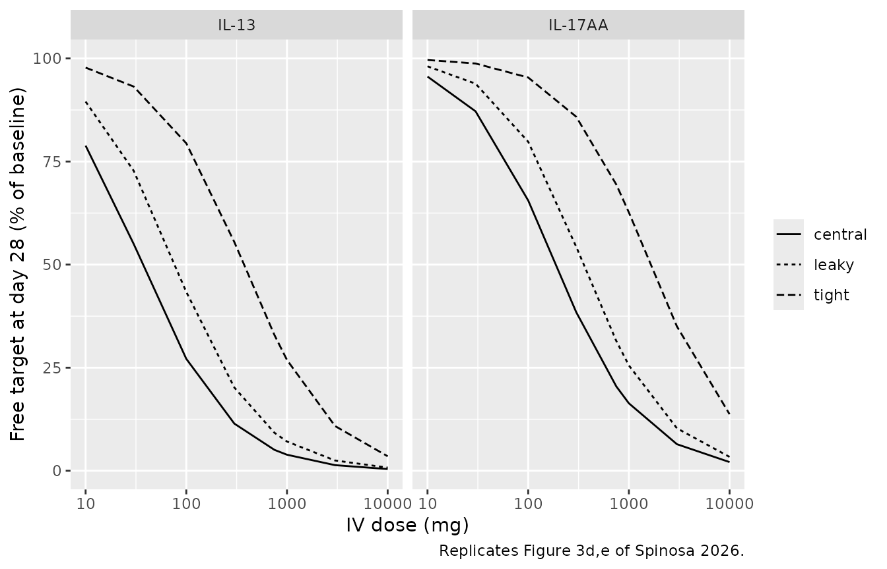
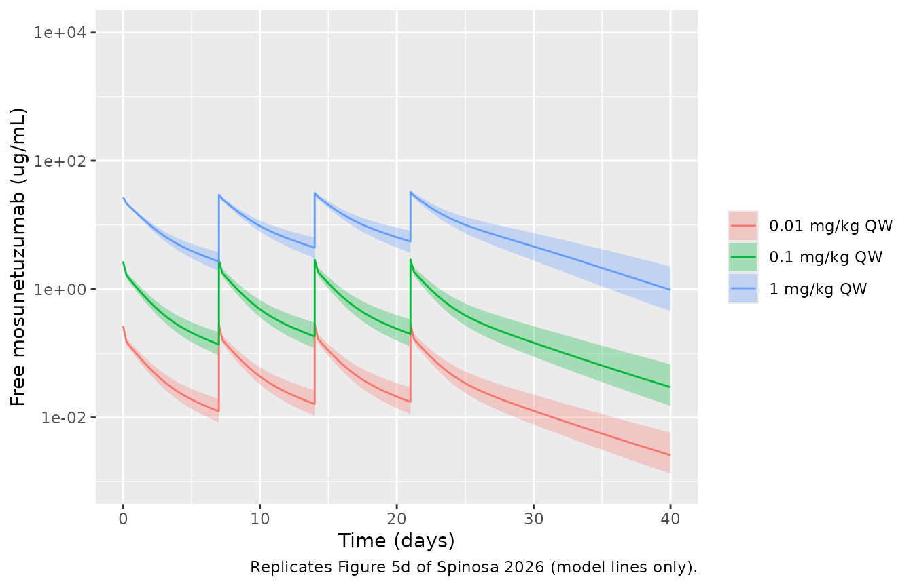
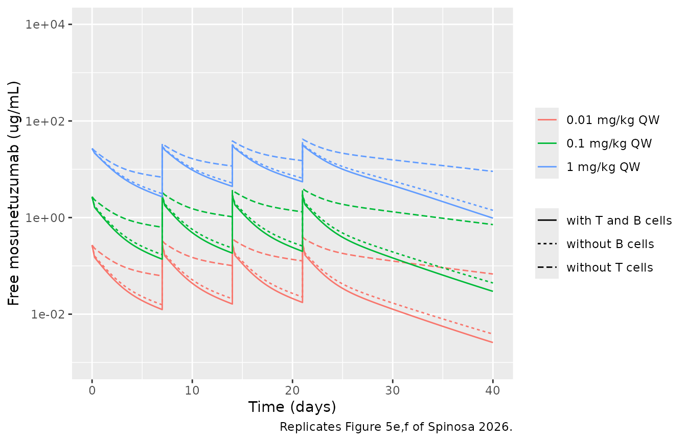
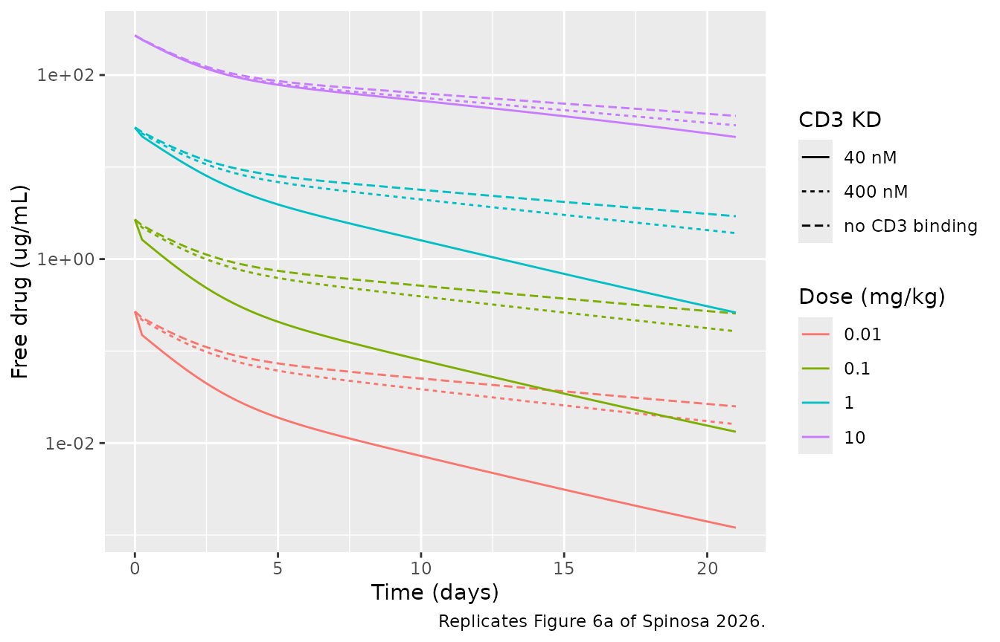
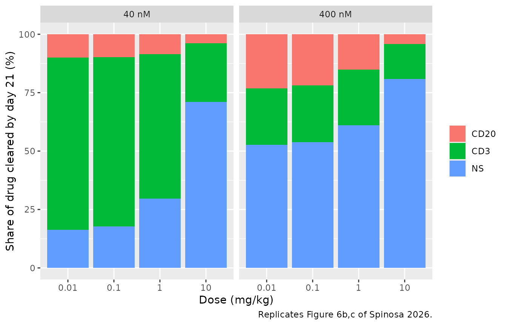
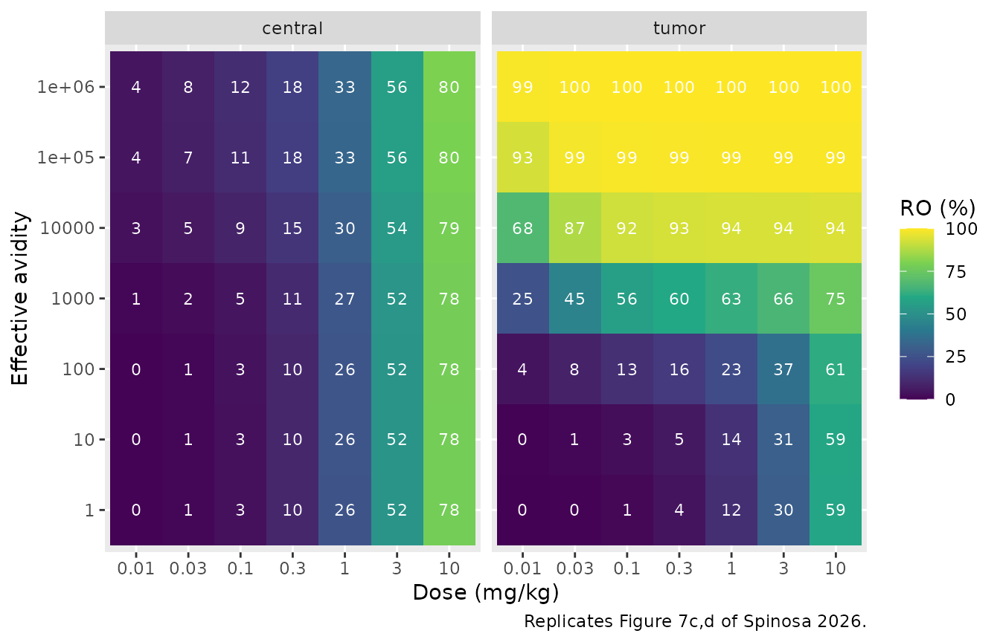

# Bispecific antibody minimal PBPK-PD: BITS7201A, mosunetuzumab and a tumor-targeted bispecific (Spinosa 2026)

## Model and source

- Citation: Spinosa P, Joslyn L, Ramanujan S, Gadkar K, Hosseini I. A
  Generalized Minimal PBPK-PD Model of Bispecific Antibodies: Case
  Studies and Applications in Drug Development. CPT Pharmacometrics Syst
  Pharmacol. 2026;15(2):e70167.
- Article: <https://doi.org/10.1002/psp4.70167> (open access,
  PMC12896375)
- Supplement: Data S1, a zip holding the model description
  (`-s01.docx`), Tables S1-S4 (`-s02.docx`), the SimBiology project
  (`-s04.sbproj`), two MATLAB helper functions (`-s05.m`, `-s06.m`) and
  the parameter workbook (`-s07.xlsx`, one sheet per case study).

Spinosa et al. built one generalized minimal PBPK model for bispecific
antibodies. It extends the second-generation Cao-Jusko minimal PBPK
backbone (plasma, leaky and tight interstitial tissue, lymph; Cao 2013)
with optional safety and efficacy tissues, two targets that may each be
soluble or membrane-bound in every compartment except lymph, and three
binding modes: both arms on soluble targets, trans-binding of two
receptors on different cells (T-cell engagers), and cis-binding of two
receptors on the same cell (tumor-targeted bispecifics), with a bivalent
monospecific antibody as a further option. Flags in the SimBiology
project switch the modes on and off, and the workbook supplies one
parameter set per case study.

The library ships the four molecules the paper actually parameterizes.
Each file is the published model reduced to the species that can become
non-zero under that case study’s flags and target burden, so every
equation is the published rate law with the switched-off terms dropped:

| Model | Case study | Binding mode | Species |
|----|----|----|----|
| `Spinosa_2026_BITS7201A_mpbpk` | 1, anti-IL-13/IL-17AA | two soluble targets, complexes traffic | human |
| `Spinosa_2026_mosunetuzumab_cyno_mpbpk` | 2 (and 3), CD20 x CD3 | trans-binding, central targets | cynomolgus monkey |
| `Spinosa_2026_tumor_targeted_bsab_mpbpk` | 4, prototypical tumor-targeted bispecific | cis-binding with avidity | human |
| `Spinosa_2026_bivalent_mab_mpbpk` | 4, bivalent comparator | bivalent with avidity | human |

The reductions were checked against a direct translation of the complete
published model (all 81 differential equations and 273 reactions of the
SimBiology project, with the workbook parameters): the two encodings
agree to better than one part in 10^7 for every state compared.

``` r

mod_bits <- readModelDb("Spinosa_2026_BITS7201A_mpbpk")
mod_mosun <- readModelDb("Spinosa_2026_mosunetuzumab_cyno_mpbpk")
mod_tt <- readModelDb("Spinosa_2026_tumor_targeted_bsab_mpbpk")
mod_bv <- readModelDb("Spinosa_2026_bivalent_mab_mpbpk")

rx_bits <- rxode2::rxode2(mod_bits)
rx_mosun <- rxode2::rxode2(mod_mosun)
rx_tt <- rxode2::rxode2(mod_tt)
rx_bv <- rxode2::rxode2(mod_bv)

# The models carry no inter-individual variability, so every multi-subject
# solve below differs only in its doses or parameter columns; rxode2's
# "multi-subject simulation without 'omega'" note is expected and muffled.
solve_typical <- function(...) {
  withCallingHandlers(
    rxode2::rxSolve(...),
    warning = function(w) {
      if (grepl("without 'omega'", conditionMessage(w), fixed = TRUE)) invokeRestart("muffleWarning")
    }
  )
}
```

## Population

The model is mechanistic and calibrated to mean-level data, so none of
the four files carries inter-individual variability or a residual-error
estimate.

- **Case Study 1 (BITS7201A).** Healthy volunteers in the phase I
  single- and multiple-ascending-dose study of Staton et al. (BMC Pulm
  Med 2019). The model was calibrated to the SAD cohorts (30, 90 and 300
  mg SC; 300 and 750 mg IV) and validated against the MAD cohorts (150,
  300 and 600 mg SC every 4 weeks x 3). A 70 kg body weight scales the
  per-kg volumes for flat-mg doses.
- **Case Studies 2 and 3 (mosunetuzumab).** Cynomolgus monkeys given
  0.01, 0.1 or 1 mg/kg IV once weekly for 4 weeks (Hosseini et al., NPJ
  Syst Biol Appl 2020). Only the nonspecific clearance was fitted to
  mosunetuzumab PK; the CD3 and CD20 capacities were fitted beforehand
  to other molecules (Figure 4).
- **Case Study 4 (tumor-targeted bispecific and bivalent comparator).**
  A simulation-only design study in a 70 kg patient with a solid tumor.

## Source trace

Every model shares the minimal PBPK transport: free drug leaves plasma
for each tissue *i* at `L_i (1 - sigma_i) C_plasma / V_plasma` (in
plasma units), leaves the tissue for lymph at
`L_i (1 - sigma_L) C_i / V_i`, and returns from lymph at
`L C_lymph / V_lymph`, with `L_i = f_i L`. The receiving compartment
gains the same amount, so each flux is multiplied by the volume ratio
(Data S1, `transport_between_compartments` in `-s05.m`). Binding is
`kon (D R - KD C)` for a first binding and `chi kon C1 R2 - kon KD C12`
for the second (Data S1, `binding_on_off` in `-s06.m`). Receptors are
synthesized at `kdeg R0` and degraded at `kdeg`; receptor-bound drug is
internalized at `kdeg` (the workbook’s fold change `fcint` is 1).

| Quantity | Value | Source |
|----|----|----|
| **Shared physiology** |  |  |
| Lymph flow `L` | 41.4288 mL/day/kg | Workbook `L_D1` (all sheets) |
| Leaky / tight volumes | 62.4 / 115.9 mL/kg | Workbook `V_lea`, `V_tig` |
| Tight reflection coefficient | 0.95 | Workbook `sig_tig_D1` |
| Lymphatic reflection coefficient | 0.2 | Workbook `sig_lym_D1` |
| Antibody molecular weight | 150 000 g/mol | Workbook `MWab_D1`; Data S1 “150 kDa” |
| kon (every arm) | 3.6 1/nM/day | Workbook `kon_R1_D1`, `kon_R2_D1` |
| **BITS7201A** |  |  |
| CLns | 3.1 mL/kg/day | Table S1; workbook `CLp_D1` |
| Vplasma | 52 mL/kg | Table S1 (inferred from Cmax); workbook `V_cen` |
| Vlymph | 37.14 mL/kg | Workbook `V_lym` |
| kabs, F | 0.2 1/day, 0.92 | Table S1; workbook `kabs_D1`, `F_D1` |
| Leaky reflection, lymph-flow split | 0.7; 0.65 / 0.35 | Workbook `sig_lea_D1`, `f_lea_D1`, `f_tig_D1` |
| KD IL-13 / IL-17AA | 0.005 / 0.010 nM | Table S1; workbook `Kd_R1_D1`, `Kd_R2_D1` |
| Baseline IL-13 / IL-17AA | 6e-6 / 2.83e-6 nM | Workbook `sR1_0_*`, `sR2_0_*` (Table S1 ranges in pg/mL) |
| Turnover half-life IL-13 / IL-17AA | 0.0208 / 0.0056 day | Workbook `Thalf_sR1`, `Thalf_sR2` (Table S1: 30 / 8 min) |
| Body weight | 70 kg | Workbook `BW` |
| **Mosunetuzumab (cyno)** |  |  |
| CLns | 4.0 mL/kg/day | Table S2 (fitted); workbook `CLp_D1` |
| Vplasma / Vlymph | 37.14 / 44.4 mL/kg | Workbook `V_cen`, `V_lym` |
| Leaky reflection, lymph-flow split | 0.67; 0.65 / 0.35 | Workbook `sig_lea_D1`, `f_lea_D1`, `f_tig_D1` |
| KD CD20 / CD3 | 68 / 40 nM | Table S2; workbook `Kd_R1_D1`, `Kd_R2_D1` |
| CD20 / CD3 capacity | 4.4 / 19 nM | Table S2 (fit; +/-30% ranges) |
| CD20 / CD3 turnover half-life | 1.0 / 0.7083 day | Table S2 (1.0 / 0.7 day); workbook `Thalf_mR1`, `Thalf_mR2` |
| Trans-binding avidity | 1 | Data S1 text (“avidity constant is equal to 1”) |
| **Tumor-targeted bispecific / bivalent comparator** |  |  |
| CLns | 2.8272 mL/kg/day | Workbook `CLp_D1`; Table S4 (2.8) |
| Vplasma / Vtumor / Vlymph | 37.14 / 4 / 37.14 mL/kg | Workbook `V_cen`, `V_eff`, `V_lym` |
| Lymph-flow split leaky / tight / tumor | 0.58 / 0.35 / 0.07 | Workbook `f_lea_D1`, `f_tig_D1`, `f_eff_D1` |
| Leaky and tumor reflection | 0.7 | Workbook `sig_lea_D1`, `sig_eff_D1` |
| KD therapeutic / targeting (bispecific) | 100 / 0.05 nM | Table S4; workbook `Kd_R1_D1`, `Kd_R2_D1` |
| KD therapeutic (bivalent) | 10 nM | Table S4 |
| Cells, receptors per cell | 10^6 /mL; 10^4 therapeutic everywhere, 10^3 targeting (10^5 in tumor) | Table S3; workbook `mR*_cellspermL_*`, `rpc_mR*_*` |
| Receptor turnover half-life | 1 day | Workbook `Thalf_mR1`, `Thalf_mR2` |
| Effective avidity, therapeutic arm second | 1000 | Figure 7 caption; workbook `avid_R1_D1` = 1e9 per 10^6 cells/mL |
| Effective avidity, targeting arm second | 1e-6 | Workbook `avid_R2_D1` = 1 per 10^6 cells/mL |
| Effective avidity, bivalent second arm | 1000 | Project variant “6. AVIDITY: same cell bv mAb” (1e9 per 10^6 cells/mL) |

## Case Study 1: BITS7201A (anti-IL-13 / anti-IL-17AA)

### Single ascending dose PK (Figure 2b,c)

``` r

sad <- tibble::tribble(
  ~treatment, ~amt, ~cmt,
  "30 mg SC", 30, "depot",
  "90 mg SC", 90, "depot",
  "300 mg SC", 300, "depot",
  "300 mg IV", 300, "central",
  "750 mg IV", 750, "central"
) |>
  mutate(id = row_number())
obs_times <- sort(unique(c(0, seq(0.25, 3, by = 0.25), seq(3.5, 84, by = 0.5))))
ev_sad <- bind_rows(
  sad |> mutate(time = 0, evid = 1),
  tidyr::crossing(sad |> select(id, treatment, cmt), time = obs_times) |>
    mutate(amt = 0, evid = 0)
) |>
  arrange(id, time, desc(evid)) |>
  select(id, time, amt, evid, cmt, treatment)

sim_sad <- solve_typical(rx_bits, ev_sad, keep = "treatment", returnType = "data.frame")
sim_sad$treatment <- factor(sim_sad$treatment, levels = sad$treatment)

ggplot(sim_sad, aes(time, Cc, colour = treatment)) +
  geom_line() +
  scale_y_log10(limits = c(0.01, 1000)) +
  labs(x = "Time (days)", y = "Total BITS7201A (ug/mL)", colour = NULL,
       caption = "Replicates Figure 2b,c of Spinosa 2026 (model lines only).")
#> Warning in scale_y_log10(limits = c(0.01, 1000)): log-10 transformation
#> introduced infinite values.
```



### Multiple ascending dose PK and serum IL-17AA (Figure 3a,b)

The MAD cohorts received three SC doses every 4 weeks. Total serum
IL-17AA (free plus drug-bound) rises because the drug-bound cytokine is
cleared at the antibody’s slow clearance instead of the cytokine’s
minutes-long turnover. The paper captures the spread of the data by
varying the unmeasurable baseline IL-17AA between 0.04 and 0.3 pg/mL;
the model works in nM and the paper reports no molecular weight for
IL-17AA, so the band below brackets the nominal baseline with the low
(1e-6 nM) and high (8.753e-6 nM) baselines stored as variants in the
published SimBiology project.

``` r

mad <- tibble::tibble(treatment = c("150 mg SC q4w", "300 mg SC q4w", "600 mg SC q4w"),
                      dose = c(150, 300, 600))
mad_times <- seq(0, 140, by = 1)
mad_ev <- function(bl) {
  bind_rows(
    tidyr::crossing(mad, time = c(0, 28, 56)) |> mutate(amt = dose, evid = 1, cmt = "depot"),
    tidyr::crossing(mad, time = mad_times) |> mutate(amt = 0, evid = 0, cmt = "central")
  ) |>
    mutate(id = as.integer(factor(treatment, levels = mad$treatment)), bl_il17 = bl) |>
    arrange(id, time, desc(evid))
}
sim_mad <- bind_rows(lapply(c(low = 1e-6, nominal = 2.83e-6, high = 8.753e-6), function(bl) {
  solve_typical(rx_bits, mad_ev(bl), keep = "treatment", returnType = "data.frame")
}), .id = "baseline")

ggplot(sim_mad |> filter(baseline == "nominal"), aes(time, Cc, colour = treatment)) +
  geom_line() +
  scale_y_log10(limits = c(0.01, 1000)) +
  scale_x_continuous(breaks = seq(0, 140, 28)) +
  labs(x = "Time (days)", y = "Total BITS7201A (ug/mL)", colour = NULL,
       caption = "Replicates Figure 3a of Spinosa 2026.")
#> Warning in scale_y_log10(limits = c(0.01, 1000)): log-10 transformation
#> introduced infinite values.
```



``` r


sim_mad |>
  select(baseline, treatment, time, il17_total_central) |>
  tidyr::pivot_wider(names_from = baseline, values_from = il17_total_central) |>
  ggplot(aes(time, nominal * 1e6)) +
  geom_ribbon(aes(ymin = low * 1e6, ymax = high * 1e6), alpha = 0.3) +
  geom_line() +
  facet_wrap(~treatment) +
  scale_x_continuous(breaks = seq(0, 140, 28)) +
  labs(x = "Time (days)", y = "Total serum IL-17AA (fM)",
       caption = "Replicates Figure 3b of Spinosa 2026 in molar units; band = baseline range.")
```



### Target neutralization in serum and tissue (Figure 3d,e)

Figure 3d,e plots free target as a percentage of baseline at day 28
after a single IV dose. The paper states that the highest SAD dose (750
mg) neutralizes about 80% of serum IL-17AA and about 90% of serum IL-13,
and the figure shows the tight tissue, which drug reaches slowly,
staying least neutralized.

``` r

iv_doses <- c(10, 30, 100, 300, 750, 1000, 3000, 10000)
ev_iv <- tibble::tibble(id = seq_along(iv_doses), dose = iv_doses) |>
  tidyr::crossing(time = c(0, 28)) |>
  mutate(amt = ifelse(time == 0, dose, 0), evid = ifelse(time == 0, 1, 0), cmt = "central")
neut <- solve_typical(rx_bits, ev_iv, keep = "dose", returnType = "data.frame") |>
  filter(time == 28) |>
  select(dose, starts_with("il17_pctfree"), starts_with("il13_pctfree")) |>
  tidyr::pivot_longer(-dose, names_to = c("cytokine", "location"),
                      names_pattern = "(il1[37])_pctfree_(.*)", values_to = "pct_free")

ggplot(neut, aes(dose, pct_free, linetype = location)) +
  geom_line() +
  facet_wrap(~cytokine, labeller = as_labeller(c(il13 = "IL-13", il17 = "IL-17AA"))) +
  scale_x_log10() +
  labs(x = "IV dose (mg)", y = "Free target at day 28 (% of baseline)", linetype = NULL,
       caption = "Replicates Figure 3d,e of Spinosa 2026.")
```



``` r


neut_750 <- neut |> filter(dose == 750)
knitr::kable(neut_750 |> mutate(pct_free = round(pct_free, 1)) |>
  dplyr::rename("IV dose (mg)" = dose, "Cytokine" = cytokine, "Compartment" = location,
                "Free target, % of baseline" = pct_free),
  caption = "Day-28 free cytokine after 750 mg IV.")
```

| IV dose (mg) | Cytokine | Compartment | Free target, % of baseline |
|-------------:|:---------|:------------|---------------------------:|
|          750 | il17     | central     |                       20.5 |
|          750 | il17     | leaky       |                       31.5 |
|          750 | il17     | tight       |                       69.4 |
|          750 | il13     | central     |                        5.1 |
|          750 | il13     | leaky       |                        9.2 |
|          750 | il13     | tight       |                       32.9 |

Day-28 free cytokine after 750 mg IV. {.table}

``` r


pf <- function(cyt, loc, d) {
  vapply(d, function(dd) neut$pct_free[neut$cytokine == cyt & neut$location == loc & neut$dose == dd], numeric(1))
}
stopifnot(
  # Paper text: 750 mg neutralizes ~80% of IL-17AA and ~90% of IL-13 in serum.
  abs(pf("il17", "central", 750) - 20) < 5,
  pf("il13", "central", 750) < 10,
  # Figure 3d,e ordering at every dose: central < leaky < tight free target.
  all(pf("il17", "central", iv_doses) < pf("il17", "leaky", iv_doses)),
  all(pf("il17", "leaky", iv_doses) < pf("il17", "tight", iv_doses)),
  # Figure 3d at 1000 mg reads ~17 / ~25 / ~65% free IL-17AA.
  abs(pf("il17", "tight", 1000) - 65) < 10
)
```

### PKNCA of the SAD cohorts

The paper does not tabulate NCA results, so there is no published
reference to compare against; the NCA below documents the simulated
typical-subject exposure and confirms the linear (dose-proportional) PK
the paper describes for the SAD range.

``` r

sim_nca <- sim_sad |>
  dplyr::filter(!is.na(Cc)) |>
  dplyr::select(id, time, Cc, treatment)
sim_nca <- dplyr::bind_rows(
  sim_nca,
  sim_nca |> dplyr::distinct(id, treatment) |> dplyr::mutate(time = 0, Cc = 0)
) |>
  dplyr::distinct(id, treatment, time, .keep_all = TRUE) |>
  dplyr::arrange(id, treatment, time)
conc_obj <- PKNCA::PKNCAconc(sim_nca, Cc ~ time | treatment + id)
dose_df <- ev_sad |> dplyr::filter(evid == 1) |> dplyr::select(id, time, amt, treatment)
dose_obj <- PKNCA::PKNCAdose(dose_df, amt ~ time | treatment + id)
intervals <- data.frame(start = 0, end = 84, cmax = TRUE, tmax = TRUE, auclast = TRUE)
nca_res <- PKNCA::pk.nca(PKNCA::PKNCAdata(conc_obj, dose_obj, intervals = intervals))
nca_tab <- as.data.frame(nca_res) |>
  select(treatment, PPTESTCD, PPORRES) |>
  tidyr::pivot_wider(names_from = PPTESTCD, values_from = PPORRES) |>
  left_join(sad |> select(treatment, amt), by = "treatment")
knitr::kable(nca_tab |> mutate(across(c(cmax, auclast), \(x) signif(x, 3))) |>
  dplyr::rename("Group" = treatment, "Cmax (ug/mL)" = cmax, "Tmax (day)" = tmax,
                "AUC0-84 (ug*day/mL)" = auclast, "Dose (mg)" = amt),
  caption = "Simulated NCA of total BITS7201A, SAD cohorts.")
```

| Group     | AUC0-84 (ug\*day/mL) | Cmax (ug/mL) | Tmax (day) | Dose (mg) |
|:----------|---------------------:|-------------:|-----------:|----------:|
| 30 mg SC  |                  118 |         3.13 |          8 |        30 |
| 300 mg IV |                 1290 |        82.40 |          0 |       300 |
| 300 mg SC |                 1180 |        31.30 |          8 |       300 |
| 750 mg IV |                 3240 |       206.00 |          0 |       750 |
| 90 mg SC  |                  353 |         9.38 |          8 |        90 |

Simulated NCA of total BITS7201A, SAD cohorts. {.table}

``` r


sc <- nca_tab |> filter(grepl("SC", treatment))
stopifnot(
  # Linear PK: dose-normalized SC AUC agrees within 2% across 30-300 mg.
  diff(range(sc$auclast / sc$amt)) / mean(sc$auclast / sc$amt) < 0.02
)
```

## Case Study 2: mosunetuzumab in cynomolgus monkeys

### Multi-dose PK with the CD3 / CD20 capacity range (Figure 5d)

The shaded band is the paper’s +/-30% range on both receptor capacities
(CD3 13-25 nM, CD20 3.3-5.8 nM).

``` r

mosun_doses <- c(0.01, 0.1, 1)
mosun_times <- sort(unique(c(seq(0, 40, by = 0.25), 6.999, 13.999, 20.999)))
ev_mosun <- function(scale) {
  bind_rows(
    tidyr::crossing(dose = mosun_doses, time = c(0, 7, 14, 21)) |> mutate(amt = dose, evid = 1),
    tidyr::crossing(dose = mosun_doses, time = mosun_times) |> mutate(amt = 0, evid = 0)
  ) |>
    mutate(id = as.integer(factor(dose)), cmt = "central",
           bl_cd3 = 19 * scale, bl_cd20 = 4.4 * scale,
           treatment = paste(dose, "mg/kg QW")) |>
    arrange(id, time, desc(evid))
}
sim_mosun <- bind_rows(lapply(c(lower = 1.3, nominal = 1, upper = 0.7), function(s) {
  solve_typical(rx_mosun, ev_mosun(s), keep = c("treatment", "dose"), returnType = "data.frame")
}), .id = "capacity")
mosun_wide <- sim_mosun |>
  select(capacity, treatment, dose, time, Cc) |>
  tidyr::pivot_wider(names_from = capacity, values_from = Cc)

ggplot(mosun_wide, aes(time, nominal, colour = treatment, fill = treatment)) +
  geom_ribbon(aes(ymin = lower, ymax = upper), alpha = 0.3, colour = NA) +
  geom_line() +
  scale_y_log10(limits = c(1e-3, 1e4)) +
  labs(x = "Time (days)", y = "Free mosunetuzumab (ug/mL)", colour = NULL, fill = NULL,
       caption = "Replicates Figure 5d of Spinosa 2026 (model lines only).")
```



The central line of Figure 5d at day 40 reads roughly 1, 0.03 and 0.0025
ug/mL for 1, 0.1 and 0.01 mg/kg (read off the figure by the maintainers;
log axis, so only to within about a factor of 1.5).

``` r

day40 <- mosun_wide |> filter(time == 40) |> arrange(dose)
day40$digitized <- c(0.0025, 0.03, 1)
knitr::kable(day40 |> transmute(treatment, simulated = signif(nominal, 3), digitized) |>
  dplyr::rename("Regimen" = treatment, "Simulated day-40 Cc (ug/mL)" = simulated,
                "Figure 5d central line (ug/mL)" = digitized))
```

| Regimen       | Simulated day-40 Cc (ug/mL) | Figure 5d central line (ug/mL) |
|:--------------|----------------------------:|-------------------------------:|
| 0.01 mg/kg QW |                     0.00259 |                         0.0025 |
| 0.1 mg/kg QW  |                     0.02970 |                         0.0300 |
| 1 mg/kg QW    |                     0.97400 |                         1.0000 |

``` r

stopifnot(all(abs(log(day40$nominal / day40$digitized)) < log(1.6)))
```

### Contribution of T- and B-cell-mediated disposition (Figure 5e,f)

Removing CD3 (no T cells) raises exposure substantially at every dose;
removing CD20 (no B cells) has a smaller effect.

``` r

sim_noT <- solve_typical(rx_mosun, ev_mosun(1) |> mutate(bl_cd3 = 0),
                           keep = c("treatment", "dose"), returnType = "data.frame")
sim_noB <- solve_typical(rx_mosun, ev_mosun(1) |> mutate(bl_cd20 = 0),
                           keep = c("treatment", "dose"), returnType = "data.frame")
cmp_tmdd <- bind_rows(
  `with T and B cells` = sim_mosun |> filter(capacity == "nominal"),
  `without T cells` = sim_noT,
  `without B cells` = sim_noB,
  .id = "scenario"
)
ggplot(cmp_tmdd, aes(time, Cc, colour = treatment, linetype = scenario)) +
  geom_line() +
  scale_y_log10(limits = c(1e-3, 1e4)) +
  labs(x = "Time (days)", y = "Free mosunetuzumab (ug/mL)", colour = NULL, linetype = NULL,
       caption = "Replicates Figure 5e,f of Spinosa 2026.")
```



``` r


ratio_at <- function(sim, d) {
  sim$Cc[sim$dose == d & sim$time == 40] /
    sim_mosun$Cc[sim_mosun$capacity == "nominal" & sim_mosun$dose == d & sim_mosun$time == 40]
}
stopifnot(
  # T-cell-mediated disposition matters even at the highest dose (Figure 5e).
  ratio_at(sim_noT, 1) > 3,
  # B-cell-mediated disposition matters less than T-cell-mediated (Figure 5f).
  all(sapply(mosun_doses, ratio_at, sim = sim_noB) < sapply(mosun_doses, ratio_at, sim = sim_noT))
)
```

### PKNCA of the first dosing interval

``` r

nca_in <- sim_mosun |>
  filter(capacity == "nominal", time <= 6.999, !is.na(Cc)) |>
  select(id, time, Cc, treatment)
# IV bolus into a concentration state: the time-0 record is the post-dose
# concentration, which the solve already returns; assert it is there.
stopifnot(all(tapply(nca_in$time == 0, nca_in$id, any)))
conc2 <- PKNCA::PKNCAconc(nca_in, Cc ~ time | treatment + id)
dose2 <- ev_mosun(1) |> filter(evid == 1, time == 0) |> select(id, time, amt, treatment)
dose2_obj <- PKNCA::PKNCAdose(dose2, amt ~ time | treatment + id, route = "intravascular")
res2 <- PKNCA::pk.nca(PKNCA::PKNCAdata(conc2, dose2_obj,
  intervals = data.frame(start = 0, end = 6.999, cmax = TRUE, auclast = TRUE)))
nca2 <- as.data.frame(res2) |>
  select(treatment, PPTESTCD, PPORRES) |>
  tidyr::pivot_wider(names_from = PPTESTCD, values_from = PPORRES) |>
  mutate(dose = as.numeric(sub(" mg/kg QW", "", treatment)), auc_per_dose = auclast / dose)
knitr::kable(nca2 |> mutate(across(c(cmax, auclast, auc_per_dose), \(x) signif(x, 3))) |>
  dplyr::rename("Regimen" = treatment, "Cmax (ug/mL)" = cmax, "AUC0-7 (ug*day/mL)" = auclast,
                "Dose (mg/kg)" = dose, "AUC0-7 / dose" = auc_per_dose),
  caption = "Simulated first-interval NCA of free mosunetuzumab.")
```

| Regimen       | AUC0-7 (ug\*day/mL) | Cmax (ug/mL) | Dose (mg/kg) | AUC0-7 / dose |
|:--------------|--------------------:|-------------:|-------------:|--------------:|
| 0.01 mg/kg QW |               0.345 |        0.269 |         0.01 |          34.5 |
| 0.1 mg/kg QW  |               3.730 |        2.690 |         0.10 |          37.3 |
| 1 mg/kg QW    |              56.800 |       26.900 |         1.00 |          56.8 |

Simulated first-interval NCA of free mosunetuzumab. {.table
style="width:100%;"}

``` r

# Target-mediated disposition: dose-normalized exposure rises with dose.
stopifnot(all(diff(nca2$auc_per_dose[order(nca2$dose)]) > 0))
```

## Case Study 3: CD3 affinity and the share of clearance (Figure 6)

Case Study 3 reuses the mosunetuzumab model setup (workbook sheet “Case
Study 3”: the Table S2 capacities, here 19.1 nM CD3 and 4.48 nM CD20
from the receptors-per-mL inputs) and compares a moderate (40 nM) with a
low (400 nM) CD3 affinity, plus no CD3 binding, after a single IV dose.
The cumulative-elimination states split total clearance by route at day
21.

``` r

cs3 <- tidyr::crossing(dose = c(0.01, 0.1, 1, 10),
                       affinity = c("40 nM", "400 nM", "no CD3 binding")) |>
  mutate(id = row_number(),
         kd_cd3 = ifelse(affinity == "400 nM", 400, 40),
         kon_cd3 = ifelse(affinity == "no CD3 binding", 0, 3.6),
         bl_cd3 = 19.097, bl_cd20 = 4.4836)
ev_cs3 <- bind_rows(
  cs3 |> mutate(time = 0, amt = dose, evid = 1),
  tidyr::crossing(cs3, time = seq(0, 21, by = 0.25)) |> mutate(amt = 0, evid = 0)
) |>
  mutate(cmt = "central") |>
  arrange(id, time, desc(evid))
sim_cs3 <- solve_typical(rx_mosun, ev_cs3, keep = c("dose", "affinity"), returnType = "data.frame")

ggplot(sim_cs3, aes(time, Cc, colour = factor(dose), linetype = affinity)) +
  geom_line() +
  scale_y_log10() +
  labs(x = "Time (days)", y = "Free drug (ug/mL)", colour = "Dose (mg/kg)", linetype = "CD3 KD",
       caption = "Replicates Figure 6a of Spinosa 2026.")
```



``` r


cl_share <- sim_cs3 |>
  filter(time == 21, affinity != "no CD3 binding") |>
  mutate(total = elim_ns + elim_cd20 + elim_cd3,
         NS = 100 * elim_ns / total, CD20 = 100 * elim_cd20 / total, CD3 = 100 * elim_cd3 / total) |>
  select(affinity, dose, NS, CD20, CD3)
cl_share |>
  tidyr::pivot_longer(c(NS, CD20, CD3), names_to = "route", values_to = "pct") |>
  ggplot(aes(factor(dose), pct, fill = route)) +
  geom_col() +
  facet_wrap(~affinity) +
  labs(x = "Dose (mg/kg)", y = "Share of drug cleared by day 21 (%)", fill = NULL,
       caption = "Replicates Figure 6b,c of Spinosa 2026.")
```



``` r


sh <- function(aff, d, col) cl_share[[col]][cl_share$affinity == aff & cl_share$dose == d]
stopifnot(
  # Moderate CD3 affinity: CD3-mediated disposition dominates below 10 mg/kg.
  all(sapply(c(0.01, 0.1, 1), sh, aff = "40 nM", col = "CD3") > 50),
  # Low CD3 affinity: nonspecific clearance dominates at every dose.
  all(sapply(c(0.01, 0.1, 1, 10), sh, aff = "400 nM", col = "NS") > 50)
)
```

## Case Study 4: tumor-targeted bispecific versus a bivalent antibody (Figure 7)

Therapeutic-receptor occupancy (RO) at day 21 after a single IV dose,
for the bispecific at effective avidities 1 to 10^6 (Figure 7c,d) and
for the bivalent monospecific comparator (Figure 7e,f).

``` r

cs4_doses <- c(0.01, 0.03, 0.1, 0.3, 1, 3, 10)
grid <- tidyr::crossing(dose = cs4_doses, chi_ther = 10^(0:6)) |> mutate(id = row_number())
ev_cs4 <- bind_rows(
  grid |> mutate(time = 0, amt = dose, evid = 1),
  grid |> mutate(time = 21, amt = 0, evid = 0)
) |>
  mutate(cmt = "central") |>
  arrange(id, time, desc(evid))
ro_bs <- solve_typical(rx_tt, ev_cs4, keep = c("dose", "chi_ther"), returnType = "data.frame") |>
  filter(time == 21) |>
  select(dose, chi_ther, central = ro_ther_central, tumor = ro_ther_tumor) |>
  tidyr::pivot_longer(c(central, tumor), names_to = "location", values_to = "RO")

ggplot(ro_bs, aes(factor(dose), factor(chi_ther), fill = RO)) +
  geom_tile() +
  geom_text(aes(label = round(RO)), size = 3, colour = "white") +
  facet_wrap(~location) +
  scale_fill_viridis_c(limits = c(0, 100)) +
  labs(x = "Dose (mg/kg)", y = "Effective avidity", fill = "RO (%)",
       caption = "Replicates Figure 7c,d of Spinosa 2026.")
```



``` r


ev_bv <- bind_rows(
  tibble::tibble(id = seq_along(cs4_doses), dose = cs4_doses, time = 0, amt = cs4_doses, evid = 1),
  tibble::tibble(id = seq_along(cs4_doses), dose = cs4_doses, time = 21, amt = 0, evid = 0)
) |>
  mutate(cmt = "central") |>
  arrange(id, time, desc(evid))
ro_bv <- solve_typical(rx_bv, ev_bv, keep = "dose", returnType = "data.frame") |>
  filter(time == 21) |>
  select(dose, central = ro_ther_central, tumor = ro_ther_tumor)
knitr::kable(ro_bv |> mutate(across(c(central, tumor), round)) |>
  dplyr::rename("Dose (mg/kg)" = dose, "RO central (%)" = central, "RO tumor (%)" = tumor),
  caption = "Bivalent antibody RO at day 21 (Figure 7e,f).")
```

| Dose (mg/kg) | RO central (%) | RO tumor (%) |
|-------------:|---------------:|-------------:|
|         0.01 |             13 |            6 |
|         0.03 |             29 |           15 |
|         0.10 |             54 |           35 |
|         0.30 |             74 |           58 |
|         1.00 |             89 |           79 |
|         3.00 |             96 |           91 |
|        10.00 |             99 |           97 |

Bivalent antibody RO at day 21 (Figure 7e,f). {.table}

``` r


ro <- function(loc, chi, d) {
  vapply(d, function(dd) ro_bs$RO[ro_bs$location == loc & ro_bs$chi_ther == chi & ro_bs$dose == dd], numeric(1))
}
stopifnot(
  # Avidity has little effect on blood RO (Figure 7c): within 15 points at 10 mg/kg.
  abs(ro("central", 1e6, 10) - ro("central", 1, 10)) < 15,
  # but drives tumor RO (Figure 7d): near-complete at 1e6, low at 1 for low doses.
  all(ro("tumor", 1e6, cs4_doses) > 95),
  all(ro("tumor", 1, c(0.01, 0.03, 0.1)) < 5),
  # At avidity 1000 the bispecific reaches > 50% tumor RO with < 40% blood RO at 0.1-1 mg/kg.
  all(ro("tumor", 1000, c(0.1, 0.3, 1)) > 50),
  all(ro("central", 1000, c(0.1, 0.3, 1)) < 40),
  # The bivalent antibody engages blood more than tumor at every dose (Figure 7e,f)
  all(ro_bv$central > ro_bv$tumor),
  # and engages blood more than the bispecific does (Figure 7e vs 7c).
  all(ro_bv$central > ro("central", 1000, cs4_doses))
)
```

## Assumptions and deviations

- **Model reduction.** Each file drops the published species that stay
  at zero under its case study’s flags and target burden (for example,
  the safety and efficacy compartments when they receive no lymph flow
  and express no target, or membrane-receptor species when no membrane
  receptor is expressed). The reduction is exact; it was verified
  numerically against a full translation of the published SimBiology
  model.
- **Mosunetuzumab receptor capacities.** The workbook sheet “Case Study
  2 Mosunetuzumab” holds 2.3e12 CD20 and 8e12 CD3 receptors per mL (3.8
  and 13.3 nM), whereas Table S2 gives the fitted capacities 4.4 and 19
  nM, which the “Case Study 3” sheet also uses (4.48 and 19.1 nM).
  Simulated with the Table S2 values, the model reproduces the central
  line of Figure 5d at day 40 for all three doses; the sheet’s CD3 value
  is the lower edge of the +/-30% band (19 x 0.7). The model therefore
  uses the Table S2 values.
- **CD3 turnover half-life.** Table S2 prints 0.7 day; the workbook runs
  0.7083 day (17 h), which is used.
- **Avidity in Case Study 4.** The published model computes the
  effective avidity as `avid / (Vchi * cells per mL)`. The workbook
  gives `avid` = 1e9 for the therapeutic arm binding second and 1 for
  the targeting arm binding second but no `Vchi`; the project’s default
  `Vchi` (1.76e-8 mL/cell) would make the therapeutic-arm factor 5.7e10,
  contradicting the Figure 7 caption (“avidity factor held constant at
  1000”). Dividing by 10^6 (the cells per mL) reproduces the caption’s
  1000 and, with the same normalization, gives 1e-6 for the targeting
  arm. The files therefore carry the effective factors directly
  (`chi_ther` = 1000, `chi_tgt` = 1e-6), and with them the model
  reproduces the occupancy patterns of Figure 7c-f. The bivalent
  comparator’s factor (1000) comes from the project variant “6. AVIDITY:
  same cell bv mAb” (avid 1e9) under the same normalization; the paper
  text does not state it.
- **Bivalent comparator clearance.** Table S4 gives 2.8 mL/kg/day for
  both molecules and the workbook 2.8272 for the bispecific; the
  bivalent file uses 2.8272 as well.
- **Cytokine units.** The model works in nM. The paper reports serum
  IL-17AA and IL-13 in pg/mL but does not give the cytokine molecular
  weights, so Figure 3b is reproduced in molar units. The baseline
  bracket uses the project variants “fit target everywhere low/high
  IL17” (1e-6 and 8.753e-6 nM), which span the 0.04-0.3 pg/mL range of
  the text. Table S1 prints the IL-17AA range as 0.04-3 pg/mL, which
  disagrees with the text’s 0.04-0.3 pg/mL; the model’s nominal baseline
  is the workbook value either way.
- **Not shipped.** The calibration molecules of Figure 5a-c (anti-gD,
  anti-gD/CD3 low and high affinity, obinutuzumab, the anti-CD20/CD3
  tool molecules) are not provided as models because their affinities
  and clearances are not reported in the paper, its tables or the
  parameter workbook. Figure 7b (the affinity-ratio sweep) is not
  reproduced because the paper does not say which arm’s affinity was
  varied.
- **No variability.** None of the case studies estimates
  inter-individual variability or residual error; each file carries a
  fixed zero proportional error so it can be used for simulation.
