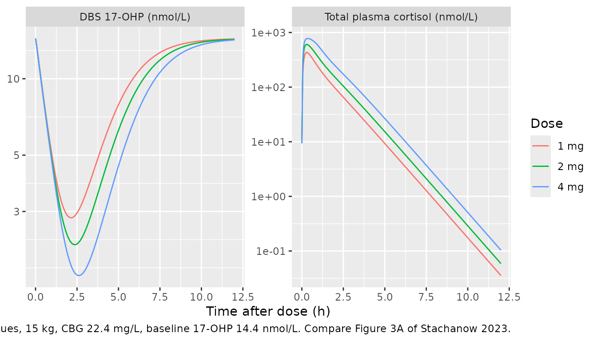
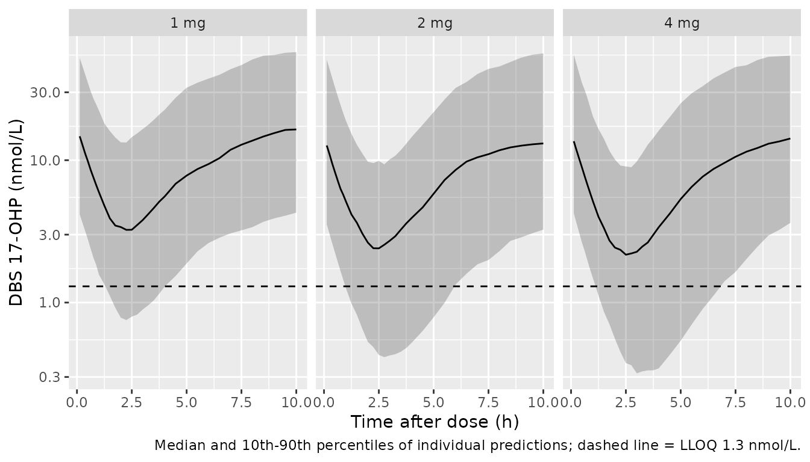
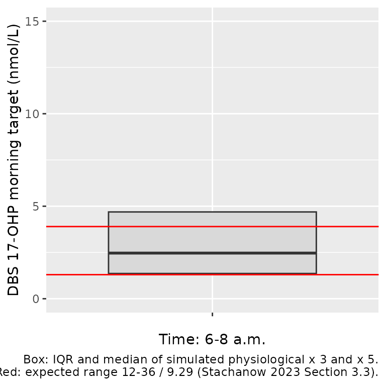

# Hydrocortisone and 17-OHP in dried blood spots (Stachanow 2023)

## Model and source

- Citation: Stachanow V, Neumann U, Blankenstein O, Alder-Baerens N,
  Bindellini D, Hindmarsh P, Ross RJ, Whitaker MJ, Melin J, Huisinga W,
  Michelet R, Kloft C. Model-Informed Target Morning
  17alpha-Hydroxyprogesterone Concentrations in Dried Blood Spots for
  Pediatric Congenital Adrenal Hyperplasia Patients. Pharmaceuticals
  (Basel). 2023;16(3):464. <doi:10.3390/ph16030464>. Cortisol PK layer
  from Stachanow V, Neumann U, Blankenstein O, Bindellini D, Melin J,
  Ross R, Whitaker MJ, Huisinga W, Michelet R, Kloft C. Exploring Dried
  Blood Spot Cortisol Concentrations as an Alternative for Monitoring
  Pediatric Adrenal Insufficiency Patients: A Model-Based Analysis.
  Front Pharmacol. 2022;13:819590. <doi:10.3389/fphar.2022.819590>.
- Description: Pediatric PK/PD model of oral hydrocortisone (Alkindi
  granules) in young children and infants with congenital adrenal
  hyperplasia: total plasma cortisol from a two-compartment model with
  saturable (Michaelis-Menten) absorption, saturable
  corticosteroid-binding-globulin and linear albumin plasma binding
  acting on unbound cortisol, and allometric weight scaling
  (Stachanow 2022) inhibits the synthesis of
  17-alpha-hydroxyprogesterone (17-OHP) measured in venous dried blood
  spots through an indirect-response model whose baseline is the
  subject’s observed pre-dose DBS 17-OHP (Stachanow 2023).
- Article: <https://doi.org/10.3390/ph16030464> (open access; the
  supplement holds the PK/PD equations and the NONMEM code)
- Cortisol PK source: <https://doi.org/10.3389/fphar.2022.819590> (open
  access; Table 1 and the supplementary NONMEM code)

Stachanow 2023 links total plasma cortisol after a morning dose of
hydrocortisone granules (Alkindi) to 17-alpha-hydroxyprogesterone
(17-OHP) measured in venous dried blood spots (DBS) in young children
and infants with congenital adrenal hyperplasia (CAH). Cortisol inhibits
the zero-order synthesis of 17-OHP (indirect-response model, Imax = 1,
Hill = 1). The PD was fitted sequentially on top of the authors’ earlier
pediatric cortisol PK model (Stachanow 2022): each child’s individual PK
parameters were data items. The packaged model therefore carries the
2022 typical values and between-subject variability for the cortisol
layer, so that it can simulate new children:

- two-compartment disposition of unbound cortisol;
- saturable (Michaelis-Menten) absorption from the depot;
- saturable binding to corticosteroid-binding globulin (CBG) and linear
  binding to albumin;
- allometric weight scaling to 70 kg.

The paper used the model to derive a target range for morning DBS
17-OHP. It simulated physiological 17-OHP from healthy children’s
24-hour cortisol profiles and multiplied the 6-8 a.m. values by 3 and by
5. That calculation is reproduced at the end of this article.

Dosing is in **nmol** of hydrocortisone and concentrations are in
**nmol/L**, the units in which the source models were fitted. To convert
a dose in mg, use the molar mass of hydrocortisone, 362.46 g/mol (1 mg =
2759 nmol). The molar mass is not stated in the papers.

## Population

The PK/PD model was fitted to 18 children from the phase 3 Alkindi trial
(NCT02720952; Charite Berlin): 12 young children aged 2-6 years and 6
infants aged 28 days-2 years. They had a median age of 2.5 years (4
months-5 years) and a median weight of 15 kg (7-21 kg) (Stachanow 2023
Table S1). The trial enrolled 23 CAH patients and 1 patient with
hypopituitarism. Each child received one individualised morning dose of
1-4 mg (Stachanow 2022 Methods). Plasma cortisol was sampled before the
dose and at 1 h and 4 h, with two further samples in the young children.
The PD dataset had 88 venous DBS 17-OHP concentrations, 22 of them below
the LLOQ of 1.3 nmol/L; these were handled with the M3 method. Sex and
race were not reported.

The cortisol PK model (Stachanow 2022) pooled 30
dexamethasone-suppressed healthy adults with 24 pediatric patients,
including 6 neonates who are not part of the PD cohort.

``` r

str(readModelDb("Stachanow_2023_hydrocortisone")()$population)
#> List of 12
#>  $ species       : chr "human"
#>  $ n_subjects    : int 18
#>  $ n_studies     : int 1
#>  $ age_range     : chr "4 months - 5 years (cohorts: young children 2-6 years, infants 28 days - 2 years)"
#>  $ age_median    : chr "2.5 years"
#>  $ weight_range  : chr "7-21 kg"
#>  $ weight_median : chr "15 kg"
#>  $ disease_state : chr "Pediatric adrenal insufficiency, predominantly congenital adrenal hyperplasia (the phase 3 trial enrolled 23 CA"| __truncated__
#>  $ dose_range    : chr "Single individualised morning oral dose of hydrocortisone granules (Alkindi), 1-4 mg (Stachanow 2022 Methods)."
#>  $ regions       : chr "Germany (Charite Berlin)"
#>  $ n_observations: chr "88 venous DBS 17-OHP concentrations (22 below the LLOQ of 1.3 nmol/L, handled with the M3 method) and 88 plasma"| __truncated__
#>  $ notes         : chr "Stachanow 2023 Section 2.1.1 and Table S1; phase 3 Alkindi trial NCT02720952. Sex and race are not reported. Th"| __truncated__
```

## Source trace

Every `ini()` value carries an in-file comment pointing at its source.
They are collected here.

| Equation / parameter | Value | Source location |
|----|----|----|
| `lcl` (CL, 70 kg) | 400 L/h | Stachanow 2022 Table 1 |
| `lvc` (Vc, 70 kg) | 10.6 L | Stachanow 2022 Table 1 |
| `lq` (Q, 70 kg) | 160 L/h | Stachanow 2022 Table 1 |
| `lvp` (Vp, 70 kg) | 124 L | Stachanow 2022 Table 1 |
| `ltmax_abs` (Vmax) | 21388 nmol/h | Stachanow 2022 Table 1 |
| `lkt_abs` (Km) | 4810 nmol (fixed) | Stachanow 2022 Table 1 |
| `lfdepot` (F) | 1 (fixed) | Stachanow 2022 Table 1 |
| `e_wt_cl_q`, `e_wt_vc_vp` | 0.75, 1 (fixed) | Stachanow 2022 Methods; supplement `$PK` |
| `lkcbg` (Kd for CBG) | 9.71 nmol/L (fixed) | Stachanow 2022 Table 1 |
| `nsalb` (NSAlb) | 4.15 (fixed) | Stachanow 2022 Table 1 |
| `lbs_cbg` (binding sites per CBG) | 1 (fixed) | Stachanow 2022 supplement `$THETA` 6 |
| `bmax` | `TRANSCORTIN * 1000 / 52` nmol/L | Stachanow 2022 supplement `$PK` (`CBGmol = CBG2*1000/52`) |
| `lrbase_cortisol` (pre-dose plasma cortisol) | 9.41 nmol/L | Stachanow 2022 Table 1 (`BASEchild, pla`) |
| `lkdeg` | 1.22 1/h | Stachanow 2023 Table 1 |
| `lic50` | 21.0 nmol/L | Stachanow 2023 Table 1 |
| `imax`, `hill` | 1, 1 (fixed) | Stachanow 2023 Table 1 |
| `etalcl`, `etaltmax_abs`, `etalkt_abs`, `etalfdepot` | 0.0644, 0.196, 0.270, 0.123 | Stachanow 2022 Table 1 (25.8, 46.5, 55.7, 36.1 %CV) |
| `etalbs_cbg` | 0.049 (fixed) | Stachanow 2022 supplement `$OMEGA` 6 |
| `etalrbase_cortisol` | 0.144^2 (fixed) | Stachanow 2022 supplement (`ETA(13)*THETA(14)`, omega 1) |
| `etalkdeg` | 0.0025 (fixed) | Stachanow 2023 supplement `$OMEGA`; Table 1 5.0 %CV |
| `etalic50` | 0.733 | Stachanow 2023 Table 1 (104 %CV) |
| `etalrbase` | 0.381^2 (fixed) | Stachanow 2023 supplement (`ETA(3)*THETA(3)`, omega 1) |
| `expSd` (plasma cortisol) | 0.144 | Stachanow 2022 Table 1 (14.4 %) |
| `expSd_ohp17_dbs` | 0.381 | Stachanow 2023 Table 1 (38.1 %) |
| `d/dt(depot)`, `d/dt(central)`, `d/dt(peripheral1)` | n/a | Stachanow 2022 supplement, differential equations; Stachanow 2023 supplement `$DES` |
| unbound cortisol (quadratic) | n/a | Stachanow 2022 supplement `A_u` equation; Stachanow 2023 `$DES` `AUP` |
| `d/dt(effect)`, `ksyn = rbase * kdeg` | n/a | Stachanow 2023 supplement `$PK` / `$DES` |
| `central(0)`, `effect(0)` | n/a | Stachanow 2023 supplement `A_0(2) = IBASE*V1`, `A_0(5) = OHPBASE` |

## Virtual cohort

The observed data are not public. The virtual cohort below follows Table
S1 and Figure 3A of the paper:

- Weight: log-normal around 15 kg, truncated to 7-21 kg.
- CBG: 22.4 mg/L for every child. This is the value the authors used
  when CBG was not measured; the pediatric CBG distribution is not
  reported.
- Baseline DBS 17-OHP: log-normal with the cohort median of 14.4 nmol/L
  (Section 2.3) and a log-scale SD of 1. The SD was chosen by the
  maintainers so the draws span roughly the 3-160 nmol/L of the Figure
  3A baselines.
- Dose: three arms at the trial’s dose range, 1, 2 and 4 mg, given at 0
  h (morning), with 150 children per arm.

``` r

# set.seed() fixes R's draws of the covariates. rxode2's own random-effect
# draws are seeded per solver thread, so assertions below are written to hold
# for any cohort the model can produce.
set.seed(20231)
mw_hc <- 362.46 # g/mol, hydrocortisone (not stated in the source papers)
obs_times <- c(seq(0, 1, by = 0.125), seq(1.25, 4, by = 0.25), seq(4.5, 10, by = 0.5))

make_cohort <- function(n, dose_mg, id_offset = 0L) {
  subj <- tibble(
    id = id_offset + seq_len(n),
    WT = pmin(pmax(exp(rnorm(n, log(15), 0.3)), 7), 21),
    TRANSCORTIN = 22.4,
    OHP17_DBS_BL = exp(rnorm(n, log(14.4), 1)),
    dose_group = paste(dose_mg, "mg")
  )
  doses <- subj |>
    mutate(time = 0, amt = dose_mg * 1e6 / mw_hc, evid = 1L, cmt = "depot", dvid = NA_integer_)
  obs <- subj |>
    tidyr::crossing(time = obs_times) |>
    mutate(amt = 0, evid = 0L, cmt = "central", dvid = 1L)
  bind_rows(doses, obs) |> arrange(id, time, desc(evid))
}

events <- bind_rows(
  make_cohort(150, 1, id_offset = 0L),
  make_cohort(150, 2, id_offset = 150L),
  make_cohort(150, 4, id_offset = 300L)
)
stopifnot(!anyDuplicated(unique(events[, c("id", "time", "evid")])))
```

The model has two observed endpoints (`Cc` and `ohp17_dbs`), so the
observation rows carry `dvid = 1`. Both endpoints come back as columns
of every solved row.

## Simulation

``` r

mod <- rxode2::rxode2(readModelDb("Stachanow_2023_hydrocortisone"))
#> ℹ parameter labels from comments will be replaced by 'label()'
sim <- rxode2::rxSolve(mod, events = events, keep = c("dose_group", "OHP17_DBS_BL")) |>
  as.data.frame()

mod_typical <- rxode2::zeroRe(mod)
typ_events <- bind_rows(lapply(c(1, 2, 4), function(d) {
  make_cohort(1, d, id_offset = d)
})) |>
  mutate(WT = 15, OHP17_DBS_BL = 14.4)
typ_events <- typ_events |>
  filter(evid == 1) |>
  bind_rows(
    typ_events |>
      filter(evid == 0) |>
      distinct(id, .keep_all = TRUE) |>
      select(-time) |>
      tidyr::crossing(time = seq(0, 12, by = 0.05))
  ) |>
  arrange(id, time, desc(evid))
sim_typ <- rxode2::rxSolve(mod_typical, events = typ_events, keep = "dose_group") |>
  as.data.frame()
#> ℹ omega/sigma items treated as zero: 'etalcl', 'etaltmax_abs', 'etalkt_abs', 'etalfdepot', 'etalbs_cbg', 'etalrbase_cortisol', 'etalkdeg', 'etalic50', 'etalrbase'
#> Warning: multi-subject simulation without without 'omega'
```

## Replicate published figures

### Figure 3A: the U-shaped 17-OHP time course

The paper’s Figure 3A shows observed DBS 17-OHP falling after the
morning dose and rising again as plasma cortisol declines. Most profiles
reach their minimum between about 1 and 4 h and approach baseline by 6-8
h. The typical-value simulation reproduces that shape for a 15-kg child
with the median baseline of 14.4 nmol/L.

``` r

sim_typ |>
  select(time, dose_group, Cc, ohp17_dbs) |>
  pivot_longer(c(Cc, ohp17_dbs), names_to = "output", values_to = "conc") |>
  mutate(output = recode(output,
    Cc = "Total plasma cortisol (nmol/L)",
    ohp17_dbs = "DBS 17-OHP (nmol/L)"
  )) |>
  ggplot(aes(time, conc, colour = dose_group)) +
  geom_line() +
  facet_wrap(~output, scales = "free_y") +
  scale_y_log10() +
  labs(
    x = "Time after dose (h)", y = NULL, colour = "Dose",
    caption = "Typical values, 15 kg, CBG 22.4 mg/L, baseline 17-OHP 14.4 nmol/L. Compare Figure 3A of Stachanow 2023."
  )
```



``` r

u_shape <- sim_typ |>
  group_by(dose_group) |>
  summarise(
    t_nadir = time[which.min(ohp17_dbs)],
    nadir = min(ohp17_dbs),
    at_8h = ohp17_dbs[which.min(abs(time - 8))],
    .groups = "drop"
  )
knitr::kable(u_shape |> rename(
  "Dose" = dose_group, "Time of nadir (h)" = t_nadir,
  "Nadir 17-OHP (nmol/L)" = nadir, "17-OHP at 8 h (nmol/L)" = at_8h
), digits = 2)
```

| Dose | Time of nadir (h) | Nadir 17-OHP (nmol/L) | 17-OHP at 8 h (nmol/L) |
|:-----|------------------:|----------------------:|-----------------------:|
| 1 mg |              2.15 |                  2.83 |                  13.15 |
| 2 mg |              2.35 |                  2.22 |                  12.52 |
| 4 mg |              2.60 |                  1.68 |                  11.51 |

``` r


stopifnot(
  # The nadir falls inside the 1-4 h window where Figure 3A profiles bottom out.
  all(u_shape$t_nadir > 1 & u_shape$t_nadir < 4),
  # Suppression is substantial (Figure 3A: profiles fall several-fold) ...
  all(u_shape$nadir < 0.5 * 14.4),
  # ... and the profile has recovered most of the way by 8 h.
  all(u_shape$at_8h > 0.5 * 14.4)
)
```

### Cohort profiles (compare Figure 3A and Supplementary Figure S3)

``` r

sim |>
  filter(time > 0) |>
  group_by(time, dose_group) |>
  summarise(
    Q10 = quantile(ohp17_dbs, 0.10), Q50 = median(ohp17_dbs),
    Q90 = quantile(ohp17_dbs, 0.90), .groups = "drop"
  ) |>
  ggplot(aes(time, Q50)) +
  geom_ribbon(aes(ymin = Q10, ymax = Q90), alpha = 0.25) +
  geom_line() +
  geom_hline(yintercept = 1.3, linetype = "dashed") +
  facet_wrap(~dose_group) +
  scale_y_log10() +
  labs(
    x = "Time after dose (h)", y = "DBS 17-OHP (nmol/L)",
    caption = "Median and 10th-90th percentiles of individual predictions; dashed line = LLOQ 1.3 nmol/L."
  )
```



## PKNCA validation

Neither paper reports NCA of plasma cortisol, so the PKNCA block below
documents the simulated exposure by dose group. It has no published
comparator. Cortisol is the only output where NCA applies; 17-OHP is
endogenous and is checked with the PD tests below. The pre-dose plasma
cortisol (the child’s residual cortisol, 9.41 nmol/L typical) decays
from time 0 and is included in the AUC, as it is in the model.

``` r

sim_nca <- sim |>
  dplyr::filter(!is.na(Cc)) |>
  dplyr::select(id, time, Cc, dose_group)

conc_obj <- PKNCA::PKNCAconc(sim_nca, Cc ~ time | dose_group + id)
dose_df <- events |>
  dplyr::filter(evid == 1) |>
  dplyr::select(id, time, amt, dose_group)
dose_obj <- PKNCA::PKNCAdose(dose_df, amt ~ time | dose_group + id)
intervals <- data.frame(
  start = 0, end = 10, cmax = TRUE, tmax = TRUE, auclast = TRUE
)
nca_res <- PKNCA::pk.nca(PKNCA::PKNCAdata(conc_obj, dose_obj, intervals = intervals))

nca_sum <- as.data.frame(nca_res) |>
  filter(PPTESTCD %in% c("cmax", "tmax", "auclast")) |>
  group_by(dose_group, PPTESTCD) |>
  summarise(median = median(PPORRES), .groups = "drop") |>
  pivot_wider(names_from = PPTESTCD, values_from = median)
nca_sum |>
  rename(
    "Dose" = dose_group, "Cmax (nmol/L)" = cmax,
    "Tmax (h)" = tmax, "AUC0-10 (nmol*h/L)" = auclast
  ) |>
  knitr::kable(digits = 2, caption = "Median simulated plasma cortisol NCA by dose group.")
```

| Dose | AUC0-10 (nmol\*h/L) | Cmax (nmol/L) | Tmax (h) |
|:-----|--------------------:|--------------:|---------:|
| 1 mg |              623.87 |        468.44 |     0.25 |
| 2 mg |              926.18 |        596.05 |     0.25 |
| 4 mg |             1415.55 |        759.59 |     0.38 |

Median simulated plasma cortisol NCA by dose group. {.table}

``` r


# Saturable CBG binding makes total cortisol exposure LESS than dose
# proportional: a doubled dose frees a larger unbound fraction, which is
# cleared faster. A mis-coded binding term (e.g. linear) would give a ratio
# of about 2.
auc_ratio <- nca_sum$auclast[nca_sum$dose_group == "4 mg"] /
  nca_sum$auclast[nca_sum$dose_group == "2 mg"]
stopifnot(auc_ratio > 1.1, auc_ratio < 1.9)
```

The 4 mg / 2 mg AUC ratio is 1.53, less than dose-proportional, as
expected from saturable CBG binding.

## PD and binding checks

### Binding model

The unbound amount in `model()` is the positive root of the quadratic
for saturable CBG plus linear albumin binding. At any total
concentration it must satisfy

C_total = C_u (1 + NSAlb) + Bmax C_u / (Kd + C_u).

At trace concentrations the CBG-bound share of plasma cortisol tends to
(Bmax/Kd) / (1 + NSAlb + Bmax/Kd) = 89.6 % at 22.4 mg/L CBG. Stachanow
2022 reports CBG binding of “approximately 90%” at the LLOQ, in its
whole-blood fractions.

``` r

th <- mod$theta
kd <- exp(th[["lkcbg"]])
ns <- th[["nsalb"]]
bmax <- 22.4 * 1000 / 52
chk_bind <- sim_typ |>
  filter(dose_group == "4 mg", time > 0) |>
  mutate(
    vc = 10.6 * 15 / 70,
    cu = central_u / vc,
    resid = (cu * (1 + ns) + bmax * cu / (kd + cu)) / Cc - 1
  )
stopifnot(max(abs(chk_bind$resid)) < 1e-6)

frac_cbg_trace <- (bmax / kd) / (1 + ns + bmax / kd)
frac_cbg_peak <- with(
  chk_bind[which.max(chk_bind$Cc), ],
  bmax * cu / (kd + cu) / Cc
)
stopifnot(abs(frac_cbg_trace - 0.90) < 0.01)
```

At the 4-mg peak (776 nmol/L total) the CBG-bound fraction falls to 49
%, compared with 89.6 % at trace concentrations. Stachanow 2022
describes the same saturation.

### Steady state without cortisol

With no cortisol, `inh = 1` and 17-OHP must stay at its baseline,
because `ksyn = baseline * kdeg`.

``` r

ev_ss <- data.frame(
  id = 1, time = seq(0, 24, by = 1), amt = 0, evid = 0L, cmt = "central", dvid = 1L,
  WT = 15, TRANSCORTIN = 22.4, OHP17_DBS_BL = 14.4
)
ss <- rxode2::rxSolve(mod_typical, events = ev_ss, params = c(lrbase_cortisol = log(1e-8))) |>
  as.data.frame()
#> ℹ omega/sigma items treated as zero: 'etalcl', 'etaltmax_abs', 'etalkt_abs', 'etalfdepot', 'etalbs_cbg', 'etalrbase_cortisol', 'etalkdeg', 'etalic50', 'etalrbase'
stopifnot(max(abs(ss$ohp17_dbs / 14.4 - 1)) < 1e-4)
```

### Figure 6: derived morning DBS 17-OHP target range

For Step C the authors drove the PD with plasma cortisol from 28 healthy
children aged 5-9 years, sampled every 20 minutes over 24 h (Figure 2).
They started the 17-OHP compartment at the median baseline of 14.4
nmol/L, ran 1000 simulations, and took the physiological DBS 17-OHP at
6-8 a.m. Those values were multiplied by 3 and by 5 to approximate the
target range. The interquartile range of the pooled values was 2.1-8.3
nmol/L, median 4.4 nmol/L.

The individual profiles are not published. The maintainers digitised the
**median** profile (the blue line in Figure 2) at the 72 sampling times.
Below, the packaged model’s PD layer is driven by that profile, with
between-subject variability on IC50 and kdeg. The PD layer is written
out as an rxode2 model whose input `CORT` is the cortisol concentration.
Its parameters are read from the packaged model, and a first check
confirms it reproduces the packaged model’s 17-OHP when fed the packaged
model’s own cortisol.

``` r

pd_only <- rxode2::rxode2({
  kdeg <- exp(lkdeg + etalkdeg)
  ic50 <- exp(lic50 + etalic50)
  rbase <- OHP17_DBS_BL * exp(etalrbase)
  ksyn <- rbase * kdeg
  inh <- 1 - imax * CORT^hill / (ic50^hill + CORT^hill)
  d/dt(effect) <- ksyn * inh - kdeg * effect
  effect(0) <- rbase
  ohp17_dbs <- effect
})
pd_par <- c(
  lkdeg = th[["lkdeg"]], lic50 = th[["lic50"]],
  imax = th[["imax"]], hill = th[["hill"]],
  etalkdeg = 0, etalic50 = 0, etalrbase = 0
)

# Equivalence: drive pd_only with the packaged model's own typical cortisol
# (2 mg, dense 0.05-h grid, linear interpolation) and compare 17-OHP.
drv <- sim_typ |> filter(dose_group == "2 mg")
pd_chk <- rxode2::rxSolve(
  pd_only,
  params = pd_par,
  events = data.frame(id = 1, time = drv$time, evid = 0L, CORT = drv$Cc, OHP17_DBS_BL = 14.4),
  covsInterpolation = "linear"
) |> as.data.frame()
rel_diff <- pd_chk$ohp17_dbs / drv$ohp17_dbs - 1
stopifnot(max(abs(rel_diff)) < 0.02)
```

The PD-only layer matches the packaged model within 0.046 %, the error
from interpolating cortisol linearly on the 0.05-h grid.

``` r

# Median plasma cortisol of 28 healthy children aged 5-9 years, digitised by
# the maintainers from Figure 2 of Stachanow 2023 at the 20-minute sampling
# grid (00:00 to 23:40), nmol/L.
cort_median <- c(
  88, 153, 173, 178, 207, 212, 248, 249, 226, 217, 240, 294, 341, 345, 425, 427,
  399, 454, 455, 388, 423, 449, 500, 444, 471, 504, 408, 356, 349, 312, 310, 291,
  287, 285, 318, 288, 306, 328, 368, 362, 337, 291, 258, 227, 252, 281, 272, 260,
  224, 220, 224, 270, 220, 225, 241, 226, 187, 194, 174, 161, 131, 116, 113, 113,
  104, 92, 77, 80, 71, 70, 94, 95
)
clock <- seq(0, by = 1 / 3, length.out = length(cort_median))

n_sim <- 200
om <- mod$omega
eta_draw <- data.frame(
  id = seq_len(n_sim),
  etalic50 = rnorm(n_sim, 0, sqrt(om["etalic50", "etalic50"])),
  etalkdeg = rnorm(n_sim, 0, sqrt(om["etalkdeg", "etalkdeg"]))
)
pd_ev <- tidyr::crossing(id = seq_len(n_sim), data.frame(time = clock, CORT = cort_median)) |>
  mutate(evid = 0L, OHP17_DBS_BL = 14.4) |>
  left_join(eta_draw, by = "id")
pd_sim <- rxode2::rxSolve(
  pd_only,
  params = pd_par[c("lkdeg", "lic50", "imax", "hill", "etalrbase")],
  events = pd_ev,
  covsInterpolation = "linear",
  keep = c("CORT")
) |>
  as.data.frame()

morning <- pd_sim |> filter(time >= 6, time <= 8)
target <- c(3 * morning$ohp17_dbs, 5 * morning$ohp17_dbs)
fig6 <- tibble::tibble(
  Statistic = c("25th percentile", "Median", "75th percentile"),
  `Stachanow 2023 (nmol/L)` = c(2.1, 4.4, 8.3),
  `Simulated (nmol/L)` = unname(quantile(target, c(0.25, 0.5, 0.75)))
)
knitr::kable(fig6, digits = 2, caption = "Derived morning (6-8 a.m.) DBS 17-OHP target range: physiological x 3 and x 5, pooled.")
```

| Statistic       | Stachanow 2023 (nmol/L) | Simulated (nmol/L) |
|:----------------|------------------------:|-------------------:|
| 25th percentile |                     2.1 |               1.36 |
| Median          |                     4.4 |               2.47 |
| 75th percentile |                     8.3 |               4.69 |

Derived morning (6-8 a.m.) DBS 17-OHP target range: physiological x 3
and x 5, pooled. {.table}

``` r


# Quasi-steady state: kdeg = 1.22 1/h makes 17-OHP track cortisol within
# about an hour, so at 6-8 a.m. the solve sits close to the closed form
# baseline * IC50 / (IC50 + C) for each subject.
qss <- morning |>
  select(id, time, CORT, ohp17_dbs) |>
  left_join(eta_draw, by = "id") |>
  mutate(qss = 14.4 * exp(th[["lic50"]] + etalic50) / (exp(th[["lic50"]] + etalic50) + CORT))
stopifnot(abs(median(qss$ohp17_dbs / qss$qss) - 1) < 0.15)
```

``` r

ggplot(data.frame(target = target), aes(x = "", y = target)) +
  geom_boxplot(outlier.shape = NA, coef = 0, fill = "grey85") +
  geom_hline(yintercept = c(1.3, 3.9), colour = "red") +
  coord_cartesian(ylim = c(0, 15)) +
  labs(
    x = "Time: 6-8 a.m.", y = "DBS 17-OHP morning target (nmol/L)",
    caption = "Box: IQR and median of simulated physiological x 3 and x 5.\nRed: expected range 12-36 / 9.29 (Stachanow 2023 Section 3.3)."
  )
```



The simulated range is lower than the published one: its median is about
0.56 of the paper’s 4.4 nmol/L. The 17-OHP layer itself reproduces the
packaged model exactly (check above), so the gap comes from the cortisol
input:

- The paper drove each simulation with one of the 28 *individual*
  cortisol profiles; only the median profile can be recovered from
  Figure 2.
- At quasi-steady state the morning 17-OHP is
  `14.4 * IC50 / (IC50 + C)`. With the median morning cortisol of about
  450 nmol/L and IC50 = 21 nmol/L, that gives about 0.64 nmol/L, or a
  target median of about 2.6 nmol/L. The published 4.4 nmol/L would need
  a typical morning cortisol of about 250 nmol/L, which is below the
  Figure 2 median between 6 and 8 a.m.

The paper does not state how the cortisol input was aligned in time or
whether the 17-OHP baseline carried its variability in Step C. The
maintainers have not been able to close the gap from the published
information, and the parameters have not been adjusted to match. The
simulated range still lies in the same order of magnitude as the paper’s
calculated “expected” range of 1.3-3.9 nmol/L (red lines), which was the
paper’s plausibility criterion.

## Assumptions and deviations

- **Cortisol PK carried from Stachanow 2022.** The 2023 fit used each
  child’s individual PK estimates from the 2022 model as data. The
  packaged model carries the 2022 typical values and variability (Table
  1, sampling importance resampling medians), so it simulates new
  children rather than the fitted 18.
- **Cortisol association with red blood cells is omitted.** The 2022
  model’s RBC compartment and blood-volume term (`Vdelta`) produce DBS
  *cortisol*. The 2023 PD reads total *plasma* cortisol only, so that
  compartment does not affect any output here. DBS cortisol belongs to
  an extraction of Stachanow 2022 itself.
- **CBG is a covariate (`TRANSCORTIN`, mg/L).** Measured CBG was used
  for the pediatric data; when CBG was not measured the authors used
  22.4 mg/L, which this article uses throughout.
- **Pre-dose plasma cortisol is a typical value.** The 2022 model used
  each child’s observed pre-dose cortisol (or 9.41 nmol/L when
  unobserved), with a log-normal deviation whose SD equals the residual
  SD. The packaged model uses 9.41 nmol/L with that deviation. The
  baseline is residual cortisol that decays from time 0 (CAH patients
  make little cortisol), not a steady state. The peripheral compartment
  starts empty, as in the source code.
- **17-OHP baseline is a covariate, `OHP17_DBS_BL`.** As in the source,
  the baseline is the child’s observed pre-dose DBS 17-OHP, with a
  log-normal deviation whose SD equals the residual SD
  (`OHPBASE = BASEDV*EXP(ETA(3)*THETA(3))`, omega 1). Table 1 lists the
  “IIV on 17-OHPBASE” as 131 %CV, which is the unscaled omega of 1. The
  effective log-scale SD is 0.381. Baselines below the LLOQ were entered
  as 0.65 nmol/L.
- **Residual error read as a log-scale SD.** Table 1 reports the
  residual error, additive on the log scale, as 38.1 %CV. It is encoded
  as SD 0.381, the convention the same group’s 2022 paper used (14.4 %
  in Table 1 = 0.144 in its control stream). Variabilities are converted
  with omega^2 = log(CV^2 + 1), which reproduces Table 1’s 131.1 %CV for
  omega = 1.
- **Both endpoints carry a residual error.** The 2023 fit modelled only
  17-OHP (plasma cortisol came in through the individual PK parameters).
  The packaged model also declares plasma cortisol with the 2022
  residual error (log-scale SD 0.144), so simulated observations of both
  are available.
- **Below-LLOQ handling.** The M3 likelihood used for fitting does not
  apply to simulation. The LLOQ (1.3 nmol/L) is shown on the plots.
- **Virtual cohort.** CBG, the baseline 17-OHP spread and the per-arm
  doses are assumptions, as described in the Virtual cohort section.
- **Figure 6.** Driven by the digitised median cortisol profile instead
  of the 28 individual profiles. The result is a lower target range than
  published (see above).
- **Errata.** No correction notice for either paper on EuropePMC
  (checked 2026-10-26).
