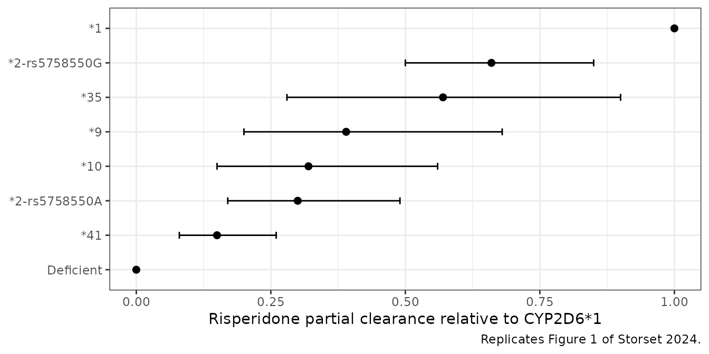
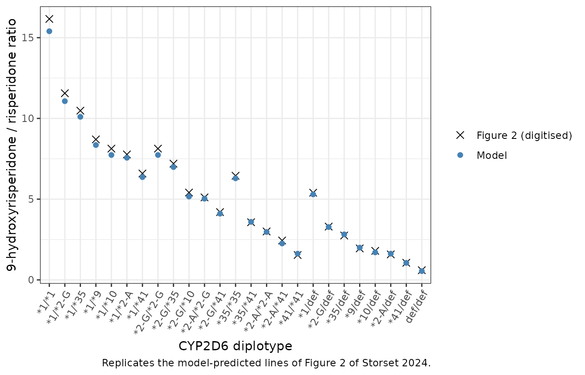
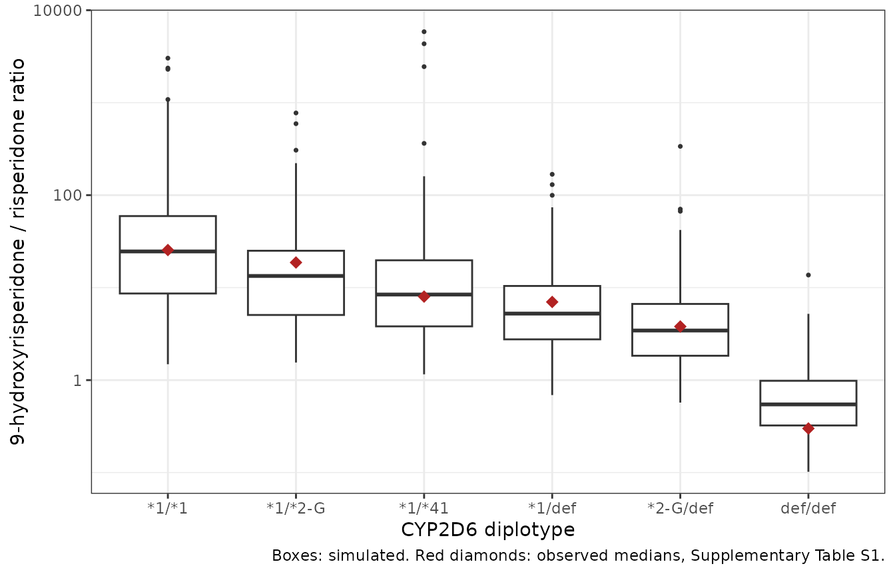

# Risperidone and CYP2D6 haplotypes (Storset 2024)

## Model and source

- Citation: Storset E, Braten LS, Ingelman-Sundberg M, Johansson I,
  Molden E, Kringen MK (2024). Impact of CYP2D6\*2, CYP2D6\*35,
  rs5758550, and related haplotypes on risperidone clearance in vivo.
  *European Journal of Clinical Pharmacology* **80**(10):1531-1541.
  <doi:10.1007/s00228-024-03721-6>.
- Article: <https://doi.org/10.1007/s00228-024-03721-6> (open access,
  PMC11393095)

Storset 2024 used risperidone as a CYP2D6 activity marker. Its joint
parent-metabolite population PK model writes risperidone apparent
clearance as the **sum** of a CYP2D6-independent base clearance and one
partial clearance per expressed CYP2D6 allele, each allele’s partial
clearance being an estimated fraction of the CYP2D6\*1 partial
clearance. The central finding is that CYP2D6\*2 and \*35, currently
classified as normal-function alleles, both encode reduced risperidone
clearance, and that the \*2 effect splits by the rs5758550 haplotype
(\*2-rs5758550G 66 %, \*2-rs5758550A 30 % of \*1).

``` r

mod_fn <- readModelDb("Storset_2024_risperidone")
mod <- rxode2::rxode2(mod_fn())
mod_typ <- rxode2::zeroRe(mod)

# Typical-value solves: rxode2 warns that a multi-subject solve has no
# omega, which is the intent here, so that one warning is muffled.
solve_typ <- function(events) {
  withCallingHandlers(
    rxode2::rxSolve(mod_typ, events, returnType = "data.frame",
                    useLinCmt = FALSE),
    warning = function(w) {
      if (grepl("without 'omega'", conditionMessage(w), fixed = TRUE)) {
        invokeRestart("muffleWarning")
      }
    }
  )
}
```

## Population

Storset 2024 analysed 1565 paired risperidone + 9-hydroxyrisperidone
serum concentrations from 512 adults (275 male, 237 female; median age
37 years, range 18-89) with routine therapeutic drug monitoring at the
Center for Psychopharmacology, Diakonhjemmet Hospital, Oslo, between
2005 and 2022 (Table 1). Oral risperidone daily doses were 0.5-12 mg
(median 3 mg), given once (789 samples), twice (758) or three times (18)
daily; samples were taken 9-30 h after the last dose (median 13 h) and
assumed at steady state. Comedication with the CYP2D6 inhibitors
paroxetine, fluoxetine and bupropion, the CYP3A inducers phenobarbital,
phenytoin and carbamazepine, and recent long-acting risperidone or
paliperidone injections were exclusion criteria. Of 1026 CYP2D6 alleles,
401 were \*1, 166 \*2-rs5758550G, 27 \*2-rs5758550A, 54 \*35, 20 \*9, 23
\*10, 66 \*41 and 269 deficient (\*3, \*4, \*5, \*6). Diplotype counts
are in Supplementary Table S1. No body size or organ-function data were
available.

The same metadata are available programmatically via
`readModelDb("Storset_2024_risperidone")$population`.

## Source trace

| Element | Value | Source |
|----|----|----|
| Structure: one compartment each for parent and metabolite, first-order absorption, linear elimination | – | Methods ‘Structural and stochastic model’ |
| `lka` (fixed) | 2.01 1/h | Table 2 (fixed to literature value, ref. 31) |
| `lvc` (V/F) | 333 L | Table 2 |
| `lcl_base` (CLbase/F) | 4.2 L/h | Table 2 ‘Clearance, Base’ |
| `lcl_cyp2d6_star1` (CL per \*1 allele) | 23.2 L/h | Table 2 ‘Clearance, CYP2D6\*1’ |
| `f_cyp2d6_star2g` | 0.66 | Table 2 ‘\*2-rs5758550G’ |
| `f_cyp2d6_star35` | 0.57 | Table 2 ‘\*35’ |
| `f_cyp2d6_star2a` | 0.30 | Table 2 ‘\*2-rs5758550A’ |
| `f_cyp2d6_star9` | 0.39 | Table 2 ‘\*9’ |
| `f_cyp2d6_star10` | 0.32 | Table 2 ‘\*10’ |
| `f_cyp2d6_star41` | 0.15 | Table 2 ‘\*41’ |
| Deficient \*3-\*6 contribution | 0 (fixed) | Table 2 ‘\*3-\*6’; no column needed |
| `e_snp_nfib_rs28379954_cl` | 1.41 | Table 2 ‘NFIB-C’ |
| `lage_hinge`, `e_age_cl` | 34 years, -0.9 %/year | Table 2 risperidone ‘Age breaking point’, ‘Reduction per year’ |
| `lvc_9oh` (Vmet/(F x fmet)) | 96 L | Table 2 |
| `lcl_9oh` (CLmet/(F x fmet)) | 8.0 L/h | Table 2 |
| `lage_hinge_9oh`, `e_age_cl_9oh` | 39 years, -1.3 %/year | Table 2 metabolite ‘Age breaking point’, ‘Reduction per year’ |
| Clearance equations | – | Table 2 footnote; Methods ‘Covariate model’ equation |
| `etalcl`, `etalcl_9oh` (block) | 86 % CV, 49 % CV, r = 0.43 | Table 2; CV = sqrt(exp(omega^2) - 1) per Methods |
| `propSd`, `addSd` | 0.58, 0.06 ng/mL | Table 2 risperidone residual error |
| `propSd_9oh` | 0.38 | Table 2 9-hydroxyrisperidone residual error |

## Covariate encoding

Each CYP2D6 allele category is carried by a pair of binary indicators,
`CYP2D6_STAR<allele>_HET` and `CYP2D6_STAR<allele>_HOM`; the model
counts the copies as `HET + 2 * HOM`. Deficient alleles (\*3, \*4, \*5,
\*6) contribute zero clearance and have no column, so a
deficient/deficient subject has every indicator at 0. The helper below
converts a diplotype label such as `"*2-G/*41"` into these columns.

``` r

cyp_cols <- c(
  "CYP2D6_STAR1_HET", "CYP2D6_STAR1_HOM",
  "CYP2D6_STAR2_RS5758550G_HET", "CYP2D6_STAR2_RS5758550G_HOM",
  "CYP2D6_STAR2_RS5758550A_HET", "CYP2D6_STAR2_RS5758550A_HOM",
  "CYP2D6_STAR35_HET", "CYP2D6_STAR35_HOM",
  "CYP2D6_STAR9_HET", "CYP2D6_STAR9_HOM",
  "CYP2D6_STAR10_HET", "CYP2D6_STAR10_HOM",
  "CYP2D6_STAR41_HET", "CYP2D6_STAR41_HOM"
)
allele_token <- c(
  "*1" = "STAR1", "*2-G" = "STAR2_RS5758550G", "*2-A" = "STAR2_RS5758550A",
  "*35" = "STAR35", "*9" = "STAR9", "*10" = "STAR10", "*41" = "STAR41"
)
diplotype_covariates <- function(diplotype) {
  out <- matrix(0L, nrow = length(diplotype), ncol = length(cyp_cols),
                dimnames = list(NULL, cyp_cols))
  for (i in seq_along(diplotype)) {
    alleles <- strsplit(diplotype[i], "/", fixed = TRUE)[[1]]
    alleles <- alleles[alleles != "def"]
    for (a in unique(alleles)) {
      zyg <- if (sum(alleles == a) == 2) "_HOM" else "_HET"
      out[i, paste0("CYP2D6_", allele_token[[a]], zyg)] <- 1L
    }
  }
  as.data.frame(out)
}
# Escape the star-allele asterisks so markdown tables do not read them as
# emphasis.
md_escape <- function(df) {
  dplyr::mutate(df, dplyr::across(
    dplyr::where(function(x) is.character(x) || is.factor(x)),
    function(x) gsub("*", "\\*", as.character(x), fixed = TRUE)
  ))
}
diplotype_covariates(c("*1/*1", "*2-G/*41", "def/def"))
#>   CYP2D6_STAR1_HET CYP2D6_STAR1_HOM CYP2D6_STAR2_RS5758550G_HET
#> 1                0                1                           0
#> 2                0                0                           1
#> 3                0                0                           0
#>   CYP2D6_STAR2_RS5758550G_HOM CYP2D6_STAR2_RS5758550A_HET
#> 1                           0                           0
#> 2                           0                           0
#> 3                           0                           0
#>   CYP2D6_STAR2_RS5758550A_HOM CYP2D6_STAR35_HET CYP2D6_STAR35_HOM
#> 1                           0                 0                 0
#> 2                           0                 0                 0
#> 3                           0                 0                 0
#>   CYP2D6_STAR9_HET CYP2D6_STAR9_HOM CYP2D6_STAR10_HET CYP2D6_STAR10_HOM
#> 1                0                0                 0                 0
#> 2                0                0                 0                 0
#> 3                0                0                 0                 0
#>   CYP2D6_STAR41_HET CYP2D6_STAR41_HOM
#> 1                 0                 0
#> 2                 1                 0
#> 3                 0                 0
```

## Typical clearance by metabolizer group

The Discussion quotes typical risperidone CL/F of 50.6 L/h for a CYP2D6
\*1/\*1 normal metabolizer, 27.4 L/h for a \*1/deficient intermediate
metabolizer and 4.2 L/h for a poor metabolizer. These hold for NFIB-T
homozygotes at or below the 34-year age breakpoint.

``` r

typ_cl <- function(diplotype, age = 30, nfib = 0) {
  ev <- data.frame(
    id = seq_along(diplotype), time = 0, amt = 0, evid = 0L,
    cmt = "central", dvid = 1L, AGE = age, SNP_NFIB_RS28379954 = nfib
  )
  ev <- cbind(ev, diplotype_covariates(diplotype))
  s <- solve_typ(ev)
  s$cl
}
cl_chk <- data.frame(
  Group = c("*1/*1 (normal)", "*1/def (intermediate)", "def/def (poor)"),
  diplotype = c("*1/*1", "*1/def", "def/def"),
  published = c(50.6, 27.4, 4.2)
)
cl_chk$simulated <- typ_cl(cl_chk$diplotype)
#> ℹ omega/sigma items treated as zero: 'etalcl', 'etalcl_9oh'
knitr::kable(
  cl_chk |>
    dplyr::select(-diplotype) |>
    md_escape() |>
    dplyr::rename("Published CL/F (L/h)" = published, "Model CL/F (L/h)" = simulated),
  digits = 2
)
```

| Group                  | Published CL/F (L/h) | Model CL/F (L/h) |
|:-----------------------|---------------------:|-----------------:|
| \*1/\*1 (normal)       |                 50.6 |             50.6 |
| \*1/def (intermediate) |                 27.4 |             27.4 |
| def/def (poor)         |                  4.2 |              4.2 |

``` r

stopifnot(all(abs(cl_chk$simulated - cl_chk$published) < 1e-6))
```

## Allele-specific clearance (Figure 1)

Figure 1 plots each allele’s partial clearance relative to CYP2D6\*1
with its 95 % confidence interval. The points are the model’s
`f_cyp2d6_*` parameters; the intervals are the bootstrap intervals from
Table 2.

``` r

ini_df <- as.data.frame(mod$iniDf)
fr <- data.frame(
  allele = c("*1", "*2-rs5758550G", "*35", "*9", "*10", "*2-rs5758550A", "*41", "Deficient"),
  name = c(NA, "f_cyp2d6_star2g", "f_cyp2d6_star35", "f_cyp2d6_star9",
           "f_cyp2d6_star10", "f_cyp2d6_star2a", "f_cyp2d6_star41", NA),
  lo = c(NA, 0.50, 0.28, 0.20, 0.15, 0.17, 0.08, NA),
  hi = c(NA, 0.85, 0.90, 0.68, 0.56, 0.49, 0.26, NA)
)
fr$est <- c(1, ini_df$est[match(fr$name[2:7], ini_df$name)], 0)
fr$allele <- factor(fr$allele, levels = rev(fr$allele))
ggplot(fr, aes(est, allele)) +
  geom_errorbar(aes(xmin = lo, xmax = hi), width = 0.2, orientation = "y",
                na.rm = TRUE) +
  geom_point(size = 2) +
  labs(x = "Risperidone partial clearance relative to CYP2D6*1", y = NULL,
       caption = "Replicates Figure 1 of Storset 2024.") +
  theme_bw()
```



## Typical metabolic ratio by diplotype (Figure 2)

Figure 2 overlays a horizontal line per diplotype: the model-predicted
9-hydroxyrisperidone / risperidone metabolic ratio for a typical subject
aged 37 years, NFIB TT, sampled 13 h after the last dose. The line
heights were digitised by the maintainers from the published figure (one
pixel is 0.3 ratio units). The figure does not state the dosing
frequency or dose; the ratio does not depend on dose because the model
is linear, and the digitised values are reproduced with twice-daily
dosing (last dose 13 h before the sample, the next dose not yet taken),
so that regimen is used here. Once-daily dosing gives ratios about 20 %
lower.

``` r

fig2 <- data.frame(
  diplotype = c("*1/*1", "*1/*2-G", "*1/*35", "*1/*9", "*1/*10", "*1/*2-A",
                "*1/*41", "*2-G/*2-G", "*2-G/*35", "*2-G/*10", "*2-A/*2-G",
                "*2-G/*41", "*35/*35", "*35/*41", "*2-A/*2-A", "*2-A/*41",
                "*41/*41", "*1/def", "*2-G/def", "*35/def", "*9/def",
                "*10/def", "*2-A/def", "*41/def", "def/def"),
  published = c(16.16, 11.56, 10.48, 8.70, 8.13, 7.77, 6.59, 8.13, 7.20,
                5.41, 5.11, 4.20, 6.45, 3.57, 3.00, 2.44, 1.54, 5.40, 3.30,
                2.75, 1.95, 1.80, 1.58, 1.06, 0.60)
)

ii <- 12
n_dose <- 70
t_obs <- (n_dose - 1) * ii + 13
ev_fig2 <- lapply(seq_len(nrow(fig2)), function(i) {
  data.frame(
    id = i,
    time = c((seq_len(n_dose) - 1) * ii, t_obs),
    amt = c(rep(1.5, n_dose), 0),
    evid = c(rep(1L, n_dose), 0L),
    cmt = c(rep("depot", n_dose), "central"),
    dvid = c(rep(NA_integer_, n_dose), 1L)
  )
}) |>
  dplyr::bind_rows()
cov_fig2 <- cbind(
  data.frame(id = seq_len(nrow(fig2)), AGE = 37, SNP_NFIB_RS28379954 = 0),
  diplotype_covariates(fig2$diplotype)
)
ev_fig2 <- dplyr::left_join(ev_fig2, cov_fig2, by = "id")
sim_fig2 <- solve_typ(ev_fig2)
#> ℹ omega/sigma items treated as zero: 'etalcl', 'etalcl_9oh'
fig2$simulated <- sim_fig2 |>
  dplyr::filter(time == t_obs) |>
  dplyr::arrange(id) |>
  dplyr::mutate(mr = Cc_9oh / Cc) |>
  dplyr::pull(mr)
fig2$pct_diff <- 100 * (fig2$simulated - fig2$published) / fig2$published

knitr::kable(
  fig2 |>
    md_escape() |>
    dplyr::rename(
      "Diplotype" = diplotype,
      "Figure 2 (digitised)" = published,
      "Model" = simulated,
      "Difference (%)" = pct_diff
    ),
  digits = 2
)
```

| Diplotype   | Figure 2 (digitised) | Model | Difference (%) |
|:------------|---------------------:|------:|---------------:|
| \*1/\*1     |                16.16 | 15.40 |          -4.71 |
| \*1/\*2-G   |                11.56 | 11.07 |          -4.25 |
| \*1/\*35    |                10.48 | 10.10 |          -3.63 |
| \*1/\*9     |                 8.70 |  8.35 |          -4.00 |
| \*1/\*10    |                 8.13 |  7.73 |          -4.86 |
| \*1/\*2-A   |                 7.77 |  7.56 |          -2.65 |
| \*1/\*41    |                 6.59 |  6.37 |          -3.41 |
| \*2-G/\*2-G |                 8.13 |  7.73 |          -4.86 |
| \*2-G/\*35  |                 7.20 |  6.99 |          -2.95 |
| \*2-G/\*10  |                 5.41 |  5.16 |          -4.59 |
| \*2-A/\*2-G |                 5.11 |  5.03 |          -1.57 |
| \*2-G/\*41  |                 4.20 |  4.10 |          -2.32 |
| \*35/\*35   |                 6.45 |  6.29 |          -2.48 |
| \*35/\*41   |                 3.57 |  3.59 |           0.67 |
| \*2-A/\*2-A |                 3.00 |  2.97 |          -1.10 |
| \*2-A/\*41  |                 2.44 |  2.26 |          -7.45 |
| \*41/\*41   |                 1.54 |  1.62 |           5.43 |
| \*1/def     |                 5.40 |  5.30 |          -1.94 |
| \*2-G/def   |                 3.30 |  3.27 |          -0.80 |
| \*35/def    |                 2.75 |  2.82 |           2.51 |
| \*9/def     |                 1.95 |  2.00 |           2.35 |
| \*10/def    |                 1.80 |  1.70 |          -5.32 |
| \*2-A/def   |                 1.58 |  1.62 |           2.76 |
| \*41/def    |                 1.06 |  1.06 |          -0.46 |
| def/def     |                 0.60 |  0.55 |          -9.06 |

``` r


fig2$diplotype <- factor(fig2$diplotype, levels = fig2$diplotype)
ggplot(fig2, aes(diplotype)) +
  geom_point(aes(y = published, shape = "Figure 2 (digitised)"), size = 2.5) +
  geom_point(aes(y = simulated, shape = "Model"), size = 2, colour = "steelblue") +
  scale_shape_manual(values = c(4, 16), name = NULL) +
  labs(x = "CYP2D6 diplotype", y = "9-hydroxyrisperidone / risperidone ratio",
       caption = "Replicates the model-predicted lines of Figure 2 of Storset 2024.") +
  theme_bw() +
  theme(axis.text.x = element_text(angle = 60, hjust = 1))
```



Both sides are deterministic typical values, so the remaining difference
is digitisation error (one pixel is 5 % of the largest ratio and 50 % of
the smallest) plus any difference in the dosing regimen the authors
used.

``` r

stopifnot(
  abs(median(fig2$pct_diff)) < 6,
  all(abs(fig2$simulated - fig2$published) < 0.8)
)
```

## Stochastic metabolic ratio by diplotype

A cohort of 100 subjects per diplotype for six common diplotypes
(Supplementary Table S1) was simulated with between-subject variability,
1.5 mg twice daily, and a sample 13 h after the last dose. Ages were
drawn from a log-normal distribution matching the cohort median of 37
years and truncated to the observed 18-89 range; NFIB C carriage was
drawn at the cohort carrier frequency (53 C alleles of 1018 genotyped,
about 10 % carriers under Hardy-Weinberg). The raw observed median
metabolic ratios from Supplementary Table S1 are shown for orientation.
They are medians of the per-subject median observed ratio over mixed
dosing regimens and sampling times, so they are not expected to coincide
with the simulated medians.

``` r

set.seed(20241)
rxode2::rxSetSeed(20241)
dips <- c("*1/*1", "*1/*2-G", "*1/*41", "*1/def", "*2-G/def", "def/def")
obs_s1 <- data.frame(
  diplotype = dips,
  n_subjects = c(82, 62, 26, 88, 37, 51),
  observed_median = c(25.5, 18.7, 8.0, 7.0, 3.8, 0.3)
)
n_per <- 100
cohort <- data.frame(
  id = seq_len(n_per * length(dips)),
  diplotype = rep(dips, each = n_per)
)
age <- exp(rnorm(nrow(cohort), log(37), 0.35))
cohort$AGE <- pmin(pmax(age, 18), 89)
cohort$SNP_NFIB_RS28379954 <- rbinom(nrow(cohort), 1, 0.10)
cohort <- cbind(cohort, diplotype_covariates(cohort$diplotype))

ev_mr <- lapply(cohort$id, function(i) {
  data.frame(
    id = i,
    time = c((seq_len(n_dose) - 1) * ii, t_obs),
    amt = c(rep(1.5, n_dose), 0),
    evid = c(rep(1L, n_dose), 0L),
    cmt = c(rep("depot", n_dose), "central"),
    dvid = c(rep(NA_integer_, n_dose), 1L)
  )
}) |>
  dplyr::bind_rows() |>
  dplyr::left_join(cohort, by = "id")

sim_mr <- rxode2::rxSolve(mod, ev_mr, returnType = "data.frame",
                          useLinCmt = FALSE, keep = "diplotype") |>
  dplyr::filter(time == t_obs) |>
  dplyr::mutate(mr = Cc_9oh / Cc)

mr_sum <- sim_mr |>
  dplyr::group_by(diplotype) |>
  dplyr::summarise(
    sim_median = median(mr),
    sim_p05 = quantile(mr, 0.05),
    sim_p95 = quantile(mr, 0.95),
    .groups = "drop"
  ) |>
  dplyr::left_join(obs_s1, by = "diplotype") |>
  dplyr::mutate(diplotype = factor(diplotype, levels = dips)) |>
  dplyr::arrange(diplotype)

knitr::kable(
  mr_sum |>
    md_escape() |>
    dplyr::rename(
      "Diplotype" = diplotype,
      "Simulated median" = sim_median,
      "Simulated 5th pct" = sim_p05,
      "Simulated 95th pct" = sim_p95,
      "Table S1 subjects" = n_subjects,
      "Table S1 observed median" = observed_median
    ),
  digits = 2
)
```

| Diplotype | Simulated median | Simulated 5th pct | Simulated 95th pct | Table S1 subjects | Table S1 observed median |
|:---|---:|---:|---:|---:|---:|
| \*1/\*1 | 24.62 | 2.57 | 794.55 | 82 | 25.5 |
| \*1/\*2-G | 13.37 | 2.51 | 192.47 | 62 | 18.7 |
| \*1/\*41 | 8.42 | 1.61 | 118.61 | 26 | 8.0 |
| \*1/def | 5.24 | 1.18 | 55.66 | 88 | 7.0 |
| \*2-G/def | 3.44 | 0.87 | 28.01 | 37 | 3.8 |
| def/def | 0.55 | 0.19 | 1.90 | 51 | 0.3 |

``` r


ggplot(sim_mr, aes(factor(diplotype, levels = dips), mr)) +
  geom_boxplot(outlier.size = 0.6) +
  geom_point(data = mr_sum, aes(diplotype, observed_median),
             colour = "firebrick", shape = 18, size = 3) +
  scale_y_log10() +
  labs(x = "CYP2D6 diplotype", y = "9-hydroxyrisperidone / risperidone ratio",
       caption = "Boxes: simulated. Red diamonds: observed medians, Supplementary Table S1.") +
  theme_bw()
```



The simulated medians follow the CYP2D6 activity sum. The check below
uses only the three diplotypes whose activities are far apart (2, 1 and
0 units of \*1); adjacent diplotypes such as \*1/\*41 (1.15 units) and
\*1/def (1 unit) are closer than the Monte Carlo error of a 100-subject
median under 86 % CV clearance variability, so their order is not
asserted.

``` r

med <- setNames(mr_sum$sim_median, as.character(mr_sum$diplotype))
stopifnot(med[["*1/*1"]] > med[["*1/def"]], med[["*1/def"]] > med[["def/def"]])
```

## Age effect on the active moiety

The Discussion states that the total active moiety (risperidone +
9-hydroxyrisperidone) is predicted to be more than doubled at 75 years
and older compared with a 30-year-old. The typical-value steady-state
average concentrations below (\*1/\*1, NFIB TT) use
`Css,avg = dose rate / CL` for each analyte; the metabolite term is
exact because all parent clearance forms metabolite in the apparent
parameterisation.

``` r

ages <- c(30, 75, 80, 85)
cl_age <- data.frame(id = seq_along(ages), time = 0, amt = 0, evid = 0L,
                     cmt = "central", dvid = 1L, AGE = ages,
                     SNP_NFIB_RS28379954 = 0)
cl_age <- cbind(cl_age, diplotype_covariates(rep("*1/*1", length(ages))))
s_age <- solve_typ(cl_age)
#> ℹ omega/sigma items treated as zero: 'etalcl', 'etalcl_9oh'
dose_rate <- 3 / 24
moiety <- data.frame(
  age = ages,
  cl = s_age$cl,
  cl_9oh = s_age$cl_9oh,
  css_moiety = 1000 * (dose_rate / s_age$cl + dose_rate / s_age$cl_9oh)
)
moiety$ratio_vs_30 <- moiety$css_moiety / moiety$css_moiety[1]
knitr::kable(
  moiety |>
    dplyr::rename(
      "Age (years)" = age,
      "Risperidone CL/F (L/h)" = cl,
      "9-OH CL (L/h)" = cl_9oh,
      "Active moiety Css,avg at 3 mg/day (ng/mL)" = css_moiety,
      "Ratio to age 30" = ratio_vs_30
    ),
  digits = 2
)
```

| Age (years) | Risperidone CL/F (L/h) | 9-OH CL (L/h) | Active moiety Css,avg at 3 mg/day (ng/mL) | Ratio to age 30 |
|---:|---:|---:|---:|---:|
| 30 | 50.60 | 8.00 | 18.10 | 1.00 |
| 75 | 31.93 | 4.26 | 33.29 | 1.84 |
| 80 | 29.65 | 3.74 | 37.67 | 2.08 |
| 85 | 27.37 | 3.22 | 43.43 | 2.40 |

``` r

stopifnot(
  moiety$ratio_vs_30[moiety$age == 80] > 2,
  moiety$ratio_vs_30[moiety$age == 75] > 1.8
)
```

The ratio is 1.84 at exactly 75 years and 2.08 at 80 years, consistent
with “more than doubled in subjects 75 years and older” as a statement
about that age group rather than about age 75 itself.

## Steady-state NCA by metabolizer group

A stochastic cohort of 100 subjects per group (normal \*1/\*1,
intermediate \*1/def, poor def/def) was dosed 1.5 mg twice daily to
steady state and sampled densely over the last dosing interval. PKNCA
computes the dosing-interval AUC for each analyte. Because the paper
reports no NCA, the check is internal: at steady state AUCtau equals
dose / CL for risperidone and dose / CLmet for 9-hydroxyrisperidone (all
parent clearance forms metabolite), using each subject’s own simulated
clearances.

``` r

rxode2::rxSetSeed(20242)
groups <- c("*1/*1" = "Normal (*1/*1)", "*1/def" = "Intermediate (*1/def)",
            "def/def" = "Poor (def/def)")
n_grp <- 100
nca_cohort <- data.frame(
  id = seq_len(n_grp * length(groups)),
  diplotype = rep(names(groups), each = n_grp)
)
nca_cohort$treatment <- unname(groups[nca_cohort$diplotype])
nca_cohort$AGE <- 30
nca_cohort$SNP_NFIB_RS28379954 <- 0
nca_cohort <- cbind(nca_cohort, diplotype_covariates(nca_cohort$diplotype))

n_ss <- 120
t_last <- (n_ss - 1) * ii
obs_t <- t_last + seq(0, ii, by = 0.25)
ev_nca <- lapply(nca_cohort$id, function(i) {
  data.frame(
    id = i,
    time = c((seq_len(n_ss) - 1) * ii, obs_t),
    amt = c(rep(1.5, n_ss), rep(0, length(obs_t))),
    evid = c(rep(1L, n_ss), rep(0L, length(obs_t))),
    cmt = c(rep("depot", n_ss), rep("central", length(obs_t))),
    dvid = c(rep(NA_integer_, n_ss), rep(1L, length(obs_t)))
  )
}) |>
  dplyr::bind_rows() |>
  dplyr::left_join(nca_cohort, by = "id") |>
  dplyr::arrange(id, time, -evid)

sim_nca <- rxode2::rxSolve(mod, ev_nca, returnType = "data.frame",
                           useLinCmt = FALSE, keep = "treatment") |>
  dplyr::filter(time >= t_last) |>
  dplyr::mutate(tad = time - t_last)
```

``` r

nca_long <- sim_nca |>
  dplyr::select(id, treatment, tad, Cc, Cc_9oh) |>
  tidyr::pivot_longer(c(Cc, Cc_9oh), names_to = "analyte", values_to = "conc") |>
  dplyr::filter(!is.na(conc))
dose_df <- nca_long |>
  dplyr::distinct(id, treatment, analyte) |>
  dplyr::mutate(tad = 0, dose = 1.5)

conc_obj <- PKNCA::PKNCAconc(nca_long, conc ~ tad | treatment + analyte + id)
dose_obj <- PKNCA::PKNCAdose(dose_df, dose ~ tad | treatment + analyte + id)
intervals <- data.frame(start = 0, end = ii, auclast = TRUE, cmax = TRUE,
                        tmax = TRUE, cmin = TRUE, cav = TRUE)
nca_res <- PKNCA::pk.nca(PKNCA::PKNCAdata(conc_obj, dose_obj, intervals = intervals))
nca_tab <- as.data.frame(nca_res)

summary(nca_res)
#>  start end             treatment analyte   N     auclast        cmax
#>      0  12 Intermediate (*1/def)      Cc 100 58.4 [78.3] 7.08 [49.5]
#>      0  12 Intermediate (*1/def)  Cc_9oh 100  193 [43.1] 16.9 [40.0]
#>      0  12        Normal (*1/*1)      Cc 100 30.7 [97.9] 4.88 [49.6]
#>      0  12        Normal (*1/*1)  Cc_9oh 100  182 [53.1] 16.8 [44.9]
#>      0  12        Poor (def/def)      Cc 100  357 [84.4] 31.9 [76.7]
#>      0  12        Poor (def/def)  Cc_9oh 100  189 [42.6] 15.9 [42.1]
#>         cmin               tmax         cav
#>   2.62 [174]  1.50 [1.00, 1.50] 4.87 [78.3]
#>  14.6 [50.1]  5.50 [4.00, 6.00] 16.0 [43.1]
#>  0.620 [970] 1.25 [0.750, 1.50] 2.56 [97.9]
#>  12.4 [76.6]  5.25 [3.00, 6.25] 15.1 [53.1]
#>  27.1 [96.0]  1.50 [1.50, 1.75] 29.7 [84.4]
#>  15.5 [43.5]  6.00 [5.25, 9.50] 15.7 [42.6]
#> 
#> Caption: auclast, cmax, cmin, cav: geometric mean and geometric coefficient of variation; tmax: median and range; N: number of subjects
```

``` r

cl_sub <- sim_nca |>
  dplyr::distinct(id, cl, cl_9oh)
auc_chk <- nca_tab |>
  dplyr::filter(PPTESTCD == "auclast") |>
  dplyr::left_join(cl_sub, by = "id") |>
  dplyr::mutate(
    expected = 1000 * 1.5 / ifelse(analyte == "Cc", cl, cl_9oh),
    pct_diff = 100 * (PPORRES - expected) / expected
  )
auc_sum <- auc_chk |>
  dplyr::group_by(treatment, analyte) |>
  dplyr::summarise(
    median_auc = median(PPORRES),
    median_pct_diff = median(pct_diff),
    p90_abs_pct_diff = quantile(abs(pct_diff), 0.9),
    .groups = "drop"
  )
knitr::kable(
  auc_sum |>
    md_escape() |>
    dplyr::rename(
      "Group" = treatment,
      "Analyte" = analyte,
      "Median AUCtau (ng*h/mL)" = median_auc,
      "Median % diff vs dose/CL" = median_pct_diff,
      "90th pct |% diff|" = p90_abs_pct_diff
    ),
  digits = 2
)
```

| Group | Analyte | Median AUCtau (ng\*h/mL) | Median % diff vs dose/CL | 90th pct \|% diff\| |
|:---|:---|---:|---:|---:|
| Intermediate (\*1/def) | Cc | 65.67 | -0.07 | 0.21 |
| Intermediate (\*1/def) | Cc_9oh | 202.44 | 0.00 | 0.00 |
| Normal (\*1/\*1) | Cc | 30.85 | -0.16 | 0.47 |
| Normal (\*1/\*1) | Cc_9oh | 175.15 | 0.00 | 0.00 |
| Poor (def/def) | Cc | 374.77 | -0.02 | 0.11 |
| Poor (def/def) | Cc_9oh | 194.76 | 0.00 | 0.11 |

``` r

stopifnot(
  all(abs(auc_sum$median_pct_diff) < 2),
  all(auc_sum$p90_abs_pct_diff < 5)
)
```

The dosing-interval AUC matches dose / CL to within the trapezoid error
for both analytes in every group, confirming the parent-to-metabolite
routing and the steady-state behaviour of the additive clearance.

## Assumptions and deviations

- **CYP2D6 encoding.** The paper assigns each subject a diplotype and
  sums the per-allele partial clearances. The model receives the
  diplotype as heterozygote / homozygote indicator pairs per allele
  category and counts copies as `HET + 2 * HOM`. Deficient alleles
  (\*3-\*6, fixed at zero clearance in the paper) need no column. Gene
  duplications cannot be expressed this way: the two subjects with three
  alleles (\*1/\*1xN and \*2-G/\*2-G xN, Table 1 footnote) would be
  encoded as their two-copy diplotype.
- **CYP2D6\*10.** In this cohort \*10 is a star-allele call from the
  routine panel in which \*4 (which also carries the rs1065852 variant)
  is called separately as deficient; `CYP2D6_STAR10_HET` / `_HOM`
  therefore mean \*10 copies, not raw rs1065852 genotype.
- **CYP2D6\*1 includes three \*1-rs5758550G alleles** that the paper
  merged with \*1-rs5758550A. Heterozygous \*1/\*2 with rs5758550 A/G
  were assumed by the authors to be \*1-rs5758550A/\*2-rs5758550G
  (Discussion).
- **NFIB unknown genotype.** Six of 1024 NFIB alleles were undetermined.
  The final model has no separate unknown category, so undetermined
  genotype is coded as NFIB-T (`SNP_NFIB_RS28379954 = 0`).
- **Age function.** The Table 2 footnote form
  `1 - CLage x (Age - AgeBP)` for `Age >= AgeBP` is written as
  `1 + e_age_cl * max(AGE - age_hinge, 0)` with the signed Table 2
  reduction per year (-0.9 % and -1.3 %).
- **Between-subject variability.** Table 2 reports 86 % and 49 % CV;
  these were converted with `omega^2 = log(1 + CV^2)` (the Methods
  define CV as `sqrt(exp(omega^2) - 1)`). The covariance uses the
  reported correlation of 0.43.
- **Residual error.** Table 2 reports the proportional errors as
  percentages (58 % and 38 %) and the additive error as 0.06 ng/mL;
  these are taken as standard deviations. The combined error follows the
  Methods equation `Obs = Pred (1 + eps1) + eps2`, which is nlmixr2’s
  default combined form.
- **Concentration units.** The assay reports nmol/L but Table 2 gives
  the additive error in ng/mL, so the model works in mg doses and ng/mL.
  The metabolite parameters are apparent (`/(F x fmet)`); the
  unidentified fraction metabolised, and the 4 % molecular-weight
  difference between risperidone and 9-hydroxyrisperidone, are absorbed
  into them, so the 9-hydroxyrisperidone output is on the scale the
  authors fitted.
- **Figure 2 regimen.** The figure states age 37, NFIB TT and 13 h after
  dose but not the dosing frequency; twice-daily dosing reproduces the
  digitised lines and was used.
- **Not retained.** Sex (p \>= 0.23) and CYP3A4\*22 (p = 0.31) were
  tested but not retained and are documented under
  `covariatesDataExcluded`.
- **Lower limit of detection.** Concentrations below the detection limit
  were imputed at half the limit during fitting (Methods); this affects
  the fit, not the model structure.
