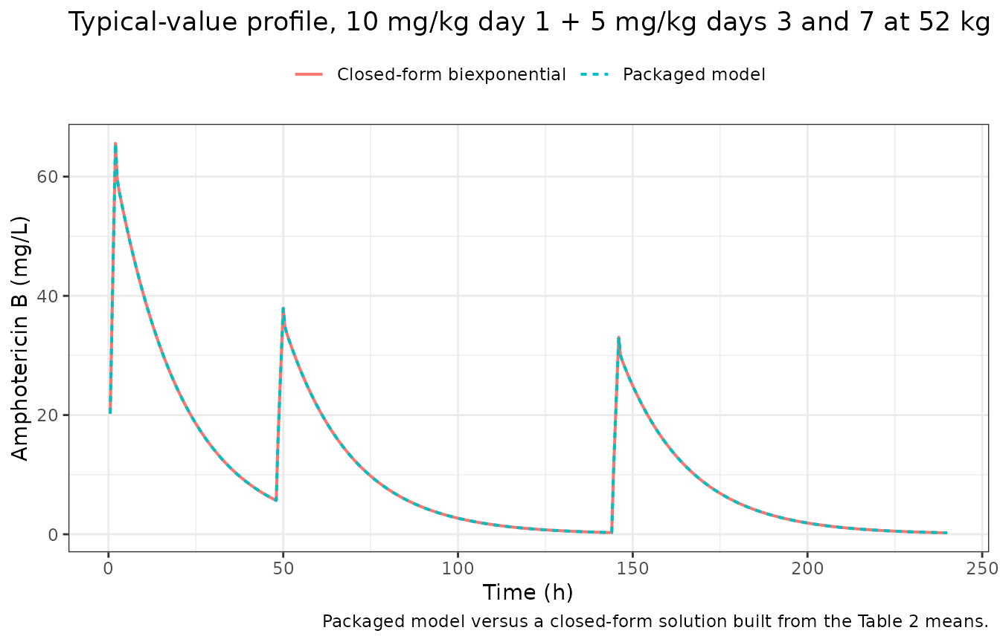
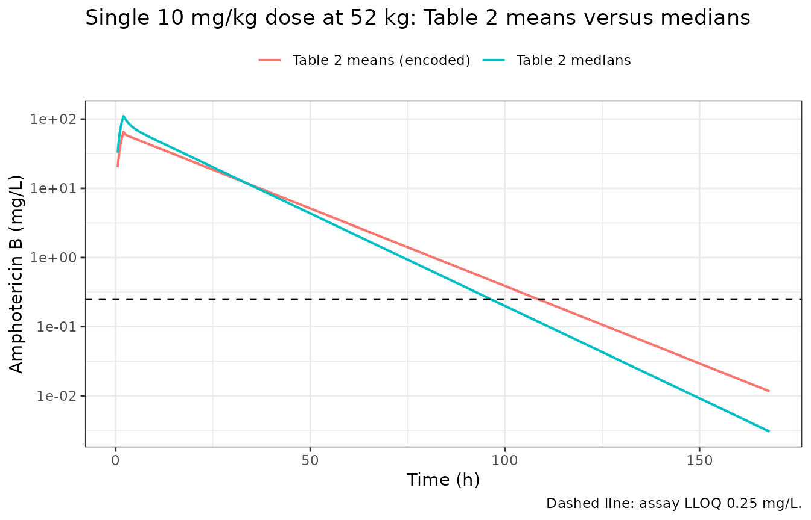
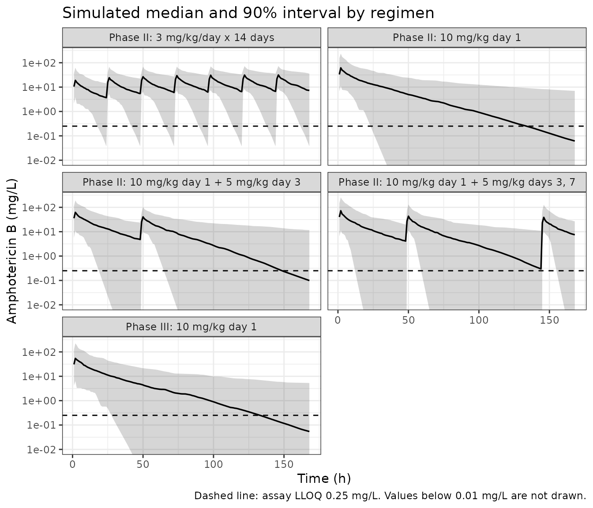

# Liposomal amphotericin B (Stott 2022)

## Model and source

``` r

ui <- rxode2::rxode(readModelDb("Stott_2022_amphotericinB_liposomal"))
#> ℹ parameter labels from comments will be replaced by 'label()'
```

- Citation: Stott KE, Moyo M, Ahmadu A, Kajanga C, Gondwe E,
  Chimang’anga W, Chasweka M, Leeme TB, Molefi M, Chofle A, Bidwell G,
  Changalucha J, Unsworth J, Jimenez-Valverde A, Lawrence DS, Mwandumba
  HC, Lalloo DG, Harrison TS, Jarvis JN, Hope W, Martson AG. Population
  pharmacokinetics of liposomal amphotericin B in adults with
  HIV-associated cryptococcal meningoencephalitis. J Antimicrob
  Chemother. 2023;78(1):276-283. <doi:10.1093/jac/dkac389>
- Description: Two-compartment IV-infusion population PK model for
  liposomal amphotericin B (AmBisome) in adults with HIV-associated
  cryptococcal meningoencephalitis given high-dose, short-course
  regimens (AMBITION-cm Phase II and III), with no covariates;
  disposition is written with explicit k12 / k21 micro-constants and no
  q / vp pair, so solve it with rxSolve(useLinCmt = FALSE) or the
  peripheral compartment is silently discarded (Stott 2022)
- Article: <https://doi.org/10.1093/jac/dkac389>

Stott 2022 pooled the pharmacokinetic substudies of the Phase II and
Phase III AMBITION-cm trials of high-dose, short-course liposomal
amphotericin B (AmBisome) for HIV-associated cryptococcal
meningoencephalitis and fitted the data with the nonparametric adaptive
grid (NPAG) algorithm of Pmetrics 1.9.7. A two-compartment model with a
zero-order infusion into the central compartment and first-order
elimination was retained: a third compartment and Michaelis-Menten
elimination did not improve the fit. No covariate was retained. The same
paper also reports an exposure-toxicity logistic regression and a
meta-analysis of clinical outcomes after AmBisome monotherapy; neither
is encodable from the printed values (see Assumptions and deviations).

**Solve this model with `useLinCmt = FALSE`.** Its `model()` block
exposes the micro-constants `k12` and `k21` (the paper’s `KCP` and
`KPC`) rather than a `q` / `vp` pair, so a `linCmt()` conversion has no
well-formed two-compartment macro-parameterisation to build.

## Population

The model was fitted to 87 adults with HIV-associated cryptococcal
meningoencephalitis: 56 from all four arms of the Phase II trial
(Princess Marina Hospital, Gaborone, Botswana and Bugando Medical Centre
and Sekou Toure Hospital, Mwanza, Tanzania; January 2015 to August 2016)
and 31 from the single-dose intervention arm of the Phase III trial
(Queen Elizabeth Central Hospital, Blantyre, Malawi; November 2018 to
October 2019). Table 1 gives 55 men and 32 women, a median age of 37
years (IQR 32-43), a median weight of 52.0 kg (IQR 46.5-58.7), a median
serum creatinine of 64.0 umol/L (IQR 58.0-87.2) and a median CD4+ count
of 30 cells/mm^3 (IQR 12-60).

AmBisome was infused over 2 h after pre-hydration. The Phase II arms
were 3 mg/kg/day for 14 days; 10 mg/kg on day 1 only; 10 mg/kg on day 1
plus 5 mg/kg on day 3; and 10 mg/kg on day 1 plus 5 mg/kg on days 3 and
7, each with fluconazole. The Phase III intervention arm was a single 10
mg/kg dose with flucytosine and fluconazole. Phase II samples were drawn
at the end of the infusion, at 6 h and at 24 h; Phase III samples at 0,
2, 4, 7, 12 and 23 h after the start of the day-1 infusion and at 2, 4,
7, 12 and 23 h on day 7. The data set held 565 plasma concentrations
(mean 6.5, range 2-12 per patient) of total amphotericin B
(liposome-associated plus free), assayed by UPLC-MS/MS with a lower
limit of quantitation of 0.25 mg/L.

``` r

str(ui$population)
#> List of 13
#>  $ species       : chr "human"
#>  $ n_subjects    : int 87
#>  $ n_studies     : int 2
#>  $ age_range     : chr "IQR 32-43 years"
#>  $ age_median    : chr "37 years"
#>  $ weight_range  : chr "IQR 46.5-58.7 kg"
#>  $ weight_median : chr "52.0 kg"
#>  $ sex_female_pct: num 36.8
#>  $ race_ethnicity: chr "Not reported; all patients were enrolled at sub-Saharan African sites (Botswana, Tanzania, Malawi)"
#>  $ disease_state : chr "HIV-associated cryptococcal meningoencephalitis. Baseline median (IQR): haemoglobin 11.0 (9.7-12.25) g/dL, WBC "| __truncated__
#>  $ dose_range    : chr "AmBisome by 2 h IV infusion after pre-hydration with 1 L 0.9% saline plus 20 mmol KCl. Phase II arms: 3 mg/kg/d"| __truncated__
#>  $ regions       : chr "Botswana (Princess Marina Hospital, Gaborone) and Tanzania (Bugando Medical Centre and Sekou Toure Hospital, Mw"| __truncated__
#>  $ notes         : chr "AMBITION-cm PK substudies: 56 patients from all four Phase II arms (January 2015 to August 2016) and 31 from th"| __truncated__
```

## Source trace

Every `ini()` entry in
`inst/modeldb/specificDrugs/Stott_2022_amphotericinB_liposomal.R`
carries an in-file comment pointing at its source location. They are
collected here.

| Equation / parameter | Value | Source location |
|----|----|----|
| `d/dt(central)` | n/a | Equation 1: `dX(1)/dt = R(1) - (SCL/V + KCP) * X(1) + KPC * X(2)` |
| `d/dt(peripheral1)` | n/a | Equation 2: `dX(2)/dt = KCP * X(1) - KPC * X(2)` |
| `Cc` | n/a | Equation 3: `Y(1) = X(1) / V` |
| `lcl` | `log(0.416)` | Table 2, `Clearance (L/h)` mean (Abstract: “clearance 0.416 (0.363) L/h”) |
| `lvc` | `log(4.566)` | Table 2, `Volume (L)` mean |
| `lk12` | `log(2.222)` | Table 2, `KCP (h-1)` mean |
| `lk21` | `log(2.951)` | Table 2, `KPC (h-1)` mean |
| `etalcl` | `0.566123` | Table 2, `Clearance` SD 0.363; `log(1 + (0.363/0.416)^2)` |
| `etalvc` | `0.682635` | Table 2, `Volume` SD 4.518; `log(1 + (4.518/4.566)^2)` |
| `etalk12` | `1.18612` | Table 2, `KCP` SD 3.351; `log(1 + (3.351/2.222)^2)` |
| `etalk21` | `1.06546` | Table 2, `KPC` SD 4.070; `log(1 + (4.070/2.951)^2)` |
| `addSd` | `0` (fixed) | Results: “additive error was selected for the final model”; the fitted lambda is not printed |
| `propSd` | `0.09` (fixed) | Materials and methods, “Bioanalysis of PK samples”: assay CV “\<9.0% over the concentration range 0.25-50.0 mg/L” |

The paper’s printed constants are restated once here and used from this
list throughout, so that every check below is driven by numbers
transcribed from the paper rather than by the model’s own variables.

``` r

paper <- list(
  # Table 2, means (the encoded typical values)
  mean = c(cl = 0.416, vc = 4.566, k12 = 2.222, k21 = 2.951),
  # Table 2, medians (shown for comparison only)
  median = c(cl = 0.345, vc = 3.698, k12 = 0.218, k21 = 0.484),
  # Table 2, SDs
  sd = c(cl = 0.363, vc = 4.518, k12 = 3.351, k21 = 4.070),
  wt_median = 52.0, # Table 1 median weight (kg)
  wt_q1 = 46.5, # Table 1 weight IQR
  wt_q3 = 58.7,
  tinf = 2, # 'administered in a 2 h IV infusion'
  lloq = 0.25 # mg/L
)
```

## Deterministic structural checks

These checks use the typical-value model (`zeroRe()`) and compare it
against arithmetic carried out independently from the printed constants
above. They are deterministic, so they are asserted tightly.

``` r

ui_typ <- rxode2::zeroRe(ui)
```

### Whole-ODE check against an independent biexponential

The two-compartment infusion system has a closed-form solution. The
function below is written from the paper’s printed micro-constants and
is independent of the packaged model, so agreement exercises the ODE
block, the infusion and the observation equation at once. It also
detects a dropped peripheral compartment, which leaves `Dose / CL` – and
therefore any AUC check – intact while changing the shape of the curve.

``` r

biexp_conc <- function(times, dose_times, doses, tinf, p) {
  k10 <- p[["cl"]] / p[["vc"]]
  b <- k10 + p[["k12"]] + p[["k21"]]
  alpha <- (b + sqrt(b^2 - 4 * k10 * p[["k21"]])) / 2
  beta <- (b - sqrt(b^2 - 4 * k10 * p[["k21"]])) / 2
  ca <- (alpha - p[["k21"]]) / ((alpha - beta) * alpha)
  cb <- (p[["k21"]] - beta) / ((alpha - beta) * beta)
  # Central amount under an infusion of unit rate started u time units ago and
  # never stopped; a finite infusion is that minus the same thing started tinf
  # later, superposed over the dosing history.
  step <- function(u) {
    ifelse(u <= 0, 0, ca * (1 - exp(-alpha * pmax(u, 0))) + cb * (1 - exp(-beta * pmax(u, 0))))
  }
  amt <- rep(0, length(times))
  for (d in seq_along(dose_times)) {
    rate <- doses[d] / tinf
    amt <- amt + rate * (step(times - dose_times[d]) - step(times - dose_times[d] - tinf))
  }
  list(conc = amt / p[["vc"]], alpha = alpha, beta = beta)
}

# Phase II arm 4 at the median weight: 10 mg/kg day 1, 5 mg/kg days 3 and 7.
dose_times <- c(0, 48, 144)
doses <- c(10, 5, 5) * paper$wt_median
t_grid <- seq(0, 240, by = 0.5)
ref <- biexp_conc(t_grid, dose_times, doses, paper$tinf, paper$mean)

ev_typ <- bind_rows(
  tibble(
    id = 1L, time = dose_times, evid = 1L, amt = doses,
    rate = doses / paper$tinf, cmt = "central"
  ),
  tibble(id = 1L, time = t_grid, evid = 0L, amt = NA_real_, rate = NA_real_, cmt = "central")
) |>
  arrange(time, desc(evid))

sim_typ <- rxode2::rxSolve(
  ui_typ,
  events = as.data.frame(ev_typ),
  useLinCmt = FALSE,
  rtol = 1e-10, atol = 1e-12,
  returnType = "data.frame"
)
#> ℹ omega/sigma items treated as zero: 'etalcl', 'etalvc', 'etalk12', 'etalk21'

cmp_typ <- tibble(time = t_grid, model = sim_typ$Cc[match(t_grid, sim_typ$time)], closed = ref$conc) |>
  filter(time > 0)
rel_err <- max(abs(cmp_typ$model - cmp_typ$closed) / cmp_typ$closed)

# Two solutions of the same linear ODE at tight solver tolerances. 1e-6 is far
# above the realised error and still goes red on a dropped peripheral
# compartment, a swapped micro-constant or a wrong infusion duration.
stopifnot(rel_err < 1e-6)
rel_err
#> [1] 5.668657e-10
```

``` r

cmp_typ |>
  tidyr::pivot_longer(-time) |>
  mutate(name = recode(name, model = "Packaged model", closed = "Closed-form biexponential")) |>
  ggplot(aes(time, value, colour = name, linetype = name)) +
  geom_line(linewidth = 0.7) +
  labs(
    x = "Time (h)", y = "Amphotericin B (mg/L)", colour = NULL, linetype = NULL,
    title = "Typical-value profile, 10 mg/kg day 1 + 5 mg/kg days 3 and 7 at 52 kg",
    caption = "Packaged model versus a closed-form solution built from the Table 2 means."
  ) +
  theme_bw() +
  theme(legend.position = "top")
```



### Mass balance and terminal half-life after a single 10 mg/kg dose

After a single dose, the area under the curve to infinity equals
`Dose / CL` exactly, and the terminal half-life is `log(2) / beta`.

``` r

dose_single <- 10 * paper$wt_median
ev_single <- bind_rows(
  tibble(id = 1L, time = 0, evid = 1L, amt = dose_single, rate = dose_single / paper$tinf, cmt = "central"),
  tibble(id = 1L, time = seq(0, 336, by = 0.25), evid = 0L, amt = NA_real_, rate = NA_real_, cmt = "central")
) |>
  arrange(time, desc(evid))

sim_single <- rxode2::rxSolve(
  ui_typ,
  events = as.data.frame(ev_single),
  useLinCmt = FALSE,
  rtol = 1e-10, atol = 1e-12,
  returnType = "data.frame"
)
#> ℹ omega/sigma items treated as zero: 'etalcl', 'etalvc', 'etalk12', 'etalk21'
stopifnot("peripheral1" %in% names(sim_single))

ref_single <- biexp_conc(0, 0, dose_single, paper$tinf, paper$mean)
t_half_paper <- log(2) / ref_single$beta

auc_0_336 <- sum(diff(sim_single$time) * (head(sim_single$Cc, -1) + tail(sim_single$Cc, -1)) / 2)
auc_inf <- auc_0_336 + tail(sim_single$Cc, 1) / ref_single$beta
auc_closed <- dose_single / paper$mean[["cl"]]

late <- sim_single |> filter(time >= 120, time <= 240)
t_half_model <- log(2) / -coef(stats::lm(log(Cc) ~ time, data = late))[["time"]]

# Deterministic. The trapezoid on a 0.25 h grid is the only approximation in
# the AUC (realised error well under 0.1%); 1% still goes red on a wrong
# clearance or dose unit. The half-life fit is on a pure monoexponential tail.
stopifnot(
  abs(auc_inf - auc_closed) / auc_closed < 0.01,
  abs(t_half_model - t_half_paper) / t_half_paper < 0.01
)

tibble(
  Quantity = c(
    "Dose (mg)", "Dose / CL (mg*h/L)", "Simulated AUC0-inf (mg*h/L)",
    "alpha (1/h)", "beta (1/h)",
    "Terminal half-life, closed form (h)", "Terminal half-life, packaged model (h)"
  ),
  Value = c(dose_single, auc_closed, auc_inf, ref_single$alpha, ref_single$beta, t_half_paper, t_half_model)
) |>
  knitr::kable(digits = 3, caption = "Typical patient (52 kg) after a single 10 mg/kg 2 h infusion.")
```

| Quantity                               |    Value |
|:---------------------------------------|---------:|
| Dose (mg)                              |  520.000 |
| Dose / CL (mg\*h/L)                    | 1250.000 |
| Simulated AUC0-inf (mg\*h/L)           | 1250.000 |
| alpha (1/h)                            |    5.213 |
| beta (1/h)                             |    0.052 |
| Terminal half-life, closed form (h)    |   13.438 |
| Terminal half-life, packaged model (h) |   13.438 |

Typical patient (52 kg) after a single 10 mg/kg 2 h infusion. {.table}

### Table 2 means versus medians

Table 2 reports both the mean and the median of every parameter’s
nonparametric marginal distribution, and Methods says that “both mean
and median parameter values were examined” without stating which set the
final model’s population predictions used. The Abstract presents the
means as the population estimates, so the means are encoded. The two
sets differ by a factor of about ten on `KCP` and six on `KPC`, which is
a direct sign that the NPAG distribution of the distribution rate
constants is far from log-normal.

The Discussion states that “plasma concentrations fall to negligible
levels 48-72 h after a single dose of 10 mg/kg”. Both parameter sets
satisfy that statement, so it does not discriminate between them; the
visible difference is in the first hours, where the medians’ slow
distribution gives a peak almost twice as high.

``` r

mean_median <- bind_rows(
  tibble(set = "Table 2 means (encoded)", time = t_grid, Cc = biexp_conc(t_grid, 0, dose_single, paper$tinf, paper$mean)$conc),
  tibble(set = "Table 2 medians", time = t_grid, Cc = biexp_conc(t_grid, 0, dose_single, paper$tinf, paper$median)$conc)
)

neg <- mean_median |>
  group_by(set) |>
  summarise(
    cmax = max(Cc),
    c48 = Cc[time == 48],
    c72 = Cc[time == 72],
    .groups = "drop"
  ) |>
  mutate(pct72 = 100 * c72 / cmax)

# The Discussion's 'negligible by 48-72 h' claim: under 5% of the peak by 72 h
# for both parameter sets (realised 2.5% and 1.0%). Deterministic.
stopifnot(all(neg$pct72 < 5))

neg |>
  rename(
    "Parameter set" = set, "Cmax (mg/L)" = cmax, "C at 48 h (mg/L)" = c48,
    "C at 72 h (mg/L)" = c72, "C72 as % of Cmax" = pct72
  ) |>
  knitr::kable(digits = 2, caption = "Typical 52 kg patient after a single 10 mg/kg dose, closed form.")
```

| Parameter set | Cmax (mg/L) | C at 48 h (mg/L) | C at 72 h (mg/L) | C72 as % of Cmax |
|:---|---:|---:|---:|---:|
| Table 2 means (encoded) | 65.58 | 5.67 | 1.64 | 2.51 |
| Table 2 medians | 110.54 | 4.90 | 1.12 | 1.01 |

Typical 52 kg patient after a single 10 mg/kg dose, closed form.
{.table}

``` r


ggplot(mean_median |> filter(time > 0, time <= 168), aes(time, Cc, colour = set)) +
  geom_line(linewidth = 0.7) +
  geom_hline(yintercept = paper$lloq, linetype = "dashed") +
  scale_y_log10() +
  labs(
    x = "Time (h)", y = "Amphotericin B (mg/L)", colour = NULL,
    title = "Single 10 mg/kg dose at 52 kg: Table 2 means versus medians",
    caption = "Dashed line: assay LLOQ 0.25 mg/L."
  ) +
  theme_bw() +
  theme(legend.position = "top")
```



## Virtual cohort

Original observed data are not publicly available. The cohort below
reproduces the five AmBisome regimens of the two trials at 200 virtual
patients per regimen. Weight drives only the mg/kg dose, since no
covariate was retained; it is drawn from a log-normal matched to the
Table 1 median and IQR.

``` r

# set.seed() seeds R's RNG, which draws the weights below. It does NOT seed
# rxode2's eta sampler, whose streams are partitioned per solver thread, so the
# drawn cohort differs between machines. Every assertion below holds for any
# cohort this model can produce.
set.seed(20221122)

n_arm <- 200L
wt_sdlog <- log(paper$wt_q3 / paper$wt_q1) / (2 * stats::qnorm(0.75))
cohort_wt <- pmin(pmax(stats::rlnorm(n_arm, log(paper$wt_median), wt_sdlog), 30), 100)

regimens <- list(
  "Phase II: 3 mg/kg/day x 14 days" = tibble(day = 1:14, mgkg = 3),
  "Phase II: 10 mg/kg day 1" = tibble(day = 1, mgkg = 10),
  "Phase II: 10 mg/kg day 1 + 5 mg/kg day 3" = tibble(day = c(1, 3), mgkg = c(10, 5)),
  "Phase II: 10 mg/kg day 1 + 5 mg/kg days 3, 7" = tibble(day = c(1, 3, 7), mgkg = c(10, 5, 5)),
  "Phase III: 10 mg/kg day 1" = tibble(day = 1, mgkg = 10)
)

make_arm <- function(i) {
  label <- names(regimens)[i]
  subj <- tibble(id = (i - 1L) * n_arm + seq_len(n_arm), WT = cohort_wt, treatment = label)
  dosing <- subj |>
    tidyr::crossing(regimens[[i]]) |>
    mutate(
      time = 24 * (day - 1), evid = 1L, amt = mgkg * WT,
      rate = amt / paper$tinf, cmt = "central"
    ) |>
    select(-day, -mgkg)
  obs <- subj |>
    tidyr::crossing(time = seq(0, 168, by = 1)) |>
    mutate(evid = 0L, amt = NA_real_, rate = NA_real_, cmt = "central")
  bind_rows(dosing, obs) |>
    arrange(id, time, desc(evid)) |>
    select(id, time, evid, amt, rate, cmt, WT, treatment)
}

events <- bind_rows(lapply(seq_along(regimens), make_arm))
stopifnot(!anyDuplicated(events[, c("id", "time", "evid")]))
```

``` r

sim <- rxode2::rxSolve(
  ui,
  events = as.data.frame(events),
  keep = c("WT", "treatment"),
  useLinCmt = FALSE,
  returnType = "data.frame"
) |>
  mutate(treatment = factor(treatment, levels = names(regimens)))

stopifnot(
  dplyr::n_distinct(sim$id) == length(regimens) * n_arm,
  !anyNA(sim$Cc),
  all(sim$Cc >= -1e-6 * max(sim$Cc))
)
```

## Replicate published figures

Stott 2022 publishes only goodness-of-fit plots (Figure 1: observed
versus population and individual predicted concentrations, regression
r^2 0.52 and 0.90), which cannot be reproduced without the observed
data. The simulated concentration-time profiles below are therefore
companions rather than replications.

``` r

sim |>
  filter(time > 0) |>
  group_by(treatment, time) |>
  summarise(
    Q05 = quantile(Cc, 0.05),
    Q50 = quantile(Cc, 0.50),
    Q95 = quantile(Cc, 0.95),
    .groups = "drop"
  ) |>
  ggplot(aes(time)) +
  geom_ribbon(aes(ymin = Q05, ymax = Q95), alpha = 0.2) +
  geom_line(aes(y = Q50), linewidth = 0.6) +
  geom_hline(yintercept = paper$lloq, linetype = "dashed") +
  facet_wrap(~treatment, ncol = 2) +
  scale_y_log10() +
  coord_cartesian(ylim = c(0.01, NA)) +
  labs(
    x = "Time (h)", y = "Amphotericin B (mg/L)",
    title = "Simulated median and 90% interval by regimen",
    caption = "Dashed line: assay LLOQ 0.25 mg/L. Values below 0.01 mg/L are not drawn."
  ) +
  theme_bw()
```



## PKNCA validation

Stott 2022 computed AUC0-24, AUC0-168 and the first-week Cmax from
Bayesian posterior predictions for its exposure-toxicity analysis, but
does not print their values, so there is no published NCA to compare
against. The block below reports the same metrics for the simulated
cohort and checks the single-dose arms against the per-subject identity
`AUC0-inf = Dose / CL`.

``` r

sim_nca <- sim |>
  filter(!is.na(Cc)) |>
  mutate(Cc = pmax(Cc, 0)) |>
  select(id, time, Cc, treatment)

# Guarantee a time = 0 row per subject; pre-dose concentration is zero.
sim_nca <- bind_rows(
  sim_nca,
  sim_nca |> distinct(id, treatment) |> mutate(time = 0, Cc = 0)
) |>
  distinct(id, treatment, time, .keep_all = TRUE) |>
  arrange(id, treatment, time)

conc_obj <- PKNCA::PKNCAconc(
  as.data.frame(sim_nca),
  Cc ~ time | treatment + id,
  concu = "mg/L", timeu = "h"
)

dose_df <- events |>
  filter(evid == 1) |>
  select(id, time, amt, treatment)
dose_obj <- PKNCA::PKNCAdose(as.data.frame(dose_df), amt ~ time | treatment + id, doseu = "mg")

intervals <- data.frame(
  start = 0,
  end = c(24, 168),
  auclast = TRUE,
  cmax = c(FALSE, TRUE),
  tmax = c(FALSE, TRUE)
)

nca_res <- PKNCA::pk.nca(PKNCA::PKNCAdata(conc_obj, dose_obj, intervals = intervals))

nca_res$result |>
  filter(PPTESTCD %in% c("auclast", "cmax", "tmax")) |>
  mutate(PPTESTCD = ifelse(PPTESTCD == "auclast", paste0("auc0-", end), PPTESTCD)) |>
  group_by(treatment, PPTESTCD) |>
  summarise(
    median = median(PPORRES),
    q25 = quantile(PPORRES, 0.25),
    q75 = quantile(PPORRES, 0.75),
    .groups = "drop"
  ) |>
  rename(
    "Regimen" = treatment, "NCA parameter" = PPTESTCD,
    "Median" = median, "P25" = q25, "P75" = q75
  ) |>
  knitr::kable(digits = 2, caption = "Simulated NCA by regimen: AUC0-24 and AUC0-168 (mg*h/L), first-week Cmax (mg/L) and tmax (h).")
```

| Regimen | NCA parameter | Median | P25 | P75 |
|:---|:---|---:|---:|---:|
| Phase II: 10 mg/kg day 1 | auc0-168 | 1163.76 | 721.49 | 1977.52 |
| Phase II: 10 mg/kg day 1 | auc0-24 | 651.60 | 425.63 | 1104.94 |
| Phase II: 10 mg/kg day 1 | cmax | 61.68 | 29.54 | 106.55 |
| Phase II: 10 mg/kg day 1 | tmax | 2.00 | 2.00 | 2.00 |
| Phase II: 10 mg/kg day 1 + 5 mg/kg day 3 | auc0-168 | 1658.98 | 1022.01 | 2896.76 |
| Phase II: 10 mg/kg day 1 + 5 mg/kg day 3 | auc0-24 | 666.86 | 433.10 | 1034.23 |
| Phase II: 10 mg/kg day 1 + 5 mg/kg day 3 | cmax | 62.62 | 35.93 | 105.92 |
| Phase II: 10 mg/kg day 1 + 5 mg/kg day 3 | tmax | 2.00 | 2.00 | 2.00 |
| Phase II: 10 mg/kg day 1 + 5 mg/kg days 3, 7 | auc0-168 | 2018.59 | 1275.64 | 3218.07 |
| Phase II: 10 mg/kg day 1 + 5 mg/kg days 3, 7 | auc0-24 | 648.49 | 379.96 | 1112.59 |
| Phase II: 10 mg/kg day 1 + 5 mg/kg days 3, 7 | cmax | 72.39 | 33.58 | 131.96 |
| Phase II: 10 mg/kg day 1 + 5 mg/kg days 3, 7 | tmax | 2.00 | 2.00 | 2.00 |
| Phase II: 3 mg/kg/day x 14 days | auc0-168 | 2094.10 | 1225.28 | 3714.27 |
| Phase II: 3 mg/kg/day x 14 days | auc0-24 | 205.53 | 123.08 | 328.41 |
| Phase II: 3 mg/kg/day x 14 days | cmax | 31.48 | 19.06 | 45.57 |
| Phase II: 3 mg/kg/day x 14 days | tmax | 146.00 | 146.00 | 146.00 |
| Phase III: 10 mg/kg day 1 | auc0-168 | 1063.99 | 695.53 | 1763.77 |
| Phase III: 10 mg/kg day 1 | auc0-24 | 614.98 | 383.02 | 1052.90 |
| Phase III: 10 mg/kg day 1 | cmax | 54.24 | 26.17 | 96.17 |
| Phase III: 10 mg/kg day 1 | tmax | 2.00 | 2.00 | 2.00 |

Simulated NCA by regimen: AUC0-24 and AUC0-168 (mg\*h/L), first-week
Cmax (mg/L) and tmax (h). {.table style="width:100%;"}

``` r

single_arms <- c("Phase II: 10 mg/kg day 1", "Phase III: 10 mg/kg day 1")

intervals_single <- data.frame(start = 0, end = Inf, aucinf.obs = TRUE, half.life = TRUE)
conc_single <- PKNCA::PKNCAconc(
  as.data.frame(sim_nca |> filter(treatment %in% single_arms)),
  Cc ~ time | treatment + id,
  concu = "mg/L", timeu = "h"
)
dose_single_obj <- PKNCA::PKNCAdose(
  as.data.frame(dose_df |> filter(treatment %in% single_arms)),
  amt ~ time | treatment + id,
  doseu = "mg"
)
nca_single <- PKNCA::pk.nca(PKNCA::PKNCAdata(conc_single, dose_single_obj, intervals = intervals_single))

chk <- nca_single$result |>
  filter(PPTESTCD == "aucinf.obs") |>
  select(id, aucinf = PPORRES) |>
  inner_join(
    sim |> distinct(id, cl, treatment),
    by = "id"
  ) |>
  inner_join(dose_df |> select(id, amt), by = "id") |>
  mutate(pct_diff = 100 * (aucinf - amt / cl) / (amt / cl)) |>
  filter(!is.na(pct_diff))

# AUC0-inf from PKNCA against each subject's own Dose / CL. The two sides use
# the same drawn parameters, so the centre is numerical error only; the tail
# carries the extrapolation error of subjects whose sampled k21 is small enough
# that the 168 h window does not reach the terminal phase.
stopifnot(
  nrow(chk) > 0.9 * length(single_arms) * n_arm,
  abs(median(chk$pct_diff)) < 2,
  quantile(abs(chk$pct_diff), 0.9) < 10
)

chk |>
  group_by(treatment) |>
  summarise(
    "Subjects" = n(),
    "Median AUC0-inf (mg*h/L)" = median(aucinf),
    "Median Dose/CL (mg*h/L)" = median(amt / cl),
    "Median % difference" = median(pct_diff),
    "90th percentile |% difference|" = quantile(abs(pct_diff), 0.9),
    .groups = "drop"
  ) |>
  rename("Regimen" = treatment) |>
  knitr::kable(digits = 2, caption = "Single-dose arms: PKNCA AUC0-inf against each subject's Dose / CL.")
```

| Regimen | Subjects | Median AUC0-inf (mg\*h/L) | Median Dose/CL (mg\*h/L) | Median % difference | 90th percentile \|% difference\| |
|:---|---:|---:|---:|---:|---:|
| Phase II: 10 mg/kg day 1 | 200 | 1371.41 | 1372.67 | -0.03 | 0.32 |
| Phase III: 10 mg/kg day 1 | 200 | 1203.19 | 1203.43 | -0.02 | 0.29 |

Single-dose arms: PKNCA AUC0-inf against each subject’s Dose / CL.
{.table}

## Assumptions and deviations

- **Nonparametric distributions approximated as log-normal.** Pmetrics
  NPAG estimates a discrete joint distribution over support points and
  Stott 2022 publishes only each marginal’s mean, median and SD (Table
  2). Each parameter is encoded as a log-normal whose median is the
  reported mean and whose variance is `log(1 + (SD / mean)^2)` (CVs of
  87, 99, 151 and 138% for clearance, volume, `KCP` and `KPC`). No
  correlations are published, so the etas are independent. The
  nonparametric shape cannot be reproduced: for a log-normal the
  mean-to-median ratio is `exp(omega^2 / 2)`, which is 1.33 and 1.41 for
  clearance and volume against the reported 1.21 and 1.23, and 1.81 and
  1.70 for `KCP` and `KPC` against the reported 10.2 and 6.1. Simulated
  distribution-phase behaviour is therefore the least reliable part of
  the stochastic model.

- **Means used as the typical values.** Methods says both mean and
  median parameter values were examined, without stating which the final
  model’s population predictions used; the Abstract reports the means as
  the “population PK parameter estimates”. The means are encoded, as in
  the same group’s amphotericin B deoxycholate model
  (`Stott_2018_amphotericinB_deoxycholate`), and the medians are
  compared above. The Discussion’s single-dose washout statement holds
  for either set.

- **Residual error is an assay-precision stand-in, not a fitted
  estimate.** Results states that additive error (the Pmetrics `lambda`
  term, combined in quadrature with the assay error polynomial) was
  selected, but neither the assay polynomial nor the fitted lambda is
  printed. `addSd` (lambda) is therefore fixed to 0 and `propSd` to the
  reported assay coefficient of variation of 9% (Materials and methods:
  “The coefficient of variation was \<9.0% over the concentration range
  0.25-50.0 mg/L”). The encoded residual understates the observation
  scatter. Every check in this vignette is run on `Cc`, the individual
  prediction, so none depends on it.

- **No covariates.** Age, sex, weight, baseline serum creatinine and
  CD4+ count were screened by stepwise multivariate linear regression on
  the Bayesian posterior parameters and none was retained. They are
  recorded in the model file’s `covariatesDataExcluded` metadata. Weight
  enters the simulation only through the mg/kg dose.

- **Typographical errors in the source.** Table 1 gives serum creatinine
  in “mmol/L”; a median of 64.0 is only possible in umol/L, the unit the
  Toxicity section uses. Results describes the Figure 1 regression as
  being of “observed-versus-predicted concentrations of DAmB”, where the
  analyte is liposomal amphotericin B. Neither affects a model value.

- **Simulated weights.** Table 1 reports the weight median and IQR only;
  the virtual cohort draws a log-normal with median 52.0 kg and the
  IQR-matched log-SD, truncated to 30-100 kg.

- **Exposure-toxicity and meta-analysis layers not extracted.** The
  exposure-toxicity logistic regressions report only odds ratios of 1.0
  per unit AUC (Table 3) with no intercepts, and the random-effects
  meta-analysis of AmBisome monotherapy outcomes reports only residual
  heterogeneity (`tau^2` 0.0023 falling to 0.0003 with moderators) and P
  values, not the moderator coefficients. Neither can be encoded from
  the printed values.

- **Errata.** No erratum or correction was found for this article
  (Europe PMC search, October 2026).
