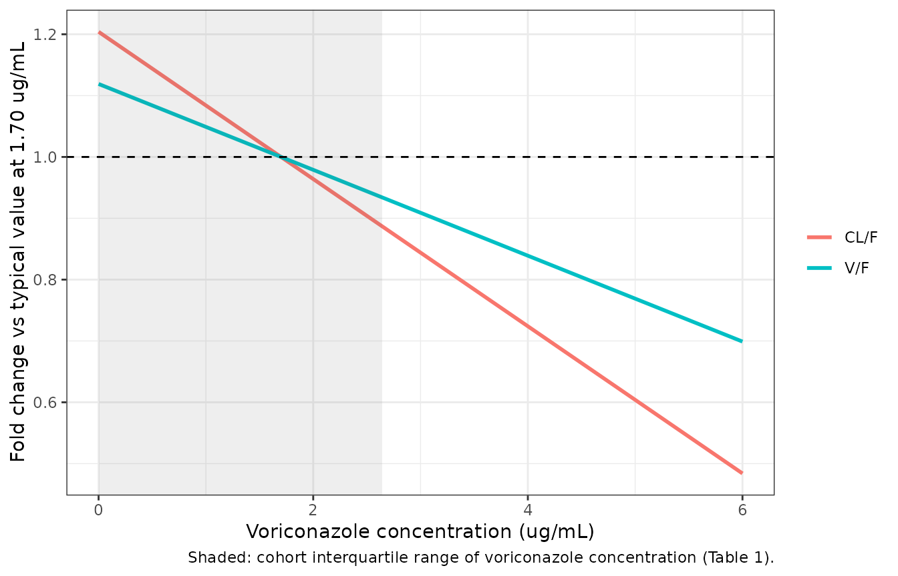
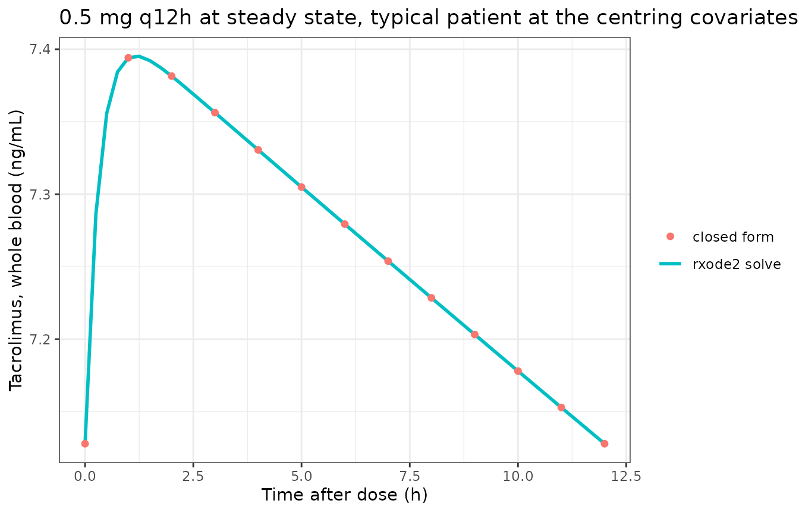
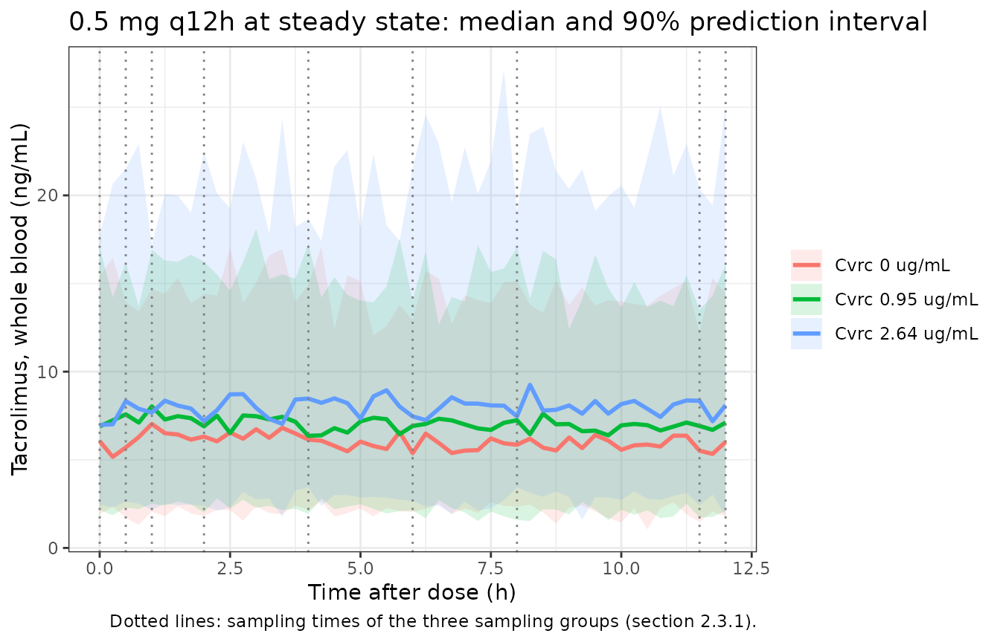

# Tacrolimus with voriconazole co-therapy, late post-transplant (Sun 2024)

## Model and source

``` r

mod <- readModelDb("Sun_2024_tacrolimus")
ui <- rxode2::rxode(mod)
#> ℹ parameter labels from comments will be replaced by 'label()'
```

- Citation: Sun Z-H, Zhao Y-C, Li J-K, Peng F, Yu F, Zhang B-K, Yan M.
  Population dynamics analysis of the interaction between tacrolimus and
  voriconazole in renal transplant recipients. Front Pharmacol.
  2024;15:1502097. <doi:10.3389/fphar.2024.1502097>. Parameter values
  are the final-model estimates in Table 3, cross-checked against the
  bootstrap summary in Table 4; covariate forms from the section 3.2
  equations for V and Cl.
- Article: <https://doi.org/10.3389/fphar.2024.1502097>
- Description: One-compartment population PK model with first-order
  absorption for oral immediate-release tacrolimus in adult renal
  transplant recipients at least one year post-transplant who were
  co-administered oral voriconazole. The absorption rate constant is
  fixed. Apparent clearance falls linearly as the measured voriconazole
  concentration rises, falls with red blood cell count and rises with
  platelet count; apparent volume of distribution falls linearly with
  voriconazole concentration. Combined additive and proportional
  residual error.

Sun 2024 develops a single population PK model, so this paper
contributes one model file. It comes from the same Second Xiangya
Hospital group as `Zhao_2024_tacrolimus`, which modelled the same drug
pair in the first 15 days after transplantation; Sun 2024 is a separate,
prospective cohort of patients at least one year post-transplant and a
separately estimated model.

## Population

51 adult renal transplant recipients treated at The Second Xiangya
Hospital of Central South University, Changsha, China, enrolled
prospectively between April 2023 and September 2024. All were at least
one year post-transplant, on oral immediate-release tacrolimus
(typically twice daily) with mycophenolate mofetil and a glucocorticoid,
and on concomitant oral voriconazole. Patients on other
immunosuppressants or on potent CYP450 inducers or inhibitors were
excluded.

Baseline characteristics (Sun 2024 Table 1): 37 male (72.55%) and 14
female; median age 45 years (IQR 38-55); median weight 59.6 kg (IQR
51.1-67.2); median tacrolimus concentration 5.80 ng/mL (IQR 4.20-8.65);
median voriconazole concentration 0.95 ug/mL (IQR 0.00-2.64); median red
blood cell count 3.44 x 10^12/L (IQR 2.82-4.12); median platelet count
170 x 10^9/L (IQR 129-220); median serum creatinine 172 umol/L (IQR
120-277).

281 whole-blood tacrolimus concentrations were collected with a sparse
design: patients were randomised to one of three sampling groups (0, 0.5
and 1 h; 2, 4 and 6 h; 8 h and 30 min before the next dose), with at
least five concentrations per patient.

The same information is available programmatically from `ui$population`.

## Source trace

Per-parameter origins are recorded as in-file comments beside each
`ini()` entry; they are collected here for review.

| Quantity | Value | Source location |
|----|----|----|
| Structural model: one compartment, first-order absorption and elimination | n/a | Section 2.3.2 and section 3.2; Table 2 row `1a_Add_Multiplicative` (lowest AIC among the one-compartment models) |
| Residual model: additive + multiplicative | n/a | Table 2 row `1a_Add_Multiplicative`; section 3.2 |
| `Ka` (fixed) | 3.09 1/h | Table 3 row `Ka (Fix)` (Stderr 0.00, CI 3.09-3.09); Table 4 |
| `V/F` | 1635.34 L | Table 3 row `V/F`; Table 4 bootstrap median 1626.24 (95% CI 1313.12-2013.20) |
| `CL/F` | 5.73 L/h | Table 3 row `CL/F`; Table 4 bootstrap median 5.74 (95% CI 4.65-7.07) |
| RBC exponent on CL/F | -1.34 | Table 3 row `dCldRBC`; Table 4 row `Theta RBC-CL` |
| PLT exponent on CL/F | 0.46 | Table 3 row `dCldPLT`; Table 4 row `Theta PLT-CL` |
| Voriconazole coefficient on CL/F | -0.12 | Table 3 row `dCldCvRc`; Table 4 row `Theta Cvrc-CL` |
| Voriconazole coefficient on V/F | -0.07 | Table 3 row `dVdCVRC`; Table 4 row `Theta Cvrc-V` |
| Covariate equations, centring constants 1.70 ug/mL, 3.49 x 10^12/L, 181.24 x 10^9/L | n/a | Section 3.2, equations for `V` and `Cl` |
| `omega^2` V | 0.091 | Table 4 row `omega 2 V` |
| `omega^2` CL | 0.039 | Table 4 row `omega 2 CL` |
| Proportional residual SD | 0.36 | Table 3 row `tvCMultStdev`; section 3.2 `CMultStdev = 0.36` |
| Additive residual SD | 0.04 ng/mL | Table 3 row `stdev0`; Table 4 row `sigma` |

The final-model equations printed in section 3.2 are

    V  = 1635.34 * (1 + (Cvrc - 1.70) * (-0.07)) * exp(nV)
    Cl = 5.73 * (RBC / 3.49)^(-1.34) * (PLT / 181.24)^(0.46)
              * (1 + (Cvrc - 1.70) * (-0.12)) * exp(nCL)

with `Cvrc` in ug/mL. The model takes voriconazole in the canonical
ng/mL column `CONC_VORI_NGML` and divides by 1000 before applying these
equations.

## Covariate effects on the typical parameters

With the random effects zeroed, the solved `cl` and `vc` must equal the
section 3.2 equations evaluated by hand. This check has no random
component.

``` r

typ <- rxode2::zeroRe(mod)
#> ℹ parameter labels from comments will be replaced by 'label()'

covGrid <- tidyr::expand_grid(
  cvrc = c(0, 0.95, 1.70, 2.64, 5),
  RBC = c(2.82, 3.49, 4.12),
  PLT = c(129, 181.24, 220)
) |>
  dplyr::mutate(id = dplyr::row_number())

evCov <- covGrid |>
  dplyr::transmute(
    id, time = 0, amt = NA_real_, evid = 0L, cmt = "central",
    CONC_VORI_NGML = cvrc * 1000, RBC, PLT
  )

simCov <- rxode2::rxSolve(typ, evCov, returnType = "data.frame") |>
  dplyr::select(id, cl, vc) |>
  dplyr::left_join(covGrid, by = "id") |>
  dplyr::mutate(
    clPaper = 5.73 * (RBC / 3.49)^(-1.34) * (PLT / 181.24)^(0.46) *
      (1 + (cvrc - 1.70) * (-0.12)),
    vcPaper = 1635.34 * (1 + (cvrc - 1.70) * (-0.07))
  )
#> ℹ omega/sigma items treated as zero: 'etalvc', 'etalcl'
#> Warning: multi-subject simulation without without 'omega'

stopifnot(
  max(abs(simCov$cl / simCov$clPaper - 1)) < 1e-10,
  max(abs(simCov$vc / simCov$vcPaper - 1)) < 1e-10
)

knitr::kable(
  simCov |>
    dplyr::filter(RBC == 3.49, PLT == 181.24) |>
    dplyr::select(cvrc, cl, vc) |>
    dplyr::mutate(clFold = cl / 5.73, vcFold = vc / 1635.34) |>
    dplyr::rename(
      "Voriconazole (ug/mL)" = cvrc,
      "CL/F (L/h)" = cl,
      "V/F (L)" = vc,
      "CL/F vs typical" = clFold,
      "V/F vs typical" = vcFold
    ),
  digits = 3,
  caption = "Typical CL/F and V/F against voriconazole concentration at RBC = 3.49 x 10^12/L and PLT = 181.24 x 10^9/L (section 3.2 equations)."
)
```

| Voriconazole (ug/mL) | CL/F (L/h) |  V/F (L) | CL/F vs typical | V/F vs typical |
|---------------------:|-----------:|---------:|----------------:|---------------:|
|                 0.00 |      6.899 | 1829.945 |           1.204 |          1.119 |
|                 0.95 |      6.246 | 1721.195 |           1.090 |          1.052 |
|                 1.70 |      5.730 | 1635.340 |           1.000 |          1.000 |
|                 2.64 |      5.084 | 1527.735 |           0.887 |          0.934 |
|                 5.00 |      3.461 | 1257.576 |           0.604 |          0.769 |

Typical CL/F and V/F against voriconazole concentration at RBC = 3.49 x
10^12/L and PLT = 181.24 x 10^9/L (section 3.2 equations). {.table}

Across the observed interquartile range of voriconazole (0 to 2.64
ug/mL) the typical CL/F falls from 6.9 to 5.08 L/h, about a 26%
reduction. The red blood cell effect is the largest of the three over
the cohort’s interquartile range: CL/F at RBC = 2.82 x 10^12/L is
1.66-fold that at 4.12 x 10^12/L. The platelet effect over its
interquartile range (129 to 220 x 10^9/L) is 1.28-fold.



## Structural verification against the closed form

At steady state on a q12h schedule the one-compartment
first-order-absorption model has an exact closed form. A typical patient
at the centring covariates dosed 0.5 mg q12h is solved with `ss = 1` and
compared against it. The apparent half-life at these values is 198 h, so
steady state takes weeks to reach and the steady-state solve needs a
larger step budget and tight tolerances.

``` r

kaRef <- 3.09
clRef <- 5.73
vcRef <- 1635.34
doseMg <- 0.5
tau <- 12
obsT <- seq(0, tau, by = 0.25)

evSs <- dplyr::bind_rows(
  data.frame(time = 0, amt = doseMg, evid = 1L, cmt = "depot", ss = 1L, ii = tau),
  data.frame(time = obsT, amt = NA_real_, evid = 0L, cmt = "central", ss = 0L, ii = 0)
) |>
  dplyr::mutate(id = 1L, CONC_VORI_NGML = 1700, RBC = 3.49, PLT = 181.24) |>
  dplyr::arrange(time, dplyr::desc(evid))

simSs <- rxode2::rxSolve(
  typ, evSs, returnType = "data.frame",
  rtol = 1e-10, atol = 1e-12, ssRtol = 1e-10, ssAtol = 1e-12, maxsteps = 1e6
)
#> ℹ omega/sigma items treated as zero: 'etalvc', 'etalcl'

kelRef <- clRef / vcRef
closedSs <- 1000 * doseMg * kaRef / (vcRef * (kaRef - kelRef)) *
  (exp(-kelRef * simSs$time) / (1 - exp(-kelRef * tau)) -
     exp(-kaRef * simSs$time) / (1 - exp(-kaRef * tau)))

relDiff <- abs(simSs$Cc / closedSs - 1)
summary(relDiff)
#>      Min.   1st Qu.    Median      Mean   3rd Qu.      Max. 
#> 4.503e-09 4.503e-09 4.504e-09 4.534e-09 4.562e-09 4.697e-09
stopifnot(max(relDiff) < 1e-5)
```



Sun 2024 does not tabulate the tacrolimus doses. At the cohort-median
voriconazole concentration (0.95 ug/mL) and the centring RBC and
platelet counts, the model’s average steady-state concentration equals
the observed cohort median of 5.80 ng/mL at a dose of about 0.43 mg
q12h. That is a low dose for tacrolimus, in line with the paper’s remark
that clinicians gave patients on long-term tacrolimus smaller doses and
with the CYP3A inhibition by voriconazole. The 0.5 mg q12h regimen used
throughout this article is chosen on that basis; it is an illustration,
not a dose from the paper.

## Simulated cohort on the paper’s sampling design

Three voriconazole levels spanning the cohort distribution (0, the
median 0.95 and the upper quartile 2.64 ug/mL), 100 virtual patients
each, dosed 0.5 mg q12h to steady state. Red blood cell and platelet
counts are drawn log-normally to match the Table 1 medians and
interquartile ranges. Observation times are the union of the three
sampling groups in section 2.3.1, with “30 min before the next dose”
taken as 11.5 h.

``` r

# set.seed() for the base-R covariate draws, rxSetSeed() for the etas.
set.seed(20241502)
rxode2::rxSetSeed(20241502)
nPerArm <- 100L
arms <- data.frame(
  treatment = c("Cvrc 0 ug/mL", "Cvrc 0.95 ug/mL", "Cvrc 2.64 ug/mL"),
  cvrc = c(0, 0.95, 2.64)
)

# log-normal SDs from the Table 1 IQRs: (log(Q3) - log(Q1)) / 1.349
subjects <- tidyr::expand_grid(arm = seq_len(nrow(arms)), k = seq_len(nPerArm)) |>
  dplyr::mutate(
    id = dplyr::row_number(),
    treatment = arms$treatment[arm],
    cvrc = arms$cvrc[arm],
    RBC = 3.44 * exp(rnorm(dplyr::n(), 0, (log(4.12) - log(2.82)) / 1.349)),
    PLT = 170 * exp(rnorm(dplyr::n(), 0, (log(220) - log(129)) / 1.349))
  )

sampleT <- c(0, 0.5, 1, 2, 4, 6, 8, 11.5, 12)
gridT <- sort(unique(c(sampleT, seq(0, 12, by = 0.25))))

evCohort <- dplyr::bind_rows(
  subjects |>
    dplyr::mutate(time = 0, amt = doseMg, evid = 1L, cmt = "depot", ss = 1L, ii = tau),
  tidyr::expand_grid(subjects, time = gridT) |>
    dplyr::mutate(amt = NA_real_, evid = 0L, cmt = "central", ss = 0L, ii = 0)
) |>
  dplyr::mutate(CONC_VORI_NGML = cvrc * 1000) |>
  dplyr::select(id, time, amt, evid, cmt, ss, ii, CONC_VORI_NGML, RBC, PLT) |>
  dplyr::arrange(id, time, dplyr::desc(evid))

simCohort <- rxode2::rxSolve(mod, evCohort, returnType = "data.frame", maxsteps = 1e6) |>
  dplyr::left_join(dplyr::select(subjects, id, treatment), by = "id")
#> ℹ parameter labels from comments will be replaced by 'label()'

stopifnot(!anyNA(simCohort$Cc))
```



The paper’s Figure 3 VPC plots observed concentrations against an
independent-variable axis of up to 600 h of clinical time with
clinician-titrated doses that are not tabulated, so it cannot be
regenerated without the dosing records. The cohort above shows instead
what the model predicts at the paper’s sampling times for a fixed
regimen.

``` r

atSamples <- simCohort |>
  dplyr::filter(time %in% sampleT[sampleT < 12]) |>
  dplyr::group_by(treatment) |>
  dplyr::summarise(
    median = median(sim),
    q25 = quantile(sim, 0.25),
    q75 = quantile(sim, 0.75),
    .groups = "drop"
  )

knitr::kable(
  atSamples |>
    dplyr::rename(
      "Arm" = treatment,
      "Median (ng/mL)" = median,
      "25th percentile" = q25,
      "75th percentile" = q75
    ),
  digits = 2,
  caption = "Simulated tacrolimus concentrations pooled over the eight sampling times, 0.5 mg q12h. Observed cohort (all doses pooled, Table 1): median 5.80 ng/mL, IQR 4.20-8.65."
)
```

| Arm             | Median (ng/mL) | 25th percentile | 75th percentile |
|:----------------|---------------:|----------------:|----------------:|
| Cvrc 0 ug/mL    |           5.89 |            3.90 |            8.52 |
| Cvrc 0.95 ug/mL |           7.18 |            4.59 |           10.11 |
| Cvrc 2.64 ug/mL |           7.66 |            5.13 |           11.39 |

Simulated tacrolimus concentrations pooled over the eight sampling
times, 0.5 mg q12h. Observed cohort (all doses pooled, Table 1): median
5.80 ng/mL, IQR 4.20-8.65. {.table}

At the median voriconazole level the simulated spread is close to the
observed Table 1 median and interquartile range. That agreement is not
an independent check of the model: the regimen was chosen above so that
the typical average concentration matches the observed median. What it
does show is that the published inter-individual variability, together
with the RBC and platelet spread, gives a concentration spread of the
same width as the observed one.

## PKNCA validation

Sun 2024 reports no non-compartmental analysis, so there is no published
Cmax / AUC table to compare against. PKNCA is used two ways.

First, as an internal identity on the typical patient: at steady state
`AUC(0-tau) = Dose / (CL/F)` exactly, so PKNCA’s dosing-interval AUC at
each voriconazole level must recover the CL/F that the section 3.2
equation gives.

``` r

evNcaTyp <- arms |>
  dplyr::mutate(id = dplyr::row_number()) |>
  dplyr::rowwise() |>
  dplyr::reframe(
    id = id, treatment = treatment, cvrc = cvrc,
    dplyr::bind_rows(
      data.frame(time = 0, amt = doseMg, evid = 1L, cmt = "depot", ss = 1L, ii = tau),
      data.frame(time = obsT, amt = NA_real_, evid = 0L, cmt = "central", ss = 0L, ii = 0)
    )
  ) |>
  dplyr::mutate(CONC_VORI_NGML = cvrc * 1000, RBC = 3.49, PLT = 181.24) |>
  dplyr::arrange(id, time, dplyr::desc(evid))

simNcaTyp <- rxode2::rxSolve(
  typ, dplyr::select(evNcaTyp, -treatment, -cvrc), returnType = "data.frame",
  rtol = 1e-10, atol = 1e-12, ssRtol = 1e-10, ssAtol = 1e-12, maxsteps = 1e6
) |>
  dplyr::left_join(dplyr::distinct(evNcaTyp, id, treatment, cvrc), by = "id")
#> ℹ omega/sigma items treated as zero: 'etalvc', 'etalcl'
#> Warning: multi-subject simulation without without 'omega'

concTyp <- simNcaTyp |>
  dplyr::filter(!is.na(Cc)) |>
  dplyr::select(id, treatment, time, Cc)
doseTyp <- concTyp |>
  dplyr::distinct(id, treatment) |>
  dplyr::mutate(time = 0, dose_mg = doseMg)

ssIntervals <- data.frame(
  start = 0, end = tau,
  cmax = TRUE, tmax = TRUE, cmin = TRUE, auclast = TRUE, cav = TRUE
)

ncaTyp <- PKNCA::pk.nca(
  PKNCA::PKNCAdata(
    PKNCA::PKNCAconc(concTyp, Cc ~ time | treatment + id),
    PKNCA::PKNCAdose(doseTyp, dose_mg ~ time | treatment + id),
    intervals = ssIntervals
  )
)

typCompare <- as.data.frame(ncaTyp) |>
  dplyr::select(treatment, PPTESTCD, PPORRES) |>
  tidyr::pivot_wider(names_from = PPTESTCD, values_from = PPORRES) |>
  dplyr::left_join(arms, by = "treatment") |>
  dplyr::mutate(
    clEquation = 5.73 * (1 + (cvrc - 1.70) * (-0.12)),
    aucExpected = 1000 * doseMg / clEquation,
    aucPctDiff = 100 * (auclast - aucExpected) / aucExpected
  )

knitr::kable(
  typCompare |>
    dplyr::select(treatment, cmax, tmax, cmin, auclast, aucExpected, aucPctDiff) |>
    dplyr::rename(
      "Arm" = treatment,
      "Cmax (ng/mL)" = cmax,
      "Tmax (h)" = tmax,
      "Cmin (ng/mL)" = cmin,
      "AUC0-12 NCA (ng/mL*h)" = auclast,
      "AUC0-12 Dose/CL" = aucExpected,
      "AUC % diff" = aucPctDiff
    ),
  digits = 3,
  caption = "Typical patient, 0.5 mg q12h at steady state: PKNCA dosing-interval AUC against Dose / (CL/F) from the section 3.2 equation."
)
```

| Arm | Cmax (ng/mL) | Tmax (h) | Cmin (ng/mL) | AUC0-12 NCA (ng/mL\*h) | AUC0-12 Dose/CL | AUC % diff |
|:---|---:|---:|---:|---:|---:|---:|
| Cvrc 0 ug/mL | 6.150 | 1.25 | 5.911 | 72.471 | 72.475 | -0.006 |
| Cvrc 0.95 ug/mL | 6.789 | 1.25 | 6.535 | 80.050 | 80.055 | -0.006 |
| Cvrc 2.64 ug/mL | 8.328 | 1.25 | 8.042 | 98.349 | 98.354 | -0.005 |

Typical patient, 0.5 mg q12h at steady state: PKNCA dosing-interval AUC
against Dose / (CL/F) from the section 3.2 equation. {.table}

``` r


stopifnot(
  # Linear-up/log-down trapezoids on a 0.25-h grid; measured error ~0.01%.
  max(abs(typCompare$aucPctDiff)) < 0.5,
  # Exposure rises with voriconazole, as the paper reports.
  all(diff(typCompare$auclast) > 0)
)
```

Second, as a per-arm summary of the simulated cohort, so the spread of
steady-state exposure across the three voriconazole levels can be read
directly. The PKNCA formula groups by arm.

``` r

concCohort <- simCohort |>
  dplyr::filter(!is.na(Cc)) |>
  dplyr::select(id, treatment, time, Cc)
doseCohort <- concCohort |>
  dplyr::distinct(id, treatment) |>
  dplyr::mutate(time = 0, dose_mg = doseMg)

ncaCohort <- PKNCA::pk.nca(
  PKNCA::PKNCAdata(
    PKNCA::PKNCAconc(concCohort, Cc ~ time | treatment + id),
    PKNCA::PKNCAdose(doseCohort, dose_mg ~ time | treatment + id),
    intervals = ssIntervals
  )
)

cohortNca <- as.data.frame(ncaCohort) |>
  dplyr::filter(PPTESTCD %in% c("cmax", "cmin", "auclast", "cav")) |>
  dplyr::group_by(treatment, PPTESTCD) |>
  dplyr::summarise(
    value = sprintf("%.2f [%.2f, %.2f]", median(PPORRES),
                    quantile(PPORRES, 0.25), quantile(PPORRES, 0.75)),
    .groups = "drop"
  ) |>
  tidyr::pivot_wider(names_from = PPTESTCD, values_from = value)

knitr::kable(
  cohortNca |>
    dplyr::rename(
      "Arm" = treatment,
      "AUC0-12 (ng/mL*h)" = auclast,
      "Cavg (ng/mL)" = cav,
      "Cmax (ng/mL)" = cmax,
      "Cmin (ng/mL)" = cmin
    ),
  caption = "Simulated cohort, 0.5 mg q12h at steady state: median [interquartile range] of individual NCA parameters by voriconazole level."
)
```

| Arm | AUC0-12 (ng/mL\*h) | Cavg (ng/mL) | Cmax (ng/mL) | Cmin (ng/mL) |
|:---|:---|:---|:---|:---|
| Cvrc 0 ug/mL | 76.80 \[55.84, 98.76\] | 6.40 \[4.65, 8.23\] | 6.52 \[4.73, 8.30\] | 6.26 \[4.56, 8.14\] |
| Cvrc 0.95 ug/mL | 90.81 \[64.21, 114.68\] | 7.57 \[5.35, 9.56\] | 7.68 \[5.53, 9.68\] | 7.43 \[5.15, 9.42\] |
| Cvrc 2.64 ug/mL | 98.82 \[77.45, 126.26\] | 8.24 \[6.45, 10.52\] | 8.39 \[6.56, 10.63\] | 8.06 \[6.34, 10.39\] |

Simulated cohort, 0.5 mg q12h at steady state: median \[interquartile
range\] of individual NCA parameters by voriconazole level. {.table}

``` r


aucByArm <- as.data.frame(ncaCohort) |>
  dplyr::filter(PPTESTCD == "auclast") |>
  dplyr::group_by(treatment) |>
  dplyr::summarise(auc = median(PPORRES), .groups = "drop")

foldHighLow <- aucByArm$auc[aucByArm$treatment == "Cvrc 2.64 ug/mL"] /
  aucByArm$auc[aucByArm$treatment == "Cvrc 0 ug/mL"]
foldTypical <- (1 + 1.70 * 0.12) / (1 - (2.64 - 1.70) * 0.12)
c(simulated = foldHighLow, typical = foldTypical)
#> simulated   typical 
#>  1.286659  1.357078

stopifnot(
  # The arms are independent cohorts, so their median AUC ratio scatters around
  # the typical-value ratio (1.36). The per-subject CL/F spread (IIV plus the
  # RBC and PLT draws) is about 46% CV, giving a log-SE of the ratio of two
  # 100-subject medians near 0.08; the bound below is about 3 SE either side.
  foldHighLow > 1.05,
  foldHighLow < 1.75
)
```

## Assumptions and deviations

1.  **The voriconazole effect is linear and centred at 1.70 ug/mL, as
    printed.** The section 3.2 equations give
    `(1 + (Cvrc - 1.70) * theta)` on both CL/F and V/F. A linear
    covariate term can reach zero: CL/F does so at 10.03 ug/mL and V/F
    at 15.99 ug/mL. Those concentrations are within the assay’s linear
    range (0.35-11.26 ug/mL) but far above the cohort’s upper quartile
    of 2.64 ug/mL. The model file does not clamp the term; do not
    simulate it at voriconazole concentrations approaching 10 ug/mL. The
    centring value 1.70 is above the cohort median (0.95 ug/mL), and the
    RBC and PLT centring values (3.49 and 181.24) likewise differ from
    the Table 1 medians (3.44 and 170); all three appear to be cohort
    means and are used exactly as printed.

2.  **Power forms for RBC and platelets.** The MathML of the section 3.2
    `Cl` equation sets -1.34 and 0.46 as superscripts of `(RBC/3.49)`
    and `(PLT/181.24)`; the authors’ manuscript supplement renders the
    same line with the superscripts flattened into multiplication. The
    exponent reading is used: the multiplicative reading would make CL/F
    negative.

3.  **Residual error.** Phoenix NLME’s additive-plus-multiplicative
    error model has variance `stdev0^2 + (CMultStdev * C)^2`, which is
    nlmixr2’s default `add() + prop()` (combined2) form. `stdev0 = 0.04`
    is taken to be in ng/mL, the unit of the observations.

4.  **`omega^2` values are variances.** Table 4 labels them `omega 2 V`
    and `omega 2 CL`; they are used directly. No covariance is reported,
    so the random effects are independent. The bootstrap median for
    `omega^2 CL` (0.063) differs from the final estimate (0.039); the
    final estimate is used.

5.  **Whole blood.** Tacrolimus was measured with the ARCHITECT
    tacrolimus chemiluminescent immunoassay, a whole-blood method
    (section 2.3.1); the paper does not use the word “whole blood”
    itself.

6.  **Doses and the VPC.** Tacrolimus and voriconazole doses were
    titrated by clinicians and are not tabulated, so Figure 3 (VPC) and
    Figure 2 (goodness of fit) cannot be regenerated. The 0.5 mg q12h
    regimen used here is chosen from the back-calculation above and is
    not from the paper.

7.  **Time-varying covariates.** The paper does not say whether RBC,
    platelet count and voriconazole concentration were applied per
    sample or as baselines. Voriconazole was measured alongside
    tacrolimus and is most naturally time-varying; the model accepts all
    three as time-varying columns.

### Errata in the source

- **Male count.** Section 3.1 says “comprising 38 males”; Table 1 gives
  37 male (72.55%) and 14 female, which sums to 51 and is used here.
- **Table 3 confidence intervals for V/F and CL/F are on a different
  scale from the estimates** (V/F 1635.34 L with CI 1.30-1.97; CL/F 5.73
  L/h with CI 0.005-0.007), consistent with Phoenix having estimated
  them in thousands of litres. The Table 4 bootstrap intervals
  (1313.12-2013.20 L and 4.65-7.07 L/h) are on the reported scale and
  corroborate the point estimates.
- **Table 4 bootstrap CI for `Theta Cvrc-CL`** is printed as -0.20 to
  -0.38, which does not bracket the median of -0.12; -0.038 is
  presumably intended. The final estimate -0.12 is unaffected.
- **Voriconazole units in the Discussion.** The Discussion quotes the
  median voriconazole concentration as “0.95 \[0.00, 2.64\] ng/mL”;
  Table 1 and the assay description give ug/mL, which is used.
- **Abstract wording.** The Abstract calls CL the “volume of clearance
  rate” and omits the voriconazole effect on V/F; the Table 3 results
  and section 3.2 equations are followed.
