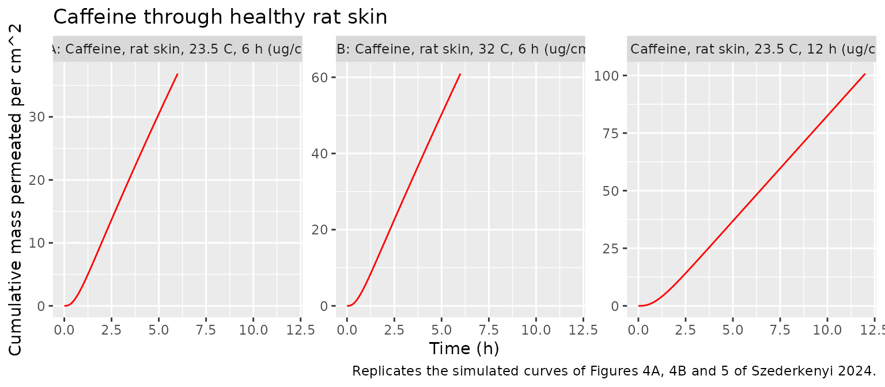
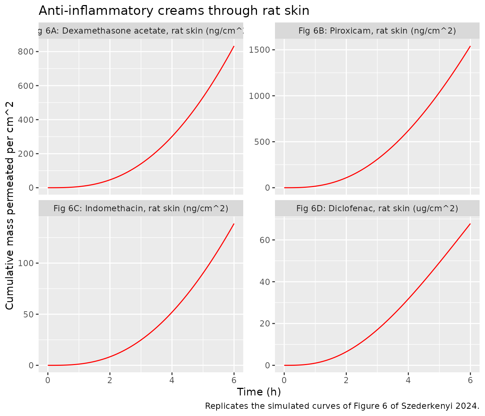
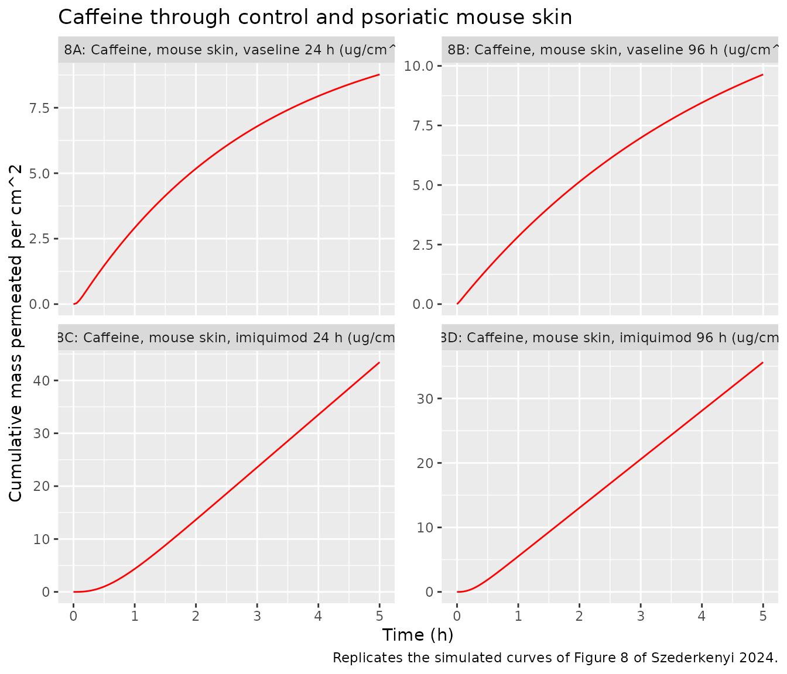
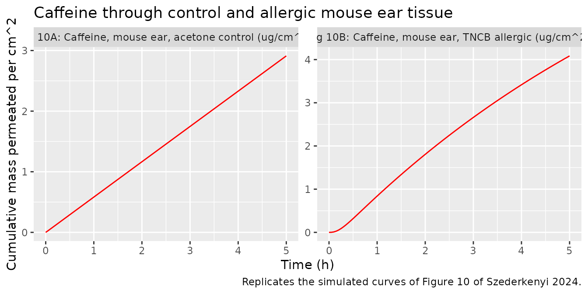

# Transdermal caffeine and anti-inflammatory drugs in a skin-on-a-chip chamber (Szederkenyi 2024)

## Model and source

- Citation: Szederkenyi G, Kocsis D, Vaghy MA, Czaran D, Sasvari P,
  Lengyel M, Naszlady MB, Kreis F, Antal I, Csepanyi-Komi R, Erdo F.
  Mathematical modeling of transdermal delivery of topical drug
  formulations in a dynamic microfluidic diffusion chamber in health and
  disease. PLoS One. 2024;19(4):e0299501.
  <doi:10.1371/journal.pone.0299501>. PMCID: PMC11008853. Model: Section
  2.7, Eq 1; estimates: S1 Table (row ‘caffeine 6hr’); fit: Figure 4A.
- Article: <https://doi.org/10.1371/journal.pone.0299501>
- Supplement (S1 Table, parameter estimates):
  <https://doi.org/10.1371/journal.pone.0299501.s001>

Szederkenyi et al. measured the penetration of topically applied 2% O/W
creams through excised skin mounted in a dynamic “skin-on-a-chip”
microfluidic diffusion chamber, and described every measured
cumulative-permeation curve with the same three-compartment linear ODE
model (Section 2.7, Eq 1). The three compartments are the layers of the
skin obtained by spatially discretising a diffusion-convection equation:
a constant zero-order input `kin` from the cream enters the outermost
layer, neighbouring layers exchange drug by diffusion (`kd`, both
directions) and by inward convection (`kc`), and the deepest layer loses
drug at the first-order rate `kout`. The only observed quantity is the
deepest-layer state, `y = x3`, which the authors fit to the cumulative
drug mass permeated into the receptor fluid per cm^2 of diffusion
surface.

The model was fitted separately to each experiment’s mean curve, giving
13 independent parameter sets (S1 Table). nlmixr2lib ships each as its
own model:

``` r

cases <- tibble::tribble(
  ~model,                                    ~experiment,                                ~figure,  ~tend, ~mass_unit,
  "Szederkenyi_2024_caffeine_rt6h",          "Caffeine, rat skin, 23.5 C, 6 h",          "4A",     6,     "ug/cm^2",
  "Szederkenyi_2024_caffeine_32c6h",         "Caffeine, rat skin, 32 C, 6 h",            "4B",     6,     "ug/cm^2",
  "Szederkenyi_2024_caffeine_rt12h",         "Caffeine, rat skin, 23.5 C, 12 h",         "5",      12,    "ug/cm^2",
  "Szederkenyi_2024_dexamethasone",          "Dexamethasone acetate, rat skin",          "6A",     6,     "ng/cm^2",
  "Szederkenyi_2024_piroxicam",              "Piroxicam, rat skin",                      "6B",     6,     "ng/cm^2",
  "Szederkenyi_2024_indomethacin",           "Indomethacin, rat skin",                   "6C",     6,     "ng/cm^2",
  "Szederkenyi_2024_diclofenac",             "Diclofenac, rat skin",                     "6D",     6,     "ug/cm^2",
  "Szederkenyi_2024_caffeine_vaseline24h",   "Caffeine, mouse skin, vaseline 24 h",      "8A",     5,     "ug/cm^2",
  "Szederkenyi_2024_caffeine_vaseline96h",   "Caffeine, mouse skin, vaseline 96 h",      "8B",     5,     "ug/cm^2",
  "Szederkenyi_2024_caffeine_imiquimod24h",  "Caffeine, mouse skin, imiquimod 24 h",     "8C",     5,     "ug/cm^2",
  "Szederkenyi_2024_caffeine_imiquimod96h",  "Caffeine, mouse skin, imiquimod 96 h",     "8D",     5,     "ug/cm^2",
  "Szederkenyi_2024_caffeine_ear_acetone",   "Caffeine, mouse ear, acetone control",     "10A",    5,     "ug/cm^2",
  "Szederkenyi_2024_caffeine_ear_tncb",      "Caffeine, mouse ear, TNCB allergic",       "10B",    5,     "ug/cm^2"
)
uis <- lapply(cases$model, function(nm) rxode2::rxode(readModelDb(nm)))
names(uis) <- cases$model
knitr::kable(cases |> dplyr::select(model, experiment, figure))
```

| model | experiment | figure |
|:---|:---|:---|
| Szederkenyi_2024_caffeine_rt6h | Caffeine, rat skin, 23.5 C, 6 h | 4A |
| Szederkenyi_2024_caffeine_32c6h | Caffeine, rat skin, 32 C, 6 h | 4B |
| Szederkenyi_2024_caffeine_rt12h | Caffeine, rat skin, 23.5 C, 12 h | 5 |
| Szederkenyi_2024_dexamethasone | Dexamethasone acetate, rat skin | 6A |
| Szederkenyi_2024_piroxicam | Piroxicam, rat skin | 6B |
| Szederkenyi_2024_indomethacin | Indomethacin, rat skin | 6C |
| Szederkenyi_2024_diclofenac | Diclofenac, rat skin | 6D |
| Szederkenyi_2024_caffeine_vaseline24h | Caffeine, mouse skin, vaseline 24 h | 8A |
| Szederkenyi_2024_caffeine_vaseline96h | Caffeine, mouse skin, vaseline 96 h | 8B |
| Szederkenyi_2024_caffeine_imiquimod24h | Caffeine, mouse skin, imiquimod 24 h | 8C |
| Szederkenyi_2024_caffeine_imiquimod96h | Caffeine, mouse skin, imiquimod 96 h | 8D |
| Szederkenyi_2024_caffeine_ear_acetone | Caffeine, mouse ear, acetone control | 10A |
| Szederkenyi_2024_caffeine_ear_tncb | Caffeine, mouse ear, TNCB allergic | 10B |

## Population

There is no human or animal population in the usual sense: each model
describes the mean of three replicate skin samples (n = 3 per
experiment, figure captions) in one ex vivo set-up. The chamber has a
0.5 cm^2 diffusion surface between the cream-filled donor chamber and a
receptor chamber perfused with peripheral perfusion fluid (147 mM NaCl,
4 mM KCl, 2.3 mM CaCl2, pH 7.4) at 4 uL/min; receptor fluid was
collected every 30 or 15 min (Section 2.4).

- Healthy-skin experiments (caffeine at room temperature and at 32 C,
  and the four anti-inflammatory creams) used tape-stripped abdominal
  skin of rats weighing 599-615 g (Sections 2.4 and 2.6).
- Psoriasiform dermatitis was induced in male C57BL/6J mice
  (21.7-27.0 g) with 0.0625 g of 5% imiquimod cream on the shaved back
  (once for the 24 h group, daily for the 96 h group), with
  vaseline-treated time-matched controls (Section 2.5).
- Allergic contact dermatitis was induced in male C57BL/6J mice
  (24.2-31.2 g) by sensitising the abdomen with 3% TNCB (controls:
  acetone) and challenging both ears with 1% TNCB on day 5; the ear
  tissue was mounted in the chamber (Section 2.5).

Caffeine was assayed by NanoDrop spectrophotometry at 273 nm and the
anti-inflammatory drugs by LC-MS/MS. The same information is stored in
each model’s `population` metadata:

``` r

str(uis[["Szederkenyi_2024_caffeine_rt6h"]]$population)
#> List of 11
#>  $ species      : chr "ex vivo (rat abdominal skin)"
#>  $ n_subjects   : int 3
#>  $ n_studies    : int 1
#>  $ system       : chr "Skin-on-a-chip microfluidic diffusion chamber (polydimethylsiloxane in an aluminium frame): a 0.5 cm^2 diffusio"| __truncated__
#>  $ tissue       : chr "Full-thickness 18-mm punches of shaved, depilated and tape-stripped (10 strips) abdominal skin of rats weighing"| __truncated__
#>  $ dose_range   : chr "O/W cream (46% petrolatum basis ointment, 4% paraffin oil, 38% purified water, 10% propylene glycol) containing"| __truncated__
#>  $ temperature  : chr "room temperature, approximately 23.5 C (air-conditioned laboratory)"
#>  $ sampling     : chr "Receptor fluid collected every 30 or 15 min for 6 h; caffeine in the collected receptor fluid by NanoDrop spect"| __truncated__
#>  $ disease_state: chr "healthy (intact skin)"
#>  $ regions      : chr "Hungary (Budapest)"
#>  $ notes        : chr "Mean of n = 3 replicate skin samples (Figure 4A caption); the model was fitted to the mean curve by minimising "| __truncated__
```

## Source trace

Every `ini()` value carries an in-file comment pointing to its row of S1
Table. All four parameters were estimated (Matlab `fmincon`, Eq 7) on
the linear scale and are reported without uncertainty; nlmixr2lib stores
them log-transformed.

| Model element | Source location |
|----|----|
| `d/dt(skin_slab1)`, `d/dt(skin_slab2)`, `d/dt(skin_slab3)` | Section 2.7, Eq 1 (states `x1`, `x2`, `x3`) |
| Output `cum_mass <- skin_slab3` | Section 2.7 (“The only measured concentration is y = x3”); figure y-axes (cumulative mass per cm^2) |
| `lkin`, `lkdiff`, `lkconv`, `lkout` (paper `kin`, `kd`, `kc`, `kout`) | S1 Table, one row per model |
| Zero initial conditions | Figures 4-10 (all simulated curves start at 0); S1 Table reports no initial-condition estimates |
| Time unit (h) | Figure x-axes |
| Mass units (ug/cm^2 or ng/cm^2) | Figure y-axes; Table 2 |

``` r

s1 <- dplyr::bind_rows(lapply(cases$model, function(nm) {
  th <- uis[[nm]]$theta
  tibble::tibble(
    model = nm,
    kin = exp(th[["lkin"]]),
    kd = exp(th[["lkdiff"]]),
    kc = exp(th[["lkconv"]]),
    kout = exp(th[["lkout"]])
  )
}))
knitr::kable(s1, digits = 6, caption = "Back-transformed parameters (compare S1 Table).")
```

| model                                  |      kin |       kd |         kc |     kout |
|:---------------------------------------|---------:|---------:|-----------:|---------:|
| Szederkenyi_2024_caffeine_rt6h         |   7.4371 | 0.033600 |    3.37780 | 0.029300 |
| Szederkenyi_2024_caffeine_32c6h        |  11.8667 | 0.031900 |    3.66370 | 0.019300 |
| Szederkenyi_2024_caffeine_rt12h        |   9.2316 | 0.019800 |    2.04090 | 0.000042 |
| Szederkenyi_2024_dexamethasone         | 874.9814 | 0.000034 |    0.22190 | 0.000039 |
| Szederkenyi_2024_piroxicam             | 821.8726 | 0.000012 |    0.37762 | 0.000016 |
| Szederkenyi_2024_indomethacin          | 111.8016 | 0.000646 |    0.26900 | 0.000643 |
| Szederkenyi_2024_diclofenac            |  52.0705 | 0.027900 |    0.36810 | 0.223100 |
| Szederkenyi_2024_caffeine_vaseline24h  |   3.6499 | 0.120600 |   30.64610 | 0.336500 |
| Szederkenyi_2024_caffeine_vaseline96h  |   3.1878 | 0.215000 |  261.08480 | 0.220700 |
| Szederkenyi_2024_caffeine_imiquimod24h |  10.0399 | 0.027200 |    3.13610 | 0.000304 |
| Szederkenyi_2024_caffeine_imiquimod96h |   7.5925 | 0.063700 |    7.40990 | 0.000035 |
| Szederkenyi_2024_caffeine_ear_acetone  |   0.5846 | 1.849400 | 1017.20590 | 0.000738 |
| Szederkenyi_2024_caffeine_ear_tncb     |   1.1352 | 0.034700 |    9.06110 | 0.123600 |

Back-transformed parameters (compare S1 Table). {.table}

## Simulation

The models carry no between-sample variability and no residual error, so
each is solved once at its typical values. There are no dose records:
the cream is the constant input `kin`.

``` r

sim <- dplyr::bind_rows(lapply(seq_len(nrow(cases)), function(i) {
  ev <- rxode2::et(seq(0, cases$tend[i], by = 0.05))
  s <- rxode2::rxSolve(uis[[cases$model[i]]], events = ev, rtol = 1e-10, atol = 1e-12)
  tibble::tibble(
    model = cases$model[i],
    experiment = cases$experiment[i],
    figure = cases$figure[i],
    mass_unit = cases$mass_unit[i],
    time = s$time,
    cum_mass = s$cum_mass
  )
}))
```

## Replicate published figures

``` r

plot_cases <- function(figs, title) {
  sim |>
    dplyr::filter(figure %in% figs) |>
    dplyr::mutate(panel = paste0("Fig ", figure, ": ", experiment, " (", mass_unit, ")")) |>
    ggplot(aes(time, cum_mass)) +
    geom_line(colour = "red") +
    facet_wrap(~panel, scales = "free_y") +
    labs(x = "Time (h)", y = "Cumulative mass permeated per cm^2", title = title)
}
```

``` r

plot_cases(c("4A", "4B", "5"), "Caffeine through healthy rat skin") +
  labs(caption = "Replicates the simulated curves of Figures 4A, 4B and 5 of Szederkenyi 2024.")
```



``` r

plot_cases(c("6A", "6B", "6C", "6D"), "Anti-inflammatory creams through rat skin") +
  labs(caption = "Replicates the simulated curves of Figure 6 of Szederkenyi 2024.")
```



``` r

plot_cases(c("8A", "8B", "8C", "8D"), "Caffeine through control and psoriatic mouse skin") +
  labs(caption = "Replicates the simulated curves of Figure 8 of Szederkenyi 2024.")
```



``` r

plot_cases(c("10A", "10B"), "Caffeine through control and allergic mouse ear tissue") +
  labs(caption = "Replicates the simulated curves of Figure 10 of Szederkenyi 2024.")
```



## Validation

The paper reports no NCA, so PKNCA does not apply. The checks below
compare the packaged models against the printed numbers that the paper
does give, and against the closed-form solution of Eq 1.

### Final cumulative mass against the published curves

The final value of each red simulated curve in Figures 4, 5, 6, 8 and 10
was read off the figure by the maintainers (precision about 2-3% of the
axis range). The packaged models reproduce every one within 5%.

``` r

digitised <- tibble::tribble(
  ~figure, ~fig_end,
  "4A",    37.0,
  "4B",    61.0,
  "5",     101,
  "6A",    830,
  "6B",    1560,
  "6C",    140,
  "6D",    67.5,
  "8A",    8.75,
  "8B",    9.65,
  "8C",    43.3,
  "8D",    35.5,
  "10A",   2.90,
  "10B",   4.08
)
final <- sim |>
  dplyr::group_by(model, figure, mass_unit) |>
  dplyr::filter(time == max(time)) |>
  dplyr::ungroup() |>
  dplyr::select(model, figure, mass_unit, time, cum_mass) |>
  dplyr::inner_join(digitised, by = "figure") |>
  dplyr::mutate(pct_diff = 100 * (cum_mass / fig_end - 1))
stopifnot(nrow(final) == nrow(cases), all(abs(final$pct_diff) < 5))
final |>
  dplyr::rename(
    "Figure" = figure,
    "Units" = mass_unit,
    "Time (h)" = time,
    "Simulated" = cum_mass,
    "Published (figure)" = fig_end,
    "Difference (%)" = pct_diff
  ) |>
  knitr::kable(digits = 2)
```

| model | Figure | Units | Time (h) | Simulated | Published (figure) | Difference (%) |
|:---|:---|:---|---:|---:|---:|---:|
| Szederkenyi_2024_caffeine_rt6h | 4A | ug/cm^2 | 6 | 36.87 | 37.00 | -0.34 |
| Szederkenyi_2024_caffeine_32c6h | 4B | ug/cm^2 | 6 | 60.96 | 61.00 | -0.06 |
| Szederkenyi_2024_caffeine_rt12h | 5 | ug/cm^2 | 12 | 100.82 | 101.00 | -0.18 |
| Szederkenyi_2024_dexamethasone | 6A | ng/cm^2 | 6 | 833.04 | 830.00 | 0.37 |
| Szederkenyi_2024_piroxicam | 6B | ng/cm^2 | 6 | 1541.58 | 1560.00 | -1.18 |
| Szederkenyi_2024_indomethacin | 6C | ng/cm^2 | 6 | 138.70 | 140.00 | -0.93 |
| Szederkenyi_2024_diclofenac | 6D | ug/cm^2 | 6 | 67.82 | 67.50 | 0.47 |
| Szederkenyi_2024_caffeine_vaseline24h | 8A | ug/cm^2 | 5 | 8.77 | 8.75 | 0.25 |
| Szederkenyi_2024_caffeine_vaseline96h | 8B | ug/cm^2 | 5 | 9.64 | 9.65 | -0.10 |
| Szederkenyi_2024_caffeine_imiquimod24h | 8C | ug/cm^2 | 5 | 43.45 | 43.30 | 0.34 |
| Szederkenyi_2024_caffeine_imiquimod96h | 8D | ug/cm^2 | 5 | 35.62 | 35.50 | 0.34 |
| Szederkenyi_2024_caffeine_ear_acetone | 10A | ug/cm^2 | 5 | 2.91 | 2.90 | 0.39 |
| Szederkenyi_2024_caffeine_ear_tncb | 10B | ug/cm^2 | 5 | 4.08 | 4.08 | 0.12 |

### Table 2 acceptance windows

Table 2 lists the a-posteriori acceptance window for the measured
cumulative mass at the end of each healthy-skin experiment; replicates
outside it were excluded before fitting. A faithful fit to the mean of
the accepted replicates must end inside the window.

``` r

table2 <- tibble::tribble(
  ~model,                             ~lower, ~upper,
  "Szederkenyi_2024_caffeine_rt6h",   20,     50,
  "Szederkenyi_2024_caffeine_32c6h",  40,     75,
  "Szederkenyi_2024_caffeine_rt12h",  80,     120,
  "Szederkenyi_2024_dexamethasone",   600,    1000,
  "Szederkenyi_2024_indomethacin",    100,    200,
  "Szederkenyi_2024_piroxicam",       1200,   2000,
  "Szederkenyi_2024_diclofenac",      50,     100
)
t2 <- final |>
  dplyr::select(model, mass_unit, cum_mass) |>
  dplyr::inner_join(table2, by = "model")
stopifnot(nrow(t2) == 7, all(t2$cum_mass > t2$lower & t2$cum_mass < t2$upper))
knitr::kable(t2, digits = 1)
```

| model                           | mass_unit | cum_mass | lower | upper |
|:--------------------------------|:----------|---------:|------:|------:|
| Szederkenyi_2024_caffeine_rt6h  | ug/cm^2   |     36.9 |    20 |    50 |
| Szederkenyi_2024_caffeine_32c6h | ug/cm^2   |     61.0 |    40 |    75 |
| Szederkenyi_2024_caffeine_rt12h | ug/cm^2   |    100.8 |    80 |   120 |
| Szederkenyi_2024_dexamethasone  | ng/cm^2   |    833.0 |   600 |  1000 |
| Szederkenyi_2024_piroxicam      | ng/cm^2   |   1541.6 |  1200 |  2000 |
| Szederkenyi_2024_indomethacin   | ng/cm^2   |    138.7 |   100 |   200 |
| Szederkenyi_2024_diclofenac     | ug/cm^2   |     67.8 |    50 |   100 |

### Disease effects stated in the text

Section 3.5 states that imiquimod raised the caffeine permeability “more
than 4 times at 24 h, and more than 3.5 times at 96 h” over the
time-matched vaseline controls; Section 3.6 states that allergic contact
dermatitis raised the ear permeability by 30%.

``` r

end_of <- function(nm) final$cum_mass[final$model == nm]
ratios <- tibble::tibble(
  comparison = c("Imiquimod / vaseline, 24 h", "Imiquimod / vaseline, 96 h", "TNCB / acetone (ear)"),
  simulated_ratio = c(
    end_of("Szederkenyi_2024_caffeine_imiquimod24h") / end_of("Szederkenyi_2024_caffeine_vaseline24h"),
    end_of("Szederkenyi_2024_caffeine_imiquimod96h") / end_of("Szederkenyi_2024_caffeine_vaseline96h"),
    end_of("Szederkenyi_2024_caffeine_ear_tncb") / end_of("Szederkenyi_2024_caffeine_ear_acetone")
  ),
  paper = c("> 4", "> 3.5", "1.3")
)
stopifnot(
  ratios$simulated_ratio[1] > 4,
  ratios$simulated_ratio[2] > 3.5,
  ratios$simulated_ratio[3] > 1
)
knitr::kable(ratios, digits = 2)
```

| comparison                 | simulated_ratio | paper  |
|:---------------------------|----------------:|:-------|
| Imiquimod / vaseline, 24 h |            4.95 | \> 4   |
| Imiquimod / vaseline, 96 h |            3.70 | \> 3.5 |
| TNCB / acetone (ear)       |            1.40 | 1.3    |

The imiquimod ratios meet the stated thresholds. The ear ratio from the
fitted curves at 5 h is about 1.4 rather than the stated 1.3; the
measured curves of Figure 10 end at about 2.95 and 4.1 ug/cm^2, also a
ratio near 1.4, so the paper’s 30% presumably comes from a different
summary (for example the permeation rate over part of the experiment)
that is not reported.

### Closed-form solution and the eliminated model (Eqs 2-6)

Eq 1 is linear, `x' = A x + b` with `b = (kin, 0, 0)` and zero initial
state, so `x(t) = A^-1 (exp(A t) - I) b`. The packaged ODE must match
this to integration precision. The authors’ identifiability argument
rewrites the model as
`y''' + theta1 y'' + theta2 y' + theta3 y + theta4 = 0` (Eqs 2-6);
`theta1..theta3` are the characteristic-polynomial coefficients of `A`,
and the steady state of `y` is `-theta4 / theta3 = kin / kout`. Both
identities are checked for every parameter set.

``` r

system_matrix <- function(kd, kc, kout) {
  matrix(c(
    -(kd + kc), kd, 0,
    kd + kc, -(2 * kd + kc), kd,
    0, kd + kc, -(kd + kout)
  ), nrow = 3, byrow = TRUE)
}
x3_closed_form <- function(times, kin, kd, kc, kout) {
  A <- system_matrix(kd, kc, kout)
  e <- eigen(A)
  vinv <- solve(e$vectors)
  b <- c(kin, 0, 0)
  vapply(times, function(t) {
    expAt <- Re(e$vectors %*% diag(exp(e$values * t)) %*% vinv)
    (solve(A, (expAt - diag(3)) %*% b))[3]
  }, numeric(1))
}
cf <- dplyr::bind_rows(lapply(seq_len(nrow(s1)), function(i) {
  p <- s1[i, ]
  s <- sim[sim$model == p$model, ]
  A <- system_matrix(p$kd, p$kc, p$kout)
  minors <- A[1, 1] * A[2, 2] - A[1, 2] * A[2, 1] +
    A[2, 2] * A[3, 3] - A[2, 3] * A[3, 2] +
    A[1, 1] * A[3, 3] - A[1, 3] * A[3, 1]
  theta <- c(
    2 * p$kc + 4 * p$kd + p$kout,
    p$kc^2 + 3 * p$kc * p$kd + 2 * p$kout * p$kc + 3 * p$kd^2 + 3 * p$kout * p$kd,
    p$kout * p$kc^2 + 2 * p$kout * p$kc * p$kd + p$kout * p$kd^2,
    -p$kin * (p$kc + p$kd)^2
  )
  tibble::tibble(
    model = p$model,
    ode_vs_closed_form = max(abs(s$cum_mass - x3_closed_form(s$time, p$kin, p$kd, p$kc, p$kout))) /
      max(s$cum_mass),
    theta_vs_charpoly = max(abs(c(-sum(diag(A)), minors, -det(A)) / theta[1:3] - 1)),
    steady_state = -theta[4] / theta[3],
    steady_state_vs_kin_over_kout = abs(-theta[4] / theta[3] / (p$kin / p$kout) - 1)
  )
}))
# The ODE-vs-closed-form error is integration error at rtol = 1e-10; the
# theta and steady-state identities are pure floating-point algebra.
stopifnot(
  all(cf$ode_vs_closed_form < 1e-6),
  all(cf$theta_vs_charpoly < 1e-10),
  all(cf$steady_state_vs_kin_over_kout < 1e-10)
)
knitr::kable(cf, digits = 12)
```

| model | ode_vs_closed_form | theta_vs_charpoly | steady_state | steady_state_vs_kin_over_kout |
|:---|---:|---:|---:|---:|
| Szederkenyi_2024_caffeine_rt6h | 5.00e-12 | 0 | 2.538259e+02 | 0 |
| Szederkenyi_2024_caffeine_32c6h | 6.00e-12 | 0 | 6.148549e+02 | 0 |
| Szederkenyi_2024_caffeine_rt12h | 5.00e-12 | 0 | 2.183857e+05 | 0 |
| Szederkenyi_2024_dexamethasone | 4.73e-10 | 0 | 2.229877e+07 | 0 |
| Szederkenyi_2024_piroxicam | 6.10e-10 | 0 | 5.180022e+07 | 0 |
| Szederkenyi_2024_indomethacin | 3.00e-12 | 0 | 1.739182e+05 | 0 |
| Szederkenyi_2024_diclofenac | 0.00e+00 | 0 | 2.333953e+02 | 0 |
| Szederkenyi_2024_caffeine_vaseline24h | 7.90e-11 | 0 | 1.084666e+01 | 0 |
| Szederkenyi_2024_caffeine_vaseline96h | 2.10e-11 | 0 | 1.444404e+01 | 0 |
| Szederkenyi_2024_caffeine_imiquimod24h | 5.00e-12 | 0 | 3.305099e+04 | 0 |
| Szederkenyi_2024_caffeine_imiquimod96h | 1.00e-11 | 0 | 2.194808e+05 | 0 |
| Szederkenyi_2024_caffeine_ear_acetone | 0.00e+00 | 0 | 7.920873e+02 | 0 |
| Szederkenyi_2024_caffeine_ear_tncb | 6.00e-12 | 0 | 9.184466e+00 | 0 |

The steady-state column also shows why most curves in the paper still
rise almost linearly at the end of the experiment: with `kout` as small
as 1e-5 1/h, the deepest layer would only level off at `kin / kout`, far
beyond the measured range.

## Assumptions and deviations

- **One model per experiment.** The paper fits the same structure
  separately to each of 13 experiments and reports 13 parameter sets
  with no shared parameters, so nlmixr2lib ships 13 models rather than
  one model with experiment indicators.
- **Compartment names.** The three states `x1..x3` are the layers of a
  spatially discretised diffusion-convection equation and are named with
  the method-of-lines family `skin_slab1..skin_slab3`, numbered from the
  skin surface inward. The slab count of 3 is fixed by the published
  fit, not a numerical choice, so no convergence check applies.
- **Parameter names.** The paper’s `kd` (diffusion) and `kc`
  (convection) are stored as `kdiff` and `kconv`, because `kd` is the
  library’s name for a dissociation rate constant. `kin` and `kout` keep
  their names.
- **No variability or residual error.** The authors fitted each mean
  curve by minimising a relative 2-norm (Eq 7) and report no
  residual-error magnitude, so the models carry typical values only and
  expose the output as the algebraic variable `cum_mass` without an
  error model. The minimum objective value `V_min` of each fit is
  recorded in the model’s `population$notes`.
- **Units.** Time is in hours and the states are mass per cm^2 of
  diffusion surface, from the figure axes. The states are called
  concentrations in Section 2.7, but the fitted quantity is the
  cumulative mass. `kin` is in mass per cm^2 per hour.
- **Diclofenac units.** Figure 6D and Table 2 both give diclofenac in
  ug/cm^2 (versus ng/cm^2 for the other three anti-inflammatory drugs),
  and the model follows them. Section 3.4 says diclofenac “penetrated in
  the lowest amount”, which would hold only if those values were
  ng/cm^2. The parameters are unaffected by the unit label except that
  `kin` scales with it.
- **Species of the healthy-skin experiments.** Sections 2.4 and 2.6, the
  S2 and S3 Fig captions and Table 2 (rat body-weight window) state rat
  skin for the temperature and anti-inflammatory experiments; Section
  3.2 and the captions of Figures 4-6 say mouse skin. The models follow
  the Methods.
- **Figure label in S1 Table.** S1 Table labels the TNCB row as Figure
  “10.C”; Figure 10 has panels A and B only, and the TNCB curve is
  Figure 10B.
- **Model provenance citation.** Section 2.7 describes Eq 1 as a
  modified form of Eqs 55-57 of the paper’s reference 1, which in the
  published reference list is a tacrolimus molecular-modelling study;
  the citation appears to be misnumbered. Eq 1 is printed in full, so
  the extraction does not depend on it.
- **Constant input.** `kin` is constant from time zero, i.e. the cream
  acts as an infinite-dose donor; the applied amount is not reported.
- No correction notice is linked to the article in Europe PMC as of
  2026-10-29.
