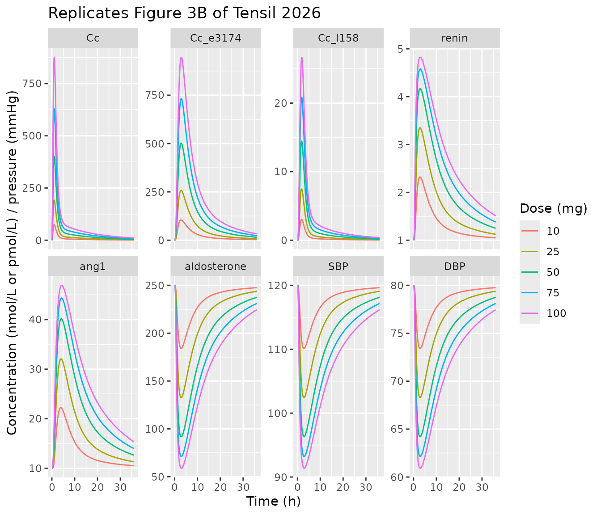
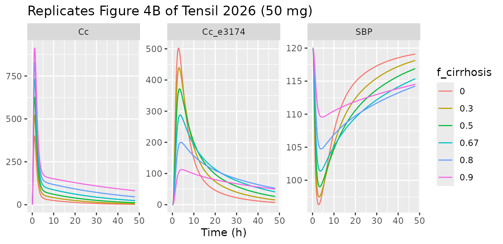
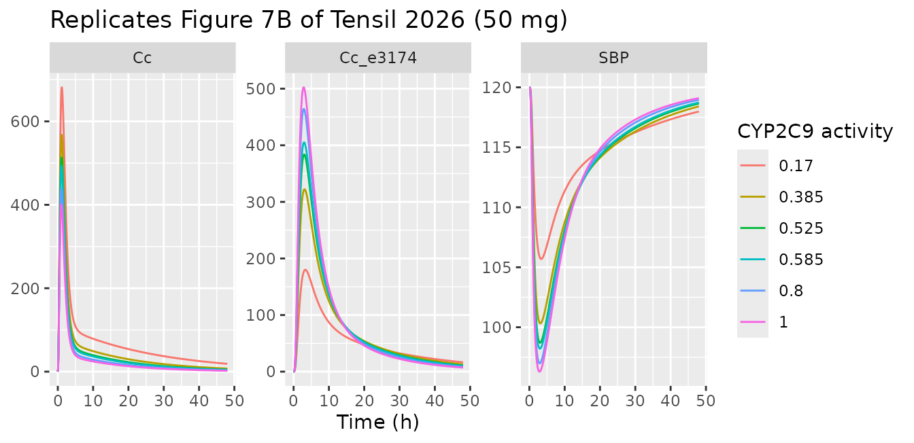
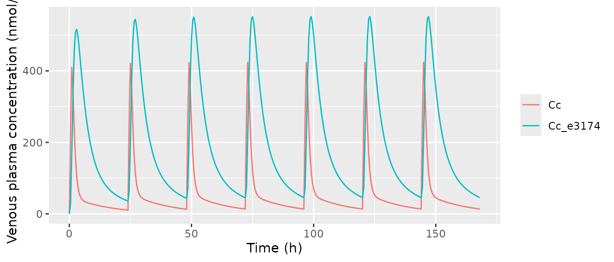

# Losartan whole-body PBPK/PD (Tensil 2026)

``` r

library(nlmixr2lib)
library(rxode2)
library(PKNCA)
library(dplyr)
library(tidyr)
library(ggplot2)
```

## The model

`Tensil_2026_losartan_pbpk` is a whole-body physiologically based
pharmacokinetic/pharmacodynamic model of losartan, its active CYP2C9
metabolite E3174 (losartan carboxylic acid) and the E3174 glucuronide
L158, built by Tensil, Myshkina and Koenig (2026) from 25 curated
clinical studies and distributed by the authors as SBML under CC-BY.

``` r

mod <- rxode2::rxode(readModelDb("Tensil_2026_losartan_pbpk"))
length(mod$state)
#> [1] 49
```

The 49 ODEs are organised as a systemic circulation (venous, arterial,
portal and hepatic-venous plasma pools, plus lung and a lumped
rest-of-body) linking three pharmacokinetic submodels and one
pharmacodynamic submodel:

- **Intestine.** Oral losartan dissolves into the gut lumen at
  `ka_dis_los`. Of the flux leaving the lumen, 60% (`f_los_abs`) enters
  the enterocytes and 40% is excreted in feces. P-glycoprotein (ABCB1)
  effluxes losartan from the enterocytes back to the lumen; the
  remainder passes to gut plasma. E3174 and L158 that reach the lumen in
  bile are excreted in feces.
- **Liver.** Losartan is taken up into liver tissue, converted to E3174
  by CYP2C9 (Michaelis-Menten; the covariate `CYP2C9` scales the Vmax),
  and E3174 to L158 (first order). E3174 and L158 are exported back to
  plasma, and all three species are secreted into bile, which empties
  into the gut lumen.
- **Kidney.** First-order urinary excretion of all three species from
  kidney plasma, scaled by `RENALFUNC_REL`.
- **RAAS.** One Emax term on venous E3174 raises renin secretion (up to
  six-fold) and suppresses aldosterone secretion. Renin converts a
  constant angiotensinogen pool to angiotensin I, which turns over to
  angiotensin II, and systolic, diastolic and mean arterial pressure
  move in proportion to the aldosterone deviation from baseline.

Hepatic impairment (`HEPFUNC_REL`) shrinks the metabolising liver volume
and shunts portal and hepatic-arterial blood past the liver; body weight
(`WT`) scales every organ volume and blood flow.

**A note on units and dosing.** Drug states are *concentrations* in
umol/L (cumulative urine and feces pools are amounts in umol) and the
RAAS hormones are in pmol/L; the outputs `Cc`, `Cc_e3174` and `Cc_l158`
are venous plasma concentrations in **nmol/L**, matching the paper’s
figures. Doses (mg) must go into `depot` (oral), `depot_iv` (intravenous
losartan) or `depot_iv_e3174` (intravenous E3174) and never directly
into a plasma or tissue compartment. Model time is in **minutes**.

## Population

``` r

pop <- mod$population
data.frame(Field = names(pop), Value = vapply(pop, as.character, character(1))) |>
  knitr::kable(row.names = FALSE)
```

| Field | Value |
|:---|:---|
| species | human |
| n_subjects | NA |
| n_studies | 25 |
| age_range | adults; not tabulated per study in the source |
| weight_range | study-specific mean bodyweight where reported (52-84.6 kg across Supplementary Table S5); 75 kg reference individual otherwise |
| sex_female_pct | NA |
| disease_state | Healthy volunteers, CYP2C9 and ABCB1 genotyped volunteers, and subjects with hepatic (cirrhosis) or renal impairment (Table 1). Animal, pediatric, single-patient, cocktail and combination studies were excluded (Methods Section 2.1). |
| dose_range | Oral losartan 2-200 mg single and multiple dose (Table 1); intravenous losartan 10-30 mg and intravenous E3174 10-20 mg (FDA 1995 studies 60 and 67, Lo 1995). |
| regions | not reported |
| notes | Deterministic typical-individual model. Methods Section 2.3 states that ‘all simulations were performed deterministically using the optimized parameter set representing the typical (mean) individual’ and that inter-individual variability was NOT included, so no IIV and no residual-error model are reported and none are invented here. Data were curated into PK-DB (identifiers in Table 1) from a PubMed and PKPDAI search screening 787 records down to 25 studies. Parameters were fitted sequentially by weighted least squares with 100 multi-start local optimisation runs - pharmacokinetic first (12 parameters, Table S2), then pharmacodynamic (4 parameters, Table S3). Pharmacodynamic data (renin, angiotensin, aldosterone, blood pressure) came from a smaller subset of studies and showed high between-study variability (Discussion). |

The model is **deterministic**. Methods Section 2.3 states that all
simulations were “performed deterministically using the optimized
parameter set representing the typical (mean) individual” and that
inter-individual variability was not included, so the model carries no
IIV and no residual-error estimate, and `propSd` is fixed at zero. Every
simulation below is a single typical individual per scenario.

## Source trace

| Quantity | Parameters | Source |
|----|----|----|
| Fractional organ volumes (gut, kidney, liver, lung) | `fvgu`, `fvki`, `fvli`, `fvlu` | Methods 2.3 (1.71%, 0.44%, 2.10%, 0.76%); Table S7 |
| Fractional blood-pool volumes | `fvar`, `fvve` | Table S7 (0.0257, 0.0514 L/kg) |
| Portal and hepatic-venous fractional volumes | `fvpo`, `fvhv` | Archived SBML `FVpo`, `FVhv` (not tabulated) |
| Fractional blood flows | `fqgu`, `fqh`, `fqki`, `fqlu` | Methods 2.3 (18.00%, 21.50%, 19.00%, 100%); Table S7 |
| Cardiac output, hematocrit | `covbw`, `hct` | Table S7 `COBW` (1.55 mL/s/kg; SBML 1.548), `HCT` (0.51) |
| Blood fraction, cardiac function, enterocyte and RAAS volumes | `fblood`, `fcardio`, `v_entero`, `vplasma` | Archived SBML `Fblood`, `f_cardiac_function`, `GU__Ventero`, `Vplasma` |
| Molecular weights | `mr_los`, `mr_e3174` | Archived SBML `Mr_los`, `Mr_e3174` |
| Partition coefficient, tissue distribution | `kp_los`, `ftissue_los` | Table S2 (3.262; 0.145 L/min); Methods 2.3 |
| Dissolution, absorption, absorbed fraction | `ka_dis_los`, `losabs_k`, `f_los_abs` | Table S7 (2 /h); Table S2 (0.036 /min); Table S7 (0.6) |
| P-gp efflux, fecal metabolite excretion | `f_losefl_k`, `metexc_k` | Table S2 (1.020; 2.696e-5 /min) |
| Uptake and P-gp activity scalars | `f_oatp2b1`, `f_abcb1` | Table S7 (1, 1) |
| Hepatic CYP2C9 metabolism | `los2e3174_vmax`, `los2e3174_km` | Table S2 (7.251e-4 mmol/min/L); Table S7 Km 0.0011 mmol/L (literature) |
| E3174 to L158, E3174 export, biliary export | `e3174l158_k`, `li_e3174ex_k`, `mbiex_k` | Table S2 (1.134e-3; 0.011; 0.066 /min) |
| Hepatic losartan uptake, L158 export | `losim_k`, `li_l158ex_k` | Archived SBML `LI__LOSIM_k`, `LI__L158EX_k` (1 /min; not fitted) |
| Renal excretion | `ki_losex_k`, `ki_e3174ex_k`, `ki_l158ex_k` | Table S2 (0.077; 0.029; 0.289 /min) |
| RAAS fitted parameters | `anggen2ang1_k`, `e50_e3174`, `aldsec_k`, `bp_ald_fe` | Table S3 (0.100 L/min; 2.911e-4 mmol/L; -; 0.312); `aldsec_k` from Table S7 (1.01e-6 mmol/min) – see Errata |
| RAAS fixed parameters | `rensec_k`, `rensec_fa_e3174` | Table S7 (0.1 mmol/min; 5) |
| Baseline hormones | `ren_ref`, `ang1_ref`, `ang2_ref`, `ald_ref`, `anggen_ref` | Archived SBML `*_ref` (1, 10, 8, 250, 10 pmol/L) |
| Baseline blood pressure | `sbp_ref`, `dbp_ref` | Results 3.2 (120/80 mmHg) |
| Scenario covariates | `WT`, `RENALFUNC_REL`, `HEPFUNC_REL`, `CYP2C9` | Table S7 (`BW`, `KI__f_renal_function`, `LI__f_cyp2c9`); `f_cirrhosis` from the archived SBML and Tables S5/S6; per-study values Table S5 |

None of the rate laws or ODEs are printed in the manuscript or the
Supplementary Materials. They were taken from the authors’ archived SBML
model, which Methods Section 2.3 cites as shared on Zenodo at v0.8.0
(reference 53:
[10.5281/zenodo.18213663](https://doi.org/10.5281/zenodo.18213663); file
`models/losartan_body_flat.md` of the 0.8.0 release of
github.com/matthiaskoenig/losartan-model). Every parameter value of that
release agrees with Supplementary Tables S2, S3 and S7 to the printed
precision, apart from the `ALDSEC_k` entry of Table S3 (see Errata); the
full-precision SBML values are used in
[`ini()`](https://nlmixr2.github.io/rxode2/reference/ini.html).

## Simulation helper

``` r

# Time is in minutes. Observations are placed on the `venous` ODE state; rxode2
# returns every algebraic observable (Cc, Cc_e3174, SBP, ...) as a column on
# those rows.
sim_los <- function(dose_mg = 50, route = "depot", hours = 48, by_min = 5,
                    wt = 75, renal = 1, hep = 1, cyp2c9 = 1, model = mod,
                    times = NULL, tight = FALSE) {
  tt <- if (is.null(times)) seq(0, hours * 60, by = by_min) else times
  ev <- rbind(
    data.frame(time = 0, amt = dose_mg, evid = 1L, cmt = route),
    data.frame(time = tt, amt = NA_real_, evid = 0L, cmt = "venous")
  )
  ev$WT <- wt
  ev$RENALFUNC_REL <- renal
  ev$HEPFUNC_REL <- hep
  ev$CYP2C9 <- cyp2c9
  out <- if (tight) {
    rxode2::rxSolve(model, ev, returnType = "data.frame", atol = 1e-12, rtol = 1e-10)
  } else {
    rxode2::rxSolve(model, ev, returnType = "data.frame")
  }
  out <- as.data.frame(out)
  out$hour <- out$time / 60
  out
}

# Trapezoidal AUC on the dense simulation grid (summary use only; the PKNCA
# section below is the NCA of record).
trap <- function(t, y) sum(diff(t) * (head(y, -1) + tail(y, -1)) / 2)
```

## Exact reproduction of the authors’ model

The strongest check available for a model distributed as SBML is to
simulate that SBML directly and compare. The table below holds reference
values computed with libroadrunner 2.11 from the authors’ archived
`losartan_body_flat.xml` (release 0.8.0) at tolerances 1e-14 absolute /
1e-10 relative, for ten scenarios covering every route and every
covariate: oral 10, 50 and 100 mg; 50 mg with cirrhosis (`f_cirrhosis`
0.67, the FDA 1995 study 67 value), renal impairment
(`KI__f_renal_function` 0.14), CYP2C9 activity 0.17, ABCB1 activity
0.306 and body weight 60 kg; intravenous losartan 30 mg and intravenous
E3174 20 mg. Concentrations are in nmol/L, renin and aldosterone in
pmol/L, SBP in mmHg and cumulative urinary E3174 in umol.

``` r

rr <- tibble::tribble(
  ~scenario, ~time, ~Cc, ~Cc_e3174, ~Cc_l158, ~renin, ~aldosterone, ~SBP, ~urine_e3174,
  "po50", 60, 400.9947, 167.9322, 8.349906, 2.829307, 161.0193, 106.6743, 0.02697759,
  "po50", 180, 101.7525, 501.1334,  9.45803, 4.162898, 91.82095, 96.31116, 0.4765545,
  "po50", 720, 21.57749, 108.7675, 0.8303907, 2.360137, 181.8482, 109.7936, 1.789382,
  "po10", 60, 74.78837, 35.72772, 1.779888, 1.546629, 223.6971, 116.0609, 0.005694748,
  "po10", 180, 19.52231, 104.1864, 1.931643,  2.31795, 184.0634, 110.1254, 0.100279,
  "po10", 720, 4.075586, 21.46125, 0.1586794, 1.343343, 232.7842, 117.4218, 0.3676898,
  "po100", 60, 876.0789, 307.5659, 15.24276, 3.568878, 124.2178, 101.1629, 0.05008329,
  "po100", 180, 215.4605, 945.5142, 18.32171,  4.82308, 58.83488, 91.37118, 0.8834033,
  "po100", 720, 46.58667, 221.6223, 1.765669, 3.161346, 141.7627, 103.7904, 3.439145,
  "po50_cirr067", 60,  727.248, 73.25295, 4.417902, 2.005322, 201.5384, 112.7424, 0.01138136,
  "po50_cirr067", 180, 234.4563, 280.9034, 7.406594, 3.455552, 127.3435,  101.631, 0.2383445,
  "po50_cirr067", 720, 81.10768, 169.6968, 1.339973,  2.84145, 157.8574, 106.2008, 1.393155,
  "po50_renal014", 60,  411.142, 173.6355, 9.922634, 2.868221, 159.1443, 106.3935, 0.0038965,
  "po50_renal014", 180, 105.6414, 576.6098, 17.51916,   4.3227, 83.90742, 95.12603, 0.07318147,
  "po50_renal014", 720, 23.02296, 213.0373, 1.808677, 3.113004, 144.2097, 104.1569, 0.3432374,
  "po50_cyp017", 60, 671.0298, 49.42683, 2.460787, 1.725799, 215.0347, 114.7636, 0.007882573,
  "po50_cyp017", 180, 236.1442, 178.2883, 3.814194, 2.899266, 155.1204, 105.7909, 0.1542534,
  "po50_cyp017", 720, 73.15641, 73.88037, 0.7720712,  2.01219, 199.3283, 112.4114, 0.7614893,
  "po50_abcb1_0306", 60, 544.9191, 204.0262, 10.19727, 3.060459, 149.6927,  104.978, 0.03199825,
  "po50_abcb1_0306", 180, 122.6635, 635.2368, 11.93637, 4.428858, 78.51121,  94.3179, 0.6009125,
  "po50_abcb1_0306", 720, 27.97719, 137.2101, 1.071993, 2.601863, 169.7521, 107.9821, 2.237123,
  "po50_bw60", 60, 448.4444, 184.0536, 9.176471, 2.936891, 155.7647, 105.8874, 0.02335062,
  "po50_bw60", 180, 134.2359, 590.1041, 11.57109, 4.348386, 82.57712, 94.92681, 0.4357186,
  "po50_bw60", 720, 31.08124, 146.4356, 1.183895, 2.673518, 166.1722,  107.446, 1.746884,
  "iv30", 60, 131.9622,  482.696, 18.00487, 4.119123, 94.23357, 96.67248, 0.1608347,
  "iv30", 180, 84.67303, 400.3066, 4.034879, 3.894985, 105.0876, 98.29797, 0.6649228,
  "iv30", 720, 46.95715, 160.8498, 1.680699, 2.779617,  160.927, 106.6605, 1.928968,
  "iv20_e3174", 60,        0, 6713.611, 6.658412,  5.79223, 10.33153, 84.10734, 4.297814,
  "iv20_e3174", 180,        0, 3845.284, 5.915158, 5.648153, 17.49886, 85.18071, 10.04074,
  "iv20_e3174", 720,        0, 313.2995, 0.4934254, 3.591941, 120.0445, 100.5379, 17.11368
)

scenarios <- list(
  po10 = list(dose_mg = 10),
  po50 = list(dose_mg = 50),
  po100 = list(dose_mg = 100),
  po50_cirr067 = list(hep = 1 - 0.67),
  po50_renal014 = list(renal = 0.14),
  po50_cyp017 = list(cyp2c9 = 0.17),
  po50_abcb1_0306 = list(model = mod |> rxode2::ini(f_abcb1 = 0.306)),
  po50_bw60 = list(wt = 60),
  iv30 = list(dose_mg = 30, route = "depot_iv"),
  iv20_e3174 = list(dose_mg = 20, route = "depot_iv_e3174")
)
#> ℹ change initial estimate of `f_abcb1` to `0.306`

ours <- bind_rows(lapply(names(scenarios), function(nm) {
  args <- c(scenarios[[nm]], list(times = c(60, 180, 720), tight = TRUE))
  do.call(sim_los, args) |>
    mutate(scenario = nm) |>
    select(scenario, time, Cc, Cc_e3174, Cc_l158, renin, aldosterone, SBP, urine_e3174)
}))

cmp <- rr |>
  pivot_longer(-c(scenario, time), names_to = "output", values_to = "roadrunner") |>
  inner_join(
    ours |> pivot_longer(-c(scenario, time), names_to = "output", values_to = "rxode2"),
    by = c("scenario", "time", "output")
  ) |>
  filter(roadrunner != 0) |>
  mutate(rel_diff = abs(rxode2 / roadrunner - 1))

cmp |>
  group_by(output) |>
  summarise(n = n(), max_rel_diff = max(rel_diff)) |>
  rename("Output" = output, "Values compared" = n, "Max relative difference" = max_rel_diff) |>
  knitr::kable(digits = 10)
```

| Output      | Values compared | Max relative difference |
|:------------|----------------:|------------------------:|
| Cc          |              27 |               3.918e-07 |
| Cc_e3174    |              30 |               3.367e-07 |
| Cc_l158     |              30 |               4.099e-07 |
| SBP         |              30 |               4.492e-07 |
| aldosterone |              30 |               3.010e-07 |
| renin       |              30 |               2.196e-07 |
| urine_e3174 |              30 |               2.442e-07 |

``` r


stopifnot(
  nrow(cmp) == 7 * 30 - 3, # the three losartan values of the IV-E3174 arm are exactly 0
  max(cmp$rel_diff) < 1e-4 # measured ~4e-7 at these tolerances
)
```

All 207 non-zero values agree to better than 1e-4, so every flow,
volume, rate law and scenario scalar of the SBML has been carried over
faithfully.

## Mass balance

Losartan, E3174 and L158 are interconverted one-to-one, so the total
drug-related amount in the body plus what has been excreted must equal
the dose at every time.

``` r

mb <- sim_los(50, hours = 24 * 7, by_min = 60, tight = TRUE)
dose_umol <- 50 / 422.911 * 1000
species_amount <- function(s, sfx) {
  with(s, get(paste0("gut_lumen", sfx)) * vgu +
    get(paste0("gut_plasma", sfx)) * vgu_plasma +
    get(paste0("portal", sfx)) * vpo +
    get(paste0("liver_plasma", sfx)) * vli_plasma +
    get(paste0("liver", sfx)) * vli_tissue +
    get(paste0("hepatic_vein", sfx)) * vhv +
    get(paste0("kidney_plasma", sfx)) * vki_plasma +
    get(paste0("lung_plasma", sfx)) * vlu_plasma +
    get(paste0("rest_plasma", sfx)) * vre_plasma +
    get(paste0("venous", sfx)) * vve +
    get(paste0("arterial", sfx)) * var_ +
    get(paste0("urine", sfx)) + get(paste0("feces", sfx)))
}
mb <- mb |>
  mutate(
    total = 1000 * depot / 422.911 + gut * 1 +
      lung * vlu_tissue + rest * vre_tissue +
      species_amount(mb, "") + species_amount(mb, "_e3174") + species_amount(mb, "_l158")
  )
stopifnot(max(abs(mb$total / dose_umol - 1)) < 1e-6)

last <- tail(mb, 1)
recovery <- tibble::tibble(
  Route = c("Urine", "Urine", "Urine", "Feces", "Feces", "Feces"),
  Species = rep(c("losartan", "E3174", "L158"), 2),
  `Percent of dose at 7 days` = 100 * c(
    last$urine, last$urine_e3174, last$urine_l158,
    last$feces, last$feces_e3174, last$feces_l158
  ) / dose_umol
)
knitr::kable(recovery, digits = 2)
```

| Route | Species  | Percent of dose at 7 days |
|:------|:---------|--------------------------:|
| Urine | losartan |                      1.70 |
| Urine | E3174    |                      2.10 |
| Urine | L158     |                      0.26 |
| Feces | losartan |                     59.90 |
| Feces | E3174    |                      8.14 |
| Feces | L158     |                      0.08 |

The model conserves mass to integrator precision. It routes about 60% of
the dose to feces as unchanged losartan – the 40% of the luminal flux
that is never absorbed, plus losartan returned in bile – and another 8%
as E3174, but only a few percent to urine. Figure 2 of the paper quotes
clinical recovery of 49-58% of the dose in feces and 5-12% (losartan)
and 6-7% (E3174) in urine, so the model somewhat over-predicts fecal and
under-predicts urinary recovery; see the Errata.

## Dose dependency (Figure 3)

``` r

doses <- c(10, 25, 50, 75, 100)
dd <- bind_rows(lapply(doses, function(d) sim_los(d, hours = 36) |> mutate(dose_mg = d)))

dd |>
  select(hour, dose_mg, Cc, Cc_e3174, Cc_l158, renin, ang1, aldosterone, SBP, DBP) |>
  pivot_longer(-c(hour, dose_mg)) |>
  mutate(name = factor(name, levels = c("Cc", "Cc_e3174", "Cc_l158", "renin", "ang1",
                                        "aldosterone", "SBP", "DBP"))) |>
  ggplot(aes(hour, value, colour = factor(dose_mg))) +
  geom_line() +
  facet_wrap(~name, scales = "free_y", ncol = 4) +
  labs(x = "Time (h)", y = "Concentration (nmol/L or pmol/L) / pressure (mmHg)",
       colour = "Dose (mg)",
       title = "Replicates Figure 3B of Tensil 2026")
```



``` r

dose_tab <- dd |>
  group_by(dose_mg) |>
  summarise(
    auc_los = trap(hour, Cc) / 1000,
    auc_e3174 = trap(hour, Cc_e3174) / 1000,
    cmax_los = max(Cc) / 1000,
    cmax_e3174 = max(Cc_e3174) / 1000,
    ratio = auc_e3174 / auc_los,
    min_sbp = min(SBP),
    min_dbp = min(DBP),
    max_renin = max(renin),
    min_ald = min(aldosterone)
  )
dose_tab |>
  rename(
    "Dose (mg)" = dose_mg, "Losartan AUC0-36 (umol*h/L)" = auc_los,
    "E3174 AUC0-36 (umol*h/L)" = auc_e3174, "Losartan Cmax (umol/L)" = cmax_los,
    "E3174 Cmax (umol/L)" = cmax_e3174, "E3174/losartan AUC ratio" = ratio,
    "Min SBP (mmHg)" = min_sbp, "Min DBP (mmHg)" = min_dbp,
    "Max renin (pmol/L)" = max_renin, "Min aldosterone (pmol/L)" = min_ald
  ) |>
  knitr::kable(digits = 3)
```

| Dose (mg) | Losartan AUC0-36 (umol\*h/L) | E3174 AUC0-36 (umol\*h/L) | Losartan Cmax (umol/L) | E3174 Cmax (umol/L) | E3174/losartan AUC ratio | Min SBP (mmHg) | Min DBP (mmHg) | Max renin (pmol/L) | Min aldosterone (pmol/L) |
|---:|---:|---:|---:|---:|---:|---:|---:|---:|---:|
| 10 | 0.244 | 0.852 | 0.075 | 0.105 | 3.488 | 110.100 | 73.400 | 2.322 | 183.895 |
| 25 | 0.623 | 2.120 | 0.192 | 0.258 | 3.402 | 102.414 | 68.276 | 3.349 | 132.569 |
| 50 | 1.292 | 4.208 | 0.401 | 0.502 | 3.258 | 96.297 | 64.198 | 4.166 | 91.726 |
| 75 | 2.011 | 6.261 | 0.629 | 0.732 | 3.114 | 93.211 | 62.141 | 4.578 | 71.120 |
| 100 | 2.785 | 8.274 | 0.876 | 0.946 | 2.971 | 91.370 | 60.913 | 4.824 | 58.826 |

``` r

stopifnot(
  # "a decreasing E3174/losartan ratio at higher doses" (Section 3.3) --
  # saturable CYP2C9 metabolism.
  all(diff(dose_tab$ratio) < 0),
  # "nonlinear increases in AUC and Cmax": losartan AUC rises more than
  # dose-proportionally.
  dose_tab$auc_los[dose_tab$dose_mg == 100] / dose_tab$auc_los[dose_tab$dose_mg == 10] > 10,
  # Stronger suppression of aldosterone and blood pressure, and larger renin
  # rise, at higher doses.
  all(diff(dose_tab$min_sbp) < 0), all(diff(dose_tab$min_ald) < 0),
  all(diff(dose_tab$max_renin) > 0)
)
```

Figure 3D plots the minimum SBP and DBP against dose. The model gives
the values read off that panel at 50 mg (about 96 and 64 mmHg) and the
10-100 mg span (about 110 to 91 mmHg systolic):

``` r

fig3d <- tibble::tribble(
  ~dose_mg, ~pressure, ~figure,
  10, "SBP", 110,
  50, "SBP", 96,
  100, "SBP", 91.5,
  10, "DBP", 73.5,
  50, "DBP", 64,
  100, "DBP", 61
)
fig3d_cmp <- fig3d |>
  left_join(
    dose_tab |>
      select(dose_mg, SBP = min_sbp, DBP = min_dbp) |>
      pivot_longer(-dose_mg, names_to = "pressure", values_to = "model"),
    by = c("dose_mg", "pressure")
  ) |>
  mutate(diff_mmHg = model - figure)
fig3d_cmp |>
  rename("Dose (mg)" = dose_mg, "Pressure" = pressure,
         "Figure 3D read-off (mmHg)" = figure, "Model (mmHg)" = model,
         "Difference (mmHg)" = diff_mmHg) |>
  knitr::kable(digits = 1)
```

| Dose (mg) | Pressure | Figure 3D read-off (mmHg) | Model (mmHg) | Difference (mmHg) |
|----------:|:---------|--------------------------:|-------------:|------------------:|
|        10 | SBP      |                     110.0 |        110.1 |               0.1 |
|        50 | SBP      |                      96.0 |         96.3 |               0.3 |
|       100 | SBP      |                      91.5 |         91.4 |              -0.1 |
|        10 | DBP      |                      73.5 |         73.4 |              -0.1 |
|        50 | DBP      |                      64.0 |         64.2 |               0.2 |
|       100 | DBP      |                      61.0 |         60.9 |              -0.1 |

``` r

# Read-off precision on the published panel is about +/-1 mmHg.
stopifnot(all(abs(fig3d_cmp$diff_mmHg) < 2))
```

## Hepatic impairment (Figure 4)

``` r

cirr <- c(0, 0.3, 0.5, 0.67, 0.8, 0.9)
hep <- bind_rows(lapply(cirr, function(f) sim_los(50, hours = 48, hep = 1 - f) |>
  mutate(f_cirrhosis = f)))

hep |>
  select(hour, f_cirrhosis, Cc, Cc_e3174, SBP) |>
  pivot_longer(-c(hour, f_cirrhosis)) |>
  ggplot(aes(hour, value, colour = factor(f_cirrhosis))) +
  geom_line() +
  facet_wrap(~name, scales = "free_y") +
  labs(x = "Time (h)", y = NULL, colour = "f_cirrhosis",
       title = "Replicates Figure 4B of Tensil 2026 (50 mg)")
```



``` r


hep_tab <- hep |>
  group_by(f_cirrhosis) |>
  summarise(auc_los = trap(hour, Cc) / 1000, auc_e3174 = trap(hour, Cc_e3174) / 1000,
            ratio = auc_e3174 / auc_los, min_sbp = min(SBP),
            feces_los = 100 * last(feces) / dose_umol)
hep_tab |>
  rename("f_cirrhosis" = f_cirrhosis, "Losartan AUC (umol*h/L)" = auc_los,
         "E3174 AUC (umol*h/L)" = auc_e3174, "E3174/losartan" = ratio,
         "Min SBP (mmHg)" = min_sbp, "Fecal losartan (% dose)" = feces_los) |>
  knitr::kable(digits = 3)
```

| f_cirrhosis | Losartan AUC (umol\*h/L) | E3174 AUC (umol\*h/L) | E3174/losartan | Min SBP (mmHg) | Fecal losartan (% dose) |
|---:|---:|---:|---:|---:|---:|
| 0.00 | 1.332 | 4.337 | 3.257 | 96.297 | 59.856 |
| 0.30 | 2.036 | 5.034 | 2.473 | 97.479 | 59.753 |
| 0.50 | 2.847 | 5.473 | 1.922 | 99.008 | 59.598 |
| 0.67 | 4.003 | 5.571 | 1.392 | 101.384 | 59.333 |
| 0.80 | 5.473 | 5.016 | 0.916 | 104.745 | 58.939 |
| 0.90 | 7.277 | 3.571 | 0.491 | 109.552 | 58.392 |

``` r


stopifnot(
  # "As cirrhosis severity increases, losartan plasma ... concentrations rise,
  # while ... the E3174/losartan ratio decrease[s]" (Section 3.4).
  all(diff(hep_tab$auc_los) > 0), all(diff(hep_tab$ratio) < 0),
  # "Fecal excretion remains largely unchanged".
  diff(range(hep_tab$feces_los)) < 5,
  # Attenuated blood-pressure response in severe cirrhosis.
  hep_tab$min_sbp[hep_tab$f_cirrhosis == 0.9] > hep_tab$min_sbp[hep_tab$f_cirrhosis == 0]
)
```

## Renal impairment (Figure 5)

``` r

renal_lv <- c(1, 0.95, 0.5, 0.14)
ren <- bind_rows(lapply(renal_lv, function(r) sim_los(50, hours = 48, renal = r) |>
  mutate(renal = r)))
ren_tab <- ren |>
  group_by(renal) |>
  summarise(auc_los = trap(hour, Cc) / 1000, auc_e3174 = trap(hour, Cc_e3174) / 1000,
            urine_los = last(urine), urine_e3174 = last(urine_e3174),
            min_sbp = min(SBP)) |>
  arrange(desc(renal))
ren_tab |>
  rename("Relative renal function" = renal, "Losartan AUC (umol*h/L)" = auc_los,
         "E3174 AUC (umol*h/L)" = auc_e3174, "Urinary losartan (umol)" = urine_los,
         "Urinary E3174 (umol)" = urine_e3174, "Min SBP (mmHg)" = min_sbp) |>
  knitr::kable(digits = 3)
```

| Relative renal function | Losartan AUC (umol\*h/L) | E3174 AUC (umol\*h/L) | Urinary losartan (umol) | Urinary E3174 (umol) | Min SBP (mmHg) |
|---:|---:|---:|---:|---:|---:|
| 1.00 | 1.332 | 4.337 | 1.963 | 2.417 | 96.297 |
| 0.95 | 1.335 | 4.429 | 1.871 | 2.346 | 96.231 |
| 0.50 | 1.367 | 5.463 | 1.017 | 1.528 | 95.622 |
| 0.14 | 1.395 | 6.682 | 0.292 | 0.525 | 95.097 |

``` r


stopifnot(
  # "losartan plasma concentrations remain largely unchanged, whereas E3174
  # levels increase, accompanied by reduced urinary excretion of both"
  # (Section 3.5).
  diff(range(ren_tab$auc_los)) / ren_tab$auc_los[1] < 0.1,
  all(diff(ren_tab$auc_e3174) > 0),
  all(diff(ren_tab$urine_los) < 0), all(diff(ren_tab$urine_e3174) < 0),
  # "impaired renal function amplifies losartan's antihypertensive effects".
  all(diff(ren_tab$min_sbp) < 0)
)
```

## ABCB1 activity (Figure 6)

ABCB1 activity is a scaling parameter (`f_abcb1`, 1 = reference) rather
than a covariate. The Shin 2020 simulation uses 1.0, 0.653 and 0.306 for
its three diplotype groups (Supplementary Table S5; Section 3.6 names
the GG/CC, GT/CT and TT/TT diplotypes).

``` r

abcb1_lv <- c(1, 0.653, 0.306)
abc <- bind_rows(lapply(abcb1_lv, function(a) {
  sim_los(50, hours = 48, model = mod |> rxode2::ini(f_abcb1 = a)) |> mutate(abcb1 = a)
}))
#> ℹ change initial estimate of `f_abcb1` to `1`
#> ℹ change initial estimate of `f_abcb1` to `0.653`
#> ℹ change initial estimate of `f_abcb1` to `0.306`
abc_tab <- abc |>
  group_by(abcb1) |>
  summarise(auc_los = trap(hour, Cc) / 1000, auc_e3174 = trap(hour, Cc_e3174) / 1000,
            feces_los = 100 * last(feces) / dose_umol, min_sbp = min(SBP)) |>
  arrange(desc(abcb1))
abc_tab |>
  rename("ABCB1 activity" = abcb1, "Losartan AUC (umol*h/L)" = auc_los,
         "E3174 AUC (umol*h/L)" = auc_e3174, "Fecal losartan (% dose)" = feces_los,
         "Min SBP (mmHg)" = min_sbp) |>
  knitr::kable(digits = 3)
```

| ABCB1 activity | Losartan AUC (umol\*h/L) | E3174 AUC (umol\*h/L) | Fecal losartan (% dose) | Min SBP (mmHg) |
|---:|---:|---:|---:|---:|
| 1.000 | 1.332 | 4.337 | 59.856 | 96.297 |
| 0.653 | 1.503 | 4.836 | 55.196 | 95.333 |
| 0.306 | 1.727 | 5.466 | 49.304 | 94.289 |

``` r


stopifnot(
  # "reduced ABCB1 activity leads to increased plasma ... concentrations of
  # both compounds, while fecal excretion of losartan declines" (Section 3.6).
  all(diff(abc_tab$auc_los) > 0), all(diff(abc_tab$auc_e3174) > 0),
  all(diff(abc_tab$feces_los) < 0),
  # Only a slight enhancement of the blood-pressure effect.
  abs(abc_tab$min_sbp[3] - abc_tab$min_sbp[1]) < 5
)
```

## CYP2C9 activity (Figure 7)

The per-study simulations assign a CYP2C9 activity to each genotype
group (Supplementary Table S5); for example Li 2009 uses 1.0, 0.525 and
0.17 for its three groups. The paper does not print which diplotype each
value belongs to.

``` r

cyp_lv <- c(1, 0.8, 0.585, 0.525, 0.385, 0.17)
cyp <- bind_rows(lapply(cyp_lv, function(a) sim_los(50, hours = 48, cyp2c9 = a) |>
  mutate(cyp2c9 = a)))

cyp |>
  select(hour, cyp2c9, Cc, Cc_e3174, SBP) |>
  pivot_longer(-c(hour, cyp2c9)) |>
  ggplot(aes(hour, value, colour = factor(cyp2c9))) +
  geom_line() +
  facet_wrap(~name, scales = "free_y") +
  labs(x = "Time (h)", y = NULL, colour = "CYP2C9 activity",
       title = "Replicates Figure 7B of Tensil 2026 (50 mg)")
```



``` r


cyp_tab <- cyp |>
  group_by(cyp2c9) |>
  summarise(auc_los = trap(hour, Cc) / 1000, auc_e3174 = trap(hour, Cc_e3174) / 1000,
            min_sbp = min(SBP)) |>
  arrange(desc(cyp2c9)) |>
  mutate(auc_los_ratio = auc_los / auc_los[1])
cyp_tab |>
  rename("CYP2C9 activity" = cyp2c9, "Losartan AUC (umol*h/L)" = auc_los,
         "E3174 AUC (umol*h/L)" = auc_e3174, "Min SBP (mmHg)" = min_sbp,
         "Losartan AUC ratio vs activity 1" = auc_los_ratio) |>
  knitr::kable(digits = 3)
```

| CYP2C9 activity | Losartan AUC (umol\*h/L) | E3174 AUC (umol\*h/L) | Min SBP (mmHg) | Losartan AUC ratio vs activity 1 |
|---:|---:|---:|---:|---:|
| 1.000 | 1.332 | 4.337 | 96.297 | 1.000 |
| 0.800 | 1.520 | 4.214 | 96.991 | 1.142 |
| 0.585 | 1.842 | 3.998 | 98.215 | 1.383 |
| 0.525 | 1.968 | 3.911 | 98.710 | 1.478 |
| 0.385 | 2.372 | 3.625 | 100.330 | 1.781 |
| 0.170 | 3.631 | 2.655 | 105.692 | 2.726 |

``` r


stopifnot(
  # "reduced-function alleles lead to a 1.6- to 3-fold increase in losartan
  # AUC" (Abstract) -- the poorest-function group lands inside that range.
  cyp_tab$auc_los_ratio[cyp_tab$cyp2c9 == 0.17] > 1.6,
  cyp_tab$auc_los_ratio[cyp_tab$cyp2c9 == 0.17] < 3,
  all(diff(cyp_tab$auc_los) > 0), all(diff(cyp_tab$auc_e3174) < 0),
  # "diminished blood pressure reduction".
  all(diff(cyp_tab$min_sbp) > 0)
)
```

## Multiple dosing

The model handles repeated doses through ordinary dosing records. This
illustrative simulation gives 50 mg once daily for seven days at the 72
kg body weight used for the Fischer 2002 multiple-dose study (Table 1,
Table S5); the paper does not print that study’s regimen.

``` r

ev_md <- rbind(
  data.frame(time = 0, amt = 50, evid = 1L, cmt = "depot", addl = 6L, ii = 1440),
  data.frame(time = seq(0, 7 * 1440, by = 30), amt = NA_real_, evid = 0L,
             cmt = "venous", addl = NA_integer_, ii = NA_real_)
)
ev_md$WT <- 72
ev_md$RENALFUNC_REL <- 1
ev_md$HEPFUNC_REL <- 1
ev_md$CYP2C9 <- 1
md <- as.data.frame(rxode2::rxSolve(mod, ev_md, returnType = "data.frame"))
md$hour <- md$time / 60

md |>
  select(hour, Cc, Cc_e3174) |>
  pivot_longer(-hour) |>
  ggplot(aes(hour, value, colour = name)) +
  geom_line() +
  labs(x = "Time (h)", y = "Venous plasma concentration (nmol/L)", colour = NULL)
```



``` r


day1 <- max(md$Cc_e3174[md$hour <= 24])
day7 <- max(md$Cc_e3174[md$hour > 144])
stopifnot(day7 / day1 > 1, day7 / day1 < 1.2) # little accumulation, t1/2 << 24 h
```

## Non-compartmental analysis

PKNCA on single oral doses of 10, 25, 50 and 100 mg, for losartan and
E3174.

``` r

nca_doses <- c(10, 25, 50, 100)
nca_sim <- bind_rows(lapply(seq_along(nca_doses), function(i) {
  sim_los(nca_doses[i], hours = 48, by_min = 10) |>
    mutate(id = i, treatment = paste(nca_doses[i], "mg"), dose = nca_doses[i])
}))

conc_long <- nca_sim |>
  select(id, treatment, hour, losartan = Cc, E3174 = Cc_e3174) |>
  pivot_longer(c(losartan, E3174), names_to = "analyte", values_to = "conc") |>
  filter(!is.na(conc)) |>
  mutate(conc = pmax(conc, 0) / 1000) # umol/L

dose_df <- nca_sim |>
  distinct(id, treatment, dose) |>
  mutate(hour = 0) |>
  as.data.frame()

o_conc <- PKNCA::PKNCAconc(as.data.frame(conc_long), conc ~ hour | treatment + id / analyte)
o_dose <- PKNCA::PKNCAdose(dose_df, dose ~ hour | treatment + id)
nca_res <- PKNCA::pk.nca(PKNCA::PKNCAdata(
  o_conc, o_dose,
  intervals = data.frame(start = 0, end = Inf, cmax = TRUE, tmax = TRUE,
                         aucinf.obs = TRUE, half.life = TRUE)
))

nca_tab <- as.data.frame(nca_res$result) |>
  filter(PPTESTCD %in% c("cmax", "tmax", "aucinf.obs", "half.life")) |>
  select(treatment, analyte, PPTESTCD, PPORRES) |>
  pivot_wider(names_from = PPTESTCD, values_from = PPORRES) |>
  arrange(analyte, as.numeric(sub(" mg", "", treatment)))
nca_tab |>
  rename("Dose" = treatment, "Analyte" = analyte, "Cmax (umol/L)" = cmax,
         "tmax (h)" = tmax, "AUCinf (umol*h/L)" = aucinf.obs,
         "Half-life (h)" = half.life) |>
  knitr::kable(digits = 3)
```

| Dose   | Analyte  | Cmax (umol/L) | tmax (h) | Half-life (h) | AUCinf (umol\*h/L) |
|:-------|:---------|--------------:|---------:|--------------:|-------------------:|
| 10 mg  | E3174    |         0.105 |    2.833 |        10.809 |              0.897 |
| 25 mg  | E3174    |         0.258 |    2.833 |        10.811 |              2.236 |
| 50 mg  | E3174    |         0.502 |    2.833 |        10.820 |              4.449 |
| 100 mg | E3174    |         0.946 |    3.000 |        10.835 |              8.793 |
| 10 mg  | losartan |         0.075 |    1.000 |        10.960 |              0.258 |
| 25 mg  | losartan |         0.192 |    1.000 |        10.954 |              0.659 |
| 50 mg  | losartan |         0.401 |    1.000 |        10.954 |              1.366 |
| 100 mg | losartan |         0.876 |    1.000 |        10.956 |              2.946 |

Over 10-100 mg losartan AUCinf rises 11.4-fold and E3174 AUCinf 9.8-fold
for a 10-fold dose increase (saturable CYP2C9 conversion), and the
terminal half-life of about 11 h is the slow tail of a multi-phasic
profile; Figure 3C plots half-lives of about 6.6-8.3 h, which the
authors computed with their own terminal-phase window, so half-life is
not compared. Figure 3C also plots AUC and Cmax against dose; the values
read off that panel at 50 mg are compared below.

``` r

fig3c <- tibble::tribble(
  ~treatment, ~analyte, ~cmax, ~aucinf.obs,
  "50 mg", "losartan", 0.40, 1.3,
  "50 mg", "E3174", 0.50, 4.4
)
sim_50 <- as.data.frame(nca_res$result) |> filter(treatment == "50 mg")
nca_cmp <- nlmixr2lib::ncaComparisonTable(
  simulated = sim_50,
  reference = fig3c,
  by = c("treatment", "analyte"),
  params = c("cmax", "aucinf.obs"),
  units = c(cmax = "umol/L", aucinf.obs = "umol*h/L"),
  tolerance_pct = 20
)
knitr::kable(nca_cmp, caption = "Simulated NCA vs. Figure 3C of Tensil 2026 (read off the plot). * differs by >20%.")
```

| NCA parameter            | treatment | analyte  | Reference | Simulated | % diff |
|:-------------------------|:----------|:---------|:----------|:----------|:-------|
| Cmax (umol/L)            | 50 mg     | losartan | 0.4       | 0.401     | +0.2%  |
| Cmax (umol/L)            | 50 mg     | E3174    | 0.5       | 0.502     | +0.5%  |
| AUC0-∞ (obs) (umol\*h/L) | 50 mg     | losartan | 1.3       | 1.37      | +5.1%  |
| AUC0-∞ (obs) (umol\*h/L) | 50 mg     | E3174    | 4.4       | 4.45      | +1.1%  |

Simulated NCA vs. Figure 3C of Tensil 2026 (read off the plot). \*
differs by \>20%. {.table style="width:100%;"}

``` r


nca_50 <- nca_tab |> filter(treatment == "50 mg")
stopifnot(
  abs(nca_50$cmax[nca_50$analyte == "losartan"] / 0.40 - 1) < 0.1,
  abs(nca_50$cmax[nca_50$analyte == "E3174"] / 0.50 - 1) < 0.1,
  abs(nca_50$aucinf.obs[nca_50$analyte == "E3174"] / 4.4 - 1) < 0.1,
  # Losartan peaks within about 1 h and E3174 later (about 3 h), as in the
  # clinical data quoted in the Introduction (1-2 h and 3-4 h).
  nca_50$tmax[nca_50$analyte == "losartan"] <= 1.5,
  nca_50$tmax[nca_50$analyte == "E3174"] > 2, nca_50$tmax[nca_50$analyte == "E3174"] < 4
)
```

### Oral bioavailability

``` r

po <- sim_los(50, hours = 96, by_min = 5)
iv <- sim_los(30, route = "depot_iv", hours = 96, by_min = 5)
f_oral <- (trap(po$hour, po$Cc) / 50) / (trap(iv$hour, iv$Cc) / 30)
f_oral
#> [1] 0.2935073
stopifnot(f_oral > 0.2, f_oral < 0.4)
```

The model’s oral bioavailability of losartan is about 29%, close to the
approximately 33% quoted in the paper’s Introduction.

## Assumptions and deviations / Errata

**1. The model equations come from the authors’ SBML archive.** The
paper and its supplement give the parameter values but no rate law or
ODE. The equations were taken from the authors’ archive at release
0.8.0, the release the paper cites; its parameters match Supplementary
Tables S2, S3 and S7. A later release (0.9.0) re-fits several parameters
(its release notes list, for example, `Kp_los` 3.262 to 1.167 and
`E50_e3174` 2.91e-4 to 2.07e-4 mmol/L) and is not the published model.

**2. Table S3 prints the aldosterone secretion rate in the wrong unit.**
Table S3 lists `ALDSEC_k = 1.011 mmole/min`, Table S7 and the SBML give
1.01e-6 mmol/min. Because the aldosterone degradation constant is
`ALDSEC_k / ald_ref`, only the second value keeps aldosterone at its 250
pmol/L baseline with the published dynamics, so 1.0105e-6 mmol/min is
used.

**3. Aldosterone secretion does not depend on angiotensin II.** Results
3.2 says “angiotensin II stimulates aldosterone secretion”, but in the
archived model aldosterone secretion is `ALDSEC_k * (1 - fe_e3174)` and
angiotensin II has no downstream effect. The model is carried over as
archived, so angiotensin I and II are outputs only. Renin, too, responds
only to E3174 (there is no angiotensin-II feedback), and the renin
turnover rate constant (`rensec_k / (ren_ref * vplasma)`, about 2e7
/min) makes renin follow E3174 instantaneously.

**4. Omitted states.** The SBML carries seven further states that never
change the solution: three bile pools whose inflow and outflow are the
same expression (so they stay at zero; the biliary flux goes straight to
the gut lumen here), an unused stomach pool, the constant
angiotensinogen pool (here the parameter `anggen_ref`), and two
cumulative-infusion counters. An intravenous infusion (SBML `Ri_los`,
`Ri_e3174`) is given here as an ordinary `rate` into `depot_iv` or
`depot_iv_e3174`, which is the same input.

**5. Units are rescaled.** The SBML works in mmol and mmol/L. Drug
states here are in umol/L, the RAAS hormones in pmol/L and the outputs
`Cc`, `Cc_e3174`, `Cc_l158` in nmol/L, with the Michaelis constant and
E50 converted inside
[`model()`](https://nlmixr2.github.io/rxode2/reference/model.html). The
rescaling is exact (the roadrunner comparison above confirms it) and
keeps baseline renin (1e-9 mmol/L) well above the solver’s absolute
tolerance.

**6. Study-specific baselines.** The per-study simulations reset the
baseline hormone levels and blood pressures to each study’s values
(Supplementary Table S5). These are the parameters `ren_ref`,
`ang1_ref`, `ang2_ref`, `ald_ref`, `sbp_ref` and `dbp_ref` (pmol/L and
mmHg); override them with
[`ini()`](https://nlmixr2.github.io/rxode2/reference/ini.html) to
reproduce a given study. The defaults are the model’s reference values
(renin 1, angiotensin I 10, angiotensin II 8, aldosterone 250 pmol/L;
120/80 mmHg).

**7. Covariate encoding.** Hepatic impairment is the complement of the
source’s cirrhosis severity (`HEPFUNC_REL = 1 - f_cirrhosis`). The paper
does not print a genotype-to-activity map for CYP2C9 or ABCB1, nor a
KDIGO-to-renal-function map; the values used in each study simulation
are listed in Supplementary Table S5 and quoted above. ABCB1 activity is
kept as the parameter `f_abcb1` because the library has no continuous
P-glycoprotein activity covariate.

**8. Known model limitations reported by the authors.** The model
under-predicts E3174 accumulation in cirrhosis and over-predicts it in
renal impairment relative to clinical data (Sections 3.4 and 3.5), and
Figure 2 reports higher urinary recovery than the model produces. These
are properties of the published model and are reproduced, not corrected.
