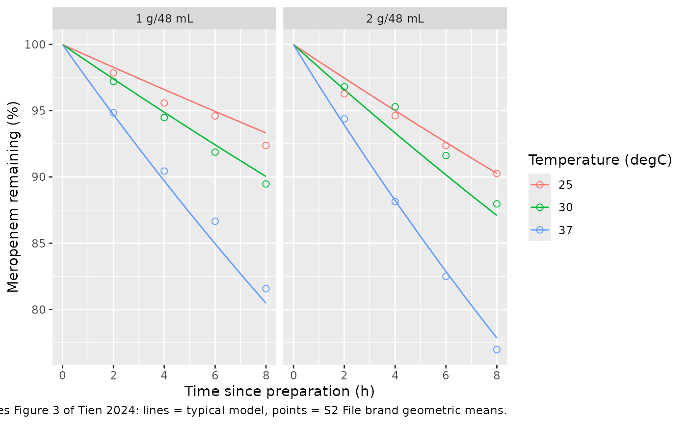
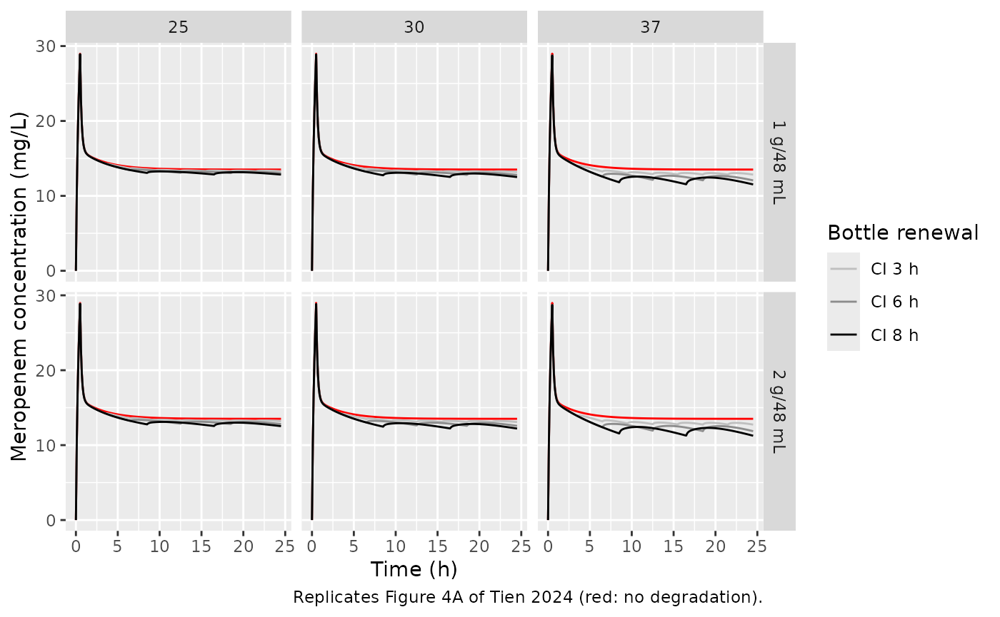
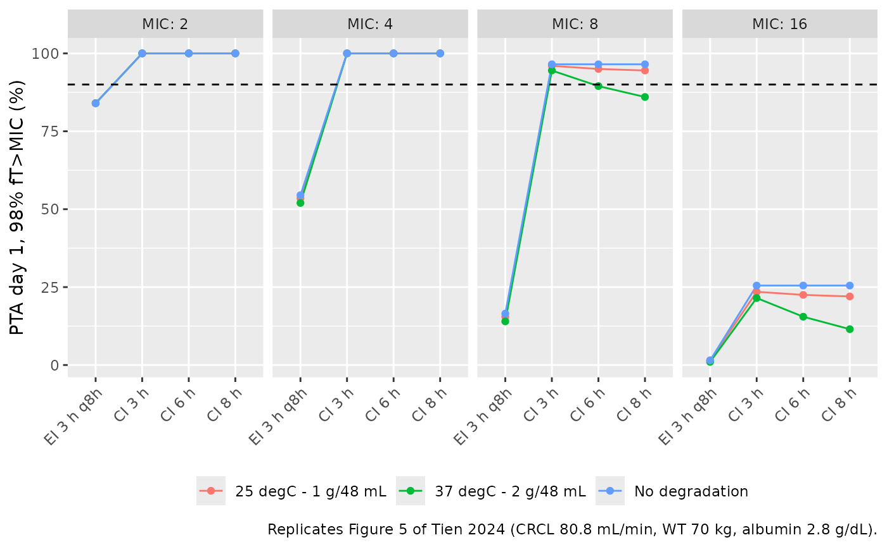
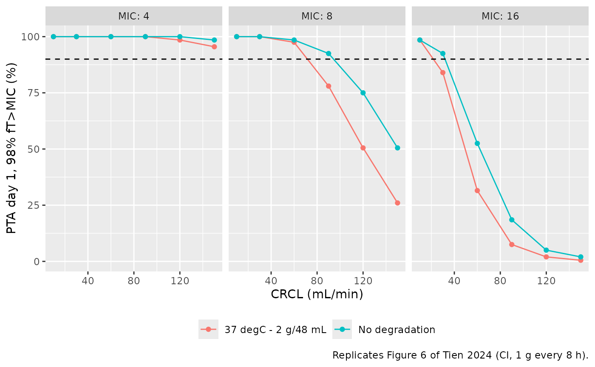

# Meropenem in-bottle degradation and PK (Tien 2024)

## Model and source

- Citation: Tien NTN, Binh VN, Ha PTT, Lan DTN, Cho YS, Long NP, Shin
  JG, Anh NH, Quan TA, Tuan DN, Tiep NK, Thach PT, Anh NH, Hoa VD.
  Optimization of meropenem continuous infusion based on Monte Carlo
  simulation integrating with degradation study. PLoS One.
  2024;19(12):e0313764. <doi:10.1371/journal.pone.0313764>. Stability
  model: Methods Eq. 1, Table 2 and the full-precision lmer output in S3
  File; coupled PK/degradation equations: Methods ‘Simulation procedure’
  and S4 File. PK parameters as recoded in S4 File from Ehmann L et
  al. Int J Antimicrob Agents. 2019;54(3):309-317,
  <doi:10.1016/j.ijantimicag.2019.06.016>.
- Description: Meropenem in-bottle degradation coupled to a
  two-compartment population PK model in critically ill adults without
  CRRT (Tien 2024). The infusion solution is an ODE state
  (infusion_container) dosed as a bolus when the bottle is hung; intact
  drug degrades by first-order kinetics and is pumped into central at
  constant volume rate over TINF, so the delivery rate is Dose \*
  exp(-kdeg \* t) / TINF. kdeg comes from a linear mixed-effects fit to
  in-vitro stability data (7 generic brands, 1 or 2 g/48 mL in saline,
  25/30/37 degC, 0-8 h) with categorical solution-temperature and
  solution-strength effects and correlated random intercept and slope
  per bottle series; the in-vitro fraction remaining is a second output
  with additive error on log(C/C0). The PK layer is the Ehmann 2019 ICU
  model as recoded by Tien: CL linear in Cockcroft-Gault creatinine
  clearance (centred 80.8 mL/min) up to an estimated hinge at 154
  mL/min, power weight effect on Vc and linear albumin effect on Vp,
  with IIV on CL, Vc and Vp and one occasion of IOV on CL.
- Article: <https://doi.org/10.1371/journal.pone.0313764> (open access,
  with the stability data, the `lmer` code and the RxODE simulation code
  as S2-S4 Files)

Tien et al. measured how fast meropenem degrades in a prepared infusion
bottle, then fed that loss into a published ICU population PK model to
ask whether the loss matters for target attainment during prolonged and
continuous infusion. The packaged model keeps both layers in one file
because they are coupled: the bottle is an ODE state whose intact drug
decays while the pump delivers it to the central compartment.

## Population

**Stability study (in vitro).** Seven generic meropenem brands were
reconstituted in 0.9% sodium chloride at 1 g/48 mL and 2 g/48 mL, held
at 25, 30 and 37 degC, and assayed by HPLC hourly for 8 h: 42 bottle
series and 365 retained observations (Results; S2 and S3 Files). Brand
did not improve the fit (Table 1, Model 4, p = 0.14), so the final model
has temperature and strength effects only.

**PK layer.** Tien used the Ehmann 2019 model for critically ill adults
with severe infections who were not on continuous renal replacement
therapy (48 patients, 1376 samples; creatinine clearance median 70.8
mL/min, 5th-95th percentiles 34.8-160 mL/min; Methods). The typical
patient of the deterministic simulations has CRCL 80.8 mL/min, weight 70
kg and albumin 2.8 g/dL.

``` r

str(rxode2::rxode(readModelDb("Tien_2024_meropenem"))$population)
#> List of 9
#>  $ species       : chr "human (PK layer) + in vitro (infusion-solution stability)"
#>  $ n_subjects    : num 48
#>  $ n_studies     : num 1
#>  $ disease_state : chr "Critically ill adults with severe infections, not on continuous renal replacement therapy (Ehmann 2019 PK cohort)."
#>  $ renal_function: chr "Cockcroft-Gault creatinine clearance median 70.8 mL/min, 5th-95th percentiles 34.8-160 mL/min (Methods, citing Ehmann 2019)."
#>  $ n_observations: chr "1376 plasma samples (PK); 365 in-vitro stability observations"
#>  $ in_vitro      : chr "Seven meropenem generic brands reconstituted in 0.9% sodium chloride at 1 g/48 mL and 2 g/48 mL, held at 25, 30"| __truncated__
#>  $ regions       : chr "Vietnam (stability study); the PK cohort's region is not stated in Tien 2024"
#>  $ notes         : chr "Typical patient of the deterministic simulations: CRCL 80.8 mL/min, WT 70 kg, albumin 2.8 g/dL. Monte Carlo sim"| __truncated__
```

## Source trace

| Model element | Value | Source |
|----|----|----|
| Stability model `log(C/C0) = mu + theta - (b0 + b1*T + b2*Cinfu + eta)*t + eps` | – | Methods Eq. 1; S3 File section 1 |
| `infusion_log_intercept` (mu) | -0.0002568 | S3 File `summary(fit3)`; Table 2 (-0.0003) |
| `kdeg` (b0, 25 degC, 1 g/48 mL) | 0.0086083 1/h | S3 File; Table 2 (0.0086) |
| `e_infusion_temp_30c_kdeg` | 0.0044789 1/h | S3 File; Table 2 (0.0045) |
| `e_infusion_temp_37c_kdeg` | 0.0185050 1/h | S3 File; Table 2 (0.0185) |
| `e_form_meropenem_soln2g48ml_kdeg` | 0.0041512 1/h | S3 File; Table 2 (0.0042) |
| Random intercept / slope variances, correlation | 4.119e-05, 2.149e-06, 0.94 | S3 File; Table 2 (omega1 0.0064, omega2 0.0015 as SD) |
| `expSd_infusion_fraction_remaining` (sigma) | 0.010127 | S3 File; Table 2 (0.0101) |
| Bottle input `Dose * exp(-kdeg * t) / Tinf` for `t <= Tinf` | – | Methods ‘Simulation procedure’ equations; Fig 1; S4 File `Depot/duration` |
| Two-compartment ODEs | – | Methods ‘Simulation procedure’ equations; S4 File `@dynamics` |
| `lcl` | log(9.25) L/h | S4 File `tvCL` (RSE 4.6%) |
| `lvc` | log(7.89) L | S4 File `tvVc` (RSE 11.9%) |
| `lq` | log(28.4) L/h | S4 File `tvQ` (RSE 16.1%) |
| `lvp` | log(16.1) L | S4 File `tvVp` (RSE 7.4%) |
| `e_crcl_cl`, centred 80.8 mL/min | 0.00977 | S4 File `CLCR_CL`, `@pre` block |
| `lcrcl_hinge` | log(154) mL/min | S4 File `CLCR_INF` (RSE 6.9%) |
| `e_wt_vc`, reference 70 kg | 0.945 | S4 File `WT_Vc` |
| `e_alb_vp`, centred 2.8 g/dL | -0.202 | S4 File `ALB_Vp` |
| IIV CL, Vc, Vp | 27.1, 31.5, 16.9 %CV | Methods; S4 File `Omega` |
| IOV CL | 12.5 %CV | Methods; S4 File `Omega` |
| `propSd` (Cc) | fixed(0) | not reported (see Assumptions) |

## Simulation helpers

Dosing follows S4 File: a 500 mg loading dose over 30 min, then the
maintenance bottles from 0.5 h. A *degradation* arm hangs each bottle as
a bolus into `infusion_container` and sets `TINF` to that bottle’s
infusion length; a *no-degradation* arm gives the same doses as
zero-order infusions straight into `central`, which is the paper’s
reference model.

``` r

mod <- readModelDb("Tien_2024_meropenem")

regimens <- tibble::tribble(
  ~regimen,     ~interval, ~tinf, ~dose,
  "EI 3 h q8h",         8,     3,  1000,
  "CI 3 h",             3,     3,   375,
  "CI 6 h",             6,     6,   750,
  "CI 8 h",             8,     8,  1000
)

conditions <- tibble::tribble(
  ~condition,               ~degrade, ~temp, ~strength,
  "No degradation",         FALSE,    25,    "1 g/48 mL",
  "25 degC - 1 g/48 mL",    TRUE,     25,    "1 g/48 mL",
  "25 degC - 2 g/48 mL",    TRUE,     25,    "2 g/48 mL",
  "30 degC - 1 g/48 mL",    TRUE,     30,    "1 g/48 mL",
  "30 degC - 2 g/48 mL",    TRUE,     30,    "2 g/48 mL",
  "37 degC - 1 g/48 mL",    TRUE,     37,    "1 g/48 mL",
  "37 degC - 2 g/48 mL",    TRUE,     37,    "2 g/48 mL"
)

# One subject's dose records: loading dose then maintenance bottles.
dose_table <- function(interval, tinf, dose, t_end = 24.5) {
  starts <- seq(0.5, t_end, by = interval)
  starts <- starts[starts < t_end]
  tibble(
    time = c(0, starts),
    amt = c(500, rep(dose, length(starts))),
    tinf = c(0.5, rep(tinf, length(starts)))
  )
}

# Event records for n subjects. Degradation arms dose the bottle state; the
# reference arm infuses into central with a duration.
build_events <- function(n, interval, tinf, dose, degrade, temp, strength,
                         crcl = 80.8, obs_times = seq(0, 24.5, by = 0.1)) {
  doses <- dose_table(interval, tinf, dose)
  dose_rows <- doses |>
    mutate(
      evid = 1L,
      cmt = if (degrade) "infusion_container" else "central",
      dur = if (degrade) 0 else tinf,
      dvid = NA_integer_
    )
  # Observations on the central state; dvid 1 selects the Cc endpoint (the
  # in-vitro fraction remaining is returned as a column on the same rows).
  obs_rows <- tibble(time = obs_times, amt = 0, tinf = NA_real_, evid = 0L,
                     cmt = "central", dur = 0, dvid = 1L)
  one <- bind_rows(dose_rows, obs_rows) |>
    arrange(time, desc(evid)) |>
    mutate(TINF = doses$tinf[findInterval(time, doses$time)])
  ev <- tidyr::crossing(id = seq_len(n), one) |>
    arrange(id, time, desc(evid)) |>
    mutate(
      CRCL = crcl, WT = 70, ALB = 28,
      INFUSION_TEMP_30C = as.integer(temp == 30),
      INFUSION_TEMP_37C = as.integer(temp == 37),
      FORM_MEROPENEM_SOLN2G48ML = as.integer(strength == "2 g/48 mL")
    ) |>
    select(-tinf)
  ev$dur[ev$evid == 0L | ev$dur == 0] <- NA_real_
  ev
}

# Typical-value solve. Each subject is a different regimen or condition, so
# rxode2's "multi-subject simulation without 'omega'" warning is expected and
# is the only warning muffled.
muffle_no_omega <- function(w) {
  if (grepl("multi-subject simulation without", conditionMessage(w))) {
    invokeRestart("muffleWarning")
  }
}
solve_typical <- function(ev) {
  withCallingHandlers(
    rxSolve(rxode2::zeroRe(mod), ev, returnType = "data.frame",
            useLinCmt = FALSE),
    warning = muffle_no_omega
  )
}
```

## In-vitro stability (replicates Figure 3)

The `infusion_fraction_remaining` output is the stability model itself.
Observed values are the geometric means across the seven brands of the
percentage remaining in S2 File, tabulated by the maintainers at 2, 4, 6
and 8 h.

``` r

observed_fig3 <- tibble::tribble(
  ~strength,   ~temp, ~time, ~n_brands, ~pct_obs,
  "1 g/48 mL", 25, 2, 7, 97.84,
  "1 g/48 mL", 25, 4, 7, 95.58,
  "1 g/48 mL", 25, 6, 6, 94.60,
  "1 g/48 mL", 25, 8, 7, 92.37,
  "1 g/48 mL", 30, 2, 6, 97.19,
  "1 g/48 mL", 30, 4, 6, 94.48,
  "1 g/48 mL", 30, 6, 7, 91.87,
  "1 g/48 mL", 30, 8, 7, 89.47,
  "1 g/48 mL", 37, 2, 7, 94.84,
  "1 g/48 mL", 37, 4, 7, 90.44,
  "1 g/48 mL", 37, 6, 7, 86.66,
  "1 g/48 mL", 37, 8, 7, 81.57,
  "2 g/48 mL", 25, 2, 7, 96.27,
  "2 g/48 mL", 25, 4, 7, 94.62,
  "2 g/48 mL", 25, 6, 7, 92.37,
  "2 g/48 mL", 25, 8, 7, 90.26,
  "2 g/48 mL", 30, 2, 7, 96.80,
  "2 g/48 mL", 30, 4, 7, 95.29,
  "2 g/48 mL", 30, 6, 7, 91.61,
  "2 g/48 mL", 30, 8, 6, 87.97,
  "2 g/48 mL", 37, 2, 7, 94.38,
  "2 g/48 mL", 37, 4, 7, 88.14,
  "2 g/48 mL", 37, 6, 7, 82.50,
  "2 g/48 mL", 37, 8, 7, 76.98
)

# A bottle stored for 8 h (TINF longer than the window, so nothing is
# delivered while it is being sampled).
stab_cond <- conditions |> filter(degrade)
stab_events <- bind_rows(lapply(seq_len(nrow(stab_cond)), function(i) {
  build_events(1, interval = 24, tinf = 24, dose = 1000, degrade = TRUE,
               temp = stab_cond$temp[i], strength = stab_cond$strength[i],
               obs_times = seq(0.5, 8.5, by = 0.25)) |>
    filter(!(evid == 1L & time == 0)) |>
    mutate(id = i, TINF = 24)
}))
stab_sim <- solve_typical(stab_events) |>
  mutate(time_bottle = time - 0.5,
         temp = stab_cond$temp[id], strength = stab_cond$strength[id],
         pct_pred = 100 * infusion_fraction_remaining)
#> ℹ omega/sigma items treated as zero: 'etainfusion_log_intercept', 'etakdeg', 'etalcl', 'etalvc', 'etalvp', 'etaiov_cl_1'

ggplot(stab_sim, aes(time_bottle, pct_pred, colour = factor(temp))) +
  geom_line() +
  geom_point(data = observed_fig3, aes(time, pct_obs), shape = 21, size = 2) +
  facet_wrap(~strength) +
  labs(x = "Time since preparation (h)", y = "Meropenem remaining (%)",
       colour = "Temperature (degC)",
       caption = "Replicates Figure 3 of Tien 2024: lines = typical model, points = S2 File brand geometric means.")
```



``` r


fig3_check <- observed_fig3 |>
  left_join(stab_sim |> select(time = time_bottle, temp, strength, pct_pred),
            by = c("time", "temp", "strength")) |>
  mutate(diff_pct_points = pct_pred - pct_obs)
knitr::kable(fig3_check, digits = 2)
```

| strength  | temp | time | n_brands | pct_obs | pct_pred | diff_pct_points |
|:----------|-----:|-----:|---------:|--------:|---------:|----------------:|
| 1 g/48 mL |   25 |    2 |        7 |   97.84 |    98.27 |            0.43 |
| 1 g/48 mL |   25 |    4 |        7 |   95.58 |    96.59 |            1.01 |
| 1 g/48 mL |   25 |    6 |        6 |   94.60 |    94.94 |            0.34 |
| 1 g/48 mL |   25 |    8 |        7 |   92.37 |    93.32 |            0.95 |
| 1 g/48 mL |   30 |    2 |        6 |   97.19 |    97.39 |            0.20 |
| 1 g/48 mL |   30 |    4 |        6 |   94.48 |    94.88 |            0.40 |
| 1 g/48 mL |   30 |    6 |        7 |   91.87 |    92.42 |            0.55 |
| 1 g/48 mL |   30 |    8 |        7 |   89.47 |    90.04 |            0.57 |
| 1 g/48 mL |   37 |    2 |        7 |   94.84 |    94.70 |           -0.14 |
| 1 g/48 mL |   37 |    4 |        7 |   90.44 |    89.70 |           -0.74 |
| 1 g/48 mL |   37 |    6 |        7 |   86.66 |    84.96 |           -1.70 |
| 1 g/48 mL |   37 |    8 |        7 |   81.57 |    80.48 |           -1.09 |
| 2 g/48 mL |   25 |    2 |        7 |   96.27 |    97.46 |            1.19 |
| 2 g/48 mL |   25 |    4 |        7 |   94.62 |    95.00 |            0.38 |
| 2 g/48 mL |   25 |    6 |        7 |   92.37 |    92.61 |            0.24 |
| 2 g/48 mL |   25 |    8 |        7 |   90.26 |    90.27 |            0.01 |
| 2 g/48 mL |   30 |    2 |        7 |   96.80 |    96.59 |           -0.21 |
| 2 g/48 mL |   30 |    4 |        7 |   95.29 |    93.31 |           -1.98 |
| 2 g/48 mL |   30 |    6 |        7 |   91.61 |    90.15 |           -1.46 |
| 2 g/48 mL |   30 |    8 |        6 |   87.97 |    87.10 |           -0.87 |
| 2 g/48 mL |   37 |    2 |        7 |   94.38 |    93.91 |           -0.47 |
| 2 g/48 mL |   37 |    4 |        7 |   88.14 |    88.22 |            0.08 |
| 2 g/48 mL |   37 |    6 |        7 |   82.50 |    82.87 |            0.37 |
| 2 g/48 mL |   37 |    8 |        7 |   76.98 |    77.85 |            0.87 |

``` r

stopifnot(
  !anyNA(fig3_check$pct_pred),
  abs(median(fig3_check$diff_pct_points)) < 1,
  max(abs(fig3_check$diff_pct_points)) < 3
)
```

The fixed effects reproduce the brand-averaged data to within about one
percentage point; both sides are deterministic (typical model against
tabulated means), so a tight bound is appropriate.

## Deterministic profiles (replicates Figure 4A)

Total daily dose 3 g as 375 mg every 3 h, 750 mg every 6 h or 1000 mg
every 8 h, each bottle infused over its whole renewal interval, after
the 500 mg loading dose.

``` r

ci_regimens <- regimens |> filter(grepl("^CI", regimen))
det_grid <- tidyr::crossing(ci_regimens, conditions)
det_events <- bind_rows(lapply(seq_len(nrow(det_grid)), function(i) {
  g <- det_grid[i, ]
  build_events(1, g$interval, g$tinf, g$dose, g$degrade, g$temp, g$strength) |>
    mutate(id = i)
}))
det_sim <- solve_typical(det_events) |>
  left_join(det_grid |> mutate(id = row_number()), by = "id")
#> ℹ omega/sigma items treated as zero: 'etainfusion_log_intercept', 'etakdeg', 'etalcl', 'etalvc', 'etalvp', 'etaiov_cl_1'

det_plot <- det_sim |> filter(condition != "No degradation")
ref_plot <- det_sim |> filter(condition == "No degradation", regimen == "CI 8 h") |>
  select(time, Cc)
ggplot(det_plot, aes(time, Cc)) +
  geom_line(data = ref_plot, colour = "red") +
  geom_line(aes(colour = regimen)) +
  facet_grid(strength ~ temp) +
  scale_colour_grey(start = 0.75, end = 0) +
  labs(x = "Time (h)", y = "Meropenem concentration (mg/L)",
       colour = "Bottle renewal",
       caption = "Replicates Figure 4A of Tien 2024 (red: no degradation).")
```



``` r


# Peak after the loading dose and the no-degradation steady state.
ref_ss <- det_sim |> filter(condition == "No degradation", regimen == "CI 8 h")
peak_ld <- max(ref_ss$Cc[ref_ss$time <= 1])
css_24 <- ref_ss$Cc[ref_ss$time == 24]
c(peak_after_LD = peak_ld, Css_no_degradation = css_24,
  expected_Css = 125 / 9.25)
#>      peak_after_LD Css_no_degradation       expected_Css 
#>           28.98595           13.51456           13.51351
stopifnot(abs(css_24 / (125 / 9.25) - 1) < 0.02, peak_ld > 26, peak_ld < 32)
```

The no-degradation curve settles at the infusion rate over clearance
(125 mg/h / 9.25 L/h = 13.5 mg/L) and peaks near 29 mg/L at the end of
the loading dose, as in Figure 4A.

## Trough ratio Cmin / Cno-deg (replicates Figure 4B)

Figure 4B shows the concentration at the end of a steady-state bottle
(the minimum of the saw-tooth) as a percentage of the no-degradation
concentration. The paper’s points are per-brand conditional modes; the
maintainers digitised the centre of each brand cluster.

``` r

fig4b_digitised <- tibble::tribble(
  ~strength,   ~temp, ~regimen, ~ratio_paper,
  "1 g/48 mL", 25, "CI 3 h", 98.0,
  "1 g/48 mL", 30, "CI 3 h", 97.5,
  "1 g/48 mL", 37, "CI 3 h", 95.2,
  "1 g/48 mL", 25, "CI 6 h", 96.2,
  "1 g/48 mL", 30, "CI 6 h", 94.4,
  "1 g/48 mL", 37, "CI 6 h", 89.8,
  "1 g/48 mL", 25, "CI 8 h", 94.8,
  "1 g/48 mL", 30, "CI 8 h", 92.2,
  "1 g/48 mL", 37, "CI 8 h", 86.0,
  "2 g/48 mL", 25, "CI 3 h", 97.3,
  "2 g/48 mL", 30, "CI 3 h", 96.9,
  "2 g/48 mL", 37, "CI 3 h", 94.3,
  "2 g/48 mL", 25, "CI 6 h", 94.6,
  "2 g/48 mL", 30, "CI 6 h", 93.4,
  "2 g/48 mL", 37, "CI 6 h", 87.6,
  "2 g/48 mL", 25, "CI 8 h", 92.8,
  "2 g/48 mL", 30, "CI 8 h", 91.0,
  "2 g/48 mL", 37, "CI 8 h", 83.0
)

ref_cc <- det_sim |> filter(condition == "No degradation") |>
  select(regimen, time, Cc_ref = Cc)
ratio_sim <- det_sim |>
  filter(condition != "No degradation", time >= 16.5, time <= 24.5) |>
  left_join(ref_cc, by = c("regimen", "time")) |>
  group_by(regimen, temp, strength) |>
  summarise(ratio_model = 100 * min(Cc / Cc_ref), .groups = "drop")

fig4b <- fig4b_digitised |>
  left_join(ratio_sim, by = c("regimen", "temp", "strength")) |>
  mutate(diff = ratio_model - ratio_paper)
knitr::kable(fig4b, digits = 1)
```

| strength  | temp | regimen | ratio_paper | ratio_model | diff |
|:----------|-----:|:--------|------------:|------------:|-----:|
| 1 g/48 mL |   25 | CI 3 h  |        98.0 |        98.4 |  0.4 |
| 1 g/48 mL |   30 | CI 3 h  |        97.5 |        97.5 |  0.0 |
| 1 g/48 mL |   37 | CI 3 h  |        95.2 |        95.0 | -0.2 |
| 1 g/48 mL |   25 | CI 6 h  |        96.2 |        96.5 |  0.3 |
| 1 g/48 mL |   30 | CI 6 h  |        94.4 |        94.7 |  0.3 |
| 1 g/48 mL |   37 | CI 6 h  |        89.8 |        89.3 | -0.5 |
| 1 g/48 mL |   25 | CI 8 h  |        94.8 |        95.0 |  0.2 |
| 1 g/48 mL |   30 | CI 8 h  |        92.2 |        92.6 |  0.4 |
| 1 g/48 mL |   37 | CI 8 h  |        86.0 |        85.3 | -0.7 |
| 2 g/48 mL |   25 | CI 3 h  |        97.3 |        97.6 |  0.3 |
| 2 g/48 mL |   30 | CI 3 h  |        96.9 |        96.8 | -0.1 |
| 2 g/48 mL |   37 | CI 3 h  |        94.3 |        94.3 |  0.0 |
| 2 g/48 mL |   25 | CI 6 h  |        94.6 |        94.8 |  0.2 |
| 2 g/48 mL |   30 | CI 6 h  |        93.4 |        93.0 | -0.4 |
| 2 g/48 mL |   37 | CI 6 h  |        87.6 |        87.8 |  0.2 |
| 2 g/48 mL |   25 | CI 8 h  |        92.8 |        92.8 |  0.0 |
| 2 g/48 mL |   30 | CI 8 h  |        91.0 |        90.4 | -0.6 |
| 2 g/48 mL |   37 | CI 8 h  |        83.0 |        83.3 |  0.3 |

``` r

stopifnot(
  !anyNA(fig4b$ratio_model),
  abs(median(fig4b$diff)) < 1.5,
  max(abs(fig4b$diff)) < 3
)
```

The 5-18% reduction stated in the Results is reproduced, rising with the
renewal interval and the temperature.

## Probability of target attainment (replicates Figures 5 and 6)

Monte Carlo simulation of the first treatment day with IIV on CL, Vc and
Vp and IOV on CL. Target: total concentration above the MIC for at least
98% of the 0.1 h grid over 0-24 h (S4 File `Cp_GT_MIC`). The paper used
1000 patients per regimen and condition; this vignette uses 200, and
every arm of a figure reuses the same 200 patients through a common
seed.

``` r

n_mc <- 200

simulate_arm <- function(regimen_row, condition_row, crcl, seed = 2024) {
  ev <- build_events(n_mc, regimen_row$interval, regimen_row$tinf,
                     regimen_row$dose, condition_row$degrade,
                     condition_row$temp, condition_row$strength,
                     crcl = crcl, obs_times = seq(0, 24, by = 0.1))
  rxode2::rxSetSeed(seed)
  rxSolve(mod, ev, returnType = "data.frame", useLinCmt = FALSE) |>
    select(id, time, Cc) |>
    mutate(regimen = regimen_row$regimen, condition = condition_row$condition,
           CRCL = crcl)
}

pta_table <- function(sim, mic) {
  sim |>
    group_by(regimen, condition, CRCL, id) |>
    summarise(ft = 100 * mean(Cc > mic), .groups = "drop") |>
    group_by(regimen, condition, CRCL) |>
    summarise(PTA = 100 * mean(ft >= 98), .groups = "drop") |>
    mutate(MIC = mic)
}
```

``` r

fig5_cond <- conditions |>
  filter(condition %in% c("No degradation", "25 degC - 1 g/48 mL",
                          "37 degC - 2 g/48 mL"))
fig5_sim <- bind_rows(lapply(seq_len(nrow(regimens)), function(i) {
  bind_rows(lapply(seq_len(nrow(fig5_cond)), function(j) {
    simulate_arm(regimens[i, ], fig5_cond[j, ], crcl = 80.8)
  }))
}))
fig5_pta <- bind_rows(lapply(c(2, 4, 8, 16), function(m) pta_table(fig5_sim, m)))

ggplot(fig5_pta, aes(factor(regimen, levels = regimens$regimen), PTA,
                     colour = condition, group = condition)) +
  geom_line() + geom_point() +
  geom_hline(yintercept = 90, linetype = "dashed") +
  facet_wrap(~MIC, nrow = 1, labeller = label_both) +
  labs(x = NULL, y = "PTA day 1, 98% fT>MIC (%)", colour = NULL,
       caption = "Replicates Figure 5 of Tien 2024 (CRCL 80.8 mL/min, WT 70 kg, albumin 2.8 g/dL).") +
  theme(axis.text.x = element_text(angle = 45, hjust = 1), legend.position = "bottom")
```



``` r

fig5_digitised <- tibble::tribble(
  ~regimen,     ~condition,             ~MIC, ~PTA_paper,
  "EI 3 h q8h", "No degradation",          2,   86,
  "EI 3 h q8h", "No degradation",          4,   59,
  "EI 3 h q8h", "37 degC - 2 g/48 mL",     4,   53,
  "EI 3 h q8h", "No degradation",          8,   17,
  "CI 3 h",     "No degradation",          8,   96,
  "CI 8 h",     "No degradation",          8,   96,
  "CI 8 h",     "25 degC - 1 g/48 mL",     8,   93,
  "CI 8 h",     "37 degC - 2 g/48 mL",     8,   86,
  "CI 3 h",     "No degradation",         16,   25,
  "CI 8 h",     "No degradation",         16,   25,
  "CI 8 h",     "37 degC - 2 g/48 mL",    16,   11
)
fig5_cmp <- fig5_digitised |>
  left_join(fig5_pta |> select(regimen, condition, MIC, PTA_model = PTA),
            by = c("regimen", "condition", "MIC")) |>
  mutate(diff = PTA_model - PTA_paper)
knitr::kable(fig5_cmp, digits = 1)
```

| regimen    | condition           | MIC | PTA_paper | PTA_model | diff |
|:-----------|:--------------------|----:|----------:|----------:|-----:|
| EI 3 h q8h | No degradation      |   2 |        86 |      84.0 | -2.0 |
| EI 3 h q8h | No degradation      |   4 |        59 |      54.5 | -4.5 |
| EI 3 h q8h | 37 degC - 2 g/48 mL |   4 |        53 |      52.0 | -1.0 |
| EI 3 h q8h | No degradation      |   8 |        17 |      16.5 | -0.5 |
| CI 3 h     | No degradation      |   8 |        96 |      96.5 |  0.5 |
| CI 8 h     | No degradation      |   8 |        96 |      96.5 |  0.5 |
| CI 8 h     | 25 degC - 1 g/48 mL |   8 |        93 |      94.5 |  1.5 |
| CI 8 h     | 37 degC - 2 g/48 mL |   8 |        86 |      86.0 |  0.0 |
| CI 3 h     | No degradation      |  16 |        25 |      25.5 |  0.5 |
| CI 8 h     | No degradation      |  16 |        25 |      25.5 |  0.5 |
| CI 8 h     | 37 degC - 2 g/48 mL |  16 |        11 |      11.5 |  0.5 |

``` r

stopifnot(
  !anyNA(fig5_cmp$PTA_model),
  abs(median(fig5_cmp$diff)) < 8,
  quantile(abs(fig5_cmp$diff), 0.9) < 20
)
```

``` r

fig6_cond <- conditions |> filter(condition %in% c("No degradation", "37 degC - 2 g/48 mL"))
ci8 <- regimens |> filter(regimen == "CI 8 h")
fig6_sim <- bind_rows(lapply(c(10, 30, 60, 90, 120, 150), function(cr) {
  bind_rows(lapply(seq_len(nrow(fig6_cond)), function(j) {
    simulate_arm(ci8, fig6_cond[j, ], crcl = cr)
  }))
}))
fig6_pta <- bind_rows(lapply(c(4, 8, 16), function(m) pta_table(fig6_sim, m)))

ggplot(fig6_pta, aes(CRCL, PTA, colour = condition)) +
  geom_line() + geom_point() +
  geom_hline(yintercept = 90, linetype = "dashed") +
  facet_wrap(~MIC, labeller = label_both) +
  labs(x = "CRCL (mL/min)", y = "PTA day 1, 98% fT>MIC (%)", colour = NULL,
       caption = "Replicates Figure 6 of Tien 2024 (CI, 1 g every 8 h).") +
  theme(legend.position = "bottom")
```



``` r


fig6_digitised <- tibble::tribble(
  ~CRCL, ~condition,             ~MIC, ~PTA_paper,
     90, "No degradation",          8,   93,
    120, "No degradation",          8,   74,
    150, "No degradation",          8,   50,
     90, "37 degC - 2 g/48 mL",     8,   80,
    120, "37 degC - 2 g/48 mL",     8,   48,
    150, "37 degC - 2 g/48 mL",     8,   26,
     30, "No degradation",         16,   90,
     60, "No degradation",         16,   45,
     60, "37 degC - 2 g/48 mL",    16,   33
)
fig6_cmp <- fig6_digitised |>
  left_join(fig6_pta |> select(CRCL, condition, MIC, PTA_model = PTA),
            by = c("CRCL", "condition", "MIC")) |>
  mutate(diff = PTA_model - PTA_paper)
knitr::kable(fig6_cmp, digits = 1)
```

| CRCL | condition           | MIC | PTA_paper | PTA_model | diff |
|-----:|:--------------------|----:|----------:|----------:|-----:|
|   90 | No degradation      |   8 |        93 |      92.5 | -0.5 |
|  120 | No degradation      |   8 |        74 |      75.0 |  1.0 |
|  150 | No degradation      |   8 |        50 |      50.5 |  0.5 |
|   90 | 37 degC - 2 g/48 mL |   8 |        80 |      78.0 | -2.0 |
|  120 | 37 degC - 2 g/48 mL |   8 |        48 |      50.5 |  2.5 |
|  150 | 37 degC - 2 g/48 mL |   8 |        26 |      26.0 |  0.0 |
|   30 | No degradation      |  16 |        90 |      92.5 |  2.5 |
|   60 | No degradation      |  16 |        45 |      52.5 |  7.5 |
|   60 | 37 degC - 2 g/48 mL |  16 |        33 |      31.5 | -1.5 |

``` r

stopifnot(
  !anyNA(fig6_cmp$PTA_model),
  abs(median(fig6_cmp$diff)) < 8,
  quantile(abs(fig6_cmp$diff), 0.9) < 20
)
```

With 200 patients the Monte Carlo standard error of a PTA near 50% is
about 3.5 percentage points, and the digitised values carry a further
1-2 points, so the checks bound the centre and a robust quantile of the
differences rather than every point.

## NCA of the typical-patient day 1 (PKNCA)

The paper reports no NCA. PKNCA is used here to quantify how much
exposure the bottle loses. For a linear model, the day-1 AUC equals the
drug that reached the patient minus the drug still in the body at 24 h,
divided by clearance; the delivered amount has a closed form, because a
bottle hung at `s` with dose `D` and length `T` has delivered
`D * (1 - exp(-k t)) / (k T)` by `t = min(T, 24 - s)` hours.

``` r

nca_conc <- det_sim |>
  filter(!is.na(Cc), time <= 24) |>
  mutate(treatment = paste(regimen, condition, sep = " | ")) |>
  select(id, time, Cc, treatment, regimen, condition)
conc_obj <- PKNCAconc(nca_conc, Cc ~ time | treatment + id)
intervals <- data.frame(start = 0, end = 24, auclast = TRUE, cmax = TRUE)
nca_res <- pk.nca(PKNCAdata(conc_obj, intervals = intervals))
#> No dose information provided, calculations requiring dose will return NA.
nca_wide <- as.data.frame(nca_res) |>
  select(treatment, PPTESTCD, PPORRES) |>
  tidyr::pivot_wider(names_from = PPTESTCD, values_from = PPORRES) |>
  tidyr::separate(treatment, c("regimen", "condition"), sep = " \\| ")

kdeg_typ <- function(temp, strength) {
  0.0086083 + 0.0044789 * (temp == 30) + 0.0185050 * (temp == 37) +
    0.0041512 * (strength == "2 g/48 mL")
}

# Drug delivered by 24 h from every bottle hung before then.
delivered_by_24 <- function(interval, tinf, dose, k) {
  doses <- dose_table(interval, tinf, dose, t_end = 24)
  tau <- pmin(doses$tinf, 24 - doses$time)
  sum(doses$amt * (1 - exp(-k * tau)) / (k * doses$tinf))
}

body_24 <- det_sim |>
  filter(time == 24) |>
  transmute(regimen, condition, body_amount = central + peripheral1)

auc_check <- nca_wide |>
  left_join(nca_wide |> filter(condition == "No degradation") |>
              select(regimen, auc_ref = auclast), by = "regimen") |>
  left_join(conditions, by = "condition") |>
  left_join(regimens, by = "regimen") |>
  left_join(body_24, by = c("regimen", "condition")) |>
  filter(degrade) |>
  rowwise() |>
  mutate(
    delivered = delivered_by_24(interval, tinf, dose, kdeg_typ(temp, strength)),
    auc_mass_balance = (delivered - body_amount) / 9.25
  ) |>
  ungroup() |>
  mutate(
    auc_ratio = auclast / auc_ref,
    pct_diff = 100 * (auclast / auc_mass_balance - 1)
  )
auc_check |>
  select(regimen, condition, cmax, auclast, auc_mass_balance, pct_diff, auc_ratio) |>
  dplyr::rename(
    "Bottle renewal" = regimen, "Condition" = condition,
    "Cmax (mg/L)" = cmax, "AUC0-24 PKNCA (mg*h/L)" = auclast,
    "AUC0-24 mass balance (mg*h/L)" = auc_mass_balance,
    "Difference (%)" = pct_diff,
    "AUC0-24 ratio vs no degradation" = auc_ratio
  ) |>
  knitr::kable(digits = 3)
```

| Bottle renewal | Condition | Cmax (mg/L) | AUC0-24 PKNCA (mg\*h/L) | AUC0-24 mass balance (mg\*h/L) | Difference (%) | AUC0-24 ratio vs no degradation |
|:---|:---|---:|---:|---:|---:|---:|
| CI 3 h | 25 degC - 1 g/48 mL | 28.909 | 332.896 | 332.930 | -0.010 | 0.989 |
| CI 3 h | 25 degC - 2 g/48 mL | 28.871 | 331.161 | 331.196 | -0.011 | 0.984 |
| CI 3 h | 30 degC - 1 g/48 mL | 28.868 | 331.024 | 331.060 | -0.011 | 0.984 |
| CI 3 h | 30 degC - 2 g/48 mL | 28.831 | 329.303 | 329.340 | -0.011 | 0.978 |
| CI 3 h | 37 degC - 1 g/48 mL | 28.743 | 325.264 | 325.304 | -0.012 | 0.966 |
| CI 3 h | 37 degC - 2 g/48 mL | 28.706 | 323.589 | 323.630 | -0.013 | 0.962 |
| CI 6 h | 25 degC - 1 g/48 mL | 28.909 | 329.588 | 329.621 | -0.010 | 0.979 |
| CI 6 h | 25 degC - 2 g/48 mL | 28.871 | 326.316 | 326.351 | -0.011 | 0.970 |
| CI 6 h | 30 degC - 1 g/48 mL | 28.868 | 326.060 | 326.094 | -0.011 | 0.969 |
| CI 6 h | 30 degC - 2 g/48 mL | 28.831 | 322.843 | 322.879 | -0.011 | 0.959 |
| CI 6 h | 37 degC - 1 g/48 mL | 28.743 | 315.390 | 315.429 | -0.012 | 0.937 |
| CI 6 h | 37 degC - 2 g/48 mL | 28.706 | 312.339 | 312.378 | -0.013 | 0.928 |
| CI 8 h | 25 degC - 1 g/48 mL | 28.909 | 327.478 | 327.512 | -0.010 | 0.973 |
| CI 8 h | 25 degC - 2 g/48 mL | 28.871 | 323.247 | 323.281 | -0.011 | 0.961 |
| CI 8 h | 30 degC - 1 g/48 mL | 28.868 | 322.917 | 322.951 | -0.011 | 0.960 |
| CI 8 h | 30 degC - 2 g/48 mL | 28.831 | 318.779 | 318.814 | -0.011 | 0.947 |
| CI 8 h | 37 degC - 1 g/48 mL | 28.743 | 309.273 | 309.311 | -0.012 | 0.919 |
| CI 8 h | 37 degC - 2 g/48 mL | 28.706 | 305.414 | 305.453 | -0.013 | 0.908 |

``` r

stopifnot(all(abs(auc_check$pct_diff) < 1))
```

The PKNCA AUC agrees with the mass balance to within the trapezoidal
error of the 0.1 h grid, so the bottle delivers exactly the drug the
stability model says survives. Over the first day the loss ranges from
about 1% (3 h bottles at 25 degC) to about 9% (8 h bottles at 37 degC, 2
g/48 mL).

## Assumptions and deviations

- **PK layer from the S4 File, not from Ehmann 2019 itself.** Ehmann
  2019 (<doi:10.1016/j.ijantimicag.2019.06.016>) is not open access and
  was not available; every PK value comes from Tien’s RxODE recoding,
  which matches the summary of the same model in Yang et al. 2022 (Front
  Pharmacol 13:838205, Table 2), apart from Yang printing the albumin
  centring as 2.79 g/dL where Tien uses 2.8. Re-verify against Ehmann
  2019 when it is obtained.
- **Above the CRCL hinge.** Tien’s code sets CL to
  `CLCR_INF * 60 / 1000` (9.24 L/h) above 154 mL/min, a discontinuous
  drop from 15.9 L/h just below it that none of the paper’s simulations
  reach (all use CRCL \<= 150). Yang 2022 prints “CL = CL-INF” for this
  branch. The model holds CL at its value at the hinge, the continuous
  reading of the published relationship.
- **Residual error on Cc is not reported** in Tien 2024 or its
  supplements, so `propSd` is `fixed(0)`; the paper’s PTA simulations
  used individual predictions without residual error, as here.
- **IOV on CL** enters as one occasion (`etaiov_cl_1`), as Tien
  simulated only the first treatment day; for multi-day simulation the
  occasion structure of Ehmann 2019 would be needed.
- **Bottle random effects.** The stability model’s random intercept and
  slope are per bottle series. Tien’s simulations used the typical kdeg
  (or per-brand conditional modes in Figure 4B); in a stochastic
  simulation of this model each patient also draws a bottle kdeg, which
  changes kdeg by about 0.0015 1/h (1 SD) and has no visible effect on
  PTA. The intercept describes the measured log(C/C0) at preparation and
  does not scale the delivered dose.
- **Albumin units.** The source model takes albumin in g/dL; the
  canonical `ALB` column is g/L and is divided by 10 in the model.
- **Brand.** Tested and not retained (Model 4, p = 0.14), so it is not a
  covariate.
- **S3 File parameter table.** The knitted `df_stability_param` table in
  S3 File shows the 37 degC and 2 g/48 mL coefficients on every row,
  because its [`ifelse()`](https://rdrr.io/r/base/ifelse.html) compares
  the labelled factor levels (‘25 degC’, ‘1g/48mL’) with bare numbers.
  Figure 4 clearly differs by temperature, so the simulations did not
  use those printed rows; the model uses the `summary(fit3)`
  coefficients, which agree with Table 2.
- **Figures 4B, 5 and 6** were digitised by the maintainers from the
  published images (about 1-2 percentage points of reading error).
