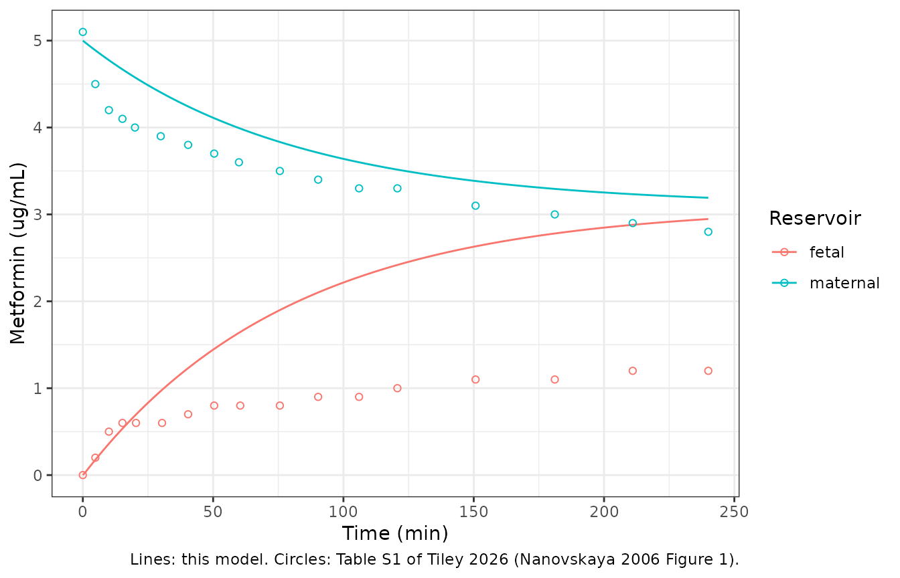

# Metformin placental cotyledon perfusion (Tiley 2026)

## Model and source

- Citation: Tiley JB, Hartauer ME, Whigham TL, De Sousa Mendes M,
  Brouwer KLR, Hebert MF. Comparison of Metformin PBPK Models
  Incorporating Placental Transfer to Predict Fetal and Maternal
  Exposure. CPT Pharmacometrics Syst Pharmacol. 2026;15(1):e70136.
  <doi:10.1002/psp4.70136>. PMCID: PMC12823317. Model structure and
  fixed volumes and dose: Methods, Equations 2-5; unit conversion:
  Equation 1; estimates: Methods (Approach 3) and Table 1; fitted data:
  Table S1 (digitised by the source authors from Figure 1 of Nanovskaya
  et al., Am J Obstet Gynecol 2006;195:1081-1085).

- Description: Ex vivo (human term placenta, dual-side recirculating
  single-cotyledon perfusion). Three-compartment model of metformin
  transfer across an isolated perfused cotyledon: a maternal reservoir,
  the syncytiotrophoblast (placental barrier) and a fetal reservoir,
  linked by bidirectional passive diffusion clearances at the
  maternal-placental (CLPDM) and placental-fetal (CLPDF) barriers. The
  system is closed (no metabolism or loss). Fitted in Phoenix WinNonlin
  by the source authors to the closed-system cotyledon data of
  Nanovskaya 2006 (Tiley 2026 Equations 2-5, ‘Approach 3’); the fitted
  clearances are printed per mL of whole-placenta volume and are
  converted back to per-cotyledon clearances with the paper’s own
  Equation 1. The paper’s Simcyp pregnancy PBPK model, into which these
  clearances were imputed, is NOT reproduced here.

- Article: <https://doi.org/10.1002/psp4.70136>

- Open-access full text: <https://europepmc.org/article/MED/41289433>

## What this file is, and what it is not

Tiley and colleagues compared four ways of putting metformin placental
transfer into a pregnancy PBPK model:

| Approach | Placental transfer | Implementation | In this file? |
|----|----|----|----|
| 1 | Perfusion-limited placenta-fetus compartment | Simcyp | no |
| 2 | Permeability-limited; CLPDM = CLPDF from the ex vivo open-system apparent cotyledon clearance | Simcyp | no |
| 3 | Permeability-limited; CLPDM and CLPDF **fitted with a three-compartment model** to ex vivo closed-system cotyledon data | Phoenix WinNonlin fit, then Simcyp | **the ex vivo fit only** |
| 4 | Permeability-limited; PAMPA passive clearance plus five placental transporters | Simcyp | no |

All four whole-body models start from the default Simcyp metformin
compound file and the Simcyp virtual pregnancy population. Their organ
volumes, blood flows, partition coefficients and gestational-age
placental volume are platform outputs that the paper does not print, and
every placental input in Table 1 is normalised per mL of that unprinted
placental volume, so none of the whole-body models can be rebuilt from
the publication.

The Approach 3 ex vivo model is self-contained: three ODEs printed as
Equations 2-5, the reservoir and syncytiotrophoblast volumes and the
dose stated in the Methods, and two fitted clearances. It is the part of
the paper that is a fitted model of its own, and the data it was fitted
to are printed in Table S1.

## Population

The model describes an isolated human term placenta, not a patient
population. The data are the mean maternal-artery and fetal-vein
metformin concentrations of a closed (recirculating) dual-side cotyledon
perfusion, read by the source authors from Figure 1 of Nanovskaya et
al. (*Am J Obstet Gynecol* 2006;195:1081-1085) and printed as Table S1.
Metformin was added to the 250 mL maternal reservoir to a final
concentration of 5 ug/mL (1250 ug); the fetal reservoir held 150 mL. The
syncytiotrophoblast of one cotyledon was given a volume of 3.395 mL
(67.9 mL placental syncytiotrophoblast volume over 20 cotyledons). The
number of perfused placentas is in the Nanovskaya report, not in this
paper.

## Source trace

| Quantity | Value | Source |
|----|----|----|
| Maternal reservoir `Vm` (`v_mres`) | 250 mL, fixed | Methods, Approach 3 |
| Fetal reservoir `Vf` (`v_fres`) | 150 mL, fixed | Methods, Approach 3 |
| Syncytiotrophoblast `Vs` (`v_pb`) | 3.395 mL, fixed | Methods, Approach 3 |
| Dose | 1250 ug into the maternal reservoir | Methods, Approach 3 |
| `CLPDM` (`lcl_pdm`) | 0.0023 L/h/mL placental volume = 1.263 mL/min per cotyledon | Methods, Approach 3; Table 1; Equation 1 inverted |
| `CLPDF` (`lcl_pdf`) | 0.039 L/h/mL placental volume = 21.42 mL/min per cotyledon | Methods, Approach 3; Table 1; Equation 1 inverted |
| Unit conversion | 20 cotyledons per placenta, 659 mL placental volume | Equation 1 and the sentence after it |
| Concentrations | Equation 2 | Methods |
| Maternal reservoir balance | Equation 3 | Methods |
| Syncytiotrophoblast balance | Equation 4 | Methods |
| Fetal reservoir balance | Equation 5 | Methods |
| Fitted data | maternal and fetal concentrations, 0-240 min | Table S1 |

The clearances the Phoenix fit produced, in mL/min for one cotyledon,
are not printed; only their conversion through Equation 1 is. The model
file inverts that conversion:

``` r

eq1_to_cot <- function(cl_per_ml_placenta) cl_per_ml_placenta * 659 / 20 * 1000 / 60
cot_to_eq1 <- function(cl_cot) cl_cot * 20 / 659 * 60 / 1000
est <- setNames(ui$iniDf$est, ui$iniDf$name)
cl_cot <- exp(c(CLPDM = est[["lcl_pdm"]], CLPDF = est[["lcl_pdf"]]))
eq1_tab <- tibble::tibble(
  Clearance = names(cl_cot),
  `Per cotyledon (mL/min)` = cl_cot,
  `Back through Equation 1 (L/h/mL placenta)` = cot_to_eq1(cl_cot),
  `Printed (L/h/mL placenta)` = c(0.0023, 0.039)
)
knitr::kable(eq1_tab, digits = c(0, 4, 5, 5))
```

| Clearance | Per cotyledon (mL/min) | Back through Equation 1 (L/h/mL placenta) | Printed (L/h/mL placenta) |
|:---|---:|---:|---:|
| CLPDM | 1.2631 | 0.0023 | 0.0023 |
| CLPDF | 21.4175 | 0.0390 | 0.0390 |

``` r

stopifnot(all(abs(eq1_tab[[3]] / eq1_tab[[4]] - 1) < 1e-6))
```

## Simulation

``` r

dose_ug <- 1250
s1 <- tibble::tribble(
  ~time_m, ~maternal, ~time_f, ~fetal,
  0, 5.1, 0, 0,
  4.8, 4.5, 4.8, 0.2,
  10.0, 4.2, 10.0, 0.5,
  15.2, 4.1, 15.2, 0.6,
  20.0, 4.0, 20.4, 0.6,
  29.9, 3.9, 30.4, 0.6,
  40.4, 3.8, 40.4, 0.7,
  50.4, 3.7, 50.4, 0.8,
  59.9, 3.6, 60.4, 0.8,
  75.6, 3.5, 75.6, 0.8,
  90.3, 3.4, 90.3, 0.9,
  106.0, 3.3, 106.0, 0.9,
  120.7, 3.3, 120.7, 1.0,
  150.7, 3.1, 150.7, 1.1,
  181.1, 3.0, 181.1, 1.1,
  211.0, 2.9, 211.0, 1.2,
  240.0, 2.8, 240.0, 1.2
)
obs_times <- sort(unique(c(s1$time_m, s1$time_f)))
tgrid <- sort(unique(c(seq(0, 240, by = 1), obs_times)))
ev <- et(amt = dose_ug, cmt = "maternal_reservoir") |>
  et(tgrid, cmt = "maternal_reservoir")
sim <- as.data.frame(rxSolve(mod, ev))
head(sim[, c("time", "Cmaternal", "Cfetal")])
#>   time Cmaternal     Cfetal
#> 1  0.0  5.000000 0.00000000
#> 2  1.0  4.976043 0.03307493
#> 3  2.0  4.952581 0.07138044
#> 4  3.0  4.929413 0.10921345
#> 5  4.0  4.906534 0.14657372
#> 6  4.8  4.888437 0.17612547
```

## Comparison with the fitted data (Table S1)

The paper does not show the Approach 3 fit itself. The table and figure
below put this model against the data it was fitted to.

``` r

pred_at <- function(t, y) approx(sim$time, y, xout = t)$y
cmp <- s1 |>
  mutate(
    model_maternal = pred_at(time_m, sim$Cmaternal),
    model_fetal = pred_at(time_f, sim$Cfetal)
  )
cmp |>
  select(time_m, maternal, model_maternal, time_f, fetal, model_fetal) |>
  dplyr::rename(
    "Maternal time (min)" = time_m,
    "Maternal, Table S1" = maternal,
    "Maternal, model" = model_maternal,
    "Fetal time (min)" = time_f,
    "Fetal, Table S1" = fetal,
    "Fetal, model" = model_fetal
  ) |>
  knitr::kable(digits = 2)
```

| Maternal time (min) | Maternal, Table S1 | Maternal, model | Fetal time (min) | Fetal, Table S1 | Fetal, model |
|---:|---:|---:|---:|---:|---:|
| 0.0 | 5.1 | 5.00 | 0.0 | 0.0 | 0.00 |
| 4.8 | 4.5 | 4.89 | 4.8 | 0.2 | 0.18 |
| 10.0 | 4.2 | 4.78 | 10.0 | 0.5 | 0.36 |
| 15.2 | 4.1 | 4.67 | 15.2 | 0.6 | 0.53 |
| 20.0 | 4.0 | 4.58 | 20.4 | 0.6 | 0.70 |
| 29.9 | 3.9 | 4.40 | 30.4 | 0.6 | 0.98 |
| 40.4 | 3.8 | 4.24 | 40.4 | 0.7 | 1.23 |
| 50.4 | 3.7 | 4.11 | 50.4 | 0.8 | 1.45 |
| 59.9 | 3.6 | 3.99 | 60.4 | 0.8 | 1.65 |
| 75.6 | 3.5 | 3.83 | 75.6 | 0.8 | 1.90 |
| 90.3 | 3.4 | 3.71 | 90.3 | 0.9 | 2.10 |
| 106.0 | 3.3 | 3.60 | 106.0 | 0.9 | 2.28 |
| 120.7 | 3.3 | 3.52 | 120.7 | 1.0 | 2.42 |
| 150.7 | 3.1 | 3.38 | 150.7 | 1.1 | 2.63 |
| 181.1 | 3.0 | 3.29 | 181.1 | 1.1 | 2.78 |
| 211.0 | 2.9 | 3.23 | 211.0 | 1.2 | 2.88 |
| 240.0 | 2.8 | 3.19 | 240.0 | 1.2 | 2.95 |

``` r

obs_long <- bind_rows(
  tibble::tibble(time = s1$time_m, conc = s1$maternal, reservoir = "maternal"),
  tibble::tibble(time = s1$time_f, conc = s1$fetal, reservoir = "fetal")
)
sim_long <- sim |>
  select(time, maternal = Cmaternal, fetal = Cfetal) |>
  pivot_longer(-time, names_to = "reservoir", values_to = "conc")
ggplot() +
  geom_line(data = sim_long, aes(time, conc, colour = reservoir)) +
  geom_point(data = obs_long, aes(time, conc, colour = reservoir), shape = 1) +
  labs(
    x = "Time (min)", y = "Metformin (ug/mL)", colour = "Reservoir",
    caption = "Lines: this model. Circles: Table S1 of Tiley 2026 (Nanovskaya 2006 Figure 1)."
  ) +
  theme_bw()
```



The fetal rise over the first 15 min is reproduced (within about 30%),
but from 30 min onward the model’s fetal concentration climbs well above
the data (2.9 vs 1.2 ug/mL at 240 min) and its maternal concentration
falls more slowly (3.2 vs 2.8 ug/mL). This is a property of the printed
model, not of the transcription, as the next two sections show.

### The printed structure cannot fit these data at any clearances

Equations 3-5 conserve mass: whatever leaves the maternal reservoir is
in the syncytiotrophoblast or the fetal reservoir. The authors state the
same assumption (“any metformin not accounted for in the maternal or
fetal reservoirs at a given timepoint was assumed to be in the
syncytiotrophoblast”). Applied to Table S1, it puts several hundred
micrograms into a 3.395 mL compartment, a syncytiotrophoblast
concentration far above the maternal one, which passive diffusion from
the maternal side cannot produce:

``` r

gap <- s1 |>
  filter(time_m == time_f, time_m > 0) |>
  mutate(
    recovered_ug = maternal * 250 + fetal * 150,
    implied_pb_ug = dose_ug - recovered_ug,
    implied_c_pb = implied_pb_ug / 3.395
  )
gap |>
  select(time_m, maternal, fetal, recovered_ug, implied_pb_ug, implied_c_pb) |>
  dplyr::rename(
    "Time (min)" = time_m,
    "Maternal (ug/mL)" = maternal,
    "Fetal (ug/mL)" = fetal,
    "In reservoirs (ug)" = recovered_ug,
    "Left for syncytiotrophoblast (ug)" = implied_pb_ug,
    "Implied syncytiotrophoblast conc (ug/mL)" = implied_c_pb
  ) |>
  knitr::kable(digits = 1)
```

| Time (min) | Maternal (ug/mL) | Fetal (ug/mL) | In reservoirs (ug) | Left for syncytiotrophoblast (ug) | Implied syncytiotrophoblast conc (ug/mL) |
|---:|---:|---:|---:|---:|---:|
| 4.8 | 4.5 | 0.2 | 1155 | 95 | 28.0 |
| 10.0 | 4.2 | 0.5 | 1125 | 125 | 36.8 |
| 15.2 | 4.1 | 0.6 | 1115 | 135 | 39.8 |
| 40.4 | 3.8 | 0.7 | 1055 | 195 | 57.4 |
| 50.4 | 3.7 | 0.8 | 1045 | 205 | 60.4 |
| 75.6 | 3.5 | 0.8 | 995 | 255 | 75.1 |
| 90.3 | 3.4 | 0.9 | 985 | 265 | 78.1 |
| 106.0 | 3.3 | 0.9 | 960 | 290 | 85.4 |
| 120.7 | 3.3 | 1.0 | 975 | 275 | 81.0 |
| 150.7 | 3.1 | 1.1 | 940 | 310 | 91.3 |
| 181.1 | 3.0 | 1.1 | 915 | 335 | 98.7 |
| 211.0 | 2.9 | 1.2 | 905 | 345 | 101.6 |
| 240.0 | 2.8 | 1.2 | 880 | 370 | 109.0 |

So no pair of clearances lets this structure follow both reservoirs; the
best it can do is trade the maternal fit against the fetal one.

### The printed clearances are a weighted least-squares fit of this structure

The paper does not state the Phoenix weighting scheme. Re-fitting the
two clearances to Table S1 with the same structure, volumes and dose
shows that the printed values sit almost exactly at the minimum of a
1/predicted-squared (relative) weighted least-squares objective. They
are not the unweighted optimum, which would put the series clearance
near 0.5 mL/min and match the late fetal points at the cost of the early
ones.

``` r

fit_obs <- cmp |> filter(time_m > 0)
sim_pair <- function(cl_pdm, cl_pdf) {
  m <- mod |> ini(lcl_pdm = log(cl_pdm), lcl_pdf = log(cl_pdf))
  s <- as.data.frame(rxSolve(m, ev))
  list(
    maternal = approx(s$time, s$Cmaternal, xout = fit_obs$time_m)$y,
    fetal = approx(s$time, s$Cfetal, xout = fit_obs$time_f)$y
  )
}
obj_rel <- function(p) {
  q <- sim_pair(p[1], p[2])
  sum(((q$maternal - fit_obs$maternal) / q$maternal)^2 +
    ((q$fetal - fit_obs$fetal) / q$fetal)^2)
}
obj_unw <- function(p) {
  q <- sim_pair(p[1], p[2])
  sum((q$maternal - fit_obs$maternal)^2 + (q$fetal - fit_obs$fetal)^2)
}
fit_rel <- optim(log(c(1, 1)), function(lp) obj_rel(exp(lp)),
  method = "L-BFGS-B", lower = log(c(0.01, 0.01)), upper = log(c(100, 100))
)
#> ℹ change initial estimate of `lcl_pdm` to `0`
#> ℹ change initial estimate of `lcl_pdf` to `0`
#> ℹ change initial estimate of `lcl_pdm` to `0.00100000000000004`
#> ℹ change initial estimate of `lcl_pdf` to `0`
#> ℹ change initial estimate of `lcl_pdm` to `-0.00099999999999997`
#> ℹ change initial estimate of `lcl_pdf` to `0`
#> ℹ change initial estimate of `lcl_pdm` to `0`
#> ℹ change initial estimate of `lcl_pdf` to `0.00100000000000004`
#> ℹ change initial estimate of `lcl_pdm` to `0`
#> ℹ change initial estimate of `lcl_pdf` to `-0.00099999999999997`
#> ℹ change initial estimate of `lcl_pdm` to `4.60517018598809`
#> ℹ change initial estimate of `lcl_pdf` to `4.60517018598809`
#> ℹ change initial estimate of `lcl_pdm` to `4.60517018598809`
#> ℹ change initial estimate of `lcl_pdf` to `4.60517018598809`
#> ℹ change initial estimate of `lcl_pdm` to `4.60417018598809`
#> ℹ change initial estimate of `lcl_pdf` to `4.60517018598809`
#> ℹ change initial estimate of `lcl_pdm` to `4.60517018598809`
#> ℹ change initial estimate of `lcl_pdf` to `4.60517018598809`
#> ℹ change initial estimate of `lcl_pdm` to `4.60517018598809`
#> ℹ change initial estimate of `lcl_pdf` to `4.60417018598809`
#> ℹ change initial estimate of `lcl_pdm` to `4.59331220025325`
#> ℹ change initial estimate of `lcl_pdf` to `4.5934715117352`
#> ℹ change initial estimate of `lcl_pdm` to `4.59431220025325`
#> ℹ change initial estimate of `lcl_pdf` to `4.5934715117352`
#> ℹ change initial estimate of `lcl_pdm` to `4.59231220025325`
#> ℹ change initial estimate of `lcl_pdf` to `4.5934715117352`
#> ℹ change initial estimate of `lcl_pdm` to `4.59331220025325`
#> ℹ change initial estimate of `lcl_pdf` to `4.5944715117352`
#> ℹ change initial estimate of `lcl_pdm` to `4.59331220025325`
#> ℹ change initial estimate of `lcl_pdf` to `4.5924715117352`
#> ℹ change initial estimate of `lcl_pdm` to `4.54588025731389`
#> ℹ change initial estimate of `lcl_pdf` to `4.54667681472362`
#> ℹ change initial estimate of `lcl_pdm` to `4.54688025731389`
#> ℹ change initial estimate of `lcl_pdf` to `4.54667681472362`
#> ℹ change initial estimate of `lcl_pdm` to `4.54488025731388`
#> ℹ change initial estimate of `lcl_pdf` to `4.54667681472362`
#> ℹ change initial estimate of `lcl_pdm` to `4.54588025731389`
#> ℹ change initial estimate of `lcl_pdf` to `4.54767681472362`
#> ℹ change initial estimate of `lcl_pdm` to `4.54588025731389`
#> ℹ change initial estimate of `lcl_pdf` to `4.54567681472362`
#> ℹ change initial estimate of `lcl_pdm` to `4.35615248555642`
#> ℹ change initial estimate of `lcl_pdf` to `4.35949802667729`
#> ℹ change initial estimate of `lcl_pdm` to `4.35715248555642`
#> ℹ change initial estimate of `lcl_pdf` to `4.35949802667729`
#> ℹ change initial estimate of `lcl_pdm` to `4.35515248555642`
#> ℹ change initial estimate of `lcl_pdf` to `4.35949802667729`
#> ℹ change initial estimate of `lcl_pdm` to `4.35615248555642`
#> ℹ change initial estimate of `lcl_pdf` to `4.36049802667729`
#> ℹ change initial estimate of `lcl_pdm` to `4.35615248555642`
#> ℹ change initial estimate of `lcl_pdf` to `4.35849802667729`
#> ℹ change initial estimate of `lcl_pdm` to `3.59724139852658`
#> ℹ change initial estimate of `lcl_pdf` to `3.61078287449199`
#> ℹ change initial estimate of `lcl_pdm` to `3.59824139852658`
#> ℹ change initial estimate of `lcl_pdf` to `3.61078287449199`
#> ℹ change initial estimate of `lcl_pdm` to `3.59624139852658`
#> ℹ change initial estimate of `lcl_pdf` to `3.61078287449199`
#> ℹ change initial estimate of `lcl_pdm` to `3.59724139852658`
#> ℹ change initial estimate of `lcl_pdf` to `3.61178287449199`
#> ℹ change initial estimate of `lcl_pdm` to `3.59724139852658`
#> ℹ change initial estimate of `lcl_pdf` to `3.60978287449199`
#> ℹ change initial estimate of `lcl_pdm` to `0.561597050407204`
#> ℹ change initial estimate of `lcl_pdf` to `0.615922265750801`
#> ℹ change initial estimate of `lcl_pdm` to `0.562597050407204`
#> ℹ change initial estimate of `lcl_pdf` to `0.615922265750801`
#> ℹ change initial estimate of `lcl_pdm` to `0.560597050407204`
#> ℹ change initial estimate of `lcl_pdf` to `0.615922265750801`
#> ℹ change initial estimate of `lcl_pdm` to `0.561597050407204`
#> ℹ change initial estimate of `lcl_pdf` to `0.616922265750801`
#> ℹ change initial estimate of `lcl_pdm` to `0.561597050407204`
#> ℹ change initial estimate of `lcl_pdf` to `0.614922265750801`
#> ℹ change initial estimate of `lcl_pdm` to `3.33873633678776`
#> ℹ change initial estimate of `lcl_pdf` to `3.35575081612803`
#> ℹ change initial estimate of `lcl_pdm` to `3.33973633678776`
#> ℹ change initial estimate of `lcl_pdf` to `3.35575081612803`
#> ℹ change initial estimate of `lcl_pdm` to `3.33773633678776`
#> ℹ change initial estimate of `lcl_pdf` to `3.35575081612803`
#> ℹ change initial estimate of `lcl_pdm` to `3.33873633678776`
#> ℹ change initial estimate of `lcl_pdf` to `3.35675081612803`
#> ℹ change initial estimate of `lcl_pdm` to `3.33873633678776`
#> ℹ change initial estimate of `lcl_pdf` to `3.35475081612803`
#> ℹ change initial estimate of `lcl_pdm` to `1.2062697656913`
#> ℹ change initial estimate of `lcl_pdf` to `1.25193383335445`
#> ℹ change initial estimate of `lcl_pdm` to `1.2072697656913`
#> ℹ change initial estimate of `lcl_pdf` to `1.25193383335445`
#> ℹ change initial estimate of `lcl_pdm` to `1.2052697656913`
#> ℹ change initial estimate of `lcl_pdf` to `1.25193383335445`
#> ℹ change initial estimate of `lcl_pdm` to `1.2062697656913`
#> ℹ change initial estimate of `lcl_pdf` to `1.25293383335445`
#> ℹ change initial estimate of `lcl_pdm` to `1.2062697656913`
#> ℹ change initial estimate of `lcl_pdf` to `1.25093383335445`
#> ℹ change initial estimate of `lcl_pdm` to `0.826174459558218`
#> ℹ change initial estimate of `lcl_pdf` to `0.876945089824398`
#> ℹ change initial estimate of `lcl_pdm` to `0.827174459558218`
#> ℹ change initial estimate of `lcl_pdf` to `0.876945089824398`
#> ℹ change initial estimate of `lcl_pdm` to `0.825174459558218`
#> ℹ change initial estimate of `lcl_pdf` to `0.876945089824398`
#> ℹ change initial estimate of `lcl_pdm` to `0.826174459558218`
#> ℹ change initial estimate of `lcl_pdf` to `0.877945089824398`
#> ℹ change initial estimate of `lcl_pdm` to `0.826174459558218`
#> ℹ change initial estimate of `lcl_pdf` to `0.875945089824398`
#> ℹ change initial estimate of `lcl_pdm` to `-4.60517018598809`
#> ℹ change initial estimate of `lcl_pdf` to `-4.00489972581187`
#> ℹ change initial estimate of `lcl_pdm` to `-4.60417018598809`
#> ℹ change initial estimate of `lcl_pdf` to `-4.00489972581187`
#> ℹ change initial estimate of `lcl_pdm` to `-4.60517018598809`
#> ℹ change initial estimate of `lcl_pdf` to `-4.00489972581187`
#> ℹ change initial estimate of `lcl_pdm` to `-4.60517018598809`
#> ℹ change initial estimate of `lcl_pdf` to `-4.00389972581187`
#> ℹ change initial estimate of `lcl_pdm` to `-4.60517018598809`
#> ℹ change initial estimate of `lcl_pdf` to `-4.00589972581187`
#> ℹ change initial estimate of `lcl_pdm` to `-0.885945540394781`
#> ℹ change initial estimate of `lcl_pdf` to `-0.661956359261788`
#> ℹ change initial estimate of `lcl_pdm` to `-0.884945540394781`
#> ℹ change initial estimate of `lcl_pdf` to `-0.661956359261788`
#> ℹ change initial estimate of `lcl_pdm` to `-0.886945540394781`
#> ℹ change initial estimate of `lcl_pdf` to `-0.661956359261788`
#> ℹ change initial estimate of `lcl_pdm` to `-0.885945540394781`
#> ℹ change initial estimate of `lcl_pdf` to `-0.660956359261788`
#> ℹ change initial estimate of `lcl_pdm` to `-0.885945540394781`
#> ℹ change initial estimate of `lcl_pdf` to `-0.662956359261788`
#> ℹ change initial estimate of `lcl_pdm` to `0.418862701440916`
#> ℹ change initial estimate of `lcl_pdf` to `0.51084186410788`
#> ℹ change initial estimate of `lcl_pdm` to `0.419862701440916`
#> ℹ change initial estimate of `lcl_pdf` to `0.51084186410788`
#> ℹ change initial estimate of `lcl_pdm` to `0.417862701440916`
#> ℹ change initial estimate of `lcl_pdf` to `0.51084186410788`
#> ℹ change initial estimate of `lcl_pdm` to `0.418862701440916`
#> ℹ change initial estimate of `lcl_pdf` to `0.51184186410788`
#> ℹ change initial estimate of `lcl_pdm` to `0.418862701440916`
#> ℹ change initial estimate of `lcl_pdf` to `0.50984186410788`
#> ℹ change initial estimate of `lcl_pdm` to `0.819150379217742`
#> ℹ change initial estimate of `lcl_pdf` to `0.870631649519541`
#> ℹ change initial estimate of `lcl_pdm` to `0.820150379217742`
#> ℹ change initial estimate of `lcl_pdf` to `0.870631649519541`
#> ℹ change initial estimate of `lcl_pdm` to `0.818150379217742`
#> ℹ change initial estimate of `lcl_pdf` to `0.870631649519541`
#> ℹ change initial estimate of `lcl_pdm` to `0.819150379217742`
#> ℹ change initial estimate of `lcl_pdf` to `0.871631649519541`
#> ℹ change initial estimate of `lcl_pdm` to `0.819150379217742`
#> ℹ change initial estimate of `lcl_pdf` to `0.869631649519541`
#> ℹ change initial estimate of `lcl_pdm` to `0.818093967476765`
#> ℹ change initial estimate of `lcl_pdf` to `0.870890531720874`
#> ℹ change initial estimate of `lcl_pdm` to `0.819093967476765`
#> ℹ change initial estimate of `lcl_pdf` to `0.870890531720874`
#> ℹ change initial estimate of `lcl_pdm` to `0.817093967476765`
#> ℹ change initial estimate of `lcl_pdf` to `0.870890531720874`
#> ℹ change initial estimate of `lcl_pdm` to `0.818093967476765`
#> ℹ change initial estimate of `lcl_pdf` to `0.871890531720874`
#> ℹ change initial estimate of `lcl_pdm` to `0.818093967476765`
#> ℹ change initial estimate of `lcl_pdf` to `0.869890531720874`
#> ℹ change initial estimate of `lcl_pdm` to `0.815433070010548`
#> ℹ change initial estimate of `lcl_pdf` to `0.872627080590644`
#> ℹ change initial estimate of `lcl_pdm` to `0.816433070010548`
#> ℹ change initial estimate of `lcl_pdf` to `0.872627080590644`
#> ℹ change initial estimate of `lcl_pdm` to `0.814433070010548`
#> ℹ change initial estimate of `lcl_pdf` to `0.872627080590644`
#> ℹ change initial estimate of `lcl_pdm` to `0.815433070010548`
#> ℹ change initial estimate of `lcl_pdf` to `0.873627080590644`
#> ℹ change initial estimate of `lcl_pdm` to `0.815433070010548`
#> ℹ change initial estimate of `lcl_pdf` to `0.871627080590644`
#> ℹ change initial estimate of `lcl_pdm` to `0.788316595691996`
#> ℹ change initial estimate of `lcl_pdf` to `0.892866688110374`
#> ℹ change initial estimate of `lcl_pdm` to `0.789316595691996`
#> ℹ change initial estimate of `lcl_pdf` to `0.892866688110374`
#> ℹ change initial estimate of `lcl_pdm` to `0.787316595691996`
#> ℹ change initial estimate of `lcl_pdf` to `0.892866688110374`
#> ℹ change initial estimate of `lcl_pdm` to `0.788316595691996`
#> ℹ change initial estimate of `lcl_pdf` to `0.893866688110374`
#> ℹ change initial estimate of `lcl_pdm` to `0.788316595691996`
#> ℹ change initial estimate of `lcl_pdf` to `0.891866688110374`
#> ℹ change initial estimate of `lcl_pdm` to `0.575480969590962`
#> ℹ change initial estimate of `lcl_pdf` to `1.05712213611889`
#> ℹ change initial estimate of `lcl_pdm` to `0.576480969590962`
#> ℹ change initial estimate of `lcl_pdf` to `1.05712213611889`
#> ℹ change initial estimate of `lcl_pdm` to `0.574480969590962`
#> ℹ change initial estimate of `lcl_pdf` to `1.05712213611889`
#> ℹ change initial estimate of `lcl_pdm` to `0.575480969590962`
#> ℹ change initial estimate of `lcl_pdf` to `1.05812213611889`
#> ℹ change initial estimate of `lcl_pdm` to `0.575480969590962`
#> ℹ change initial estimate of `lcl_pdf` to `1.05612213611889`
#> ℹ change initial estimate of `lcl_pdm` to `0.766160589560847`
#> ℹ change initial estimate of `lcl_pdf` to `0.909965539368592`
#> ℹ change initial estimate of `lcl_pdm` to `0.767160589560847`
#> ℹ change initial estimate of `lcl_pdf` to `0.909965539368592`
#> ℹ change initial estimate of `lcl_pdm` to `0.765160589560847`
#> ℹ change initial estimate of `lcl_pdf` to `0.909965539368592`
#> ℹ change initial estimate of `lcl_pdm` to `0.766160589560847`
#> ℹ change initial estimate of `lcl_pdf` to `0.910965539368592`
#> ℹ change initial estimate of `lcl_pdm` to `0.766160589560847`
#> ℹ change initial estimate of `lcl_pdf` to `0.908965539368593`
#> ℹ change initial estimate of `lcl_pdm` to `0.737589484239875`
#> ℹ change initial estimate of `lcl_pdf` to `0.933464005251822`
#> ℹ change initial estimate of `lcl_pdm` to `0.738589484239875`
#> ℹ change initial estimate of `lcl_pdf` to `0.933464005251822`
#> ℹ change initial estimate of `lcl_pdm` to `0.736589484239875`
#> ℹ change initial estimate of `lcl_pdf` to `0.933464005251822`
#> ℹ change initial estimate of `lcl_pdm` to `0.737589484239875`
#> ℹ change initial estimate of `lcl_pdf` to `0.934464005251822`
#> ℹ change initial estimate of `lcl_pdm` to `0.737589484239875`
#> ℹ change initial estimate of `lcl_pdf` to `0.932464005251822`
#> ℹ change initial estimate of `lcl_pdm` to `0.662569366533714`
#> ℹ change initial estimate of `lcl_pdf` to `0.998942614522441`
#> ℹ change initial estimate of `lcl_pdm` to `0.663569366533714`
#> ℹ change initial estimate of `lcl_pdf` to `0.998942614522441`
#> ℹ change initial estimate of `lcl_pdm` to `0.661569366533714`
#> ℹ change initial estimate of `lcl_pdf` to `0.998942614522441`
#> ℹ change initial estimate of `lcl_pdm` to `0.662569366533714`
#> ℹ change initial estimate of `lcl_pdf` to `0.999942614522441`
#> ℹ change initial estimate of `lcl_pdm` to `0.662569366533714`
#> ℹ change initial estimate of `lcl_pdf` to `0.997942614522441`
#> ℹ change initial estimate of `lcl_pdm` to `0.708189197506052`
#> ℹ change initial estimate of `lcl_pdf` to `0.959124987217064`
#> ℹ change initial estimate of `lcl_pdm` to `0.709189197506051`
#> ℹ change initial estimate of `lcl_pdf` to `0.959124987217064`
#> ℹ change initial estimate of `lcl_pdm` to `0.707189197506052`
#> ℹ change initial estimate of `lcl_pdf` to `0.959124987217064`
#> ℹ change initial estimate of `lcl_pdm` to `0.708189197506052`
#> ℹ change initial estimate of `lcl_pdf` to `0.960124987217064`
#> ℹ change initial estimate of `lcl_pdm` to `0.708189197506052`
#> ℹ change initial estimate of `lcl_pdf` to `0.958124987217064`
#> ℹ change initial estimate of `lcl_pdm` to `0.614681292651554`
#> ℹ change initial estimate of `lcl_pdf` to `1.04642369270107`
#> ℹ change initial estimate of `lcl_pdm` to `0.615681292651554`
#> ℹ change initial estimate of `lcl_pdf` to `1.04642369270107`
#> ℹ change initial estimate of `lcl_pdm` to `0.613681292651554`
#> ℹ change initial estimate of `lcl_pdf` to `1.04642369270107`
#> ℹ change initial estimate of `lcl_pdm` to `0.614681292651554`
#> ℹ change initial estimate of `lcl_pdf` to `1.04742369270107`
#> ℹ change initial estimate of `lcl_pdm` to `0.614681292651554`
#> ℹ change initial estimate of `lcl_pdf` to `1.04542369270107`
#> ℹ change initial estimate of `lcl_pdm` to `0.670686641344226`
#> ℹ change initial estimate of `lcl_pdf` to `0.994137263562716`
#> ℹ change initial estimate of `lcl_pdm` to `0.671686641344226`
#> ℹ change initial estimate of `lcl_pdf` to `0.994137263562716`
#> ℹ change initial estimate of `lcl_pdm` to `0.669686641344226`
#> ℹ change initial estimate of `lcl_pdf` to `0.994137263562716`
#> ℹ change initial estimate of `lcl_pdm` to `0.670686641344226`
#> ℹ change initial estimate of `lcl_pdf` to `0.995137263562715`
#> ℹ change initial estimate of `lcl_pdm` to `0.670686641344226`
#> ℹ change initial estimate of `lcl_pdf` to `0.993137263562716`
#> ℹ change initial estimate of `lcl_pdm` to `0.567395323990037`
#> ℹ change initial estimate of `lcl_pdf` to `1.09904077137867`
#> ℹ change initial estimate of `lcl_pdm` to `0.568395323990037`
#> ℹ change initial estimate of `lcl_pdf` to `1.09904077137867`
#> ℹ change initial estimate of `lcl_pdm` to `0.566395323990037`
#> ℹ change initial estimate of `lcl_pdf` to `1.09904077137867`
#> ℹ change initial estimate of `lcl_pdm` to `0.567395323990037`
#> ℹ change initial estimate of `lcl_pdf` to `1.10004077137867`
#> ℹ change initial estimate of `lcl_pdm` to `0.567395323990037`
#> ℹ change initial estimate of `lcl_pdf` to `1.09804077137867`
#> ℹ change initial estimate of `lcl_pdm` to `0.619806086668953`
#> ℹ change initial estimate of `lcl_pdf` to `1.04581197158057`
#> ℹ change initial estimate of `lcl_pdm` to `0.620806086668953`
#> ℹ change initial estimate of `lcl_pdf` to `1.04581197158057`
#> ℹ change initial estimate of `lcl_pdm` to `0.618806086668953`
#> ℹ change initial estimate of `lcl_pdf` to `1.04581197158057`
#> ℹ change initial estimate of `lcl_pdm` to `0.619806086668953`
#> ℹ change initial estimate of `lcl_pdf` to `1.04681197158057`
#> ℹ change initial estimate of `lcl_pdm` to `0.619806086668953`
#> ℹ change initial estimate of `lcl_pdf` to `1.04481197158057`
#> ℹ change initial estimate of `lcl_pdm` to `0.522537314112858`
#> ℹ change initial estimate of `lcl_pdf` to `1.1582460415807`
#> ℹ change initial estimate of `lcl_pdm` to `0.523537314112858`
#> ℹ change initial estimate of `lcl_pdf` to `1.1582460415807`
#> ℹ change initial estimate of `lcl_pdm` to `0.521537314112858`
#> ℹ change initial estimate of `lcl_pdf` to `1.1582460415807`
#> ℹ change initial estimate of `lcl_pdm` to `0.522537314112858`
#> ℹ change initial estimate of `lcl_pdf` to `1.1592460415807`
#> ℹ change initial estimate of `lcl_pdm` to `0.522537314112858`
#> ℹ change initial estimate of `lcl_pdf` to `1.1572460415807`
#> ℹ change initial estimate of `lcl_pdm` to `0.477372916516574`
#> ℹ change initial estimate of `lcl_pdf` to `1.23884385695864`
#> ℹ change initial estimate of `lcl_pdm` to `0.478372916516574`
#> ℹ change initial estimate of `lcl_pdf` to `1.23884385695864`
#> ℹ change initial estimate of `lcl_pdm` to `0.476372916516574`
#> ℹ change initial estimate of `lcl_pdf` to `1.23884385695864`
#> ℹ change initial estimate of `lcl_pdm` to `0.477372916516574`
#> ℹ change initial estimate of `lcl_pdf` to `1.23984385695864`
#> ℹ change initial estimate of `lcl_pdm` to `0.477372916516574`
#> ℹ change initial estimate of `lcl_pdf` to `1.23784385695864`
#> ℹ change initial estimate of `lcl_pdm` to `0.221471138547144`
#> ℹ change initial estimate of `lcl_pdf` to `1.87582289062415`
#> ℹ change initial estimate of `lcl_pdm` to `0.222471138547144`
#> ℹ change initial estimate of `lcl_pdf` to `1.87582289062415`
#> ℹ change initial estimate of `lcl_pdm` to `0.220471138547144`
#> ℹ change initial estimate of `lcl_pdf` to `1.87582289062415`
#> ℹ change initial estimate of `lcl_pdm` to `0.221471138547144`
#> ℹ change initial estimate of `lcl_pdf` to `1.87682289062415`
#> ℹ change initial estimate of `lcl_pdm` to `0.221471138547144`
#> ℹ change initial estimate of `lcl_pdf` to `1.87482289062415`
#> ℹ change initial estimate of `lcl_pdm` to `0.307455155330108`
#> ℹ change initial estimate of `lcl_pdf` to `2.31489318759904`
#> ℹ change initial estimate of `lcl_pdm` to `0.308455155330108`
#> ℹ change initial estimate of `lcl_pdf` to `2.31489318759904`
#> ℹ change initial estimate of `lcl_pdm` to `0.306455155330108`
#> ℹ change initial estimate of `lcl_pdf` to `2.31489318759904`
#> ℹ change initial estimate of `lcl_pdm` to `0.307455155330108`
#> ℹ change initial estimate of `lcl_pdf` to `2.31589318759904`
#> ℹ change initial estimate of `lcl_pdm` to `0.307455155330108`
#> ℹ change initial estimate of `lcl_pdf` to `2.31389318759904`
#> ℹ change initial estimate of `lcl_pdm` to `0.0448614661625082`
#> ℹ change initial estimate of `lcl_pdf` to `3.1723192998866`
#> ℹ change initial estimate of `lcl_pdm` to `0.0458614661625083`
#> ℹ change initial estimate of `lcl_pdf` to `3.1723192998866`
#> ℹ change initial estimate of `lcl_pdm` to `0.0438614661625083`
#> ℹ change initial estimate of `lcl_pdf` to `3.1723192998866`
#> ℹ change initial estimate of `lcl_pdm` to `0.0448614661625082`
#> ℹ change initial estimate of `lcl_pdf` to `3.1733192998866`
#> ℹ change initial estimate of `lcl_pdm` to `0.0448614661625082`
#> ℹ change initial estimate of `lcl_pdf` to `3.1713192998866`
#> ℹ change initial estimate of `lcl_pdm` to `0.162117964793029`
#> ℹ change initial estimate of `lcl_pdf` to `2.80386286831514`
#> ℹ change initial estimate of `lcl_pdm` to `0.163117964793029`
#> ℹ change initial estimate of `lcl_pdf` to `2.80386286831514`
#> ℹ change initial estimate of `lcl_pdm` to `0.161117964793029`
#> ℹ change initial estimate of `lcl_pdf` to `2.80386286831514`
#> ℹ change initial estimate of `lcl_pdm` to `0.162117964793029`
#> ℹ change initial estimate of `lcl_pdf` to `2.80486286831514`
#> ℹ change initial estimate of `lcl_pdm` to `0.162117964793029`
#> ℹ change initial estimate of `lcl_pdf` to `2.80286286831514`
#> ℹ change initial estimate of `lcl_pdm` to `0.109608035175233`
#> ℹ change initial estimate of `lcl_pdf` to `3.09259370868216`
#> ℹ change initial estimate of `lcl_pdm` to `0.110608035175233`
#> ℹ change initial estimate of `lcl_pdf` to `3.09259370868216`
#> ℹ change initial estimate of `lcl_pdm` to `0.108608035175233`
#> ℹ change initial estimate of `lcl_pdf` to `3.09259370868216`
#> ℹ change initial estimate of `lcl_pdm` to `0.109608035175233`
#> ℹ change initial estimate of `lcl_pdf` to `3.09359370868216`
#> ℹ change initial estimate of `lcl_pdm` to `0.109608035175233`
#> ℹ change initial estimate of `lcl_pdf` to `3.09159370868216`
#> ℹ change initial estimate of `lcl_pdm` to `0.0589881242951163`
#> ℹ change initial estimate of `lcl_pdf` to `3.51344717234733`
#> ℹ change initial estimate of `lcl_pdm` to `0.0599881242951164`
#> ℹ change initial estimate of `lcl_pdf` to `3.51344717234733`
#> ℹ change initial estimate of `lcl_pdm` to `0.0579881242951163`
#> ℹ change initial estimate of `lcl_pdf` to `3.51344717234733`
#> ℹ change initial estimate of `lcl_pdm` to `0.0589881242951163`
#> ℹ change initial estimate of `lcl_pdf` to `3.51444717234733`
#> ℹ change initial estimate of `lcl_pdm` to `0.0589881242951163`
#> ℹ change initial estimate of `lcl_pdf` to `3.51244717234733`
#> ℹ change initial estimate of `lcl_pdm` to `0.0665753988110649`
#> ℹ change initial estimate of `lcl_pdf` to `3.58265077189096`
#> ℹ change initial estimate of `lcl_pdm` to `0.0675753988110648`
#> ℹ change initial estimate of `lcl_pdf` to `3.58265077189096`
#> ℹ change initial estimate of `lcl_pdm` to `0.0655753988110648`
#> ℹ change initial estimate of `lcl_pdf` to `3.58265077189096`
#> ℹ change initial estimate of `lcl_pdm` to `0.0665753988110649`
#> ℹ change initial estimate of `lcl_pdf` to `3.58365077189096`
#> ℹ change initial estimate of `lcl_pdm` to `0.0665753988110649`
#> ℹ change initial estimate of `lcl_pdf` to `3.58165077189096`
#> ℹ change initial estimate of `lcl_pdm` to `0.0659519925177323`
#> ℹ change initial estimate of `lcl_pdf` to `4.14923964690682`
#> ℹ change initial estimate of `lcl_pdm` to `0.0669519925177324`
#> ℹ change initial estimate of `lcl_pdf` to `4.14923964690682`
#> ℹ change initial estimate of `lcl_pdm` to `0.0649519925177324`
#> ℹ change initial estimate of `lcl_pdf` to `4.14923964690682`
#> ℹ change initial estimate of `lcl_pdm` to `0.0659519925177323`
#> ℹ change initial estimate of `lcl_pdf` to `4.15023964690682`
#> ℹ change initial estimate of `lcl_pdm` to `0.0659519925177323`
#> ℹ change initial estimate of `lcl_pdf` to `4.14823964690682`
#> ℹ change initial estimate of `lcl_pdm` to `0.0577389923074774`
#> ℹ change initial estimate of `lcl_pdf` to `4.60517018598809`
#> ℹ change initial estimate of `lcl_pdm` to `0.0587389923074775`
#> ℹ change initial estimate of `lcl_pdf` to `4.60517018598809`
#> ℹ change initial estimate of `lcl_pdm` to `0.0567389923074774`
#> ℹ change initial estimate of `lcl_pdf` to `4.60517018598809`
#> ℹ change initial estimate of `lcl_pdm` to `0.0577389923074774`
#> ℹ change initial estimate of `lcl_pdf` to `4.60517018598809`
#> ℹ change initial estimate of `lcl_pdm` to `0.0577389923074774`
#> ℹ change initial estimate of `lcl_pdf` to `4.60417018598809`
#> ℹ change initial estimate of `lcl_pdm` to `0.173439768315751`
#> ℹ change initial estimate of `lcl_pdf` to `4.60517018598809`
#> ℹ change initial estimate of `lcl_pdm` to `0.174439768315751`
#> ℹ change initial estimate of `lcl_pdf` to `4.60517018598809`
#> ℹ change initial estimate of `lcl_pdm` to `0.172439768315751`
#> ℹ change initial estimate of `lcl_pdf` to `4.60517018598809`
#> ℹ change initial estimate of `lcl_pdm` to `0.173439768315751`
#> ℹ change initial estimate of `lcl_pdf` to `4.60517018598809`
#> ℹ change initial estimate of `lcl_pdm` to `0.173439768315751`
#> ℹ change initial estimate of `lcl_pdf` to `4.60417018598809`
#> ℹ change initial estimate of `lcl_pdm` to `0.0628539322932599`
#> ℹ change initial estimate of `lcl_pdf` to `4.60517018598809`
#> ℹ change initial estimate of `lcl_pdm` to `0.0638539322932599`
#> ℹ change initial estimate of `lcl_pdf` to `4.60517018598809`
#> ℹ change initial estimate of `lcl_pdm` to `0.0618539322932598`
#> ℹ change initial estimate of `lcl_pdf` to `4.60517018598809`
#> ℹ change initial estimate of `lcl_pdm` to `0.0628539322932599`
#> ℹ change initial estimate of `lcl_pdf` to `4.60517018598809`
#> ℹ change initial estimate of `lcl_pdm` to `0.0628539322932599`
#> ℹ change initial estimate of `lcl_pdf` to `4.60417018598809`
#> ℹ change initial estimate of `lcl_pdm` to `0.0628206525895542`
#> ℹ change initial estimate of `lcl_pdf` to `4.60517018598809`
#> ℹ change initial estimate of `lcl_pdm` to `0.0638206525895542`
#> ℹ change initial estimate of `lcl_pdf` to `4.60517018598809`
#> ℹ change initial estimate of `lcl_pdm` to `0.0618206525895541`
#> ℹ change initial estimate of `lcl_pdf` to `4.60517018598809`
#> ℹ change initial estimate of `lcl_pdm` to `0.0628206525895542`
#> ℹ change initial estimate of `lcl_pdf` to `4.60517018598809`
#> ℹ change initial estimate of `lcl_pdm` to `0.0628206525895542`
#> ℹ change initial estimate of `lcl_pdf` to `4.60417018598809`
fit_unw <- optim(log(c(1, 1)), function(lp) obj_unw(exp(lp)),
  method = "L-BFGS-B", lower = log(c(0.01, 0.01)), upper = log(c(100, 100))
)
#> ℹ change initial estimate of `lcl_pdm` to `0`
#> ℹ change initial estimate of `lcl_pdf` to `0`
#> ℹ change initial estimate of `lcl_pdm` to `0.00100000000000004`
#> ℹ change initial estimate of `lcl_pdf` to `0`
#> ℹ change initial estimate of `lcl_pdm` to `-0.00099999999999997`
#> ℹ change initial estimate of `lcl_pdf` to `0`
#> ℹ change initial estimate of `lcl_pdm` to `0`
#> ℹ change initial estimate of `lcl_pdf` to `0.00100000000000004`
#> ℹ change initial estimate of `lcl_pdm` to `0`
#> ℹ change initial estimate of `lcl_pdf` to `-0.00099999999999997`
#> ℹ change initial estimate of `lcl_pdm` to `1.33120009749632`
#> ℹ change initial estimate of `lcl_pdf` to `0.760904435096244`
#> ℹ change initial estimate of `lcl_pdm` to `1.33220009749632`
#> ℹ change initial estimate of `lcl_pdf` to `0.760904435096244`
#> ℹ change initial estimate of `lcl_pdm` to `1.33020009749632`
#> ℹ change initial estimate of `lcl_pdf` to `0.760904435096244`
#> ℹ change initial estimate of `lcl_pdm` to `1.33120009749632`
#> ℹ change initial estimate of `lcl_pdf` to `0.761904435096244`
#> ℹ change initial estimate of `lcl_pdm` to `1.33120009749632`
#> ℹ change initial estimate of `lcl_pdf` to `0.759904435096244`
#> ℹ change initial estimate of `lcl_pdm` to `0.100886877736872`
#> ℹ change initial estimate of `lcl_pdf` to `0.0576662162640884`
#> ℹ change initial estimate of `lcl_pdm` to `0.101886877736872`
#> ℹ change initial estimate of `lcl_pdf` to `0.0576662162640884`
#> ℹ change initial estimate of `lcl_pdm` to `0.0998868777368721`
#> ℹ change initial estimate of `lcl_pdf` to `0.0576662162640884`
#> ℹ change initial estimate of `lcl_pdm` to `0.100886877736872`
#> ℹ change initial estimate of `lcl_pdf` to `0.0586662162640885`
#> ℹ change initial estimate of `lcl_pdm` to `0.100886877736872`
#> ℹ change initial estimate of `lcl_pdf` to `0.0566662162640884`
#> ℹ change initial estimate of `lcl_pdm` to `0.135918051930104`
#> ℹ change initial estimate of `lcl_pdf` to `0.041978215225596`
#> ℹ change initial estimate of `lcl_pdm` to `0.136918051930104`
#> ℹ change initial estimate of `lcl_pdf` to `0.041978215225596`
#> ℹ change initial estimate of `lcl_pdm` to `0.134918051930104`
#> ℹ change initial estimate of `lcl_pdf` to `0.041978215225596`
#> ℹ change initial estimate of `lcl_pdm` to `0.135918051930104`
#> ℹ change initial estimate of `lcl_pdf` to `0.0429782152255958`
#> ℹ change initial estimate of `lcl_pdm` to `0.135918051930104`
#> ℹ change initial estimate of `lcl_pdf` to `0.0409782152255959`
#> ℹ change initial estimate of `lcl_pdm` to `0.55234148554941`
#> ℹ change initial estimate of `lcl_pdf` to `-0.233919129536963`
#> ℹ change initial estimate of `lcl_pdm` to `0.55334148554941`
#> ℹ change initial estimate of `lcl_pdf` to `-0.233919129536963`
#> ℹ change initial estimate of `lcl_pdm` to `0.55134148554941`
#> ℹ change initial estimate of `lcl_pdf` to `-0.233919129536963`
#> ℹ change initial estimate of `lcl_pdm` to `0.55234148554941`
#> ℹ change initial estimate of `lcl_pdf` to `-0.232919129536963`
#> ℹ change initial estimate of `lcl_pdm` to `0.55234148554941`
#> ℹ change initial estimate of `lcl_pdf` to `-0.234919129536963`
#> ℹ change initial estimate of `lcl_pdm` to `2.21803522002664`
#> ℹ change initial estimate of `lcl_pdf` to `-1.3375085085872`
#> ℹ change initial estimate of `lcl_pdm` to `2.21903522002664`
#> ℹ change initial estimate of `lcl_pdf` to `-1.3375085085872`
#> ℹ change initial estimate of `lcl_pdm` to `2.21703522002664`
#> ℹ change initial estimate of `lcl_pdf` to `-1.3375085085872`
#> ℹ change initial estimate of `lcl_pdm` to `2.21803522002664`
#> ℹ change initial estimate of `lcl_pdf` to `-1.3365085085872`
#> ℹ change initial estimate of `lcl_pdm` to `2.21803522002664`
#> ℹ change initial estimate of `lcl_pdf` to `-1.3385085085872`
#> ℹ change initial estimate of `lcl_pdm` to `0.703379195673873`
#> ℹ change initial estimate of `lcl_pdf` to `-0.333987713142303`
#> ℹ change initial estimate of `lcl_pdm` to `0.704379195673873`
#> ℹ change initial estimate of `lcl_pdf` to `-0.333987713142303`
#> ℹ change initial estimate of `lcl_pdm` to `0.702379195673873`
#> ℹ change initial estimate of `lcl_pdf` to `-0.333987713142303`
#> ℹ change initial estimate of `lcl_pdm` to `0.703379195673873`
#> ℹ change initial estimate of `lcl_pdf` to `-0.332987713142303`
#> ℹ change initial estimate of `lcl_pdm` to `0.703379195673873`
#> ℹ change initial estimate of `lcl_pdf` to `-0.334987713142303`
#> ℹ change initial estimate of `lcl_pdm` to `4.60517018598809`
#> ℹ change initial estimate of `lcl_pdf` to `-2.8052740600037`
#> ℹ change initial estimate of `lcl_pdm` to `4.60517018598809`
#> ℹ change initial estimate of `lcl_pdf` to `-2.8052740600037`
#> ℹ change initial estimate of `lcl_pdm` to `4.60417018598809`
#> ℹ change initial estimate of `lcl_pdf` to `-2.8052740600037`
#> ℹ change initial estimate of `lcl_pdm` to `4.60517018598809`
#> ℹ change initial estimate of `lcl_pdf` to `-2.8042740600037`
#> ℹ change initial estimate of `lcl_pdm` to `4.60517018598809`
#> ℹ change initial estimate of `lcl_pdf` to `-2.8062740600037`
#> ℹ change initial estimate of `lcl_pdm` to `0.765502082841459`
#> ℹ change initial estimate of `lcl_pdf` to `-0.373334629280552`
#> ℹ change initial estimate of `lcl_pdm` to `0.766502082841459`
#> ℹ change initial estimate of `lcl_pdf` to `-0.373334629280552`
#> ℹ change initial estimate of `lcl_pdm` to `0.764502082841459`
#> ℹ change initial estimate of `lcl_pdf` to `-0.373334629280552`
#> ℹ change initial estimate of `lcl_pdm` to `0.765502082841459`
#> ℹ change initial estimate of `lcl_pdf` to `-0.372334629280552`
#> ℹ change initial estimate of `lcl_pdm` to `0.765502082841459`
#> ℹ change initial estimate of `lcl_pdf` to `-0.374334629280552`
#> ℹ change initial estimate of `lcl_pdm` to `1.07194117799141`
#> ℹ change initial estimate of `lcl_pdf` to `-0.52425742329223`
#> ℹ change initial estimate of `lcl_pdm` to `1.07294117799141`
#> ℹ change initial estimate of `lcl_pdf` to `-0.52425742329223`
#> ℹ change initial estimate of `lcl_pdm` to `1.07094117799141`
#> ℹ change initial estimate of `lcl_pdf` to `-0.52425742329223`
#> ℹ change initial estimate of `lcl_pdm` to `1.07194117799141`
#> ℹ change initial estimate of `lcl_pdf` to `-0.52325742329223`
#> ℹ change initial estimate of `lcl_pdm` to `1.07194117799141`
#> ℹ change initial estimate of `lcl_pdf` to `-0.52525742329223`
#> ℹ change initial estimate of `lcl_pdm` to `1.07692074291723`
#> ℹ change initial estimate of `lcl_pdf` to `-0.493949323543068`
#> ℹ change initial estimate of `lcl_pdm` to `1.07792074291723`
#> ℹ change initial estimate of `lcl_pdf` to `-0.493949323543068`
#> ℹ change initial estimate of `lcl_pdm` to `1.07592074291723`
#> ℹ change initial estimate of `lcl_pdf` to `-0.493949323543068`
#> ℹ change initial estimate of `lcl_pdm` to `1.07692074291723`
#> ℹ change initial estimate of `lcl_pdf` to `-0.492949323543068`
#> ℹ change initial estimate of `lcl_pdm` to `1.07692074291723`
#> ℹ change initial estimate of `lcl_pdf` to `-0.494949323543068`
#> ℹ change initial estimate of `lcl_pdm` to `1.36612539309019`
#> ℹ change initial estimate of `lcl_pdf` to `-0.495868502169865`
#> ℹ change initial estimate of `lcl_pdm` to `1.36712539309019`
#> ℹ change initial estimate of `lcl_pdf` to `-0.495868502169865`
#> ℹ change initial estimate of `lcl_pdm` to `1.36512539309019`
#> ℹ change initial estimate of `lcl_pdf` to `-0.495868502169865`
#> ℹ change initial estimate of `lcl_pdm` to `1.36612539309019`
#> ℹ change initial estimate of `lcl_pdf` to `-0.494868502169865`
#> ℹ change initial estimate of `lcl_pdm` to `1.36612539309019`
#> ℹ change initial estimate of `lcl_pdf` to `-0.496868502169865`
#> ℹ change initial estimate of `lcl_pdm` to `1.90046572264155`
#> ℹ change initial estimate of `lcl_pdf` to `-0.575536356603713`
#> ℹ change initial estimate of `lcl_pdm` to `1.90146572264155`
#> ℹ change initial estimate of `lcl_pdf` to `-0.575536356603713`
#> ℹ change initial estimate of `lcl_pdm` to `1.89946572264155`
#> ℹ change initial estimate of `lcl_pdf` to `-0.575536356603713`
#> ℹ change initial estimate of `lcl_pdm` to `1.90046572264155`
#> ℹ change initial estimate of `lcl_pdf` to `-0.574536356603713`
#> ℹ change initial estimate of `lcl_pdm` to `1.90046572264155`
#> ℹ change initial estimate of `lcl_pdf` to `-0.576536356603713`
#> ℹ change initial estimate of `lcl_pdm` to `2.5835470107738`
#> ℹ change initial estimate of `lcl_pdf` to `-0.634770702683647`
#> ℹ change initial estimate of `lcl_pdm` to `2.5845470107738`
#> ℹ change initial estimate of `lcl_pdf` to `-0.634770702683647`
#> ℹ change initial estimate of `lcl_pdm` to `2.5825470107738`
#> ℹ change initial estimate of `lcl_pdf` to `-0.634770702683647`
#> ℹ change initial estimate of `lcl_pdm` to `2.5835470107738`
#> ℹ change initial estimate of `lcl_pdf` to `-0.633770702683647`
#> ℹ change initial estimate of `lcl_pdm` to `2.5835470107738`
#> ℹ change initial estimate of `lcl_pdf` to `-0.635770702683647`
#> ℹ change initial estimate of `lcl_pdm` to `3.06555001768405`
#> ℹ change initial estimate of `lcl_pdf` to `-0.616778087860853`
#> ℹ change initial estimate of `lcl_pdm` to `3.06655001768405`
#> ℹ change initial estimate of `lcl_pdf` to `-0.616778087860853`
#> ℹ change initial estimate of `lcl_pdm` to `3.06455001768405`
#> ℹ change initial estimate of `lcl_pdf` to `-0.616778087860853`
#> ℹ change initial estimate of `lcl_pdm` to `3.06555001768405`
#> ℹ change initial estimate of `lcl_pdf` to `-0.615778087860853`
#> ℹ change initial estimate of `lcl_pdm` to `3.06555001768405`
#> ℹ change initial estimate of `lcl_pdf` to `-0.617778087860853`
#> ℹ change initial estimate of `lcl_pdm` to `3.70512324448804`
#> ℹ change initial estimate of `lcl_pdf` to `-0.637509079678125`
#> ℹ change initial estimate of `lcl_pdm` to `3.70612324448804`
#> ℹ change initial estimate of `lcl_pdf` to `-0.637509079678125`
#> ℹ change initial estimate of `lcl_pdm` to `3.70412324448804`
#> ℹ change initial estimate of `lcl_pdf` to `-0.637509079678125`
#> ℹ change initial estimate of `lcl_pdm` to `3.70512324448804`
#> ℹ change initial estimate of `lcl_pdf` to `-0.636509079678125`
#> ℹ change initial estimate of `lcl_pdm` to `3.70512324448804`
#> ℹ change initial estimate of `lcl_pdf` to `-0.638509079678125`
#> ℹ change initial estimate of `lcl_pdm` to `4.34788581514977`
#> ℹ change initial estimate of `lcl_pdf` to `-0.6415773605682`
#> ℹ change initial estimate of `lcl_pdm` to `4.34888581514977`
#> ℹ change initial estimate of `lcl_pdf` to `-0.6415773605682`
#> ℹ change initial estimate of `lcl_pdm` to `4.34688581514977`
#> ℹ change initial estimate of `lcl_pdf` to `-0.6415773605682`
#> ℹ change initial estimate of `lcl_pdm` to `4.34788581514977`
#> ℹ change initial estimate of `lcl_pdf` to `-0.6405773605682`
#> ℹ change initial estimate of `lcl_pdm` to `4.34788581514977`
#> ℹ change initial estimate of `lcl_pdf` to `-0.6425773605682`
#> ℹ change initial estimate of `lcl_pdm` to `4.60517018598809`
#> ℹ change initial estimate of `lcl_pdf` to `-0.632715492326155`
#> ℹ change initial estimate of `lcl_pdm` to `4.60517018598809`
#> ℹ change initial estimate of `lcl_pdf` to `-0.632715492326155`
#> ℹ change initial estimate of `lcl_pdm` to `4.60417018598809`
#> ℹ change initial estimate of `lcl_pdf` to `-0.632715492326155`
#> ℹ change initial estimate of `lcl_pdm` to `4.60517018598809`
#> ℹ change initial estimate of `lcl_pdf` to `-0.631715492326155`
#> ℹ change initial estimate of `lcl_pdm` to `4.60517018598809`
#> ℹ change initial estimate of `lcl_pdf` to `-0.633715492326155`
#> ℹ change initial estimate of `lcl_pdm` to `4.60517018598809`
#> ℹ change initial estimate of `lcl_pdf` to `-0.636480828664024`
#> ℹ change initial estimate of `lcl_pdm` to `4.60517018598809`
#> ℹ change initial estimate of `lcl_pdf` to `-0.636480828664024`
#> ℹ change initial estimate of `lcl_pdm` to `4.60417018598809`
#> ℹ change initial estimate of `lcl_pdf` to `-0.636480828664024`
#> ℹ change initial estimate of `lcl_pdm` to `4.60517018598809`
#> ℹ change initial estimate of `lcl_pdf` to `-0.635480828664024`
#> ℹ change initial estimate of `lcl_pdm` to `4.60517018598809`
#> ℹ change initial estimate of `lcl_pdf` to `-0.637480828664025`
#> ℹ change initial estimate of `lcl_pdm` to `4.60517018598809`
#> ℹ change initial estimate of `lcl_pdf` to `-0.636704212882842`
#> ℹ change initial estimate of `lcl_pdm` to `4.60517018598809`
#> ℹ change initial estimate of `lcl_pdf` to `-0.636704212882842`
#> ℹ change initial estimate of `lcl_pdm` to `4.60417018598809`
#> ℹ change initial estimate of `lcl_pdf` to `-0.636704212882842`
#> ℹ change initial estimate of `lcl_pdm` to `4.60517018598809`
#> ℹ change initial estimate of `lcl_pdf` to `-0.635704212882842`
#> ℹ change initial estimate of `lcl_pdm` to `4.60517018598809`
#> ℹ change initial estimate of `lcl_pdf` to `-0.637704212882842`
#> ℹ change initial estimate of `lcl_pdm` to `4.60517018598809`
#> ℹ change initial estimate of `lcl_pdf` to `-0.636704459890368`
#> ℹ change initial estimate of `lcl_pdm` to `4.60517018598809`
#> ℹ change initial estimate of `lcl_pdf` to `-0.636704459890368`
#> ℹ change initial estimate of `lcl_pdm` to `4.60417018598809`
#> ℹ change initial estimate of `lcl_pdf` to `-0.636704459890368`
#> ℹ change initial estimate of `lcl_pdm` to `4.60517018598809`
#> ℹ change initial estimate of `lcl_pdf` to `-0.635704459890368`
#> ℹ change initial estimate of `lcl_pdm` to `4.60517018598809`
#> ℹ change initial estimate of `lcl_pdf` to `-0.637704459890368`
#> ℹ change initial estimate of `lcl_pdm` to `4.60517018598809`
#> ℹ change initial estimate of `lcl_pdf` to `-0.636704232907735`
#> ℹ change initial estimate of `lcl_pdm` to `4.60517018598809`
#> ℹ change initial estimate of `lcl_pdf` to `-0.636704232907735`
#> ℹ change initial estimate of `lcl_pdm` to `4.60417018598809`
#> ℹ change initial estimate of `lcl_pdf` to `-0.636704232907735`
#> ℹ change initial estimate of `lcl_pdm` to `4.60517018598809`
#> ℹ change initial estimate of `lcl_pdf` to `-0.635704232907735`
#> ℹ change initial estimate of `lcl_pdm` to `4.60517018598809`
#> ℹ change initial estimate of `lcl_pdf` to `-0.637704232907735`
#> ℹ change initial estimate of `lcl_pdm` to `4.60517018598809`
#> ℹ change initial estimate of `lcl_pdf` to `-0.636704235525305`
#> ℹ change initial estimate of `lcl_pdm` to `4.60517018598809`
#> ℹ change initial estimate of `lcl_pdf` to `-0.636704235525305`
#> ℹ change initial estimate of `lcl_pdm` to `4.60417018598809`
#> ℹ change initial estimate of `lcl_pdf` to `-0.636704235525305`
#> ℹ change initial estimate of `lcl_pdm` to `4.60517018598809`
#> ℹ change initial estimate of `lcl_pdf` to `-0.635704235525305`
#> ℹ change initial estimate of `lcl_pdm` to `4.60517018598809`
#> ℹ change initial estimate of `lcl_pdf` to `-0.637704235525305`
#> ℹ change initial estimate of `lcl_pdm` to `4.60517018598809`
#> ℹ change initial estimate of `lcl_pdf` to `-0.636704233169358`
#> ℹ change initial estimate of `lcl_pdm` to `4.60517018598809`
#> ℹ change initial estimate of `lcl_pdf` to `-0.636704233169358`
#> ℹ change initial estimate of `lcl_pdm` to `4.60417018598809`
#> ℹ change initial estimate of `lcl_pdf` to `-0.636704233169358`
#> ℹ change initial estimate of `lcl_pdm` to `4.60517018598809`
#> ℹ change initial estimate of `lcl_pdf` to `-0.635704233169358`
#> ℹ change initial estimate of `lcl_pdm` to `4.60517018598809`
#> ℹ change initial estimate of `lcl_pdf` to `-0.637704233169358`
#> ℹ change initial estimate of `lcl_pdm` to `4.60517018598809`
#> ℹ change initial estimate of `lcl_pdf` to `-0.636704232907735`
#> ℹ change initial estimate of `lcl_pdm` to `4.60517018598809`
#> ℹ change initial estimate of `lcl_pdf` to `-0.636704232907735`
#> ℹ change initial estimate of `lcl_pdm` to `4.60417018598809`
#> ℹ change initial estimate of `lcl_pdf` to `-0.636704232907735`
#> ℹ change initial estimate of `lcl_pdm` to `4.60517018598809`
#> ℹ change initial estimate of `lcl_pdf` to `-0.635704232907735`
#> ℹ change initial estimate of `lcl_pdm` to `4.60517018598809`
#> ℹ change initial estimate of `lcl_pdf` to `-0.637704232907735`
series <- function(a, b) 1 / (1 / a + 1 / b)
alt_67 <- c(0.0023, 0.039) * 67.9 / 20 * 1000 / 60
refit_tab <- tibble::tibble(
  Clearances = c(
    "Printed (this file)",
    "Relative-weighted refit",
    "Unweighted refit",
    "Printed values converted with 67.9 mL instead of 659 mL"
  ),
  `CLPDM (mL/min)` = c(cl_cot[1], exp(fit_rel$par[1]), exp(fit_unw$par[1]), alt_67[1]),
  `CLPDF (mL/min)` = c(cl_cot[2], exp(fit_rel$par[2]), exp(fit_unw$par[2]), alt_67[2])
) |>
  mutate(
    `Series clearance (mL/min)` = series(`CLPDM (mL/min)`, `CLPDF (mL/min)`),
    `Relative-weighted objective` = mapply(function(a, b) obj_rel(c(a, b)), `CLPDM (mL/min)`, `CLPDF (mL/min)`)
  )
#> ℹ change initial estimate of `lcl_pdm` to `0.233555557757018`
#> ℹ change initial estimate of `lcl_pdf` to `3.06420834485606`
#> ℹ change initial estimate of `lcl_pdm` to `0.0628206525895542`
#> ℹ change initial estimate of `lcl_pdf` to `4.60517018598809`
#> ℹ change initial estimate of `lcl_pdm` to `4.60517018598809`
#> ℹ change initial estimate of `lcl_pdf` to `-0.636704232907735`
#> ℹ change initial estimate of `lcl_pdm` to `-2.03913167827634`
#> ℹ change initial estimate of `lcl_pdf` to `0.791520844918205`
knitr::kable(refit_tab, digits = 3)
```

| Clearances | CLPDM (mL/min) | CLPDF (mL/min) | Series clearance (mL/min) | Relative-weighted objective |
|:---|---:|---:|---:|---:|
| Printed (this file) | 1.263 | 21.418 | 1.193 | 3.932 |
| Relative-weighted refit | 1.065 | 100.000 | 1.054 | 3.828 |
| Unweighted refit | 100.000 | 0.529 | 0.526 | 10.315 |
| Printed values converted with 67.9 mL instead of 659 mL | 0.130 | 2.207 | 0.123 | 577.086 |

``` r


stopifnot(
  # The printed pair is within 10% of the relative-weighted minimum ...
  refit_tab$`Relative-weighted objective`[1] < 1.10 * fit_rel$value,
  # ... and a wrong Equation 1 conversion is not (it is several times worse).
  refit_tab$`Relative-weighted objective`[4] > 3 * fit_rel$value
)
```

The refit drives one of the two clearances to its upper bound: with a
3.395 mL syncytiotrophoblast, the reservoirs only see the two barriers
in series, so the data fix the series clearance (about 1.0-1.2 mL/min
under relative weighting) and say little about how it splits between
`CLPDM` and `CLPDF`. The printed split (1.26 and 21.4 mL/min) is one
point on that ridge.

## Structural checks

### Mass balance and the closed-form equilibrium

The system has no elimination, so the total amount must stay at the dose
and all three compartments must settle at `1250 / (250 + 3.395 + 150)`
ug/mL.

``` r

ev_long <- et(amt = dose_ug, cmt = "maternal_reservoir") |>
  et(c(seq(0, 240, by = 10), 5000, 20000), cmt = "maternal_reservoir")
sim_long_t <- as.data.frame(rxSolve(mod, ev_long, atol = 1e-10, rtol = 1e-10))
total <- with(sim_long_t, maternal_reservoir + placental_barrier + fetal_reservoir)
c_eq <- dose_ug / (250 + 3.395 + 150)
end <- sim_long_t[sim_long_t$time == 20000, ]
knitr::kable(tibble::tibble(
  Quantity = c("Max |total amount - dose| (ug)", "Closed-form equilibrium (ug/mL)", "Maternal at 20000 min", "Fetal at 20000 min"),
  Value = c(max(abs(total - dose_ug)), c_eq, end$Cmaternal, end$Cfetal)
), digits = 6)
```

| Quantity                         |  Value |
|:---------------------------------|-------:|
| Max \|total amount - dose\| (ug) | 0.0000 |
| Closed-form equilibrium (ug/mL)  | 3.0987 |
| Maternal at 20000 min            | 3.0987 |
| Fetal at 20000 min               | 3.0987 |

``` r

stopifnot(
  max(abs(total - dose_ug)) < 1e-4,
  abs(end$Cmaternal / c_eq - 1) < 1e-4,
  abs(end$Cfetal / c_eq - 1) < 1e-4
)
```

### Only the series clearance matters to the reservoirs

Swapping the two printed clearances leaves the reservoir curves almost
unchanged, which is why the fit cannot separate them.

``` r

mod_swap <- mod |> ini(lcl_pdm = log(cl_cot[["CLPDF"]]), lcl_pdf = log(cl_cot[["CLPDM"]]))
#> ℹ change initial estimate of `lcl_pdm` to `3.06420834485606`
#> ℹ change initial estimate of `lcl_pdf` to `0.233555557757018`
sim_swap <- as.data.frame(rxSolve(mod_swap, ev))
max_diff <- c(
  maternal = max(abs(sim_swap$Cmaternal - sim$Cmaternal)),
  fetal = max(abs(sim_swap$Cfetal - sim$Cfetal))
)
max_diff
#>    maternal       fetal 
#> 0.059063138 0.009024225
stopifnot(all(max_diff < 0.1))
```

## NCA

Non-compartmental analysis is not a meaningful check for a closed ex
vivo perfusion circuit with no elimination, and the paper reports no NCA
for this model (its Table 2 summarises the whole-body Simcyp
simulations). The validation above relies instead on the exact Equation
1 round trip, mass balance, the closed-form equilibrium and the refit to
the paper’s own data.

## Assumptions and deviations

- **Per-cotyledon clearances are derived.** The paper prints the fitted
  clearances only after converting them with Equation 1 (20 cotyledons
  per placenta, 659 mL placental volume). The file inverts that
  conversion; the printed values have two significant figures, so the
  per-cotyledon clearances carry about 2% rounding.
- **Equation 1 conversion volume.** Equation 1 and the sentence after it
  use a 659 mL placental volume, while the syncytiotrophoblast volume
  uses 67.9 mL; the refit above shows the 659 mL reading is the one
  consistent with the data, and the 67.9 mL reading is several times
  worse.
- **Poor fit is the model’s, not the transcription’s.** The stated
  mass-conserving structure cannot follow the Table S1 maternal decline
  and fetal rise together. The printed clearances are close to the
  relative-weighted least-squares optimum of that structure, so the file
  carries them as printed; they are not tuned to the late data points.
- **No variability or residual error.** The Phoenix fit was to the mean
  digitised curves and no variances, standard errors or residual error
  are reported, so the file carries typical values only.
- **Initial maternal concentration.** The model starts the maternal
  reservoir at the nominal 5 ug/mL (1250 ug in 250 mL), as stated for
  the Phoenix simulation; Table S1 reads 5.1 ug/mL at time 0.
- **Whole-body PBPK not reproduced.** The Simcyp pregnancy PBPK models
  (Approaches 1-4), including the Approach 4 transporter clearances in
  Table 1 and File S1, are platform inputs normalised to an unprinted
  placental volume and are not part of this file.
