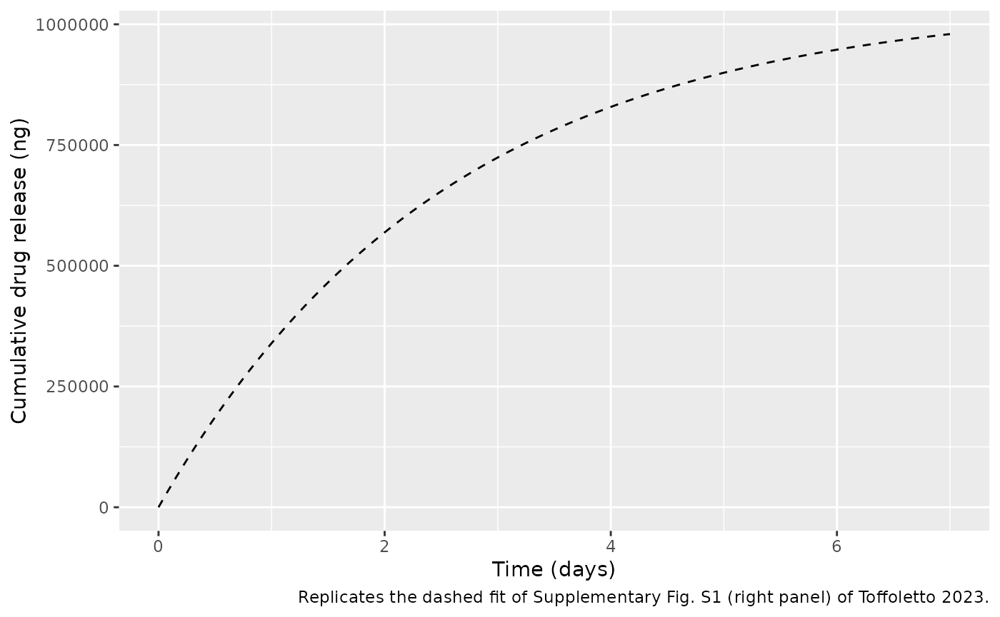
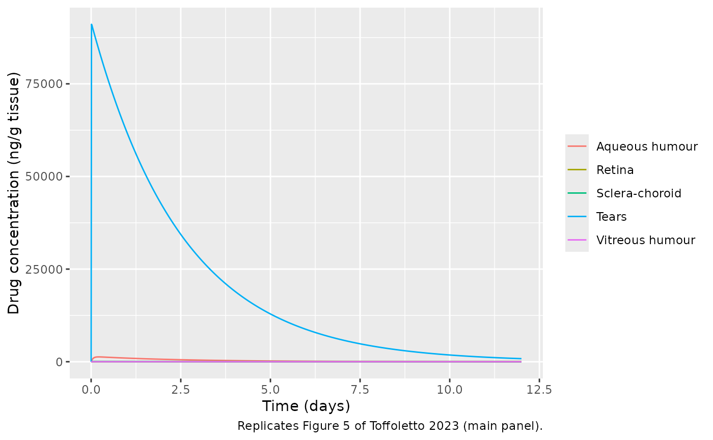
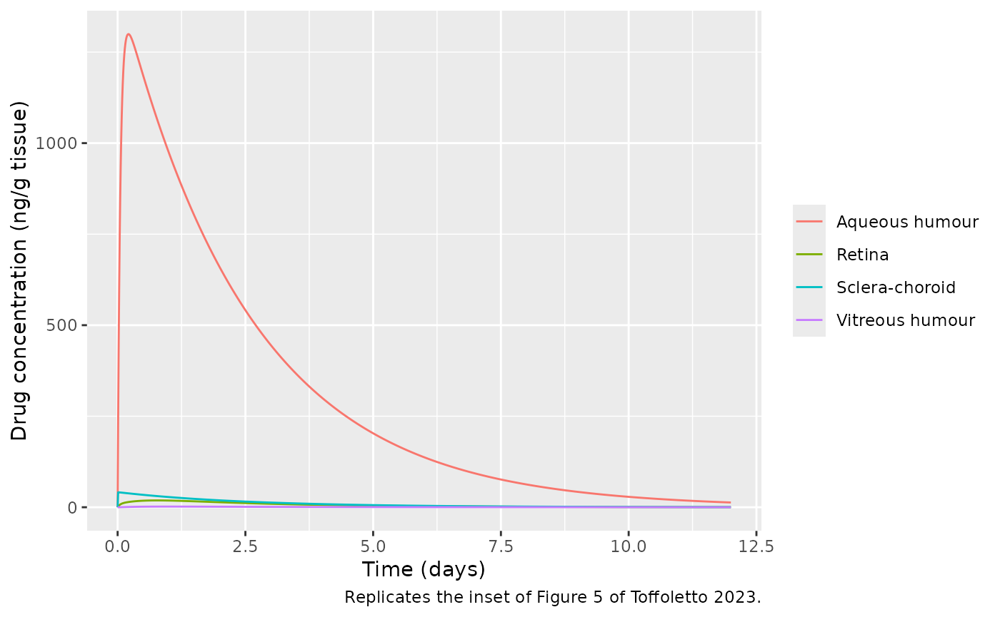
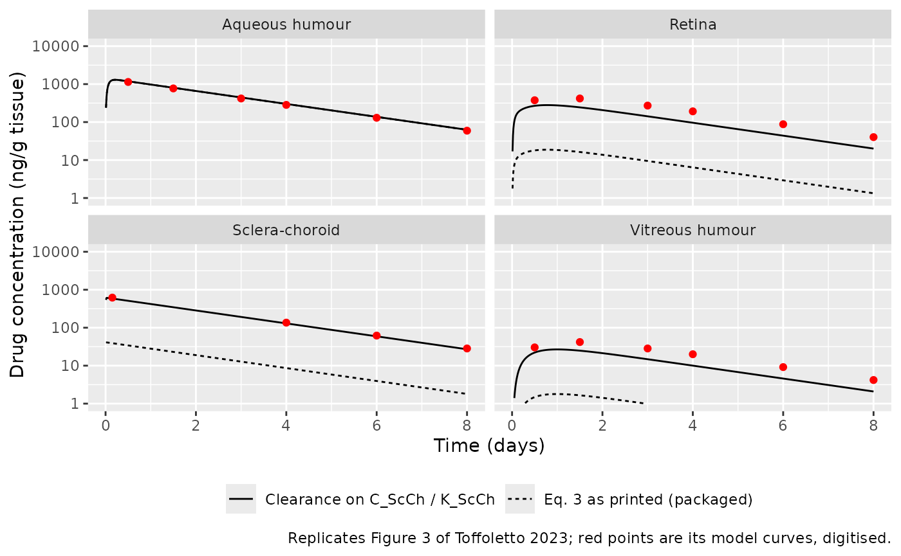

# Dexamethasone contact-lens ocular PK in the rabbit (Toffoletto 2023)

## Model and source

``` r

ui <- rxode2::rxode(readModelDb("Toffoletto_2023_dexamethasone_rabbit"))
```

- Citation: Toffoletto N, Saramago B, Serro AP, Chauhan A. A
  Physiology-Based Mathematical Model to Understand Drug Delivery from
  Contact Lenses to the Back of the Eye. Pharm Res.
  2023;40(8):1939-1951. <doi:10.1007/s11095-023-03560-7>. Validation
  data: Ross AE et al. Topical sustained drug delivery to the retina
  with a drug-eluting contact lens. Biomaterials. 2019;217:119285.
  <doi:10.1016/j.biomaterials.2019.119285>.
- Description: Preclinical (rabbit). Physiology-based ocular PK model of
  dexamethasone released from a drug-eluting soft contact lens (Ross
  2019 sandwich lens), with well-mixed tear film, lumped sclera-choroid,
  retina, vitreous humour and aqueous humour (plus stroma) compartments.
  Transport across each barrier is area x permeability x the difference
  of the partition-corrected concentrations; drug leaves by tear
  drainage, palpebral-conjunctival uptake, choroidal blood-flow
  clearance, uveoscleral outflow and aqueous-humour turnover. The lens
  is a first-order depot (Eqs. 12-13): a fraction F of the released drug
  crosses the cornea directly into the aqueous humour and the rest
  enters the tears (Eqs. 10-11). Deterministic (no IIV or residual
  error); every value is a literature or hand-tuned input, not a
  statistical estimate.
- Article: <https://doi.org/10.1007/s11095-023-03560-7> (open access;
  PMC10447275)
- Supplement: Electronic Supplementary Material 1 (Supplementary Figs.
  S1-S2, Supplementary Table S1), available from the article page.

Toffoletto et al. built a physiology-based ocular model to follow a drug
from a therapeutic soft contact lens into the tear film, the sclera and
choroid, the retina, the vitreous humour and the aqueous humour.
Transport across each barrier is the exposed area times the barrier
permeability times the difference of the partition-corrected
concentrations (Eqs. 2-6). The general form treats the lens as a
diffusion slab (Eq. 1, a partial differential equation in the lens
thickness). For the only time-course data available, the dexamethasone
sandwich lens of Ross et al. (2019), release is governed by polymer
degradation rather than diffusion, so the authors replaced the lens
equation by the measured in-vitro release,
`R = M_Released / T * exp(-t/T)` (Eqs. 12-13), of which a fraction `F`
crosses the cornea into the aqueous humour and the rest enters the tears
(Eqs. 10-11). That validated form is the one packaged here. The lens is
a `depot` dosed with the released amount `M_Released`; first-order
release from it with rate constant `ka = 1/T` reproduces Eq. 13 exactly.

## Population

The model was not fitted to animals. Its anatomy (Table II) and
physiology (Table IV) are literature values for the rabbit eye, and its
drug-specific inputs (Table III) are literature permeabilities and
partition coefficients for dexamethasone, two of them (`K_ScCh`,
`K_Ret`) adjusted by hand during the validation. It was compared against
the rabbit data of Ross et al. (2019), who measured dexamethasone in the
aqueous humour, choroid, sclera, retina and vitreous humour at 0.25, 1,
2, 5 and 7 days of wearing the lens (3-5 eyes per time point in Fig. 3
of Toffoletto 2023). The model describes one eye.

``` r

str(ui$population)
#> List of 6
#>  $ species      : chr "rabbit"
#>  $ n_subjects   : int NA
#>  $ n_studies    : int 1
#>  $ disease_state: chr "healthy"
#>  $ dose_range   : chr "One dexamethasone-eluting sandwich contact lens per eye, worn for 7 days; about 1.05 mg released in vitro over "| __truncated__
#>  $ notes        : chr "No animals were studied in Toffoletto 2023: the model is parameterised from rabbit physiology (Tables II and IV"| __truncated__
```

## Source trace

| Equation / parameter | Value | Source location |
|----|----|----|
| `d/dt(depot)`, release `ka * depot` | n/a | Eqs. 12-13 |
| `d/dt(tear)` | n/a | Eq. 10 |
| `d/dt(sclera_choroid)` | n/a | Eq. 3 |
| `d/dt(retina)` | n/a | Eq. 4 |
| `d/dt(vitreous)` | n/a | Eq. 5 |
| `d/dt(aqueous_humour)` | n/a | Eq. 11 |
| `lka` (`1/T`) | log(1/2.55 day) | Supplementary Fig. S1, right panel, exponential fit (digitised) |
| dose `M_Released` | 1047 ug | Supplementary Fig. S1, right panel, exponential fit (digitised) |
| `f_aqueous_humour` (`F`) | 0.0208 | Table III, 2.08 percent (Eq. 14) |
| `p_conj` | 2.5e-6 cm/s | Table III |
| `p_rpe` (`P_ScCh-Ret`) | 10e-6 cm/s | Table III |
| `p_ilm` (`P_Ret-Vit`) | 13e-6 cm/s | Table III |
| `kp_sclera_choroid` | 15 | Table III |
| `kp_retina` | 10 | Table III |
| `kp_vitreous`, `kp_tear` | 1 | Table IV |
| `q_uveoscleral` | 0.176 uL/min | Table IV |
| `q_vitreous_aqueous_humour` | 0.19 uL/min | Table IV |
| `q_aqueous_humour` | 4.2 uL/min | Table IV |
| `q_tear_drainage` | 0.5 uL/min | Table IV |
| `cl_sclera_choroid` | 1 mL/min | Table IV |
| `v_tear`, `v_vitreous`, `v_sclera_choroid`, `v_retina`, `v_aqueous_humour` | 0.007, 1.7, 0.361, 0.086, 0.325 mL | Table II |
| `a_globe`, `a_palpebral`, `a_bulbar` | 8.6, 14, 3 cm^2 | Table II |

### Digitised reference values

The paper prints neither the lens release constants nor any numerical
concentrations, so the maintainers digitised the figures. The release
curve of Supplementary Fig. S1 (the exponential fit of Eq. 12, drawn
dashed over the in-vitro data) gives `M_Released = 1.047e6 ng` and
`T = 2.55 days`. The model curves of Fig. 3 (log scale) and Fig. 5
(linear scale, the same simulation) give the values below; the tear
curve of Fig. 5 is a single exponential, `89,200 * exp(-t / 2.513 days)`
ng/mL.

``` r

fig3 <- tibble::tribble(
  ~tissue,            ~time, ~conc,
  "Aqueous humour",     0.5, 1140,
  "Aqueous humour",     1.5,  771,
  "Aqueous humour",     3.0,  419,
  "Aqueous humour",     4.0,  284,
  "Aqueous humour",     6.0,  130,
  "Aqueous humour",     8.0,   59.4,
  "Sclera-choroid",     0.15, 620,
  "Sclera-choroid",     4.0,  136,
  "Sclera-choroid",     6.0,   62.0,
  "Sclera-choroid",     8.0,   28.4,
  "Retina",             0.5,  376,
  "Retina",             1.5,  419,
  "Retina",             3.0,  272,
  "Retina",             4.0,  192,
  "Retina",             6.0,   87.8,
  "Retina",             8.0,   40.2,
  "Vitreous humour",    0.5,   30.3,
  "Vitreous humour",    1.5,   41.9,
  "Vitreous humour",    3.0,   28.4,
  "Vitreous humour",    4.0,   20.0,
  "Vitreous humour",    6.0,    9.17,
  "Vitreous humour",    8.0,    4.19
)
tear_fig5 <- function(t) 89200 * exp(-t / 2.513)
```

## Simulation

One eye wearing the lens; the dose is the total amount released in
vitro. Observation rows sit on the `tear` state; rxode2 returns every
concentration output on each row.

``` r

mod <- readModelDb("Toffoletto_2023_dexamethasone_rabbit")
m_released_ug <- 1047

times <- sort(unique(c(seq(0, 0.5, by = 0.01), seq(0.5, 12, by = 0.05), fig3$time)))
events <- rxode2::et(amt = m_released_ug, cmt = "depot") |>
  rxode2::et(time = times, cmt = "tear")

sim <- as.data.frame(rxode2::rxSolve(mod, events, rtol = 1e-10, atol = 1e-12))
if (is.null(sim$id)) sim$id <- 1L

tissue_cols <- c(
  Tears = "Ctear",
  "Aqueous humour" = "Caqueous_humour",
  "Sclera-choroid" = "Csclera_choroid",
  Retina = "Cretina",
  "Vitreous humour" = "Cvitreous"
)
sim_long <- sim |>
  dplyr::select(id, time, dplyr::all_of(unname(tissue_cols))) |>
  tidyr::pivot_longer(-c(id, time), names_to = "output", values_to = "Cc") |>
  dplyr::mutate(tissue = names(tissue_cols)[match(output, tissue_cols)])
```

### Lens release

The depot reproduces the release fit of Supplementary Fig. S1 by
construction: the cumulative amount released is
`M_Released * (1 - exp(-t/T))`.

``` r

rel <- sim |> dplyr::mutate(released_ng = 1000 * (m_released_ug - depot))
stopifnot(
  max(abs(rel$released_ng - 1.047e6 * (1 - exp(-rel$time / 2.55)))) < 1
)
ggplot(rel |> dplyr::filter(time <= 7), aes(time, released_ng)) +
  geom_line(linetype = "dashed") +
  labs(
    x = "Time (days)", y = "Cumulative drug release (ng)",
    caption = "Replicates the dashed fit of Supplementary Fig. S1 (right panel) of Toffoletto 2023."
  )
```



## Replicate published figures

### Figure 5: all tissues, linear scale

``` r

ggplot(sim_long, aes(time, Cc, colour = tissue)) +
  geom_line() +
  labs(
    x = "Time (days)", y = "Drug concentration (ng/g tissue)", colour = NULL,
    caption = "Replicates Figure 5 of Toffoletto 2023 (main panel)."
  )
```



``` r


ggplot(sim_long |> dplyr::filter(tissue != "Tears"), aes(time, Cc, colour = tissue)) +
  geom_line() +
  labs(
    x = "Time (days)", y = "Drug concentration (ng/g tissue)", colour = NULL,
    caption = "Replicates the inset of Figure 5 of Toffoletto 2023."
  )
```



### Figure 3: comparison with the published model curves

The packaged model (solid) against the model curves digitised from Fig.
3 (points). The tear film and the aqueous humour agree; the
sclera-choroid, retina and vitreous do not (see *Known discrepancy*
below). The dashed curves show the alternative reading of Eq. 3
described there.

``` r

# Alternative reading of Eq. 3: choroidal clearance acting on the
# partition-corrected concentration C_ScCh / K_ScCh, like every other
# outflow term of the sclera-choroid balance.
mod_alt <- rxode2::rxode(mod) |>
  rxode2::model(
    d/dt(sclera_choroid) <- q_uv * c_aq - q_uv * c_sc / kp_sclera_choroid +
      flux_bulbar - cl_sc * c_sc / kp_sclera_choroid - flux_rpe
  )
sim_alt <- as.data.frame(rxode2::rxSolve(mod_alt, events, rtol = 1e-10, atol = 1e-12))
if (is.null(sim_alt$id)) sim_alt$id <- 1L
sim_alt_long <- sim_alt |>
  dplyr::select(id, time, dplyr::all_of(unname(tissue_cols))) |>
  tidyr::pivot_longer(-c(id, time), names_to = "output", values_to = "Cc") |>
  dplyr::mutate(tissue = names(tissue_cols)[match(output, tissue_cols)])

fig3_tissues <- c("Aqueous humour", "Sclera-choroid", "Retina", "Vitreous humour")
ggplot(
  sim_long |> dplyr::filter(tissue %in% fig3_tissues, time >= 0.01, time <= 8),
  aes(time, Cc)
) +
  geom_line(aes(linetype = "Eq. 3 as printed (packaged)")) +
  geom_line(
    data = sim_alt_long |> dplyr::filter(tissue %in% fig3_tissues, time >= 0.01, time <= 8),
    aes(linetype = "Clearance on C_ScCh / K_ScCh")
  ) +
  geom_point(data = fig3, aes(time, conc), colour = "red") +
  facet_wrap(~tissue) +
  scale_y_log10(limits = c(1, 1e4)) +
  labs(
    x = "Time (days)", y = "Drug concentration (ng/g tissue)", linetype = NULL,
    caption = "Replicates Figure 3 of Toffoletto 2023; red points are its model curves, digitised."
  ) +
  theme(legend.position = "bottom")
#> Warning: Removed 129 rows containing missing values or values outside the scale range
#> (`geom_line()`).
#> Warning: Removed 4 rows containing missing values or values outside the scale range
#> (`geom_line()`).
```



### Quantitative checks

All checks below are deterministic (the model has no random effects), so
their bounds only need to cover the digitisation error of the figures (a
few percent).

``` r

at <- function(d, tis, t) {
  v <- d$Cc[d$tissue == tis & abs(d$time - t) < 1e-9]
  if (length(v) != 1L) stop("no unique simulated row for ", tis, " at ", t)
  v
}
cmp <- fig3 |>
  dplyr::rowwise() |>
  dplyr::mutate(
    printed = at(sim_long, tissue, time),
    alternative = at(sim_alt_long, tissue, time)
  ) |>
  dplyr::ungroup() |>
  dplyr::mutate(
    ratio_printed = printed / conc,
    ratio_alternative = alternative / conc
  )
cmp |>
  dplyr::rename(
    Tissue = tissue, "Time (day)" = time, "Fig. 3 (ng/g)" = conc,
    "Packaged model" = printed, "Alternative Eq. 3" = alternative,
    "Packaged / Fig. 3" = ratio_printed, "Alternative / Fig. 3" = ratio_alternative
  ) |>
  knitr::kable(digits = 2, caption = "Simulated concentrations against the digitised Fig. 3 model curves.")
```

| Tissue | Time (day) | Fig. 3 (ng/g) | Packaged model | Alternative Eq. 3 | Packaged / Fig. 3 | Alternative / Fig. 3 |
|:---|---:|---:|---:|---:|---:|---:|
| Aqueous humour | 0.50 | 1140.00 | 1185.57 | 1186.44 | 1.04 | 1.04 |
| Aqueous humour | 1.50 | 771.00 | 801.09 | 802.15 | 1.04 | 1.04 |
| Aqueous humour | 3.00 | 419.00 | 444.85 | 445.49 | 1.06 | 1.06 |
| Aqueous humour | 4.00 | 284.00 | 300.54 | 300.97 | 1.06 | 1.06 |
| Aqueous humour | 6.00 | 130.00 | 137.18 | 137.37 | 1.06 | 1.06 |
| Aqueous humour | 8.00 | 59.40 | 62.61 | 62.70 | 1.05 | 1.06 |
| Sclera-choroid | 0.15 | 620.00 | 39.08 | 585.27 | 0.06 | 0.94 |
| Sclera-choroid | 4.00 | 136.00 | 8.64 | 129.80 | 0.06 | 0.95 |
| Sclera-choroid | 6.00 | 62.00 | 3.94 | 59.24 | 0.06 | 0.96 |
| Sclera-choroid | 8.00 | 28.40 | 1.80 | 27.04 | 0.06 | 0.95 |
| Retina | 0.50 | 376.00 | 17.96 | 268.43 | 0.05 | 0.71 |
| Retina | 1.50 | 419.00 | 16.28 | 244.34 | 0.04 | 0.58 |
| Retina | 3.00 | 272.00 | 9.45 | 141.96 | 0.03 | 0.52 |
| Retina | 4.00 | 192.00 | 6.40 | 96.16 | 0.03 | 0.50 |
| Retina | 6.00 | 87.80 | 2.92 | 43.91 | 0.03 | 0.50 |
| Retina | 8.00 | 40.20 | 1.33 | 20.04 | 0.03 | 0.50 |
| Vitreous humour | 0.50 | 30.30 | 1.49 | 22.14 | 0.05 | 0.73 |
| Vitreous humour | 1.50 | 41.90 | 1.66 | 24.84 | 0.04 | 0.59 |
| Vitreous humour | 3.00 | 28.40 | 0.98 | 14.78 | 0.03 | 0.52 |
| Vitreous humour | 4.00 | 20.00 | 0.67 | 10.02 | 0.03 | 0.50 |
| Vitreous humour | 6.00 | 9.17 | 0.30 | 4.58 | 0.03 | 0.50 |
| Vitreous humour | 8.00 | 4.19 | 0.14 | 2.09 | 0.03 | 0.50 |

Simulated concentrations against the digitised Fig. 3 model curves.
{.table}

``` r


tear_ratio <- sapply(c(1, 4, 8), function(t) at(sim_long, "Tears", t) / tear_fig5(t))
tear_ratio
#> [1] 1.032837 1.050883 1.075436

stopifnot(
  # Tears: the release constants and the tear outflows (Q_Drain, P_Conj x
  # A_Palp, P_Conj x A_Bulb) set this level. Measured 1.03, 1.05, 1.08 at
  # days 1, 4, 8: the Fig. 5 curve decays with T = 2.51 days against the
  # 2.55 days of Supplementary Fig. S1, so the ratio drifts up with time.
  all(abs(tear_ratio - 1) < 0.10),
  # Aqueous humour: F, Q_Aq and the release; measured 1.04-1.06.
  all(abs(cmp$ratio_printed[cmp$tissue == "Aqueous humour"] - 1) < 0.15)
)
```

## PKNCA validation

PKNCA on each output, grouped by tissue. The paper reports no NCA table;
the reference values are the peaks digitised from Fig. 5 and, for the
aqueous humour, the area under the exponential fit of Supplementary Fig.
S1 (`1636.7 * exp(-5e-6 t)`, t in seconds), which the authors used in
Eq. 14 to derive `F`: 1636.7 / 5e-6 ng s/mL = 3789 ng day/mL.

``` r

conc_nca <- sim_long |>
  dplyr::filter(!is.na(Cc)) |>
  dplyr::mutate(Cc = pmax(Cc, 0)) |>
  dplyr::select(id, time, Cc, tissue)
stopifnot(all(conc_nca$time[!duplicated(conc_nca[, c("id", "tissue")])] == 0))

dose_nca <- conc_nca |>
  dplyr::distinct(id, tissue) |>
  dplyr::mutate(time = 0, amt = m_released_ug)

conc_obj <- PKNCA::PKNCAconc(conc_nca, Cc ~ time | tissue + id)
dose_obj <- PKNCA::PKNCAdose(dose_nca, amt ~ time | tissue + id)
intervals <- data.frame(
  start = 0, end = Inf,
  cmax = TRUE, tmax = TRUE, aucinf.obs = TRUE, half.life = TRUE
)
nca_res <- PKNCA::pk.nca(PKNCA::PKNCAdata(conc_obj, dose_obj, intervals = intervals))

reference <- tibble::tribble(
  ~tissue,            ~PPTESTCD,    ~PPORRES,
  "Tears",            "cmax",       89200,
  "Tears",            "half.life",  2.513 * log(2),
  "Aqueous humour",   "cmax",       1234,
  "Aqueous humour",   "tmax",       0.22,
  "Aqueous humour",   "aucinf.obs", 1636.7 / 5e-6 / 86400,
  "Sclera-choroid",   "cmax",       611,
  "Retina",           "cmax",       447,
  "Retina",           "tmax",       1.02,
  "Vitreous humour",  "cmax",       42,
  "Vitreous humour",  "tmax",       1.18
)

nca_cmp <- nlmixr2lib::ncaComparisonTable(
  simulated = nca_res,
  reference = reference,
  by = "tissue",
  units = c(cmax = "ng/mL", tmax = "day", aucinf.obs = "ng*day/mL", half.life = "day"),
  tolerance_pct = 20
)
knitr::kable(
  nca_cmp,
  caption = paste(
    "Simulated vs. digitised published values (Fig. 5 peaks; Supplementary",
    "Fig. S1 aqueous AUC). * differs by more than 20 percent."
  )
)
```

| NCA parameter             | tissue          | Reference | Simulated | % diff   |
|:--------------------------|:----------------|:----------|:----------|:---------|
| Cmax (ng/mL)              | Tears           | 89200     | 91100     | +2.1%    |
| Cmax (ng/mL)              | Aqueous humour  | 1230      | 1300      | +5.3%    |
| Cmax (ng/mL)              | Sclera-choroid  | 611       | 41        | -93.3%\* |
| Cmax (ng/mL)              | Retina          | 447       | 18.7      | -95.8%\* |
| Cmax (ng/mL)              | Vitreous humour | 42        | 1.79      | -95.7%\* |
| Tmax (day)                | Aqueous humour  | 0.22      | 0.21      | -4.5%    |
| Tmax (day)                | Retina          | 1.02      | 0.75      | -26.5%\* |
| Tmax (day)                | Vitreous humour | 1.18      | 1         | -15.3%   |
| AUC0-∞ (obs) (ng\*day/mL) | Aqueous humour  | 3790      | 3600      | -5.0%    |
| t½ (day)                  | Tears           | 1.74      | 1.77      | +1.5%    |

Simulated vs. digitised published values (Fig. 5 peaks; Supplementary
Fig. S1 aqueous AUC). \* differs by more than 20 percent. {.table
style="width:100%;"}

The tear film and aqueous humour agree within a few percent, including
the aqueous-humour AUC that the authors used to derive `F`
(`F = Q_Aq x AUC / M_Released`): the simulated AUC is about 5 percent
below the Supplementary Fig. S1 value, consistent with the
one-significant-figure rate constant (`5E-06`) printed on that fit. The
sclera-choroid, retina and vitreous peaks are starred; see below.

## Known discrepancy: sclera-choroid, retina and vitreous

Eq. 3 removes drug from the sclera-choroid by choroidal blood flow as
`Clearance_ScCh x C_ScCh`, with `Clearance_ScCh = 1 mL/min` (Table IV).
Solved as printed, the sclera-choroid concentration is about 16 times
below the paper’s own Fig. 3 and Fig. 5 curves, and the retina and
vitreous (fed from the sclera-choroid) are 20-35 times below. Every
other outflow of the sclera-choroid balance acts on the
partition-corrected concentration `C_ScCh / K_ScCh`; applying the
choroidal clearance to that concentration as well (equivalently, a
clearance of 1/15 mL/min on `C_ScCh`) reproduces the published
sclera-choroid curve within about 6 percent, but still leaves the retina
and vitreous at 0.5-0.7 times the published curves. No single reading of
the printed equations and tables reproduces all five published curves,
so the package keeps Eq. 3 and Table IV exactly as printed; the
alternative reading is shown above for comparison. The checks below pin
both behaviours so that any later change to the model has to revisit
this section.

``` r

r <- function(col, tis) cmp[[col]][cmp$tissue == tis]
stopifnot(
  # As printed: sclera-choroid ratios measured 0.06; retina 0.03-0.05;
  # vitreous 0.03-0.05.
  all(r("ratio_printed", "Sclera-choroid") < 0.2),
  all(r("ratio_printed", "Retina") < 0.2),
  all(r("ratio_printed", "Vitreous humour") < 0.2),
  # Alternative reading: sclera-choroid measured 0.94-0.96; retina and
  # vitreous measured 0.50-0.73.
  all(abs(r("ratio_alternative", "Sclera-choroid") - 1) < 0.2),
  all(r("ratio_alternative", "Retina") < 0.85),
  all(r("ratio_alternative", "Vitreous humour") < 0.85)
)
```

## Other drugs (Supplementary Table S1)

The authors also compared the model with single-study data for
melatonin, dexamethasone (Bengani 2020 lens), latanoprost, ofloxacin and
pravastatin (Fig. 4), changing only the drug- and lens-specific inputs
of Supplementary Table S1. The release constants of those lenses
(`M_Released`, `T`, or the diffusion-lens inputs `D_SCL`, `H`, `K_SCL`)
are not reported, so those scenarios cannot be reproduced here; the drug
inputs can be swapped into the packaged model with
[`rxode2::ini()`](https://nlmixr2.github.io/rxode2/reference/ini.html)
once a release profile is available.

``` r

table_s1 <- tibble::tribble(
  ~drug,                          ~p_conj, ~p_rpe, ~p_ilm, ~kp_sclera_choroid, ~kp_retina, ~f_aqueous_humour,
  "Dexamethasone (Bengani 2020)", 2.5e-6,  10e-6,  13e-6,  15,                 10,         0.0349,
  "Melatonin",                    2.5e-6,  10e-6,  13e-6,  15,                 10,         0.0293,
  "Latanoprost",                  3.0e-6,  10e-6,  13e-6,  17,                 11,         0.0208,
  "Ofloxacin",                    2.5e-7,   5e-6,   7e-6,   7,                  5,         0.0707,
  "Pravastatin",                  2.5e-7,   3e-6,   4e-6,   3,                  3,         0.0787
)
table_s1 |>
  dplyr::mutate(dplyr::across(c(p_conj, p_rpe, p_ilm), function(x) formatC(x, format = "e", digits = 1))) |>
  knitr::kable(caption = "Supplementary Table S1 drug-specific inputs (permeabilities in cm/s).")
```

| drug | p_conj | p_rpe | p_ilm | kp_sclera_choroid | kp_retina | f_aqueous_humour |
|:---|:---|:---|:---|---:|---:|---:|
| Dexamethasone (Bengani 2020) | 2.5e-06 | 1.0e-05 | 1.3e-05 | 15 | 10 | 0.0349 |
| Melatonin | 2.5e-06 | 1.0e-05 | 1.3e-05 | 15 | 10 | 0.0293 |
| Latanoprost | 3.0e-06 | 1.0e-05 | 1.3e-05 | 17 | 11 | 0.0208 |
| Ofloxacin | 2.5e-07 | 5.0e-06 | 7.0e-06 | 7 | 5 | 0.0707 |
| Pravastatin | 2.5e-07 | 3.0e-06 | 4.0e-06 | 3 | 3 | 0.0787 |

Supplementary Table S1 drug-specific inputs (permeabilities in cm/s).
{.table style="width:100%;"}

``` r


# Example: the ofloxacin inputs, ready for a user-supplied release profile.
mod_oflox <- rxode2::rxode(mod) |>
  rxode2::ini(
    p_conj = 2.5e-7, p_rpe = 5e-6, p_ilm = 7e-6,
    kp_sclera_choroid = 7, kp_retina = 5, f_aqueous_humour = 0.0707
  )
#> ℹ change initial estimate of `p_conj` to `2.5e-07`
#> ℹ change initial estimate of `p_rpe` to `5e-06`
#> ℹ change initial estimate of `p_ilm` to `7e-06`
#> ℹ change initial estimate of `kp_sclera_choroid` to `7`
#> ℹ change initial estimate of `kp_retina` to `5`
#> ℹ change initial estimate of `f_aqueous_humour` to `0.0707`
stopifnot(isTRUE(all.equal(unname(mod_oflox$theta["kp_retina"]), 5)))
```

## Assumptions and deviations

- **Release constants digitised.** `M_Released` and `T` are not printed.
  The maintainers digitised the dashed exponential fit of Supplementary
  Fig. S1 (right panel) and fitted Eq. 12 to the digitised curve:
  `M_Released = 1.047e6 ng`, `T = 2.55 days`. Two independent checks
  agree: the tear curve of Fig. 5 decays with a time constant of 2.51
  days, and the tear and aqueous-humour levels it implies are within 2-8
  percent of the simulation. Using the 7-day in-vitro total of about
  1.1e6 ng instead reproduces the printed `F = 2.08` percent more
  closely through Eq. 14, so the released amount is uncertain by about 5
  percent.
- **`F` for the Ross 2019 lens.** Table III gives `F = 2.08` percent for
  this data set, while Supplementary Table S1 gives 3.49 percent for the
  Bengani 2020 dexamethasone lens and 2.08 percent for latanoprost. The
  Table III value is used here; the Bengani value belongs to a different
  lens.
- **Sclera-choroid clearance kept as printed.** See *Known discrepancy*.
  The printed Eq. 3 and Table IV value under-predict the published
  sclera-choroid, retina and vitreous curves; the alternative reading is
  shown but not packaged.
- **Corneal epithelium not included.** Eq. 7 needs the partition
  coefficients `K_Ep/Aq` and `K_Ep/t`, which the paper does not report;
  the corneal-epithelium concentration is therefore not an output.
- **Diffusion-lens form not included.** Eqs. 1, 2, 6, 8 and 9 describe
  diffusion through the lens thickness (a partial differential
  equation). The paper gives no lens diffusivity, thickness or lens
  partition coefficient, and its validation uses the release-rate form
  instead.
- **`K_Aq` not used.** Table IV lists `K_Aq = 1`, but it appears in none
  of the validated equations (Eqs. 3-5, 10, 11), so the model does not
  carry it.
- **Concentration units.** Outputs are ng/mL; the paper reports ng/g
  tissue, which is the same number at unit tissue density.
- **No variability.** The model is deterministic; the paper’s
  uncertainty analysis (all inputs varied by +/-10 percent,
  Supplementary Fig. S2) is a sensitivity exercise, not an estimate of
  between-animal variability.
- A search for errata or corrections to Toffoletto 2023 found none as of
  2026-10-27.
