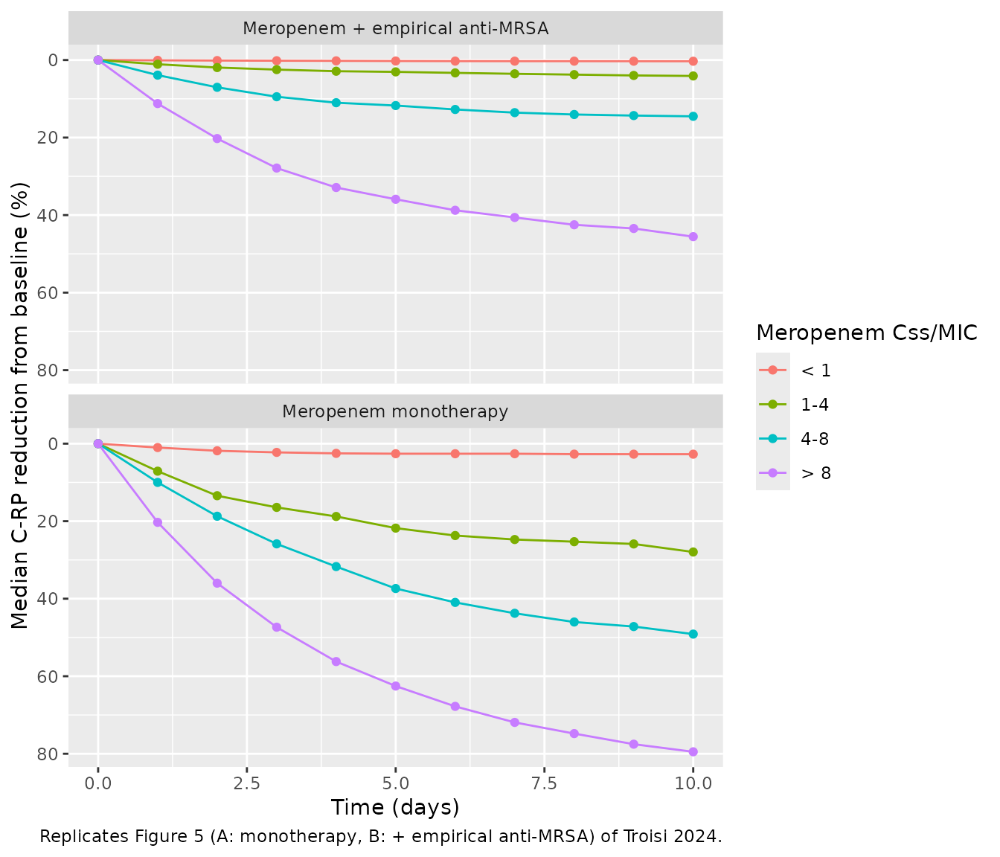

# Meropenem and C-reactive protein (Troisi 2024)

## Model and source

- Citation: Troisi C, Cojutti PG, Rinaldi M, Tonetti T, Siniscalchi A,
  van Hasselt C, Viale P, Pea F. Impact of Continuous Infusion Meropenem
  PK/PD Target Attainment on C-Reactive Protein Dynamics in Critically
  Ill Patients With Documented Gram-Negative Hospital-Acquired or
  Ventilator-Associated Pneumonia. Clin Pharmacokinet.
  2024;63(11):1573-1583. <doi:10.1007/s40262-024-01436-6>
- Description: Sequential population PK/PD model of continuous-infusion
  meropenem and plasma C-reactive protein (C-RP) in critically ill
  adults with documented Gram-negative hospital-acquired or
  ventilator-associated pneumonia. One-compartment intravenous PK with
  the volume fixed at 20 L and clearance rising exponentially
  (uncentered) with CKD-EPI eGFR. Meropenem concentration inhibits C-RP
  production in an indirect-response (turnover) model with FULL
  inhibition (Imax = 1); the C-RP baseline R0 is estimated and kin = R0
  \* kout. The IC50 rises exponentially (uncentered) with the meropenem
  MIC of the subject’s isolate and with empirical anti-MRSA co-therapy.
- Article (open access): <https://doi.org/10.1007/s40262-024-01436-6>

Troisi 2024 fitted continuous-infusion (CI) meropenem plasma
concentrations and C-reactive protein (C-RP) concentrations in a
two-step **sequential** analysis in Monolix: a one-compartment PK model
was estimated first, and its parameters were then held fixed while an
indirect-response (turnover) model with full inhibition of C-RP
production was fitted. The published final model is one coupled PK/PD
system, so it is packaged as a single `.R` file with both outputs.

Three features of the encoding are worth flagging before the numbers:

1.  Both covariate relationships are **uncentered exponentials**.
    `CL = 2.72 x e^(0.011 x eGFR)` (Results), so `exp(lcl) = 2.72 L/h`
    is the clearance extrapolated to eGFR = 0; and
    `IC50 = 0.79 x e^(0.44 x MIC) x e^(2.46 x DRUG)`, so
    `exp(lic50) = 0.79 mg/L` is the IC50 at MIC = 0 without anti-MRSA
    co-therapy.
2.  Unlike the same group’s dalbavancin model
    (`Cojutti_2024_dalbavancin`), the C-RP baseline is **estimated**
    (`C-RP0 = 22.58 mg/dL`, Table 3) and is not supplied as data.
3.  The volume is **fixed** at 20 L from the group’s earlier meropenem
    model (`Cojutti_2021_meropenem`), because a continuous infusion
    carries no information on V.

## Population

Sixty-four critically ill adults with documented Gram-negative
hospital-acquired (HAP) or ventilator-associated pneumonia (VAP),
treated with CI meropenem under real-time therapeutic drug monitoring at
a single Italian centre between December 2020 and August 2023 (Patients
and Methods). Median (IQR) age 65.5 (57.0-74.0) years, weight 75.0
(65.0-85.0) kg, 28/64 (43.75%) female, CKD-EPI eGFR 70.0 (39.0-100.0)
mL/min/1.73 m^2; median daily dose 2 g (1.5-4) and median meropenem Css
15.9 (9.8-27.6) mg/L (Table 1). The PK model used all 64 patients (211
concentrations). The PD model used only the 47 patients on meropenem
monotherapy (Fig. 2 Group A, n = 24) or meropenem plus an empirical
anti-MRSA agent (Group B, n = 23), providing 328 C-RP concentrations;
median observed baseline C-RP was 15.7 (9.2-26.1) mg/dL. Isolates in the
PD cohort were mostly *Pseudomonas aeruginosa* (13), *Klebsiella
pneumoniae* (13) and *Acinetobacter baumannii* (7), with a median
meropenem MIC of 0.25 mg/L (IQR 0.12-4.00, range 0.12-64; Table 2).

The same information is available programmatically via
`rxode2::rxode(readModelDb("Troisi_2024_meropenem"))$population`.

## Source trace

The per-parameter origin is recorded as an in-file comment next to each
`ini()` entry in `inst/modeldb/specificDrugs/Troisi_2024_meropenem.R`.
The table below collects them in one place.

| Equation / parameter | Value | Source location |
|----|----|----|
| `lcl` (CL intercept at eGFR = 0) | 2.72 L/h | Table 3, ‘CLMER’; Results equation `CL (L/h) = 2.72 x e^(0.011 x eGFR)` |
| `e_crcl_cl` | 0.011 per mL/min/1.73 m^2 | Table 3, ‘CLCR on CLMER’; same Results equation; ESM covariate equation 1 |
| `lvc` | 20 L (fixed) | Table 3, ‘V (L) 20 (fixed)’; Methods (‘V was fixed at 20 L, based on a previous model \[16\]’) |
| `lrbase` (C-RP0) | 22.58 mg/dL | Table 3 |
| `lic50` | 0.79 mg/L | Table 3; Results IC50 equation |
| `lkout` | 0.012 1/h | Table 3 |
| `e_mic_ic50` | 0.44 per mg/L | Table 3, ‘MIC on IC50’; ESM covariate equation 2 |
| `e_conmed_antimrsa_ic50` | 2.46 | Table 3, ‘Group on IC50’; ESM covariate equation 2 (`DRUG`) |
| `etalcl`, `etalrbase`, `etalic50`, `etalkout` | SD 0.59, 0.51, 1.59, 1.08 (squared into variances) | Table 3; footnote ‘omega standard deviation of inter-individual variability’ |
| `propSd`, `propSd_crp` | 0.37, 0.35 | Table 3, ‘Proportional error’ (PK and PD); footnote `observation = prediction x (1 + proportional error)` |
| One-compartment IV model, first-order elimination | n/a | Methods; ESM (‘central compartment (volume V) and a linear elimination’) |
| `d/dt(crp) <- kin * (1 - Cc / (Cc + ic50)) - kout * crp` | n/a | Methods equation; ESM `ddt_R = kin * (1 - Cc/(Cc+IC50)) - kout * R` |
| `kin <- rbase * kout`, `crp(0) <- rbase` | n/a | Methods (`kin = CRP0 x kout`); ESM (`R_0 = R0`, `kin = R0 * kout`) |

## Typical-value checks against the paper’s own numbers

The Discussion quotes the model’s clearance at two eGFR values. These
are a closed-form identity of the transcribed `lcl` and `e_crcl_cl`.

``` r

mod <- readModelDb("Troisi_2024_meropenem")
ui <- rxode2::rxode(mod)
#> ℹ parameter labels from comments will be replaced by 'label()'
th <- ui$theta

cl_check <- tibble(
  eGFR = c(49, 91.5),
  `CL paper (L/h)` = c(4.66, 7.44),
  `CL model (L/h)` = exp(th[["lcl"]]) * exp(th[["e_crcl_cl"]] * eGFR)
) |>
  mutate(`Difference (%)` = 100 * (`CL model (L/h)` / `CL paper (L/h)` - 1))
knitr::kable(cl_check, digits = 2,
             caption = "Typical clearance versus the Discussion of Troisi 2024.")
```

| eGFR | CL paper (L/h) | CL model (L/h) | Difference (%) |
|-----:|---------------:|---------------:|---------------:|
| 49.0 |           4.66 |           4.66 |           0.06 |
| 91.5 |           7.44 |           7.44 |           0.03 |

Typical clearance versus the Discussion of Troisi 2024. {.table}

``` r

# Both values are printed to 2 decimals; a transcription slip in either
# coefficient moves CL by far more than rounding.
stopifnot(all(abs(cl_check$`Difference (%)`) < 0.5))
```

At steady state of a constant-rate infusion the typical model must give
`Css = rate / CL`, and with a constant concentration the C-RP state
approaches `R0 * (1 - Css / (Css + IC50))`. Both are checked against a
typical-value solve (no random effects) for a 2 g/day infusion at eGFR
70 and MIC 0.25 mg/L.

``` r

mod_typ <- rxode2::zeroRe(mod)
#> ℹ parameter labels from comments will be replaced by 'label()'
rate_typ <- 2000 / 24
ev_typ <- rxode2::et(amt = 2000 * 30, rate = rate_typ, cmt = "central") |>
  rxode2::et(seq(0, 30 * 24, by = 24), cmt = "crp")
typ_cov <- data.frame(CRCL = 70, MIC = 0.25, CONMED_ANTIMRSA = c(0, 1))
sim_typ <- lapply(seq_len(nrow(typ_cov)), function(i) {
  s <- rxode2::rxSolve(mod_typ, ev_typ, params = typ_cov[i, ], returnType = "data.frame")
  s$CONMED_ANTIMRSA <- typ_cov$CONMED_ANTIMRSA[i]
  s
}) |> bind_rows()
#> ℹ omega/sigma items treated as zero: 'etalcl', 'etalrbase', 'etalic50', 'etalkout'
#> ℹ omega/sigma items treated as zero: 'etalcl', 'etalrbase', 'etalic50', 'etalkout'

cl_typ <- exp(th[["lcl"]] + th[["e_crcl_cl"]] * 70)
css_typ <- rate_typ / cl_typ
ic50_typ <- exp(th[["lic50"]] + th[["e_mic_ic50"]] * 0.25 +
                  th[["e_conmed_antimrsa_ic50"]] * typ_cov$CONMED_ANTIMRSA)
crp_ss <- exp(th[["lrbase"]]) * (1 - css_typ / (css_typ + ic50_typ))
end_typ <- sim_typ |> filter(time == max(time))

ss_tab <- tibble(
  `Anti-MRSA co-therapy` = typ_cov$CONMED_ANTIMRSA,
  `Css closed form (mg/L)` = css_typ,
  `Css solved, day 30 (mg/L)` = end_typ$Cc,
  `C-RP closed form (mg/dL)` = crp_ss,
  `C-RP solved, day 30 (mg/dL)` = end_typ$crp
)
knitr::kable(ss_tab, digits = 3,
             caption = "Typical steady state: solver versus closed form (2 g/day, eGFR 70, MIC 0.25 mg/L).")
```

| Anti-MRSA co-therapy | Css closed form (mg/L) | Css solved, day 30 (mg/L) | C-RP closed form (mg/dL) | C-RP solved, day 30 (mg/dL) |
|---:|---:|---:|---:|---:|
| 0 | 14.185 | 14.185 | 1.322 | 1.325 |
| 1 | 14.185 | 14.185 | 9.510 | 9.513 |

Typical steady state: solver versus closed form (2 g/day, eGFR 70, MIC
0.25 mg/L). {.table}

``` r

# Same parameters on both sides, so only numerical error separates them; the
# C-RP state is still 0.018% short of equilibrium at day 30 (exp(-0.012 * 720)).
stopifnot(all(abs(end_typ$Cc / css_typ - 1) < 1e-3))
stopifnot(all(abs(end_typ$crp / crp_ss - 1) < 1e-2))
```

The typical 2 g/day Css of 14.2 mg/L at the cohort median eGFR of 70
mL/min/1.73 m^2 sits close to the observed Table 1 median Css of 15.9
mg/L (the observed figure pools every dose and renal function).

## Virtual cohort

Original observed data are not publicly available. The cohort follows
the Monte Carlo design of Troisi 2024 Methods: five CI meropenem dosages
(125 mg q8h, 500 mg q8h, 500 mg q6h, 1000 mg q6h and 1500 mg q6h,
i.e. 375, 1500, 2000, 4000 and 6000 mg/day) crossed with five
renal-function classes (eGFR 0-30, 31-60, 61-90, 91-120 and 121-150
mL/min/1.73 m^2), simulated separately for monotherapy and for empirical
anti-MRSA co-therapy. Each dosage x co-therapy arm holds 200 virtual
patients (40 per renal class, eGFR drawn uniformly within the class, the
lowest class bounded below at 5).

The paper does not state how isolate MICs were assigned in its
simulations. Here each virtual patient draws an MIC from the two-fold
dilutions 0.125-16 mg/L with weights chosen to match the Table 2 summary
of the PD cohort (median 0.25 mg/L, IQR 0.12-4); 0.125 mg/L stands in
for the 0.12 mg/L lowest dilution.

``` r

# set.seed() seeds R's RNG for the covariate draws below. rxode2's own
# simulation RNG (the random effects) is seeded with rxSetSeed() but is
# partitioned per solver thread, so the etas differ between machines; every
# assertion below is written to hold for any cohort the model can produce.
set.seed(20241025)
rxode2::rxSetSeed(20241025)

n_per_arm <- 200L # cap is 200 participants per arm
dosages <- tibble(
  regimen = c("125 mg q8h", "500 mg q8h", "500 mg q6h", "1000 mg q6h", "1500 mg q6h"),
  daily_mg = c(375, 1500, 2000, 4000, 6000)
)
egfr_classes <- tibble(lo = c(5, 31, 61, 91, 121), hi = c(30, 60, 90, 120, 150))
mic_grid <- c(0.125, 0.25, 0.5, 1, 2, 4, 8, 16)
# Weights reproduce Table 2: P(MIC <= 0.125) = 0.40 > 0.25 (lower quartile
# 0.12), P(MIC <= 0.25) = 0.52 (median 0.25), P(MIC <= 2) = 0.74 and
# P(MIC <= 4) = 0.83 (upper quartile 4).
mic_wt <- c(0.40, 0.12, 0.07, 0.07, 0.08, 0.09, 0.09, 0.08)
stopifnot(abs(sum(mic_wt) - 1) < 1e-12)

cohort <- tidyr::crossing(dosages, CONMED_ANTIMRSA = c(0L, 1L)) |>
  mutate(arm = row_number()) |>
  tidyr::uncount(n_per_arm) |>
  mutate(
    id = row_number(),
    egfr_class = rep(seq_len(nrow(egfr_classes)), length.out = n()),
    CRCL = runif(n(), egfr_classes$lo[egfr_class], egfr_classes$hi[egfr_class]),
    MIC = sample(mic_grid, n(), replace = TRUE, prob = mic_wt)
  )
stopifnot(all(count(cohort, arm)$n == n_per_arm))

sim_days <- 10
obs_times <- sort(unique(c(seq(0, sim_days * 24, by = 24), seq(9 * 24, 10 * 24, by = 1))))
dose_rows <- cohort |>
  transmute(id, time = 0, evid = 1L, cmt = "central",
            amt = daily_mg * sim_days, rate = daily_mg / 24)
# Observation rows sit on the `crp` state: with two endpoints (Cc and crp)
# rxode2 rejects observations on `central`, and every row still returns Cc.
obs_rows <- tidyr::crossing(id = cohort$id, time = obs_times) |>
  mutate(evid = 0L, cmt = "crp", amt = 0, rate = 0)
events <- bind_rows(dose_rows, obs_rows) |>
  left_join(select(cohort, id, CRCL, MIC, CONMED_ANTIMRSA), by = "id") |>
  arrange(id, time, desc(evid))
```

## Simulation

The C-RP trajectories are the model-predicted individual states (random
effects on, residual error off), as in the paper’s Monte Carlo
summaries.

``` r

sim <- rxode2::rxSolve(mod, events, returnType = "data.frame",
                       keep = c("CRCL", "MIC", "CONMED_ANTIMRSA"))
#> ℹ parameter labels from comments will be replaced by 'label()'
stopifnot("id" %in% names(sim))

# Individual Css: concentration at the end of the 10-day infusion (the
# meropenem half-life is at most a few hours, so this is steady state).
css_ind <- sim |>
  filter(time == sim_days * 24) |>
  transmute(id, Css = Cc, crp_end = crp)
crp0_ind <- sim |> filter(time == 0) |> transmute(id, crp0 = crp)

target_levels <- c("< 1", "1-4", "4-8", "> 8")
crp_red <- sim |>
  filter(time %% 24 == 0) |>
  left_join(css_ind, by = "id") |>
  left_join(crp0_ind, by = "id") |>
  mutate(
    day = time / 24,
    css_mic = Css / MIC,
    target = cut(css_mic, c(-Inf, 1, 4, 8, Inf), labels = target_levels, right = FALSE),
    group = ifelse(CONMED_ANTIMRSA == 1, "Meropenem + empirical anti-MRSA", "Meropenem monotherapy"),
    pct_red = 100 * (1 - crp / crp0)
  )

crp_med <- crp_red |>
  group_by(group, target, day) |>
  summarise(median_red = median(pct_red), n = n(), .groups = "drop")
knitr::kable(
  crp_red |> filter(day == 0) |> count(group, target, name = "Virtual patients"),
  caption = "Virtual patients per Css/MIC class."
)
```

| group                           | target | Virtual patients |
|:--------------------------------|:-------|-----------------:|
| Meropenem + empirical anti-MRSA | \< 1   |               98 |
| Meropenem + empirical anti-MRSA | 1-4    |              137 |
| Meropenem + empirical anti-MRSA | 4-8    |               93 |
| Meropenem + empirical anti-MRSA | \> 8   |              672 |
| Meropenem monotherapy           | \< 1   |              105 |
| Meropenem monotherapy           | 1-4    |              138 |
| Meropenem monotherapy           | 4-8    |               96 |
| Meropenem monotherapy           | \> 8   |              661 |

Virtual patients per Css/MIC class. {.table}

### Replicates Figure 5 of Troisi 2024

``` r

ggplot(crp_med, aes(day, median_red, colour = target)) +
  geom_line() +
  geom_point() +
  facet_wrap(~group, ncol = 1) +
  scale_y_reverse() +
  labs(x = "Time (days)", y = "Median C-RP reduction from baseline (%)",
       colour = "Meropenem Css/MIC",
       caption = "Replicates Figure 5 (A: monotherapy, B: + empirical anti-MRSA) of Troisi 2024.")
```



### Comparison with the reported medians

``` r

paper_red <- tribble(
  ~group,                             ~target, ~day, ~paper,
  "Meropenem monotherapy",            "4-8",   2,    40,
  "Meropenem monotherapy",            "4-8",   4,    55,
  "Meropenem monotherapy",            "4-8",   10,   75,
  "Meropenem monotherapy",            "> 8",   10,   80,
  "Meropenem monotherapy",            "1-4",   2,    25,
  "Meropenem monotherapy",            "1-4",   4,    35,
  "Meropenem monotherapy",            "1-4",   10,   50,
  "Meropenem monotherapy",            "< 1",   4,    5,
  "Meropenem + empirical anti-MRSA",  "> 8",   10,   40,
  "Meropenem + empirical anti-MRSA",  "4-8",   10,   35,
  "Meropenem + empirical anti-MRSA",  "1-4",   10,   17,
  "Meropenem + empirical anti-MRSA",  "< 1",   10,   2
)
cmp_red <- paper_red |>
  left_join(mutate(crp_med, target = as.character(target)), by = c("group", "target", "day")) |>
  mutate(diff = median_red - paper)
cmp_red |>
  rename(Group = group, `Css/MIC` = target, Day = day,
         `Paper median reduction (%)` = paper,
         `Simulated median reduction (%)` = median_red,
         `Virtual patients` = n,
         `Difference (points)` = diff) |>
  knitr::kable(digits = 1,
               caption = "Median C-RP reduction from baseline: Troisi 2024 Results text versus this simulation.")
```

| Group | Css/MIC | Day | Paper median reduction (%) | Simulated median reduction (%) | Virtual patients | Difference (points) |
|:---|:---|---:|---:|---:|---:|---:|
| Meropenem monotherapy | 4-8 | 2 | 40 | 18.7 | 96 | -21.3 |
| Meropenem monotherapy | 4-8 | 4 | 55 | 31.7 | 96 | -23.3 |
| Meropenem monotherapy | 4-8 | 10 | 75 | 49.1 | 96 | -25.9 |
| Meropenem monotherapy | \> 8 | 10 | 80 | 79.5 | 661 | -0.5 |
| Meropenem monotherapy | 1-4 | 2 | 25 | 13.4 | 138 | -11.6 |
| Meropenem monotherapy | 1-4 | 4 | 35 | 18.8 | 138 | -16.2 |
| Meropenem monotherapy | 1-4 | 10 | 50 | 27.9 | 138 | -22.1 |
| Meropenem monotherapy | \< 1 | 4 | 5 | 2.5 | 105 | -2.5 |
| Meropenem + empirical anti-MRSA | \> 8 | 10 | 40 | 45.6 | 672 | 5.6 |
| Meropenem + empirical anti-MRSA | 4-8 | 10 | 35 | 14.5 | 93 | -20.5 |
| Meropenem + empirical anti-MRSA | 1-4 | 10 | 17 | 4.1 | 137 | -12.9 |
| Meropenem + empirical anti-MRSA | \< 1 | 10 | 2 | 0.3 | 98 | -1.7 |

Median C-RP reduction from baseline: Troisi 2024 Results text versus
this simulation. {.table style="width:100%;"}

``` r

# The MIC and eGFR distributions behind the paper's 100,000 profiles are not
# reported, so the class medians can only be compared, not reproduced; the
# gate asserts the qualitative result instead. Each comparison below is between
# class medians that the paper separates by >= 25 points, and the per-class
# cohorts hold well over 100 patients. A mis-transcribed IC50, MIC or
# co-therapy coefficient would collapse or invert these gaps.
m <- function(g, t, d) crp_med$median_red[crp_med$group == g & crp_med$target == t & crp_med$day == d]
mono <- "Meropenem monotherapy"
mrsa <- "Meropenem + empirical anti-MRSA"
stopifnot(
  m(mono, "4-8", 10) - m(mono, "< 1", 10) > 25,
  m(mono, "4-8", 10) - m(mrsa, "4-8", 10) > 10,
  m(mono, "< 1", 4) < 25
)
```

The simulation reproduces the ordering the paper reports: C-RP falls
with rising Css/MIC, a sub-optimal ratio (\< 1) leaves C-RP almost
unchanged, and empirical anti-MRSA co-therapy (which multiplies the IC50
by `exp(2.46)` = 11.7) flattens every class. The supra-optimal (\> 8)
and sub-optimal (\< 1) medians agree with the paper within about 6
points. The quasi-optimal (1-4) and optimal (4-8) medians come out 12-26
points lower than the paper’s.

Those two classes are sensitive to the cohort design, because the MIC
enters the model twice: through the Css/MIC ratio that defines the
class, and directly in the IC50 (`exp(0.44 x MIC)`). At a low MIC a
ratio of 4-8 means a Css of only 0.5-2 mg/L, close to the typical IC50
of 0.79 mg/L, so inhibition is partial; at a high MIC the IC50 itself
rises (34-fold at 8 mg/L). The median of a class therefore depends on
which MICs fill it, and the paper does not report how MIC was assigned
in its simulations. The breakdown below shows the spread within the
monotherapy 4-8 class.

``` r

crp_red |>
  filter(group == mono, target == "4-8", day == 10) |>
  group_by(MIC) |>
  summarise(`Virtual patients` = n(), `Median C-RP reduction at day 10 (%)` = median(pct_red),
            .groups = "drop") |>
  mutate(MIC = format(MIC, drop0trailing = TRUE)) |>
  rename(`MIC (mg/L)` = MIC) |>
  knitr::kable(digits = 1,
               caption = "Monotherapy, Css/MIC 4-8: day-10 median C-RP reduction by isolate MIC.")
```

| MIC (mg/L) | Virtual patients | Median C-RP reduction at day 10 (%) |
|:-----------|-----------------:|------------------------------------:|
| 0.125      |               14 |                                26.1 |
| 0.25       |                6 |                                36.6 |
| 0.5        |                3 |                                78.4 |
| 1          |               10 |                                59.8 |
| 2          |               13 |                                63.4 |
| 4          |               27 |                                57.7 |
| 8          |               17 |                                47.0 |
| 16         |                6 |                                 9.4 |

Monotherapy, Css/MIC 4-8: day-10 median C-RP reduction by isolate MIC.
{.table}

## PKNCA validation

Meropenem is given by continuous infusion, so the useful NCA quantity is
the average steady-state concentration over the last simulated day
(216-240 h), which must equal `rate / CL`. The NCA is run on the
monotherapy arms (the PK is identical in both groups), grouped by
dosage.

``` r

conc_nca <- sim |>
  filter(CONMED_ANTIMRSA == 0, time >= 216, !is.na(Cc)) |>
  left_join(distinct(cohort, id, regimen), by = "id") |>
  mutate(treatment = regimen) |>
  select(id, time, Cc, treatment)
dose_nca <- cohort |>
  filter(CONMED_ANTIMRSA == 0) |>
  transmute(id, time = 216, amt = daily_mg, treatment = regimen)

conc_obj <- PKNCA::PKNCAconc(conc_nca, Cc ~ time | treatment + id)
dose_obj <- PKNCA::PKNCAdose(dose_nca, amt ~ time | treatment + id)
intervals <- data.frame(start = 216, end = 240, cav = TRUE, cmax = TRUE, cmin = TRUE)
# Linear trapezoid: at steady state of a constant-rate infusion the profile is
# flat, and the default lin-up/log-down rule evaluates (C1 - C2) / log(C1 / C2)
# on concentrations that differ only by floating-point rounding, which inflates
# the AUC by several percent for some subjects.
nca_res <- PKNCA::pk.nca(PKNCA::PKNCAdata(conc_obj, dose_obj, intervals = intervals,
                                          options = list(auc.method = "linear")))
nca_wide <- as.data.frame(nca_res) |>
  select(treatment, id, PPTESTCD, PPORRES) |>
  tidyr::pivot_wider(names_from = PPTESTCD, values_from = PPORRES) |>
  left_join(css_ind, by = "id")
summary(nca_res)
#>  start end   treatment   N        cmax        cmin         cav
#>    216 240 1000 mg q6h 200 26.3 [84.3] 26.3 [84.3] 26.3 [84.3]
#>    216 240  125 mg q8h 200 2.49 [97.7] 2.49 [97.7] 2.49 [97.7]
#>    216 240 1500 mg q6h 200 40.8 [82.8] 40.8 [82.8] 40.8 [82.8]
#>    216 240  500 mg q6h 200 12.8 [85.1] 12.8 [85.1] 12.8 [85.1]
#>    216 240  500 mg q8h 200 9.16 [86.1] 9.16 [86.1] 9.16 [86.1]
#> 
#> Caption: cmax, cmin, cav: geometric mean and geometric coefficient of variation; N: number of subjects

# Closed-form identity: a constant-rate infusion started at time 0 gives
# C(t) = (rate / CL) * (1 - exp(-k t)), k = CL / V, so the exact average over
# 216-240 h is (rate / CL) * (1 - (exp(-216 k) - exp(-240 k)) / (24 k)).
# This keeps the check exact for the slowest clearers, which are not yet at
# steady state. Realised maximum deviation 7e-7 (solver tolerance).
cl_ind <- sim |> filter(time == 240) |> select(id, cl)
nca_wide <- nca_wide |>
  left_join(cl_ind, by = "id") |>
  left_join(distinct(cohort, id, daily_mg), by = "id") |>
  mutate(
    k = cl / exp(th[["lvc"]]),
    cav_closed = daily_mg / 24 / cl * (1 - (exp(-216 * k) - exp(-240 * k)) / (24 * k)),
    dev = cav / cav_closed - 1
  )
stopifnot(max(abs(nca_wide$dev)) < 1e-4)
```

The paper’s only observed exposure summary is the Table 1 median Css of
15.9 mg/L (IQR 9.8-27.6) at a median daily dose of 2 g. The table below
sets the 2 g/day (500 mg q6h) arm against it; this arm’s eGFR spans
5-150 rather than the cohort’s IQR of 39-100, and the observed Css pools
all doses, so it is a plausibility check rather than a reproduction.

``` r

published_nca <- tibble::tribble(
  ~treatment,     ~cav,
  "500 mg q6h",   15.9
)
cmp_nca <- nlmixr2lib::ncaComparisonTable(
  simulated = nca_res,
  reference = published_nca,
  by = "treatment",
  params = "cav",
  units = c(cav = "mg/L"),
  tolerance_pct = 20
)
knitr::kable(cmp_nca,
             caption = "Simulated steady-state Cav versus Troisi 2024 Table 1 median Css. * differs from reference by >20%.")
```

| NCA parameter | treatment  | Reference | Simulated | % diff |
|:--------------|:-----------|:----------|:----------|:-------|
| Cavg (mg/L)   | 500 mg q6h | 15.9      | 13        | -18.1% |

Simulated steady-state Cav versus Troisi 2024 Table 1 median Css. \*
differs from reference by \>20%. {.table}

## Assumptions and deviations

- **Simulation MIC and eGFR distributions.** The Monte Carlo methods
  list the dosages and renal classes but not how isolate MICs (or eGFR
  within a class) were assigned. This vignette draws MIC from the
  dilution series with weights matched to the Table 2 median and IQR,
  and eGFR uniformly within each class; the Css/MIC class medians
  therefore differ from Figure 5, and the comparison above is
  qualitative.
- **Loading dose.** The simulations start the maintenance infusion at
  time 0 without the clinical 2 g loading dose, following the dosage
  list in Methods. With V = 20 L and CL of 2.8-14 L/h, meropenem reaches
  steady state within hours, so the C-RP time course is barely affected.
- **“Over 8 h” infusions given q6h.** The Methods list 500 mg, 1000 mg
  and 1500 mg q6h “over 8 h”; these are encoded as continuous infusions
  delivering the stated daily dose at a constant rate.
- **Sequential fit.** The PK parameters were estimated first and then
  fixed while the PD parameters were fitted; the packaged model carries
  both sets at their reported final values, which is what the authors
  simulated from.
- **eGFR column.** Table 3 labels the clearance covariate ‘CLCR’, but
  the Results equation, the ESM and the Methods all identify it as
  CKD-EPI eGFR in mL/min/1.73 m^2, so it is stored as `CRCL`.
- **Model scope.** The PD model was fitted only to meropenem monotherapy
  and meropenem plus an empirical anti-MRSA agent. Patients receiving a
  second anti-Gram-negative agent or targeted anti-MRSA therapy
  contributed to the PK model only; the C-RP model is not defined for
  them.
- **Uncentered exponential covariates.** At high MIC the IC50 becomes
  very large (about 1100-fold at 16 mg/L), which is how the model
  represents an almost absent C-RP response to a resistant isolate.
  Results outside the published MIC range (0.12-64 mg/L) and eGFR range
  should not be extrapolated.
- **Not retained covariates.** Age, sex, weight, height and serum
  creatinine (on PK) and isolate type (*P. aeruginosa* versus other
  Gram-negative pathogens, on PD) were screened and not retained.
