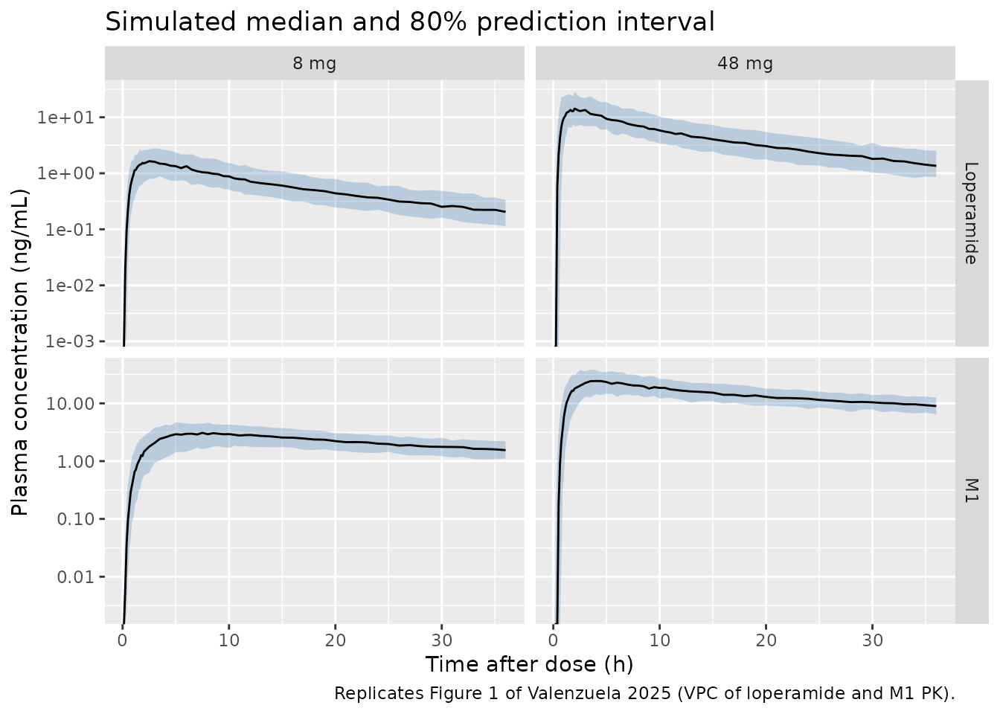
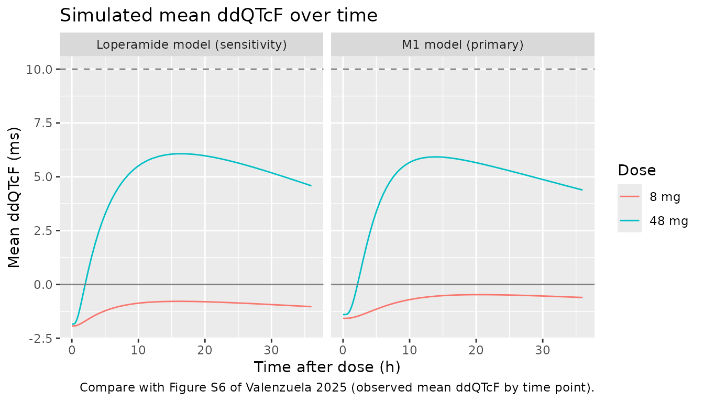
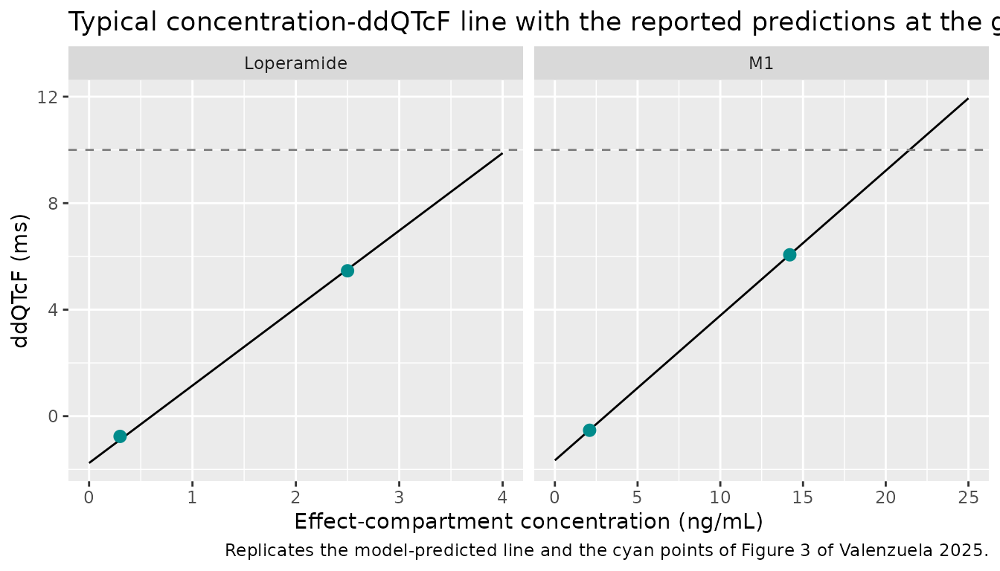

# Loperamide and N-desmethyl loperamide concentration-QTc (Valenzuela 2025)

## Model and source

Valenzuela 2025 analysed a four-way crossover thorough-QT study of
single oral loperamide doses (8 mg therapeutic, 48 mg supratherapeutic)
with placebo and moxifloxacin controls. The paper reports two
fit-for-purpose population PK models (loperamide, and its N-desmethyl
metabolite M1 treated as if dosed independently) and two
concentration-QTc models that differ only in the analyte driving the
effect compartment. The package therefore ships two model files, each a
PK model with its own effect compartment and linear concentration-ddQTcF
model:

- `Valenzuela_2025_loperamide_QTcF_M1` – the primary model, driven by
  M1.

- `Valenzuela_2025_loperamide_QTcF_parent` – the sensitivity-analysis
  model, driven by loperamide.

- Citation: Valenzuela B, Gisleskog PO, Cirillo I, Coenen E, Ariyawansa
  J, Ali SR, Takhtoukh S, Perez-Ruixo JJ, Ackaert O. Evaluation of the
  Effect of Loperamide on the Cardiac Repolarization Interval Using
  Exposure-Response Analysis. Clin Transl Sci. 2025;18(2):e70114.
  <doi:10.1111/cts.70114>.

- Description (M1): Population PK / concentration-QTc model for
  N-desmethyl loperamide (M1), the major metabolite of loperamide, in
  healthy adults from a randomized, placebo- and moxifloxacin-controlled
  four-way crossover thorough-QT study (NCT04225078; single oral
  loperamide 8 mg and 48 mg). This is the paper’s primary
  exposure-response model. Fit-for-purpose M1 PK with the metabolite
  treated as if dosed independently: the loperamide dose enters a depot
  by a zero-order input after a lag time and reaches a two-compartment
  M1 disposition model by first-order absorption; the 48 mg dose has its
  own relative bioavailability, absorption rate constant and lag time.
  IIV on Vc/F, F and ka; inter-occasion variability on the lag time and
  the zero-order duration. An effect compartment (ke0) on the M1
  concentration drives the prespecified linear model for the
  placebo-adjusted change from baseline in Fridericia-corrected QT
  (ddQTcF = (b0 + eta) + (b1 + eta) \* Ce + b2 \* (QTcF baseline -
  mean)). The loperamide-driven sensitivity model is
  Valenzuela_2025_loperamide_QTcF_parent.

- Description (parent): Population PK / concentration-QTc model for
  loperamide (parent) in healthy adults from a randomized, placebo- and
  moxifloxacin-controlled four-way crossover thorough-QT study
  (NCT04225078; single oral loperamide 8 mg and 48 mg). Fit-for-purpose
  PK: two-compartment disposition with linear elimination and sequential
  zero- then first-order absorption after a lag time; the 48 mg dose has
  its own relative bioavailability, absorption rate constant and lag
  time. IIV on Vc/F, F and ka; inter-occasion variability on the lag
  time and the zero-order duration. An effect compartment (ke0) drives
  the prespecified linear model for the placebo-adjusted change from
  baseline in Fridericia-corrected QT (ddQTcF = (b0 + eta) + (b1 + eta)
  \* Ce + b2 \* (QTcF baseline - mean)). This loperamide-driven
  exposure-response model is the paper’s sensitivity analysis; the
  primary model is driven by the N-desmethyl metabolite M1
  (Valenzuela_2025_loperamide_QTcF_M1).

- Article: <https://doi.org/10.1111/cts.70114> (open access;
  PMC11770325)

## Population

The study (NCT04225078) enrolled 65 healthy adults (22 male, 43 female)
aged 18-55 years with a body mass index of 18-30 kg/m^2 and body weight
of at least 50 kg, at a single centre in Belgium between January 2020
and January 2022. Participants received single oral doses of loperamide
8 mg, loperamide 48 mg, moxifloxacin 400 mg and placebo in four periods
separated by washouts of at least 7 days. ECGs were extracted in
triplicate from continuous 12-lead Holter recordings at 0.5 to 36 h
after dosing, time-matched to the PK samples. The exposure-response
dataset holds 1408 time-matched PK and ddQTcF records from 53
participants (51 at 8 mg, 50 at 48 mg). The paper reports no table of
baseline demographics beyond these figures (Methods and Results,
Dataset).

The same information is available programmatically:

``` r

str(readModelDb("Valenzuela_2025_loperamide_QTcF_M1")()$population)
#> Warning: some etas defaulted to non-mu referenced, possible parsing error: etaiov_ltlag_1, etaiov_ltlag_2, etaiov_ld1_1, etaiov_ld1_2, etaslope
#> as a work-around try putting the mu-referenced expression on a simple line
#> List of 11
#>  $ species       : chr "human"
#>  $ n_subjects    : int 53
#>  $ n_studies     : int 1
#>  $ n_observations: int 1408
#>  $ age_range     : chr "18-55 years (eligibility criterion; observed range not reported)"
#>  $ weight_range  : chr ">= 50 kg; BMI 18-30 kg/m^2 (eligibility criteria)"
#>  $ sex_female_pct: num 66.2
#>  $ disease_state : chr "Healthy adult volunteers"
#>  $ dose_range    : chr "Single oral loperamide 8 mg (therapeutic; 51 participants) and 48 mg (supratherapeutic; 50 participants), place"| __truncated__
#>  $ regions       : chr "Belgium"
#>  $ notes         : chr "Thorough-QT study NCT04225078, conducted January 2020 to January 2022. 65 participants were enrolled (22 male, "| __truncated__
```

## Source trace

Every `ini()` value carries an in-file comment pointing to its table
row. Both PK models share the same structure (Valenzuela 2025 Figure S3)
and both exposure-response models share Equation 1.

| Equation / parameter | Loperamide | M1 | Source location |
|----|----|----|----|
| `lcl` / `lcl_m1` (CL/F, L/h) | 293 | 52.4 | Table 1 |
| `lvc` / `lvc_m1` (Vc/F, L) | 3380 | 1650 | Table 1 |
| `lvp` / `lvp_m1` (Vp/F, L) | 1770 | 805 | Table 1 |
| `lq` / `lq_m1` (Q/F, L/h) | 219 | 96.4 | Table 1 |
| `lfdepot` (F, 8 mg) | 1 fixed | 1 fixed | Table 1 |
| `lfdepot_highdose` (F, 48 mg) | 1.20 | 1.10 | Table 1 |
| `lka` (ka, 8 mg, 1/h) | 1.19 | 0.258 | Table 1 |
| `lka_highdose` (ka, 48 mg, 1/h) | 4.21 | 0.991 | Table 1 |
| `ltlag` (lag, 8 mg, h) | 0.149 | 0.162 | Table 1 |
| `ltlag_highdose` (lag, 48 mg, h) | 0.271 | 0.376 | Table 1 |
| `ld1` (zero-order duration D1, h) | 0.551 | 0.714 | Table 1 |
| IIV Vc/F, F, ka (%CV) | 19.6, 43.5, 98.6 | 32.3, 20.8, 40.6 | Table 1 |
| IOV lag, D1 (%CV) | 76.2, 72.9 | 59.3, 97.1 | Table 1, footnote a |
| `propSd` / `propSd_m1` | 0.177 | 0.171 | Table 1, footnote b (additive on log scale) |
| `lke0` (1/h) | 0.024 | 0.094 | Table 2 |
| `e0` intercept (ms) | -1.76 | -1.66 | Table 2 |
| `slope` (ms per ng/mL) | 2.91 | 0.544 | Table 2 |
| `e_qtc_bl_e0` (ms per ms) | -0.173 | -0.155 | Table 2 |
| `etae0`, `etaslope`, `etalke0` (variances) | 17.7, 0.00001, 0.947 | 15.7, 0.143, 0.748 | Table 2 |
| `addSd` (ms) | sqrt(42.8) | sqrt(41.7) | Table 2 |
| Sequential zero- then first-order absorption after a lag |  |  | Results; Figure S3 |
| `d/dt(effect) = ke0 * (C - effect)` |  |  | Methods (effect compartment, ref. 14); Figure S3 |
| `QTcF = (e0 + eta) + (slope + eta) * Ce + e_qtc_bl_e0 * (QTC_BL - 400)` |  |  | Equation 1 |

## Typical-value check against the reported ddQTcF

The paper reports the model-predicted mean ddQTcF at the predicted
geometric mean effect-compartment Cmax of each dose (Results; Figure 3).
Equation 2 of the paper is the typical linear prediction
`b0 + Cmax * b1`, so the packaged intercept and slope must reproduce
those numbers at the printed concentrations. This is a check on the
transcription of the intercept and slope, independent of any simulation.

``` r

theta_of <- function(name) {
  ui <- rxode2::rxode(readModelDb(name))
  ui$theta
}
th_m1 <- theta_of("Valenzuela_2025_loperamide_QTcF_M1")
#> ℹ parameter labels from comments will be replaced by 'label()'
#> Warning: some etas defaulted to non-mu referenced, possible parsing error: etaiov_ltlag_1, etaiov_ltlag_2, etaiov_ld1_1, etaiov_ld1_2, etaslope
#> as a work-around try putting the mu-referenced expression on a simple line
th_p <- theta_of("Valenzuela_2025_loperamide_QTcF_parent")
#> ℹ parameter labels from comments will be replaced by 'label()'
#> Warning: some etas defaulted to non-mu referenced, possible parsing error: etaiov_ltlag_1, etaiov_ltlag_2, etaiov_ld1_1, etaiov_ld1_2, etaslope
#> as a work-around try putting the mu-referenced expression on a simple line

reported <- tibble::tribble(
  ~model, ~dose, ~ce_gm, ~ddqtcf_reported,
  "M1", "8 mg", 2.1, -0.53,
  "M1", "48 mg", 14.2, 6.06,
  "Loperamide", "8 mg", 0.3, -0.76,
  "Loperamide", "48 mg", 2.5, 5.46
)
typical <- reported |>
  mutate(
    ddqtcf_model = ifelse(
      model == "M1",
      th_m1[["e0"]] + th_m1[["slope"]] * ce_gm,
      th_p[["e0"]] + th_p[["slope"]] * ce_gm
    ),
    difference = ddqtcf_model - ddqtcf_reported
  )

typical |>
  rename(
    "Model" = model, "Dose" = dose,
    "Geometric mean Ce,max (ng/mL)" = ce_gm,
    "Reported ddQTcF (ms)" = ddqtcf_reported,
    "Packaged model ddQTcF (ms)" = ddqtcf_model,
    "Difference (ms)" = difference
  ) |>
  knitr::kable(digits = 3, caption = "Typical ddQTcF at the reported geometric-mean effect-compartment Cmax.")
```

| Model | Dose | Geometric mean Ce,max (ng/mL) | Reported ddQTcF (ms) | Packaged model ddQTcF (ms) | Difference (ms) |
|:---|:---|---:|---:|---:|---:|
| M1 | 8 mg | 2.1 | -0.53 | -0.518 | 0.012 |
| M1 | 48 mg | 14.2 | 6.06 | 6.065 | 0.005 |
| Loperamide | 8 mg | 0.3 | -0.76 | -0.887 | -0.127 |
| Loperamide | 48 mg | 2.5 | 5.46 | 5.515 | 0.055 |

Typical ddQTcF at the reported geometric-mean effect-compartment Cmax.
{.table style="width:100%;"}

``` r


# The concentrations are printed to one decimal place, so the prediction can
# differ by up to slope * 0.05 ng/mL (0.03 ms for M1, 0.15 ms for loperamide).
tol <- ifelse(typical$model == "M1", th_m1[["slope"]], th_p[["slope"]]) * 0.05 + 0.02
stopifnot(all(abs(typical$difference) <= tol))
```

## Virtual cohort

Observed data are not public. Each model is simulated in a virtual
cohort of 150 participants per dose, treated as parallel arms (the
crossover’s within-participant pairing does not change the per-dose
distributions). The 8 mg arm is occasion 1 and the 48 mg arm occasion 2,
so each draws its own inter-occasion random effects. Every participant’s
baseline QTcF is set to the 400 ms centering value, because the paper
reports neither the mean nor the spread of baseline QTcF.

``` r

n_per_arm <- 150L
obs_times <- sort(unique(c(seq(0, 2, by = 0.125), seq(2.5, 12, by = 0.5), seq(13, 36, by = 1))))

make_arm <- function(n, dose_mg, id_offset) {
  ids <- id_offset + seq_len(n)
  high <- as.integer(dose_mg == 48)
  covs <- data.frame(id = ids, DOSE_HIGH = high, OCC = ifelse(high == 1L, 2L, 1L), QTC_BL = 400)
  # The models have two error endpoints, neither of which is an ODE state, so
  # observation rows nominate the first endpoint through dvid; rxSolve still
  # returns every endpoint as a column. Zero-order input: rate = -2 lets the
  # model's dur(depot) set the duration.
  dose_rows <- data.frame(
    id = ids, time = 0, amt = dose_mg, evid = 1L, cmt = "depot",
    rate = -2, dvid = NA_integer_
  )
  obs_rows <- expand.grid(id = ids, time = obs_times) |>
    mutate(amt = 0, evid = 0L, cmt = NA_character_, rate = 0, dvid = 1L)
  bind_rows(dose_rows, obs_rows) |>
    left_join(covs, by = "id") |>
    mutate(dose = paste(dose_mg, "mg")) |>
    arrange(id, time, desc(evid))
}

events <- bind_rows(
  make_arm(n_per_arm, 8, id_offset = 0L),
  make_arm(n_per_arm, 48, id_offset = n_per_arm)
)
stopifnot(!anyDuplicated(unique(events[, c("id", "time", "evid")])))
```

## Simulation

``` r

mod_m1 <- readModelDb("Valenzuela_2025_loperamide_QTcF_M1")
mod_p <- readModelDb("Valenzuela_2025_loperamide_QTcF_parent")

rxode2::rxSetSeed(2025)
sim_m1 <- rxode2::rxSolve(mod_m1, events = events, keep = c("dose")) |>
  as.data.frame()
#> ℹ parameter labels from comments will be replaced by 'label()'
#> Warning: some etas defaulted to non-mu referenced, possible parsing error: etaiov_ltlag_1, etaiov_ltlag_2, etaiov_ld1_1, etaiov_ld1_2, etaslope
#> as a work-around try putting the mu-referenced expression on a simple line
rxode2::rxSetSeed(2026)
sim_p <- rxode2::rxSolve(mod_p, events = events, keep = c("dose")) |>
  as.data.frame()
#> ℹ parameter labels from comments will be replaced by 'label()'
#> Warning: some etas defaulted to non-mu referenced, possible parsing error: etaiov_ltlag_1, etaiov_ltlag_2, etaiov_ld1_1, etaiov_ld1_2, etaslope
#> as a work-around try putting the mu-referenced expression on a simple line

stopifnot(
  !anyNA(sim_m1$Cc_m1), !anyNA(sim_m1$QTcF),
  !anyNA(sim_p$Cc), !anyNA(sim_p$QTcF)
)
```

The in-model `Cc`, `Cc_m1` and `QTcF` columns are individual predictions
(no residual error). The VPC below adds the published residual error so
that it is comparable to the paper’s observation-based percentiles.

## Replicate Figure 1 (PK visual predictive check)

``` r

vpc_pk <- bind_rows(
  sim_p |> transmute(id, time, dose, analyte = "Loperamide", ipred = Cc,
                     sd = rxode2::rxode(mod_p)$theta[["propSd"]]),
  sim_m1 |> transmute(id, time, dose, analyte = "M1", ipred = Cc_m1,
                      sd = rxode2::rxode(mod_m1)$theta[["propSd_m1"]])
) |>
  filter(time %in% obs_times[-1]) |> # drop the pre-dose zero for the log axis
  mutate(dv = ipred * exp(rnorm(n(), 0, sd))) |>
  group_by(analyte, dose, time) |>
  summarise(
    p10 = quantile(dv, 0.10), p50 = quantile(dv, 0.50), p90 = quantile(dv, 0.90),
    .groups = "drop"
  ) |>
  mutate(dose = factor(dose, levels = c("8 mg", "48 mg")))
#> ℹ parameter labels from comments will be replaced by 'label()'
#> Warning: There was 1 warning in `transmute()`.
#> ℹ In argument: `sd = rxode2::rxode(mod_p)$theta[["propSd"]]`.
#> Caused by warning:
#> ! some etas defaulted to non-mu referenced, possible parsing error: etaiov_ltlag_1, etaiov_ltlag_2, etaiov_ld1_1, etaiov_ld1_2, etaslope
#> as a work-around try putting the mu-referenced expression on a simple line
#> ℹ parameter labels from comments will be replaced by 'label()'
#> Warning: There was 1 warning in `transmute()`.
#> ℹ In argument: `sd = rxode2::rxode(mod_m1)$theta[["propSd_m1"]]`.
#> Caused by warning:
#> ! some etas defaulted to non-mu referenced, possible parsing error: etaiov_ltlag_1, etaiov_ltlag_2, etaiov_ld1_1, etaiov_ld1_2, etaslope
#> as a work-around try putting the mu-referenced expression on a simple line

ggplot(vpc_pk, aes(time, p50)) +
  geom_ribbon(aes(ymin = p10, ymax = p90), fill = "steelblue", alpha = 0.3) +
  geom_line() +
  facet_grid(analyte ~ dose, scales = "free_y") +
  scale_y_log10() +
  labs(
    x = "Time after dose (h)", y = "Plasma concentration (ng/mL)",
    title = "Simulated median and 80% prediction interval",
    caption = "Replicates Figure 1 of Valenzuela 2025 (VPC of loperamide and M1 PK)."
  )
#> Warning in scale_y_log10(): log-10 transformation introduced infinite values.
#> Warning in scale_y_log10(): log-10 transformation introduced infinite values.
#> log-10 transformation introduced infinite values.
#> log-10 transformation introduced infinite values.
```



## Effect-compartment Cmax and ddQTcF

The paper reports the predicted geometric-mean Cmax in the effect
compartment per dose: 2.1 and 14.2 ng/mL for M1 and 0.3 and 2.5 ng/mL
for loperamide after 8 and 48 mg (Results). The simulated cohort’s
geometric means over the 0-36 h sampling window are compared below. The
effect compartment of loperamide equilibrates slowly (1/ke0 = 42 h), so
its peak falls late in that window.

``` r

ce_max <- bind_rows(
  sim_m1 |> mutate(model = "M1"),
  sim_p |> mutate(model = "Loperamide")
) |>
  group_by(model, dose, id) |>
  summarise(ce_max = max(effect), .groups = "drop") |>
  group_by(model, dose) |>
  summarise(gm_sim = exp(mean(log(ce_max))), .groups = "drop") |>
  inner_join(reported |> select(model, dose, ce_gm), by = c("model", "dose")) |>
  mutate(pct_diff = 100 * (gm_sim / ce_gm - 1))

ce_max |>
  rename(
    "Model" = model, "Dose" = dose,
    "Simulated geometric mean Ce,max (ng/mL)" = gm_sim,
    "Reported (ng/mL)" = ce_gm, "Difference (%)" = pct_diff
  ) |>
  knitr::kable(digits = 2, caption = "Geometric-mean effect-compartment Cmax, simulated vs. reported.")
```

| Model | Dose | Simulated geometric mean Ce,max (ng/mL) | Reported (ng/mL) | Difference (%) |
|:---|:---|---:|---:|---:|
| Loperamide | 48 mg | 2.31 | 2.5 | -7.44 |
| Loperamide | 8 mg | 0.32 | 0.3 | 6.12 |
| M1 | 48 mg | 13.14 | 14.2 | -7.47 |
| M1 | 8 mg | 2.02 | 2.1 | -3.93 |

Geometric-mean effect-compartment Cmax, simulated vs. reported. {.table}

``` r


# The cohort geometric mean is a centre statistic (robust to which participants
# land in the tails); a mis-transcribed CL/F, volume, F or ke0 moves it by
# tens of percent. The 8 mg loperamide value (0.3 ng/mL) is printed to one
# significant figure, so it is held to the rounding interval 0.25-0.35 widened
# by the same margin.
stopifnot(all(abs(ce_max$pct_diff[!(ce_max$model == "Loperamide" & ce_max$dose == "8 mg")]) < 25))
stopifnot(abs(ce_max$pct_diff[ce_max$model == "Loperamide" & ce_max$dose == "8 mg"]) < 40)
```

``` r

dd_time <- bind_rows(
  sim_m1 |> mutate(model = "M1 model (primary)"),
  sim_p |> mutate(model = "Loperamide model (sensitivity)")
) |>
  group_by(model, dose, time) |>
  summarise(mean_ddqtcf = mean(QTcF), .groups = "drop") |>
  mutate(dose = factor(dose, levels = c("8 mg", "48 mg")))

ggplot(dd_time, aes(time, mean_ddqtcf, colour = dose)) +
  geom_line() +
  geom_hline(yintercept = 0, colour = "grey50") +
  geom_hline(yintercept = 10, linetype = "dashed", colour = "grey50") +
  facet_wrap(~model) +
  labs(
    x = "Time after dose (h)", y = "Mean ddQTcF (ms)", colour = "Dose",
    title = "Simulated mean ddQTcF over time",
    caption = "Compare with Figure S6 of Valenzuela 2025 (observed mean ddQTcF by time point)."
  )
```



``` r


# Figure S6: after 48 mg the observed mean ddQTcF exceeded 5 ms at 8, 12 and
# 24 h; after 8 mg it stayed near zero. Assert the centre of the simulated
# 48 mg profile over 8-24 h sits well above the 8 mg one and below 10 ms.
m1_48 <- dd_time |> filter(model == "M1 model (primary)", dose == "48 mg", time >= 8, time <= 24)
m1_8 <- dd_time |> filter(model == "M1 model (primary)", dose == "8 mg", time >= 8, time <= 24)
stopifnot(
  mean(m1_48$mean_ddqtcf) > 3, mean(m1_48$mean_ddqtcf) < 10,
  abs(mean(m1_8$mean_ddqtcf)) < 2
)
```

## Replicate Figure 3 (concentration-ddQTcF relationship)

``` r

line_df <- bind_rows(
  tibble(model = "M1", ce = seq(0, 25, length.out = 101),
         ddqtcf = th_m1[["e0"]] + th_m1[["slope"]] * seq(0, 25, length.out = 101)),
  tibble(model = "Loperamide", ce = seq(0, 4, length.out = 101),
         ddqtcf = th_p[["e0"]] + th_p[["slope"]] * seq(0, 4, length.out = 101))
)
ggplot(line_df, aes(ce, ddqtcf)) +
  geom_line() +
  geom_point(data = typical, aes(ce_gm, ddqtcf_reported), colour = "darkcyan", size = 2.5) +
  geom_hline(yintercept = 10, linetype = "dashed", colour = "grey50") +
  facet_wrap(~model, scales = "free_x") +
  labs(
    x = "Effect-compartment concentration (ng/mL)", y = "ddQTcF (ms)",
    title = "Typical concentration-ddQTcF line with the reported predictions at the geometric-mean Cmax",
    caption = "Replicates the model-predicted line and the cyan points of Figure 3 of Valenzuela 2025."
  )
```



## PKNCA validation

The paper reports no NCA, so PKNCA is used here for an identity check:
for a typical participant the AUC from zero to infinity must equal
`F * dose / (CL/F)`, which ties the clearance, the relative
bioavailability of each dose and the mg-to-ng/mL unit conversion
together. The typical solve runs to 480 h so that the extrapolated tail
is negligible.

``` r

typ_times <- c(seq(0, 2, by = 0.05), seq(2.25, 24, by = 0.25), seq(25, 480, by = 1))
typ_events <- bind_rows(
  data.frame(id = 1:2, time = 0, amt = c(8, 48), evid = 1L, cmt = "depot",
             rate = -2, dvid = NA_integer_),
  expand.grid(id = 1:2, time = typ_times) |>
    mutate(amt = 0, evid = 0L, cmt = NA_character_, rate = 0, dvid = 1L)
) |>
  mutate(
    DOSE_HIGH = as.integer(id == 2), OCC = 0L, QTC_BL = 400,
    dose = ifelse(id == 2, "48 mg", "8 mg")
  ) |>
  arrange(id, time, desc(evid))

typ_m1 <- rxode2::rxSolve(rxode2::zeroRe(mod_m1), events = typ_events, keep = "dose",
                          rtol = 1e-10, atol = 1e-12) |> as.data.frame()
#> ℹ parameter labels from comments will be replaced by 'label()'
#> Warning: some etas defaulted to non-mu referenced, possible parsing error: etaiov_ltlag_1, etaiov_ltlag_2, etaiov_ld1_1, etaiov_ld1_2, etaslope
#> as a work-around try putting the mu-referenced expression on a simple line
#> Warning: some etas defaulted to non-mu referenced, possible parsing error: etaiov_ltlag_1, etaiov_ltlag_2, etaiov_ld1_1, etaiov_ld1_2, etaslope
#> as a work-around try putting the mu-referenced expression on a simple line
#> ℹ omega/sigma items treated as zero: 'etalvc_m1', 'etalfdepot', 'etalka', 'etaiov_ltlag_1', 'etaiov_ltlag_2', 'etaiov_ld1_1', 'etaiov_ld1_2', 'etae0', 'etaslope', 'etalke0'
#> Warning: multi-subject simulation without without 'omega'
typ_p <- rxode2::rxSolve(rxode2::zeroRe(mod_p), events = typ_events, keep = "dose",
                         rtol = 1e-10, atol = 1e-12) |> as.data.frame()
#> ℹ parameter labels from comments will be replaced by 'label()'
#> Warning: some etas defaulted to non-mu referenced, possible parsing error: etaiov_ltlag_1, etaiov_ltlag_2, etaiov_ld1_1, etaiov_ld1_2, etaslope
#> as a work-around try putting the mu-referenced expression on a simple line
#> Warning: some etas defaulted to non-mu referenced, possible parsing error: etaiov_ltlag_1, etaiov_ltlag_2, etaiov_ld1_1, etaiov_ld1_2, etaslope
#> as a work-around try putting the mu-referenced expression on a simple line
#> ℹ omega/sigma items treated as zero: 'etalvc', 'etalfdepot', 'etalka', 'etaiov_ltlag_1', 'etaiov_ltlag_2', 'etaiov_ld1_1', 'etaiov_ld1_2', 'etae0', 'etaslope', 'etalke0'
#> Warning: multi-subject simulation without without 'omega'

run_nca <- function(sim, conc_col) {
  conc <- sim |>
    transmute(id, treatment = dose, time, conc = .data[[conc_col]]) |>
    filter(!is.na(conc)) |>
    mutate(conc = pmax(conc, 0))
  conc <- bind_rows(conc, conc |> distinct(id, treatment) |> mutate(time = 0, conc = 0)) |>
    distinct(id, treatment, time, .keep_all = TRUE) |>
    arrange(id, treatment, time)
  doses <- typ_events |> filter(evid == 1) |> select(id, treatment = dose, time, amt)
  nca <- PKNCA::pk.nca(PKNCA::PKNCAdata(
    PKNCA::PKNCAconc(conc, conc ~ time | treatment + id),
    PKNCA::PKNCAdose(doses, amt ~ time | treatment + id),
    intervals = data.frame(start = 0, end = Inf, cmax = TRUE, tmax = TRUE,
                           aucinf.obs = TRUE, half.life = TRUE)
  ))
  as.data.frame(nca$result) |>
    select(treatment, PPTESTCD, PPORRES) |>
    pivot_wider(names_from = PPTESTCD, values_from = PPORRES)
}

nca_tab <- bind_rows(
  run_nca(typ_p, "Cc") |>
    mutate(analyte = "Loperamide",
           expected_auc = ifelse(treatment == "48 mg", 1.20 * 48, 8) / exp(th_p[["lcl"]]) * 1000),
  run_nca(typ_m1, "Cc_m1") |>
    mutate(analyte = "M1",
           expected_auc = ifelse(treatment == "48 mg", 1.10 * 48, 8) / exp(th_m1[["lcl_m1"]]) * 1000)
) |>
  mutate(auc_pct_diff = 100 * (aucinf.obs / expected_auc - 1))

nca_tab |>
  select(analyte, treatment, cmax, tmax, aucinf.obs, expected_auc, auc_pct_diff, half.life) |>
  rename(
    "Analyte" = analyte, "Dose" = treatment, "Cmax (ng/mL)" = cmax, "Tmax (h)" = tmax,
    "AUC0-inf (ng*h/mL)" = aucinf.obs, "F * dose / CL (ng*h/mL)" = expected_auc,
    "AUC difference (%)" = auc_pct_diff, "Terminal half-life (h)" = half.life
  ) |>
  knitr::kable(digits = 2, caption = "Typical-participant NCA (PKNCA) and the AUC identity.")
```

| Analyte | Dose | Cmax (ng/mL) | Tmax (h) | AUC0-inf (ng\*h/mL) | F \* dose / CL (ng\*h/mL) | AUC difference (%) | Terminal half-life (h) |
|:---|:---|---:|---:|---:|---:|---:|---:|
| Loperamide | 48 mg | 14.96 | 1.45 | 196.59 | 196.59 | 0.00 | 14.68 |
| Loperamide | 8 mg | 1.76 | 2.50 | 27.30 | 27.30 | -0.01 | 14.68 |
| M1 | 48 mg | 25.48 | 3.50 | 1007.59 | 1007.63 | 0.00 | 34.45 |
| M1 | 8 mg | 2.94 | 8.00 | 152.67 | 152.67 | 0.00 | 34.43 |

Typical-participant NCA (PKNCA) and the AUC identity. {.table}

``` r


# Same drawn parameters on both sides; only trapezoid error remains.
stopifnot(all(abs(nca_tab$auc_pct_diff) < 1))
```

The 48 mg AUC is 1.20-fold (loperamide) and 1.10-fold (M1) the
dose-proportional value, the greater-than-dose-proportional exposure the
paper describes, and the higher absorption rate constant after 48 mg
raises the early peak further (Results, Population PK Model).

## Assumptions and deviations

- **Baseline QTcF centering value.** Equation 1 centers baseline QTcF on
  the population mean, which the paper does not print. Both models use
  400 ms, a rounded standard for healthy adults; the companion trial
  report (Cirillo 2024, JAPhA Pharmacotherapy) could not be retrieved to
  check the actual mean. The term vanishes for a participant at the
  centering value, so typical predictions do not depend on this choice.
- **Baseline QTcF distribution.** The simulations hold every participant
  at 400 ms because no spread is reported.
- **IIV and IOV scale.** Table 1 prints the PK random effects as %CV;
  they are converted to log-normal variances as `log(1 + CV^2)`. The F,
  ka and Vc/F random effects are taken as log-normal (the paper does not
  print the transformation).
- **PK residual error.** Table 1 footnote b describes the residual error
  as additive on the log scale and prints 0.177 (loperamide) and 0.171
  (M1) without saying whether these are variances or standard
  deviations. The maintainers read them as standard deviations: the
  observed-versus-individual prediction panels of Figure S4 scatter by
  roughly +/-35% at the extremes, which matches a log-scale SD near 0.17
  and not one near 0.42 (the square root of 0.177). They are encoded as
  proportional SDs, the linear-scale equivalent of log-scale additive
  error.
- **Inter-occasion variability.** rxode2 has no occasion level, so the
  IOV on the lag time and on D1 is expanded into two indicator-selected
  etas per parameter (`OCC = 1, 2` for the two loperamide periods) that
  share one variance. Because the occasion effect enters as an
  indicator-weighted sum, rxode2 warns that these etas are not
  mu-referenced; this affects only the speed of a future estimation run,
  not simulation.
- **Slope variability of the loperamide model.** Table 2 prints the
  variance of the slope random effect as 0.00001 with no RSE; it is
  encoded as fixed.
- **M1 dose.** The M1 PK model treats the metabolite “as if dosed
  independently” (Results). The loperamide dose in mg is used as the M1
  input; the apparent CL/F and volumes absorb the formation fraction and
  the molecular-weight difference. Dose the M1 model with the loperamide
  amount.
- **Separate models per analyte.** The paper fits the two PK models and
  the two exposure-response models separately, and the multivariate
  model with both analytes was not identifiable (collinearity; Results).
  The package keeps the two analyte-specific chains in separate files;
  they are not meant to be combined into a single effect.
- **Dose levels.** The dose effects on F, ka and lag time are step
  changes between the two studied doses (`DOSE_HIGH`); doses other than
  8 and 48 mg are extrapolation.
- **Moxifloxacin.** The positive-control arm is not part of the
  exposure-response models and is not simulated.
- No correction notice for the article was found as of 2026-11-02.
