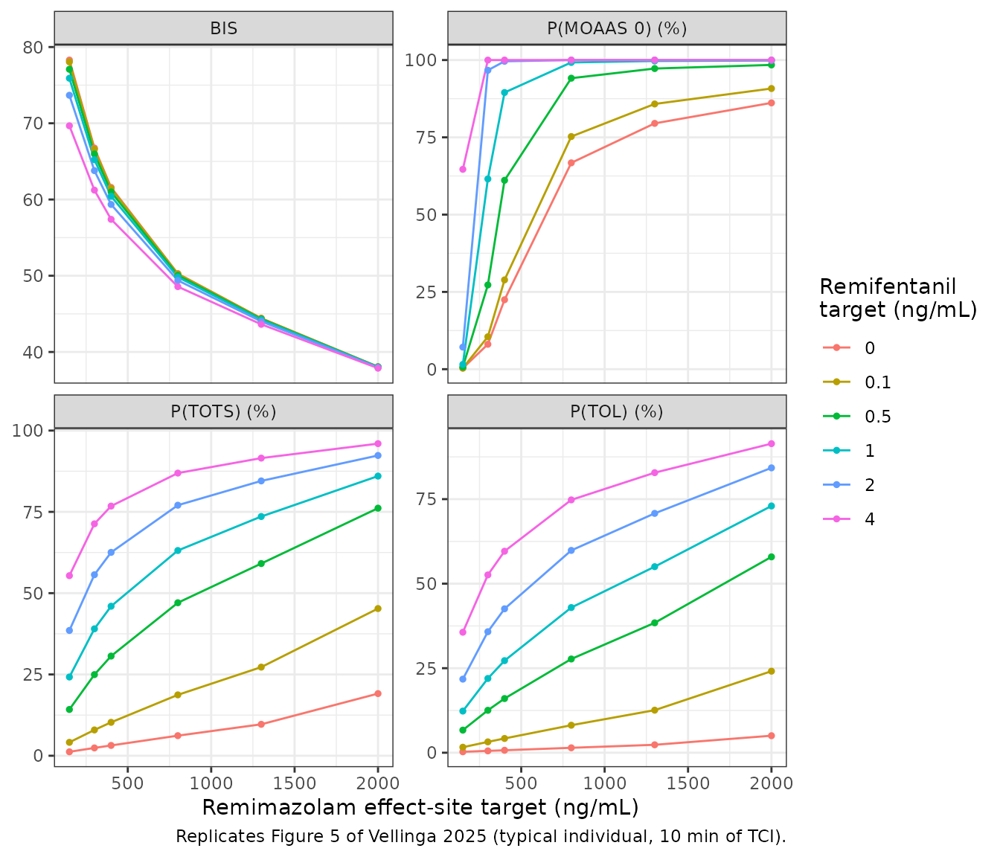
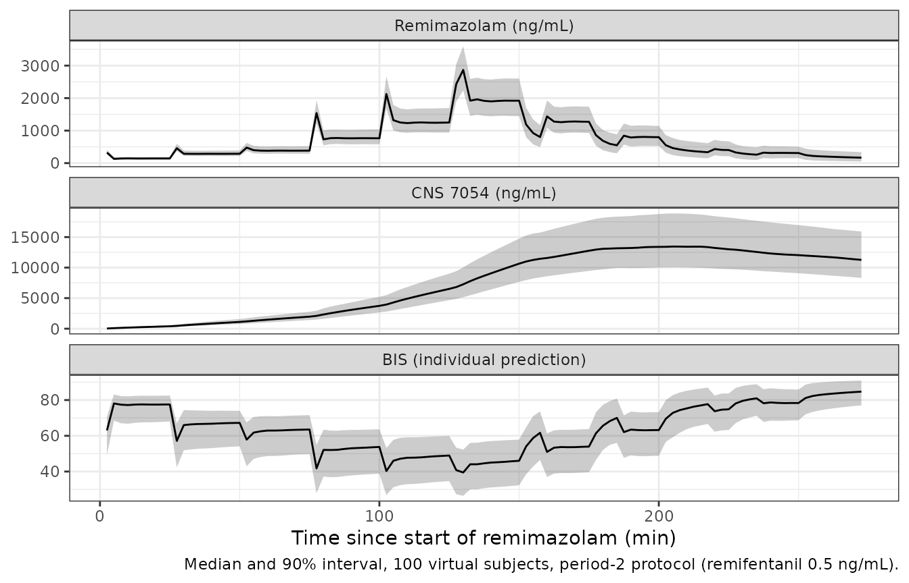

# Remimazolam with remifentanil: PK, BIS, MOAAS, TOL and TOTS (Vellinga 2025)

## Model and source

Vellinga 2025 ran a three-period crossover trial in 24 healthy
volunteers. In every period remimazolam was given by effect-site
target-controlled infusion (TCI), stepped up and down through targets of
50 to 2,000 ng/mL, together with a constant remifentanil plasma TCI
target of 0, 0.5, or 0.1 to 4.0 ng/mL. The paper fits one joint
pharmacokinetic model and then, sequentially on its individual
predictions, four separate pharmacodynamic models. The library mirrors
that structure with five model files sharing one article:

| Model | Endpoint |
|----|----|
| `Vellinga_2025_remimazolam` | Remimazolam, CNS 7054 and remifentanil plasma concentrations |
| `Vellinga_2025_remimazolam_bis` | Bispectral Index (BIS, 0-100) |
| `Vellinga_2025_remimazolam_moaas` | Modified Observer’s Assessment of Alertness and Sedation (MOAAS, 0-5) |
| `Vellinga_2025_remimazolam_tol` | Tolerance to laryngoscopy (TOL, binary) |
| `Vellinga_2025_remimazolam_tots` | Tolerance to tetanic stimulation (TOTS, binary) |

- Citation: Vellinga R, Koomen JV, Eleveld DJ, Stohr T, Pesic M, Struys
  MMRF, Colin PJ. Influence of Remifentanil on the Pharmacokinetics and
  Pharmacodynamics of Remimazolam in Healthy Volunteers. Anesthesiology.
  2025;142(4):666-679. <doi:10.1097/ALN.0000000000005348>. PMC11892992.
  Remifentanil layer: Eleveld DJ, Proost JH, Vereecke H, Absalom AR,
  Olofsen E, Vuyk J, Struys MMRF. An Allometric Model of Remifentanil
  Pharmacokinetics and Pharmacodynamics. Anesthesiology.
  2017;126(6):1005-1018.
- Description (PK): Joint population pharmacokinetic model of
  remimazolam, its inactive metabolite CNS 7054 and co-administered
  remifentanil in 24 healthy adult volunteers given remimazolam by
  effect-site target-controlled infusion (TCI) alone and with a constant
  remifentanil plasma TCI target (Vellinga 2025, NCT04670471).
  Remimazolam: three-compartment disposition with fixed allometric
  weight scaling; 80% of its clearance forms CNS 7054 through one
  transit compartment into a one-compartment metabolite pool.
  Remifentanil: the Eleveld 2017 three-compartment model with all
  structural, covariate and variability terms held at their published
  values. Remifentanil inhibits the apparent CNS 7054 clearance through
  a sigmoid Imax function of its plasma concentration (IC50 8.0 ng/mL);
  remimazolam clearance is unaffected. The four pharmacodynamic
  endpoints fit on top of this model are in
  modellib(‘Vellinga_2025_remimazolam_bis’),
  ‘Vellinga_2025_remimazolam_moaas’, ‘Vellinga_2025_remimazolam_tol’ and
  ‘Vellinga_2025_remimazolam_tots’.
- Article: <https://doi.org/10.1097/ALN.0000000000005348> (open access,
  PMC11892992)
- Supplemental Digital Content 5 (PK model code and estimates):
  <https://links.lww.com/ALN/D790>
- Supplemental Digital Content 6 (PD model code):
  <https://links.lww.com/ALN/D791>

The structure, in brief:

- **Remimazolam**: three compartments, weight-scaled allometrically to
  70 kg with fixed exponents. Eighty percent of its clearance (fixed
  from the Byfavo EPAR) forms the inactive metabolite CNS 7054.
- **CNS 7054**: formed through one transit compartment into a
  one-compartment pool. Remifentanil inhibits its apparent clearance by
  `Cr^0.61 / (Cr^0.61 + 8.0^0.61)`, about 40% at 4 ng/mL (Discussion).
- **Remifentanil**: the published Eleveld 2017 three-compartment model,
  held at its published values (only its residual error was
  re-estimated).
- **BIS**: logistic Emax in which remimazolam and remifentanil add and
  CNS 7054 antagonises both competitively. The antagonism is the paper’s
  mechanism for acute tolerance.
- **MOAAS**: proportional-odds model whose sigmoid remimazolam effect is
  antagonised by CNS 7054 and multiplied by `1 + Cr / 2.5`.
- **TOL / TOTS**: probability of no response to the stimulus, an Emax
  function of remimazolam whose C50 shrinks by `1 - Cr / (Cr + EC50R)`.
  No metabolite antagonism.

All drug effects are driven by arterial plasma concentrations; the
models have no effect compartment.

## Population

Twenty-four healthy volunteers (13 men, 11 women), ASA physical status
I, aged 19 to 70 years (mean 43), weighing 51 to 106 kg (mean 74),
height 159 to 192 cm (mean 175), BMI 20.2 to 29.4 kg/m^2 (Results).
Enrolment was stratified by age (18-34, 35-49, 50-70 years) and sex at
the University Medical Center Groningen, The Netherlands (NCT04670471).
After an interim analysis the period-3 remifentanil targets were changed
from 2.0 / 4.0 to 0.1 / 1.0 ng/mL; 8, 24, 10, 4 and 2 subjects received
the 0.1, 0.5, 1, 2 and 4 ng/mL targets. The data comprise 1,652
remimazolam / CNS 7054 samples, 634 remifentanil samples, 891 BIS
values, 1,025 MOAAS scores, 611 TOTS and 374 TOL observations.

The same information is available programmatically via
`readModelDb("Vellinga_2025_remimazolam")()$population`.

## Source trace

Every `ini()` value carries an in-file comment naming its source. The
table collects them. “S5” is Supplemental Digital Content 5 (Table 1,
Table 2 and the NONMEM control stream), “S6” is Supplemental Digital
Content 6 (the four PD control streams), and “T1” is Table 1 of the main
text.

| Model | Parameter | Value | Source |
|----|----|----|----|
| PK | `lvc`, `lvp`, `lvp2` | log(5.31), log(12.81), log(40.04) L / 70 kg | S5 Table 1 ‘All + interaction’ (Table 2: 5.3, 12.8, 40.0) |
| PK | `lcl`, `lq`, `lq2` | log(1.15), log(0.91), log(0.29) L/min / 70 kg | S5 Table 2 |
| PK | `fm` | 0.8 (fixed) | S5 Table 2 and footnote (Byfavo EPAR) |
| PK | `lktr`, `lcl_cns7054`, `lvc_cns7054` | log(0.27) 1/min, log(0.05) L/min, log(7.77) L | S5 Tables 1 and 2 |
| PK | `lic50_remifentanil`, `lhill_remifentanil` | log(8.0) ng/mL, log(0.61) | S5 Tables 1 and 2; main text equation 1 |
| PK | `lvc_remifentanil` … `e_wt_vp2_remifentanil` | Eleveld 2017 values | S5 control stream `$THETA` 1-12 (all FIX) |
| PK | IIV `etalcl`, `etalq2`, `etalcl_cns7054`, `etalktr` | 19.8%, 57.5%, 30.3%, 67.0% CV | S5 Table 2; omega^2 = log(1 + CV^2) per its footnote |
| PK | IIV `eta*_remifentanil` | Eleveld 2017 variances | S5 control stream `$OMEGA` 1-6 (all FIX) |
| PK | `propSd`, `propSd_cns7054`, `addSd_cns7054` | 0.242, 0.116, 25.28 ng/mL | S5 Tables 1 and 2 |
| PK | `propSd_remifentanil`, `addSd_remifentanil` | exp(-1.4506), exp(-3.6352) | S5 control stream `$THETA` 13-14; S5 text 23.4% and 0.03 ng/mL |
| PK | allometry, Al-Sallami FFM, ageing, sex terms | equations | S5 control stream `$PK` |
| PK | ODEs, CNS 7054 inhibition, MW ratio 425.3/439.3 | equations | S5 control stream `$DES`, `$ERROR`; main text equation 1 |
| BIS | `logitrbase` | logit(0.94) (BASEB = 94.0) | T1; S6 `LBASE = LOG(BASEB/(100-BASEB)) + ETA(1)` |
| BIS | `lemax`, `lec50`, `lec50_cns7054`, `lec50_remifentanil` | log(3.5), log(202), log(9495), log(7.96) | T1 |
| BIS | `etalogitrbase`, `etalemax` | 0.07 SD (logit), 10.3% CV | T1 |
| BIS | `addSd_BIS`, `propSd_BIS` | 0.31, 0.187 (logit domain) | T1; S6 `SDB` |
| BIS | drug term, logit link | equation | main text equation 6; S6 BIS `$ERROR` |
| MOAAS | `logitbase0_moaas`, `lbase1_moaas` … `lbase4_moaas` | -9.7; log(2.0, 1.1, 0.8, 2.2) | T1; S6 MOAAS logits |
| MOAAS | `lemax`, `lec50`, `lec50_cns7054`, `lec50_remifentanil`, `lhill` | log(11.7), log(211), log(3160), log(2.5), log(1.75) | T1 |
| MOAAS | `etalogitbase0_moaas` | 0.99 SD (logit) | T1 |
| MOAAS | proportional odds, `(1 + Cr/EC50R)` | equation | main text equation 2; S6 MOAAS `$ERROR` |
| TOL | `lec50`, `lec50_remifentanil`, `etalec50` | log(54128), log(0.02), 231.3% CV | T1 |
| TOTS | `lec50`, `lec50_remifentanil`, `etalec50` | log(12133), log(0.04), 118.8% CV | T1 |
| TOL / TOTS | zero baseline, C50 correction | equation | main text equations 3-5; S6 TOL / TOTS `$ERROR` |

## Rebuilding the paper’s TCI simulations

The paper’s simulations (Methods, Simulations) give remimazolam by
effect-site TCI on **this paper’s** final PK model, with an effect-site
equilibration rate constant of 0.135 1/min and a maximum infusion rate
of 6 mg/min. Remifentanil is given by Eleveld-model plasma TCI started
15 minutes earlier. The subject is a typical 70 kg individual. The pump
rates are not printed, so the maintainers rebuilt them with discrete TCI
controllers. Every 10 seconds the controller picks a constant rate:

- **Plasma TCI (remifentanil):** the rate that brings plasma to the
  target by the end of the 10-second step.
- **Effect-site TCI (remimazolam):** the largest rate, capped at 6
  mg/min, such that the effect-site concentration never overshoots the
  target after the step, whatever happens next. This is the Shafer-Gregg
  peak-effect criterion.

Both use the exact one-step propagation of the linear compartment model,
by eigen-decomposition of its rate matrix. The remifentanil subject is
the Eleveld reference individual (35 years, 70 kg, 170 cm, male), for
whom every covariate scalar equals one; under plasma TCI the
remifentanil concentration equals the target regardless.

``` r

# exp(M h) and its integral over [0, h], by eigen-decomposition (the rate
# matrices here have distinct real eigenvalues).
lin_step <- function(M, h) {
  e <- eigen(M)
  vi <- solve(e$vectors)
  list(
    E = Re(e$vectors %*% diag(exp(e$values * h)) %*% vi),
    G = Re(e$vectors %*% diag((exp(e$values * h) - 1) / e$values) %*% vi)[, 1],
    vectors = e$vectors, vi = vi, values = e$values
  )
}

rate_matrix_3cmt <- function(k10, k12, k21, k13, k31) {
  rbind(
    c(-(k10 + k12 + k13), k21, k31),
    c(k12, -k21, 0),
    c(k13, 0, -k31)
  )
}

# Effect-site TCI. Concentrations in ng/mL, volumes in L, amounts in mg, so
# Cp = A1 / v1 * 1000. Returns one row per step with the constant rate (mg/min).
tci_effect <- function(pk, ke0, target, t_end, h = 1 / 6, umax = 6,
                       horizon = seq(0, 30, by = 0.1)) {
  M <- matrix(0, 4, 4)
  M[1:3, 1:3] <- rate_matrix_3cmt(pk$k10, pk$k12, pk$k21, pk$k13, pk$k31)
  M[4, ] <- c(ke0 * 1000 / pk$v1, 0, 0, -ke0)
  st <- lin_step(M, h)
  # Effect-site row of exp(M tau) over the look-ahead horizon.
  ce_row <- t(vapply(horizon, function(tau) {
    Re(st$vectors %*% diag(exp(st$values * tau)) %*% st$vi)[4, ]
  }, numeric(4)))
  n <- round(t_end / h)
  x <- numeric(4)
  rate <- numeric(n)
  for (i in seq_len(n)) {
    x_free <- st$E %*% x
    ce_free <- as.vector(ce_row %*% x_free)
    ce_unit <- as.vector(ce_row %*% st$G)
    pos <- ce_unit > 1e-12
    rate[i] <- min(max(min((target - ce_free[pos]) / ce_unit[pos]), 0), umax)
    x <- x_free + st$G * rate[i]
  }
  data.frame(time = (seq_len(n) - 1) * h, rate = rate)
}

# Plasma TCI. Amounts in ug and volumes in L, so Cp = A1 / v1 in ng/mL.
tci_plasma <- function(pk, target, t_end, h = 1 / 6) {
  st <- lin_step(rate_matrix_3cmt(pk$k10, pk$k12, pk$k21, pk$k13, pk$k31), h)
  n <- round(t_end / h)
  x <- numeric(3)
  rate <- numeric(n)
  for (i in seq_len(n)) {
    x_free <- st$E %*% x
    rate[i] <- max((target * pk$v1 - x_free[1]) / st$G[1], 0)
    x <- x_free + st$G * rate[i]
  }
  data.frame(time = (seq_len(n) - 1) * h, rate = rate)
}
```

The controllers use the typical parameters of the packaged PK model.

``` r

mod_pk <- rxode2::rxode2(readModelDb("Vellinga_2025_remimazolam"))
#> ℹ parameter labels from comments will be replaced by 'label()'
th <- mod_pk$theta
micro <- function(v1, cl, q2, v2, q3, v3) {
  list(v1 = v1, k10 = cl / v1, k12 = q2 / v1, k21 = q2 / v2, k13 = q3 / v1, k31 = q3 / v3)
}
pk_remimazolam <- micro(
  exp(th[["lvc"]]), exp(th[["lcl"]]), exp(th[["lq"]]), exp(th[["lvp"]]),
  exp(th[["lq2"]]), exp(th[["lvp2"]])
)
pk_remifentanil <- micro(
  exp(th[["lvc_remifentanil"]]), exp(th[["lcl_remifentanil"]]),
  exp(th[["lq_remifentanil"]]), exp(th[["lvp_remifentanil"]]),
  exp(th[["lq2_remifentanil"]]), exp(th[["lvp2_remifentanil"]])
)
ke0_tci <- 0.135 # 1/min, Methods (Drug Administration and Simulations)

t_pre <- 15 # remifentanil starts 15 min before remimazolam
step <- 1 / 6 # controller step, min

# One scenario: event rows for both infusions plus observation rows at the
# requested times after the start of remimazolam. The controllers run one
# minute past the last observation so that no infusion ends exactly on an
# observation record.
tci_events <- function(id, rmz_target, remi_target, obs_times) {
  t_last <- max(obs_times) + 1
  ev <- list()
  if (remi_target > 0) {
    r <- tci_plasma(pk_remifentanil, remi_target, t_pre + t_last, step)
    ev$remi <- data.frame(time = r$time, rate = r$rate, cmt = "central_remifentanil")
  }
  m <- tci_effect(pk_remimazolam, ke0_tci, rmz_target, t_last, step)
  ev$rmz <- data.frame(time = t_pre + m$time, rate = m$rate, cmt = "central")
  doses <- dplyr::bind_rows(ev) |>
    dplyr::filter(rate > 1e-8) |>
    dplyr::mutate(amt = rate * step, evid = 1L, dvid = NA_integer_)
  obs <- data.frame(
    time = t_pre + obs_times, rate = 0, cmt = NA_character_, amt = 0,
    evid = 0L, dvid = 1L
  )
  dplyr::bind_rows(doses, obs) |>
    dplyr::mutate(
      id = id, rmz_target = rmz_target, remi_target = remi_target,
      WT = 70, AGE = 35, HT = 170, SEXF = 0
    ) |>
    dplyr::arrange(time, dplyr::desc(evid))
}

# Typical-value solve of one PD model; every PD file carries the full PK model.
solve_typical <- function(name, events, cols) {
  mod <- rxode2::rxode2(readModelDb(name))
  sim <- rxode2::rxSolve(
    rxode2::zeroRe(mod), events,
    keep = c("rmz_target", "remi_target"), returnType = "data.frame"
  )
  sim$tmin <- sim$time - t_pre
  sim[, c("id", "tmin", "rmz_target", "remi_target", cols)]
}

solve_all_endpoints <- function(events) {
  solve_typical(
    "Vellinga_2025_remimazolam_bis", events,
    c("Cc", "Cc_cns7054", "Cc_remifentanil", "BIS")
  ) |>
    dplyr::left_join(
      solve_typical("Vellinga_2025_remimazolam_moaas", events, paste0("prob_moaas", 0:5)),
      by = c("id", "tmin", "rmz_target", "remi_target")
    ) |>
    dplyr::left_join(
      solve_typical("Vellinga_2025_remimazolam_tol", events, "prob_tol"),
      by = c("id", "tmin", "rmz_target", "remi_target")
    ) |>
    dplyr::left_join(
      solve_typical("Vellinga_2025_remimazolam_tots", events, "prob_tots"),
      by = c("id", "tmin", "rmz_target", "remi_target")
    )
}
```

### Table 2 and Figure 5: 10 minutes of TCI

Table 2 of the paper tabulates the predicted endpoints after 10 minutes
of remimazolam TCI, for six remimazolam and six remifentanil targets.

``` r

grid_t2 <- expand.grid(
  rmz_target = c(150, 300, 400, 800, 1300, 2000),
  remi_target = c(0, 0.1, 0.5, 1, 2, 4)
)
ev_t2 <- dplyr::bind_rows(lapply(seq_len(nrow(grid_t2)), function(i) {
  tci_events(i, grid_t2$rmz_target[i], grid_t2$remi_target[i], c(10, 60, 120))
}))
sim_t2 <- solve_all_endpoints(ev_t2)
#> ℹ parameter labels from comments will be replaced by 'label()'
#> ℹ omega/sigma items treated as zero: 'etalcl', 'etalq2', 'etalcl_cns7054', 'etalktr', 'etalvc_remifentanil', 'etalvp_remifentanil', 'etalvp2_remifentanil', 'etalcl_remifentanil', 'etalq_remifentanil', 'etalq2_remifentanil', 'etalogitrbase', 'etalemax'
#> Warning: multi-subject simulation without without 'omega'
#> ℹ parameter labels from comments will be replaced by 'label()'
#> Warning: No sigma parameters in the model
#> ℹ omega/sigma items treated as zero: 'etalcl', 'etalq2', 'etalcl_cns7054', 'etalktr', 'etalvc_remifentanil', 'etalvp_remifentanil', 'etalvp2_remifentanil', 'etalcl_remifentanil', 'etalq_remifentanil', 'etalq2_remifentanil', 'etalogitbase0_moaas'
#> ℹ parameter labels from comments will be replaced by 'label()'
#> Warning: No sigma parameters in the model
#> ℹ omega/sigma items treated as zero: 'etalcl', 'etalq2', 'etalcl_cns7054', 'etalktr', 'etalvc_remifentanil', 'etalvp_remifentanil', 'etalvp2_remifentanil', 'etalcl_remifentanil', 'etalq_remifentanil', 'etalq2_remifentanil', 'etalec50'
#> ℹ parameter labels from comments will be replaced by 'label()'
#> Warning: No sigma parameters in the model
#> ℹ omega/sigma items treated as zero: 'etalcl', 'etalq2', 'etalcl_cns7054', 'etalktr', 'etalvc_remifentanil', 'etalvp_remifentanil', 'etalvp2_remifentanil', 'etalcl_remifentanil', 'etalq_remifentanil', 'etalq2_remifentanil', 'etalec50'
stopifnot(!anyNA(sim_t2$BIS), !anyNA(sim_t2$prob_moaas0))

# Vellinga 2025 Table 2 (10 min of TCI), transcribed. Percentages.
paper_t2 <- tibble::tribble(
  ~remi_target, ~rmz_target, ~BIS, ~TOL, ~TOTS, ~M5, ~M4, ~M3, ~M2, ~M1, ~M0,
  0, 150, 77, 0.3, 1.2, 38.4, 47.1, 7.7, 4.4, 2.1, 0.3,
  0, 300, 65, 0.6, 2.4, 2.3, 15.7, 15.7, 26.6, 31.5, 8.3,
  0, 400, 60, 0.7, 3.2, 0.7, 5.5, 7.1, 18.0, 45.7, 23.1,
  0, 800, 48, 1.5, 6.2, 0.1, 0.9, 1.2, 4.1, 26.6, 67.2,
  0, 1300, 43, 2.3, 9.7, 0.1, 0.4, 0.6, 2.2, 16.8, 79.9,
  0, 2000, 40, 3.1, 12.5, 0.0, 0.3, 0.5, 1.7, 13.9, 83.4,
  0.1, 150, 77, 1.5, 4.0, 34.8, 48.7, 8.7, 5.1, 2.4, 0.4,
  0.1, 300, 65, 3.0, 7.8, 1.7, 12.4, 13.5, 25.6, 36.1, 10.7,
  0.1, 400, 60, 4.0, 10.1, 0.5, 4.0, 5.3, 14.7, 45.9, 29.6,
  0.1, 800, 48, 7.6, 18.4, 0.1, 0.6, 0.8, 2.8, 20.2, 75.5,
  0.1, 1300, 43, 11.8, 26.8, 0.0, 0.3, 0.4, 1.4, 11.8, 86.0,
  0.1, 2000, 40, 15.2, 32.8, 0.0, 0.2, 0.3, 1.1, 9.6, 88.7,
  0.5, 150, 76, 6.2, 13.9, 22.1, 50.7, 13.3, 8.7, 4.4, 0.7,
  0.5, 300, 64, 11.7, 24.4, 0.5, 4.4, 5.8, 15.7, 46.0, 27.5,
  0.5, 400, 59, 15.0, 30.1, 0.1, 1.1, 1.6, 5.1, 30.5, 61.6,
  0.5, 800, 48, 26.1, 46.3, 0.0, 0.1, 0.2, 0.6, 5.1, 94.1,
  0.5, 1300, 42, 36.5, 58.3, 0.0, 0.1, 0.1, 0.3, 2.4, 97.2,
  0.5, 2000, 40, 43.4, 65.1, 0.0, 0.0, 0.1, 0.2, 1.8, 97.9,
  1, 150, 75, 11.5, 23.7, 11.4, 43.5, 19.0, 15.5, 9.0, 1.6,
  1, 300, 64, 20.6, 38.3, 0.1, 1.1, 1.6, 5.1, 30.7, 61.4,
  1, 400, 59, 25.7, 45.3, 0.0, 0.2, 0.3, 1.0, 8.9, 89.5,
  1, 800, 48, 40.9, 62.3, 0.0, 0.0, 0.0, 0.1, 0.7, 99.2,
  1, 1300, 42, 52.9, 72.9, 0.0, 0.0, 0.0, 0.0, 0.3, 99.7,
  1, 2000, 40, 60.0, 78.2, 0.0, 0.0, 0.0, 0.0, 0.2, 99.8,
  2, 150, 72, 20.4, 37.8, 2.6, 17.6, 16.8, 26.7, 29.1, 7.2,
  2, 300, 62, 33.9, 54.9, 0.0, 0.1, 0.1, 0.3, 2.9, 96.6,
  2, 400, 58, 40.6, 61.9, 0.0, 0.0, 0.0, 0.0, 0.4, 99.6,
  2, 800, 48, 57.8, 76.4, 0.0, 0.0, 0.0, 0.0, 0.0, 100.0,
  2, 1300, 42, 69.0, 84.1, 0.0, 0.0, 0.0, 0.0, 0.0, 100.0,
  2, 2000, 40, 74.8, 87.6, 0.0, 0.0, 0.0, 0.0, 0.0, 100.0,
  4, 150, 68, 33.8, 54.6, 0.1, 1.0, 1.4, 4.5, 28.5, 64.5,
  4, 300, 60, 50.5, 70.7, 0.0, 0.0, 0.0, 0.0, 0.0, 100.0,
  4, 400, 56, 57.7, 76.3, 0.0, 0.0, 0.0, 0.0, 0.0, 100.0,
  4, 800, 47, 73.1, 86.5, 0.0, 0.0, 0.0, 0.0, 0.0, 100.0,
  4, 1300, 42, 81.6, 91.3, 0.0, 0.0, 0.0, 0.0, 0.0, 100.0,
  4, 2000, 39, 85.5, 93.3, 0.0, 0.0, 0.0, 0.0, 0.0, 100.0
)

sim10 <- sim_t2 |>
  dplyr::filter(tmin == 10) |>
  dplyr::transmute(
    remi_target, rmz_target, Cc, Cc_cns7054,
    BIS, TOL = 100 * prob_tol, TOTS = 100 * prob_tots,
    M5 = 100 * prob_moaas5, M4 = 100 * prob_moaas4, M3 = 100 * prob_moaas3,
    M2 = 100 * prob_moaas2, M1 = 100 * prob_moaas1, M0 = 100 * prob_moaas0
  )
endpoints <- c("BIS", "TOL", "TOTS", "M5", "M4", "M3", "M2", "M1", "M0")
cmp_t2 <- dplyr::inner_join(
  sim10, paper_t2,
  by = c("remi_target", "rmz_target"), suffix = c("_sim", "_paper")
)

cmp_t2 |>
  dplyr::transmute(
    "Remifentanil (ng/mL)" = remi_target,
    "Remimazolam (ng/mL)" = rmz_target,
    "Cp at 10 min (ng/mL)" = round(Cc),
    "BIS sim / paper" = sprintf("%.0f / %.0f", BIS_sim, BIS_paper),
    "TOL % sim / paper" = sprintf("%.1f / %.1f", TOL_sim, TOL_paper),
    "TOTS % sim / paper" = sprintf("%.1f / %.1f", TOTS_sim, TOTS_paper),
    "MOAAS 0 % sim / paper" = sprintf("%.1f / %.1f", M0_sim, M0_paper),
    "MOAAS 2 % sim / paper" = sprintf("%.1f / %.1f", M2_sim, M2_paper)
  ) |>
  knitr::kable(caption = "Replicates Table 2 of Vellinga 2025 (selected columns): typical 70 kg individual after 10 min of TCI.")
```

| Remifentanil (ng/mL) | Remimazolam (ng/mL) | Cp at 10 min (ng/mL) | BIS sim / paper | TOL % sim / paper | TOTS % sim / paper | MOAAS 0 % sim / paper | MOAAS 2 % sim / paper |
|---:|---:|---:|:---|:---|:---|:---|:---|
| 0.0 | 150 | 149 | 78 / 77 | 0.3 / 0.3 | 1.2 / 1.2 | 0.3 / 0.3 | 4.4 / 4.4 |
| 0.0 | 300 | 299 | 67 / 65 | 0.5 / 0.6 | 2.4 / 2.4 | 8.1 / 8.3 | 26.7 / 26.6 |
| 0.0 | 400 | 397 | 62 / 60 | 0.7 / 0.7 | 3.2 / 3.2 | 22.5 / 23.1 | 18.4 / 18.0 |
| 0.0 | 800 | 799 | 50 / 48 | 1.5 / 1.5 | 6.2 / 6.2 | 66.7 / 67.2 | 4.1 / 4.1 |
| 0.0 | 1300 | 1299 | 44 / 43 | 2.3 / 2.3 | 9.7 / 9.7 | 79.5 / 79.9 | 2.2 / 2.2 |
| 0.0 | 2000 | 2867 | 38 / 40 | 5.0 / 3.1 | 19.1 / 12.5 | 86.1 / 83.4 | 1.4 / 1.7 |
| 0.1 | 150 | 149 | 78 / 77 | 1.6 / 1.5 | 4.1 / 4.0 | 0.4 / 0.4 | 5.0 / 5.1 |
| 0.1 | 300 | 299 | 67 / 65 | 3.2 / 3.0 | 7.9 / 7.8 | 10.5 / 10.7 | 25.8 / 25.6 |
| 0.1 | 400 | 397 | 61 / 60 | 4.2 / 4.0 | 10.3 / 10.1 | 28.9 / 29.6 | 15.0 / 14.7 |
| 0.1 | 800 | 799 | 50 / 48 | 8.1 / 7.6 | 18.7 / 18.4 | 75.3 / 75.5 | 2.8 / 2.8 |
| 0.1 | 1300 | 1299 | 44 / 43 | 12.6 / 11.8 | 27.3 / 26.8 | 85.8 / 86.0 | 1.5 / 1.4 |
| 0.1 | 2000 | 2867 | 38 / 40 | 24.1 / 15.2 | 45.3 / 32.8 | 90.8 / 88.7 | 0.9 / 1.1 |
| 0.5 | 150 | 149 | 77 / 76 | 6.7 / 6.2 | 14.2 / 13.9 | 0.7 / 0.7 | 8.7 / 8.7 |
| 0.5 | 300 | 299 | 66 / 64 | 12.5 / 11.7 | 24.9 / 24.4 | 27.2 / 27.5 | 15.8 / 15.7 |
| 0.5 | 400 | 397 | 61 / 59 | 16.0 / 15.0 | 30.6 / 30.1 | 61.1 / 61.6 | 5.1 / 5.1 |
| 0.5 | 800 | 799 | 50 / 48 | 27.7 / 26.1 | 47.0 / 46.3 | 94.1 / 94.1 | 0.6 / 0.6 |
| 0.5 | 1300 | 1299 | 44 / 42 | 38.4 / 36.5 | 59.1 / 58.3 | 97.3 / 97.2 | 0.3 / 0.3 |
| 0.5 | 2000 | 2867 | 38 / 40 | 57.9 / 43.4 | 76.1 / 65.1 | 98.4 / 97.9 | 0.1 / 0.2 |
| 1.0 | 150 | 149 | 76 / 75 | 12.3 / 11.5 | 24.2 / 23.7 | 1.6 / 1.6 | 15.5 / 15.5 |
| 1.0 | 300 | 299 | 65 / 64 | 22.0 / 20.6 | 39.0 / 38.3 | 61.5 / 61.4 | 5.1 / 5.1 |
| 1.0 | 400 | 397 | 60 / 59 | 27.2 / 25.7 | 46.0 / 45.3 | 89.5 / 89.5 | 1.0 / 1.0 |
| 1.0 | 800 | 799 | 50 / 48 | 42.9 / 40.9 | 63.1 / 62.3 | 99.2 / 99.2 | 0.1 / 0.1 |
| 1.0 | 1300 | 1299 | 44 / 42 | 55.0 / 52.9 | 73.6 / 72.9 | 99.7 / 99.7 | 0.0 / 0.0 |
| 1.0 | 2000 | 2867 | 38 / 40 | 73.0 / 60.0 | 86.0 / 78.2 | 99.8 / 99.8 | 0.0 / 0.0 |
| 2.0 | 150 | 149 | 74 / 72 | 21.8 / 20.4 | 38.5 / 37.8 | 7.1 / 7.2 | 26.8 / 26.7 |
| 2.0 | 300 | 299 | 64 / 62 | 35.8 / 33.9 | 55.7 / 54.9 | 96.7 / 96.6 | 0.3 / 0.3 |
| 2.0 | 400 | 397 | 59 / 58 | 42.6 / 40.6 | 62.5 / 61.9 | 99.6 / 99.6 | 0.0 / 0.0 |
| 2.0 | 800 | 799 | 49 / 48 | 59.8 / 57.8 | 77.0 / 76.4 | 100.0 / 100.0 | 0.0 / 0.0 |
| 2.0 | 1300 | 1299 | 44 / 42 | 70.8 / 69.0 | 84.5 / 84.1 | 100.0 / 100.0 | 0.0 / 0.0 |
| 2.0 | 2000 | 2867 | 38 / 40 | 84.3 / 74.8 | 92.3 / 87.6 | 100.0 / 100.0 | 0.0 / 0.0 |
| 4.0 | 150 | 149 | 70 / 68 | 35.6 / 33.8 | 55.4 / 54.6 | 64.7 / 64.5 | 4.5 / 4.5 |
| 4.0 | 300 | 299 | 61 / 60 | 52.6 / 50.5 | 71.3 / 70.7 | 100.0 / 100.0 | 0.0 / 0.0 |
| 4.0 | 400 | 397 | 57 / 56 | 59.6 / 57.7 | 76.8 / 76.3 | 100.0 / 100.0 | 0.0 / 0.0 |
| 4.0 | 800 | 799 | 49 / 47 | 74.8 / 73.1 | 86.9 / 86.5 | 100.0 / 100.0 | 0.0 / 0.0 |
| 4.0 | 1300 | 1299 | 44 / 42 | 82.8 / 81.6 | 91.5 / 91.3 | 100.0 / 100.0 | 0.0 / 0.0 |
| 4.0 | 2000 | 2867 | 38 / 39 | 91.4 / 85.5 | 96.0 / 93.3 | 100.0 / 100.0 | 0.0 / 0.0 |

Replicates Table 2 of Vellinga 2025 (selected columns): typical 70 kg
individual after 10 min of TCI. {.table style="width:100%;"}

For every remimazolam target up to 1,300 ng/mL, the controller has
brought both plasma and effect site to the target by 10 minutes. The
probabilities (TOL, TOTS and all six MOAAS categories) then agree with
Table 2 to within 2.6 percentage points, most of them within one. The
largest gaps are at the steepest part of the curves (MOAAS 5 versus 4 at
150 ng/mL). There the simulation is slightly less sedated than the
table, in the same direction as BIS, which runs one to two units above
the table throughout. The Assumptions section discusses this.

``` r

low <- cmp_t2 |> dplyr::filter(rmz_target <= 1300)
prob_cols <- setdiff(endpoints, "BIS")
max_abs_diff <- vapply(prob_cols, function(e) {
  max(abs(low[[paste0(e, "_sim")]] - low[[paste0(e, "_paper")]]))
}, numeric(1))
round(max_abs_diff, 2)
#>  TOL TOTS   M5   M4   M3   M2   M1   M0 
#> 2.13 0.82 2.58 1.84 1.14 0.38 0.47 0.72
bis_diff <- low$BIS_sim - low$BIS_paper
summary(bis_diff)
#>    Min. 1st Qu.  Median    Mean 3rd Qu.    Max. 
#>  0.9051  1.3889  1.5878  1.6258  1.9323  2.3211

stopifnot(
  # Typical-value solve with no random draws, so the differences are
  # deterministic; the measured maximum is 2.6 percentage points.
  all(max_abs_diff < 3.5),
  # BIS: a constant 1-2 unit offset (see Assumptions), never more than 3.
  all(bis_diff >= -1 & bis_diff <= 3)
)
```

At **2,000 ng/mL** the 6 mg/min rate cap is still binding at 10 minutes:
plasma has overshot to about 2,870 ng/mL while the effect site has
reached only about 1,740 ng/mL. Inverting the paper’s own TOTS and TOL
probabilities for that row (no remifentanil) shows which concentration
drove its simulation. For TOTS, `P = C / (C + EC50)` gives
`C = EC50 * P / (1 - P)`.

``` r

pk_mat <- matrix(0, 4, 4)
pk_mat[1:3, 1:3] <- with(pk_remimazolam, rate_matrix_3cmt(k10, k12, k21, k13, k31))
pk_mat[4, ] <- c(ke0_tci * 1000 / pk_remimazolam$v1, 0, 0, -ke0_tci)
st10 <- lin_step(pk_mat, 10)
x10 <- st10$G * 6 # 10 min at the 6 mg/min cap
c_plasma_10 <- x10[1] / pk_remimazolam$v1 * 1000
c_effect_10 <- x10[4]
c_from_tots <- 12133 * 0.125 / (1 - 0.125)
c_from_tol <- 54128 * 0.031 / (1 - 0.031)
data.frame(
  quantity = c(
    "Plasma after 10 min at 6 mg/min", "Effect site after 10 min at 6 mg/min",
    "Driver implied by Table 2 TOTS 12.5%", "Driver implied by Table 2 TOL 3.1%"
  ),
  ng_per_mL = round(c(c_plasma_10, c_effect_10, c_from_tots, c_from_tol))
) |> knitr::kable()
```

| quantity                             | ng_per_mL |
|:-------------------------------------|----------:|
| Plasma after 10 min at 6 mg/min      |      2867 |
| Effect site after 10 min at 6 mg/min |      1738 |
| Driver implied by Table 2 TOTS 12.5% |      1733 |
| Driver implied by Table 2 TOL 3.1%   |      1732 |

``` r

stopifnot(
  abs(c_from_tots / c_effect_10 - 1) < 0.02,
  abs(c_from_tol / c_effect_10 - 1) < 0.02,
  c_plasma_10 > 1.5 * c_from_tots
)
```

Both implied drivers agree with the TCI effect-site concentration to
within 1%, and neither is anywhere near the plasma concentration. The
paper’s simulation therefore evaluated the remimazolam effect at the TCI
**effect-site** concentration (ke0 = 0.135 1/min). The packaged models
follow the fitted model code, which uses arterial plasma
(`CP = A(1)/V1*1000`). Since the fitting data were collected at steady
state, where the two coincide, the difference shows only during the
loading phase of the 2,000 ng/mL row. That row is excluded from the
check above.

``` r

sim10 |>
  dplyr::select(remi_target, rmz_target, BIS, TOL, TOTS, M0) |>
  tidyr::pivot_longer(c(BIS, TOL, TOTS, M0), names_to = "endpoint") |>
  dplyr::mutate(endpoint = factor(
    endpoint,
    levels = c("BIS", "M0", "TOTS", "TOL"),
    labels = c("BIS", "P(MOAAS 0) (%)", "P(TOTS) (%)", "P(TOL) (%)")
  )) |>
  ggplot(aes(rmz_target, value, colour = factor(remi_target))) +
  geom_line() +
  geom_point(size = 1) +
  facet_wrap(~endpoint, scales = "free_y") +
  labs(
    x = "Remimazolam effect-site target (ng/mL)", y = NULL,
    colour = "Remifentanil\ntarget (ng/mL)",
    caption = "Replicates Figure 5 of Vellinga 2025 (typical individual, 10 min of TCI)."
  ) +
  theme_bw()
```



### Acute tolerance at 60 and 120 minutes

Results: at a 2,000 ng/mL remimazolam target without remifentanil, the
probability of MOAAS 0 falls from 83.4% to 74.4% and 64.3% after 10, 60
and 120 minutes, and BIS rises from 40 to 45 and 50. With 4 ng/mL
remifentanil, BIS rises from 39 to 45 and 51 while MOAAS 0 stays at
100%. The rise comes from CNS 7054 accumulating and antagonising the
parent. At 60 and 120 minutes the TCI is at steady state, so plasma
equals the target.

``` r

tol_cmp <- sim_t2 |>
  dplyr::filter(rmz_target == 2000, remi_target %in% c(0, 4), tmin %in% c(60, 120)) |>
  dplyr::arrange(remi_target, tmin) |>
  dplyr::transmute(
    remi_target, tmin,
    Cc_cns7054 = round(Cc_cns7054),
    BIS_sim = round(BIS, 1),
    BIS_paper = c(45, 50, 45, 51),
    M0_sim = round(100 * prob_moaas0, 1),
    M0_paper = c(74.4, 64.3, 100, 100)
  )
tol_cmp |>
  dplyr::rename(
    "Remifentanil (ng/mL)" = remi_target, "Time (min)" = tmin,
    "CNS 7054 (ng/mL)" = Cc_cns7054, "BIS sim" = BIS_sim, "BIS paper" = BIS_paper,
    "MOAAS 0 % sim" = M0_sim, "MOAAS 0 % paper" = M0_paper
  ) |>
  knitr::kable(caption = "Results text and Supplemental Digital Content 7: 2,000 ng/mL remimazolam target.")
```

| Remifentanil (ng/mL) | Time (min) | CNS 7054 (ng/mL) | BIS sim | BIS paper | MOAAS 0 % sim | MOAAS 0 % paper |
|---:|---:|---:|---:|---:|---:|---:|
| 0 | 60 | 11065 | 47.0 | 45 | 74.2 | 74.4 |
| 0 | 120 | 18931 | 51.6 | 50 | 64.4 | 64.3 |
| 4 | 60 | 11859 | 46.8 | 45 | 100.0 | 100.0 |
| 4 | 120 | 21660 | 52.3 | 51 | 100.0 | 100.0 |

Results text and Supplemental Digital Content 7: 2,000 ng/mL remimazolam
target. {.table style="width:100%;"}

``` r

stopifnot(
  all(abs(tol_cmp$M0_sim - tol_cmp$M0_paper) < 1.5),
  all(abs(tol_cmp$BIS_sim - tol_cmp$BIS_paper) < 3),
  # Tolerance develops: BIS rises and P(MOAAS 0) falls between 60 and 120 min.
  diff(tol_cmp$BIS_sim[tol_cmp$remi_target == 0]) > 0,
  diff(tol_cmp$M0_sim[tol_cmp$remi_target == 0]) < 0
)
```

### Targets maximising MOAAS 2 or 3

Results: after 10 minutes of TCI the probability of MOAAS 2 or 3 is
highest at remimazolam targets of 275, 250 and 200 ng/mL combined with
0, 0.1 and 0.5 ng/mL remifentanil (45%, 45% and 44%), where BIS is 67,
68 and 71.

``` r

grid_m23 <- expand.grid(rmz_target = seq(150, 400, by = 25), remi_target = c(0, 0.1, 0.5))
ev_m23 <- dplyr::bind_rows(lapply(seq_len(nrow(grid_m23)), function(i) {
  tci_events(i, grid_m23$rmz_target[i], grid_m23$remi_target[i], 10)
}))
sim_m23 <- solve_all_endpoints(ev_m23) |>
  dplyr::mutate(p23 = 100 * (prob_moaas2 + prob_moaas3))
#> ℹ parameter labels from comments will be replaced by 'label()'
#> ℹ omega/sigma items treated as zero: 'etalcl', 'etalq2', 'etalcl_cns7054', 'etalktr', 'etalvc_remifentanil', 'etalvp_remifentanil', 'etalvp2_remifentanil', 'etalcl_remifentanil', 'etalq_remifentanil', 'etalq2_remifentanil', 'etalogitrbase', 'etalemax'
#> Warning: multi-subject simulation without without 'omega'
#> ℹ parameter labels from comments will be replaced by 'label()'
#> Warning: No sigma parameters in the model
#> ℹ omega/sigma items treated as zero: 'etalcl', 'etalq2', 'etalcl_cns7054', 'etalktr', 'etalvc_remifentanil', 'etalvp_remifentanil', 'etalvp2_remifentanil', 'etalcl_remifentanil', 'etalq_remifentanil', 'etalq2_remifentanil', 'etalogitbase0_moaas'
#> ℹ parameter labels from comments will be replaced by 'label()'
#> Warning: No sigma parameters in the model
#> ℹ omega/sigma items treated as zero: 'etalcl', 'etalq2', 'etalcl_cns7054', 'etalktr', 'etalvc_remifentanil', 'etalvp_remifentanil', 'etalvp2_remifentanil', 'etalcl_remifentanil', 'etalq_remifentanil', 'etalq2_remifentanil', 'etalec50'
#> ℹ parameter labels from comments will be replaced by 'label()'
#> Warning: No sigma parameters in the model
#> ℹ omega/sigma items treated as zero: 'etalcl', 'etalq2', 'etalcl_cns7054', 'etalktr', 'etalvc_remifentanil', 'etalvp_remifentanil', 'etalvp2_remifentanil', 'etalcl_remifentanil', 'etalq_remifentanil', 'etalq2_remifentanil', 'etalec50'
best_m23 <- sim_m23 |>
  dplyr::group_by(remi_target) |>
  dplyr::slice_max(p23, n = 1) |>
  dplyr::ungroup() |>
  dplyr::transmute(
    remi_target, rmz_sim = rmz_target, rmz_paper = c(275, 250, 200),
    p23_sim = round(p23, 1), p23_paper = c(45, 45, 44),
    BIS_sim = round(BIS), BIS_paper = c(67, 68, 71)
  )
best_m23 |>
  dplyr::rename(
    "Remifentanil (ng/mL)" = remi_target, "Best remimazolam target, sim" = rmz_sim,
    "Best remimazolam target, paper" = rmz_paper, "P(MOAAS 2-3) % sim" = p23_sim,
    "P(MOAAS 2-3) % paper" = p23_paper, "BIS sim" = BIS_sim, "BIS paper" = BIS_paper
  ) |>
  knitr::kable()
```

| Remifentanil (ng/mL) | Best remimazolam target, sim | Best remimazolam target, paper | P(MOAAS 2-3) % sim | P(MOAAS 2-3) % paper | BIS sim | BIS paper |
|---:|---:|---:|---:|---:|---:|---:|
| 0.0 | 275 | 275 | 44.1 | 45 | 68 | 67 |
| 0.1 | 250 | 250 | 44.2 | 45 | 70 | 68 |
| 0.5 | 200 | 200 | 43.4 | 44 | 73 | 71 |

``` r

stopifnot(
  all(abs(best_m23$rmz_sim - best_m23$rmz_paper) <= 25),
  all(abs(best_m23$p23_sim - best_m23$p23_paper) < 2)
)
```

## Stochastic simulation of a trial period

The figure below simulates the period-2 protocol in a virtual cohort
with between-subject variability: remifentanil plasma TCI at 0.5 ng/mL,
then remimazolam effect-site targets stepped through 150, 300, 400, 800,
1,300 and 2,000 ng/mL and back down, 25 minutes per step. Demographics
approximate the trial’s: ages 19-70 years, weight around 74 kg, height
around 175 cm, 11 of 24 female. The TCI rates are those for a typical 70
kg individual (one-minute controller steps). In the trial each pump was
driven by the Zhou 2018 model and the subject’s own covariates, so this
is an illustration of variability, not a visual predictive check against
the trial data.

``` r

set.seed(20250110)
rxode2::rxSetSeed(20250110)
n_sub <- 100
targets_p2 <- c(150, 300, 400, 800, 1300, 2000, 1300, 800, 400, 300, 150)
step_len <- 25
step_p2 <- 1

# Effect-site TCI through a sequence of targets: run the controller one step
# at a time, carrying the state across target changes.
tci_effect_sequence <- function(pk, ke0, targets, step_len, h, umax = 6) {
  M <- matrix(0, 4, 4)
  M[1:3, 1:3] <- rate_matrix_3cmt(pk$k10, pk$k12, pk$k21, pk$k13, pk$k31)
  M[4, ] <- c(ke0 * 1000 / pk$v1, 0, 0, -ke0)
  st <- lin_step(M, h)
  horizon <- seq(0, 30, by = 0.1)
  ce_row <- t(vapply(horizon, function(tau) {
    Re(st$vectors %*% diag(exp(st$values * tau)) %*% st$vi)[4, ]
  }, numeric(4)))
  n_per <- round(step_len / h)
  tg <- rep(targets, each = n_per)
  x <- numeric(4)
  rate <- numeric(length(tg))
  for (i in seq_along(tg)) {
    x_free <- st$E %*% x
    ce_free <- as.vector(ce_row %*% x_free)
    ce_unit <- as.vector(ce_row %*% st$G)
    pos <- ce_unit > 1e-12
    rate[i] <- min(max(min((tg[i] - ce_free[pos]) / ce_unit[pos]), 0), umax)
    x <- x_free + st$G * rate[i]
  }
  data.frame(time = (seq_along(tg) - 1) * h, rate = rate, target = tg)
}

rmz_p2 <- tci_effect_sequence(pk_remimazolam, ke0_tci, targets_p2, step_len, step_p2)
t_total <- max(rmz_p2$time) + step_p2
remi_p2 <- tci_plasma(pk_remifentanil, 0.5, t_pre + t_total + 1, step_p2)

dose_p2 <- dplyr::bind_rows(
  data.frame(time = t_pre + rmz_p2$time, rate = rmz_p2$rate, cmt = "central"),
  data.frame(time = remi_p2$time, rate = remi_p2$rate, cmt = "central_remifentanil")
) |>
  dplyr::filter(rate > 1e-8) |>
  dplyr::mutate(amt = rate * step_p2, evid = 1L, dvid = NA_integer_)
obs_p2 <- data.frame(
  time = t_pre + seq(2.5, t_total - 2.5, by = 2.5), rate = 0, amt = 0,
  cmt = NA_character_, evid = 0L, dvid = 1L
)
cohort <- data.frame(
  id = seq_len(n_sub),
  AGE = round(runif(n_sub, 19, 70)),
  SEXF = rbinom(n_sub, 1, 11 / 24)
) |>
  dplyr::mutate(
    WT = pmin(pmax(rnorm(n_sub, ifelse(SEXF == 1, 67, 80), 10), 51), 106),
    HT = pmin(pmax(rnorm(n_sub, ifelse(SEXF == 1, 168, 182), 6), 159), 192)
  )
events_p2 <- dplyr::bind_rows(lapply(seq_len(n_sub), function(i) {
  dplyr::bind_rows(dose_p2, obs_p2) |>
    dplyr::mutate(id = i) |>
    dplyr::arrange(time, dplyr::desc(evid))
})) |>
  dplyr::left_join(cohort, by = "id")
```

``` r

mod_bis <- rxode2::rxode2(readModelDb("Vellinga_2025_remimazolam_bis"))
#> ℹ parameter labels from comments will be replaced by 'label()'
sim_p2 <- rxode2::rxSolve(mod_bis, events_p2, returnType = "data.frame") |>
  dplyr::mutate(tmin = time - t_pre)
stopifnot(!anyNA(sim_p2$BIS))

sim_p2 |>
  dplyr::select(id, tmin, Cc, Cc_cns7054, BIS) |>
  tidyr::pivot_longer(c(Cc, Cc_cns7054, BIS), names_to = "output") |>
  dplyr::group_by(output, tmin) |>
  dplyr::summarise(
    p05 = quantile(value, 0.05), p50 = median(value), p95 = quantile(value, 0.95),
    .groups = "drop"
  ) |>
  dplyr::mutate(output = factor(
    output,
    levels = c("Cc", "Cc_cns7054", "BIS"),
    labels = c("Remimazolam (ng/mL)", "CNS 7054 (ng/mL)", "BIS (individual prediction)")
  )) |>
  ggplot(aes(tmin, p50)) +
  geom_ribbon(aes(ymin = p05, ymax = p95), alpha = 0.25) +
  geom_line() +
  facet_wrap(~output, scales = "free_y", ncol = 1) +
  labs(
    x = "Time since start of remimazolam (min)", y = NULL,
    caption = "Median and 90% interval, 100 virtual subjects, period-2 protocol (remifentanil 0.5 ng/mL)."
  ) +
  theme_bw()
```



Remimazolam tracks its targets closely, since only clearance and Q3
carry between-subject variability. CNS 7054 accumulates throughout the
step-down phase (its half-life is about `log(2) * 7.77 / 0.05`, roughly
108 minutes, for a 70 kg subject without remifentanil). BIS on the way
down is therefore higher than at the same target on the way up. That
hysteresis is the acute tolerance the paper attributes to the
metabolite.

``` r

# Same target (400 ng/mL) on the way up (step 3) and down (step 9): the
# remimazolam concentration is matched, the metabolite is higher, BIS is higher.
mid_step <- function(k) (k - 0.5) * step_len
hyst <- sim_p2 |>
  dplyr::filter(tmin %in% c(mid_step(3), mid_step(9))) |>
  dplyr::mutate(phase = ifelse(tmin < 150, "up", "down")) |>
  dplyr::group_by(phase) |>
  dplyr::summarise(
    Cc = median(Cc), Cc_cns7054 = median(Cc_cns7054), BIS = median(BIS),
    .groups = "drop"
  )
knitr::kable(hyst, digits = 1)
```

| phase |    Cc | Cc_cns7054 |  BIS |
|:------|------:|-----------:|-----:|
| down  | 367.1 |    13428.0 | 76.3 |
| up    | 384.1 |     1561.7 | 62.9 |

``` r

up <- hyst[hyst$phase == "up", ]
down <- hyst[hyst$phase == "down", ]
stopifnot(
  abs(down$Cc / up$Cc - 1) < 0.15,
  down$Cc_cns7054 > 2 * up$Cc_cns7054,
  down$BIS > up$BIS + 3
)
```

## PKNCA: remifentanil and the CNS 7054 exposure

The paper reports no non-compartmental results. The check here is
analytic instead. A remimazolam infusion of 10 mg over 1 minute is given
to a typical 70 kg subject, alone or under a constant remifentanil
plasma concentration of 4 ng/mL (plasma TCI started 15 minutes earlier
and run throughout). Remimazolam AUC should equal `dose / CL` in both
arms. The CNS 7054 AUC should equal `fm * dose * (425.3 / 439.3) / CLM`,
inflated by `1 / (1 - INH)` with `INH = 4^0.61 / (4^0.61 + 8^0.61)`,
about 0.40.

``` r

t_obs <- c(0, 0.5, seq(1, 20, by = 1), seq(25, 600, by = 5), seq(620, 2880, by = 20))
nca_events <- function(id, remi_target) {
  ev <- data.frame(time = t_pre, amt = 10, rate = 10, cmt = "central", evid = 1L, dvid = NA_integer_)
  if (remi_target > 0) {
    r <- tci_plasma(pk_remifentanil, remi_target, t_pre + max(t_obs) + 1, 1)
    ev <- dplyr::bind_rows(ev, data.frame(
      time = r$time, amt = r$rate, rate = r$rate, cmt = "central_remifentanil",
      evid = 1L, dvid = NA_integer_
    ) |> dplyr::filter(rate > 1e-8))
  }
  obs <- data.frame(time = t_pre + t_obs, amt = 0, rate = 0, cmt = NA_character_, evid = 0L, dvid = 1L)
  dplyr::bind_rows(ev, obs) |>
    dplyr::mutate(
      id = id, treatment = ifelse(remi_target > 0, "remifentanil 4 ng/mL", "remimazolam alone"),
      WT = 70, AGE = 35, HT = 170, SEXF = 0
    ) |>
    dplyr::arrange(time, dplyr::desc(evid))
}
ev_nca <- dplyr::bind_rows(nca_events(1, 0), nca_events(2, 4))
sim_nca <- rxode2::rxSolve(
  rxode2::zeroRe(mod_pk), ev_nca,
  keep = "treatment", returnType = "data.frame", rtol = 1e-10, atol = 1e-12
) |>
  dplyr::mutate(time = time - t_pre)
#> ℹ omega/sigma items treated as zero: 'etalcl', 'etalq2', 'etalcl_cns7054', 'etalktr', 'etalvc_remifentanil', 'etalvp_remifentanil', 'etalvp2_remifentanil', 'etalcl_remifentanil', 'etalq_remifentanil', 'etalq2_remifentanil'
#> Warning: multi-subject simulation without without 'omega'
```

``` r

nca_long <- dplyr::bind_rows(
  sim_nca |> dplyr::transmute(id, time, treatment, analyte = "remimazolam", Cc),
  sim_nca |> dplyr::transmute(id, time, treatment, analyte = "CNS 7054", Cc = Cc_cns7054)
) |>
  dplyr::filter(!is.na(Cc)) |>
  dplyr::mutate(Cc = pmax(Cc, 0))
nca_long <- dplyr::bind_rows(
  nca_long,
  nca_long |> dplyr::distinct(id, treatment, analyte) |> dplyr::mutate(time = 0, Cc = 0)
) |>
  dplyr::distinct(id, treatment, analyte, time, .keep_all = TRUE) |>
  dplyr::arrange(id, treatment, analyte, time)

conc_obj <- PKNCA::PKNCAconc(nca_long, Cc ~ time | treatment + analyte + id)
dose_obj <- PKNCA::PKNCAdose(
  data.frame(id = 1:2, time = 0, amt = 10, treatment = c("remimazolam alone", "remifentanil 4 ng/mL")),
  amt ~ time | treatment + id
)
intervals <- data.frame(start = 0, end = Inf, cmax = TRUE, tmax = TRUE, aucinf.obs = TRUE, half.life = TRUE)
nca_res <- PKNCA::pk.nca(PKNCA::PKNCAdata(conc_obj, dose_obj, intervals = intervals))

auc <- as.data.frame(nca_res) |>
  dplyr::filter(PPTESTCD == "aucinf.obs") |>
  dplyr::select(treatment, analyte, aucinf = PPORRES)

inh4 <- 4^0.61 / (4^0.61 + 8^0.61)
auc_theory <- tibble::tibble(
  treatment = rep(c("remimazolam alone", "remifentanil 4 ng/mL"), each = 2),
  analyte = rep(c("remimazolam", "CNS 7054"), 2),
  theory = c(
    10 * 1000 / 1.15, 0.8 * 10 * 1000 * 425.3 / 439.3 / 0.05,
    10 * 1000 / 1.15, 0.8 * 10 * 1000 * 425.3 / 439.3 / (0.05 * (1 - inh4))
  )
)
auc_cmp <- dplyr::left_join(auc, auc_theory, by = c("treatment", "analyte")) |>
  dplyr::mutate(pct_diff = 100 * (aucinf / theory - 1))
auc_cmp |>
  dplyr::rename(
    Treatment = treatment, Analyte = analyte,
    "AUC0-inf, PKNCA (ng*min/mL)" = aucinf, "AUC0-inf, closed form (ng*min/mL)" = theory,
    "Difference (%)" = pct_diff
  ) |>
  knitr::kable(digits = 1)
```

| Treatment | Analyte | AUC0-inf, PKNCA (ng\*min/mL) | AUC0-inf, closed form (ng\*min/mL) | Difference (%) |
|:---|:---|---:|---:|---:|
| remifentanil 4 ng/mL | CNS 7054 | 256370.0 | 256391.6 | 0 |
| remifentanil 4 ng/mL | remimazolam | 8693.2 | 8695.7 | 0 |
| remimazolam alone | CNS 7054 | 154880.8 | 154901.0 | 0 |
| remimazolam alone | remimazolam | 8693.2 | 8695.7 | 0 |

``` r

# Deterministic solve at tight tolerances; the residual is trapezoid and
# tail-extrapolation error on the observation grid.
stopifnot(all(abs(auc_cmp$pct_diff) < 2))
```

Remifentanil leaves remimazolam exposure unchanged. At 4 ng/mL it raises
the CNS 7054 AUC by `1 / (1 - INH)`, which is 1.66-fold. That is the
roughly 40% clearance reduction quoted in the Discussion.

## Assumptions and deviations

- **Simulation driver at 2,000 ng/mL.** The packaged PD models are
  driven by arterial plasma, exactly as in the fitted control streams of
  Supplemental Digital Content 6. Table 2’s 10-minute row at 2,000 ng/mL
  is instead reproduced only with the TCI effect-site concentration as
  the driver (shown above). Every other row, and the 60- and 120-minute
  values, is at steady state, where plasma and effect site coincide.
- **BIS offset.** The typical BIS is 1 to 2 units above Table 2 at every
  target, with or without remifentanil. The difference cannot be closed
  with the printed values: at 800 ng/mL and no remifentanil, even with
  no CNS 7054 the printed EMAXB = 3.5 and EC50B = 202 ng/mL give a BIS
  of about 49, against Table 2’s 48. An EMAXB about 3% higher (printed
  to two significant figures, 95% CI 3.3 to 3.8) would remove the
  offset. The printed values are kept.
- **TCI schedules.** The pump rates of the paper’s simulations are not
  printed. They were rebuilt with the controllers above, using the
  paper’s ke0 (0.135 1/min) and rate cap (6 mg/min). The remifentanil
  covariates (35 years, 170 cm, male) are the Eleveld reference
  individual’s. They are unstated in the paper and irrelevant under
  plasma TCI.
- **Precision of printed estimates.** CNS 7054 clearance is printed as
  0.05 L/min (95% CI 0.04-0.05) in both supplementary tables. The TOL
  and TOTS remifentanil C50s are printed as 0.02 and 0.04 ng/mL. These
  are used as printed. Where Supplemental Digital Content 5 Table 1
  (‘Model (All + interaction)’, the same final model) prints an extra
  digit (V1, V2, V3, V5, KTR, the Hill factor, the CNS 7054 additive
  error), that value is used.
- **Residual-error scale.** The Supplement 5 footnote says the
  proportional CVs were computed as the square root of the residual
  error. The control stream, however, fixes `$SIGMA` to 1 and uses
  `EXP(THETA)` directly as the standard deviation. Its initial estimates
  (`EXP(-1.40)` = 0.25, `EXP(-2.1)` = 0.12, `EXP(3.2)` = 24.5) and the
  remifentanil `EXP(-1.4506)` = 0.234 reported as “23.4%” show that the
  tabulated values are SDs. They are encoded as such.
- **Between-subject variability on the PD models.** Table 1 gives the
  additive logit-domain etas (BIS baseline, MOAAS baselines) as SDs,
  which are squared. The exponential etas (BIS EMAX, TOL and TOTS C50)
  are given as CV%, converted with the rule Supplemental Digital Content
  5 states for the PK model, `omega^2 = log(1 + CV^2)`.
- **Below-quantification data.** The fitted model handled censored
  samples with the M3 method during development and excluded them in the
  final run. This affects only estimation, not simulation.
- **Sequential fit.** The four PD models were estimated on individual
  post hoc PK predictions. Each PD file reproduces the full PK model,
  including its between-subject variability, so it can be simulated on
  its own. Simulating two endpoints for the same virtual subject
  therefore needs the same PK etas supplied to both models.
- **Errata.** No correction notice for the article was found on PubMed,
  EuropePMC or the journal site as of 2026-11-03.
