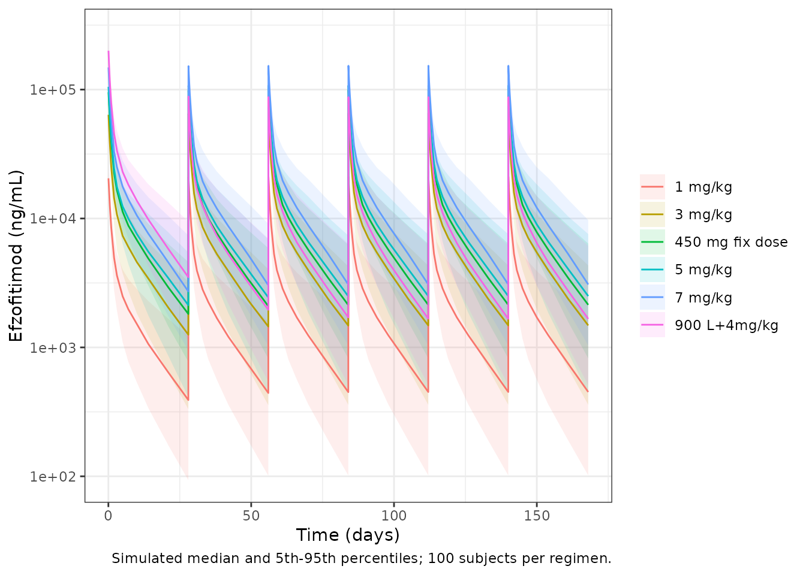
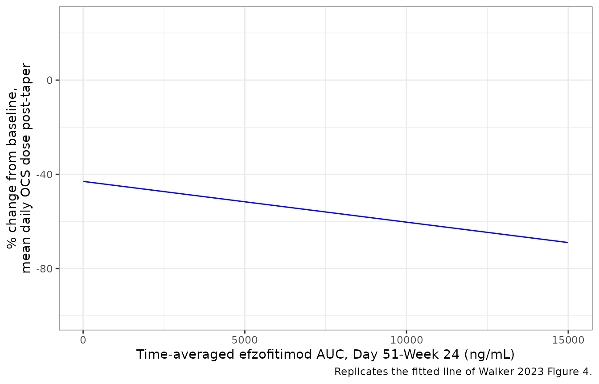
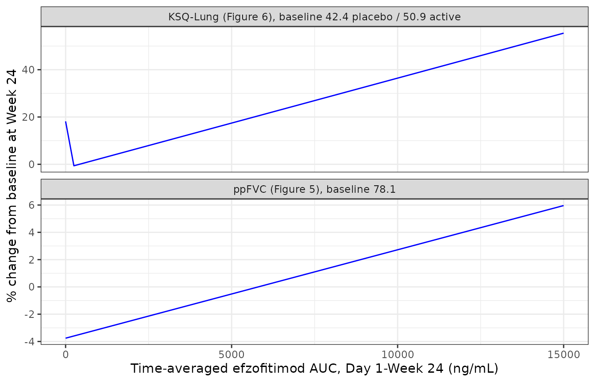
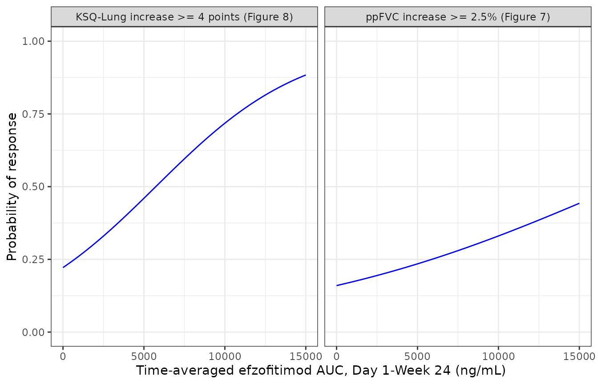

# Efzofitimod population PK and exposure-response in pulmonary sarcoidosis (Walker 2023)

## Source and models

- Citation: Walker G, Adams R, Guy L, Chandrasekaran A, Kinnersley N,
  Ramesh P, Zhang L, Brown F, Niranjan V. Exposure-response analyses of
  efzofitimod in patients with pulmonary sarcoidosis. Front Pharmacol.
  2023;14:1258236. <doi:10.3389/fphar.2023.1258236>. PMCID PMC10580085.
  Parameter estimates are from Supplementary Table S1.
- Article (open access): <https://doi.org/10.3389/fphar.2023.1258236>
- PubMed Central:
  <https://www.ncbi.nlm.nih.gov/pmc/articles/PMC10580085/>
- Supplementary Material (Table S.1 and Equations A.1-A.5) is
  distributed with the open-access article.

Efzofitimod is an immunomodulatory Fc fusion protein (64.5 kDa) that
binds neuropilin-2. Walker 2023 first fits a population PK model to a
Phase 1 healthy-volunteer study and a Phase 1b/2a study in pulmonary
sarcoidosis. It then uses post hoc individual exposures from that model
in five separate exposure-response (E-R) regressions. The authors fitted
the six models separately, so the package carries them as six files:

| Model file | What it is | Source |
|----|----|----|
| `Walker_2023_efzofitimod` | Three-compartment IV population PK | Supplementary Table S.1, Results 3.2, Figure 2 |
| `Walker_2023_efzofitimod_ocs` | Linear: % change from baseline in post-taper mean daily OCS dose | Supplementary Eq. A.1, Figure 4 |
| `Walker_2023_efzofitimod_fvcpp` | Linear: Week-24 ppFVC | Supplementary Eq. A.2, Figure 5 |
| `Walker_2023_efzofitimod_ksqlung` | Linear: Week-24 KSQ-Lung score | Supplementary Eq. A.3, Figure 6 |
| `Walker_2023_efzofitimod_fvcpp_mcid` | Logistic: P(ppFVC increase \>= 2.5%) | Supplementary Eq. A.4, Figures 7 and 9 |
| `Walker_2023_efzofitimod_ksqlung_mcid` | Logistic: P(KSQ-Lung increase \>= 4 points) | Supplementary Eq. A.5, Figures 8 and 9 |

The five E-R models have no PK layer. Exposure enters as the column
`CAV`, the paper’s “time-averaged AUC”: an individual’s cumulative AUC
over the analysis window divided by the window length in days. The paper
prints its unit as ng\*day/mL, but numerically it is an average
concentration in ng/mL. The window is Day 51 to Week 24 (the post-taper
period) for the OCS endpoint and Day 1 to Week 24 for the other four.
Placebo subjects have `CAV = 0`. This vignette makes `CAV` from the PK
model with PKNCA, the same way the source did.

## Population

    #> List of 13
    #>  $ species       : chr "human"
    #>  $ n_subjects    : int 49
    #>  $ n_studies     : int 2
    #>  $ n_observations: int 565
    #>  $ age_range     : chr "Phase 1 mean 23.8 (SD 3.94) years; Phase 1b/2a mean 52.3 (SD 10.3) years"
    #>  $ weight_range  : chr "55-157 kg"
    #>  $ weight_median : chr "82 kg"
    #>  $ sex_female_pct: num 53.1
    #>  $ race_ethnicity: Named num [1:4] 61.2 22.4 10.2 6.1
    #>   ..- attr(*, "names")= chr [1:4] "White" "Black" "Asian" "Other"
    #>  $ disease_state : chr "Healthy volunteers (Phase 1, n = 24) and patients with pulmonary sarcoidosis on oral corticosteroids (Phase 1b/2a, n = 25)"
    #>  $ dose_range    : chr "Phase 1: single 1-h IV infusion of 0.03, 0.1, 0.3, 1, 3 or 5 mg/kg. Phase 1b/2a: 1, 3 or 5 mg/kg IV every 4 wee"| __truncated__
    #>  $ regions       : chr "Australia (Phase 1), United States (Phase 1b/2a)"
    #>  $ notes         : chr "Demographics from Walker 2023 Table 3 (PK-evaluable population). Sex: 23 male (11 + 12), 26 female (13 + 13). R"| __truncated__

The PK analysis pooled 24 healthy volunteers (Phase 1, ATYR1923-C-001,
Australia; single 1-h IV infusion of 0.03-5 mg/kg; rich sampling to 672
h) and 25 patients with pulmonary sarcoidosis (Phase 1b/2a,
ATYR1923-C-002, NCT03824392, USA; 1, 3 or 5 mg/kg every 4 weeks for six
doses; sparse sampling). That is 565 concentrations in total (Walker
2023 Table 1 and Results 3.1). Healthy volunteers were younger (mean
23.8 vs 52.3 years) and lighter (mean 74 vs 97.6 kg) than the patients
(Table 3).

The E-R analysis used only the Phase 1b/2a efficacy-evaluable
population: 32 participants who received at least four doses (11
placebo, 21 efzofitimod; Tables 1, 3 and 4). All were on oral
corticosteroids (10-25 mg/day prednisone or equivalent), tapered to 5
mg/day between Day 15 and Day 50.

## Source trace

| Element | Value | Source location |
|----|----|----|
| Structure: 3-compartment, linear elimination from central | – | Results 3.2, Figure 2 |
| `lcl` | log(1.68 L/day) | Table S.1 ‘CL’; Results 3.2 |
| `lvc` | log(3.94 L) | Table S.1 ‘V1’; Results 3.2 |
| `lq` | log(2.4 L/day) | Table S.1 ‘Q2’ |
| `lvp` | log(3.3 L) | Table S.1 ‘V2’; Results 3.2 |
| `lq2` | log(1.2 L/day) | Table S.1 ‘Q3’ |
| `lvp2` | log(7.43 L) | Table S.1 ‘V3’; Results 3.2 |
| `e_crcl_cl` | 0.71 | Table S.1 ‘CRCL_CL’ |
| `e_tbili_cl` | -0.17 | Table S.1 ‘BILI_CL’ |
| `e_wt_vc` | 0.77 | Table S.1 ‘BWT_V1’ |
| `e_wt_vp` | 1.52 | Table S.1 ‘BWT_V2’ |
| `etalcl`, `etalvc`, `etalq`, `etalvp`, `etalq2`, `etalvp2` | 0.03, 0.01, 0.06, 0.1, 0 FIX, 0.01 | Table S.1 omega^2 rows (variances) |
| `expSdHv` | sqrt(0.01) = 0.1 | Table S.1 ‘epsilon^2 (Phase 1)’, log-additive |
| `expSdPat` | sqrt(1.63) = 1.277 | Table S.1 ‘epsilon^2 (Phase 2)’, log-additive |
| WT reference | 82 kg | Results 3.2 (‘relative to the median value of 82 kg’) |
| CRCL reference | 139 mL/min | Not printed; geometric mean of the Results 3.2 10th/90th percentiles (103, 187) |
| TBILI reference | 7.9 umol/L | Not printed; geometric mean of the Results 3.2 10th/90th percentiles (3.2, 19.6) |
| `ocsdosecfb_int`, `e_cav_ocsdosecfb` | -43.01, -0.001731 | Supplementary Eq. A.1 |
| `fvcpp_int`, `e_cav_fvcpp`, `e_fvc_pctpred_fvcpp` | -17.15, 0.0005061, 1.182 | Supplementary Eq. A.2 |
| `ksqlung_int`, `e_cav_ksqlung` | 50.1, 0.001935 | Supplementary Eq. A.3 |
| `logite0`, `e_cav_logit`, `e_fvc_pctpred_logit` (ppFVC MCID) | -10.25, 0.0000953, 0.11 | Supplementary Eq. A.4 |
| `logite0`, `e_cav_logit`, `e_ksq_lung_bl_logit` (KSQ-Lung MCID) | 6.38, 0.000219, -0.15 | Supplementary Eq. A.5 |
| Exposure metric | AUC over window / window length | Methods 2.3 equation; Results 3.3 (windows) |

## Population PK

### Check 1 – terminal half-life

Table S.1 and Results 3.2 give a terminal half-life of 9 days. For the
typical subject at the reference covariates, the half-lives follow from
the eigenvalues of the three-compartment rate matrix.

``` r

th <- ui_pk$theta
cl <- exp(th[["lcl"]]); v1 <- exp(th[["lvc"]]); q <- exp(th[["lq"]])
v2 <- exp(th[["lvp"]]); q2 <- exp(th[["lq2"]]); v3 <- exp(th[["lvp2"]])
kmat <- matrix(c(
  -(cl + q + q2) / v1, q / v1, q2 / v1,
  q / v2, -q / v2, 0,
  q2 / v3, 0, -q2 / v3
), nrow = 3, byrow = TRUE)
thalf <- sort(log(2) / -eigen(kmat)$values)
thalf
#> [1] 0.3876676 1.9046924 9.0051138
# A deterministic function of the printed parameters: tight tolerance.
stopifnot(abs(thalf[3] - 9) < 0.05)
```

The terminal half-life is 9.005 days against the printed 9 days. The
paper also quotes an “overall” half-life of 11.3 days “accounting for
all phases of elimination” but does not say how it was computed. It is
not `log(2) * Vss / CL` (6.05 days), so it is not checked here.

### Virtual cohort

The cohort reproduces the Phase 1b/2a patients. Weight is drawn from
Table 3 (mean 97.6 kg, SD 25.2), truncated to the 55-157 kg range of
Results 3.2. Creatinine clearance and total bilirubin are drawn
log-normally to match the pooled 10th-90th percentiles of Results 3.2
(103-187 mL/min and 3.2-19.6 umol/L). Each regimen gets 100 subjects.
The six regimens are the three studied doses plus the untested regimens
of Table 2: 7 mg/kg, a flat 450 mg, and a 900 mg loading dose followed
by 4 mg/kg. Every dose is a 1-h IV infusion every 28 days, six doses in
all.

``` r

set.seed(20231011)
n_per <- 100
regimens <- c("1 mg/kg", "3 mg/kg", "5 mg/kg", "7 mg/kg", "450 mg fix dose", "900 L+4mg/kg")
q10 <- stats::qnorm(0.9)
make_subjects <- function(reg, offset) {
  tibble::tibble(
    id = offset + seq_len(n_per),
    regimen = reg,
    WT = pmin(pmax(stats::rnorm(n_per, 97.6, 25.2), 55), 157),
    CRCL = exp(stats::rnorm(n_per, log(sqrt(103 * 187)), log(187 / 103) / (2 * q10))),
    TBILI = exp(stats::rnorm(n_per, log(sqrt(3.2 * 19.6)), log(19.6 / 3.2) / (2 * q10))),
    DIS_HEALTHY = 0L
  )
}
subjects <- dplyr::bind_rows(lapply(seq_along(regimens), function(i) {
  make_subjects(regimens[i], (i - 1) * n_per)
}))

dose_amounts <- function(reg, wt) {
  switch(reg,
    "1 mg/kg" = rep(1 * wt, 6),
    "3 mg/kg" = rep(3 * wt, 6),
    "5 mg/kg" = rep(5 * wt, 6),
    "7 mg/kg" = rep(7 * wt, 6),
    "450 mg fix dose" = rep(450, 6),
    "900 L+4mg/kg" = c(900, rep(4 * wt, 5))
  )
}
dose_times <- (0:5) * 28
# Dense sampling around each infusion, sparse during the terminal phase.
cycle_grid <- c(0, 1 / 24, 2 / 24, 0.25, 0.5, 1, 2, 3, 5, 7, 10, 14, 21)
obs_times <- sort(unique(c(outer(cycle_grid, dose_times, "+"), 50, 168)))
obs_times <- obs_times[obs_times <= 168]

doses <- dplyr::bind_rows(lapply(seq_len(nrow(subjects)), function(i) {
  tibble::tibble(
    id = subjects$id[i], regimen = subjects$regimen[i], time = dose_times,
    amt = dose_amounts(subjects$regimen[i], subjects$WT[i])
  )
})) |>
  dplyr::mutate(evid = 1L, cmt = "central", rate = amt * 24)
obs <- tidyr::expand_grid(id = subjects$id, time = obs_times) |>
  dplyr::mutate(evid = 0L, cmt = "central", amt = 0, rate = 0)
events <- dplyr::bind_rows(doses |> dplyr::select(-regimen), obs) |>
  dplyr::left_join(subjects, by = "id") |>
  dplyr::arrange(id, time, dplyr::desc(evid))
```

``` r

rxode2::rxSetSeed(20231011)
sim <- rxode2::rxSolve(mod_pk, events = events, returnType = "data.frame") |>
  as.data.frame() |>
  dplyr::left_join(subjects |> dplyr::select(id, regimen), by = "id")
#> ℹ parameter labels from comments will be replaced by 'label()'
#> ℹ omega/sigma items treated as zero: 'etalq2'
```

### Figure 3 – concentration-time profiles

Walker 2023 Figure 3 shows the mean concentration-time profile, with
three visible phases. The plot below shows the simulated median and 90%
interval over 24 weeks for each regimen.

``` r

sim |>
  dplyr::filter(time > 0) |>
  dplyr::group_by(regimen, time) |>
  dplyr::summarise(
    med = median(Cc), lo = quantile(Cc, 0.05), hi = quantile(Cc, 0.95),
    .groups = "drop"
  ) |>
  ggplot(aes(time, med, colour = regimen, fill = regimen)) +
  geom_ribbon(aes(ymin = lo, ymax = hi), alpha = 0.12, colour = NA) +
  geom_line() +
  scale_y_log10() +
  labs(
    x = "Time (days)", y = "Efzofitimod (ng/mL)", colour = NULL, fill = NULL,
    caption = "Simulated median and 5th-95th percentiles; 100 subjects per regimen."
  ) +
  theme_bw()
```



### Check 2 – PKNCA: exposure windows and terminal half-life

PKNCA computes each subject’s AUC over the two E-R windows: Day 1 to
Week 24 (times 0-168 days) and Day 51 to Week 24 (times 50-168 days).
Dividing by the window length gives `CAV`, exactly as Methods 2.3
defines it. A single-dose run at the reference covariates also gives a
terminal half-life to compare with the printed 9 days.

``` r

conc_obj <- PKNCA::PKNCAconc(
  sim |> dplyr::filter(!is.na(Cc)) |> dplyr::select(id, regimen, time, Cc),
  Cc ~ time | regimen + id
)
dose_obj <- PKNCA::PKNCAdose(doses, amt ~ time | regimen + id)
intervals <- data.frame(
  start = c(0, 50), end = c(168, 168),
  aucint.last = TRUE
)
nca <- PKNCA::pk.nca(PKNCA::PKNCAdata(conc_obj, dose_obj, intervals = intervals))
cav <- as.data.frame(nca$result) |>
  dplyr::filter(PPTESTCD == "aucint.last") |>
  dplyr::mutate(window = ifelse(start == 0, "cav_d1_w24", "cav_d51_w24"),
                CAV = PPORRES / (end - start)) |>
  dplyr::select(id, regimen, window, CAV) |>
  tidyr::pivot_wider(names_from = window, values_from = CAV)
```

``` r

single_obs <- c(0, seq(0.5, 84, by = 0.5))
ev_single <- dplyr::bind_rows(
  tibble::tibble(time = 0, evid = 1L, amt = 5 * 82, rate = 5 * 82 * 24),
  tibble::tibble(time = single_obs, evid = 0L, amt = 0, rate = 0)
) |>
  dplyr::mutate(
    id = 1L, cmt = "central", WT = 82, CRCL = 139, TBILI = 7.9, DIS_HEALTHY = 1L,
    treatment = "5 mg/kg single dose (reference subject)"
  )
# zeroRe() removes the residual error as well, which rxode2 reports; expected.
sim_single <- withCallingHandlers(
  rxode2::rxSolve(rxode2::zeroRe(mod_pk), events = ev_single, returnType = "data.frame"),
  warning = function(w) {
    if (grepl("No sigma parameters", conditionMessage(w))) invokeRestart("muffleWarning")
  }
) |> as.data.frame()
#> ℹ parameter labels from comments will be replaced by 'label()'
#> ℹ omega/sigma items treated as zero: 'etalcl', 'etalvc', 'etalq', 'etalvp', 'etalq2', 'etalvp2'
if (is.null(sim_single$id)) sim_single$id <- 1L
sim_single$treatment <- ev_single$treatment[1]
nca_single <- PKNCA::pk.nca(PKNCA::PKNCAdata(
  PKNCA::PKNCAconc(sim_single |> dplyr::filter(!is.na(Cc)), Cc ~ time | treatment + id),
  PKNCA::PKNCAdose(ev_single |> dplyr::filter(evid == 1), amt ~ time | treatment + id),
  intervals = data.frame(start = 0, end = Inf, cmax = TRUE, aucinf.obs = TRUE, half.life = TRUE)
))
knitr::kable(
  nlmixr2lib::ncaComparisonTable(
    simulated = nca_single,
    reference = data.frame(treatment = "5 mg/kg single dose (reference subject)", half.life = 9),
    by = "treatment",
    params = "half.life",
    units = c(half.life = "day")
  ),
  caption = "Terminal half-life from PKNCA against Walker 2023 Table S.1 'Terminal HL'."
)
```

| NCA parameter | treatment | Reference | Simulated | % diff |
|:---|:---|:---|:---|:---|
| t½ (day) | 5 mg/kg single dose (reference subject) | 9 | 8.96 | -0.5% |

Terminal half-life from PKNCA against Walker 2023 Table S.1 ‘Terminal
HL’. {.table}

### Check 3 – exposure by dose group (Table 3 and Figure 5)

Tables 3 and 4 split the 21 efzofitimod participants into tertiles of
Day 1 to Week 24 time-averaged AUC, with boundaries 805, 3,638, 6,198
and 14,860. Figure 5 plots each participant’s exposure by dose group,
and the tertiles almost coincide with the dose groups. The per-dose
medians below were read by the maintainers from the Figure 5 points (7
per dose group, or 8 at 5 mg/kg).

``` r

fig5_med <- tibble::tibble(
  regimen = c("1 mg/kg", "3 mg/kg", "5 mg/kg"),
  fig5_median = c(1850, 5500, 8500),
  lower = c(805, 3638, 6198), upper = c(3638, 6198, 14860)
)
tert_chk <- cav |>
  dplyr::filter(regimen %in% fig5_med$regimen) |>
  dplyr::group_by(regimen) |>
  dplyr::summarise(
    median_cav = median(cav_d1_w24),
    p10 = quantile(cav_d1_w24, 0.1), p90 = quantile(cav_d1_w24, 0.9),
    .groups = "drop"
  ) |>
  dplyr::left_join(fig5_med, by = "regimen") |>
  dplyr::mutate(ratio = median_cav / fig5_median)
tert_chk |>
  dplyr::select(regimen, median_cav, p10, p90, fig5_median, ratio, lower, upper) |>
  dplyr::rename(
    "Regimen" = regimen, "Simulated median CAV (ng/mL)" = median_cav,
    "Simulated P10" = p10, "Simulated P90" = p90,
    "Figure 5 median (read)" = fig5_median, "Simulated / Figure 5" = ratio,
    "Table 3 tertile lower" = lower, "Table 3 tertile upper" = upper
  ) |>
  knitr::kable(digits = c(0, 0, 0, 0, 0, 2, 0, 0))
```

| Regimen | Simulated median CAV (ng/mL) | Simulated P10 | Simulated P90 | Figure 5 median (read) | Simulated / Figure 5 | Table 3 tertile lower | Table 3 tertile upper |
|:---|---:|---:|---:|---:|---:|---:|---:|
| 1 mg/kg | 2092 | 1314 | 3435 | 1850 | 1.13 | 805 | 3638 |
| 3 mg/kg | 6500 | 3740 | 9901 | 5500 | 1.18 | 3638 | 6198 |
| 5 mg/kg | 10891 | 5946 | 16515 | 8500 | 1.28 | 6198 | 14860 |

``` r

# Structural gate on the centre: a unit slip (mg vs ng), a wrong clearance
# or a mis-scaled dose moves these ratios by a factor of 2 or 1000, not by tens of percent.
stopifnot(all(tert_chk$ratio > 0.75 & tert_chk$ratio < 1.5))
```

The simulated exposures are dose-proportional, as the paper reports (“a
good correlation between time-averaged AUC and dose”). They sit about
13-28% above the Figure 5 values. The 1 and 5 mg/kg medians fall inside
their tertiles; the 3 mg/kg median lies just above the 6,198 boundary.
The paper used post hoc individual clearances and the doses each
participant actually received; four of the 21 received only four or five
doses (Methods 2.1). It also does not give the exact length of its
“study duration”. Any of these would lower the published values relative
to a six-dose typical-cohort simulation. The offset is reported here and
not adjusted.

### Covariate effects on exposure (Results 3.2)

Body weight acts only on V1 and V2, so at steady state it does not
change exposure for a fixed dose. Under mg/kg dosing, exposure is
proportional to the dose, and so to weight. The printed changes of +30%
at the 90th percentile of weight and -19% at the 10th percentile
(relative to 82 kg) therefore imply weight percentiles of about 106.6 kg
and 66.4 kg. Both lie inside the 55-157 kg range.

The printed CrCL and bilirubin ranges are **not** consistent with the
printed exponents. Steady-state AUC is proportional to `1 / CL`, so the
change at each percentile follows from the power terms:

``` r

cov_tab <- tibble::tibble(
  Covariate = c("CrCL 10th pct (103 mL/min)", "CrCL 90th pct (187 mL/min)",
                "Bilirubin 10th pct (3.2 umol/L)", "Bilirubin 90th pct (19.6 umol/L)"),
  `Model AUC change (%)` = 100 * (c((103 / 139)^-0.71, (187 / 139)^-0.71,
                                    (3.2 / 7.9)^0.17, (19.6 / 7.9)^0.17) - 1),
  `Printed AUC change (%)` = c(10, -10, -8, 10)
)
knitr::kable(cov_tab, digits = 1)
```

| Covariate | Model AUC change (%) | Printed AUC change (%) |
|:---|---:|---:|
| CrCL 10th pct (103 mL/min) | 23.7 | 10 |
| CrCL 90th pct (187 mL/min) | -19.0 | -10 |
| Bilirubin 10th pct (3.2 umol/L) | -14.2 | -8 |
| Bilirubin 90th pct (19.6 umol/L) | 16.7 | 10 |

No single reference value reconciles the printed changes with the
exponents, because their ratio depends only on the 10th/90th-percentile
ratio. The model keeps the Table S.1 exponents (see Assumptions and
deviations).

## Exposure-response

``` r

solve_er <- function(model, output, data) {
  ev <- dplyr::mutate(data, id = dplyr::row_number(), time = 0, amt = 0, evid = 0L)
  # The E-R models have no random effects by design, so rxode2's notice
  # about a multi-subject solve without omega is expected; muffle only it.
  out <- withCallingHandlers(
    as.data.frame(rxode2::rxSolve(model, events = ev, returnType = "data.frame")),
    warning = function(w) {
      if (grepl("without 'omega'", conditionMessage(w))) invokeRestart("muffleWarning")
    }
  )
  if (is.null(out$id)) out$id <- 1L
  out[[output]][match(ev$id, out$id)]
}
cav_grid <- seq(0, 15000, by = 250)
```

### Figure 4 – OCS dose (Eq. A.1)

``` r

ocs_line <- tibble::tibble(CAV = cav_grid,
                           ocsdosecfb = solve_er(mod_ocs, "ocsdosecfb", tibble::tibble(CAV = cav_grid)))
ggplot(ocs_line, aes(CAV, ocsdosecfb)) +
  geom_line(colour = "blue") +
  coord_cartesian(ylim = c(-100, 25)) +
  labs(x = "Time-averaged efzofitimod AUC, Day 51-Week 24 (ng/mL)",
       y = "% change from baseline,\nmean daily OCS dose post-taper",
       caption = "Replicates the fitted line of Walker 2023 Figure 4.") +
  theme_bw()
```



``` r

ends <- ocs_line$ocsdosecfb[ocs_line$CAV %in% c(0, 15000)]
ends
#> [1] -43.010 -68.975
# Figure 4's fitted line runs from about -43% at zero exposure to about -69%
# at 15,000 (read from the figure).
stopifnot(abs(ends[1] - (-43)) < 2, abs(ends[2] - (-69)) < 3)
```

The OCS equation matches the Figure 4 line exactly. Typical post-taper
exposures in the cohort above put the predicted OCS reduction at:

``` r

cav |>
  dplyr::mutate(ocsdosecfb = solve_er(mod_ocs, "ocsdosecfb", dplyr::select(cav, CAV = cav_d51_w24))) |>
  dplyr::group_by(regimen) |>
  dplyr::summarise(`Median CAV Day 51-Wk 24` = median(cav_d51_w24),
                   `Median % change in OCS dose` = median(ocsdosecfb), .groups = "drop") |>
  dplyr::rename("Regimen" = regimen) |>
  knitr::kable(digits = 1)
```

| Regimen         | Median CAV Day 51-Wk 24 | Median % change in OCS dose |
|:----------------|------------------------:|----------------------------:|
| 1 mg/kg         |                  2044.8 |                       -46.5 |
| 3 mg/kg         |                  6374.4 |                       -54.0 |
| 450 mg fix dose |                  9547.8 |                       -59.5 |
| 5 mg/kg         |                 10672.4 |                       -61.5 |
| 7 mg/kg         |                 14477.8 |                       -68.1 |
| 900 L+4mg/kg    |                  7858.7 |                       -56.6 |

### Figures 5 and 6 – ppFVC and KSQ-Lung (Eqs. A.2 and A.3)

Equations A.2 and A.3 are labelled “percent change from baseline”, but
their values are the **absolute** Week-24 score. Read literally, A.2 at
a baseline ppFVC of 78 would predict a change of about +75%, and A.3 a
change of at least +50% at any exposure, while Figures 5 and 6 centre
near -5% and +15% at zero exposure. The models therefore emit the
absolute scores (`fvcpp`, `ksqlung`). The percent change is formed below
at the efficacy-population baselines (Table 4: ppFVC 78.1; KSQ-Lung 42.4
on placebo and 50.9 on efzofitimod).

``` r

fvc_line <- tibble::tibble(CAV = cav_grid, FVC_PCTPRED = 78.1) |>
  dplyr::mutate(fvcpp = solve_er(mod_fvc, "fvcpp", dplyr::pick(CAV, FVC_PCTPRED)),
                pct = 100 * (fvcpp - FVC_PCTPRED) / FVC_PCTPRED,
                Endpoint = "ppFVC (Figure 5), baseline 78.1")
ksq_line <- tibble::tibble(CAV = cav_grid) |>
  dplyr::mutate(ksqlung = solve_er(mod_ksq, "ksqlung", dplyr::pick(CAV)),
                bl = ifelse(CAV == 0, 42.4, 50.9),
                pct = 100 * (ksqlung - bl) / bl,
                Endpoint = "KSQ-Lung (Figure 6), baseline 42.4 placebo / 50.9 active")
dplyr::bind_rows(fvc_line, ksq_line) |>
  ggplot(aes(CAV, pct)) +
  geom_line(colour = "blue") +
  facet_wrap(~Endpoint, scales = "free_y", ncol = 1) +
  labs(x = "Time-averaged efzofitimod AUC, Day 1-Week 24 (ng/mL)",
       y = "% change from baseline at Week 24") +
  theme_bw()
```



``` r

fig56 <- tibble::tibble(
  Endpoint = c("ppFVC", "ppFVC", "KSQ-Lung", "KSQ-Lung"),
  CAV = c(0, 15000, 0, 15000),
  `Model (% change)` = c(fvc_line$pct[fvc_line$CAV %in% c(0, 15000)],
                         ksq_line$pct[ksq_line$CAV %in% c(0, 15000)]),
  `Figure line (% change, read)` = c(-5, 8, 15, 62)
)
knitr::kable(fig56, digits = 1)
```

| Endpoint |   CAV | Model (% change) | Figure line (% change, read) |
|:---------|------:|-----------------:|-----------------------------:|
| ppFVC    |     0 |             -3.8 |                           -5 |
| ppFVC    | 15000 |              6.0 |                            8 |
| KSQ-Lung |     0 |             18.2 |                           15 |
| KSQ-Lung | 15000 |             55.5 |                           62 |

``` r

# Direction of the exposure effect; the figure lines are unadjusted fits of
# the percent change and need not coincide with the baseline-adjusted
# equations, so only the sign and the zero-exposure placement are asserted.
stopifnot(
  diff(fig56$`Model (% change)`[1:2]) > 0,
  diff(fig56$`Model (% change)`[3:4]) > 0,
  abs(fig56$`Model (% change)`[1] - (-5)) < 5,
  abs(fig56$`Model (% change)`[3] - 15) < 10
)
```

### Figures 7 and 8 – responder probabilities (Eqs. A.4 and A.5)

Figures 7 and 8 draw an **unadjusted** logistic fit (exposure only). The
equations add the baseline score. The curves below evaluate the
equations at the mean efficacy-population baselines (ppFVC 78.1;
KSQ-Lung 50.9).

``` r

mcid_curves <- dplyr::bind_rows(
  tibble::tibble(CAV = cav_grid, FVC_PCTPRED = 78.1) |>
    dplyr::mutate(p = solve_er(mod_fvc_mcid, "prob_fvcpp_incr2p5", dplyr::pick(CAV, FVC_PCTPRED)),
                  Endpoint = "ppFVC increase >= 2.5% (Figure 7)"),
  tibble::tibble(CAV = cav_grid, KSQ_LUNG_BL = 50.9) |>
    dplyr::mutate(p = solve_er(mod_ksq_mcid, "prob_ksqlung_mcid", dplyr::pick(CAV, KSQ_LUNG_BL)),
                  Endpoint = "KSQ-Lung increase >= 4 points (Figure 8)")
)
ggplot(mcid_curves, aes(CAV, p)) +
  geom_line(colour = "blue") +
  facet_wrap(~Endpoint) +
  coord_cartesian(ylim = c(0, 1)) +
  labs(x = "Time-averaged efzofitimod AUC, Day 1-Week 24 (ng/mL)",
       y = "Probability of response") +
  theme_bw()
```



### Figure 9 – simulated response by regimen

Figure 9 is the paper’s dose-selection forest plot: the predicted
Week-24 probability of each responder endpoint for placebo and the six
regimens of Table 2. Here every simulated subject from the PK cohort
receives its own `CAV`. Baseline ppFVC and KSQ-Lung are drawn from the
Table 4 efficacy-population distributions, and the mean probability is
taken per regimen.

``` r

set.seed(9)
fig9_cohort <- dplyr::bind_rows(
  cav |> dplyr::select(id, regimen, CAV = cav_d1_w24),
  tibble::tibble(id = -seq_len(n_per), regimen = "Placebo", CAV = 0)
) |>
  dplyr::mutate(
    FVC_PCTPRED = stats::rnorm(dplyr::n(), 78.1, 14.9),
    KSQ_LUNG_BL = pmin(pmax(stats::rnorm(dplyr::n(), 50.9, 13), 0), 100)
  )
fig9_cohort$p_fvc <- solve_er(mod_fvc_mcid, "prob_fvcpp_incr2p5",
                              dplyr::select(fig9_cohort, CAV, FVC_PCTPRED))
fig9_cohort$p_ksq <- solve_er(mod_ksq_mcid, "prob_ksqlung_mcid",
                              dplyr::select(fig9_cohort, CAV, KSQ_LUNG_BL))
fig9_pub <- tibble::tibble(
  regimen = c("Placebo", "3 mg/kg", "5 mg/kg", "450 mg fix dose", "900 L+4mg/kg", "7 mg/kg"),
  pub_fvc = c(0.25, 0.33, 0.39, 0.38, 0.39, 0.45),
  pub_ksq = c(0.60, 0.73, 0.79, 0.78, 0.79, 0.84)
)
fig9 <- fig9_cohort |>
  dplyr::group_by(regimen) |>
  dplyr::summarise(sim_fvc = mean(p_fvc), sim_ksq = mean(p_ksq), .groups = "drop") |>
  dplyr::inner_join(fig9_pub, by = "regimen") |>
  dplyr::arrange(match(regimen, fig9_pub$regimen))
fig9 |>
  dplyr::rename(
    "Regimen" = regimen,
    "ppFVC >= 2.5%: simulated" = sim_fvc, "ppFVC >= 2.5%: Figure 9" = pub_fvc,
    "KSQ-Lung MCID: simulated" = sim_ksq, "KSQ-Lung MCID: Figure 9" = pub_ksq
  ) |>
  knitr::kable(digits = 2)
```

| Regimen | ppFVC \>= 2.5%: simulated | KSQ-Lung MCID: simulated | ppFVC \>= 2.5%: Figure 9 | KSQ-Lung MCID: Figure 9 |
|:---|---:|---:|---:|---:|
| Placebo | 0.24 | 0.32 | 0.25 | 0.60 |
| 3 mg/kg | 0.31 | 0.52 | 0.33 | 0.73 |
| 5 mg/kg | 0.43 | 0.61 | 0.39 | 0.79 |
| 450 mg fix dose | 0.39 | 0.67 | 0.38 | 0.78 |
| 900 L+4mg/kg | 0.42 | 0.65 | 0.39 | 0.79 |
| 7 mg/kg | 0.47 | 0.80 | 0.45 | 0.84 |

``` r

# ppFVC: the whole chain (PK model -> PKNCA CAV -> Eq. A.4) reproduces the
# published probabilities. Centre and robust envelope only: the cohort mean
# moves by about 0.02 between random-number streams.
fvc_err <- abs(fig9$sim_fvc - fig9$pub_fvc)
stopifnot(median(fvc_err) < 0.03, quantile(fvc_err, 0.8) < 0.05)
```

The ppFVC column agrees with Figure 9 in every regimen, with a median
absolute difference of 0.018 and a largest difference of 0.041.
Exposures here run slightly above the published ones (Check 3), which
accounts for most of that. This agreement tests the PK model, the
exposure definition (Day 1 to Week 24 AUC divided by 168 days), the
ng/mL reading of the exposure unit and Eq. A.4 together.

The KSQ-Lung column does **not** match. Figure 9 gives 0.60 on placebo.
Equation A.5 gives 0.22 at the efficacy-population mean baseline of 50.9
and 0.5 at the placebo-arm mean of 42.4. A placebo probability of 0.60
for a typical subject needs a baseline of 39.8, lower than any arm mean
in Table 4. The step from placebo to 7 mg/kg in Figure 9 is also flatter
than the A.5 slope implies. The paper does not report the baseline
distribution behind Figure 9, so the gap cannot be traced. Equation A.5
is kept as printed, because it is broadly consistent with the observed
responder rates in Figure 8 (7 of 11 placebo participants, and a rise
from about 14% to 83% across the exposure tertiles, whose mean baselines
are 50.6, 53.8 and 48.3).

## Assumptions and deviations

- **CrCL and bilirubin reference values.** Walker 2023 does not print
  the reference values of the two power terms on CL. The model uses 139
  mL/min and 7.9 umol/L, the geometric means of the printed 10th and
  90th percentiles: an estimate of the median for a log-symmetric
  distribution. The same method recovers about 84 kg for weight, against
  the printed median of 82 kg. Results 3.2 does print 82 kg, so weight
  uses it.
- **CrCL is raw mL/min.** Results 3.2 reports CrCL in mL/min, not
  BSA-normalised, and does not name the estimating equation. Supply
  creatinine clearance in mL/min in the `CRCL` column.
- **Printed covariate impacts are inconsistent with the printed
  exponents** (table above). The Table S.1 exponents are kept, because
  the table is the primary source of the estimates.
- **Residual error.** Table S.1 reports log-additive residual
  *variances* (0.01 for Phase 1 and 1.63 for Phase 1b/2a). The model
  uses their square roots as log-scale SDs, selected by `DIS_HEALTHY` (1
  for the Phase 1 healthy-volunteer study, 0 for patients).
- **omega^2 for Q3 is 0 FIX** in Table S.1 and is encoded as
  `etalq2 ~ fixed(0)`.
- **Equations A.2 and A.3 are absolute Week-24 scores.** They are
  labelled “percent change from baseline”, but their magnitudes are only
  consistent with the absolute score (Figures 5 and 6 section above).
  The outputs are `fvcpp` and `ksqlung`; compute the percent change from
  the baseline yourself.
- **Exposure unit.** The source prints time-averaged AUC in ng\*day/mL.
  Cumulative AUC divided by days is a concentration. The ng/mL reading
  puts each simulated dose group within about 30% of the Figure 5
  exposures and reproduces the Figure 9 ppFVC probabilities.
- **Simulated exposures are about 10-30% above the published ones**
  (Check 3). The reasons the paper allows for (actual doses received,
  post hoc clearances, an unstated study duration) are listed there;
  nothing is adjusted.
- **Exposure window lengths.** Day 1 to Week 24 is taken as 168 days
  (times 0-168) and Day 51 to Week 24 as 118 days (times 50-168). The
  paper notes that some participants received only four or five doses.
  Their real exposure windows are not reported, so the simulation gives
  everyone six doses.
- **No residual error is reported for the E-R regressions.** The linear
  models (A.1-A.3) are least-squares fits whose residual standard error
  is not printed. The logistic models (A.4, A.5) have a Bernoulli
  likelihood with no residual. All five carry a tiny fixed additive SD
  (0.001) only so rxode2 accepts an observation model. These are
  typical-value predictions: they do not describe between-patient
  scatter.
- **ppFVC responder threshold.** The paper calls it “a 2.5% increase”
  and does not say whether that is a relative change or 2.5 percentage
  points. The model returns the probability as fitted, so the reading
  does not affect it.
- **Virtual-cohort covariates.** CrCL and bilirubin are drawn from the
  pooled PK-population percentiles (Results 3.2), since no patient-only
  distribution is reported. Baseline ppFVC and KSQ-Lung are drawn as
  normal distributions with the Table 4 efzofitimod-arm mean and SD.
- **Figure 9 KSQ-Lung probabilities are not reproduced** (see above).
  The equation is kept as printed.
- **Overall half-life of 11.3 days** is not checked, because the paper
  does not define how it was computed.
- No erratum or correction to Walker 2023 was found (checked
  2026-11-07).
