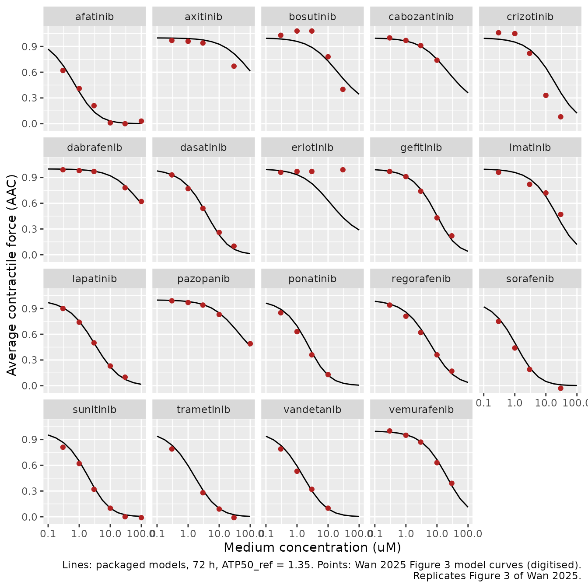
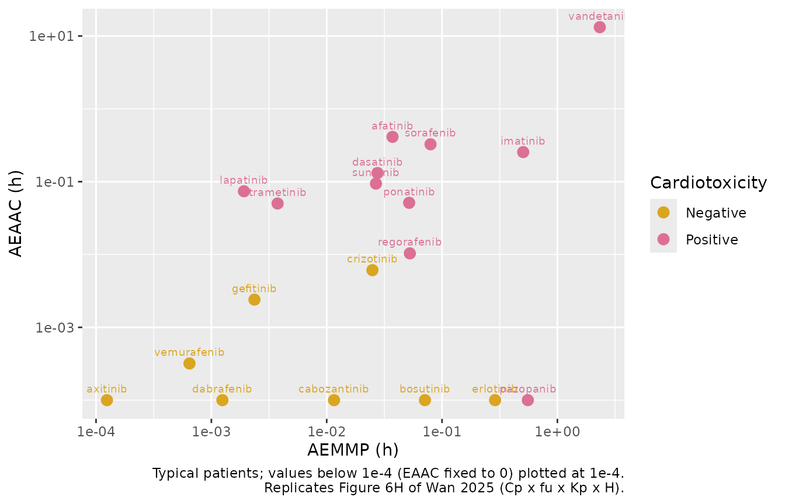
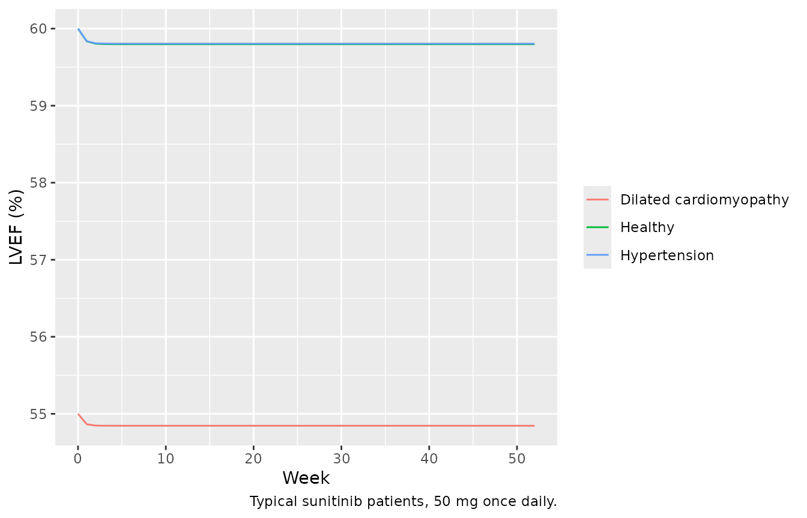
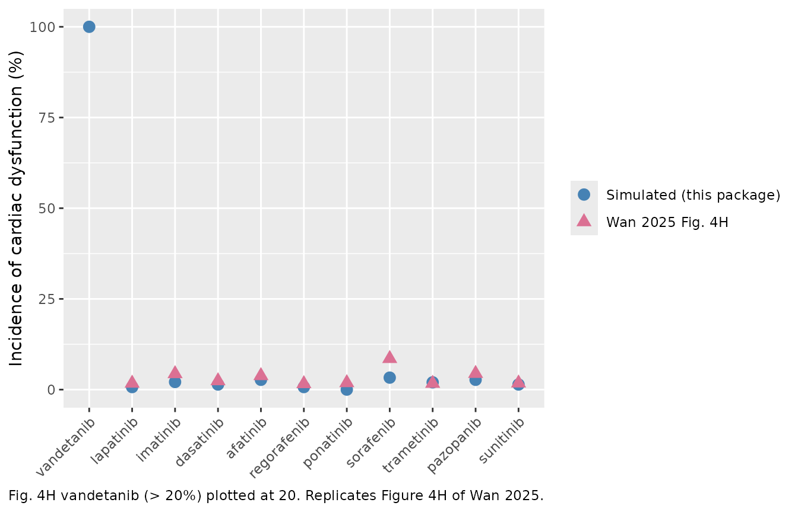

# Tyrosine kinase inhibitor cardiotoxicity QSP-PK-TD, 19 TKIs (Wan 2025)

## Model and source

- Citation: Wan Z, Wang C, Luo S, Zhu J, He H, Hao K (2025). Bridging
  the Gap Between hiPSC-CMs Cardiotoxicity Assessment and Clinical LVEF
  Decline Risk: A Case Study of 21 Tyrosine Kinase Inhibitors.
  Pharmaceuticals (Basel) 18(4):450. <doi:10.3390/ph18040450>.
  Cardiovascular QSP structure and dissipation rate constants from Sang
  L et al. (2021) CPT Pharmacometrics Syst Pharmacol 10(12):1512-1524
  (<doi:10.1002/psp4.12719>; Sang_2021_doxorubicin_human_qsp); tau,
  kin_ATP, kin_MMP and n from Sang L, Zhou Z, Luo S, Zhang Y, Qian H,
  Zhou Y, He H, Hao K (2024) Pharm Res 41(2):247-262
  (<doi:10.1007/s11095-023-03644-4>), Table I.
- Article: <https://doi.org/10.3390/ph18040450>
- Supplement: <https://www.mdpi.com/article/10.3390/ph18040450/s1>

Wan et al. (2025) translated high-throughput toxicity data from human
induced pluripotent stem cell-derived cardiomyocytes (hiPSC-CMs) into a
predicted clinical incidence of left ventricular ejection fraction
(LVEF) decline for 21 tyrosine kinase inhibitors (TKIs). Each TKI is a
QSP-PK-TD model with three layers:

1.  **PK.** A published population PK model of the TKI, condensed to
    typical values and CVs in Table S2. The plasma concentration is
    converted to an effective myocardial concentration
    `Cin = Cp x fu x Kp x H` (Eqs. 17, 18, 21): fraction unbound (Table
    S5), heart-to-plasma partition coefficient (Table S7; observed where
    reported, otherwise the Poulin-Theil prediction) and a
    heterogeneous-distribution factor `H = IC50,2D / IC50,3D` (Table S8;
    1 where no 3D value exists).
2.  **TD.** An in vitro toxicodynamic model fitted to 72-h hiPSC-CM
    viability, ATP and contractility data (Table 1; structure from Sang
    2024): `Cin` above a threshold `Cth` injures cells, which die
    through three transit stages (Eqs. 1-8); `Cin` inhibits
    mitochondrial membrane potential (MMP) production, which drives ATP
    (Eqs. 9-11); and `Cin` raises the ATP needed for half-maximal
    average contractile force (AAC, Eqs. 12-14).
3.  **QSP.** The surviving fraction times AAC replaces the drug effect
    on stroke-volume production in the Sang 2021 human cardiovascular
    QSP model (`Sang_2021_doxorubicin_human_qsp`), with baselines and
    the LVESV feedback `FB_LVESV` for cardiovascular-healthy,
    hypertensive and dilated-cardiomyopathy patients (Table 2).

The package carries 19 of the 21 TKIs, one model file each. Ibrutinib
and nilotinib are not included: Table S2 gives only a lag time for their
absorption, and the zero-order absorption duration of the primary PK
models (Al-Ghazawi 2021, Giles 2013) is needed to reproduce their
exposure.

``` r

drugs <- c(
  "afatinib", "axitinib", "bosutinib", "cabozantinib", "crizotinib",
  "dabrafenib", "dasatinib", "erlotinib", "gefitinib", "imatinib",
  "lapatinib", "pazopanib", "ponatinib", "regorafenib", "sorafenib",
  "sunitinib", "trametinib", "vandetanib", "vemurafenib"
)
# Wan 2025 Figures 1-3, panel B = cardiotoxic, panel A = non-cardiotoxic
# (nilotinib, also cardiotoxic, is not packaged)
cardiotoxic <- c(
  "afatinib", "dasatinib", "imatinib", "lapatinib", "pazopanib",
  "ponatinib", "regorafenib", "sorafenib", "sunitinib", "trametinib",
  "vandetanib"
)
model_name <- function(drug) paste0("Wan_2025_", drug, "_qsp")
mods <- lapply(setNames(drugs, drugs), function(d) rxode2::rxode2(readModelDb(model_name(d))))
mods_typ <- lapply(mods, rxode2::zeroRe)
```

Dosing regimens are from Table S4. Ponatinib has two parallel absorption
routes and takes the same dose record in both `depot` and `depot2` (the
model splits it by `fdepot`).

``` r

regimen <- tibble::tribble(
  ~drug, ~dose, ~ii,
  "afatinib", 40, 24, "axitinib", 5, 12, "bosutinib", 500, 24,
  "cabozantinib", 140, 24, "crizotinib", 250, 12, "dabrafenib", 150, 12,
  "dasatinib", 100, 24, "erlotinib", 150, 24, "gefitinib", 250, 24,
  "imatinib", 400, 24, "lapatinib", 1250, 24,
  "pazopanib", 800, 24, "ponatinib", 45, 24,
  "regorafenib", 160, 24, "sorafenib", 400, 12, "sunitinib", 50, 24,
  "trametinib", 2, 24, "vandetanib", 300, 24, "vemurafenib", 960, 24
)
dose_cmts <- function(drug) {
  switch(drug,
    ponatinib = c("depot", "depot2"),
    "depot"
  )
}
# Dosing records for `days` days of the Table S4 regimen
dose_events <- function(drug, days) {
  r <- regimen[regimen$drug == drug, ]
  tt <- seq(0, days * 24 - r$ii, by = r$ii)
  dplyr::bind_rows(lapply(dose_cmts(drug), function(cm) {
    data.frame(time = tt, amt = r$dose, evid = 1L, cmt = cm, dvid = NA_integer_)
  }))
}
obs_events <- function(times) {
  data.frame(time = times, amt = 0, evid = 0L, cmt = NA_character_, dvid = 1L)
}
# Cardiovascular-healthy typical patient (Table 2)
healthy_typ <- data.frame(
  LVEDV_BL = 113, LVESV_BL = 113 * (1 - 0.6), HR_BL = 70, MAP_BL = 94.92,
  DIS_HYPERT = 0L, DIS_DILATED_CARDIOMYOPATHY = 0L
)
```

Observation rows carry `dvid = 1` and no compartment; every output
(`Cc`, `LVEF`, `LVEDV`, `LVESV`, `MAP`) is computed on every row.

## Population

No patient data were fitted. Wan et al. generated 5000 virtual patients
for each of three cardiovascular populations by Monte Carlo sampling
around the Table 2 typical values and CVs, and weighted the population
incidences by prevalence (64.97% cardiovascular healthy, 35%
hypertension, 0.03% dilated cardiomyopathy; Eq. 16). Hypertension was
defined by a baseline mean arterial pressure of at least 106 mmHg and
dilated cardiomyopathy by a baseline LVEDV of at least 146 mL. The TD
parameters were estimated (Monolix 2021R2) on viability, ATP and
contractile-force data digitised from the 21-TKI hiPSC-CM screen of
Sharma et al. (2017) after 72 h of exposure.

``` r

readModelDb("Wan_2025_sunitinib_qsp")()$population
#> $species
#> [1] "human"
#> 
#> $n_subjects
#> [1] 15000
#> 
#> $disease_state
#> [1] "Virtual adult cancer patients treated with sunitinib (50 mg, QD), in three cardiovascular populations: cardiovascular healthy, hypertension (MAP0 >= 106 mmHg) and dilated cardiomyopathy (LVEDV0 >= 146 mL)"
#> 
#> $dose_range
#> [1] "50 mg, QD for one year (Wan 2025 Table S4)"
#> 
#> $notes
#> [1] "Virtual population only; no human data were fitted. Wan 2025 generated 5000 virtual patients per cardiovascular population by Monte Carlo sampling (Table 2 typical values and CVs) and weighted the incidence 64.97% healthy, 35% hypertension, 0.03% dilated cardiomyopathy (Eq. 16). The PK model is a published population model condensed to typical values and CVs in Table S2; the toxicodynamic parameters were fitted to digitised high-throughput hiPSC-CM viability, ATP and contractility data (Sharma 2017) after 72 h exposure."
```

## Source trace

Every `ini()` value carries an in-file comment naming its source. The
shared structure and constants:

| Equation / parameter | Value | Source |
|----|----|----|
| PK structure, typical values, CVs | per TKI | Table S2 |
| Regimen | per TKI | Table S4 |
| `fu` | per TKI | Table S5 (printed in %) |
| `mw` | per TKI | Table S6 |
| `lkp_heart` | per TKI | Table S7, observed Kp where reported, otherwise Kp_prediction |
| `h_het` = IC50,2D / IC50,3D | per TKI | Table S8 and Eq. 21; 1 without an IC50,3D |
| `cin` = Cc / MW x 1000 x fu x Kp x H | – | Eqs. 17, 18, 21 |
| `kinj`, `EC50inj`, `hill_inj`, `Cth`, `EC50MMP`, `EEC` | per TKI | Table 1 (`kinj` x 1e-2, 1/h) |
| `emax_inj` | 1 | Section 4.2.1 |
| Injury and death chain | – | Eqs. 1-8 |
| `tau_inj`, `kin_mmp`, `kin_atp`, `n_atp` | 4.9 h, 0.96 1/h, 0.032 1/h, 0.8 | Sang 2024 Table I (DOX-TRZ fit), adopted per Section 4.2.4 |
| `kout_mmp = kin_mmp`, `kout_atp = kin_atp` | – | Baselines MMP0 = ATP0 = 1 (Sang 2024) |
| MMP and ATP turnover | – | Eqs. 9-11 |
| `eaac`, ATP50 = ATP50_ref / (1 - EAAC), AAC | – | Eqs. 12-14 (Eq. 13 corrected, see below) |
| `atp50_ref` | 1.35 | Back-solved from Figure 3 by the maintainers (see below) |
| `etki` = survival x AAC replacing E_EP_SV | – | Eq. 15 |
| `kout_sv`, `kout_edv`, `kout_hr`, `kout_tpr`, `FB_MAP_0`, MAP exponent | 0.0308, 0.0308, 2.83, 0.875 1/h, 0.0029, -1.98 | Sang 2021 Table 1 and Eq. 8, per Section 4.3 |
| `FB_LVESV` healthy / hypertension / DCM | 0.0042 / 0.0045 / 0.0028 1/mL | Table 2 |
| `etalfb_lvesv` | log(1 + 0.124^2) | Table 2 CV_FB_LVESV |
| Baselines LVEDV0, Index_SV0, MAP0, HR0 | covariates | Table 2 |

The per-TKI values as stored in the model files:

``` r

theta_of <- function(m, nm) if (nm %in% names(m$theta)) m$theta[[nm]] else NA_real_
per_drug <- dplyr::bind_rows(lapply(drugs, function(d) {
  m <- mods_typ[[d]]
  data.frame(
    drug = d,
    CL = exp(theta_of(m, "lcl")), Vc = exp(theta_of(m, "lvc")),
    Q = exp(theta_of(m, "lq")), Vp = exp(theta_of(m, "lvp")),
    ka = exp(theta_of(m, "lka")), Tlag = exp(theta_of(m, "ltlag")),
    F = exp(theta_of(m, "lfdepot")), fu = theta_of(m, "fu"),
    Kp = exp(theta_of(m, "lkp_heart")), H = theta_of(m, "h_het"),
    kinj = exp(theta_of(m, "lkinj")), EC50inj = exp(theta_of(m, "lec50_inj")),
    Cth = exp(theta_of(m, "lcth")), EC50MMP = exp(theta_of(m, "lec50_mmp")),
    EEC = exp(theta_of(m, "leec"))
  )
}))
per_drug |>
  dplyr::mutate(dplyr::across(where(is.numeric), ~ signif(.x, 3))) |>
  dplyr::rename(
    "TKI" = drug, "CL (L/h)" = CL, "Vc (L)" = Vc, "Q (L/h)" = Q, "Vp (L)" = Vp,
    "ka (1/h)" = ka, "Tlag (h)" = Tlag, "kinj (1/h)" = kinj,
    "EC50inj (uM)" = EC50inj, "Cth (uM)" = Cth, "EC50MMP (uM)" = EC50MMP,
    "EEC (uM)" = EEC
  ) |>
  knitr::kable(caption = "Per-TKI parameters (NA = not part of that TKI's model).")
```

| TKI | CL (L/h) | Vc (L) | Q (L/h) | Vp (L) | ka (1/h) | Tlag (h) | F | fu | Kp | H | kinj (1/h) | EC50inj (uM) | Cth (uM) | EC50MMP (uM) | EEC (uM) |
|:---|---:|---:|---:|---:|---:|---:|---:|---:|---:|---:|---:|---:|---:|---:|---:|
| afatinib | 42.300 | 456.0 | 77.50 | 1130.0 | 0.25 | NA | 1.000 | 0.05000 | 1.770 | 1.000 | 0.1500 | 17.60 | 4.16 | 4.62 | 0.41 |
| axitinib | 17.000 | 45.3 | 1.74 | 45.9 | 0.53 | 0.46 | 0.465 | 0.01000 | 1.760 | 1.000 | 0.0032 | 4.00 | 4.70 | 50.10 | NA |
| bosutinib | 120.000 | 4920.0 | 56.40 | 388000.0 | 0.61 | 0.87 | 1.000 | 0.06000 | 2.060 | 1.000 | 0.1200 | 14.60 | 5.16 | 9.53 | NA |
| cabozantinib | 2.230 | 81.5 | 14.20 | 213.0 | 0.57 | 0.46 | 0.675 | 0.00300 | 0.500 | 1.000 | 0.0270 | 64.70 | 3.70 | 10.80 | NA |
| crizotinib | 102.000 | 2390.0 | 44.40 | 2200.0 | 0.82 | 0.65 | 1.000 | 0.09000 | 0.550 | 1.000 | 0.0440 | 12.00 | 1.70 | 10.80 | 44.20 |
| dabrafenib | 17.000 | 70.3 | 3.30 | 154.0 | 1.88 | 0.48 | 0.555 | 0.00300 | 1.980 | 1.000 | 0.0190 | 55.20 | 28.60 | 45.70 | NA |
| dasatinib | 126.000 | 166.0 | 11.10 | 1300.0 | 0.26 | NA | 1.000 | 0.04000 | 3.160 | 1.780 | 0.0310 | 20.00 | 9.60 | 13.30 | 2.76 |
| erlotinib | 3.800 | 166.0 | NA | NA | 1.48 | NA | 1.000 | 0.07000 | 0.230 | 1.000 | 0.0190 | 93.50 | 5.96 | 5.54 | NA |
| gefitinib | 21.000 | 934.0 | 46.90 | 1500.0 | 0.39 | NA | 1.000 | 0.00100 | 0.950 | 1.000 | 0.0740 | 44.60 | 5.16 | 10.60 | 10.50 |
| imatinib | 7.290 | 202.0 | NA | NA | 1.03 | NA | 1.000 | 0.05000 | 3.620 | 0.422 | 0.1800 | 72.70 | 19.80 | 16.40 | 33.00 |
| lapatinib | 19.400 | 124.0 | NA | NA | 0.12 | NA | 1.000 | 0.01000 | 0.120 | 1.000 | 0.0130 | 27.40 | 24.20 | 69.60 | 1.80 |
| pazopanib | 0.458 | 22.3 | NA | NA | 0.98 | NA | 1.000 | 0.01000 | 0.306 | 1.000 | 0.0150 | 72.40 | 13.00 | 21.50 | NA |
| ponatinib | 34.300 | 839.0 | 17.20 | 347.0 | 4.41 | 3.93 | 0.534 | 0.01000 | 5.360 | 1.000 | 0.1100 | 11.60 | 0.46 | 2.54 | 2.57 |
| regorafenib | 4.020 | 10.7 | 11.00 | 162.0 | 0.48 | 0.36 | 1.000 | 0.00500 | 0.560 | 0.731 | 0.0440 | 5.38 | 2.70 | 3.20 | 16.30 |
| sorafenib | 8.130 | 213.0 | NA | NA | 2.53 | NA | 1.000 | 0.00500 | 0.770 | 0.650 | 0.0450 | 4.36 | 1.00 | 3.31 | 0.79 |
| sunitinib | 24.100 | 1070.0 | 0.28 | 63.8 | 0.38 | 0.64 | 1.000 | 0.05000 | 2.200 | 0.234 | 0.1000 | 22.00 | 2.20 | 5.01 | 1.42 |
| trametinib | 5.830 | 61.9 | 64.90 | 417.0 | 0.91 | 0.71 | 1.000 | 0.02600 | 3.260 | 1.000 | 0.0130 | 24.80 | 15.40 | 12.60 | 0.94 |
| vandetanib | 7.260 | 1280.0 | 10.70 | 616.0 | 0.83 | NA | 1.000 | 0.06330 | 3.600 | 1.530 | 0.0710 | 79.90 | 1.38 | 10.70 | 0.94 |
| vemurafenib | 1.300 | 106.0 | NA | NA | 0.19 | NA | 0.850 | 0.00001 | 0.780 | 1.000 | 0.0260 | 44.70 | 2.20 | 15.50 | 31.30 |

Per-TKI parameters (NA = not part of that TKI’s model). {.table}

## Untreated steady state

With no drug every state must stay at its baseline: the TD states at 1
and the QSP at the covariate baselines. This checks the kin/kout balance
in all 19 files.

``` r

ss_check <- dplyr::bind_rows(lapply(drugs, function(d) {
  ev <- cbind(id = 1L, obs_events(c(0, 24 * 365)), healthy_typ)
  s <- rxode2::rxSolve(mods_typ[[d]], ev, returnType = "data.frame")
  data.frame(drug = d, LVEF_0 = s$LVEF[1], LVEF_1y = s$LVEF[2], MAP_1y = s$MAP[2])
}))
stopifnot(
  all(abs(ss_check$LVEF_1y - 60) < 1e-6),
  all(abs(ss_check$MAP_1y - 94.92) < 1e-6)
)
```

## In vitro toxicodynamics (Figure 3) and ATP50_ref

`ATP50_ref`, the relative ATP level giving half-maximal contractile
force before treatment, is required by Eq. 14 but is reported neither in
Wan 2025 nor in the cited Sang 2024 study. The maintainers back-solved
it from the model curves of Figure 3, holding every Table 1 value fixed
and using the contractile force as the observed AAC (as in Sang 2024 Eq.
15). The curves of all 21 panels were digitised pixel by pixel and
fitted with one shared value: 1.35 (drug-bootstrap 95% interval
0.75-2.31; root-mean-square error 0.10). Individual-TKI optima mostly
fall between 1 and 2.4; erlotinib (flat curve despite falling ATP) and
axitinib and crizotinib (curves rising above 1) are not reproducible by
Eqs. 9-14 at any value.

The packaged models reproduce the 72-h in vitro experiment when the PK
layer is switched off: a bolus into `central` with clearance and
distribution set to zero holds the concentration constant,
`fu = Kp = H = 1` makes `cin` the medium concentration, and the
stroke-volume and LVEDV turnover is frozen.

``` r

concs <- 10^seq(-1, 2, by = 0.25)
invitro <- function(d) {
  m <- mods_typ[[d]]
  th <- m$theta
  vc <- exp(th[["lvc"]])
  # Constant medium concentration: no clearance or distribution, fu = Kp = H = 1.
  # The cardiovascular turnover is switched off as well (SV and LVEDV frozen),
  # since the in vivo QSP plays no part in the 72-h cell experiment.
  p <- c(lcl = -40, lfdepot = 0, fu = 1, lkp_heart = 0, h_het = 1, lkout_sv = -40, lkout_edv = -40)
  if ("lq" %in% names(th)) p <- c(p, lq = -40)
  if ("ltlag" %in% names(th)) p <- c(p, ltlag = log(1e-6))
  ev <- dplyr::bind_rows(lapply(seq_along(concs), function(i) {
    dplyr::bind_rows(
      data.frame(id = i, time = 0, amt = concs[i] * th[["mw"]] / 1000 * vc, evid = 1L, cmt = "central", dvid = NA_integer_),
      data.frame(id = i, time = 72, amt = 0, evid = 0L, cmt = NA_character_, dvid = 1L)
    )
  }))
  ev <- cbind(ev, healthy_typ)
  s <- suppressWarnings(rxode2::rxSolve(m, ev, params = p, returnType = "data.frame", maxsteps = 5e5))
  # `eaac` is the constant 0 in the six models without an EEC, and rxode2 does
  # not return constant model variables
  eaac <- if ("eaac" %in% names(s)) s$eaac else 0
  data.frame(drug = d, conc = concs, cin = s$cin, survival = s$survival, atp = s$atp, eaac = eaac, aac = s$aac)
}
iv <- dplyr::bind_rows(lapply(drugs, invitro))
stopifnot(all(abs(iv$cin / iv$conc - 1) < 1e-3))
```

Model curves of Figure 3 read at the tested concentrations for the 19
packaged TKIs (digitised by the maintainers; `NA` where a data point
hides the curve):

``` r

fig3 <- tibble::tribble(
  ~drug, ~c0.3, ~c1, ~c3, ~c10, ~c30, ~c100,
  "afatinib", 0.62, 0.41, 0.21, 0.01, 0.00, 0.03,
  "axitinib", 0.97, 0.96, 0.94, NA, 0.67, NA,
  "bosutinib", 1.03, 1.08, 1.08, 0.78, 0.40, NA,
  "cabozantinib", 1.00, 0.97, 0.91, 0.74, NA, NA,
  "crizotinib", 1.06, 1.05, 0.82, 0.33, 0.08, NA,
  "dabrafenib", 0.99, 0.98, 0.97, NA, 0.78, 0.62,
  "dasatinib", 0.93, 0.77, 0.54, 0.26, 0.10, NA,
  "erlotinib", 0.96, 0.97, 0.97, NA, 0.99, NA,
  "gefitinib", 0.97, 0.91, 0.74, 0.43, 0.22, NA,
  "imatinib", 0.96, NA, 0.82, 0.72, 0.47, NA,
  "lapatinib", 0.90, 0.74, 0.50, 0.23, 0.10, NA,
  "pazopanib", 0.99, 0.97, 0.94, 0.83, NA, 0.49,
  "ponatinib", 0.85, 0.63, 0.36, 0.13, NA, NA,
  "regorafenib", 0.94, 0.81, 0.62, 0.36, 0.17, NA,
  "sorafenib", 0.75, 0.44, 0.19, NA, -0.03, NA,
  "sunitinib", 0.81, 0.62, 0.32, 0.10, 0.00, -0.01,
  "trametinib", 0.79, NA, 0.28, 0.09, -0.01, NA,
  "vandetanib", 0.79, 0.53, 0.32, 0.10, NA, NA,
  "vemurafenib", 1.00, 0.95, 0.87, 0.63, 0.39, NA
) |>
  tidyr::pivot_longer(-drug, names_to = "conc", values_to = "aac_fig3") |>
  dplyr::mutate(conc = as.numeric(sub("c", "", conc))) |>
  dplyr::filter(!is.na(aac_fig3))
```

Refit `ATP50_ref` to this coarser table with the packaged models’ own
72-h ATP and EAAC. AAC depends on `ATP50_ref` only through Eq. 14, so
the refit needs no further simulation:

``` r

iv_pts <- dplyr::bind_rows(lapply(drugs, function(d) {
  x <- fig3[fig3$drug == d, ]
  iv_d <- iv[iv$drug == d, ]
  data.frame(
    drug = d, conc = x$conc, aac_fig3 = x$aac_fig3,
    atp = approx(log(iv_d$conc), iv_d$atp, log(x$conc))$y,
    eaac = approx(log(iv_d$conc), iv_d$eaac, log(x$conc))$y
  )
}))
aac_eq14 <- function(a, atp, eaac) atp * (1 + a) * (1 - eaac) / (atp * (1 - eaac) + a)
sse <- function(la) sum((iv_pts$aac_fig3 - aac_eq14(exp(la), iv_pts$atp, iv_pts$eaac))^2)
refit <- exp(optimize(sse, log(c(1e-3, 100)))$minimum)
shipped <- exp(mods_typ$afatinib$theta[["latp50_ref"]])
c(refit_table = refit, shipped = shipped)
#> refit_table     shipped 
#>    1.506024    1.350000
# The coarse table must land inside the interval of the pixel-level fit.
stopifnot(refit > 0.75, refit < 2.31)
```

``` r

ggplot(iv, aes(conc, aac)) +
  geom_line() +
  geom_point(data = fig3, aes(conc, aac_fig3), colour = "firebrick") +
  facet_wrap(~drug, ncol = 5) +
  scale_x_log10() +
  labs(
    x = "Medium concentration (uM)", y = "Average contractile force (AAC)",
    caption = "Lines: packaged models, 72 h, ATP50_ref = 1.35. Points: Wan 2025 Figure 3 model curves (digitised).\nReplicates Figure 3 of Wan 2025."
  )
```



## Effective concentration at steady state (Table S1)

Table S1 lists the effective myocardial concentration of the 12
cardiotoxic TKIs, 11 of which are packaged. It is the steady-state peak
of `Cc x fu x Kp x H`; PKNCA computes the peak of `cin` over the
fourth-week dosing interval of each typical patient.

``` r

ss_sim <- dplyr::bind_rows(lapply(drugs, function(d) {
  r <- regimen[regimen$drug == d, ]
  t_start <- 27 * 24
  ev <- dplyr::bind_rows(dose_events(d, 28), obs_events(seq(t_start, t_start + r$ii, by = 0.1))) |>
    dplyr::arrange(time, dplyr::desc(evid))
  ev <- cbind(id = 1L, ev, healthy_typ)
  s <- rxode2::rxSolve(mods_typ[[d]], ev, returnType = "data.frame", maxsteps = 5e5)
  # A single-subject solve returns no id column; models without an EEC have no
  # aeaac state
  s$id <- 1L
  s$drug <- d
  s$aeaac <- if ("aeaac" %in% names(s)) s$aeaac else 0
  s
}))

nca_in <- ss_sim |>
  dplyr::filter(!is.na(cin)) |>
  dplyr::group_by(drug) |>
  dplyr::mutate(tad = time - min(time)) |>
  dplyr::ungroup() |>
  dplyr::select(id, drug, tad, cin)
conc_obj <- PKNCA::PKNCAconc(nca_in, cin ~ tad | drug + id)
ivl <- regimen |>
  dplyr::transmute(drug, start = 0, end = ii, cmax = TRUE, cav = TRUE)
nca_res <- as.data.frame(PKNCA::pk.nca(PKNCA::PKNCAdata(conc_obj, intervals = ivl)))

table_s1 <- tibble::tribble(
  ~drug, ~ceff_paper,
  "afatinib", 0.01, "dasatinib", 0.05, "imatinib", 0.47, "lapatinib", 0.008,
  "pazopanib", 0.61, "ponatinib", 0.0076,
  "regorafenib", 0.01, "sorafenib", 0.077, "sunitinib", 0.047,
  "trametinib", 0.0003, "vandetanib", 1.32
)
s1_cmp <- nca_res |>
  dplyr::filter(PPTESTCD == "cmax") |>
  dplyr::select(drug, cmax_sim = PPORRES) |>
  dplyr::inner_join(table_s1, by = "drug") |>
  dplyr::mutate(ratio = cmax_sim / ceff_paper)
s1_cmp |>
  dplyr::mutate(dplyr::across(where(is.numeric), ~ signif(.x, 3))) |>
  dplyr::rename(
    "TKI" = drug, "Simulated steady-state Cmax of Cin (uM)" = cmax_sim,
    "Table S1 Ceff (uM)" = ceff_paper, "Simulated / Table S1" = ratio
  ) |>
  knitr::kable()
```

| TKI | Simulated steady-state Cmax of Cin (uM) | Table S1 Ceff (uM) | Simulated / Table S1 |
|:---|---:|---:|---:|
| afatinib | 0.01020 | 0.0100 | 1.020 |
| dasatinib | 0.05280 | 0.0500 | 1.060 |
| imatinib | 0.47700 | 0.4700 | 1.020 |
| lapatinib | 0.00792 | 0.0080 | 0.990 |
| pazopanib | 0.60500 | 0.6100 | 0.992 |
| ponatinib | 0.00796 | 0.0076 | 1.050 |
| regorafenib | 0.01060 | 0.0100 | 1.060 |
| sorafenib | 0.02620 | 0.0770 | 0.340 |
| sunitinib | 0.00639 | 0.0470 | 0.136 |
| trametinib | 0.00311 | 0.0003 | 10.400 |
| vandetanib | 1.21000 | 1.3200 | 0.919 |

``` r

# Deterministic typical-value solves: eight of the eleven TKIs reproduce Table S1.
matched <- c("afatinib", "dasatinib", "imatinib", "lapatinib", "pazopanib", "ponatinib", "regorafenib", "vandetanib")
stopifnot(all(abs(s1_cmp$ratio[s1_cmp$drug %in% matched] - 1) < 0.15))
```

Eight TKIs reproduce Table S1 within 10%, which confirms the exposure
conventions: the observed Kp where one is reported,
`H = IC50,2D / IC50,3D`, total ponatinib bioavailability 1 split over
its two absorption routes, and the steady-state peak as the summary.
Imatinib matches only with its two Table S8 columns transposed (see
below). Three do not match: sorafenib (0.34x) and sunitinib (0.14x), for
which no combination of the printed fu, Kp and H reproduces the table
(sunitinib matches the predicted Kp without H), and trametinib (10x,
consistent with a fraction unbound of 0.26% rather than the printed
2.6%). The model files keep the printed values.

## AEMMP and AEAAC (Figure 6)

The area under the EMMP and EAAC effect curves over one steady-state day
(the `aemmp` and `aeaac` accumulators differenced over the fourth-week
interval; twice-daily drugs cover their 12-h interval, as Wan 2025
integrates “over a dosing cycle”):

``` r

fig6 <- ss_sim |>
  dplyr::group_by(drug) |>
  dplyr::summarise(
    AEMMP = dplyr::last(aemmp) - dplyr::first(aemmp),
    AEAAC = dplyr::last(aeaac) - dplyr::first(aeaac),
    .groups = "drop"
  ) |>
  dplyr::mutate(cardiotoxicity = ifelse(drug %in% cardiotoxic, "Positive", "Negative"))
floor_val <- 1e-4
ggplot(fig6, aes(pmax(AEMMP, floor_val), pmax(AEAAC, floor_val), colour = cardiotoxicity)) +
  geom_point(size = 3) +
  geom_text(aes(label = drug), size = 2.5, vjust = -1, show.legend = FALSE) +
  scale_x_log10() +
  scale_y_log10() +
  scale_colour_manual(values = c(Negative = "goldenrod", Positive = "palevioletred")) +
  labs(
    x = "AEMMP (h)", y = "AEAAC (h)", colour = "Cardiotoxicity",
    caption = "Typical patients; values below 1e-4 (EAAC fixed to 0) plotted at 1e-4.\nReplicates Figure 6H of Wan 2025 (Cp x fu x Kp x H)."
  )
```



``` r

# Deterministic: cardiotoxic TKIs sit above non-cardiotoxic ones on AEAAC.
stopifnot(
  median(fig6$AEAAC[fig6$cardiotoxicity == "Positive"]) >
    10 * max(median(fig6$AEAAC[fig6$cardiotoxicity == "Negative"]), 1e-6)
)
```

## Cardiovascular populations

The three Table 2 populations for a typical sunitinib patient. The
dilated-cardiomyopathy patient has the largest baseline LVEDV, a lower
baseline LVEF and the strongest response.

``` r

pops <- data.frame(
  id = 1:3,
  population = c("Healthy", "Hypertension", "Dilated cardiomyopathy"),
  LVEDV_BL = c(113, 100.95, 146),
  LVESV_BL = c(113 * 0.4, 100.95 * 0.4, 146 * 0.45),
  HR_BL = c(70, 70, 57),
  MAP_BL = c(94.92, 106, 91.54),
  DIS_HYPERT = c(0L, 1L, 0L),
  DIS_DILATED_CARDIOMYOPATHY = c(0L, 0L, 1L)
)
# Table 2 SV0 and TPR0 follow from the baselines
pops |>
  dplyr::mutate(SV0 = LVEDV_BL - LVESV_BL, TPR0 = MAP_BL / (HR_BL * SV0)) |>
  dplyr::select(population, SV0, TPR0) |>
  dplyr::mutate(dplyr::across(where(is.numeric), ~ signif(.x, 3))) |>
  knitr::kable()
```

| population             |  SV0 |  TPR0 |
|:-----------------------|-----:|------:|
| Healthy                | 67.8 | 0.020 |
| Hypertension           | 60.6 | 0.025 |
| Dilated cardiomyopathy | 80.3 | 0.020 |

``` r

ev_pop <- dplyr::bind_rows(dose_events("sunitinib", 365), obs_events(seq(0, 365 * 24, by = 24 * 7))) |>
  dplyr::arrange(time, dplyr::desc(evid))
ev_pop <- merge(pops, ev_pop) |> dplyr::arrange(id, time, dplyr::desc(evid))
pop_sim <- rxode2::rxSolve(mods_typ$sunitinib, ev_pop, keep = "population", returnType = "data.frame", maxsteps = 5e5)
#> Warning: multi-subject simulation without without 'omega'
ggplot(pop_sim, aes(time / 24 / 7, LVEF, colour = population)) +
  geom_line() +
  labs(x = "Week", y = "LVEF (%)", colour = NULL, caption = "Typical sunitinib patients, 50 mg once daily.")
```



## Virtual trial: incidence of cardiac dysfunction (Figure 4H)

The virtual trial follows Section 4.4.1: one year of the Table S4
regimen, and cardiac dysfunction defined as an LVEF fall of more than 10
points to below 50%, or a fall of 20 points or more. Each cardiotoxic
TKI is simulated in 50 cardiovascular-healthy and 50 hypertensive
virtual patients (the paper used 5000 per population; a year of daily
dosing makes larger cohorts too slow for this article); the 0.03%
dilated-cardiomyopathy stratum is omitted and the two strata are
weighted 64.97 : 35. Baselines are log-normal around the Table 2 typical
values with the Table 2 CVs; hypertensive MAP is sampled until it is at
least 106 mmHg. With 50 patients per stratum one case moves a stratum’s
incidence by 2 percentage points, so the comparison is qualitative.

``` r

set.seed(2025)
rxode2::rxSetSeed(2025)
n_per <- 50
rlnorm_cv <- function(n, m, cv) m * exp(rnorm(n, -0.5 * log(1 + cv^2), sqrt(log(1 + cv^2))))
make_population <- function(n, population) {
  if (population == "Healthy") {
    map <- rlnorm_cv(n, 94.92, 0.1)
    lvedv <- rlnorm_cv(n, 113, 0.1)
  } else {
    map <- rlnorm_cv(10 * n, 106, 0.2)
    map <- head(map[map >= 106], n)
    lvedv <- rlnorm_cv(n, 100.95, 0.2)
  }
  index_sv <- rlnorm_cv(n, 0.6, 0.05)
  data.frame(
    population = population, LVEDV_BL = lvedv, LVESV_BL = lvedv * (1 - index_sv),
    HR_BL = 70, MAP_BL = map, DIS_HYPERT = as.integer(population == "Hypertension"),
    DIS_DILATED_CARDIOMYOPATHY = 0L
  )
}
cohort <- dplyr::bind_rows(make_population(n_per, "Healthy"), make_population(n_per, "Hypertension")) |>
  dplyr::mutate(id = dplyr::row_number())
stopifnot(nrow(cohort) == 2 * n_per)

incidence <- dplyr::bind_rows(lapply(cardiotoxic, function(d) {
  ev <- dplyr::bind_rows(dose_events(d, 365), obs_events(c(0, 365 * 24))) |>
    dplyr::arrange(time, dplyr::desc(evid))
  ev <- merge(cohort, ev) |> dplyr::arrange(id, time, dplyr::desc(evid))
  s <- rxode2::rxSolve(mods[[d]], ev, keep = "population", returnType = "data.frame", maxsteps = 5e5)
  # A patient whose solve fails (NA LVEF) is counted as unsolved, not as a
  # non-event
  s |>
    dplyr::group_by(id, population) |>
    dplyr::summarise(lvef0 = dplyr::first(LVEF), lvef1 = dplyr::last(LVEF), .groups = "drop") |>
    dplyr::mutate(drop = lvef0 - lvef1, event = (drop > 10 & lvef1 < 50) | drop >= 20) |>
    dplyr::group_by(population) |>
    dplyr::summarise(incidence = 100 * mean(event, na.rm = TRUE), n_solved = sum(!is.na(event)), .groups = "drop") |>
    dplyr::mutate(drug = d)
}))
#> Warning: some ID(s) could not solve the ODEs correctly; These values are
#> replaced with 'NA'
```

``` r

fig4h <- tibble::tribble(
  ~drug, ~paper_pred, ~clinical,
  "vandetanib", NA, "0.9",
  "lapatinib", 1.74, "0.2-1.76",
  "imatinib", 4.36, "0.04-2.7",
  "dasatinib", 2.41, "2-4",
  "afatinib", 3.82, "0-5.3",
  "regorafenib", 1.61, "0.3-5.6",
  "ponatinib", 1.88, "7",
  "sorafenib", 8.54, "3.3-18.6",
  "trametinib", 1.70, "3-11",
  "pazopanib", 4.43, "7-13",
  "sunitinib", 1.79, "2.7-19"
)
stopifnot(sum(incidence$n_solved) >= 0.95 * nrow(cohort) * length(cardiotoxic))
inc_tab <- incidence |>
  dplyr::select(-n_solved) |>
  tidyr::pivot_wider(names_from = population, values_from = incidence) |>
  dplyr::mutate(weighted = (64.97 * Healthy + 35 * Hypertension) / 99.97) |>
  dplyr::left_join(fig4h, by = "drug") |>
  dplyr::arrange(match(drug, fig4h$drug))
inc_tab |>
  dplyr::mutate(dplyr::across(c(Healthy, Hypertension, weighted), ~ round(.x, 1))) |>
  dplyr::select(drug, Healthy, Hypertension, weighted, paper_pred, clinical) |>
  dplyr::rename(
    "TKI" = drug, "Healthy (%)" = Healthy, "Hypertension (%)" = Hypertension,
    "Weighted (%)" = weighted, "Wan 2025 Fig. 4H predicted (%)" = paper_pred,
    "Clinical, Table S3 (%)" = clinical
  ) |>
  knitr::kable(caption = "Fig. 4H predicted vandetanib incidence is printed as '> 20'.")
```

| TKI | Healthy (%) | Hypertension (%) | Weighted (%) | Wan 2025 Fig. 4H predicted (%) | Clinical, Table S3 (%) |
|:---|---:|---:|---:|---:|:---|
| vandetanib | 100 | 100 | 100.0 | NA | 0.9 |
| lapatinib | 0 | 2 | 0.7 | 1.74 | 0.2-1.76 |
| imatinib | 0 | 6 | 2.1 | 4.36 | 0.04-2.7 |
| dasatinib | 0 | 4 | 1.4 | 2.41 | 2-4 |
| afatinib | 2 | 4 | 2.7 | 3.82 | 0-5.3 |
| regorafenib | 0 | 2 | 0.7 | 1.61 | 0.3-5.6 |
| ponatinib | 0 | 0 | 0.0 | 1.88 | 7 |
| sorafenib | 4 | 2 | 3.3 | 8.54 | 3.3-18.6 |
| trametinib | 2 | 2 | 2.0 | 1.70 | 3-11 |
| pazopanib | 2 | 4 | 2.7 | 4.43 | 7-13 |
| sunitinib | 0 | 4 | 1.4 | 1.79 | 2.7-19 |

Fig. 4H predicted vandetanib incidence is printed as ‘\> 20’. {.table}

``` r


ggplot(inc_tab, aes(factor(drug, levels = fig4h$drug))) +
  geom_point(aes(y = weighted, colour = "Simulated (this package)"), size = 3) +
  geom_point(aes(y = pmin(paper_pred, 20), colour = "Wan 2025 Fig. 4H"), size = 3, shape = 17) +
  scale_colour_manual(values = c("Simulated (this package)" = "steelblue", "Wan 2025 Fig. 4H" = "palevioletred")) +
  labs(
    x = NULL, y = "Incidence of cardiac dysfunction (%)", colour = NULL,
    caption = "Fig. 4H vandetanib (> 20%) plotted at 20. Replicates Figure 4H of Wan 2025."
  ) +
  theme(axis.text.x = element_text(angle = 45, hjust = 1))
#> Warning: Removed 1 row containing missing values or values outside the scale range
#> (`geom_point()`).
```



``` r

others <- inc_tab$weighted[inc_tab$drug != "vandetanib"]
stopifnot(
  # The paper's one outlier: vandetanib's predicted incidence exceeds 20%.
  inc_tab$weighted[inc_tab$drug == "vandetanib"] > 20,
  # The other ten sit in the low single digits, as in Fig. 4H
  # (median of the paper's ten values: 2.1%).
  median(others) < 8
)
```

The simulated incidences fall in the same low range as the paper’s
Figure 4H predictions, and vandetanib is the clear outlier in both (its
effective concentration exceeds its EEC). The back-solved `ATP50_ref`,
which no in-vivo number was used to choose, therefore reproduces the
paper’s translation to clinical incidence.

## Assumptions and deviations

- **Eq. 13 is corrected.** The paper prints
  `ATP50 = ATP50_ref x (1 - EAAC)`, which lowers ATP50 as the drug
  concentration rises and so raises contractility, contradicting the
  text (“a higher ATP demand is needed to achieve the same AAC … ATP50
  is considered proportional to drug exposure”) and the Results (lower
  EEC means greater cardiotoxicity). The models use
  `ATP50 = ATP50_ref / (1 - EAAC)`, the only form that reproduces the
  Figure 3 contractility curves of the TKIs with an EEC; Eq. 14 is
  multiplied through by `(1 - EAAC)` so it stays finite.
- **`ATP50_ref` is back-solved.** It is reported in neither Wan 2025 nor
  the cited Sang 2024; the value 1.35 was fitted by the maintainers to
  the digitised Figure 3 curves of all 21 TKIs (see above), with the
  Table 1 values fixed. The figure’s curves are not fully reproducible
  from Table 1 (erlotinib, axitinib and crizotinib), so the value is
  approximate.
- **`kout_MMP` and `kout_ATP`** are not printed; they equal `kin_MMP`
  and `kin_ATP` because Sang 2024 normalises the MMP and ATP baselines
  to 1.
- **`kinj` unit.** Table 1 heads the column “kinj (uM) (x10^-2)”;
  because `Einj` is dimensionless in Eq. 2, `kinj` is a rate constant
  and is encoded as the printed value x 1e-2 in 1/h.
- **Imatinib H.** Table S8 prints IC50,3D 33 uM and IC50,2D 78.2 uM for
  imatinib, which gives H = 2.37 and a Table S1 effective concentration
  of 2.68 uM. Transposing the two columns gives H = 0.42 and reproduces
  Table S1 (0.47 uM); it also matches the Discussion (IC50 is higher in
  3D cultures, and accounting for heterogeneity improved the imatinib
  prediction). The model uses H = 0.422.
- **Absorption not fully specified in Table S2.** Ibrutinib and
  nilotinib have only a lag time; their primary PK models (Al-Ghazawi
  2021, Giles 2013) describe zero-order absorption whose duration Table
  S2 does not give, so these two TKIs are not packaged. Ponatinib uses
  the two parallel routes of Hanley 2022: a fraction 0.534 (the Table S2
  “F”) through a depot and two transit compartments at ktr = 1.30 1/h,
  the rest by first-order absorption at ka = 4.41 1/h after a 3.93-h
  lag; total bioavailability 1 reproduces Table S1. Regorafenib uses the
  Keunecke 2020 chain of a depot and two transit compartments (ka = ktr
  = 0.48 1/h) with the printed 0.36-h lag; Table S2 does not give the
  number of transit compartments, so both are taken from the primary
  papers.
- **Printed values kept despite Table S1.** Sorafenib, sunitinib and
  trametinib do not reproduce Table S1 (see above); the printed Table
  S2, S5, S7 and S8 values are kept. Vemurafenib fu (0.001%) and
  gefitinib fu (0.1%) are also kept as printed. Vemurafenib is dosed 960
  mg once daily, as printed in Table S4.
- **Between-patient variability.** The Table S2 CVs are applied as
  log-normal variability on the corresponding parameters (variance
  log(1 + CV^2)), including CV of F on `fdepot`; the Table 2 CVs of
  MAP0, LVEDV0 and Index_SV0 describe the covariate distribution of the
  virtual cohort rather than model random effects; CV_FB_LVESV is the
  random effect `etalfb_lvesv`. The TD parameters have no variability.
- **Cardiovascular QSP.** The dissipation rate constants, the MAP
  feedback `FB_MAP_0` with its baseline-MAP exponent, and the numerical
  guard are those of the Sang 2021 human model, as Section 4.3 states;
  `FB_LVESV` and the baselines are the Table 2 values. `DIS_HYPERT` and
  `DIS_DILATED_CARDIOMYOPATHY` select the population’s `FB_LVESV`; the
  baselines are supplied as covariates.
- **Population definition.** Hypertensive MAP is sampled from the Table
  2 log-normal and kept only at or above 106 mmHg; the incidence
  definition is read in percentage points of LVEF.
- **Solver.** One-year daily-dosing solves can exceed the default step
  limit of the integrator; the vignette passes `maxsteps = 5e5` to
  `rxSolve()`. Patients whose solve still fails are reported as unsolved
  rather than counted as non-events.
- **No residual error** is reported; all residual SDs are fixed to 0.
