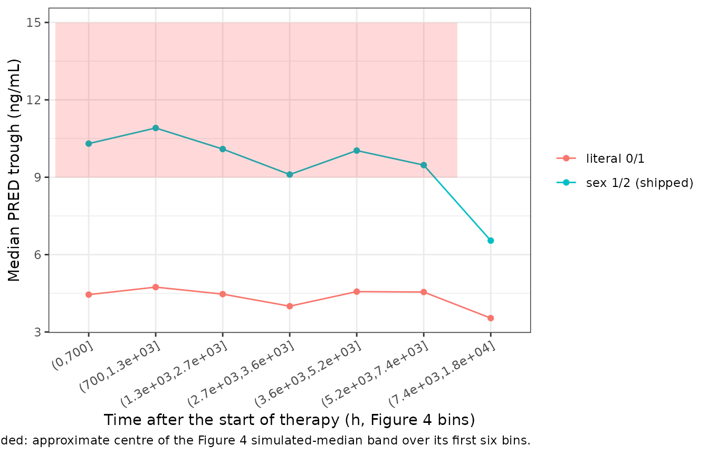
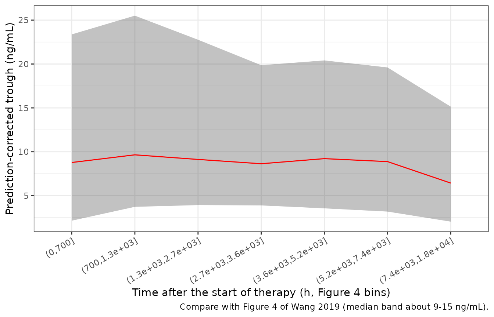

# Sirolimus (Wang 2019)

## Model and source

- Citation: Wang DD, Chen X, Li ZP. Population pharmacokinetics of
  sirolimus in pediatric patients with kaposiform hemangioendothelioma:
  A retrospective study. Oncol Lett. 2019;18(3):2412-2419.
  <doi:10.3892/ol.2019.10562>
- Description: One-compartment population PK model with first-order
  absorption for oral sirolimus in Chinese children with kaposiform
  hemangioendothelioma, developed from routine
  therapeutic-drug-monitoring trough concentrations (Wang 2019).
  Apparent clearance CL/F rises exponentially with age and alanine
  aminotransferase and is 0.441-fold lower in girls than in boys;
  apparent volume V/F rises exponentially with the duration of sirolimus
  treatment. All covariates enter uncentered. The absorption rate
  constant is fixed at 0.485 per hour. Inter-individual variability is
  on CL/F and V/F and the residual error is exponential.
- Article: <https://doi.org/10.3892/ol.2019.10562> (open access,
  PMC6676569)

Wang and colleagues fitted a one-compartment model with first-order
absorption to 133 routine trough concentrations of oral sirolimus from
17 Chinese children with kaposiform hemangioendothelioma. Age, alanine
aminotransferase (ALT) and sex were retained on apparent clearance, and
the duration of sirolimus treatment (DTT) on apparent volume. The paper
publishes no dose simulation and no NCA table. The validation below
therefore uses the paper’s goodness-of-fit and predictive-check figures
(Figures 2 and 4), and four other paediatric sirolimus models, to settle
two things the paper leaves unstated: the numeric coding of sex, and the
scale of the variance parameters.

## Population

The cohort is a single-centre retrospective one from the Children’s
Hospital of Fudan University, Shanghai, January 2016 to April 2018 (Wang
2019 Table I):

- 17 patients, 11 male and 6 female.
- Age 0.2-6 years (median 0.8) and weight 3.6-18 kg (median 7).
- Daily sirolimus dose 0.16-1.5 mg (median 0.5). The starting dose was
  0.8 mg/m^2 twice daily, then adjusted by therapeutic drug monitoring
  to a trough of 10-15 ng/mL.
- Treatment duration at sampling 7-749 days (median 117).
- ALT 2-120 IU/L (median 21).

Every concentration is a pre-dose trough measured with the Emit 2000
whole-blood assay (LLOQ 3.5 ng/mL, linear to 30 ng/mL). The same
information is available programmatically via
`readModelDb("Wang_2019_sirolimus")()$population`.

## Source trace

| Equation / parameter | Value | Source location |
|----|----|----|
| `lcl` (CL/F intercept) | 3.19 L/h | Table IV (SE 23.7%); Abstract |
| `lvc` (V/F at DTT = 0) | 165 L | Table IV (SE 26.9%); Abstract |
| `lka` (Ka) | 0.485 1/h, fixed | Table IV; Methods “PPK modeling” |
| `e_age_cl` | 0.215 per year | Table IV (SE 21.7%) |
| `e_alt_cl` | 0.0108 per IU/L | Table IV (SE 18%) |
| `e_sexf_cl` | -0.818 | Table IV (SE 15.4%) |
| `e_t_firstdose_vc` | 0.0783 per 10 days | Table IV (SE 7.8%) |
| `etalcl` | 0.047089 (omega = 0.217, read as SD) | Table IV; Methods equation 1 |
| `etalvc` | 1.779556 (omega = 1.334, read as SD) | Table IV; Methods equation 1 |
| `expSd` | 0.365 | Table IV (SE 6.8%); Methods equation 3 |
| `CL/F = theta * EXP(theta_AGE*age) * EXP(theta_ALT*ALT) * EXP(theta_SEX*sex)` | n/a | Results “Modeling”, final covariate model |
| `V/F = theta * EXP[theta_DTT*(DTT/10)]` | n/a | Results “Modeling”, final covariate model |
| Sex code 1 = male, 2 = female | n/a | Not printed; see “Sex coding” below |
| DTT in days | n/a | Table I (“Duration of treatment with sirolimus (days)”) |
| Exponential residual `Y = IPRED * exp(eps)` | n/a | Methods equation 3 (selected by OFV) |

``` r

mod <- readModelDb("Wang_2019_sirolimus")
ui <- rxode2::rxode(mod)
#> ℹ parameter labels from comments will be replaced by 'label()'
theta <- ui$theta
th <- function(nm) theta[[nm]]

# Typical CL/F with the model's sex code (1 = male, 2 = female). `sex_code`
# lets the literal 0/1 reading be evaluated with the same function.
cl_wang <- function(age, alt, sex_code) {
  exp(th("lcl")) * exp(th("e_age_cl") * age) * exp(th("e_alt_cl") * alt) *
    exp(th("e_sexf_cl") * sex_code)
}
vc_wang <- function(dtt_days) exp(th("lvc")) * exp(th("e_t_firstdose_vc") * dtt_days / 10)
```

## Sex coding

The final clearance equation contains `EXP(theta_SEX x sex)` with
`theta_SEX = -0.818`, but the paper never states how `sex` was coded.
The direction is not in doubt: the Discussion says “males had a higher
CL/F than females of the same age”, so the code increases from male to
female, and the female-to-male ratio is `exp(-0.818) = 0.441` whatever
the coding. Because age and ALT enter uncentered, though, the intercept
3.19 L/h belongs to the subject whose sex code is 0. Under the literal
0/1 reading that subject is a boy. Under a 1/2 coding it is no real
subject, and every predicted concentration is 2.27-fold higher than
under 0/1. Three independent checks settle it.

### Check 1: other paediatric sirolimus models

The table gives typical CL/F for a 7 kg, 0.8-year-old child, the cohort
medians. For Wang 2019 it also uses the median ALT of 21 IU/L. The
comparator equations are as printed in Fan 2024 Supplementary Table S1
(<doi:10.3389/fphar.2024.1457614>), which tabulates the paediatric
vascular-anomaly sirolimus models, plus the Chen 2021 tuberous-sclerosis
model from this library. Chen 2020 comes from the same hospital and
disease as Wang 2019, and the two cohorts partly overlap.

``` r

wt <- 7
age <- 0.8
pma_wk <- 40 + age * 52.18
external <- tibble::tribble(
  ~model, ~cl,
  "Chen 2020 KHE, CYP3A5\\*3/\\*3", 7.55 * (wt / 70)^0.75,
  "Chen 2020 KHE, CYP3A5\\*1 carrier", 7.55 * (wt / 70)^0.75 * 1.999,
  "Chen 2021 lymphangioma", 11.3 * (wt / 70)^0.75,
  "Chen 2021 tuberous sclerosis", 8.59 * (wt / 70)^0.75,
  "Fan 2024 vascular anomalies", 4.06 * (wt / 16)^1.23,
  "Mizuno 2017 vascular anomalies", 18.5 * (wt / 70)^0.67 * pma_wk^2.94 / (62.9^2.94 + pma_wk^2.94)
)
wang <- tibble::tribble(
  ~model, ~cl,
  "Wang 2019, sex 1/2 (shipped): male", cl_wang(age, 21, 1),
  "Wang 2019, sex 1/2 (shipped): female", cl_wang(age, 21, 2),
  "Wang 2019, literal 0/1: male", cl_wang(age, 21, 0),
  "Wang 2019, literal 0/1: female", cl_wang(age, 21, 1)
)
bind_rows(external, wang) |>
  rename("Model" = model, "CL/F at 7 kg, 0.8 years (L/h)" = cl) |>
  knitr::kable(digits = 2)
```

| Model                                | CL/F at 7 kg, 0.8 years (L/h) |
|:-------------------------------------|------------------------------:|
| Chen 2020 KHE, CYP3A5\*3/\*3         |                          1.34 |
| Chen 2020 KHE, CYP3A5\*1 carrier     |                          2.68 |
| Chen 2021 lymphangioma               |                          2.01 |
| Chen 2021 tuberous sclerosis         |                          1.53 |
| Fan 2024 vascular anomalies          |                          1.47 |
| Mizuno 2017 vascular anomalies       |                          2.70 |
| Wang 2019, sex 1/2 (shipped): male   |                          2.10 |
| Wang 2019, sex 1/2 (shipped): female |                          0.93 |
| Wang 2019, literal 0/1: male         |                          4.75 |
| Wang 2019, literal 0/1: female       |                          2.10 |

``` r


ext_range <- range(external$cl)
ext_gm <- exp(mean(log(external$cl)))
# Cohort (11 male : 6 female) geometric-mean CL/F under each coding.
cohort_gm <- function(male, female) exp((11 * log(male) + 6 * log(female)) / 17)
gm_12 <- cohort_gm(cl_wang(age, 21, 1), cl_wang(age, 21, 2))
gm_01 <- cohort_gm(cl_wang(age, 21, 0), cl_wang(age, 21, 1))
c(external_geomean = ext_gm, wang_sex_1_2 = gm_12, wang_sex_0_1 = gm_01)
#> external_geomean     wang_sex_1_2     wang_sex_0_1 
#>         1.878371         1.571633         3.561262

stopifnot(
  # The 1/2 reading puts the boys (the majority) inside the comparator range...
  cl_wang(age, 21, 1) >= ext_range[1], cl_wang(age, 21, 1) <= ext_range[2],
  # ...and the cohort within 25% of the comparators' geometric mean.
  abs(log(gm_12 / ext_gm)) < log(1.25),
  # The 0/1 reading puts the boys 1.7-fold above the HIGHEST comparator.
  cl_wang(age, 21, 0) / ext_range[2] > 1.6,
  abs(log(gm_01 / ext_gm)) > log(1.8)
)
```

Under the 1/2 coding the boys sit inside the 1.3-2.7 L/h spread of the
five comparator models, and the cohort’s geometric mean is within 25% of
theirs. Under the literal 0/1 coding the boys’ 4.75 L/h is 1.8-fold
above the highest comparator, and the cohort mean is 1.9-fold above the
comparators’. Girls under the 1/2 coding (0.93 L/h) fall below the
comparator range. None of the comparators has a sex effect, and the
girls are a minority, so this is the expected price of the paper’s large
`theta_SEX`.

### Check 2: the level of the population predictions

Figure 2A plots observations against population predictions (PRED) for
the final model. The PRED axis runs from about 1 to 37 ng/mL, and the
bulk of the points lie between about 5 and 25 ng/mL. Figure 4 is a
prediction-corrected VPC. A pcVPC rescales every observation to its
bin’s median PRED, so its simulated-median band (the pink band) sits at
the cohort’s typical PRED. It lies at about 9-15 ng/mL over the first
7,500 h, where most of the data are. Both figures put the typical
population prediction near the paper’s 10-15 ng/mL target.

The virtual cohort below draws age, ALT, daily dose and sampling day
from log-normal distributions matched to the Table I medians and means,
and truncated to the Table I ranges. It draws sex at 11:6, and gives
each child eight trough records, close to the paper’s 133 records over
17 patients.

``` r

set.seed(2019)
N_SUBJ <- 200
N_REC <- 8
# Log-normal with the given median and mean, redrawn (not clamped) outside range.
rlnorm_trunc <- function(n, median, mean, lo, hi) {
  s <- sqrt(2 * log(mean / median))
  out <- numeric(0)
  while (length(out) < n) {
    x <- rlnorm(n, log(median), s)
    out <- c(out, x[x >= lo & x <= hi])
  }
  out[seq_len(n)]
}
cohort <- tibble(
  id = seq_len(N_SUBJ),
  SEXF = rbinom(N_SUBJ, 1, 6 / 17),
  AGE = rlnorm_trunc(N_SUBJ, 0.8, 1.21, 0.2, 6),
  ALT = rlnorm_trunc(N_SUBJ, 21, 24.37, 2, 120),
  daily_dose = rlnorm_trunc(N_SUBJ, 0.5, 0.63, 0.16, 1.5)
)
records <- tibble(
  id = rep(cohort$id, each = N_REC),
  day = round(rlnorm_trunc(N_SUBJ * N_REC, 117, 154.2, 7, 749))
)
```

Each child takes the same twice-daily dose from day 0. A trough is
observed just before each morning dose, and `T_FIRSTDOSE` is updated
daily at the same rows, which drives the time-varying V/F.

``` r

TAU <- 12
LAST_DAY <- 749
trough_days <- seq_len(LAST_DAY)
events <- bind_rows(lapply(seq_len(N_SUBJ), function(i) {
  obs <- data.frame(
    id = i, time = c(0, trough_days * 24 - 0.01), evid = 0, amt = 0, cmt = "central"
  )
  dose <- data.frame(
    id = i, time = seq(0, LAST_DAY * 24 - TAU, by = TAU), evid = 1,
    amt = cohort$daily_dose[i] / 2, cmt = "depot"
  )
  bind_rows(dose, obs) |>
    arrange(time, desc(evid)) |>
    mutate(
      T_FIRSTDOSE = time, SEXF = cohort$SEXF[i], AGE = cohort$AGE[i], ALT = cohort$ALT[i]
    )
}))

m0 <- rxode2::zeroRe(ui)
solve_troughs <- function(params) {
  # zeroRe() removes the random effects, so rxode2 notes that a multi-subject
  # solve has no omega; any etas are supplied explicitly in `params`.
  s <- suppressWarnings(rxode2::rxSolve(m0, events, params = params, returnType = "data.frame"))
  s[s$time > 0, ] |>
    mutate(day = round((time + 0.01) / 24)) |>
    select(id, day, Cc)
}
zero_eta <- data.frame(etalcl = rep(0, N_SUBJ), etalvc = 0)
pred_12 <- solve_troughs(zero_eta)
# The literal 0/1 coding is the shipped model with the intercept moved by
# -theta_SEX, since (1 + SEXF) and SEXF differ by exactly one code unit.
pred_01 <- solve_troughs(mutate(zero_eta, lcl = th("lcl") - th("e_sexf_cl")))

rec_pred <- records |>
  left_join(rename(pred_12, pred_12 = Cc), by = c("id", "day")) |>
  left_join(rename(pred_01, pred_01 = Cc), by = c("id", "day"))
stopifnot(nrow(rec_pred) == N_SUBJ * N_REC, !anyNA(rec_pred$pred_12), !anyNA(rec_pred$pred_01))

pred_summary <- rec_pred |>
  pivot_longer(c(pred_12, pred_01), names_to = "coding", values_to = "PRED") |>
  mutate(coding = recode(coding, pred_12 = "sex 1/2 (shipped)", pred_01 = "literal 0/1")) |>
  group_by(coding) |>
  summarise(
    `median PRED (ng/mL)` = median(PRED),
    `5th percentile` = quantile(PRED, 0.05),
    `95th percentile` = quantile(PRED, 0.95),
    `% records PRED < 5 ng/mL` = 100 * mean(PRED < 5),
    `% records PRED 5-25 ng/mL` = 100 * mean(PRED >= 5 & PRED <= 25),
    .groups = "drop"
  )
knitr::kable(pred_summary, digits = 1)
```

| coding | median PRED (ng/mL) | 5th percentile | 95th percentile | % records PRED \< 5 ng/mL | % records PRED 5-25 ng/mL |
|:---|---:|---:|---:|---:|---:|
| literal 0/1 | 4.4 | 1.4 | 16.2 | 60.7 | 38.3 |
| sex 1/2 (shipped) | 9.7 | 3.2 | 34.6 | 16.2 | 73.6 |

``` r


med_12 <- median(rec_pred$pred_12)
med_01 <- median(rec_pred$pred_01)
stopifnot(
  # Figure 4's median band sits at about 9-15 ng/mL and Figure 2A's PRED bulk
  # at 5-25 ng/mL. The two codings differ by a factor of 2.27, far outside any
  # cohort-draw noise (the cohort is drawn with R's RNG and the solve has no
  # random effects, so these values are reproducible).
  med_12 > 7, med_12 < 16,
  med_01 < 6
)
```

The literal 0/1 coding puts the median population prediction near 4
ng/mL, just above the assay LLOQ and well below both the Figure 4 band
and the Figure 2A cloud. The 1/2 coding reproduces them. Figure 4’s
x-axis is time since the start of therapy, so the simulated troughs are
plotted the same way below, with the virtual records binned at the
paper’s bin edges.

``` r

bins <- c(0, 700, 1300, 2700, 3600, 5200, 7400, 18000)
rec_pred |>
  mutate(bin = cut(day * 24, bins)) |>
  group_by(bin) |>
  summarise(`sex 1/2 (shipped)` = median(pred_12), `literal 0/1` = median(pred_01), .groups = "drop") |>
  pivot_longer(-bin, names_to = "coding", values_to = "median_pred") |>
  ggplot(aes(bin, median_pred, colour = coding, group = coding)) +
  geom_line() +
  geom_point() +
  annotate("rect", xmin = 0.5, xmax = 6.5, ymin = 9, ymax = 15, alpha = 0.15, fill = "red") +
  labs(
    x = "Time after the start of therapy (h, Figure 4 bins)", y = "Median PRED trough (ng/mL)",
    colour = NULL,
    caption = "Shaded: approximate centre of the Figure 4 simulated-median band over its first six bins."
  ) +
  theme_bw() +
  theme(axis.text.x = element_text(angle = 30, hjust = 1))
```



### Check 3: the clinical target

The paper states that troughs “were maintained between 10 and 15 ng/ml”.
At the cohort medians, the steady-state average concentration for a boy
on 0.5 mg/day is 9.9 ng/mL under the 1/2 coding and 4.4 ng/mL under the
0/1 coding. For a TDM cohort titrated to 10-15 ng/mL, only the first is
plausible.

``` r

c(
  boy_sex_1_2 = 0.5 / 24 / cl_wang(age, 21, 1) * 1000,
  boy_sex_0_1 = 0.5 / 24 / cl_wang(age, 21, 0) * 1000
)
#> boy_sex_1_2 boy_sex_0_1 
#>    9.931717    4.383000
```

## Scale of the variance parameters

Table IV prints `omega CL/F = 0.217`, `omega V/F = 1.334` and
`sigma 1 = 0.365` without saying whether these are NONMEM variances or
their square roots. This group’s other papers, from the Children’s
Hospital of Fudan University, print omega as the standard deviation of
eta. That has been confirmed against their own simulation figures for
several of their tacrolimus and sirolimus models. Wang 2019 has no dose
simulation, but its goodness-of-fit plots constrain the residual error
directly:

- **Figure 2B** (observations against individual predictions, 133
  points). The largest excursions are about 2-fold either way (for
  example 28 ng/mL at an IPRED of 14, and 7 at 16.5). With a residual SD
  `s` on the log scale, the extreme of 133 draws is about 2.6 `s`.
- **Figure 2C** (\|IWRES\| against IPRED). The smooth runs at 0.20-0.31,
  and almost every point is below 1. A sigma-standardised IWRES would
  have a mean absolute value near 0.8. The axis label is in ng/mL and
  the magnitudes are about 0.3, so the plotted quantity is the relative
  residual (DV - IPRED)/IPRED.

``` r

# Expected mean |DV/IPRED - 1| and expected largest excursion over 133 records,
# for an exponential residual with log-scale SD s.
mean_abs_rel <- function(s) {
  integrate(function(e) abs(exp(e) - 1) * dnorm(e, 0, s), -10 * s, 10 * s)$value
}
scales <- tibble(
  reading = c("sigma 0.365 is the SD (shipped)", "sigma 0.365 is the variance"),
  s = c(0.365, sqrt(0.365))
) |>
  mutate(
    mean_abs_rel = vapply(s, mean_abs_rel, numeric(1)),
    extreme_fold = exp(qnorm(1 - 0.5 / 133) * s)
  )
scales |>
  rename(
    "Reading" = reading, "Log-scale SD" = s,
    "Expected mean |relative residual|" = mean_abs_rel,
    "Expected extreme fold over 133 records" = extreme_fold
  ) |>
  knitr::kable(digits = 2)
```

| Reading | Log-scale SD | Expected mean \|relative residual\| | Expected extreme fold over 133 records |
|:---|---:|---:|---:|
| sigma 0.365 is the SD (shipped) | 0.36 | 0.30 | 2.65 |
| sigma 0.365 is the variance | 0.60 | 0.55 | 5.03 |

``` r


stopifnot(
  # Figure 2C smooth 0.20-0.31; Figure 2B extremes about 2-fold. Individual
  # predictions absorb part of the residual (epsilon shrinkage), so the figures
  # should sit somewhat BELOW the expectation, never above it.
  scales$mean_abs_rel[1] > 0.25, scales$mean_abs_rel[1] < 0.35,
  scales$extreme_fold[1] < 3,
  scales$mean_abs_rel[2] > 0.45,
  scales$extreme_fold[2] > 4
)
```

The SD reading fits both figures with modest shrinkage. The variance
reading would put the expected mean relative residual near 0.5 and the
extreme near 5-fold, which would take more than 50% epsilon shrinkage to
compress into the plotted 2-fold. The omega rows are printed in the same
notation in the same table and are read the same way. Figure 2A’s spread
about PRED agrees with this: roughly 0.45 on the log scale by eye,
against more than 0.8 under the variance reading of all three rows.

## Simulation: trough distribution over time

The virtual cohort is simulated with inter-individual variability (etas
drawn in R) and the exponential residual, and summarised by Figure 4’s
bins after prediction correction. Figure 4 is not reproduced exactly,
because the real dosing histories were TDM-titrated and are not
available.

``` r

etas <- data.frame(
  etalcl = rnorm(N_SUBJ, 0, sqrt(ui$omega["etalcl", "etalcl"])),
  etalvc = rnorm(N_SUBJ, 0, sqrt(ui$omega["etalvc", "etalvc"]))
)
ipred <- solve_troughs(etas)
vpc <- records |>
  left_join(rename(ipred, IPRED = Cc), by = c("id", "day")) |>
  left_join(distinct(select(rec_pred, id, day, PRED = pred_12)), by = c("id", "day")) |>
  mutate(
    DV = IPRED * exp(rnorm(n(), 0, th("expSd"))),
    bin = cut(day * 24, bins)
  ) |>
  group_by(bin) |>
  mutate(pcDV = DV * median(PRED) / PRED) |>
  summarise(
    n = n(),
    p025 = quantile(pcDV, 0.025), p50 = median(pcDV), p975 = quantile(pcDV, 0.975),
    .groups = "drop"
  )
vpc |>
  rename(
    "Bin (h since start)" = bin, "Records" = n, "2.5th (ng/mL)" = p025,
    "Median (ng/mL)" = p50, "97.5th (ng/mL)" = p975
  ) |>
  knitr::kable(digits = 1)
```

| Bin (h since start) | Records | 2.5th (ng/mL) | Median (ng/mL) | 97.5th (ng/mL) |
|:--------------------|--------:|--------------:|---------------:|---------------:|
| (0,700\]            |      53 |           2.1 |            8.8 |           23.4 |
| (700,1.3e+03\]      |     200 |           3.7 |            9.7 |           25.5 |
| (1.3e+03,2.7e+03\]  |     507 |           3.9 |            9.1 |           22.8 |
| (2.7e+03,3.6e+03\]  |     272 |           3.9 |            8.6 |           19.9 |
| (3.6e+03,5.2e+03\]  |     266 |           3.6 |            9.2 |           20.4 |
| (5.2e+03,7.4e+03\]  |     172 |           3.2 |            8.9 |           19.6 |
| (7.4e+03,1.8e+04\]  |     130 |           2.0 |            6.4 |           15.1 |

``` r


ggplot(vpc, aes(bin, p50, group = 1)) +
  geom_ribbon(aes(ymin = p025, ymax = p975), alpha = 0.3) +
  geom_line(colour = "red") +
  labs(
    x = "Time after the start of therapy (h, Figure 4 bins)",
    y = "Prediction-corrected trough (ng/mL)",
    caption = "Compare with Figure 4 of Wang 2019 (median band about 9-15 ng/mL)."
  ) +
  theme_bw() +
  theme(axis.text.x = element_text(angle = 30, hjust = 1))
```



``` r


stopifnot(
  # Centre, not extremes: the median of the binned prediction-corrected medians
  # sits in the Figure 4 band region.
  median(vpc$p50) > 6, median(vpc$p50) < 16
)
```

## PKNCA validation

The paper reports no NCA. PKNCA is run after a single 0.25 mg dose in
typical children (no random effects) on a sex-by-age grid at the median
ALT, with `T_FIRSTDOSE` held at the median sampling day (117 days, V/F =
412 L) so that disposition is time-invariant. Two identities are
checked: `AUC0-inf = Dose / CL`, and `t1/2 = ln 2 * V / CL`.

``` r

grid <- expand.grid(SEXF = 0:1, AGE = c(0.5, 1, 3)) |>
  mutate(id = row_number(), ALT = 21, T_FIRSTDOSE = 117 * 24)
nca_times <- c(0, seq(0.5, 24, by = 0.5), seq(26, 4000, by = 4))
nca_events <- bind_rows(lapply(grid$id, function(i) {
  rxode2::et(amt = 0.25, cmt = "depot") |>
    rxode2::et(nca_times, cmt = "central") |>
    as.data.frame() |>
    mutate(id = i)
})) |>
  left_join(grid, by = "id")

nca_sim <- rxode2::rxSolve(m0, nca_events, returnType = "data.frame") |>
  select(id, time, Cc) |>
  left_join(select(grid, id, SEXF), by = "id") |>
  mutate(treatment = ifelse(SEXF == 1, "female", "male"))
#> ℹ omega/sigma items treated as zero: 'etalcl', 'etalvc'
#> Warning: multi-subject simulation without without 'omega'

conc <- nca_sim |>
  filter(!is.na(Cc)) |>
  select(id, time, Cc, treatment)
dose <- grid |>
  transmute(id, time = 0, amt = 0.25, treatment = ifelse(SEXF == 1, "female", "male"))

res <- PKNCA::pk.nca(PKNCA::PKNCAdata(
  PKNCA::PKNCAconc(conc, Cc ~ time | treatment + id, concu = "ng/mL", timeu = "h"),
  PKNCA::PKNCAdose(dose, amt ~ time | treatment + id, doseu = "mg"),
  intervals = data.frame(start = 0, end = Inf, cmax = TRUE, tmax = TRUE, aucinf.obs = TRUE, half.life = TRUE)
))
nca <- as.data.frame(res$result)

nca_wide <- nca |>
  filter(PPTESTCD %in% c("cmax", "tmax", "aucinf.obs", "half.life")) |>
  select(id, treatment, PPTESTCD, PPORRES) |>
  pivot_wider(names_from = PPTESTCD, values_from = PPORRES) |>
  left_join(select(grid, id, SEXF, AGE), by = "id") |>
  mutate(
    cl = cl_wang(AGE, 21, 1 + SEXF),
    v = vc_wang(117),
    auc_expected = 0.25 / cl * 1000,
    thalf_expected = log(2) * v / cl
  )

nca_wide |>
  select(treatment, AGE, cmax, tmax, aucinf.obs, auc_expected, half.life, thalf_expected) |>
  rename(
    "Sex" = treatment, "Age (years)" = AGE, "Cmax (ng/mL)" = cmax, "Tmax (h)" = tmax,
    "AUC0-inf (ng*h/mL)" = aucinf.obs, "Dose/CL (ng*h/mL)" = auc_expected,
    "t1/2 (h)" = half.life, "ln2*V/CL (h)" = thalf_expected
  ) |>
  knitr::kable(digits = c(0, 1, 2, 1, 0, 0, 0, 0))
```

| Sex | Age (years) | Cmax (ng/mL) | Tmax (h) | AUC0-inf (ng\*h/mL) | Dose/CL (ng\*h/mL) | t1/2 (h) | ln2\*V/CL (h) |
|:---|---:|---:|---:|---:|---:|---:|---:|
| female | 0.5 | 0.59 | 11.5 | 288 | 288 | 329 | 329 |
| female | 1.0 | 0.59 | 11.0 | 259 | 259 | 296 | 296 |
| female | 3.0 | 0.58 | 10.0 | 168 | 168 | 192 | 192 |
| male | 0.5 | 0.58 | 9.5 | 127 | 127 | 145 | 145 |
| male | 1.0 | 0.58 | 9.5 | 114 | 114 | 131 | 131 |
| male | 3.0 | 0.57 | 8.5 | 74 | 74 | 85 | 85 |

``` r


stopifnot(
  nrow(nca_wide) == nrow(grid),
  # Same parameters on both sides; the only differences are the trapezoid and
  # the terminal extrapolation.
  max(abs(nca_wide$aucinf.obs / nca_wide$auc_expected - 1)) < 0.01,
  max(abs(nca_wide$half.life / nca_wide$thalf_expected - 1)) < 0.01
)
```

## Assumptions and deviations

- **Sex coding (not printed in the paper).** Encoded as 1 = male, 2 =
  female, i.e. `exp(-0.818 * (1 + SEXF))`. The maintainers asked for an
  independent verification before choosing between this and the literal
  0/1 reading. The three checks above all favour 1/2: five other
  paediatric sirolimus models, including the same hospital’s Chen 2020
  KHE model; the level of the paper’s own population predictions in
  Figures 2A and 4; and its stated 10-15 ng/mL target. No paper from
  this group that prints its sex coding was found. Under either coding,
  girls have 0.441 times the CL/F of boys of the same age and ALT.
- **Uncentered covariates.** Age, ALT and DTT enter uncentered, as
  printed, so `lcl` and `lvc` are equation intercepts (age 0, ALT 0, sex
  code 0; DTT 0). For the median boy, CL/F is 2.10 L/h.
- **Scale of omega and sigma.** All three Table IV variance rows are
  read as SDs: omega SDs 0.217 and 1.334 (variances 0.047089 and
  1.779556) and residual SD 0.365. This follows the group’s convention
  and is supported by Figures 2B and 2C (above). The Methods’
  boilerplate, “the variance of zero-mean random variables was
  estimated”, does not say which quantity Table IV prints. This differs
  from the library’s `Wang_2019a_tacrolimus`, where a literature
  comparison table supported the variance reading for that paper.
- **Duration of treatment and the time-varying V/F.** DTT is in days
  (Table I), supplied as `T_FIRSTDOSE` in hours and divided by 24 in
  `model()`. V/F grows from 175 L at 7 days to 412 L at the median 117
  days and about 58,000 L at 749 days. That is not a physiological
  volume, and it reflects a weakly identified V/F in trough-only data
  with Ka fixed (bootstrap 95% CI 56-389 L, eta SD 1.334). It is
  reproduced as published. Because the ODE state is an amount, an
  increase in V/F at a `T_FIRSTDOSE` update dilutes the concentration,
  as it would in NONMEM.
- **Ka provenance.** Ka = 0.485 1/h is printed in Table IV and is what
  ships. The paper attributes it to its reference 17, Jiao 2009 (Br J
  Clin Pharmacol), but `Jiao_2009_sirolimus` in this library fixes Ka at
  0.752 1/h.
- **Residual-error form.** Methods equation 3, `Y = IPRED * exp(eps)`,
  is encoded as `lnorm(expSd)`. The paper does not say whether the data
  were log-transformed. If they were not, NONMEM’s FOCE-I treats this
  term as proportional; at an SD of 0.365 the two forms are close.
- **Figure 4 not reproduced exactly.** The individual TDM-titrated
  dosing histories are not available. The virtual cohort uses constant
  per-child doses and covariate distributions fitted to the Table I
  medians, means and ranges.
- **Covariates without a registered column.** MCH, MCHC, and concomitant
  sulfamethoxazole, digoxin and ursodeoxycholic acid were screened but
  not retained. They are listed in `population$notes` rather than
  `covariatesDataExcluded`.
