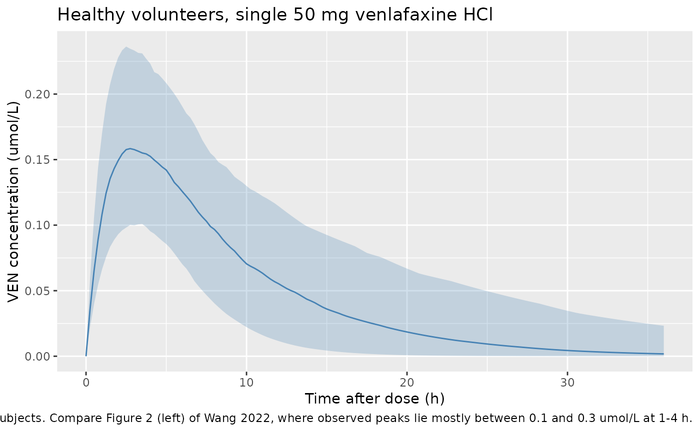
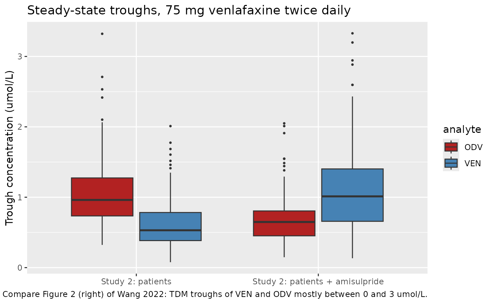
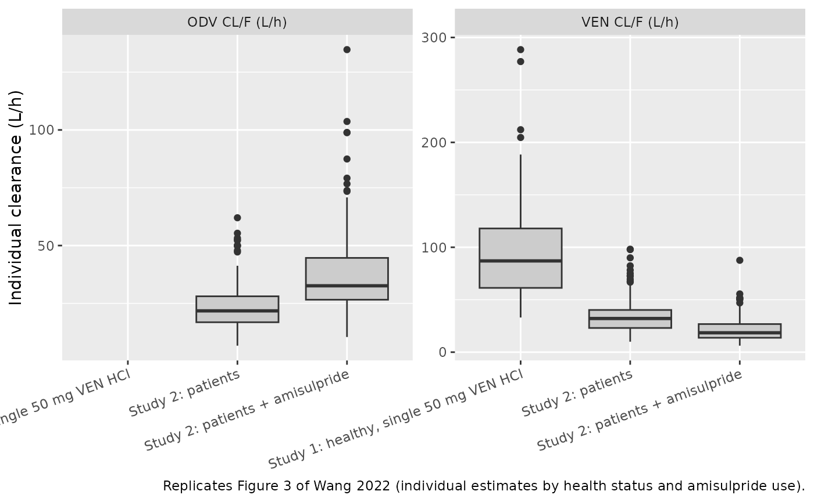

# Venlafaxine and O-desmethylvenlafaxine (Wang 2022)

## Model and source

- Citation: Wang Z, Li L, Huang S, Wang X, Liu S, Li X, Kong W, Ni X,
  Zhang M, Huang S, Tan Y, Wen Y, Shang D. Joint population
  pharmacokinetic modeling of venlafaxine and O-desmethyl venlafaxine in
  healthy volunteers and patients to evaluate the impact of morbidity
  and concomitant medication. Front Pharmacol. 2022;13:978202.
  <doi:10.3389/fphar.2022.978202>
- Description: Joint parent-metabolite population PK model for oral
  venlafaxine (VEN) and its active metabolite O-desmethylvenlafaxine
  (ODV, desvenlafaxine) in Chinese healthy male volunteers and
  psychiatric patients (Wang 2022). One-compartment disposition for each
  analyte with first-order absorption (ka fixed at 0.63 1/h). The
  absorbed dose splits at absorption: a fraction fm_odv is converted
  pre-systemically (first pass) and enters the ODV compartment directly,
  and the remainder enters the VEN compartment. All systemic VEN
  clearance forms ODV (k23 = CL/V), and ODV is cleared with CL_odv.
  Clearances and volumes are apparent (relative to the unknown oral
  bioavailability). The model works on a MOLAR basis: doses are in umol
  of venlafaxine and both concentrations are in umol/L, as in the source
  figures. Patient status lowers VEN CL/F by 61.7 percent relative to
  healthy volunteers; concomitant amisulpride lowers VEN CL/F by 39.2
  percent and raises ODV CL/F by 59.3 percent. Proportional residual
  error on each analyte.
- Article: <https://doi.org/10.3389/fphar.2022.978202> (open access)

Wang et al. fitted venlafaxine (VEN) and its active metabolite
O-desmethylvenlafaxine (ODV) jointly in NONMEM 7.3 (FOCEI, ADVAN6). A
dose enters a single absorption depot (ka fixed at 0.63 1/h). A fraction
FP of the absorbed dose is converted to ODV before it reaches the
circulation and enters the ODV compartment directly; the rest enters the
VEN compartment. All systemic VEN elimination forms ODV (Figure 1: `K23`
is the only exit from the VEN compartment), and ODV is eliminated by
`K30`.

**Molar units.** The source figures plot both analytes in umol/L, so the
model works in moles: doses are entered in umol of venlafaxine and `Cc`
(VEN) and `Cc_odv` (ODV) are returned in umol/L. Molar amounts also make
the VEN-to-ODV conversion stoichiometric. The constants below convert
doses and concentrations.

``` r

mw_ven <- 277.40 # g/mol, venlafaxine free base
mw_ven_hcl <- 313.86 # g/mol, venlafaxine hydrochloride
mw_odv <- 263.38 # g/mol, O-desmethylvenlafaxine
mg_to_umol <- function(mg, mw) mg / mw * 1000
```

## Population

The analysis pooled two single-centre studies from Guangzhou, China
(Wang 2022 Table 1). Study 1 was a single-dose crossover bioequivalence
study in 24 healthy men (18-27 years, 54-80 kg) given 50 mg venlafaxine
hydrochloride after an overnight fast, with 15 samples per period over
36 h; only VEN was measured. Study 2 was a retrospective therapeutic
drug monitoring (TDM) data set of 127 psychiatric inpatients (14-86
years, 38-93 kg, 55 percent women) on 25-300 mg/day venlafaxine (84
percent sustained-release), with mostly trough samples of both VEN and
ODV. The model was built on 664 + 804 concentrations. Co-medications in
Study 2 included valproic acid (18 percent), quetiapine (23 percent),
clozapine (16 percent), olanzapine (25 percent), risperidone (13
percent) and amisulpride (5.5 percent).

The same information is available programmatically via
`readModelDb("Wang_2022_venlafaxine")()$population`.

## Source trace

| Equation / parameter | Value | Source location |
|----|----|----|
| `lka` (fixed) | log(0.63) 1/h | Table 2 ‘Ka’ (no RSE); Results 3.2 ‘fixed at 0.63 h-1’ |
| `lcl` | log(80.9) L/h | Table 2 ‘CL/F’ |
| `lvc` | log(628) L | Table 2 ‘V/F’ |
| `lcl_odv` | log(22.1) L/h | Table 2 ‘CLM/F’ |
| `lvc_odv` | log(238) L | Table 2 ‘VM/F’ |
| `fm_odv` | 0.048 | Table 2 ‘FP’ |
| `e_patient_cl` | 0.617 | Table 2 ‘theta morbid state on CL/F’; Results 3.2 (61.7 percent decrease; 31 L/h in patients) |
| `e_conmed_amisulpride_cl` | 0.392 | Table 2 ‘theta amisulpride on CL/F’; Results 3.2 (39.2 percent lower) |
| `e_conmed_amisulpride_cl_odv` | 0.593 | Table 2 ‘theta amisulpride on CLM/F’; Results 3.2 (59.3 percent higher) |
| `etalcl`, `etalvc`, `etalcl_odv`, `etalvc_odv` | 0.219, 0.106, 0.156, 1.38 (variances) | Table 2 ‘Interindividual variability’; scale settled against Figure 3 below |
| `propSd`, `propSd_odv` | sqrt(0.123), sqrt(0.101) | Table 2 ‘Residual variability’; same scale as the IIV rows |
| Depot split `ka * (1 - FP)` / `ka * FP` | n/a | Figure 1; Methods 2.2 |
| `K23 = CL/V` into ODV, `K30 = CLM/VM` | n/a | Figure 1; Methods 2.2 |
| Exponential IIV, proportional residual error | n/a | Methods 2.2 |

## Variance scale of the IIV column

Table 2 heads its random-effect rows “Interindividual variability, %CV”
but prints fractions (0.219, 0.106, 0.156, 1.38). Three readings are
possible: an SD of the log-parameter, a coefficient of variation, or the
NONMEM OMEGA variance. Figure 3 of the paper settles it. It shows the
individual (empirical Bayes) clearances by group, and the
healthy-volunteer group is the decisive panel: each of these 24 subjects
contributed 15 samples per period, so shrinkage is small and the spread
of their clearances approximates the IIV. The maintainers digitised the
box plots; the healthy-volunteer VEN clearance has a median of about 80
L/h and an interquartile range of about 57-105 L/h.

``` r

mod <- readModelDb("Wang_2022_venlafaxine")
omega <- rxode2::rxode(mod)$omega
#> ℹ parameter labels from comments will be replaced by 'label()'

# Q3/Q1 of a log-normal is exp(2 * qnorm(0.75) * sd_log).
iqr_ratio <- function(sd_log) exp(2 * qnorm(0.75) * sd_log)
fig3_ratio <- 105 / 57

omega_check <- tibble::tibble(
  reading = c(
    "omega^2 (variance) = 0.219",
    "SD of log CL = 0.219",
    "CV = 0.219"
  ),
  sd_log = c(sqrt(0.219), 0.219, sqrt(log(1 + 0.219^2)))
) |>
  dplyr::mutate(
    q1 = 80.9 * exp(qnorm(0.25) * sd_log),
    q3 = 80.9 * exp(qnorm(0.75) * sd_log),
    ratio = iqr_ratio(sd_log)
  )

omega_check |>
  dplyr::rename(
    "Reading of 0.219" = reading,
    "SD of log CL" = sd_log,
    "Q1 (L/h)" = q1,
    "Q3 (L/h)" = q3,
    "Q3/Q1" = ratio
  ) |>
  knitr::kable(
    digits = 3,
    caption = "Healthy-volunteer VEN CL/F interquartile range under each reading, against Figure 3 (about 57-105 L/h, Q3/Q1 about 1.84)."
  )
```

| Reading of 0.219           | SD of log CL | Q1 (L/h) | Q3 (L/h) | Q3/Q1 |
|:---------------------------|-------------:|---------:|---------:|------:|
| omega^2 (variance) = 0.219 |        0.468 |   59.002 |  110.925 | 1.880 |
| SD of log CL = 0.219       |        0.219 |   69.791 |   93.778 | 1.344 |
| CV = 0.219                 |        0.216 |   69.911 |   93.616 | 1.339 |

Healthy-volunteer VEN CL/F interquartile range under each reading,
against Figure 3 (about 57-105 L/h, Q3/Q1 about 1.84). {.table}

``` r


stopifnot(
  # The packaged model carries the variance reading.
  isTRUE(all.equal(omega["etalcl", "etalcl"], 0.219)),
  # Only the variance reading reproduces the Figure 3 spread ...
  abs(iqr_ratio(sqrt(omega["etalcl", "etalcl"])) / fig3_ratio - 1) < 0.15,
  # ... and the SD reading falls well outside it.
  iqr_ratio(0.219) / fig3_ratio < 0.8
)
```

ODV clearance in patients without amisulpride tells the same story: its
Figure 3 interquartile range (about 17-28 L/h, log-SD about 0.37 even
after shrinkage of sparse TDM data) matches sqrt(0.156) = 0.39 and not
0.156. The residual-error rows sit in the same column and are read on
the same (variance) scale, giving proportional SDs of 35 percent (VEN)
and 32 percent (ODV).

## Virtual cohorts

Study 1 is reproduced with 200 healthy men given a single 50 mg
venlafaxine hydrochloride dose. Study 2 is represented by two patient
arms of 200 each, without and with amisulpride, at 75 mg venlafaxine
twice daily (150 mg/day, close to the Study 2 mean of 133 mg/day) for 28
days, long enough for the subjects with the largest ODV volumes
(half-lives of several days) to reach steady state.

``` r

set.seed(2022)
rxode2::rxSetSeed(2022)

dose_study1 <- mg_to_umol(50, mw_ven_hcl) # 50 mg venlafaxine HCl
dose_study2 <- mg_to_umol(75, mw_ven) # 75 mg venlafaxine (base)

obs_study1 <- sort(unique(c(
  0, 0.5, 1, 1.5, 2, 2.5, 3, 3.5, 4, 6, 8, 10, 12, 24, 36,
  seq(0.25, 36, by = 0.25)
)))

study1 <- tidyr::crossing(id = 1:200, time = obs_study1) |>
  dplyr::mutate(evid = 0L, amt = NA_real_, cmt = "central", dvid = 1L) |>
  dplyr::bind_rows(tibble::tibble(
    id = 1:200, time = 0, evid = 1L, amt = dose_study1, cmt = "depot"
  )) |>
  dplyr::mutate(
    DIS_HEALTHY = 1L, CONMED_AMISULPRIDE = 0L,
    arm = "Study 1: healthy, single 50 mg VEN HCl"
  )

tau <- 12
n_dose <- 56
t_last <- tau * (n_dose - 1)
make_patients <- function(n, ami, id_offset) {
  obs <- sort(unique(c(seq(0, t_last, by = tau), t_last + seq(0, tau, by = 0.25))))
  doses <- tidyr::crossing(id = id_offset + seq_len(n), time = tau * (0:(n_dose - 1))) |>
    dplyr::mutate(evid = 1L, amt = dose_study2, cmt = "depot")
  tidyr::crossing(id = id_offset + seq_len(n), time = obs) |>
    dplyr::mutate(evid = 0L, amt = NA_real_, cmt = "central", dvid = 1L) |>
    dplyr::bind_rows(doses) |>
    dplyr::mutate(
      DIS_HEALTHY = 0L, CONMED_AMISULPRIDE = ami,
      arm = if (ami == 1L) "Study 2: patients + amisulpride" else "Study 2: patients"
    )
}

events <- dplyr::bind_rows(
  study1,
  make_patients(200, 0L, id_offset = 1000L),
  make_patients(200, 1L, id_offset = 2000L)
) |>
  dplyr::arrange(id, time, dplyr::desc(evid))
stopifnot(!anyDuplicated(unique(events[, c("id", "time", "evid")])))
```

## Simulation

``` r

sim <- rxode2::rxSolve(
  mod,
  events = events,
  keep = c("arm", "DIS_HEALTHY", "CONMED_AMISULPRIDE"),
  # Both observables are returned as columns on every observation row, so
  # the rows sit on the VEN state with dvid 1.
  useLinCmt = FALSE
) |>
  as.data.frame()
#> ℹ parameter labels from comments will be replaced by 'label()'
```

## Replicate published figures

### Figure 2 (left): Study 1 VEN concentrations

``` r

sim |>
  dplyr::filter(grepl("Study 1", arm)) |>
  dplyr::group_by(time) |>
  dplyr::summarise(
    Q05 = quantile(Cc, 0.05), Q50 = median(Cc), Q95 = quantile(Cc, 0.95),
    .groups = "drop"
  ) |>
  ggplot(aes(time, Q50)) +
  geom_ribbon(aes(ymin = Q05, ymax = Q95), alpha = 0.25, fill = "steelblue") +
  geom_line(colour = "steelblue") +
  labs(
    x = "Time after dose (h)", y = "VEN concentration (umol/L)",
    title = "Healthy volunteers, single 50 mg venlafaxine HCl",
    caption = "Median and 90% interval of 200 simulated subjects. Compare Figure 2 (left) of Wang 2022, where observed peaks lie mostly between 0.1 and 0.3 umol/L at 1-4 h."
  )
```



### Figure 2 (right): Study 2 troughs

``` r

troughs <- sim |>
  dplyr::filter(grepl("Study 2", arm), time == t_last + tau) |>
  dplyr::select(id, arm, VEN = Cc, ODV = Cc_odv) |>
  tidyr::pivot_longer(c(VEN, ODV), names_to = "analyte", values_to = "conc")

ggplot(troughs, aes(arm, conc, fill = analyte)) +
  geom_boxplot(outlier.size = 0.6) +
  scale_fill_manual(values = c(VEN = "steelblue", ODV = "firebrick")) +
  labs(
    x = NULL, y = "Trough concentration (umol/L)",
    title = "Steady-state troughs, 75 mg venlafaxine twice daily",
    caption = "Compare Figure 2 (right) of Wang 2022: TDM troughs of VEN and ODV mostly between 0 and 3 umol/L."
  )
```



``` r


troughs |>
  dplyr::group_by(arm, analyte) |>
  dplyr::summarise(
    median = median(conc), p05 = quantile(conc, 0.05), p95 = quantile(conc, 0.95),
    .groups = "drop"
  ) |>
  dplyr::rename(
    "Arm" = arm, "Analyte" = analyte, "Median (umol/L)" = median,
    "5th percentile" = p05, "95th percentile" = p95
  ) |>
  knitr::kable(digits = 2, caption = "Simulated steady-state troughs.")
```

| Arm | Analyte | Median (umol/L) | 5th percentile | 95th percentile |
|:---|:---|---:|---:|---:|
| Study 2: patients | ODV | 0.96 | 0.46 | 1.97 |
| Study 2: patients | VEN | 0.53 | 0.20 | 1.24 |
| Study 2: patients + amisulpride | ODV | 0.65 | 0.29 | 1.26 |
| Study 2: patients + amisulpride | VEN | 1.01 | 0.39 | 2.33 |

Simulated steady-state troughs. {.table}

### Figure 3: individual clearances by group

``` r

indiv <- sim |>
  dplyr::distinct(id, arm, cl, cl_odv) |>
  dplyr::mutate(arm = factor(arm, levels = unique(arm)))

indiv |>
  tidyr::pivot_longer(c(cl, cl_odv), names_to = "parameter", values_to = "value") |>
  dplyr::filter(!(grepl("Study 1", arm) & parameter == "cl_odv")) |>
  dplyr::mutate(parameter = dplyr::recode(
    parameter,
    cl = "VEN CL/F (L/h)", cl_odv = "ODV CL/F (L/h)"
  )) |>
  ggplot(aes(arm, value)) +
  geom_boxplot(fill = "grey80") +
  facet_wrap(~parameter, scales = "free_y") +
  labs(
    x = NULL, y = "Individual clearance (L/h)",
    caption = "Replicates Figure 3 of Wang 2022 (individual estimates by health status and amisulpride use)."
  ) +
  theme(axis.text.x = element_text(angle = 20, hjust = 1))
```



``` r


fig3 <- tibble::tribble(
  ~arm, ~parameter, ~fig3_median,
  "Study 1: healthy, single 50 mg VEN HCl", "cl", 80,
  "Study 2: patients", "cl", 32,
  "Study 2: patients + amisulpride", "cl", 19,
  "Study 2: patients", "cl_odv", 22.5,
  "Study 2: patients + amisulpride", "cl_odv", 38.5
)

# Typical values from the packaged parameters: no simulation noise, so the
# comparison tests only the covariate form against the figure.
th <- rxode2::rxode(mod)$theta
#> ℹ parameter labels from comments will be replaced by 'label()'
tv <- tibble::tribble(
  ~arm, ~parameter, ~typical,
  "Study 1: healthy, single 50 mg VEN HCl", "cl", exp(th[["lcl"]]),
  "Study 2: patients", "cl", exp(th[["lcl"]]) * (1 - th[["e_patient_cl"]]),
  "Study 2: patients + amisulpride", "cl",
  exp(th[["lcl"]]) * (1 - th[["e_patient_cl"]]) * (1 - th[["e_conmed_amisulpride_cl"]]),
  "Study 2: patients", "cl_odv", exp(th[["lcl_odv"]]),
  "Study 2: patients + amisulpride", "cl_odv",
  exp(th[["lcl_odv"]]) * (1 + th[["e_conmed_amisulpride_cl_odv"]])
)

cl_cmp <- indiv |>
  tidyr::pivot_longer(c(cl, cl_odv), names_to = "parameter", values_to = "value") |>
  dplyr::group_by(arm, parameter) |>
  dplyr::summarise(sim_median = median(value), .groups = "drop") |>
  dplyr::mutate(arm = as.character(arm)) |>
  dplyr::inner_join(tv, by = c("arm", "parameter")) |>
  dplyr::inner_join(fig3, by = c("arm", "parameter")) |>
  dplyr::mutate(pct_diff = 100 * (typical / fig3_median - 1))

cl_cmp |>
  dplyr::rename(
    "Group" = arm, "Parameter" = parameter,
    "Simulated median (L/h)" = sim_median,
    "Typical value (L/h)" = typical,
    "Figure 3 median, digitised (L/h)" = fig3_median,
    "Typical vs Figure 3 (%)" = pct_diff
  ) |>
  knitr::kable(digits = 1, caption = "Individual clearance by group: model vs Figure 3.")
```

| Group | Parameter | Simulated median (L/h) | Typical value (L/h) | Figure 3 median, digitised (L/h) | Typical vs Figure 3 (%) |
|:---|:---|---:|---:|---:|---:|
| Study 1: healthy, single 50 mg VEN HCl | cl | 87.0 | 80.9 | 80.0 | 1.1 |
| Study 2: patients | cl | 32.1 | 31.0 | 32.0 | -3.2 |
| Study 2: patients | cl_odv | 21.7 | 22.1 | 22.5 | -1.8 |
| Study 2: patients + amisulpride | cl | 18.5 | 18.8 | 19.0 | -0.8 |
| Study 2: patients + amisulpride | cl_odv | 32.6 | 35.2 | 38.5 | -8.6 |

Individual clearance by group: model vs Figure 3. {.table}

``` r


stopifnot(
  # A wrong covariate form or sign moves a group value by 40-60 percent.
  # The figure medians carry a few percent of reading error, and the
  # amisulpride group of Figure 3 has only about seven patients, which is
  # why its ODV clearance (typical 35.2 vs about 38.5 L/h) sits furthest off.
  all(abs(cl_cmp$pct_diff) < 15),
  # The simulated cohort medians agree with the typical values.
  abs(median(log(cl_cmp$sim_median / cl_cmp$typical))) < 0.1
)
```

The amisulpride arm combines the patient and amisulpride effects
multiplicatively (80.9 x 0.383 x 0.608 = 18.8 L/h), which lands on the
Figure 3 median of about 19 L/h. ODV clearance with amisulpride is the
least well matched group (typical 35.2 L/h against a Figure 3 median of
about 38.5 L/h), which is unsurprising for a box built from about seven
patients’ sparse troughs.

## PKNCA validation

### Study 1: VEN after a single dose

``` r

nca_conc1 <- sim |>
  dplyr::filter(grepl("Study 1", arm), !is.na(Cc)) |>
  dplyr::select(id, time, Cc, arm)
nca_conc1 <- dplyr::bind_rows(
  nca_conc1,
  nca_conc1 |> dplyr::distinct(id, arm) |> dplyr::mutate(time = 0, Cc = 0)
) |>
  dplyr::distinct(id, arm, time, .keep_all = TRUE) |>
  dplyr::arrange(id, time)

dose1 <- events |>
  dplyr::filter(evid == 1, grepl("Study 1", arm)) |>
  dplyr::select(id, time, amt, arm)

nca1 <- PKNCA::pk.nca(PKNCA::PKNCAdata(
  PKNCA::PKNCAconc(nca_conc1, Cc ~ time | arm + id),
  PKNCA::PKNCAdose(dose1, amt ~ time | arm + id),
  intervals = data.frame(
    start = 0, end = Inf,
    cmax = TRUE, tmax = TRUE, aucinf.obs = TRUE, half.life = TRUE
  )
))

published <- tibble::tribble(
  ~arm, ~half.life,
  "Study 1: healthy, single 50 mg VEN HCl", 5.4
)

cmp <- nlmixr2lib::ncaComparisonTable(
  simulated = nca1,
  reference = published,
  by = "arm",
  units = c(cmax = "umol/L", tmax = "h", aucinf.obs = "umol*h/L", half.life = "h"),
  tolerance_pct = 20
)
knitr::kable(
  cmp,
  caption = "Simulated vs published VEN half-life in healthy volunteers (Wang 2022 Discussion: 5.4 h). * differs by more than 20%."
)
```

| NCA parameter | arm | Reference | Simulated | % diff |
|:---|:---|:---|:---|:---|
| t½ (h) | Study 1: healthy, single 50 mg VEN HCl | 5.4 | 5.08 | -6.0% |

Simulated vs published VEN half-life in healthy volunteers (Wang 2022
Discussion: 5.4 h). \* differs by more than 20%. {.table}

``` r


res1 <- as.data.frame(nca1$result)
cmax1 <- res1$PPORRES[res1$PPTESTCD == "cmax"]
hl1 <- res1$PPORRES[res1$PPTESTCD == "half.life"]
stopifnot(
  # Figure 2 (left): observed peaks lie mostly within 0.1-0.3 umol/L. A dose
  # entered in mg instead of umol, or a missed salt correction, moves this
  # far outside the band.
  median(cmax1) > 0.1, median(cmax1) < 0.3,
  # Typical half-life log(2) * V / CL = 5.38 h against the 5.4 h quoted.
  abs(median(hl1) / 5.4 - 1) < 0.15
)
```

### Study 2: steady-state mass balance

All venlafaxine ends up as ODV in this model (first-pass fraction FP
plus all systemic VEN clearance), so at steady state the ODV exposure
over one dosing interval satisfies `dose / AUCtau(ODV) = CL_odv/F` for
every subject, and the VEN exposure satisfies
`(1 - FP) * dose / AUCtau(VEN) = CL/F`. PKNCA recovers both from the
simulated profiles.

``` r

ss <- sim |>
  dplyr::filter(grepl("Study 2", arm), time >= t_last) |>
  dplyr::mutate(time = time - t_last)
dose2 <- ss |>
  dplyr::distinct(id, arm) |>
  dplyr::mutate(time = 0, amt = dose_study2)

nca_ss <- function(conc_col) {
  conc <- ss |>
    dplyr::filter(!is.na(.data[[conc_col]])) |>
    dplyr::select(id, time, arm, conc = dplyr::all_of(conc_col))
  res <- PKNCA::pk.nca(PKNCA::PKNCAdata(
    PKNCA::PKNCAconc(conc, conc ~ time | arm + id),
    PKNCA::PKNCAdose(dose2, amt ~ time | arm + id),
    intervals = data.frame(start = 0, end = tau, auclast = TRUE, cmax = TRUE, cmin = TRUE)
  ))
  as.data.frame(res$result) |>
    dplyr::filter(PPTESTCD == "auclast") |>
    dplyr::select(id, arm, auc = PPORRES)
}

indiv_ss <- indiv |>
  dplyr::mutate(arm = as.character(arm)) |>
  dplyr::filter(grepl("Study 2", arm))
mb <- dplyr::inner_join(
  nca_ss("Cc") |> dplyr::rename(auc_ven = auc),
  nca_ss("Cc_odv") |> dplyr::rename(auc_odv = auc),
  by = c("id", "arm")
) |>
  dplyr::inner_join(indiv_ss, by = c("id", "arm")) |>
  dplyr::mutate(
    cl_ven_nca = (1 - 0.048) * dose_study2 / auc_ven,
    cl_odv_nca = dose_study2 / auc_odv,
    pct_ven = 100 * (cl_ven_nca / cl - 1),
    pct_odv = 100 * (cl_odv_nca / cl_odv - 1)
  )

mb |>
  dplyr::group_by(arm) |>
  dplyr::summarise(
    median_cl_ven = median(cl_ven_nca), median_cl_odv = median(cl_odv_nca),
    p90_abs_pct_ven = quantile(abs(pct_ven), 0.9), p90_abs_pct_odv = quantile(abs(pct_odv), 0.9),
    .groups = "drop"
  ) |>
  dplyr::rename(
    "Arm" = arm,
    "Median VEN CL/F from NCA (L/h)" = median_cl_ven,
    "Median ODV CL/F from NCA (L/h)" = median_cl_odv,
    "VEN: 90th percentile of absolute difference (%)" = p90_abs_pct_ven,
    "ODV: 90th percentile of absolute difference (%)" = p90_abs_pct_odv
  ) |>
  knitr::kable(digits = 2, caption = "Steady-state mass balance per subject.")
```

| Arm | Median VEN CL/F from NCA (L/h) | Median ODV CL/F from NCA (L/h) | VEN: 90th percentile of absolute difference (%) | ODV: 90th percentile of absolute difference (%) |
|:---|---:|---:|---:|---:|
| Study 2: patients | 32.1 | 21.75 | 0.03 | 0.01 |
| Study 2: patients + amisulpride | 18.5 | 32.60 | 0.03 | 0.05 |

Steady-state mass balance per subject. {.table}

``` r


stopifnot(
  # Both sides use the same drawn parameters; the difference is trapezoidal
  # error on a 0.25 h grid plus a residual approach to steady state for the
  # few subjects with half-lives of several days.
  quantile(abs(mb$pct_ven), 0.9) < 1,
  quantile(abs(mb$pct_odv), 0.9) < 1,
  # Patients without amisulpride: median VEN CL/F 31 L/h and ODV CL/F 22 L/h
  # (Results 3.2 and Table 2).
  abs(median(mb$cl_ven_nca[mb$arm == "Study 2: patients"]) / 31 - 1) < 0.1,
  abs(median(mb$cl_odv_nca[mb$arm == "Study 2: patients"]) / 22.1 - 1) < 0.1
)
```

## Assumptions and deviations

- **IIV scale.** Table 2 labels the random-effect column “%CV” but
  prints fractions. The maintainers read these as OMEGA variances
  because the spread of the individual clearances in Figure 3 matches
  only that reading (see “Variance scale of the IIV column” above). The
  large ODV volume variance (1.38, log-SD 1.17) is carried as printed.
- **Residual error scale.** The residual rows (0.123 VEN, 0.101 ODV)
  share the mislabelled column and are read on the same scale, as SIGMA
  variances, giving proportional SDs of 0.351 and 0.318. No figure in
  the paper tests this directly; 12 percent and 10 percent proportional
  SDs (the SD reading) would be unusually small for a TDM data set with
  uncertain dosing times.
- **Error model.** Results 3.2 mentions a “mixture error” model, but
  Methods 2.2 and Table 2 give a proportional error for each analyte
  only; the proportional form is used.
- **Covariate combination.** The paper does not print the covariate
  equations. The patient and amisulpride effects are applied as linear
  fractional changes combined multiplicatively. This reproduces the 31
  L/h patient clearance quoted in Results 3.2 and the Figure 3 medians.
- **Molar dosing and salt.** The figures are in umol/L, so the model is
  in umol. The Study 1 dose of 50 mg venlafaxine hydrochloride is 159.3
  umol. For the Study 2 simulation, the 75 mg doses are taken as
  venlafaxine base (270.4 umol); the paper does not say whether Study 2
  doses were recorded as salt or base.
- **Formulation.** Study 2 patients mostly took sustained-release
  tablets, but formulation was not a significant covariate and the model
  has one absorption rate (0.63 1/h, fixed from an unpublished
  two-compartment VEN model). The simulated Study 2 profiles therefore
  have immediate-release absorption.
- **Fraction converted pre-systemically.** FP is estimated directly
  (0.048) as a fraction of the absorbed dose, with no IIV.
- No erratum or correction notice for the article was found on Europe
  PMC (checked 2026-10-10).
