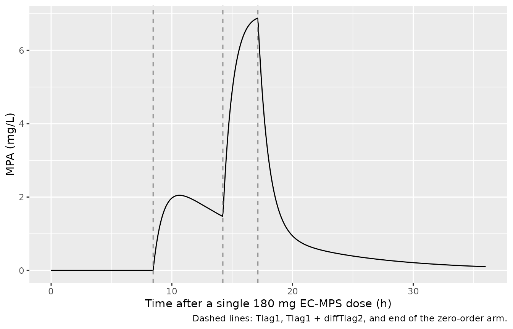
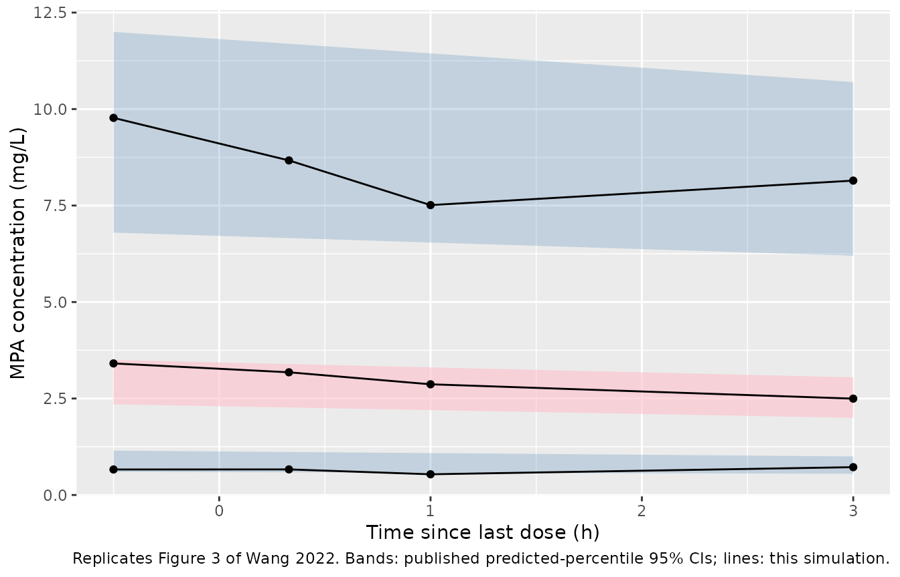
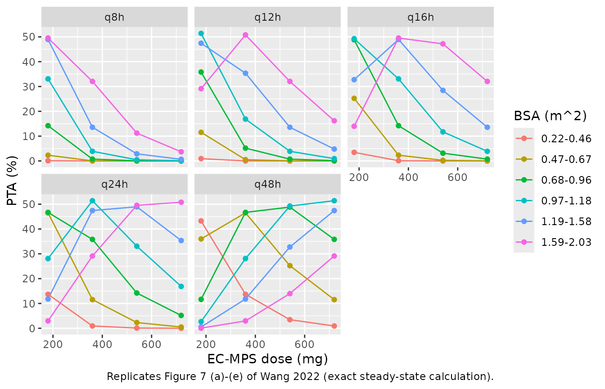

# Enteric-coated mycophenolate sodium in paediatric renal transplant (Wang 2022b)

## Model and source

- Citation: Wang G, Ye Q, Huang Y, Xu H, Li Z. Population
  Pharmacokinetics of Enteric-Coated Mycophenolate Sodium in Children
  after Renal Transplantation and Initial Dosage Recommendation Based on
  Body Surface Area. Comput Math Methods Med. 2022;2022:1881176.
  <doi:10.1155/2022/1881176>.
- Description: Population PK model for mycophenolic acid (MPA) after
  oral enteric-coated mycophenolate sodium (EC-MPS) in children after
  renal transplantation (Wang 2022b). One-compartment disposition with
  linear elimination and a double extravascular absorption: a
  first-order arm (rate ka, fraction F of the MPA dose, lag time Tlag1)
  running in parallel with a zero-order arm (duration Tk02, fraction
  1 - F) whose lag time Tlag2 = Tlag1 + diffTlag2 is longer than the
  first. The EC-MPS dose is converted to MPA by the factor 0.936. Body
  surface area enters the apparent clearance as a power term (BSA /
  1.23)^1.30. Log-normal IIV on all seven absorption and disposition
  parameters; combined additive plus proportional residual error. Each
  oral dose is given as two event records, one to depot and one to
  central with rate = -2.
- Article: <https://doi.org/10.1155/2022/1881176> (open access,
  PMC9482478)

Wang 2022 developed a population pharmacokinetic model of mycophenolic
acid (MPA) in children treated with enteric-coated mycophenolate sodium
(EC-MPS, Myfortic) after renal transplantation, and used it to recommend
initial EC-MPS regimens by body surface area (BSA). The file carries the
`2022b` suffix because `Wang_2022_mycophenolic_acid` is a different
paper (adult renal transplant recipients on mycophenolate mofetil).

The structural model is one compartment with linear elimination and a
“double extravascular absorption”: a first-order arm (rate `ka`,
fraction `F` of the MPA dose, lag `Tlag1`) in parallel with a zero-order
arm (duration `Tk02`, fraction `1 - F`) whose lag is longer than the
first, `Tlag2 = Tlag1 + diffTlag2`. The EC-MPS dose is multiplied by
0.936 to give the MPA amount. BSA acts on clearance as
`CL/F = 4.28 * (BSA / 1.23)^1.30`.

### Dosing the model

Each oral EC-MPS dose is two event records at the same time with the
same EC-MPS amount: one to `depot` (the first-order arm) and one to
`central` with `rate = -2` (the zero-order arm, whose duration `d2` is a
model parameter). The model applies the fractions `0.936 * ffo` and
`0.936 * (1 - ffo)` and the two lag times itself.

``` r

mod <- readModelDb("Wang_2022b_mycophenolic_acid")

# Repeated EC-MPS dosing for a cohort: one row per subject in `subj`
# (id, BSA, amt, ii), doses from time 0 to `t_last`.
make_doses <- function(subj, t_last) {
  base <- subj |>
    mutate(
      time = 0,
      evid = 1L,
      addl = as.integer(round(t_last / ii))
    )
  bind_rows(
    base |> mutate(cmt = "depot", rate = 0),
    base |> mutate(cmt = "central", rate = -2)
  )
}
```

## Population

The modelling group was 96 children (52 boys, 44 girls) aged 13.3 years
(median; range 4.3-18.0) weighing 39.0 kg (15.0-67.0), height 147 cm
(102-171) and BSA 1.26 m^2 (0.66-1.78; Mosteller formula), sampled a
median 396 days (13-2258) after transplantation at the Children’s
Hospital of Fudan University, Shanghai (Wang 2022 Table 1). Median
creatinine clearance was 78.8 mL/min/1.73 m^2. 94 children received
tacrolimus and 2 cyclosporin. EC-MPS doses were 10.5 mg/kg/day
(3.4-24.0), or 325 mg/m^2/day (117-605), on an unchanged regimen for at
least five days before therapeutic drug monitoring. MPA was sampled 30
min before a dose and 20 min, 1 h and 3 h after it (384 concentrations)
and measured by EMIT (LLOQ 0.1 mg/L). The model was fitted in Monolix
2019R1 and externally validated in 32 further children (Table 3: MPE
-0.880%, MAPE 10.0%, RMSE 0.810 mg/L).

## Source trace

| Model element | Value | Source |
|----|----|----|
| One-compartment model, parallel first-order + zero-order absorption | – | Methods 2.2, Figure 1, Table 2 footnote |
| EC-MPS to MPA conversion `fmpa` | 0.936 | Methods 2.2 |
| `lka` (ka1) | log(0.123) 1/h | Table 2, final model |
| `ld2` (Tk02) | log(2.90) h | Table 2 |
| `lffo` (F) | log(0.553) | Table 2 |
| `ltlag` (Tlag1) | log(8.45) h | Table 2 |
| `ldtlag2` (diffTlag2), `tlag2 = tlag + dtlag2` | log(5.78) h | Table 2; Table 2 footnote |
| `lvc` (V/F) | log(3.73) L | Table 2 |
| `lcl` (CL/F at BSA 1.23 m^2) | log(4.28) L/h | Table 2; Results 3.2 equation |
| `e_bsa_cl` | 1.30 | Table 2 (theta_CL-BSA); Results 3.2 equation |
| IIV SDs (ka1, Tk02, F, Tlag1, diffTlag2, V, CL) | 0.885, 2.31, 0.513, 0.576, 0.941, 0.337, 0.481 | Table 2 (omega, SD of log-normal eta; Methods 2.2) |
| `addSd` (a) | 0.0631 mg/L | Table 2 |
| `propSd` (b) | 0.199 | Table 2; error model in Methods 2.2 |

The variances in `ini()` are the squares of the Table 2 SDs.

## Typical-value profile

A single 180 mg EC-MPS tablet in a typical child (BSA 1.23 m^2) shows
the two absorption arms: the first-order arm starts at `Tlag1` = 8.45 h
and the zero-order arm runs from `Tlag1 + diffTlag2` = 14.23 h for 2.90
h.

``` r

subj_typ <- data.frame(id = 1L, BSA = 1.23, amt = 180, ii = 24)
ev_typ <- bind_rows(
  make_doses(subj_typ, 0),
  data.frame(id = 1L, BSA = 1.23, time = seq(0, 36, by = 0.05), evid = 0L, cmt = "central")
) |>
  arrange(time, desc(evid))
sim_typ <- rxode2::rxSolve(rxode2::zeroRe(mod), events = ev_typ)
#> ℹ parameter labels from comments will be replaced by 'label()'
#> ℹ omega/sigma items treated as zero: 'etalka', 'etald2', 'etalffo', 'etaltlag', 'etaldtlag2', 'etalvc', 'etalcl'

ggplot(as.data.frame(sim_typ), aes(time, Cc)) +
  geom_line() +
  geom_vline(xintercept = c(8.45, 8.45 + 5.78, 8.45 + 5.78 + 2.90), linetype = 2, colour = "grey50") +
  labs(
    x = "Time after a single 180 mg EC-MPS dose (h)", y = "MPA (mg/L)",
    caption = "Dashed lines: Tlag1, Tlag1 + diffTlag2, and end of the zero-order arm."
  )
```



``` r

st <- as.data.frame(sim_typ)
# No MPA reaches plasma before the first lag time.
stopifnot(max(abs(st$Cc[st$time < 8.4])) < 1e-8)
# The zero-order arm (fraction 1 - F = 0.447 of the MPA dose) enters at
# 0.936 * 180 * 0.447 / 2.90 = 26.0 mg/h; a kink appears at its start.
d_cc <- diff(st$Cc) / diff(st$time)
i0 <- which.min(abs(st$time - 14.23))
stopifnot(d_cc[i0 + 2] - d_cc[i0 - 2] > 5)
```

## Steady-state exposure check (PKNCA)

At steady state the dosing-interval AUC equals `0.936 * Dose / CL`
whatever the split between the arms, so it checks the dose conversion,
`CL/F` and the BSA term together. The zero-order duration has a very
wide IIV (SD 2.31 on the log scale, so `d2` exceeds 100 h in about 6% of
children) and the lags reach a day or more, so dosing runs for 40 days
before the measured interval. The cohort covers the observed BSA range
on two regimens.

The AUC uses the linear trapezoid. Children whose first-order fraction
`F` exceeds 1 (see “Subjects with F above 1” below) receive a negative
zero-order input, and when that input is short their concentration dips
below zero even at steady state; the log-down trapezoid cannot integrate
those intervals, while the linear trapezoid integrates the signed
concentration and still recovers the mass balance.

``` r

rxode2::rxSetSeed(20220910)
n_per <- 40
subj_ss <- data.frame(
  id = seq_len(2 * n_per),
  BSA = rep(seq(0.66, 1.78, length.out = n_per), 2),
  amt = rep(c(180, 360), each = n_per),
  ii = 12
) |>
  mutate(treatment = paste(amt, "mg q12h"))
t_ss <- 40 * 24
obs_ss <- tidyr::crossing(
  subj_ss |> select(id, BSA, amt, ii, treatment),
  time = t_ss + seq(0, 12, by = 0.1)
) |>
  mutate(evid = 0L, cmt = "central")
ev_ss <- bind_rows(make_doses(subj_ss, t_ss), obs_ss) |>
  arrange(id, time, desc(evid))
sim_ss <- rxode2::rxSolve(mod, events = ev_ss, maxsteps = 1e6) |>
  as.data.frame()
#> ℹ parameter labels from comments will be replaced by 'label()'
```

``` r

conc_ss <- sim_ss |>
  filter(!is.na(Cc)) |>
  select(id, time, Cc) |>
  left_join(subj_ss |> select(id, treatment), by = "id")
dose_ss <- subj_ss |>
  mutate(time = t_ss) |>
  select(id, time, amt, treatment)
o_conc <- PKNCA::PKNCAconc(conc_ss, Cc ~ time | treatment + id)
#> Warning in assert_conc(conc, any_missing_conc = any_missing_conc): Negative
#> concentrations found
o_dose <- PKNCA::PKNCAdose(dose_ss, amt ~ time | treatment + id)
intervals <- data.frame(start = t_ss, end = t_ss + 12, auclast = TRUE, cav = TRUE)
# PKNCA warns once per subject with a negative concentration; those
# subjects are expected here (F > 1) and are counted below instead.
nca_ss <- withCallingHandlers(
  PKNCA::pk.nca(PKNCA::PKNCAdata(o_conc, o_dose, intervals = intervals, options = list(auc.method = "linear"))),
  warning = function(w) {
    if (grepl("Negative concentrations found", conditionMessage(w))) invokeRestart("muffleWarning")
  }
)
c(`Subjects with a negative Cc in the interval` = sum(tapply(conc_ss$Cc, conc_ss$id, min) < 0))
#> Subjects with a negative Cc in the interval 
#>                                           6

auc_ss <- as.data.frame(nca_ss$result) |>
  filter(PPTESTCD == "auclast") |>
  select(id, treatment, auc = PPORRES) |>
  left_join(
    sim_ss |> group_by(id) |> summarise(cl = first(cl)),
    by = "id"
  ) |>
  left_join(subj_ss |> select(id, amt), by = "id") |>
  mutate(
    auc_expected = 0.936 * amt / cl,
    pct_diff = 100 * (auc / auc_expected - 1)
  )

auc_ss |>
  group_by(treatment) |>
  summarise(
    `Median AUC0-12 (mg*h/L)` = signif(median(auc), 3),
    `Median 0.936*Dose/CL (mg*h/L)` = signif(median(auc_expected), 3),
    `Median % difference` = round(median(pct_diff), 2),
    `90th pct |% difference|` = round(quantile(abs(pct_diff), 0.9), 2)
  ) |>
  dplyr::rename(Regimen = treatment) |>
  knitr::kable()
```

| Regimen | Median AUC0-12 (mg\*h/L) | Median 0.936*Dose/CL (mg*h/L) | Median % difference | 90th pct \|% difference\| |
|:---|---:|---:|---:|---:|
| 180 mg q12h | 47.9 | 47.9 | 0 | 0.07 |
| 360 mg q12h | 77.9 | 77.9 | 0 | 0.18 |

``` r


stopifnot(
  nrow(auc_ss) == 2 * n_per,
  !anyNA(auc_ss$pct_diff),
  # Both sides use the same drawn parameters, so the difference is
  # trapezoid error on the 0.1 h grid (largest for zero-order arms of a few
  # minutes) plus the rare subject still short of steady state after 40
  # days. Measured: median 0.005%, 90th percentile 0.09%. A mis-entered dose
  # conversion, CL/F or BSA exponent moves every subject by tens of percent.
  abs(median(auc_ss$pct_diff)) < 1,
  quantile(abs(auc_ss$pct_diff), 0.9) < 2
)
```

## Visual predictive check (Figure 3)

Figure 3 of Wang 2022 is a VPC of MPA concentrations at steady state
against time since the last dose, at the four sampling times (-0.5,
0.33, 1 and 3 h). The doses behind it are not tabulated per child, so
the virtual cohort below draws BSA from a normal distribution with mean
1.23 m^2 (the centring value of the clearance model) and SD 0.27 m^2
truncated to the observed 0.66-1.78 m^2, draws a daily dose per m^2 from
a log-normal with median 325 mg/m^2/day truncated to the observed
117-605 mg/m^2/day, and rounds the twice-daily dose to whole 180 mg
tablets. The model concentrations are compared with the
predicted-percentile bands read from Figure 3 by the maintainers.

``` r

rxode2::rxSetSeed(2022)
n_vpc <- 200
bsa_draw <- rnorm(4 * n_vpc, 1.23, 0.27)
bsa_draw <- bsa_draw[bsa_draw >= 0.66 & bsa_draw <= 1.78][seq_len(n_vpc)]
dd_draw <- exp(rnorm(4 * n_vpc, log(325), 0.3))
dd_draw <- dd_draw[dd_draw >= 117 & dd_draw <= 605][seq_len(n_vpc)]
subj_vpc <- data.frame(
  id = seq_len(n_vpc),
  BSA = bsa_draw,
  amt = pmax(180, 180 * round(dd_draw * bsa_draw / 2 / 180)),
  ii = 12
)
t_dose <- 40 * 24
obs_vpc <- tidyr::crossing(
  subj_vpc |> select(id, BSA, amt, ii),
  tsld = c(-0.5, 0.33, 1, 3)
) |>
  mutate(time = t_dose + tsld, evid = 0L, cmt = "central") |>
  select(-tsld)
ev_vpc <- bind_rows(make_doses(subj_vpc, t_dose), obs_vpc) |>
  arrange(id, time, desc(evid))
sim_vpc <- rxode2::rxSolve(mod, events = ev_vpc, maxsteps = 1e6) |>
  as.data.frame() |>
  mutate(tsld = round(time - t_dose, 2))

table(subj_vpc$amt)
#> 
#> 180 360 540 
#> 162  37   1
```

``` r

vpc_sum <- sim_vpc |>
  group_by(tsld) |>
  summarise(
    p10 = quantile(sim, 0.1),
    p50 = quantile(sim, 0.5),
    p90 = quantile(sim, 0.9)
  )
# Predicted 95% CI bands of the 10th / 50th / 90th percentiles, read from
# Wang 2022 Figure 3 at -0.5 h and 3 h by the maintainers.
fig3 <- data.frame(
  tsld = c(-0.5, 3),
  p10_lo = c(0.60, 0.55), p10_hi = c(1.15, 1.00),
  p50_lo = c(2.35, 2.00), p50_hi = c(3.50, 3.05),
  p90_lo = c(6.80, 6.20), p90_hi = c(12.0, 10.7)
)

ggplot() +
  geom_ribbon(data = fig3, aes(tsld, ymin = p10_lo, ymax = p10_hi), fill = "steelblue", alpha = 0.25) +
  geom_ribbon(data = fig3, aes(tsld, ymin = p50_lo, ymax = p50_hi), fill = "pink", alpha = 0.6) +
  geom_ribbon(data = fig3, aes(tsld, ymin = p90_lo, ymax = p90_hi), fill = "steelblue", alpha = 0.25) +
  geom_line(data = vpc_sum |> pivot_longer(-tsld), aes(tsld, value, group = name)) +
  geom_point(data = vpc_sum |> pivot_longer(-tsld), aes(tsld, value)) +
  labs(
    x = "Time since last dose (h)", y = "MPA concentration (mg/L)",
    caption = "Replicates Figure 3 of Wang 2022. Bands: published predicted-percentile 95% CIs; lines: this simulation."
  )
```



``` r


knitr::kable(vpc_sum, digits = 2, caption = "Simulated percentiles of MPA (mg/L) by time since last dose.")
```

|  tsld |  p10 |  p50 |  p90 |
|------:|-----:|-----:|-----:|
| -0.50 | 0.66 | 3.41 | 9.77 |
|  0.33 | 0.66 | 3.18 | 8.67 |
|  1.00 | 0.54 | 2.87 | 7.51 |
|  3.00 | 0.72 | 2.50 | 8.15 |

Simulated percentiles of MPA (mg/L) by time since last dose. {.table}

The simulated 10th, 50th and 90th percentiles are nearly flat across the
sampling window, as in Figure 3: with lags of 8 to 14 h and a slow
first-order absorption (half-life 5.6 h) under 12-hourly dosing, the
concentration at steady state is set by overlapping inputs from earlier
doses rather than by the dose just given.

``` r

# Pooled over the four times. The cohort's doses are a reconstruction, so
# the bounds allow for it while still failing on a tenfold error in CL/F,
# V/F or the dose conversion. Robust quantiles, not extremes (cohort draws
# differ across rxode2 builds and thread counts).
pooled <- quantile(sim_vpc$sim, c(0.1, 0.5, 0.9))
pooled
#>       10%       50%       90% 
#> 0.6538099 2.9559331 8.6216935
stopifnot(
  pooled[["50%"]] > 1.5, pooled[["50%"]] < 5,
  pooled[["10%"]] > 0.2, pooled[["10%"]] < 2,
  pooled[["90%"]] > 4, pooled[["90%"]] < 16
)
```

### Subjects with F above 1

Wang 2022 states that every parameter, including the fraction `F`, is
log-normal. With `F` = 0.553 and an IIV SD of 0.513, a child has `F > 1`
when `eta > log(1 / 0.553)`, which happens with probability 12.4%. The
zero-order arm `1 - F` is then negative; the total MPA absorbed is still
0.936 times the dose. The model keeps the published distribution.

``` r

ffo_tab <- sim_vpc |>
  group_by(id) |>
  summarise(ffo = first(ffo), min_cc = min(Cc))
c(
  `Fraction of simulated subjects with F > 1` = mean(ffo_tab$ffo > 1),
  `Fraction with any negative Cc at the sampled times` = mean(ffo_tab$min_cc < 0)
)
#>          Fraction of simulated subjects with F > 1 
#>                                              0.145 
#> Fraction with any negative Cc at the sampled times 
#>                                              0.020
```

## Dosing-regimen simulation (Figures 5-7)

Wang 2022 simulated 1000 children with BSA uniform on 0.22-2.03 m^2 and
reported, per BSA group, the regimen with the highest percentage of
target attainment (PTA: AUC0-12 30-60 mg*h/L, or the equivalent 60-120
mg*h/L over 24 h and 120-240 mg\*h/L over 48 h). At steady state every
one of those AUCs is `0.936 * (EC-MPS amount per 24 h) / CL` scaled to
its window, so PTA depends only on the daily dose, BSA and the IIV of
clearance, and can be computed exactly:
`PTA = P(60 < 0.936 * D24 / CL_i < 120)` with
`log CL_i ~ N(log(4.28 * (BSA / 1.23)^1.30), 0.481^2)`, averaged over
BSA within each group.

``` r

groups <- data.frame(
  group = c("0.22-0.46", "0.47-0.67", "0.68-0.96", "0.97-1.18", "1.19-1.58", "1.59-2.03"),
  lo = c(0.22, 0.47, 0.68, 0.97, 1.19, 1.59),
  hi = c(0.46, 0.67, 0.96, 1.18, 1.58, 2.03),
  paper_regimen = c("180 mg q48h", "180 mg q24h", "180 mg q24h", "360 mg q24h", "540 mg q24h", "360 mg q12h")
)
regimens <- tidyr::crossing(amt = c(180, 360, 540, 720), tau = c(8, 12, 16, 24, 48)) |>
  mutate(regimen = paste0(amt, " mg q", tau, "h"), d24 = amt * 24 / tau) |>
  bind_rows(data.frame(
    regimen = c("360/180 mg q12h", "540/360 mg q12h", "720/540 mg q12h"),
    d24 = c(540, 900, 1260)
  ))
pta_one <- function(d24, bsa) {
  m <- log(0.936 * d24 / (4.28 * (bsa / 1.23)^1.30))
  s <- 0.481
  pnorm((log(120) - m) / s) - pnorm((log(60) - m) / s)
}
pta_tab <- tidyr::crossing(groups, regimens) |>
  rowwise() |>
  mutate(pta = 100 * mean(pta_one(d24, seq(lo, hi, length.out = 201)))) |>
  ungroup()

pta_best <- pta_tab |>
  group_by(group) |>
  summarise(
    paper_regimen = first(paper_regimen),
    pta_paper = pta[regimen == first(paper_regimen)],
    best_pta = max(pta),
    best_regimens = paste(regimen[abs(pta - max(pta)) < 1e-9], collapse = ", ")
  )
stopifnot(nrow(pta_best) == 6, all(lengths(pta_best$pta_paper) == 1))

pta_best |>
  mutate(across(c(pta_paper, best_pta), \(x) round(x, 1))) |>
  dplyr::rename(
    `BSA group (m^2)` = group,
    `Recommended in Wang 2022` = paper_regimen,
    `PTA of that regimen (%)` = pta_paper,
    `Highest PTA (%)` = best_pta,
    `Regimen(s) with highest PTA` = best_regimens
  ) |>
  knitr::kable()
```

| BSA group (m^2) | Recommended in Wang 2022 | PTA of that regimen (%) | Highest PTA (%) | Regimen(s) with highest PTA |
|:---|:---|---:|---:|:---|
| 0.22-0.46 | 180 mg q48h | 43.2 | 43.2 | 180 mg q48h |
| 0.47-0.67 | 180 mg q24h | 46.5 | 46.5 | 180 mg q24h, 360 mg q48h |
| 0.68-0.96 | 180 mg q24h | 46.7 | 48.8 | 180 mg q16h, 540 mg q48h |
| 0.97-1.18 | 360 mg q24h | 51.4 | 51.4 | 180 mg q12h, 360 mg q24h, 720 mg q48h |
| 1.19-1.58 | 540 mg q24h | 49.0 | 49.0 | 180 mg q8h, 360 mg q16h, 540 mg q24h, 360/180 mg q12h |
| 1.59-2.03 | 360 mg q12h | 50.8 | 50.8 | 360 mg q12h, 720 mg q24h |

``` r

pta_tab |>
  filter(!grepl("/", regimen)) |>
  mutate(tau = factor(paste0("q", tau, "h"), levels = paste0("q", c(8, 12, 16, 24, 48), "h"))) |>
  ggplot(aes(amt, pta, colour = group)) +
  geom_line() +
  geom_point() +
  facet_wrap(~tau) +
  labs(
    x = "EC-MPS dose (mg)", y = "PTA (%)", colour = "BSA (m^2)",
    caption = "Replicates Figure 7 (a)-(e) of Wang 2022 (exact steady-state calculation)."
  )
```



The exact calculation reproduces the paper’s recommended regimen as the
best regimen in five of the six BSA groups. In the 0.68-0.96 m^2 group,
180 mg q24h (the recommendation) gives a PTA of 46.7%, against 48.8% for
270 mg/day (180 mg q16h or 540 mg q48h); with about 160 simulated
children per group the paper’s Monte Carlo PTA has a standard error near
4 percentage points, so the two are not distinguishable there. The
highest PTA is about 50% in every group, as the paper reports.

``` r

stopifnot(
  # The recommended regimen is (one of) the exact best in five groups.
  sum(abs(pta_best$best_pta - pta_best$pta_paper) < 1e-9) == 5,
  # Each recommended regimen is within the paper's Monte Carlo error of the best.
  all(pta_best$best_pta - pta_best$pta_paper < 5),
  # "the highest PTA among all the groups and all the dosing regimens are around 50%"
  all(pta_best$best_pta > 40 & pta_best$best_pta < 56)
)
```

## Assumptions and deviations

- **File name.** `Wang_2022_mycophenolic_acid` already holds a different
  Wang 2022 paper (Front Pharmacol, adult renal transplant,
  mycophenolate mofetil), so this model is
  `Wang_2022b_mycophenolic_acid`.
- **Log-normal `F`.** The paper states that every parameter is
  log-normal, including the first-order fraction `F`. About 12% of
  children then have `F > 1` and a negative zero-order arm. The model
  keeps the published distribution rather than moving `F` to the logit
  scale, which would narrow its tails; total absorption stays 0.936
  times the dose, so the steady-state AUC and the paper’s dosing
  recommendations are unaffected.
- **Lag increment.** `diffTlag2` is estimated with its own IIV as the
  increment of the zero-order lag over `Tlag1`; it is encoded as
  `ldtlag2`, with `tlag2 = tlag + dtlag2` in `model()`.
- **BSA reference.** The equation divides BSA by 1.23 m^2; the Methods
  centre continuous covariates on their mean, while Table 1 gives the
  median 1.26 m^2. The equation value is used.
- **Residual error.** `Cobs = Cpred + sqrt(a^2 + (b * Cpred)^2) * eps`
  is encoded as `add(addSd) + prop(propSd)`, the combined form on the
  variance scale.
- **VPC cohort.** Per-child doses and BSA values are not published. The
  Figure 3 comparison uses a reconstructed cohort (BSA and dose per m^2
  drawn to match Table 1, doses rounded to whole 180 mg tablets,
  12-hourly dosing) and the predicted-percentile bands were read from
  the figure by eye.
- **Morning and evening doses.** All samples followed a morning dose,
  and the paper fits a single set of lag times; no diurnal difference is
  modelled.
- **No published NCA.** The paper reports no Cmax, Tmax or AUC table;
  the PKNCA check compares simulated AUC0-12 against the steady-state
  identity `0.936 * Dose / CL` instead.
