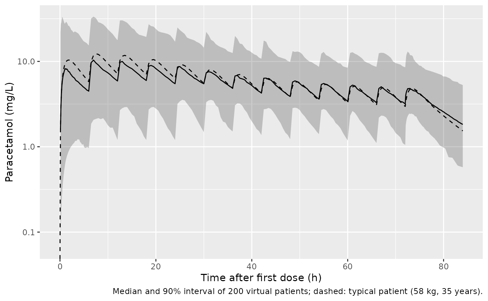
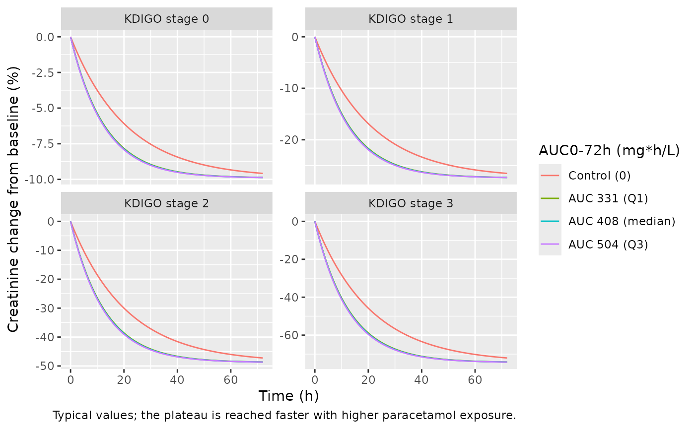
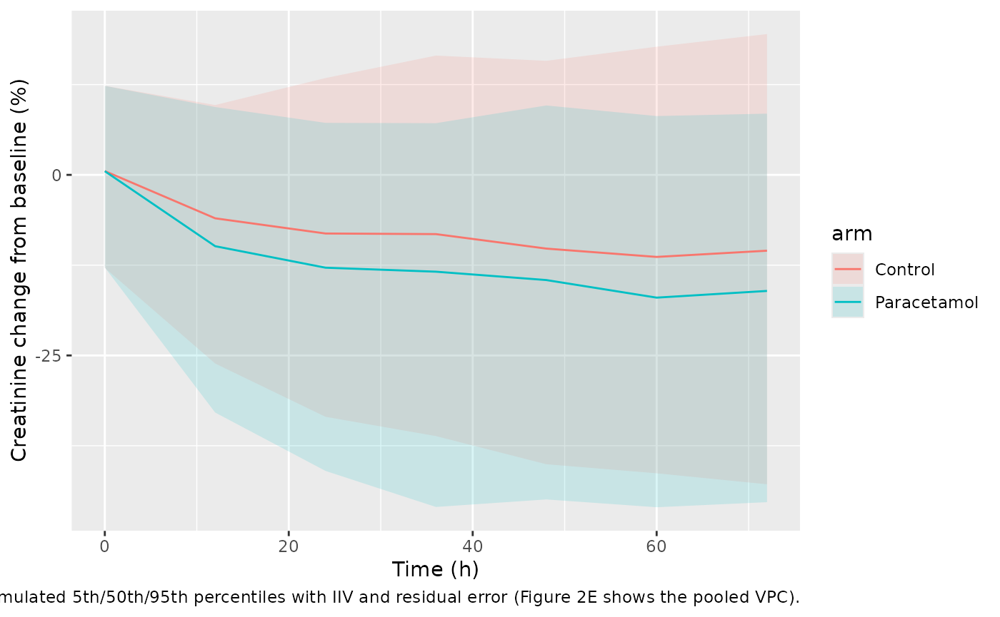
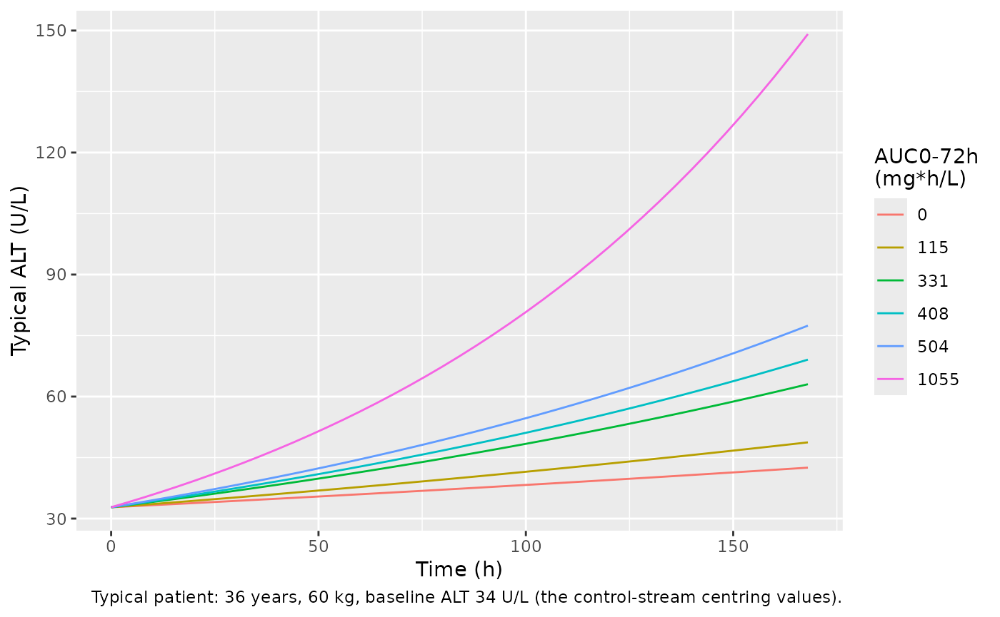
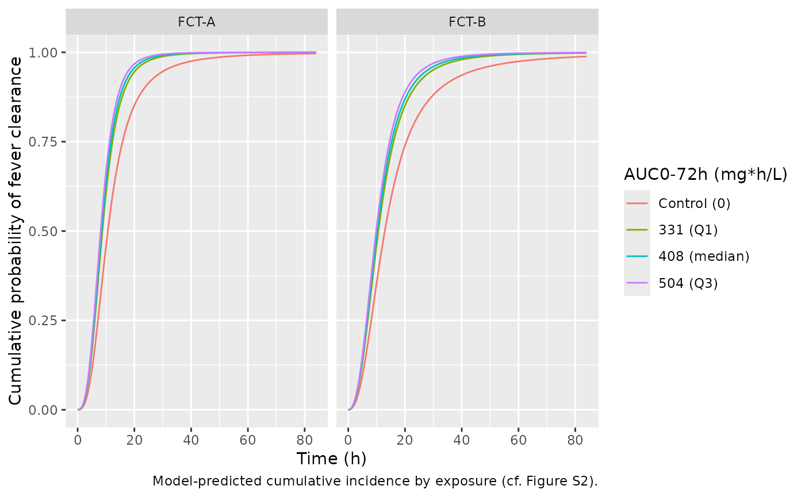

# Paracetamol PK and renal, hepatic and antipyretic exposure-response in knowlesi malaria (Wattanakul 2026)

## Model and source

Wattanakul 2026 analysed the PACKNOW trial, in which Malaysian patients
with *Plasmodium knowlesi* malaria were randomised to oral paracetamol 1
g every 6 h for 72 h or to no paracetamol. The paper reports one
population PK model and four sequentially fitted exposure-response
models, each driven by the individual paracetamol AUC from 0 to 72 h
predicted by the PK model. They are packaged as five models:

| Model | Endpoint |
|----|----|
| `Wattanakul_2026_paracetamol` | Plasma paracetamol (two-compartment PK) |
| `Wattanakul_2026_paracetamol_creatinine` | Percentage change from baseline in serum creatinine |
| `Wattanakul_2026_paracetamol_alt` | ln(ALT) over 0-168 h |
| `Wattanakul_2026_paracetamol_fcta` | Fever clearance time A (first temperature \< 37.5 C) |
| `Wattanakul_2026_paracetamol_fctb` | Fever clearance time B (temperature \< 37.5 C sustained for 24 h) |

- Citation: Wattanakul T, Cooper DJ, Plewes K, Grigg MJ, Rajahram GS,
  William T, Dondorp AM, Edstein MD, Birrell GW, Anstey NM, Hoglund RM,
  Barber BE, Tarning J. Population Pharmacokinetics and Pharmacodynamics
  of Paracetamol in Malaysian Patients With Plasmodium knowlesi Malaria.
  CPT Pharmacometrics Syst Pharmacol. 2026;15:e70283.
  <doi:10.1002/psp4.70283>. Prior PK model: Wattanakul T et al. Malaria
  Journal 2016;15:244, <doi:10.1186/s12936-016-1283-9>; see
  modellib(‘Wattanakul_2016_paracetamol’).
- Description: Two-compartment population PK model with first-order
  absorption for oral paracetamol (acetaminophen) 1 g every 6 h for 72 h
  in Malaysian patients aged 5 years and older with predominantly
  non-severe Plasmodium knowlesi malaria (PACKNOW trial; Wattanakul
  2026). Relative bioavailability declines exponentially from 1 at the
  start of treatment to a minimum of 0.220 with a 10.2 h half-life, and
  carries inter-occasion variability across four treatment days.
  Allometric body-weight scaling (exponents 0.75 on CL/F and Q/F, 1 on
  Vc/F and Vp/F, reference 58 kg) and a linear age effect on ka. The
  structural parameters were estimated with an informative NONMEM
  \$PRIOR on THETA from the Wattanakul 2016 falciparum-malaria model
  (modellib(‘Wattanakul_2016_paracetamol’)); the values here are the
  posterior estimates reported for the knowlesi cohort.
- Article: <https://doi.org/10.1002/psp4.70283>
- Supplement (study procedures, prior-model selection, Table S1 and the
  NONMEM control streams of all five models): Supporting Information S1
  of the article.

The exposure-response models take paracetamol exposure as a per-subject
covariate, `AUC_PARACETAMOL` (mg\*h/L), rather than carrying PK
compartments. In the source the column was computed from each patient’s
empirical-Bayes PK parameters; here it is computed by simulating the PK
model, as in the sections below. Untreated patients have
`AUC_PARACETAMOL = 0`.

## Population

The PK model was fitted to 2435 plasma concentrations from the 183
patients in the paracetamol arm (median age 35 years, IQR 26-49; median
weight 61.0 kg, IQR 53.5-68.4; 87.4% male). The exposure-response models
used both arms (372 patients: 183 paracetamol, 189 control). Patients
were 5 years and older, hospitalised with PCR-confirmed *P. knowlesi*
monoinfection and recent fever, and enrolled within 18 h of starting
artesunate and/or artemether-lumefantrine; 7.5% had WHO-defined severe
malaria and 28.5% had acute kidney injury (KDIGO stage 1-3) at
enrollment. The fever-clearance models used the 194 patients whose
temperature was at least 37.5 C at enrollment. Baseline characteristics
are in Wattanakul 2026 Table 1.

The same information is available programmatically, e.g.
`readModelDb("Wattanakul_2026_paracetamol")()$population`.

## Source trace

Every `ini()` value carries an in-file comment pointing to its source.
The supplement control streams settle the equation forms and the
centring values that the main text does not print.

| Model | Equation / parameter | Value | Source location |
|----|----|----|----|
| PK | `ka` | 0.917 1/h | Table 2 |
| PK | `CL/F` | 9.80 L/h | Table 2 |
| PK | `Vc/F` | 53.7 L | Table 2 |
| PK | `Q/F` | 10.7 L/h | Table 2 |
| PK | `Vp/F` | 33.2 L | Table 2 |
| PK | `F` at time zero | 1 (fixed) | Table 2; stream `$THETA (1) FIX` |
| PK | `F50` (half-life of the F decline) | 10.2 h | Table 2; stream `KF1 = LOG(2)/HLF1` |
| PK | `FMIN` | 0.220 | Table 2 |
| PK | F(t) = F x (exp(-k t)(1 - FMIN) + FMIN) | n/a | Methods Eq. 3; stream `TEFFF1` |
| PK | Age on ka, `1 + theta (AGE - 35)` | -0.0187 | Table 2; stream `KAAGE` |
| PK | Allometry, `(WT/58)^0.75` on CL, Q; `^1` on Vc, Vp | fixed | Methods Eq. 5; stream `TVCL ... (WT/58)**0.75` |
| PK | IIV ka, Vc, Vp, F (variances) | 2.13, 0.338, 2.77, 0.0662 | stream `$OMEGA`; equal to Table 2 %CV |
| PK | IOV F, 4 day-occasions | 0.251 | stream `$OMEGA BLOCK(1) ... SAME`; Table 2 53.4% CV |
| PK | Residual, additive on log scale | variance 0.290 | Table 2 (footnote: variance); stream `$SIGMA 0.29` |
| Creatinine | `kappa` | 0.0477 1/h | Table 3 |
| Creatinine | `Plateau` | -9.9% | Table 3 |
| Creatinine | AUC on kappa, `1 + theta log10(AUC)` | 0.254 | Table 3; stream `KAPPALAUC72` |
| Creatinine | KDIGO 1 / 2 / 3 on plateau, `1 + theta` | 1.77 / 3.93 / 6.52 | Table 3; stream `PLATEAUSTAGE` |
| Creatinine | dCr = Plateau (1 - exp(-kappa t)) | n/a | Methods Eq. 7 with BaseCR = 0 |
| Creatinine | IIV kappa, Plateau (SD, additive) | 0.0377, 12.2 | Table 3 (footnote c) |
| Creatinine | Residual SD (additive) | 7.94% | Table 3; sqrt of stream `$SIGMA 63` |
| ALT | Slope | 0.00236 1/h | Table 4 |
| ALT | Intercept | 3.49 | Table 4 |
| ALT | Age on slope, centred at 36 y | -1.1% per year | Table 4; stream `SLOPEAGE` |
| ALT | AUC on slope, centred at 114.76 mg\*h/L | +0.3% per mg\*h/L | Table 4; stream `SLOPEAUC72MG` |
| ALT | Baseline ALT on slope, centred at 34 U/L | -1.2% per U/L | Table 4; stream `SLOPEBALT` |
| ALT | Weight on intercept, centred at 60 kg | +0.4% per kg | Table 4; stream `INTERCEPTWT` |
| ALT | ln(ALT) = Intercept + Slope t | n/a | Methods Eq. 10 |
| ALT | IIV slope, intercept (SD, additive) | 0.00274, 0.547 | Table 4 |
| ALT | Residual on ln(ALT) | variance 0.118 | Table 4; stream `$SIGMA 0.12` |
| FCT-A | lambda, gamma | 0.0940 1/h, 2.77 | Table S1 |
| FCT-A | AUC on hazard, `1 + theta AUC` | 0.158 per 100 mg\*h/L | Table S1; stream `EFF = (1+BETA*AUC72MG)` |
| FCT-B | lambda, gamma | 0.0776 1/h, 2.37 | Table S1 |
| FCT-B | AUC on hazard | 0.126 per 100 mg\*h/L | Table S1 |
| FCT | h(t) = EFF lambda gamma (lambda t)^(gamma-1) / (1 + (lambda t)^gamma) | n/a | Supplement S3; stream `$DES` |

## Pharmacokinetics

### Virtual cohort

Two hundred virtual patients receive 1 g every 6 h from time 0 to 72 h
(13 doses; the intensive schedule sampled after a dose at 72 h). Weight
and age are drawn log-normally to match the paracetamol-arm medians and
interquartile ranges of Table 1, re-drawing any value outside 12-80
years or 35-100 kg. Each dose carries the occasion index of its
treatment day (`OCC` 1-4).

``` r

set.seed(2026)

draw_bounded <- function(n, meanlog, sdlog, lo, hi) {
  x <- stats::rlnorm(n, meanlog, sdlog)
  bad <- x < lo | x > hi
  while (any(bad)) {
    x[bad] <- stats::rlnorm(sum(bad), meanlog, sdlog)
    bad <- x < lo | x > hi
  }
  x
}

n_pk <- 200
# sdlog from the IQR: (log(Q3) - log(Q1)) / 1.349
pk_cov <- tibble(
  id = seq_len(n_pk),
  WT = draw_bounded(n_pk, log(61.0), (log(68.4) - log(53.5)) / 1.349, 35, 100),
  AGE = draw_bounded(n_pk, log(35), (log(49) - log(26)) / 1.349, 12, 80)
)

dose_times <- seq(0, 72, by = 6)
obs_times <- sort(unique(c(
  seq(0, 6, by = 0.1), seq(6, 72, by = 0.5), seq(72, 84, by = 0.1)
)))

pk_events <- bind_rows(
  tidyr::crossing(id = pk_cov$id, time = dose_times) |>
    mutate(evid = 1L, amt = 1000, cmt = "depot"),
  tidyr::crossing(id = pk_cov$id, time = obs_times) |>
    mutate(evid = 0L, amt = 0, cmt = "central")
) |>
  mutate(OCC = pmin(floor(time / 24) + 1, 4)) |>
  left_join(pk_cov, by = "id") |>
  arrange(id, time, desc(evid))

# Occasion boundaries: the dose at 24 h belongs to day 1, at 72 h to day 3.
stopifnot(
  all(pk_events$OCC[pk_events$evid == 1 & pk_events$time == 24] == 2),
  all(pk_events$OCC[pk_events$evid == 1 & pk_events$time == 72] == 4)
)
```

### Simulation

``` r

mod_pk <- readModelDb("Wattanakul_2026_paracetamol")
sim_pk <- rxode2::rxSolve(
  mod_pk,
  events = pk_events,
  returnType = "data.frame",
  keep = c("WT", "AGE")
)
#> ℹ parameter labels from comments will be replaced by 'label()'
#> Warning: some etas defaulted to non-mu referenced, possible parsing error: etaiov_fdepot_1, etaiov_fdepot_2, etaiov_fdepot_3, etaiov_fdepot_4
#> as a work-around try putting the mu-referenced expression on a simple line
sim_pk_typ <- rxode2::rxSolve(
  rxode2::zeroRe(mod_pk),
  events = pk_events |> filter(id == 1) |> mutate(WT = 58, AGE = 35),
  returnType = "data.frame"
)
#> ℹ parameter labels from comments will be replaced by 'label()'
#> Warning: some etas defaulted to non-mu referenced, possible parsing error: etaiov_fdepot_1, etaiov_fdepot_2, etaiov_fdepot_3, etaiov_fdepot_4
#> as a work-around try putting the mu-referenced expression on a simple line
#> Warning: some etas defaulted to non-mu referenced, possible parsing error: etaiov_fdepot_1, etaiov_fdepot_2, etaiov_fdepot_3, etaiov_fdepot_4
#> as a work-around try putting the mu-referenced expression on a simple line
#> ℹ omega/sigma items treated as zero: 'etalka', 'etalvc', 'etalvp', 'etalfdepot', 'etaiov_fdepot_1', 'etaiov_fdepot_2', 'etaiov_fdepot_3', 'etaiov_fdepot_4'
```

### Concentration-time profile (Figure 1E)

``` r

# Replicates the shape of Figure 1E of Wattanakul 2026 (the published panel is
# prediction-corrected and overlays observations; this shows the simulated
# 5th, 50th and 95th percentiles).
sim_pk |>
  filter(time > 0) |>
  group_by(time) |>
  summarise(
    Q05 = quantile(Cc, 0.05),
    Q50 = quantile(Cc, 0.50),
    Q95 = quantile(Cc, 0.95),
    .groups = "drop"
  ) |>
  ggplot(aes(time, Q50)) +
  geom_ribbon(aes(ymin = Q05, ymax = Q95), alpha = 0.25) +
  geom_line() +
  geom_line(data = sim_pk_typ, aes(time, Cc), linetype = "dashed") +
  scale_y_log10() +
  labs(
    x = "Time after first dose (h)",
    y = "Paracetamol (mg/L)",
    caption = "Median and 90% interval of 200 virtual patients; dashed: typical patient (58 kg, 35 years)."
  )
#> Warning in scale_y_log10(): log-10 transformation introduced infinite values.
```



The declining peaks reproduce what motivated the time-dependent
bioavailability: the paper reports a 46% median fall from the first to
the last observed peak. The typical-value model gives the same order of
fall, which is set by `FMIN` and `F50` alone.

``` r

typ_first <- max(sim_pk_typ$Cc[sim_pk_typ$time <= 6])
typ_last <- max(sim_pk_typ$Cc[sim_pk_typ$time >= 72])
fall_pct <- 100 * (1 - typ_last / typ_first)
fall_pct
#> [1] 53.60769

# F at the 72 h dose, from Eq. 3: exp(-log(2)/10.2 * 72) * 0.78 + 0.22
f72 <- exp(-log(2) / 10.2 * 72) * (1 - 0.220) + 0.220
stopifnot(
  abs(f72 - 0.2261) < 1e-3,
  # The last-dose peak sits between the pure F ratio (all of the fall) and
  # the first-dose peak; accumulation of earlier doses keeps it above f72.
  typ_last / typ_first > f72,
  fall_pct > 30, fall_pct < 70
)
```

### Bioavailability decline: the solve against Eq. 3

The model applies F at each dose time. A typical patient given only the
first and the 72 h dose, compared with one given only the first dose,
isolates the 72 h dose’s contribution, whose AUC must equal
`F(72) x Dose / CL`.

``` r

two_dose <- function(times) {
  bind_rows(
    tibble(id = 1L, time = times, evid = 1L, amt = 1000, cmt = "depot"),
    tibble(id = 1L, time = seq(0, 400, by = 0.05), evid = 0L, amt = 0, cmt = "central")
  ) |>
    mutate(OCC = pmin(floor(time / 24) + 1, 4), WT = 58, AGE = 35) |>
    arrange(time, desc(evid))
}
auc_trap <- function(d) sum(diff(d$time) * (head(d$Cc, -1) + tail(d$Cc, -1)) / 2)
typ_mod <- rxode2::zeroRe(mod_pk)
#> ℹ parameter labels from comments will be replaced by 'label()'
#> Warning: some etas defaulted to non-mu referenced, possible parsing error: etaiov_fdepot_1, etaiov_fdepot_2, etaiov_fdepot_3, etaiov_fdepot_4
#> as a work-around try putting the mu-referenced expression on a simple line
#> Warning: some etas defaulted to non-mu referenced, possible parsing error: etaiov_fdepot_1, etaiov_fdepot_2, etaiov_fdepot_3, etaiov_fdepot_4
#> as a work-around try putting the mu-referenced expression on a simple line
a_both <- auc_trap(rxode2::rxSolve(typ_mod, two_dose(c(0, 72)), returnType = "data.frame", atol = 1e-10, rtol = 1e-10))
#> ℹ omega/sigma items treated as zero: 'etalka', 'etalvc', 'etalvp', 'etalfdepot', 'etaiov_fdepot_1', 'etaiov_fdepot_2', 'etaiov_fdepot_3', 'etaiov_fdepot_4'
a_first <- auc_trap(rxode2::rxSolve(typ_mod, two_dose(0), returnType = "data.frame", atol = 1e-10, rtol = 1e-10))
#> ℹ omega/sigma items treated as zero: 'etalka', 'etalvc', 'etalvp', 'etalfdepot', 'etaiov_fdepot_1', 'etaiov_fdepot_2', 'etaiov_fdepot_3', 'etaiov_fdepot_4'
auc_72 <- a_both - a_first
c(simulated = auc_72, expected = f72 * 1000 / 9.80)
#> simulated  expected 
#>  23.04514  23.04595
stopifnot(abs(auc_72 / (f72 * 1000 / 9.80) - 1) < 0.01)
```

### NCA and the published secondary parameters

The paper’s secondary-parameter table (Table 2, lower block) reports
medians of the individual post-hoc predictions: first- and last-dose
Cmax and Tmax, AUC0-72h, and the terminal half-life. Cmax, Tmax and
AUC0-72h come from PKNCA on the simulated profiles; the half-life is the
terminal (beta) half-life of each patient’s two-compartment parameters,
which is how the source computes it (`HTB = 0.693/BETA` in the control
stream).

``` r

sim_nca <- sim_pk |>
  filter(!is.na(Cc)) |>
  mutate(treatment = "1 g q6h") |>
  select(id, time, Cc, treatment)
sim_nca <- bind_rows(
  sim_nca,
  sim_nca |> distinct(id, treatment) |> mutate(time = 0, Cc = 0)
) |>
  distinct(id, treatment, time, .keep_all = TRUE) |>
  arrange(id, treatment, time)

dose_df <- pk_events |>
  filter(evid == 1) |>
  mutate(treatment = "1 g q6h") |>
  select(id, time, amt, treatment)

conc_obj <- PKNCA::PKNCAconc(sim_nca, Cc ~ time | treatment + id)
dose_obj <- PKNCA::PKNCAdose(dose_df, amt ~ time | treatment + id)
intervals <- data.frame(
  start = c(0, 72, 0),
  end = c(6, 84, 72),
  cmax = c(TRUE, TRUE, FALSE),
  tmax = c(TRUE, TRUE, FALSE),
  auclast = c(FALSE, FALSE, TRUE)
)
nca_res <- PKNCA::pk.nca(PKNCA::PKNCAdata(conc_obj, dose_obj, intervals = intervals))

nca_long <- as.data.frame(nca_res$result) |>
  mutate(
    interval = case_when(
      start == 0 & end == 6 ~ "First dose (0-6 h)",
      start == 72 & end == 84 ~ "Last dose (72-84 h)",
      start == 0 & end == 72 ~ "0-72 h"
    )
  ) |>
  select(interval, PPTESTCD, PPORRES)

# Terminal half-life from each patient's individual parameters
thalf <- sim_pk |>
  group_by(id) |>
  slice(1) |>
  ungroup() |>
  mutate(
    s = kel + k12 + k21,
    beta = 0.5 * (s - sqrt(s^2 - 4 * k21 * kel)),
    PPORRES = log(2) / beta,
    interval = "Terminal",
    PPTESTCD = "half.life"
  ) |>
  select(interval, PPTESTCD, PPORRES)

sim_long <- bind_rows(nca_long, thalf)

published <- tibble::tribble(
  ~interval,             ~cmax, ~tmax, ~auclast, ~half.life,
  "First dose (0-6 h)",  9.34,  1.51,  NA,       NA,
  "Last dose (72-84 h)", 4.15,  1.21,  NA,       NA,
  "0-72 h",              NA,    NA,    408,      NA,
  "Terminal",            NA,    NA,    NA,       9.31
)

cmp <- nlmixr2lib::ncaComparisonTable(
  simulated = sim_long,
  reference = published,
  by = "interval",
  units = c(cmax = "mg/L", tmax = "h", auclast = "mg*h/L", half.life = "h"),
  tolerance_pct = 20
)
knitr::kable(
  cmp,
  caption = "Simulated medians vs. Wattanakul 2026 Table 2 (secondary parameters). * differs from the reference by >20%."
)
```

| NCA parameter     | interval            | Reference | Simulated | % diff   |
|:------------------|:--------------------|:----------|:----------|:---------|
| Cmax (mg/L)       | First dose (0-6 h)  | 9.34      | 9.42      | +0.9%    |
| Cmax (mg/L)       | Last dose (72-84 h) | 4.15      | 5.03      | +21.3%\* |
| Tmax (h)          | First dose (0-6 h)  | 1.51      | 1.9       | +25.8%\* |
| Tmax (h)          | Last dose (72-84 h) | 1.21      | 1.1       | -9.1%    |
| AUClast (mg\*h/L) | 0-72 h              | 408       | 423       | +3.7%    |
| t½ (h)            | Terminal            | 9.31      | 8.85      | -4.9%    |

Simulated medians vs. Wattanakul 2026 Table 2 (secondary parameters). \*
differs from the reference by \>20%. {.table}

``` r

sim_med <- sim_long |>
  group_by(interval, PPTESTCD) |>
  summarise(med = median(PPORRES, na.rm = TRUE), .groups = "drop")
get_med <- function(i, p) sim_med$med[sim_med$interval == i & sim_med$PPTESTCD == p]
stopifnot(
  # A mis-transcribed CL/F, F decline or dose moves these by far more than
  # the differences between simulated and post-hoc medians.
  abs(get_med("0-72 h", "auclast") / 408 - 1) < 0.25,
  abs(get_med("First dose (0-6 h)", "cmax") / 9.34 - 1) < 0.25,
  abs(get_med("Last dose (72-84 h)", "cmax") / 4.15 - 1) < 0.3
)
```

First-dose Cmax, AUC0-72h and the terminal half-life agree with the
published medians to within 5%. The last-dose Cmax is about 20% above
the published median and first-dose Tmax about 25% later. The published
values are medians of empirical-Bayes predictions from a sparse,
trough-dominated design (81.4% troughs; 34-50% eta shrinkage on ka, Vc
and Vp and 38% on the occasion-level F), and NONMEM `TIME` in the
source, which drives the decline in bioavailability, runs from
enrollment rather than from the first dose. Both shift post-hoc peaks
relative to a forward simulation of the population model. The Tmax
values also depend on the 0.1 h simulation grid.

### Individual paracetamol AUC0-72h for the exposure-response models

``` r

auc72 <-as.data.frame(nca_res$result) |>
  filter(start == 0, end == 72, PPTESTCD == "auclast") |>
  transmute(id, AUC_PARACETAMOL = PPORRES)
summary(auc72$AUC_PARACETAMOL)
#>    Min. 1st Qu.  Median    Mean 3rd Qu.    Max. 
#>   124.0   329.3   422.9   511.8   636.2  2047.3
```

## Creatinine

The creatinine model is algebraic in time: creatinine moves from its
baseline (0% change) towards a plateau at rate `kappa`. Higher
paracetamol exposure raises `kappa` (log10 AUC), and the enrollment
KDIGO stage deepens the plateau.

### Typical-value curves (structure of Figure 2 and Table 3)

``` r

mod_cr <- readModelDb("Wattanakul_2026_paracetamol_creatinine")
cr_grid <- tidyr::crossing(
  AUC_PARACETAMOL = c(0, 331, 408, 504),
  stage = 0:3
) |>
  mutate(
    id = row_number(),
    KDIGO_AKI_1 = as.integer(stage == 1),
    KDIGO_AKI_2 = as.integer(stage == 2),
    KDIGO_AKI_3 = as.integer(stage == 3)
  )
cr_typ_events <- tidyr::crossing(id = cr_grid$id, time = seq(0, 72, by = 1)) |>
  mutate(evid = 0L, amt = 0) |>
  left_join(cr_grid, by = "id")
cr_typ <- rxode2::rxSolve(
  rxode2::zeroRe(mod_cr),
  events = cr_typ_events,
  returnType = "data.frame",
  keep = c("AUC_PARACETAMOL", "stage")
)
#> ℹ parameter labels from comments will be replaced by 'label()'
#> ℹ omega/sigma items treated as zero: 'etakcr', 'etaplateau_cr'
#> Warning: multi-subject simulation without without 'omega'

cr_typ |>
  mutate(
    exposure = factor(
      AUC_PARACETAMOL,
      labels = c("Control (0)", "AUC 331 (Q1)", "AUC 408 (median)", "AUC 504 (Q3)")
    ),
    stage = paste("KDIGO stage", stage)
  ) |>
  ggplot(aes(time, crcfb, colour = exposure)) +
  geom_line() +
  facet_wrap(~stage, scales = "free_y") +
  labs(
    x = "Time (h)", y = "Creatinine change from baseline (%)",
    colour = "AUC0-72h (mg*h/L)",
    caption = "Typical values; the plateau is reached faster with higher paracetamol exposure."
  )
```



The closed form fixes every curve:
`crcfb = Plateau x (1 + theta_KDIGO) x (1 - exp(-kappa x (1 + 0.254 log10 AUC) t))`.
A 10-fold rise in AUC adds 25.4% to `kappa` (Results 3.2.1), and at the
median AUC of 408 mg\*h/L the rate constant is 1.663-fold that of the
control arm.

``` r

cr_closed <- cr_typ |>
  mutate(
    k = 0.0477 * (1 + 0.254 * ifelse(AUC_PARACETAMOL > 0, log10(AUC_PARACETAMOL), 0)),
    p = -9.9 * c(1, 2.77, 4.93, 7.52)[stage + 1],
    expected = p * (1 - exp(-k * time))
  )
kappa_ratio_408 <- 1 + 0.254 * log10(408)
stopifnot(
  max(abs(cr_closed$crcfb - cr_closed$expected)) < 1e-8,
  abs(kappa_ratio_408 - 1.663) < 1e-3
)
cr_typ |>
  filter(time == 72) |>
  select(stage, AUC_PARACETAMOL, crcfb) |>
  tidyr::pivot_wider(names_from = AUC_PARACETAMOL, values_from = crcfb, names_prefix = "AUC ") |>
  knitr::kable(digits = 1, caption = "Typical creatinine change from baseline (%) at 72 h, by enrollment KDIGO stage and AUC0-72h (mg*h/L).")
```

| stage | AUC 0 | AUC 331 | AUC 408 | AUC 504 |
|------:|------:|--------:|--------:|--------:|
|     0 |  -9.6 |    -9.9 |    -9.9 |    -9.9 |
|     1 | -26.5 |   -27.3 |   -27.3 |   -27.3 |
|     2 | -47.2 |   -48.6 |   -48.6 |   -48.7 |
|     3 | -72.0 |   -74.2 |   -74.2 |   -74.2 |

Typical creatinine change from baseline (%) at 72 h, by enrollment KDIGO
stage and AUC0-72h (mg\*h/L). {.table}

### Stochastic prediction by arm (Figure 2E)

``` r

set.seed(2027)
draw_stage <- function(n, p) sample(0:3, n, replace = TRUE, prob = p)
cr_cov <- bind_rows(
  tibble(
    id = seq_len(n_pk), arm = "Paracetamol",
    AUC_PARACETAMOL = auc72$AUC_PARACETAMOL,
    # Table 1 paracetamol arm: 134 / 39 / 8 / 2 of 183
    stage = draw_stage(n_pk, c(134, 39, 8, 2))
  ),
  tibble(
    id = n_pk + seq_len(n_pk), arm = "Control",
    AUC_PARACETAMOL = 0,
    # Table 1 control arm: 132 / 52 / 5 / 0 of 189
    stage = draw_stage(n_pk, c(132, 52, 5, 0))
  )
) |>
  mutate(
    KDIGO_AKI_1 = as.integer(stage == 1),
    KDIGO_AKI_2 = as.integer(stage == 2),
    KDIGO_AKI_3 = as.integer(stage == 3)
  )
cr_events <- tidyr::crossing(id = cr_cov$id, time = seq(0, 72, by = 12)) |>
  mutate(evid = 0L, amt = 0) |>
  left_join(cr_cov, by = "id")
sim_cr <- rxode2::rxSolve(mod_cr, events = cr_events, returnType = "data.frame", keep = "arm")
#> ℹ parameter labels from comments will be replaced by 'label()'

sim_cr |>
  group_by(arm, time) |>
  summarise(
    Q05 = quantile(sim, 0.05), Q50 = quantile(sim, 0.5), Q95 = quantile(sim, 0.95),
    .groups = "drop"
  ) |>
  ggplot(aes(time, Q50, colour = arm, fill = arm)) +
  geom_ribbon(aes(ymin = Q05, ymax = Q95), alpha = 0.15, colour = NA) +
  geom_line() +
  labs(
    x = "Time (h)", y = "Creatinine change from baseline (%)",
    caption = "Simulated 5th/50th/95th percentiles with IIV and residual error (Figure 2E shows the pooled VPC)."
  )
```



``` r


med72 <- sim_cr |>
  filter(time == 72) |>
  group_by(arm) |>
  summarise(med = median(sim), .groups = "drop")
med72
#> # A tibble: 2 × 2
#>   arm           med
#>   <chr>       <dbl>
#> 1 Control     -10.5
#> 2 Paracetamol -16.1
stopifnot(
  # The typical stage-0 plateau is -9.9%; the stage mix of Table 1 and the
  # exposure effect pull the 72 h median below it in both arms.
  all(med72$med < -5), all(med72$med > -30)
)
```

## Alanine aminotransferase

ln(ALT) rises linearly over 0-168 h. Exposure steepens the slope
(centred at 114.76 mg\*h/L, so the untreated arm sits below the
reference slope), while older age and a higher baseline ALT flatten it.

``` r

mod_alt <- readModelDb("Wattanakul_2026_paracetamol_alt")
alt_grid <- tibble(
  AUC_PARACETAMOL = c(0, 114.76, 331, 408, 504, round(quantile(auc72$AUC_PARACETAMOL, 0.95)))
) |>
  mutate(id = row_number(), AGE = 36, WT = 60, ALT = 34)
alt_events <- tidyr::crossing(id = alt_grid$id, time = seq(0, 168, by = 4)) |>
  mutate(evid = 0L, amt = 0) |>
  left_join(alt_grid, by = "id")
alt_typ <- rxode2::rxSolve(
  rxode2::zeroRe(mod_alt),
  events = alt_events,
  returnType = "data.frame",
  keep = "AUC_PARACETAMOL"
)
#> ℹ parameter labels from comments will be replaced by 'label()'
#> ℹ omega/sigma items treated as zero: 'etaslope_lnalt', 'etabl_lnalt'
#> Warning: multi-subject simulation without without 'omega'
alt_typ |>
  mutate(ALT_pred = exp(lnalt), AUC = factor(round(AUC_PARACETAMOL))) |>
  ggplot(aes(time, ALT_pred, colour = AUC)) +
  geom_line() +
  labs(
    x = "Time (h)", y = "Typical ALT (U/L)", colour = "AUC0-72h\n(mg*h/L)",
    caption = "Typical patient: 36 years, 60 kg, baseline ALT 34 U/L (the control-stream centring values)."
  )
```



Wattanakul 2026 reports that no individual predicted ALT reached three
times baseline within the observed exposure range. In the typical
patient the ratio at 168 h is `exp(slope x 168)`, which stays below 3
across the paracetamol-arm interquartile range of AUC0-72h (331-504
mg\*h/L). Because exposure enters the slope linearly, the typical ratio
does exceed 3 at the 95th percentile of the simulated AUC0-72h (last
row); the paper does not report its observed maximum AUC, so that tail
is not compared.

``` r

ratio168 <- alt_typ |>
  group_by(AUC_PARACETAMOL) |>
  summarise(ratio = exp(lnalt[time == 168] - lnalt[time == 0]), .groups = "drop")
knitr::kable(ratio168, digits = 2, caption = "Typical ALT at 168 h relative to time 0.")
```

| AUC_PARACETAMOL | ratio |
|----------------:|------:|
|            0.00 |  1.30 |
|          114.76 |  1.49 |
|          331.00 |  1.92 |
|          408.00 |  2.11 |
|          504.00 |  2.36 |
|         1055.00 |  4.55 |

Typical ALT at 168 h relative to time 0. {.table}

``` r

slope_at <- function(auc) 0.00236 * (1 + 0.003 * (auc - 114.76))
stopifnot(
  max(abs(ratio168$ratio - exp(slope_at(ratio168$AUC_PARACETAMOL) * 168))) < 1e-8,
  all(ratio168$ratio[ratio168$AUC_PARACETAMOL <= 504] < 3),
  # The typical ratio crosses 3 at AUC = 114.76 + (log(3) / (0.00236 * 168) - 1) / 0.003,
  # about 705 mg*h/L, well inside the upper tail of any simulated cohort.
  ratio168$ratio[nrow(ratio168)] > 3,
  # Intercept at 60 kg is 3.49 -> exp(3.49) = 32.8 U/L, inside the Table 1
  # baseline IQRs (23-55 and 22-48 U/L).
  abs(exp(alt_typ$lnalt[alt_typ$time == 0][1]) - exp(3.49)) < 1e-8
)
```

## Fever clearance

Both fever-clearance endpoints use a log-logistic hazard multiplied by
`1 + theta x AUC`. Integrating the hazard gives a closed-form survival,
`S(t) = ((1 + (lambda t + d)^gamma) / (1 + d^gamma))^(-EFF)` with the
control-stream offset `d = 1e-6`, against which the ODE solve is
checked.

``` r

mod_fcta <- readModelDb("Wattanakul_2026_paracetamol_fcta")
mod_fctb <- readModelDb("Wattanakul_2026_paracetamol_fctb")
fct_grid <- tibble(AUC_PARACETAMOL = c(0, 331, 408, 504)) |> mutate(id = row_number())
fct_events <- tidyr::crossing(id = fct_grid$id, time = seq(0, 84, by = 0.5)) |>
  mutate(evid = 0L, amt = 0) |>
  left_join(fct_grid, by = "id")
solve_fct <- function(m, label) {
  rxode2::rxSolve(m, events = fct_events, returnType = "data.frame",
                  keep = "AUC_PARACETAMOL", atol = 1e-12, rtol = 1e-12) |>
    mutate(endpoint = label)
}
sim_fct <- bind_rows(solve_fct(mod_fcta, "FCT-A"), solve_fct(mod_fctb, "FCT-B"))

pars <- tibble(
  endpoint = c("FCT-A", "FCT-B"),
  lambda_pub = c(0.0940, 0.0776), gamma_pub = c(2.77, 2.37), beta_pub = c(0.00158, 0.00126)
)
fct_check <- sim_fct |>
  left_join(pars, by = "endpoint") |>
  mutate(
    eff = 1 + beta_pub * AUC_PARACETAMOL,
    sur_closed = ((1 + (lambda_pub * time + 1e-6)^gamma_pub) / (1 + 1e-6^gamma_pub))^(-eff)
  )
stopifnot(max(abs(fct_check$sur - fct_check$sur_closed)) < 1e-6)

sim_fct |>
  mutate(AUC = factor(AUC_PARACETAMOL, labels = c("Control (0)", "331 (Q1)", "408 (median)", "504 (Q3)"))) |>
  ggplot(aes(time, 1 - sur, colour = AUC)) +
  geom_line() +
  facet_wrap(~endpoint) +
  labs(
    x = "Time (h)", y = "Cumulative probability of fever clearance",
    colour = "AUC0-72h (mg*h/L)",
    caption = "Model-predicted cumulative incidence by exposure (cf. Figure S2)."
  )
```



The median time to fever clearance follows from `S = 0.5`:
`t50 = (2^(1/EFF) - 1)^(1/gamma) / lambda`. In the control arm this is
`1 / lambda`, 10.6 h for FCT-A and 12.9 h for FCT-B.

``` r

t50 <- pars |>
  tidyr::crossing(AUC_PARACETAMOL = c(0, 408)) |>
  mutate(
    eff = 1 + beta_pub * AUC_PARACETAMOL,
    t50_h = (2^(1 / eff) - 1)^(1 / gamma_pub) / lambda_pub
  )
knitr::kable(
  t50 |> select(endpoint, AUC_PARACETAMOL, eff, t50_h),
  digits = 2,
  caption = "Median fever clearance time (h) for control and median paracetamol exposure."
)
```

| endpoint | AUC_PARACETAMOL |  eff | t50_h |
|:---------|----------------:|-----:|------:|
| FCT-A    |               0 | 1.00 | 10.64 |
| FCT-A    |             408 | 1.64 |  8.43 |
| FCT-B    |               0 | 1.00 | 12.89 |
| FCT-B    |             408 | 1.51 | 10.24 |

Median fever clearance time (h) for control and median paracetamol
exposure. {.table}

``` r

stopifnot(
  abs(t50$t50_h[t50$endpoint == "FCT-A" & t50$AUC_PARACETAMOL == 0] - 1 / 0.0940) < 1e-8,
  all(t50$t50_h[t50$AUC_PARACETAMOL == 408] < t50$t50_h[t50$AUC_PARACETAMOL == 0])
)
```

## Assumptions and deviations

- **Exposure is a covariate, not a coupled PK model.** In each source
  PK/PD stream the PK compartments are present but only the precomputed
  AUC0-72h data column (`AUC72MG` / `LAUC72MG`) enters the PD equations,
  so the packaged exposure-response models take `AUC_PARACETAMOL`
  directly. Untreated patients use 0; in the creatinine model the log10
  term is then taken as 0 (no exposure effect), which is the only finite
  value a NONMEM data column could carry for log10(0).
- **Creatinine KDIGO effects.** The printed creatinine stream lists four
  `$THETA` values and indexes the stage-1 plateau effect with the same
  `THETA(4)` as the AUC effect on `kappa`; Table 3 reports them as
  separate estimates (0.254 and 1.77). The two are encoded as separate
  parameters, applied as `Plateau x (1 + theta_KDIGO-s)`, the form the
  stream uses for every stage.
- **Random-effect scales.** Tables 3 and 4 report additive IIV as
  standard deviations: each is close to the square root of the
  corresponding `$OMEGA` in the supplement streams. The residual errors
  differ by table. Table 2 states sigma is a variance (0.290, equal to
  the PK stream’s `$SIGMA 0.29`). Table 3’s 7.94 is the square root of
  the creatinine stream’s `$SIGMA 63`, an SD. Table 4’s 0.118 is within
  2% of the ALT stream’s `$SIGMA 0.12` and is read as a variance (SD
  0.344 on ln(ALT)); reading it as an SD would put the final variance
  nine-fold below that value while every ALT `$OMEGA` moved by under 2%.
- **ALT covariate coefficients are rounded in the source.** Table 4
  prints the covariate effects as percent per unit to one decimal (0.3%,
  -1.1%, -1.2%, 0.4%), and those values are used. The supplement ALT
  stream’s `$THETA` holds earlier initial estimates (for example 0.326%
  for the AUC effect) and is used only for the centring values (36
  years, 114.76 mg\*h/L, 34 U/L, 60 kg) and the equation forms.
- **Missing baseline ALT.** The ALT stream sets the baseline-ALT factor
  to 1 when the value is missing (`BALT = -99`); supply `ALT = 34` to
  reproduce that.
- **PK reference weight.** The control stream scales by `WT/58`; the
  main text calls the reference the study-population median
  (paracetamol-arm median 61.0 kg). The stream value is used.
- **Pre-study paracetamol.** The source initialised the central
  compartment from a measurable enrollment concentration. The model
  starts at zero; supply an initial amount for a patient with pre-study
  dosing.
- **Time origin.** Time zero is the first paracetamol dose. In the
  source, NONMEM `TIME` (which drives the bioavailability decline) and
  the PD time axes run from enrollment.
- **Virtual cohort.** Weight and age are drawn independently and
  log-normally from the paracetamol-arm medians and IQRs, restricted by
  re-drawing to 12-80 years and 35-100 kg; the trial’s few children aged
  5-11 years are not represented. KDIGO stages are sampled from the
  Table 1 arm-specific counts.
- **Fever-clearance offset.** The `1e-6` added to `lambda x t` in the
  hazard is carried from the control stream (`DEL = 1E-6`); it keeps the
  hazard finite at time zero and changes survival by less than 1e-6.
- **Parasite clearance** was analysed by linear regression of clearance
  parameters on Cmax and AUC0-72h, found no association (Figure S3), and
  is not a model.
- No erratum or correction notice for Wattanakul 2026 was found as of
  2026-10-15.
