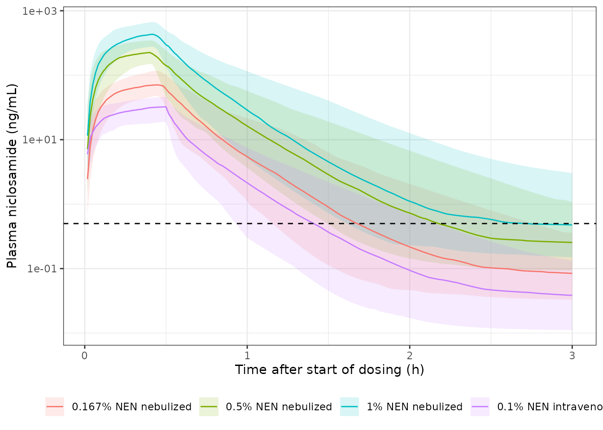
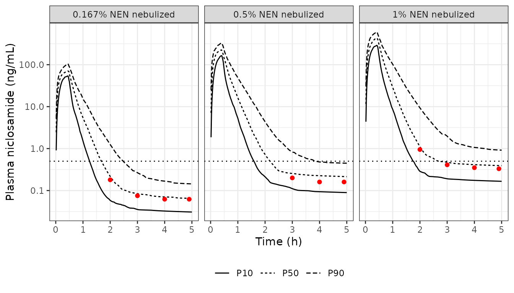

# Niclosamide in sheep (Weiss 2023)

## Model and source

Weiss 2023 studied nebulized niclosamide ethanolamine (NEN), an inhaled
formulation of the oral anthelminthic niclosamide, in healthy ewes.
Plasma concentrations after three nebulized doses and one intravenous
infusion were fitted simultaneously with a three-compartment population
PK model in NONMEM (FOCE+I), which estimates the absolute
bioavailability of the nebulized dose. Epithelial lining fluid (ELF)
concentrations and the oral arm were analysed by non-compartmental
methods only (the paper reports that no ELF model could be established),
so they are not part of the model.

- Article: <https://doi.org/10.1007/s11095-023-03559-0>
- Open access: <https://www.ncbi.nlm.nih.gov/pmc/articles/PMC10447587/>

``` r

mod <- readModelDb("Weiss_2023_niclosamide_sheep")
mod_ui <- rxode2::rxode2(mod)
#> ℹ parameter labels from comments will be replaced by 'label()'
mod_ui
#>  ── rxode2-based free-form 4-cmt ODE model ────────────────────────────────────── 
#>  ── Initalization: ──  
#> Fixed Effects ($theta): 
#>        lka    lfdepot        lcl        lvc        lvp         lq       lvp2 
#>  3.0397492 -0.1531512  5.1357984  2.7536607  2.3125354  4.0500443  4.9972123 
#>        lq2     propSd      addSd 
#>  2.0108950  0.2520000  0.2600000 
#> 
#> Omega ($omega): 
#>          etalka   etalcl   etalvc    etalvp
#> etalka 0.455905 0.000000 0.000000 0.0000000
#> etalcl 0.000000 0.109392 0.000000 0.0000000
#> etalvc 0.000000 0.000000 0.408195 0.0000000
#> etalvp 0.000000 0.000000 0.000000 0.0754785
#> attr(,"lotriLabels")
#> [1] "Table S2 IIV ka = 76% CV" "Table S2 IIV CL = 34% CV"
#> [3] "Table S2 IIV V1 = 71% CV" "Table S2 IIV V2 = 28% CV"
#> attr(,"lotriFix")
#>        etalka etalcl etalvc etalvp
#> etalka  FALSE  FALSE  FALSE  FALSE
#> etalcl  FALSE  FALSE  FALSE  FALSE
#> etalvc  FALSE  FALSE  FALSE  FALSE
#> etalvp  FALSE  FALSE  FALSE  FALSE
#> 
#> States ($state or $stateDf): 
#>   Compartment Number Compartment Name
#> 1                  1            depot
#> 2                  2          central
#> 3                  3      peripheral1
#> 4                  4      peripheral2
#>  ── μ-referencing ($muRefTable): ──  
#>   theta    eta level
#> 1   lka etalka    id
#> 2   lcl etalcl    id
#> 3   lvc etalvc    id
#> 4   lvp etalvp    id
#> 
#>  ── Model (Normalized Syntax): ── 
#> function() {
#>     compartmentData <- list(depot = list(analyte = "niclosamide", 
#>         units = "mg", specimen = "administration site", verified = TRUE), 
#>         central = list(analyte = "niclosamide", units = "mg", 
#>             specimen = "plasma", verified = TRUE), peripheral1 = list(analyte = "niclosamide", 
#>             units = "mg", specimen = "plasma", verified = TRUE), 
#>         peripheral2 = list(analyte = "niclosamide", units = "mg", 
#>             specimen = "plasma", verified = TRUE))
#>     covariateData <- list()
#>     description <- "Preclinical (sheep). Three-compartment population PK model for plasma niclosamide in ewes after intravenous infusion and nebulized (inhaled) niclosamide ethanolamine, with first-order absorption from a lung absorption compartment, estimated nebulized bioavailability, linear elimination, and combined proportional and additive residual error (Weiss 2023)."
#>     population <- list(species = "sheep (Merino cross-bred ewes)", 
#>         n_subjects = 10L, n_studies = 1L, age_range = "12 months (all animals)", 
#>         weight_range = "25-35 kg (nebulized cohort, Methods 'Animals'); 40.6 +/- 2.1 kg (intravenous / oral cohort, Table I footnote)", 
#>         sex_female_pct = 100, disease_state = "Healthy", dose_range = "Nebulized niclosamide ethanolamine (NEN) 10, 30 and 60 mg (6 mL of 0.167%, 0.5% and 1% NEN) delivered over 24-27 min; intravenous NEN 3 mg (3 mL of 0.1% NEN) infused over 30 min (Table I, Table S1).", 
#>         regions = "Monash Animal Research Platform, Monash University, Australia.", 
#>         notes = "Two cohorts of five ewes (Table I). Experiment 1 (sheep 1-5) received nebulized placebo and the three ascending nebulized doses with 7-day washouts; Experiment 2 (sheep 11-14, 18) received an oral 1132 mg niclosamide dose and the intravenous dose. The population PK model was fitted to the plasma concentrations after the intravenous and nebulized doses only; the oral arm and the epithelial lining fluid concentrations were analysed by non-compartmental methods and are not part of this model. Dose nebulized administration with the DELIVERED dose (Table S1: 0.271, 0.762 and 1.401 mg/kg NEN), not the nominal nebulizer charge: the paper's own Figure S3 simulations sit 0.6-0.75 times below a nominal-dose simulation, matching the delivery loss (see vignette). Doses are in mg NEN as the paper reports them; the paper does not state whether a salt correction to niclosamide base was applied before modelling.")
#>     reference <- "Weiss A, Bischof RJ, Landersdorfer CB, Nguyen TH, Davies A, Ibrahim J, Wynne P, Wright P, Ditzinger G, Montgomery AB, Meeusen E, McIntosh MP, Sommer MOA. Single-dose pharmacokinetics and lung function of nebulized niclosamide ethanolamine in sheep. Pharm Res. 2023;40(8):1915-1925. doi:10.1007/s11095-023-03559-0"
#>     units <- list(time = "h", dosing = "mg", concentration = "ng/mL")
#>     vignette <- "Weiss_2023_niclosamide_sheep"
#>     ini({
#>         lka <- 3.03974915897077
#>         label("First-order absorption rate constant from the lung absorption compartment (1/h)")
#>         lfdepot <- -0.153151179494175
#>         label("Bioavailability of nebulized dosing (fraction)")
#>         lcl <- 5.13579843705026
#>         label("Systemic elimination clearance (L/h)")
#>         lvc <- 2.75366071235426
#>         label("Central volume of distribution (L)")
#>         lvp <- 2.31253542384721
#>         label("Shallow peripheral volume of distribution (L)")
#>         lq <- 4.05004430332552
#>         label("Distribution clearance, central to shallow peripheral (L/h)")
#>         lvp2 <- 4.99721227376411
#>         label("Deep peripheral volume of distribution (L)")
#>         lq2 <- 2.01089499914473
#>         label("Distribution clearance, central to deep peripheral (L/h)")
#>         propSd <- c(0, 0.252)
#>         label("Proportional residual error (fraction)")
#>         addSd <- c(0, 0.26)
#>         label("Additive residual error (ng/mL)")
#>         etalka ~ 0.455905
#>         label("Table S2 IIV ka = 76% CV")
#>         etalcl ~ 0.109392
#>         label("Table S2 IIV CL = 34% CV")
#>         etalvc ~ 0.408195
#>         label("Table S2 IIV V1 = 71% CV")
#>         etalvp ~ 0.0754785
#>         label("Table S2 IIV V2 = 28% CV")
#>     })
#>     model({
#>         ka <- exp(lka + etalka)
#>         fdepot <- exp(lfdepot)
#>         cl <- exp(lcl + etalcl)
#>         vc <- exp(lvc + etalvc)
#>         vp <- exp(lvp + etalvp)
#>         q <- exp(lq)
#>         vp2 <- exp(lvp2)
#>         q2 <- exp(lq2)
#>         kel <- cl/vc
#>         k12 <- q/vc
#>         k21 <- q/vp
#>         k13 <- q2/vc
#>         k31 <- q2/vp2
#>         d/dt(depot) <- -ka * depot
#>         d/dt(central) <- ka * depot - kel * central - k12 * central + 
#>             k21 * peripheral1 - k13 * central + k31 * peripheral2
#>         d/dt(peripheral1) <- k12 * central - k21 * peripheral1
#>         d/dt(peripheral2) <- k13 * central - k31 * peripheral2
#>         f(depot) <- fdepot
#>         Cc <- 1000 * central/vc
#>         Cc ~ prop(propSd) + add(addSd)
#>     })
#> }
```

## Population

Ten 12-month-old Merino cross-bred ewes in two cohorts of five (Table
I). The nebulized cohort (sheep 1-5, 25-35 kg) received a placebo and
then 10, 30 and 60 mg NEN by an in-line eFlow nebulizer through an
endotracheal tube, over 24-27 min, with 7-day washouts. The second
cohort (sheep 11-14 and 18, 40.6 +/- 2.1 kg) received 1132 mg oral
niclosamide and a 3 mg intravenous NEN infusion over 30 min. Plasma was
sampled at 14 time points over 12 h (Table I). Only the nebulized and
intravenous plasma data enter the population PK model.

## Source trace

| Model element | Value | Source |
|----|----|----|
| Structure: absorption compartment, central, shallow and deep peripheral | – | Methods, “Non-compartmental and compartmental Pharmacokinetic analysis”, equations for dAabs/dt, dA1/dt, dA2/dt, dA3/dt |
| Nebulized input: zero-order into the absorption compartment | over the nebulization time | Methods, same section (“time-delimited zero-order … input”) |
| IV input: zero-order into central | 3 mL at 0.1 mL/min (30 min) | Methods, “Niclosamide administration procedures”; Table S1 |
| `lka` | 20.9 1/h | Table S2; Table II |
| `lfdepot` (Fneb) | 85.8% | Table S2 (Table II rounds to 86%) |
| `lcl` | 170 L/h | Table S2 |
| `lvc` (V1) | 15.7 L | Table S2 |
| `lvp` (V2, shallow) | 10.1 L | Table S2 |
| `lq` (CLd1) | 57.4 L/h | Table S2 |
| `lvp2` (V3, deep) | 148 L | Table S2 |
| `lq2` (CLd2) | 7.47 L/h | Table S2 |
| `etalka` | 76% CV | Table S2 |
| `etalcl` | 34% CV | Table S2 |
| `etalvc` | 71% CV | Table S2 |
| `etalvp` | 28% CV | Table S2 |
| `propSd` | 25.2% | Table S2 |
| `addSd` | 0.26 ng/mL | Table S2 |
| Half-lives (validation target) | 0.041, 0.2, 14 h | Table II; Results text |
| Plasma NCA (validation target) | Cmax, Tmax, AUC0-t | Table II |

## Typical-value checks

### Disposition half-lives

Table II reports half-lives of 0.041 h (alpha), 0.2 h (beta) and 14 h
(terminal). These are the eigenvalues of the typical-value disposition
matrix, so they follow from CL, V1, V2, V3, CLd1 and CLd2 alone.

``` r

th <- exp(mod_ui$theta)
kel <- th[["lcl"]] / th[["lvc"]]
k12 <- th[["lq"]] / th[["lvc"]]
k21 <- th[["lq"]] / th[["lvp"]]
k13 <- th[["lq2"]] / th[["lvc"]]
k31 <- th[["lq2"]] / th[["lvp2"]]
disp <- matrix(
  c(-(kel + k12 + k13), k21, k31,
    k12, -k21, 0,
    k13, 0, -k31),
  nrow = 3, byrow = TRUE
)
thalf <- sort(log(2) / -eigen(disp)$values)
data.frame(
  phase = c("alpha", "beta", "terminal"),
  model_h = signif(thalf, 3),
  published_h = c(0.041, 0.2, 14)
) |>
  knitr::kable(caption = "Typical-value half-lives versus Table II.")
```

| phase    | model_h | published_h |
|:---------|--------:|------------:|
| alpha    |  0.0412 |       0.041 |
| beta     |  0.1810 |       0.200 |
| terminal | 14.3000 |      14.000 |

Typical-value half-lives versus Table II. {.table}

``` r


# The parameters are deterministic here, so the comparison is a rounding check.
stopifnot(
  abs(thalf[1] - 0.041) < 0.0005,
  abs(thalf[2] - 0.2) < 0.025,
  abs(thalf[3] - 14) < 0.5
)
```

### Nebulized bioavailability and dose linearity

The dose-normalised typical-value AUC0-inf of a nebulized dose relative
to the intravenous dose recovers Fneb, and the model is linear in dose
(the paper reports dose-linear plasma PK across 10-60 mg NEN, Fig. S3).

``` r

mod_typ <- rxode2::zeroRe(mod_ui)
ev_typ <- rbind(
  data.frame(id = 1L, time = 0, amt = 10, dur = 27 / 60, evid = 1L, cmt = "depot"),
  data.frame(id = 2L, time = 0, amt = 60, dur = 25 / 60, evid = 1L, cmt = "depot"),
  data.frame(id = 3L, time = 0, amt = 3, dur = 0.5, evid = 1L, cmt = "central")
)
obs_typ <- expand.grid(id = 1:3, time = c(seq(0, 2, by = 0.005), seq(2.05, 400, by = 0.05)))
obs_typ <- transform(obs_typ, amt = 0, dur = 0, evid = 0L, cmt = "central")
sim_typ <- rxode2::rxSolve(mod_typ, rbind(ev_typ, obs_typ), returnType = "data.frame")
#> ℹ omega/sigma items treated as zero: 'etalka', 'etalcl', 'etalvc', 'etalvp'
#> Warning: multi-subject simulation without without 'omega'

auc_typ <- sim_typ |>
  dplyr::group_by(id) |>
  dplyr::summarise(
    cmax = max(Cc),
    auc = sum(diff(time) * (head(Cc, -1) + tail(Cc, -1)) / 2)
  ) |>
  dplyr::mutate(dose = c(10, 60, 3), auc_per_mg = auc / dose)
f_neb <- auc_typ$auc_per_mg[1] / auc_typ$auc_per_mg[3]
knitr::kable(auc_typ, digits = 3, caption = "Typical-value exposure (AUC to 400 h).")
```

|  id |    cmax |     auc | dose | auc_per_mg |
|----:|--------:|--------:|-----:|-----------:|
|   1 |  97.327 |  50.471 |   10 |      5.047 |
|   2 | 621.324 | 302.824 |   60 |      5.047 |
|   3 |  31.696 |  17.647 |    3 |      5.882 |

Typical-value exposure (AUC to 400 h). {.table}

``` r

f_neb
#> [1] 0.8579998

stopifnot(
  # AUC(nebulized)/AUC(IV), dose-normalised, equals Fneb = 0.858.
  abs(f_neb - 0.858) < 0.01,
  # Linear model: 60 mg and 10 mg give the same dose-normalised AUC.
  abs(auc_typ$auc_per_mg[2] / auc_typ$auc_per_mg[1] - 1) < 0.01
)
```

## Which dose to enter: nominal or delivered

The nebulizer was charged with 10, 30 or 60 mg NEN, but drug left in the
nebulizer, lines and expiratory filters was rinsed out and assayed so
that the actual delivered dose could be calculated (Methods). Table S1
reports the delivered doses as 0.271, 0.762 and 1.401 mg/kg; for ewes of
25-35 kg that is roughly 70-80% of the nominal charge. The intravenous
dose (0.073 mg/kg in 40.6 kg ewes, 2.96 mg) has no such loss.

The paper does not say which of the two entered the modelling data set,
but its own model simulations settle it. The median (P50) curves of
Figure S3 were digitised by the maintainers at 2-5 h, where they are
clear of the observed points, and compared with the typical-value
prediction for the nominal doses:

``` r

# Figure S3 P50, digitised by the maintainers against the 0.5 ng/mL LLOQ line
# (which reads back as 0.495 ng/mL). Time is from the start of nebulization.
fig_s3 <- data.frame(
  nominal_mg = c(10, 10, 10, 10, 30, 30, 30, 60, 60, 60, 60),
  time = c(2, 3, 4, 4.9, 3, 4, 4.9, 2, 3, 4, 4.9),
  p50_fig = c(0.18, 0.075, 0.062, 0.062, 0.20, 0.16, 0.16, 0.95, 0.41, 0.35, 0.33)
)
neb_dur <- c(`10` = 27, `30` = 24, `60` = 25) / 60
ev_nom <- do.call(rbind, lapply(seq_along(neb_dur), function(i) {
  rbind(
    data.frame(id = i, time = 0, amt = as.numeric(names(neb_dur)[i]),
               dur = neb_dur[[i]], evid = 1L, cmt = "depot"),
    data.frame(id = i, time = c(2, 3, 4, 4.9), amt = 0, dur = 0, evid = 0L,
               cmt = "central")
  )
}))
typ_nom <- rxode2::rxSolve(mod_typ, ev_nom, returnType = "data.frame") |>
  dplyr::mutate(nominal_mg = as.numeric(names(neb_dur))[id]) |>
  dplyr::select(nominal_mg, time, Cc_nominal = Cc)
#> ℹ omega/sigma items treated as zero: 'etalka', 'etalcl', 'etalvc', 'etalvp'
#> Warning: multi-subject simulation without without 'omega'
dose_basis <- dplyr::inner_join(fig_s3, typ_nom, by = c("nominal_mg", "time")) |>
  dplyr::mutate(ratio = p50_fig / Cc_nominal)
knitr::kable(dose_basis, digits = 3,
             caption = "Figure S3 P50 versus the typical-value prediction for the nominal nebulizer charge.")
```

| nominal_mg | time | p50_fig | Cc_nominal | ratio |
|-----------:|-----:|--------:|-----------:|------:|
|         10 |  2.0 |   0.180 |      0.219 | 0.823 |
|         10 |  3.0 |   0.075 |      0.094 | 0.798 |
|         10 |  4.0 |   0.062 |      0.087 | 0.712 |
|         10 |  4.9 |   0.062 |      0.083 | 0.745 |
|         30 |  3.0 |   0.200 |      0.281 | 0.713 |
|         30 |  4.0 |   0.160 |      0.261 | 0.614 |
|         30 |  4.9 |   0.160 |      0.250 | 0.641 |
|         60 |  2.0 |   0.950 |      1.254 | 0.757 |
|         60 |  3.0 |   0.410 |      0.562 | 0.729 |
|         60 |  4.0 |   0.350 |      0.522 | 0.671 |
|         60 |  4.9 |   0.330 |      0.499 | 0.661 |

Figure S3 P50 versus the typical-value prediction for the nominal
nebulizer charge. {.table}

``` r

summary(dose_basis$ratio)
#>    Min. 1st Qu.  Median    Mean 3rd Qu.    Max. 
#>  0.6136  0.6659  0.7125  0.7149  0.7509  0.8233

# The paper's simulations sit well below a nominal-dose simulation in every
# dose group, so the data set did not carry the nominal charge.
stopifnot(median(dose_basis$ratio) < 0.85)
```

Figure S3 lies 0.6-0.75 times below the nominal-dose prediction in all
three groups and at every time, which is the size of the delivery loss.
The model should therefore be dosed with the **delivered** nebulized
dose. The simulations below use the Table S1 mean delivered dose in
mg/kg multiplied by 30 kg, the middle of the 25-35 kg weight range of
the nebulized cohort.

## Virtual cohort and simulation

One hundred virtual ewes per arm receive each of the four modelled
regimens. Nebulization times are the Table S1 means (27, 24 and 25 min
for the 10, 30 and 60 mg doses); the IV dose is a 30 min infusion.
Plasma is sampled on the Table I schedule: before dosing, at 7.5 and 15
min during dosing, and at 0, 5, 15 and 30 min and 1, 2, 3, 4, 6, 8 and
12 h after the end of dosing. A dense grid is added for the figure.

``` r

arms <- data.frame(
  treatment = c("0.167% NEN nebulized", "0.5% NEN nebulized",
                "1% NEN nebulized", "0.1% NEN intravenous"),
  nominal_mg = c(10, 30, 60, 3),
  # Table S1 delivered dose (mg/kg) x 30 kg for the nebulized cohort and
  # x 40.6 kg (Table I footnote) for the intravenous cohort.
  amt = c(0.271 * 30, 0.762 * 30, 1.401 * 30, 0.073 * 40.6),
  dur_min = c(27, 24, 25, 30),
  cmt = c("depot", "depot", "depot", "central")
)
knitr::kable(arms, digits = 2, caption = "Simulated regimens (amt = delivered dose, mg NEN).")
```

| treatment            | nominal_mg |   amt | dur_min | cmt     |
|:---------------------|-----------:|------:|--------:|:--------|
| 0.167% NEN nebulized |         10 |  8.13 |      27 | depot   |
| 0.5% NEN nebulized   |         30 | 22.86 |      24 | depot   |
| 1% NEN nebulized     |         60 | 42.03 |      25 | depot   |
| 0.1% NEN intravenous |          3 |  2.96 |      30 | central |

Simulated regimens (amt = delivered dose, mg NEN). {.table}

``` r

arms$treatment <- factor(arms$treatment, levels = arms$treatment)
n_per_arm <- 100L
post_end_h <- c(0, 5, 15, 30, 60, 120, 180, 240, 360, 480, 720) / 60

make_arm <- function(i, n, id_offset) {
  a <- arms[i, ]
  ids <- id_offset + seq_len(n)
  dur <- a$dur_min / 60
  sched <- sort(unique(c(0, 7.5 / 60, 15 / 60, dur + post_end_h)))
  grid <- seq(0, dur + 12, by = 1 / 60)
  sched <- round(sched, 6)
  obs_times <- sort(unique(round(c(sched, grid), 6)))
  dose <- data.frame(id = ids, time = 0, amt = a$amt, dur = dur, evid = 1L,
                     cmt = a$cmt, treatment = a$treatment, scheduled = FALSE)
  obs <- expand.grid(id = ids, time = obs_times)
  obs$amt <- 0
  obs$dur <- 0
  obs$evid <- 0L
  obs$cmt <- "central"
  obs$treatment <- a$treatment
  obs$scheduled <- obs$time %in% sched
  rbind(dose, obs)
}
events <- do.call(rbind, lapply(seq_len(nrow(arms)), function(i) {
  make_arm(i, n_per_arm, (i - 1L) * n_per_arm)
}))
events <- events[order(events$id, events$time, -events$evid), ]
stopifnot(!anyDuplicated(events[events$evid == 1, "id"]))

rxode2::rxSetSeed(20230727)
sim <- rxode2::rxSolve(mod_ui, events, keep = c("treatment", "scheduled"),
                       returnType = "data.frame")
```

## Replicate Figure 2A

``` r

llq <- 0.5
sim |>
  dplyr::group_by(treatment, time) |>
  dplyr::summarise(
    p05 = quantile(Cc, 0.05), p50 = median(Cc), p95 = quantile(Cc, 0.95),
    .groups = "drop"
  ) |>
  dplyr::filter(time > 0, time <= 3) |>
  ggplot(aes(time, p50, colour = treatment, fill = treatment)) +
  geom_ribbon(aes(ymin = p05, ymax = p95), alpha = 0.15, colour = NA) +
  geom_line() +
  geom_hline(yintercept = llq, linetype = "dashed") +
  scale_y_log10() +
  labs(x = "Time after start of dosing (h)", y = "Plasma niclosamide (ng/mL)",
       colour = NULL, fill = NULL) +
  theme_bw() +
  theme(legend.position = "bottom")
```



Replicates Figure 2A (semilog panel) of Weiss 2023: median and 90%
prediction interval of plasma niclosamide by dose group; dashed line is
the 0.5 ng/mL LLOQ. As in the paper, concentrations peak at the end of
nebulization, fall steeply over the first 1-2 h and approach the LLOQ by
1-2 h for the 10 mg dose, with the IV profile tracking the 10 mg
nebulized profile.

## Replicate Figure S3

``` r

sim_p50 <- sim |>
  dplyr::filter(treatment != "0.1% NEN intravenous") |>
  dplyr::mutate(nominal_mg = arms$nominal_mg[match(treatment, arms$treatment)]) |>
  dplyr::group_by(nominal_mg, treatment, time) |>
  dplyr::summarise(
    P10 = quantile(Cc, 0.1), P50 = median(Cc), P90 = quantile(Cc, 0.9),
    .groups = "drop"
  )
fig_s3_lab <- fig_s3 |>
  dplyr::mutate(treatment = arms$treatment[match(nominal_mg, arms$nominal_mg)])
sim_p50 |>
  dplyr::filter(time > 0, time <= 5) |>
  tidyr::pivot_longer(c(P10, P50, P90), names_to = "percentile", values_to = "Cc") |>
  ggplot(aes(time, Cc)) +
  geom_line(aes(linetype = percentile)) +
  geom_point(data = fig_s3_lab, aes(time, p50_fig), colour = "red") +
  geom_hline(yintercept = llq, linetype = "dotted") +
  facet_wrap(~treatment) +
  scale_y_log10() +
  labs(x = "Time (h)", y = "Plasma niclosamide (ng/mL)", linetype = NULL) +
  theme_bw() +
  theme(legend.position = "bottom")
```



``` r


s3_check <- dplyr::inner_join(
  fig_s3,
  sim_p50 |> dplyr::mutate(time = round(time, 4)),
  by = c("nominal_mg", "time")
) |>
  dplyr::mutate(ratio = P50 / p50_fig)
knitr::kable(dplyr::select(s3_check, nominal_mg, time, p50_fig, P50, ratio), digits = 3,
             caption = "Simulated P50 (delivered doses) versus the digitised Figure S3 P50.")
```

| nominal_mg | time | p50_fig |   P50 | ratio |
|-----------:|-----:|--------:|------:|------:|
|         10 |  2.0 |   0.180 | 0.217 | 1.206 |
|         10 |  3.0 |   0.075 | 0.084 | 1.124 |
|         10 |  4.0 |   0.062 | 0.070 | 1.136 |
|         10 |  4.9 |   0.062 | 0.065 | 1.050 |
|         30 |  3.0 |   0.200 | 0.255 | 1.274 |
|         30 |  4.0 |   0.160 | 0.226 | 1.412 |
|         30 |  4.9 |   0.160 | 0.215 | 1.346 |
|         60 |  2.0 |   0.950 | 1.108 | 1.166 |
|         60 |  3.0 |   0.410 | 0.476 | 1.161 |
|         60 |  4.0 |   0.350 | 0.414 | 1.182 |
|         60 |  4.9 |   0.330 | 0.393 | 1.192 |

Simulated P50 (delivered doses) versus the digitised Figure S3 P50.
{.table}

``` r


stopifnot(
  nrow(s3_check) == nrow(fig_s3),
  abs(log(median(s3_check$ratio))) < log(1.3)
)
```

Replicates Figure S3 of Weiss 2023 (P10, P50 and P90 of the model
simulations by dose group); red points are the digitised published P50.
With the delivered doses the simulated median comes within about 20% of
the published one (median ratio near 1.2). The remaining gap is the size
of either a lighter cohort (about 25 kg rather than 30 kg) or a
salt-to-base correction of the doses (factor 0.84), which this
comparison cannot separate.

## PKNCA validation

The paper’s NCA (PKSolver) used the scheduled samples above the LLOQ, so
the simulated individual predictions are taken on the Table I schedule
and samples below 0.5 ng/mL are dropped before the NCA. The pre-dose
sample is kept as zero.

``` r

sim_nca <- sim |>
  dplyr::filter(scheduled) |>
  dplyr::mutate(Cc = ifelse(time > 0 & Cc < llq, NA_real_, Cc)) |>
  dplyr::filter(!is.na(Cc)) |>
  dplyr::select(id, time, Cc, treatment)
stopifnot(all(sim_nca$Cc[sim_nca$time == 0] == 0))
stopifnot(length(unique(sim_nca$id[sim_nca$time == 0])) == nrow(arms) * n_per_arm)

conc_obj <- PKNCA::PKNCAconc(sim_nca, Cc ~ time | treatment + id)
dose_df <- events |>
  dplyr::filter(evid == 1) |>
  dplyr::select(id, time, amt, dur, treatment)
dose_obj <- PKNCA::PKNCAdose(dose_df, amt ~ time | treatment + id, duration = "dur")

intervals <- data.frame(start = 0, end = Inf, cmax = TRUE, tmax = TRUE, auclast = TRUE)
nca_res <- PKNCA::pk.nca(PKNCA::PKNCAdata(conc_obj, dose_obj, intervals = intervals))
```

### Comparison against published NCA

Table II reports the mean of the observed NCA parameters for the
nebulized groups (Tmax converted from min to h below); no plasma NCA is
tabulated for the intravenous arm.
[`ncaComparisonTable()`](https://nlmixr2.github.io/nlmixr2lib/reference/ncaComparisonTable.md)
summarises the simulated cohort by its median.

``` r

published <- data.frame(
  treatment = c("0.167% NEN nebulized", "0.5% NEN nebulized", "1% NEN nebulized"),
  cmax = c(76.6, 239.8, 577.1),
  tmax = c(27.1, 24.3, 22.2) / 60,
  auclast = c(35.9, 96.1, 261.4)
)

cmp <- nlmixr2lib::ncaComparisonTable(
  simulated = nca_res,
  reference = published,
  by = "treatment",
  units = c(cmax = "ng/mL", tmax = "h", auclast = "ng*h/mL"),
  tolerance_pct = 20
)
knitr::kable(cmp, caption = "Simulated (median) vs. published (mean, Table II) plasma NCA. * differs from reference by >20%.")
```

| NCA parameter      | treatment            | Reference | Simulated | % diff   |
|:-------------------|:---------------------|:----------|:----------|:---------|
| Cmax (ng/mL)       | 0.167% NEN nebulized | 76.6      | 70.8      | -7.5%    |
| Cmax (ng/mL)       | 0.5% NEN nebulized   | 240       | 225       | -6.0%    |
| Cmax (ng/mL)       | 1% NEN nebulized     | 577       | 433       | -25.0%\* |
| Tmax (h)           | 0.167% NEN nebulized | 0.452     | 0.45      | -0.4%    |
| Tmax (h)           | 0.5% NEN nebulized   | 0.405     | 0.4       | -1.2%    |
| Tmax (h)           | 1% NEN nebulized     | 0.37      | 0.417     | +12.6%   |
| AUClast (ng\*h/mL) | 0.167% NEN nebulized | 35.9      | 38        | +5.8%    |
| AUClast (ng\*h/mL) | 0.5% NEN nebulized   | 96.1      | 116       | +20.5%\* |
| AUClast (ng\*h/mL) | 1% NEN nebulized     | 261       | 212       | -19.0%   |

Simulated (median) vs. published (mean, Table II) plasma NCA. \* differs
from reference by \>20%. {.table}

``` r

sim_med <- as.data.frame(nca_res$result) |>
  dplyr::filter(PPTESTCD %in% c("cmax", "auclast"),
                treatment %in% published$treatment) |>
  dplyr::group_by(treatment, PPTESTCD) |>
  dplyr::summarise(med = median(PPORRES), .groups = "drop") |>
  tidyr::pivot_wider(names_from = PPTESTCD, values_from = med) |>
  dplyr::left_join(published, by = "treatment", suffix = c("_sim", "_pub"))
sim_med
#> # A tibble: 3 × 6
#>   treatment            auclast_sim cmax_sim cmax_pub  tmax auclast_pub
#>   <chr>                      <dbl>    <dbl>    <dbl> <dbl>       <dbl>
#> 1 0.167% NEN nebulized        38.0     70.8     76.6 0.452        35.9
#> 2 0.5% NEN nebulized         116.     225.     240.  0.405        96.1
#> 3 1% NEN nebulized           212.     433.     577.  0.37        261.

# Structural check on the centre of the distribution: a mis-transcribed CL,
# volume, Fneb or dose unit moves these ratios by far more than the band.
stopifnot(
  all(sim_med$cmax_sim / sim_med$cmax_pub > 0.67 & sim_med$cmax_sim / sim_med$cmax_pub < 1.5),
  all(sim_med$auclast_sim / sim_med$auclast_pub > 0.67 & sim_med$auclast_sim / sim_med$auclast_pub < 1.5)
)
```

Rows starred in the table (typically the 1% Cmax, about 25% low, and the
0.5% AUC0-t, about 20% high) go in opposite directions across groups:
the observed means are not dose-proportional (Cmax per mg NEN 7.7, 8.0
and 9.6; AUC0-t per mg 3.6, 3.2 and 4.4), whereas the model is linear,
as the paper concluded from its population analysis. The simulated
medians are compared with observed arithmetic means of five sheep per
group, whose standard deviations in Table II are 20-38% of the mean for
Cmax and 29-32% for AUC0-t, and from which eight implausible data points
were excluded before the NCA (Fig. 2 legend). The simulated doses also
rest on an assumed 30 kg body weight. Differences of the order of 20-30%
are therefore within the precision of the published values.

## Assumptions and deviations

- **Delivered, not nominal, nebulized dose.** The paper does not state
  which dose entered the modelling data set. Its own Figure S3
  simulations sit 0.6-0.75 times below a nominal-dose simulation in
  every group, matching the delivery loss implied by Table S1, so the
  model is dosed with the delivered dose. The individual body weights of
  the nebulized cohort are not reported; the vignette uses 30 kg, the
  middle of the stated 25-35 kg range.
- **Salt basis.** Doses are entered in mg of niclosamide ethanolamine
  (NEN), the unit the paper reports for every dose (Table I, Table S1).
  The paper does not state a salt correction before modelling. If the
  data set used niclosamide-equivalent doses instead (NEN is about 84%
  niclosamide by mass), CL and the volumes would be about 16% lower on a
  NEN-dose basis; Fneb is unaffected because both routes share the same
  basis. The Figure S3 comparison cannot separate the two, because the
  unknown body weights (25-35 kg) move the delivered dose by more than
  16%.
- **IIV scale.** Table S2 reports IIV as %CV for a log-normal model; the
  variances are omega^2 = log(CV^2 + 1). Table S2 lists no covariance,
  so the etas are independent (the paper tested a CL-V covariance during
  model building).
- **Bioavailability placement.** The paper writes Fneb on the
  absorption-to-central flux (ka \* Fneb \* Aabs). The model applies it
  to the nebulized dose (`f(depot)`), which gives identical central,
  peripheral and plasma amounts.
- **Nebulization time.** The zero-order nebulized input uses the Table
  S1 mean delivery time per dose group in this vignette; the paper used
  the individual recorded delivery times.
- **Out of scope.** No ELF model was established and the oral arm was
  not modelled (Results; Discussion), so neither appears here. The deep
  peripheral parameters had RSE above 100% (Table S2 footnote); the
  paper cautions against extrapolating beyond 3 h for regimens outside
  those studied.
- **Errata.** No correction notice was found for this article (Europe
  PMC, checked 2026-10-27).
