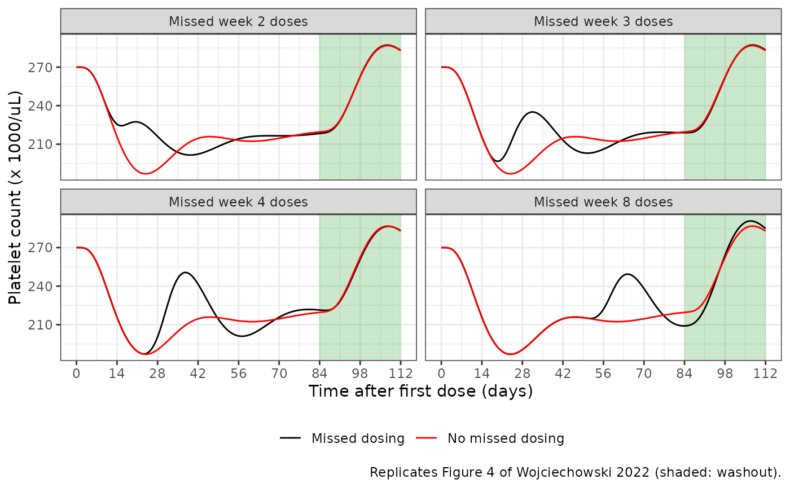
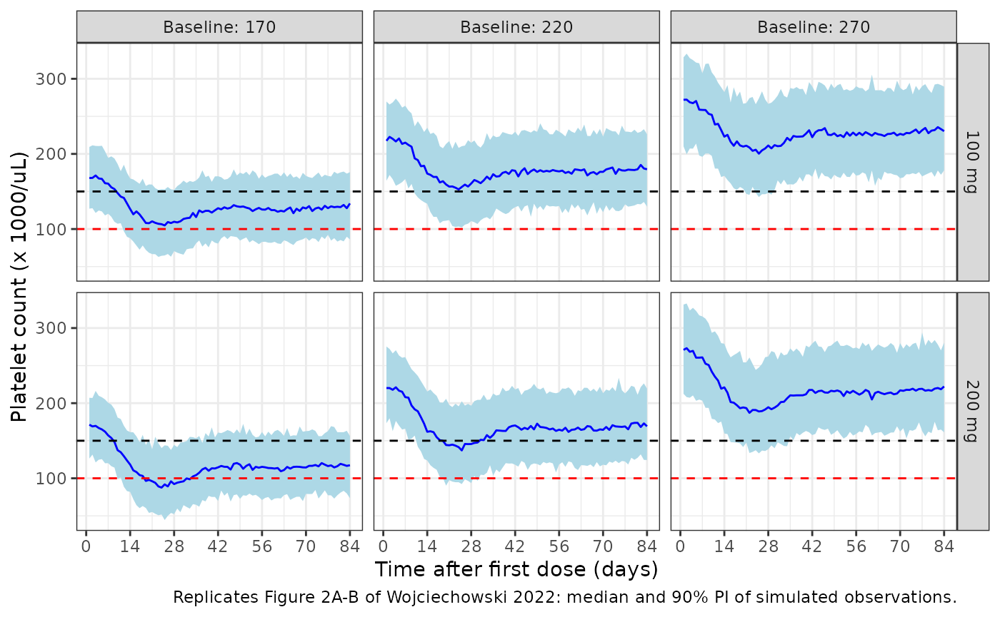

# Abrocitinib platelet time-course (Wojciechowski 2022)

## Model and source

- Citation: Wojciechowski J, Malhotra BK, Wang X, Fostvedt L, Valdez H,
  Nicholas T. Population pharmacokinetic-pharmacodynamic modelling of
  platelet time-courses following administration of abrocitinib. Br J
  Clin Pharmacol. 2022;88(8):3856-3871. <doi:10.1111/bcp.15334>. PK
  structure from Wojciechowski J et al. Population Pharmacokinetics of
  Abrocitinib in Healthy Individuals and Patients with Psoriasis or
  Atopic Dermatitis. Clin Pharmacokinet. 2022;61:709-723.
  <doi:10.1007/s40262-021-01104-z>; see
  modellib(‘Wojciechowski_2022_abrocitinib’).
- Description: Population PK-PD model of the platelet time-course after
  oral abrocitinib (JAK1 inhibitor) in adolescents and adults with
  atopic dermatitis or psoriasis (Wojciechowski 2022, Br J Clin
  Pharmacol). A Friberg semi-mechanistic myelosuppression model
  (proliferating pool, three transit compartments and circulating
  platelets, mean transit time 7.21 days, feedback exponent 0.232) in
  which abrocitinib concentration inhibits platelet proliferation by an
  Emax function. Emax scales with the individual baseline platelet count
  (power -1.11) and wanes with time on treatment (tachyphylaxis
  half-life 151 days). Baseline platelet count depends on baseline white
  blood cell count, haematocrit, age, sex and psoriasis. The abrocitinib
  concentrations come from the companion Wojciechowski 2022 population
  PK model, carried here unchanged.
- Article: <https://doi.org/10.1111/bcp.15334> (open access, Br J Clin
  Pharmacol 2022;88(8):3856-3871). No correction notice was listed in
  Europe PMC as of 2026-10-09.

The paper fits a Friberg semi-mechanistic myelosuppression model to
platelet counts. The abrocitinib concentration that drives it comes from
the population PK model of the same group, which is packaged separately
as `modellib("Wojciechowski_2022_abrocitinib")` and has its own
vignette. This file carries that PK model unchanged and adds the
platelet layer, so a single `rxSolve()` gives both abrocitinib
concentration (`Cc`, ng/mL) and platelet count (`PLT`, x 1000/uL, which
equals 10^9/L).

## Population

The platelet model was fitted to 12 189 platelet counts from 2333
patients in five studies: the phase II psoriasis study B7451005 (n =
59), the phase IIb atopic dermatitis (AD) study B7451006 (n = 269) and
the phase III AD studies JADE MONO-1, JADE MONO-2 and JADE REGIMEN (n =
387, 391 and 1236; Table A1). Of the 2333 patients, 2274 had AD (340 of
them adolescents aged 12-17 years) and 59 had psoriasis. Median age was
30 years (range 12-84), median weight 73 kg (34-204) and 44.4% were
female; 71.8% were White, 17.8% Asian, 7.6% Black, 2.3% other race and
0.6% unknown. Median baseline platelet count was 274 x 1000/uL
(118-651), white blood cell count 7 x 1000/uL and haematocrit 43% (Table
1). Patients received placebo (n = 224) or abrocitinib 10, 30, 100, 200
or 400 mg once daily or 200 mg twice daily for 4-12 weeks, with platelet
counts up to week 16.

``` r

str(readModelDb("Wojciechowski_2022_abrocitinib_platelets")()$population)
#> List of 15
#>  $ species           : chr "human"
#>  $ n_subjects        : int 2333
#>  $ n_studies         : int 5
#>  $ n_observations    : int 12189
#>  $ age_range         : chr "12-84 years"
#>  $ age_median        : chr "30 years"
#>  $ weight_range      : chr "34-204 kg"
#>  $ weight_median     : chr "73 kg"
#>  $ sex_female_pct    : num 44.4
#>  $ race_ethnicity    : Named num [1:5] 71.8 17.8 7.6 2.3 0.6
#>   ..- attr(*, "names")= chr [1:5] "White" "Asian" "Black" "Other" ...
#>  $ disease_state     : chr "Moderate-to-severe atopic dermatitis (n = 2274, including 340 adolescents aged 12-17 years) and moderate-to-sev"| __truncated__
#>  $ dose_range        : chr "Placebo (n = 224) or oral abrocitinib 10, 30, 100, 200 or 400 mg once daily or 200 mg twice daily for 4-12 weeks"
#>  $ regions           : chr "Multinational (includes 44 Japanese patients)"
#>  $ baseline_platelets: chr "Median 274 x 1000/uL (range 118-651)"
#>  $ notes             : chr "Two phase II studies (B7451005 psoriasis, B7451006 atopic dermatitis) and three phase III atopic dermatitis stu"| __truncated__
```

## Source trace

Platelet-model values are from Table 2 of the Br J Clin Pharmacol paper
and equations from its Methods. The abrocitinib PK block is documented
in the companion vignette and in the comments of the model file (marked
`CPK`).

| Equation / parameter | Value | Source location |
|----|----|----|
| `lrbase` (CIRC0) | log(270) x 1000/uL | Table 2 ‘Baseline platelet count’ |
| `lgamma` | log(0.232) | Table 2 ‘Feedback exponent (GAM)’ |
| `lmtt` | log(7.21 x 24) h | Table 2 ‘Mean transit time (MTT; days)’ = 7.21 |
| `lemax` | log(0.109) | Table 2 ‘Maximum drug effect on platelet proliferation’ |
| `lec50` | log(55.3) ng/mL | Table 2 ‘Concentration at 50% of maximum drug effect’ |
| `e_rbase_emax` | -1.11 | Table 2 ‘Effect of CIRC0 on Emax’; Results 3.2 (power model referenced to the typical CIRC0) |
| `emax_exp_famp` | -1, fixed | Results 3.2: DELTATCPX estimated at 0.991, then fixed to 1 |
| `lemax_exp_kdes` | log(ln 2 / (151 x 24)) 1/h | Table 2 ‘Half-life of tachyphylaxis (kTCPX; days)’ = 151 |
| `e_wbc_rbase` | 0.199, reference 6.9 x 1000/uL | Table 2 |
| `e_sexf_rbase` | 0.0584 | Table 2 ‘Effect of female sex on CIRC0’ |
| `e_age_rbase` | -0.0695, reference 30 years | Table 2 |
| `e_hct_rbase` | -0.203, reference 43% | Table 2 |
| `e_dis_psoriasis_rbase` | -0.118 | Table 2 ‘Effect of psoriasis patients on CIRC0’ |
| `etalrbase` | 0.175^2 | Table 2 ‘omega CIRC0 (% CV)’ = 17.5; footnote CV = sqrt(omega^2) x 100 |
| `propSd_PLT`, `addSd_PLT` | 0.120, 16.4 x 1000/uL | Table 2 RUV PRO / RUV ADD (SDs; EPS variance fixed to 1) |
| `d/dt(prol)` … `d/dt(circ)` | n/a | Equations 1-5 |
| `ktr = 4 / mtt` | n/a | Equation 6 with n = 3; kPROL = kTR = kCIRC (Methods 2.3) |
| `emax` time course | `emax * (1 + emax_exp_famp * (1 - exp(-emax_exp_kdes * t)))` | Equation 7 with Emax(t) = Emax x (1 - TCPX) |
| covariates on CIRC0 | power (continuous), 1 + theta (categorical) | Equations 9 and 10 |
| `PLT ~ add(addSd_PLT) + prop(propSd_PLT)` | n/a | Table 2 footnote, `RUVSD = sqrt(RUVPRO^2 * IPRE^2 + RUVADD^2)` |
| PK (`Cc` and its parameters) | n/a | `modellib("Wojciechowski_2022_abrocitinib")`; Methods 2.3 |

## Dosing the model

Dosing follows the PK model: every administration is two records with
the same amount, one into `depot` with `rate = 0` and one into `central`
with `rate = -1`. `DOSE_ABROCITINIB_MG` is the amount per
administration, `DOSE_ABROCITINIB_MGD` the daily dose, and `MULTI_DOSE`
switches from 0 to 1 at the second dose. The time-dependent PK clearance
and the tachyphylaxis term both run on the solver time, so the first
dose must be at `t = 0`.

Because the model has two endpoints (`Cc` and `PLT`), observation rows
carry `dvid`. Here they are written on the `circ` state with `dvid = 2`
(the platelet endpoint); the algebraic `Cc` is returned on the same
rows.

The paper’s reference patient is a White, 30-year-old male with AD
weighing 70 kg; the platelet covariates are set to the Table 2 reference
values (white blood cell count 6.9 x 1000/uL, haematocrit 43%), so that
patient’s typical baseline is 270 x 1000/uL. The phase III tablet is
used throughout.

``` r

reference_covariates <- function(...) {
  base <- list(
    WT = 70, SEXF = 0, RACE_ASIAN = 0, RACE_OTHER = 0, ADOLESCENT = 0,
    DIS_PSORIASIS = 0, DIS_ATOPIC_DERMATITIS = 1,
    HEPIMP_MILD = 0, HEPIMP_MOD = 0,
    CONMED_RIFAMPICIN = 0, CONMED_FLUCONAZOLE = 0, CONMED_FLUVOXAMINE = 0,
    FED_HIGHFAT = 0,
    FORM_ABROCITINIB_SUSP = 0, FORM_ABROCITINIB_TAB_PH2B = 0,
    FORM_ABROCITINIB_TAB_PH3 = 1,
    STUDY_B7451005 = 0, STUDY_B7451006 = 0, STUDY_B7451012 = 0,
    STUDY_B7451043 = 0,
    AGE = 30, WBC = 6.9, HCT = 43,
    DOSE_ABROCITINIB_MG = 200, DOSE_ABROCITINIB_MGD = 200
  )
  as.data.frame(utils::modifyList(base, list(...)))
}

# One subject: once-daily doses on the days in `dose_days` (day 0 = first
# dose), each as a depot record and a rate = -1 central record, plus platelet
# observations at `obs_times` (h).
regimen_events <- function(id, cov, dose_days, obs_times) {
  dose_times <- dose_days * 24
  amt <- cov$DOSE_ABROCITINIB_MG
  doses <- dplyr::bind_rows(
    data.frame(time = dose_times, amt = amt, evid = 1L, cmt = "depot", rate = 0),
    data.frame(time = dose_times, amt = amt, evid = 1L, cmt = "central", rate = -1)
  )
  obs <- data.frame(
    time = obs_times, amt = 0, evid = 0L, cmt = "circ", rate = 0, dvid = 2L
  )
  ev <- dplyr::bind_rows(doses, obs) |>
    dplyr::arrange(time, dplyr::desc(evid)) |>
    dplyr::mutate(id = id)
  ev <- cbind(ev, cov[rep(1, nrow(ev)), , drop = FALSE])
  ev$MULTI_DOSE <- as.integer(ev$time > min(dose_times))
  ev
}

mod <- readModelDb("Wojciechowski_2022_abrocitinib_platelets")
mod_typical <- rxode2::zeroRe(mod)
#> ℹ parameter labels from comments will be replaced by 'label()'
```

## Typical patient: abrocitinib exposure

Results 3.2 states that for the average AD patient on 200 mg once daily
the steady-state concentration ranges from 13.0 to 1181 ng/mL and stays
above the EC50 of 55.3 ng/mL for 15.3 hours of each 24-hour interval.
The PK layer is checked against those numbers with PKNCA over day 84.

``` r

day84 <- seq(83 * 24, 84 * 24, by = 0.05)
ev_pk <- dplyr::bind_rows(
  regimen_events(1, reference_covariates(DOSE_ABROCITINIB_MG = 100, DOSE_ABROCITINIB_MGD = 100),
    dose_days = 0:83, obs_times = c(0, day84)
  ) |> dplyr::mutate(treatment = "100 mg QD"),
  regimen_events(2, reference_covariates(),
    dose_days = 0:83, obs_times = c(0, day84)
  ) |> dplyr::mutate(treatment = "200 mg QD")
)
sim_pk <- rxode2::rxSolve(
  mod_typical, ev_pk, keep = "treatment", returnType = "data.frame"
)
#> ℹ omega/sigma items treated as zero: 'etalcl', 'etalvc', 'etalrbase'
#> Warning: multi-subject simulation without without 'omega'

conc_pk <- sim_pk |>
  dplyr::filter(!is.na(Cc)) |>
  dplyr::select(id, treatment, time, Cc)
dose_pk <- ev_pk |>
  dplyr::filter(evid == 1, cmt == "depot") |>
  dplyr::select(id, treatment, time, amt)
nca_pk <- PKNCA::pk.nca(PKNCA::PKNCAdata(
  PKNCA::PKNCAconc(conc_pk, Cc ~ time | treatment + id),
  PKNCA::PKNCAdose(dose_pk, amt ~ time | treatment + id),
  intervals = data.frame(
    start = 83 * 24, end = 84 * 24, cmax = TRUE, cmin = TRUE, auclast = TRUE
  )
))
nca_pk_tbl <- as.data.frame(nca_pk) |>
  dplyr::filter(PPTESTCD %in% c("cmax", "cmin", "auclast"))

time_above_ec50 <- conc_pk |>
  dplyr::filter(time >= 83 * 24) |>
  dplyr::group_by(treatment) |>
  dplyr::summarise(hours = sum(Cc[-1] > 55.3) * 0.05, .groups = "drop")

cmp_pk <- nlmixr2lib::ncaComparisonTable(
  simulated = nca_pk_tbl |> dplyr::filter(treatment == "200 mg QD"),
  reference = data.frame(treatment = "200 mg QD", cmax = 1181, cmin = 13.0),
  by = "treatment",
  units = c(cmax = "ng/mL", cmin = "ng/mL")
)
knitr::kable(cmp_pk, caption = "Typical AD patient, 200 mg once daily, day 84 (Results 3.2).")
```

| NCA parameter | treatment | Reference | Simulated | % diff |
|:--------------|:----------|:----------|:----------|:-------|
| Cmax (ng/mL)  | 200 mg QD | 1180      | 1180      | -0.4%  |
| Cmin (ng/mL)  | 200 mg QD | 13        | 12.6      | -3.4%  |

Typical AD patient, 200 mg once daily, day 84 (Results 3.2). {.table}

``` r

knitr::kable(
  time_above_ec50 |>
    dplyr::mutate(hours = round(hours, 1)) |>
    dplyr::rename("Regimen" = treatment, "Hours above EC50 per day" = hours),
  caption = "Time above EC50 at steady state; the paper reports 15.3 h for 200 mg."
)
```

| Regimen   | Hours above EC50 per day |
|:----------|-------------------------:|
| 100 mg QD |                     10.2 |
| 200 mg QD |                     15.2 |

Time above EC50 at steady state; the paper reports 15.3 h for 200 mg.
{.table}

``` r

sim_200 <- nca_pk_tbl |>
  dplyr::filter(treatment == "200 mg QD") |>
  dplyr::select(PPTESTCD, PPORRES) |>
  tidyr::pivot_wider(names_from = PPTESTCD, values_from = PPORRES)
stopifnot(
  abs(sim_200$cmax / 1181 - 1) < 0.05,
  abs(sim_200$cmin / 13.0 - 1) < 0.10,
  abs(time_above_ec50$hours[time_above_ec50$treatment == "200 mg QD"] - 15.3) < 1
)
```

## Typical patient: platelet time-course and missed doses

The paper reports the platelet nadir 24 days after starting 200 mg once
daily (Results 3.3), and Figure 4 shows the population-typical 16-week
course (12 weeks of 200 mg once daily, then 4 weeks off) with seven
consecutive doses missed in week 2, 3, 4 or 8. The same scenarios are
simulated below with the typical-value model.

``` r

obs_days <- seq(0, 112, by = 0.25)
missed <- list(
  "No missed doses" = integer(0),
  "Missed week 2 doses" = 7:13,
  "Missed week 3 doses" = 14:20,
  "Missed week 4 doses" = 21:27,
  "Missed week 8 doses" = 49:55
)
ev_f4 <- dplyr::bind_rows(lapply(seq_along(missed), function(i) {
  regimen_events(i, reference_covariates(),
    dose_days = setdiff(0:83, missed[[i]]), obs_times = obs_days * 24
  ) |>
    dplyr::mutate(scenario = names(missed)[i])
}))
sim_f4 <- rxode2::rxSolve(
  mod_typical, ev_f4, keep = "scenario", returnType = "data.frame"
) |>
  dplyr::mutate(day = time / 24)
#> ℹ omega/sigma items treated as zero: 'etalcl', 'etalvc', 'etalrbase'
#> Warning: multi-subject simulation without without 'omega'

no_miss <- sim_f4 |> dplyr::filter(scenario == "No missed doses")
f4_plot <- dplyr::bind_rows(lapply(names(missed)[-1], function(s) {
  dplyr::bind_rows(
    sim_f4 |> dplyr::filter(scenario == s) |> dplyr::mutate(line = "Missed dosing"),
    no_miss |> dplyr::mutate(line = "No missed dosing")
  ) |>
    dplyr::mutate(panel = s)
}))
ggplot(f4_plot, aes(day, PLT, colour = line)) +
  annotate("rect", xmin = 84, xmax = 112, ymin = -Inf, ymax = Inf, alpha = 0.2, fill = "green4") +
  geom_line() +
  facet_wrap(~panel) +
  scale_colour_manual(values = c("Missed dosing" = "black", "No missed dosing" = "red")) +
  scale_x_continuous(breaks = seq(0, 112, by = 14)) +
  labs(
    x = "Time after first dose (days)", y = "Platelet count (x 1000/uL)", colour = NULL,
    caption = "Replicates Figure 4 of Wojciechowski 2022 (shaded: washout)."
  ) +
  theme_bw() +
  theme(legend.position = "bottom")
```



``` r


typ_summary <- no_miss |>
  dplyr::summarise(
    nadir_day = day[which.min(PLT)],
    nadir = min(PLT),
    week12 = PLT[day == 84],
    peak_washout = max(PLT[day > 84])
  )
knitr::kable(
  typ_summary |>
    dplyr::mutate(dplyr::across(dplyr::everything(), \(x) round(x, 1))) |>
    dplyr::rename(
      "Nadir day" = nadir_day, "Nadir (x 1000/uL)" = nadir,
      "Week 12 (x 1000/uL)" = week12, "Washout peak (x 1000/uL)" = peak_washout
    ),
  caption = "Typical AD patient on 200 mg once daily, from a baseline of 270 x 1000/uL."
)
```

| Nadir day | Nadir (x 1000/uL) | Week 12 (x 1000/uL) | Washout peak (x 1000/uL) |
|----------:|------------------:|--------------------:|-------------------------:|
|        24 |               187 |               219.6 |                    286.7 |

Typical AD patient on 200 mg once daily, from a baseline of 270 x
1000/uL. {.table}

``` r


missed3 <- sim_f4 |> dplyr::filter(scenario == "Missed week 3 doses", day < 40)
nadir_day_missed3 <- missed3$day[which.min(missed3$PLT)]
```

The typical nadir falls on day 24 (paper: day 24). When week 3 is missed
the first nadir moves earlier, to day 19.5 (paper: day 20).

``` r

stopifnot(
  abs(typ_summary$nadir_day - 24) <= 1,
  abs(nadir_day_missed3 - 20) <= 1.5
)
```

## Tachyphylaxis

The Discussion states that the drug effect on platelet proliferation
falls by 32% after 12 weeks and is essentially gone after about 108
weeks (about five half-lives). With `emax_exp_famp = -1` the remaining
fraction of Emax is `exp(-emax_exp_kdes * t)`:

``` r

kdes <- log(2) / (151 * 24)
lost_12wk <- 1 - exp(-kdes * 84 * 24)
lost_108wk <- 1 - exp(-kdes * 108 * 7 * 24)
c(lost_at_12_weeks = lost_12wk, lost_at_108_weeks = lost_108wk)
#>  lost_at_12_weeks lost_at_108_weeks 
#>         0.3199519         0.9688931
stopifnot(abs(lost_12wk - 0.32) < 0.01, lost_108wk > 0.95)
```

## Covariate effects on baseline platelet count

The Discussion gives three readings of the covariate model: females have
a 6% higher baseline than males, and 14-year-old (5th percentile) and
64-year-old (95th percentile) patients have about 5% higher and lower
baselines than a 30-year-old.

``` r

ini_vals <- rxode2::rxode(mod)$theta
#> ℹ parameter labels from comments will be replaced by 'label()'
cov_check <- c(
  female = 1 + ini_vals[["e_sexf_rbase"]],
  age_14 = (14 / 30)^ini_vals[["e_age_rbase"]],
  age_64 = (64 / 30)^ini_vals[["e_age_rbase"]]
)
round(cov_check, 3)
#> female age_14 age_64 
#>  1.058  1.054  0.949
stopifnot(
  abs(cov_check[["female"]] - 1.06) < 0.005,
  abs(cov_check[["age_14"]] - 1.05) < 0.01,
  abs(cov_check[["age_64"]] - 0.95) < 0.01
)
```

## Probability of thrombocytopaenia (Table 3, Figure 2)

The paper simulated 1000 typical patients per scenario (White,
30-year-old, male, AD, 70 kg) at baseline platelet counts of 170, 220
and 270 x 1000/uL, on 100 or 200 mg once daily for 12 weeks, with IIV on
the PK and PD parameters and residual error. Here each scenario has 200
patients.

Each patient’s baseline is held at the scenario value: the CIRC0 random
effect is fixed to zero and the white blood cell count is set so that
the typical CIRC0 equals the target,
`WBC = 6.9 * (target / 270)^(1 / 0.199)`. White blood cell count is used
because it is the one continuous covariate on CIRC0. The reference of
the Emax power term stays at the estimated 270. The PK random effects
and the residual error are kept. Holding the baseline fixed is the
reading under which the 100 mg probabilities below agree with Table 3.
Keeping the 17.5% IIV on CIRC0 instead roughly doubles the probability
of a nadir below 150 x 1000/uL at a baseline of 270 (about 20% against
the paper’s 7%). The nadir is the simulated observation at the time of
each patient’s predicted nadir, and changes are from the scenario
baseline.

``` r

n_per_arm <- 200
scen <- expand.grid(dose = c(100, 200), baseline = c(170, 220, 270))
ev_t3 <- dplyr::bind_rows(lapply(seq_len(nrow(scen)), function(k) {
  cov <- reference_covariates(
    DOSE_ABROCITINIB_MG = scen$dose[k], DOSE_ABROCITINIB_MGD = scen$dose[k],
    WBC = 6.9 * (scen$baseline[k] / 270)^(1 / 0.199)
  )
  # Daily observations from day 1. The baseline is the model's rbase; an
  # observation row at t = 0 coincides with the zero-order dose record of
  # the 200 mg arms and returns no simulated residual there.
  one <- regimen_events(1, cov, dose_days = 0:83, obs_times = seq(1, 84, by = 1) * 24)
  dplyr::bind_rows(lapply(seq_len(n_per_arm), function(i) {
    one |> dplyr::mutate(
      id = (k - 1) * n_per_arm + i,
      dose = paste(scen$dose[k], "mg"),
      baseline = scen$baseline[k]
    )
  }))
}))

mod_fixed_baseline <- rxode2::rxode(mod) |>
  rxode2::ini(etalrbase = fix(0))
#> ℹ parameter labels from comments will be replaced by 'label()'
#> ℹ fix `etalrbase` to `0.030625`
#> ℹ change initial estimate of `etalrbase` to `0`
rxode2::rxSetSeed(20221025)
sim_t3 <- rxode2::rxSolve(
  mod_fixed_baseline, ev_t3, keep = c("dose", "baseline"), returnType = "data.frame"
)
#> ℹ omega/sigma items treated as zero: 'etalrbase'

per_patient <- sim_t3 |>
  dplyr::group_by(id, dose, baseline) |>
  dplyr::summarise(
    base_i = rbase[1],
    nadir = sim[which.min(circ)],
    week12 = sim[time == 84 * 24],
    .groups = "drop"
  )
stopifnot(!anyNA(sim_t3$sim), !anyNA(per_patient$nadir), !anyNA(per_patient$week12))

t3 <- per_patient |>
  dplyr::group_by(dose, baseline) |>
  dplyr::summarise(
    nadir_change = median(nadir - base_i),
    week12_change = median(week12 - base_i),
    p_any_grade_nadir = 100 * mean(nadir < 150),
    p_below_100_nadir = 100 * mean(nadir < 100),
    .groups = "drop"
  )

published <- tibble::tribble(
  ~dose, ~baseline, ~pub_nadir_change, ~pub_week12_change, ~pub_any_grade, ~pub_below_100,
  "100 mg", 170, -63.9, -38.8, 92.1, 40.9,
  "100 mg", 220, -65.4, -38.2, 43.5, 4.0,
  "100 mg", 270, -66.0, -37.0, 7.0, 0.2,
  "200 mg", 170, -70.1, -44.5, 95.5, 50.1,
  "200 mg", 220, -73.4, -46.6, 53.9, 6.3,
  "200 mg", 270, -71.5, -42.6, 8.6, 0.4
)
t3_cmp <- published |>
  dplyr::left_join(t3, by = c("dose", "baseline")) |>
  dplyr::mutate(nadir_pct_diff = 100 * (nadir_change / pub_nadir_change - 1))

knitr::kable(
  t3_cmp |>
    dplyr::transmute(
      "Dose" = dose,
      "Baseline (x 1000/uL)" = baseline,
      "Nadir change, model" = round(nadir_change, 1),
      "Nadir change, paper" = pub_nadir_change,
      "Week 12 change, model" = round(week12_change, 1),
      "Week 12 change, paper" = pub_week12_change,
      "P(<150) at nadir, model (%)" = round(p_any_grade_nadir, 1),
      "P(<150) at nadir, paper (%)" = pub_any_grade,
      "P(<100) at nadir, model (%)" = round(p_below_100_nadir, 1),
      "P(<100) at nadir, paper (%)" = pub_below_100
    ),
  caption = paste(
    "Replicates Table 3 of Wojciechowski 2022. Changes are medians in",
    "x 1000/uL. Paper P(<150) is the sum of the Grade 1-4 rows as given in",
    "Results 3.3 (92.1%, 43.5%, 7.0%; 95.5%, 53.9%, 8.6%)."
  )
)
```

| Dose | Baseline (x 1000/uL) | Nadir change, model | Nadir change, paper | Week 12 change, model | Week 12 change, paper | P(\<150) at nadir, model (%) | P(\<150) at nadir, paper (%) | P(\<100) at nadir, model (%) | P(\<100) at nadir, paper (%) |
|:---|---:|---:|---:|---:|---:|---:|---:|---:|---:|
| 100 mg | 170 | -63.3 | -63.9 | -35.9 | -38.8 | 94.5 | 92.1 | 41.0 | 40.9 |
| 100 mg | 220 | -66.9 | -65.4 | -40.5 | -38.2 | 45.0 | 43.5 | 4.0 | 4.0 |
| 100 mg | 270 | -64.9 | -66.0 | -39.7 | -37.0 | 6.0 | 7.0 | 0.0 | 0.2 |
| 200 mg | 170 | -82.4 | -70.1 | -52.6 | -44.5 | 98.0 | 95.5 | 71.5 | 50.1 |
| 200 mg | 220 | -78.5 | -73.4 | -50.8 | -46.6 | 61.0 | 53.9 | 7.0 | 6.3 |
| 200 mg | 270 | -79.5 | -71.5 | -47.8 | -42.6 | 12.5 | 8.6 | 0.0 | 0.4 |

Replicates Table 3 of Wojciechowski 2022. Changes are medians in x
1000/uL. Paper P(\<150) is the sum of the Grade 1-4 rows as given in
Results 3.3 (92.1%, 43.5%, 7.0%; 95.5%, 53.9%, 8.6%). {.table}

``` r

sim_t3 |>
  dplyr::mutate(day = time / 24) |>
  dplyr::group_by(dose, baseline, day) |>
  dplyr::summarise(
    median = median(sim), lo = quantile(sim, 0.05), hi = quantile(sim, 0.95),
    .groups = "drop"
  ) |>
  ggplot(aes(day, median)) +
  geom_ribbon(aes(ymin = lo, ymax = hi), fill = "lightblue") +
  geom_line(colour = "blue") +
  geom_hline(yintercept = 150, linetype = "dashed") +
  geom_hline(yintercept = 100, linetype = "dashed", colour = "red") +
  facet_grid(dose ~ paste("Baseline:", baseline)) +
  scale_x_continuous(breaks = seq(0, 84, by = 14)) +
  labs(
    x = "Time after first dose (days)", y = "Platelet count (x 1000/uL)",
    caption = "Replicates Figure 2A-B of Wojciechowski 2022: median and 90% PI of simulated observations."
  ) +
  theme_bw()
```



``` r

# Medians and proportions of 200 simulated patients per scenario. The 100 mg
# nadir changes sit within ~5% of the paper and the 200 mg ones 7-20% deeper
# (see Assumptions and deviations); a mis-transcribed EC50, Emax or MTT moves
# every row by tens of percent. The binomial SD of a proportion near 50% with
# 200 patients is 3.5 percentage points, so 12 points leaves room for the
# cohort draw while still catching a baseline-IIV or residual-error mistake
# (keeping the CIRC0 IIV moves the 270 baseline row from ~6% to ~20%).
p100 <- t3_cmp[t3_cmp$dose == "100 mg", ]
stopifnot(
  abs(median(p100$nadir_pct_diff)) < 10,
  max(abs(t3_cmp$nadir_pct_diff)) < 30,
  abs(median(t3_cmp$week12_change / t3_cmp$pub_week12_change - 1)) < 0.25,
  max(abs(p100$p_any_grade_nadir - p100$pub_any_grade)) < 12
)
```

## Assumptions and deviations

- **Tachyphylaxis gate.** Equation 7 sets TCPX to 0 when the dose amount
  is 0 (placebo, or drug withdrawn). Here the term depends only on the
  time since the first dose. For placebo the concentration is zero, so
  the term has no effect. During a dosing gap it only acts on the small
  amount of drug still circulating. After dosing restarts, the paper
  describes the effect as diminished compared with the first dose, which
  matches the time-since-first-dose reading used here.
- **How tachyphylaxis enters Emax.** The paper describes TCPX as an
  exponential function “proportional to Emax” without printing the
  product. `Emax(t) = Emax x (1 - TCPX)` is used. It reproduces the
  Discussion’s statements that the effect falls by 32% after 12 weeks
  and is gone after about 108 weeks.
- **Effect of CIRC0 on Emax** uses the individual model baseline,
  including covariates and IIV, divided by the typical estimate of 270
  (Results 3.2, “referenced to the population typical estimate for
  baseline platelet count”).
- **Baseline covariates.** White blood cell count and haematocrit are
  baseline values. Table 2 gives their reference values (6.9 x 1000/uL
  and 43%), and Table 1 gives the median age of 30 years.
- **Psoriasis.** The platelet psoriasis effect is relative to AD (every
  patient in the platelet analysis had one of the two). The PK layer’s
  shared psoriasis/AD bioavailability shift is relative to healthy
  volunteers. Simulate AD patients with `DIS_ATOPIC_DERMATITIS = 1` and
  psoriasis patients with `DIS_PSORIASIS = 1`.
- **Sequential fit.** The paper used empirical Bayes estimates of the PK
  parameters as fixed inputs. When this model is simulated, the PK
  random effects are drawn together with the CIRC0 random effect. This
  matches how the paper itself simulated new patients (Methods 2.8).
- **Table 3 baselines.** The paper’s Methods mention IIV in “PK and PD
  parameters”, but the PD model’s only random effect is on CIRC0, and
  the scenarios are described as typical individuals with a given
  baseline. The replication holds each baseline at the scenario value
  (CIRC0 random effect fixed to zero, target set through the white blood
  cell count). With that design the 100 mg probabilities of a nadir
  below 150 and below 100 x 1000/uL match Table 3 to within a few
  percentage points.
- **200 mg nadir depth.** The PK layer reproduces the paper’s typical
  steady-state concentrations at 200 mg (Cmax, trough and time above
  EC50), and the 100 mg platelet results reproduce Table 3. At 200 mg,
  however, the simulated nadir is deeper than published: the typical
  nadir from 270 is about 187 x 1000/uL against about 199 read from
  Figure 4, and the Table 3 median nadir changes are 7-18% larger, with
  probabilities of a nadir below 150 x 1000/uL a few points higher.
  Every parameter was checked against Table 2, and no transcription
  error was found that would explain it. The model is not tuned to close
  the gap.
