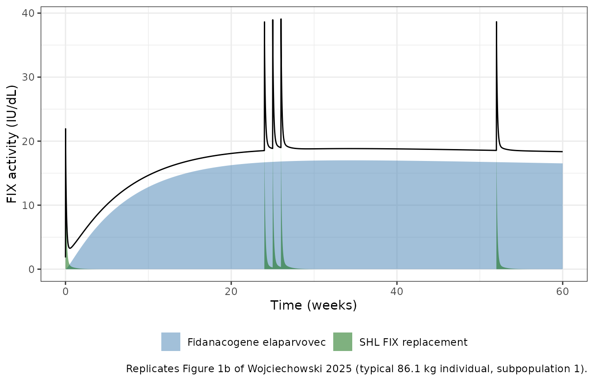
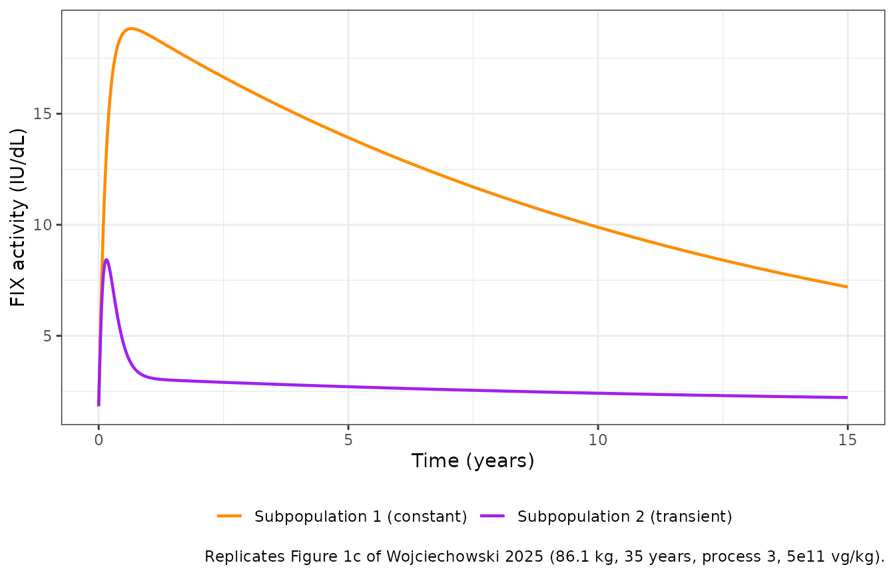
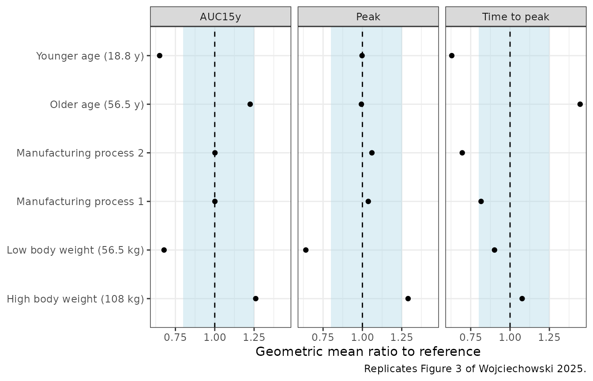
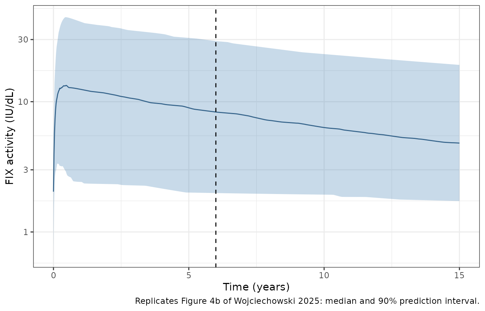

# Fidanacogene elaparvovec (Wojciechowski 2025)

## Model and source

- Citation: Wojciechowski J, Gaitonde P, Hughes JH, Ravva P. Population
  Modeling of Factor IX Activity Following Administration of
  Fidanacogene Elaparvovec Gene Therapy in Participants with
  Hemophilia B. Clin Pharmacokinet. 2025;64(10):1531-1548.
  <doi:10.1007/s40262-025-01535-y>. Parameter values from Table 2; model
  structure from the ESM NONMEM control stream (run57.mod). Extended
  half-life FIX disposition fixed from Diao L, et al. Clin
  Pharmacokinet. 2014;53(5):467-477 (<doi:10.1007/s40262-013-0129-7>),
  as hard-coded in run57.mod.
- Description: Population model of factor IX (FIX) activity after the
  AAV gene therapy fidanacogene elaparvovec and/or FIX replacement
  therapy in hemophilia B (Wojciechowski 2025). A Hargrove-Schmidt
  gene/protein-expression model (productive transgene amount translated
  into FIX at a synthesis site, first-order transgene degradation, and
  for a transient-production mixture subpopulation a reversible
  transition to a non-productive transgene state) feeds a
  three-compartment FIX disposition model with an endogenous baseline.
  Standard half-life FIX products dose into the same central
  compartment; extended half-life products use the fixed
  three-compartment rFIXFc model of Diao 2014. Allometric weight scaling
  referenced to 70 kg, age effects on synthesis, transgene degradation
  and relative FIX activity, manufacturing-process effects on synthesis,
  Box-Cox-transformed IIV on the translation constant, study effects on
  baseline, relative activity and the log-scale residual error.
- Article: <https://doi.org/10.1007/s40262-025-01535-y> (open access;
  the electronic supplementary material holds the final NONMEM control
  stream, `run57.mod`)

Fidanacogene elaparvovec is an adeno-associated virus (AAV) vector
carrying a high-activity (Padua) factor IX (FIX) transgene. The model
describes FIX activity from every source at once: endogenous FIX
(baseline `BASE`), transgene-derived FIX, standard half-life (SHL) FIX
replacement products such as nonacog alfa, and extended half-life (EHL)
products. The gene-therapy part is the Hargrove-Schmidt
gene/protein-expression model: the vector dose (vector genomes, vg)
enters a productive-transgene state that is translated into FIX at a
synthesis site at rate `ktau * transgene` without consuming the
transgene, and the transgene itself is lost at `kdeg`. FIX leaves the
synthesis site at `ksyn` into a three-compartment disposition model
estimated from nonacog alfa data. A two-class mixture separates a
constant-production phenotype (subpopulation 1) from a
transient-production phenotype (subpopulation 2) in which the productive
transgene moves reversibly into a non-productive state.

## Population

The analysis pooled 337 participants with hemophilia B and 8931 FIX
activity observations (one-stage clotting assays) from 11 trials: 274
participants from eight nonacog alfa studies (141 paediatric, 133 adult;
median age 17.1 years, range \< 0.1 to 64.7; median weight 60.0 kg) and
63 adult men from three fidanacogene elaparvovec studies (median age
29.0 years, range 18.0-62.0; median weight 86.1 kg, range 55.0-139).
Most gene-therapy participants received 5e11 vg/kg as a single 60-minute
infusion; 10, 8 and 45 received material from manufacturing processes 1,
2 and 3, and 31 of 63 received concomitant corticosteroids. Race overall
was 82.8% White, 5.6% Asian, 5.0% Black and 5.3% other (Wojciechowski
2025 Table 1).

The same information is available programmatically via
`readModelDb("Wojciechowski_2025_fidanacogeneElaparvovec")()$population`.

## Source trace

Every `ini()` value carries an in-file comment naming its source.
Structure follows the deposited control stream `run57.mod` (ESM
pp. 2-6).

| Equation / parameter | Value | Source location |
|----|----|----|
| `lrbase` (BASE) | 1.83 IU/dL | Table 2 |
| `lcl`, `lvc` (CL, V1) | 0.617 L/h, 10.3 L | Table 2 |
| `lq`, `lvp` (Q2, V2) | 1.46 L/h, 3.29 L | Table 2 |
| `lq2`, `lvp2` (Q3, V3) | 0.145 L/h, 14.0 L | Table 2 |
| `lthalf_ksyn` | 34.9 day | Table 2; `run57.mod` `POPKSYN = LOG(2)/(24*THETA(8))` |
| `lktau` | 24.0 x 1e-13 IU/vg/h | Table 2; `run57.mod` `POPKT = THETA(9)/1E13` |
| `lthalf_kdeg` | 423 week | Table 2; `run57.mod` `LOG(2)/(168*THETA(10))` |
| `lthalf_ktrd`, `lthalf_ktrp` | 4.90, 62.6 week | Table 2 |
| `boxcox_lktau` | -0.631 | Table 2; `run57.mod` `ETAKTT = (EXP(ETAKT)**BXCXK-1)/BXCXK` |
| `e_wt_cl`, `e_wt_vc`, `e_wt_krate` | 0.75, 1, -0.25 (fixed) | Methods; Table 2 footnote; `run57.mod` |
| `e_age_ksyn`, `e_age_kdeg`, `e_age_fixa` | -0.704, -1.57, 0.0395 | Table 2 (age / 35) |
| `e_form_p1_ksyn`, `e_form_p2_ksyn` | 0.356, 0.658 | Table 2 |
| `e_wt_ktau` | 1.08 | Table 2 (WT / 70) |
| `e_study1002_rbase`, `e_study1034_rbase` | 0.788, 0.994 | Table 2 |
| `e_study1010_fixa`, `e_study1036_fixa` | 0.252, 0.173 | Table 2 |
| `e_study*_expSd` (1002, 1010, 1034, 1036, C037) | 1.32, 0.545, 0.843, -0.245, 0.305 | Table 2 |
| `expSd` | 0.276 | Table 2 (SD; `$SIGMA 1 FIX`) |
| `etalrbase`, `etalktau` | 0.419, 0.657 | Table 2 (variances) |
| `*_ehl` EHL product parameters | 2.39 dL/h, 71.4 dL, 1.67 dL/h, 87.0 dL, 39.3 dL/h, 39.9 dL; WT/73 powers 0.436, 0.396 | `run57.mod` `POPCLA`-`POPV3A`; Table S2 (Diao 2014) |
| Mixture probability (subpopulation 1) | logit 0.945, i.e. 0.720 | Table 2; `run57.mod` `$MIX` |
| `d/dt(transgene)`, `d/dt(transgene_np)`, `d/dt(fix_cell)` | n/a | Structural Model equations; `run57.mod` `DADT(4)`, `DADT(9)`, `DADT(5)` |
| `d/dt(central)`, `d/dt(peripheral1)`, `d/dt(peripheral2)`, initial conditions | n/a | Structural Model equations; `run57.mod` `DADT(1)`-`DADT(3)`, `A_0` |
| `Cc <- fixa * central / vc + central_ehl / vc_ehl` | n/a | Methods (`IPRE = FIXA * CENT/V1 + EHL`); `run57.mod` `FIPRE` |
| `Cc ~ lnorm(expSd_study)` | n/a | Methods (log-transformed both sides); `run57.mod` `$ERROR` |

## Simulation helpers

All simulations below are of the gene-therapy setting: process 3
material, `STUDY_C037 = 1` (it only changes the residual SD) and the
four nonacog alfa study indicators 0. Time is in hours; the plots
convert to weeks or years. Simulated FIX activity is the individual
prediction `Cc` (no residual error), as in the published simulations.

``` r

mod <- readModelDb("Wojciechowski_2025_fidanacogeneElaparvovec")
hy <- 24 * 365.25 # hours per year
hw <- 24 * 7 # hours per week
gt_dose_per_kg <- 5e11 # vg/kg, nominal dose

# Observation grid: weekly for two years, then every four weeks to 15 years
obs_times <- sort(unique(c(0, seq(hw, 104 * hw, by = hw), seq(108 * hw, 15 * hy, by = 4 * hw), 15 * hy)))

base_cov <- function(d) {
  d |>
    mutate(
      FORM_FIDANACOGENE_PROCESS1 = 0, FORM_FIDANACOGENE_PROCESS2 = 0,
      STUDY_B1821002 = 0, STUDY_B1821010 = 0, STUDY_B1821034 = 0,
      STUDY_B1821036 = 0, STUDY_C037 = 1
    )
}

# One gene-therapy infusion (60 min) at time 0 plus the observation grid.
# Subject-level covariates come from `subj` (one row per id).
make_gt_events <- function(subj, times = obs_times) {
  dose <- subj |>
    mutate(time = 0, amt = gt_dose_per_kg * WT, rate = amt, evid = 1, cmt = "transgene")
  obs <- tidyr::expand_grid(subj, time = times) |>
    mutate(amt = 0, rate = 0, evid = 0, cmt = "central")
  bind_rows(dose, obs) |>
    arrange(id, time, desc(evid)) |>
    base_cov()
}
```

## Replicate Figure 1b: contributions of gene therapy and SHL replacement

Figure 1b shows a population-typical 86.1 kg individual given 5e11 vg/kg
and five doses of SHL FIX replacement (40 IU/kg) at weeks 0, 24, 25, 26
and 52. The model is linear in its inputs, so each contribution is the
difference between the full solve and a solve without that input.

``` r

typ <- rxode2::zeroRe(mod)
#> ℹ parameter labels from comments will be replaced by 'label()'
#> Warning: No sigma parameters in the model
subj_typ <- tibble(id = 1L, WT = 86.1, AGE = 35, MIX_TRANSIENT_EXPR = 0)
fig1b_times <- seq(0, 60 * hw, by = 2)

shl_doses <- subj_typ |>
  tidyr::expand_grid(week = c(0, 24, 25, 26, 52)) |>
  mutate(time = week * hw + 1 / 60, amt = 40 * WT, rate = amt / (10 / 60), evid = 1, cmt = "central") |>
  select(-week)

ev_full <- bind_rows(make_gt_events(subj_typ, fig1b_times), base_cov(shl_doses)) |>
  arrange(id, time, desc(evid))
ev_gt <- make_gt_events(subj_typ, fig1b_times)
ev_shl <- ev_full |> filter(!(evid == 1 & cmt == "transgene"))

solve_cc <- function(ev) as.data.frame(rxode2::rxSolve(typ, ev, returnType = "data.frame"))[, c("time", "Cc")]
s_full <- solve_cc(ev_full)
#> ℹ omega/sigma items treated as zero: 'etalrbase', 'etalktau'
s_gt <- solve_cc(ev_gt)
#> ℹ omega/sigma items treated as zero: 'etalrbase', 'etalktau'
s_shl <- solve_cc(ev_shl)
#> ℹ omega/sigma items treated as zero: 'etalrbase', 'etalktau'
s_base <- s_full$Cc[1]

fig1b <- tibble(
  time = s_full$time,
  total = s_full$Cc,
  gene_therapy = s_gt$Cc - s_base,
  shl = s_shl$Cc - s_base
)

ggplot(fig1b, aes(time / hw)) +
  geom_area(aes(y = gene_therapy, fill = "Fidanacogene elaparvovec"), alpha = 0.5) +
  geom_area(aes(y = shl, fill = "SHL FIX replacement"), alpha = 0.5) +
  geom_line(aes(y = total)) +
  scale_fill_manual(values = c("Fidanacogene elaparvovec" = "steelblue", "SHL FIX replacement" = "darkgreen")) +
  labs(
    x = "Time (weeks)", y = "FIX activity (IU/dL)", fill = NULL,
    caption = "Replicates Figure 1b of Wojciechowski 2025 (typical 86.1 kg individual, subpopulation 1)."
  ) +
  theme_bw() +
  theme(legend.position = "bottom")
```



The model is linear, so the full solve must equal baseline plus the two
contributions. That identity is pure numerical error and is checked
tightly.

``` r

stopifnot(max(abs(fig1b$total - (s_base + fig1b$gene_therapy + fig1b$shl))) < 1e-3 * max(fig1b$total))
# Without any dose the endogenous steady state is held at BASE = 1.83 IU/dL.
stopifnot(abs(s_base - 1.83) < 1e-6)
```

## Replicate Figure 1c: the two production phenotypes

``` r

subj_ph <- tibble(id = 1:2, WT = 86.1, AGE = 35, MIX_TRANSIENT_EXPR = c(0, 1))
s_ph <- as.data.frame(rxode2::rxSolve(typ, make_gt_events(subj_ph), returnType = "data.frame")) |>
  mutate(phenotype = ifelse(id == 1, "Subpopulation 1 (constant)", "Subpopulation 2 (transient)"))
#> ℹ omega/sigma items treated as zero: 'etalrbase', 'etalktau'
#> Warning: multi-subject simulation without without 'omega'

ggplot(s_ph, aes(time / hy, Cc, colour = phenotype)) +
  geom_line(linewidth = 0.8) +
  scale_colour_manual(values = c("darkorange", "purple")) +
  labs(
    x = "Time (years)", y = "FIX activity (IU/dL)", colour = NULL,
    caption = "Replicates Figure 1c of Wojciechowski 2025 (86.1 kg, 35 years, process 3, 5e11 vg/kg)."
  ) +
  theme_bw() +
  theme(legend.position = "bottom")
```



``` r


typ_peak <- s_ph |>
  group_by(phenotype) |>
  summarise(peak = max(Cc), t_peak_wk = time[which.max(Cc)] / hw, at_15y = Cc[which.max(time)], .groups = "drop")
typ_peak |>
  rename(
    "Phenotype" = phenotype, "Peak (IU/dL)" = peak,
    "Time of peak (weeks)" = t_peak_wk, "FIX activity at 15 years (IU/dL)" = at_15y
  ) |>
  knitr::kable(digits = 2, caption = "Typical-value peak, time of peak and FIX activity at 15 years by phenotype.")
```

| Phenotype | Peak (IU/dL) | Time of peak (weeks) | FIX activity at 15 years (IU/dL) |
|:---|---:|---:|---:|
| Subpopulation 1 (constant) | 18.83 | 34 | 7.20 |
| Subpopulation 2 (transient) | 8.43 | 8 | 2.22 |

Typical-value peak, time of peak and FIX activity at 15 years by
phenotype. {.table}

The constant phenotype rises over about 30 weeks to a plateau near 19
IU/dL and then falls with the 423-week transgene half-life; the
transient phenotype peaks within about two months and then drops to a
slowly declining level, as in the published Figure 1c.

## Nonacog alfa disposition check

A single 50 IU/kg nonacog alfa dose (10-minute infusion) in a typical 70
kg, 35-year-old adult. Above the constant endogenous baseline the
disposition is linear, so `dose / AUC(0-inf)` of the baseline-corrected
profile must recover the clearance, `CL = 0.617 L/h = 6.17 dL/h`. PKNCA
computes the AUC.

``` r

subj_n <- tibble(id = 1L, WT = 70, AGE = 35, MIX_TRANSIENT_EXPR = 0, treatment = "nonacog alfa 50 IU/kg")
nonacog_times <- c(0, 0.25, 0.5, 1, 2, 4, 6, 8, 12, 18, 24, 36, 48, 72, 96, 144, 192, 288, 384, 576, 768, 1152)
ev_n <- bind_rows(
  subj_n |> mutate(time = 0, amt = 50 * WT, rate = amt / (10 / 60), evid = 1, cmt = "central"),
  tidyr::expand_grid(subj_n, time = nonacog_times) |> mutate(amt = 0, rate = 0, evid = 0, cmt = "central")
) |>
  arrange(id, time, desc(evid)) |>
  base_cov()
# A single-subject solve returns no id column; add it back with the group.
s_n <- as.data.frame(rxode2::rxSolve(typ, ev_n, returnType = "data.frame")) |>
  mutate(id = 1L, treatment = subj_n$treatment, Cinc = pmax(Cc - 1.83, 0))
#> ℹ omega/sigma items treated as zero: 'etalrbase', 'etalktau'

conc_n <- PKNCA::PKNCAconc(s_n |> filter(!is.na(Cinc)) |> select(id, time, Cinc, treatment), Cinc ~ time | treatment + id)
dose_n <- PKNCA::PKNCAdose(ev_n |> filter(evid == 1) |> select(id, time, amt, treatment), amt ~ time | treatment + id)
nca_n <- PKNCA::pk.nca(PKNCA::PKNCAdata(conc_n, dose_n,
  intervals = data.frame(start = 0, end = Inf, cmax = TRUE, aucinf.obs = TRUE, half.life = TRUE)
))
res_n <- as.data.frame(nca_n$result)
auc_n <- res_n$PPORRES[res_n$PPTESTCD == "aucinf.obs"]
cl_nca <- 50 * 70 / auc_n
knitr::kable(
  res_n |> filter(PPTESTCD %in% c("cmax", "aucinf.obs", "half.life")) |>
    select(treatment, PPTESTCD, PPORRES) |>
    rename("Group" = treatment, "NCA parameter" = PPTESTCD, "Value" = PPORRES),
  digits = 3, caption = "PKNCA of the baseline-corrected nonacog alfa profile (IU/dL, IU*h/dL, h)."
)
```

| Group                 | NCA parameter |   Value |
|:----------------------|:--------------|--------:|
| nonacog alfa 50 IU/kg | cmax          |  32.813 |
| nonacog alfa 50 IU/kg | half.life     |  85.989 |
| nonacog alfa 50 IU/kg | aucinf.obs    | 569.109 |

PKNCA of the baseline-corrected nonacog alfa profile (IU/dL, IU\*h/dL,
h). {.table}

``` r

cat(sprintf("Dose / AUC(0-inf) = %.3f dL/h (model CL = 6.17 dL/h)\n", cl_nca))
#> Dose / AUC(0-inf) = 6.150 dL/h (model CL = 6.17 dL/h)
# Deterministic identity: only trapezoid and extrapolation error separate them.
stopifnot(abs(cl_nca / 6.17 - 1) < 0.03)
```

## Table 3 and Figure 3: covariate scenarios

Table 3 summarises 1000 simulated trials of 63 participants per
covariate scenario as the median geometric mean of peak FIX activity,
time to peak and the 15-year AUC, for a mixed population of 72%
subpopulation 1 and 28% subpopulation 2. Here one cohort of 200
participants per scenario stands in for the trial distribution. As in
the published summaries, exactly 28% of the participants (56 of 200) are
assigned to subpopulation 2, the Table 2 mixture probability
(`1 - plogis(0.945) = 0.280`); a random Bernoulli draw would add several
percentage points of phenotype-mix noise to every median. The same
participants and seed are used for every scenario so that
between-scenario ratios (Figure 3) compare like with like.

``` r

scen <- tribble(
  ~scenario, ~WT, ~AGE, ~p1, ~p2,
  "Reference", 86.1, 35, 0, 0,
  "Younger age (18.8 y)", 86.1, 18.8, 0, 0,
  "Older age (56.5 y)", 86.1, 56.5, 0, 0,
  "Low body weight (56.5 kg)", 56.5, 35, 0, 0,
  "High body weight (108 kg)", 108, 35, 0, 0,
  "Manufacturing process 1", 86.1, 35, 1, 0,
  "Manufacturing process 2", 86.1, 35, 0, 1
)
n_per <- 200
p_sub2 <- 1 - plogis(0.945) # Table 2 log-odds of subpopulation 1
set.seed(2025)
mix_draw <- as.integer(seq_len(n_per) %in% sample(n_per, round(p_sub2 * n_per)))

sim_scen <- lapply(seq_len(nrow(scen)), function(i) {
  subj <- tibble(id = seq_len(n_per), WT = scen$WT[i], AGE = scen$AGE[i], MIX_TRANSIENT_EXPR = mix_draw)
  ev <- make_gt_events(subj) |>
    mutate(FORM_FIDANACOGENE_PROCESS1 = scen$p1[i], FORM_FIDANACOGENE_PROCESS2 = scen$p2[i])
  rxode2::rxSetSeed(2025)
  out <- as.data.frame(rxode2::rxSolve(mod, ev, returnType = "data.frame"))
  out$scenario <- scen$scenario[i]
  out
}) |>
  bind_rows()
#> ℹ parameter labels from comments will be replaced by 'label()'
```

PKNCA gives each participant’s peak, time to peak and AUC over 15 years
(converted to IU x year/dL); the geometric means per scenario are
compared with Table 3.

``` r

conc_s <- PKNCA::PKNCAconc(
  sim_scen |> filter(!is.na(Cc)) |> mutate(time_wk = time / hw) |> select(id, time_wk, Cc, scenario),
  Cc ~ time_wk | scenario + id
)
dose_s <- PKNCA::PKNCAdose(
  sim_scen |> distinct(scenario, id) |> mutate(time_wk = 0, amt = 1),
  amt ~ time_wk | scenario + id
)
nca_s <- PKNCA::pk.nca(PKNCA::PKNCAdata(conc_s, dose_s,
  intervals = data.frame(start = 0, end = 15 * hy / hw, cmax = TRUE, tmax = TRUE, auclast = TRUE)
))
ind <- as.data.frame(nca_s$result) |>
  select(scenario, id, PPTESTCD, PPORRES) |>
  tidyr::pivot_wider(names_from = PPTESTCD, values_from = PPORRES) |>
  mutate(auc_y = auclast / (365.25 / 7)) # IU*week/dL -> IU*year/dL

geo <- ind |>
  group_by(scenario) |>
  summarise(
    peak = exp(mean(log(cmax))), tpeak = exp(mean(log(tmax))), auc = exp(mean(log(auc_y))),
    .groups = "drop"
  )

published3 <- tribble(
  ~scenario, ~peak_pub, ~tpeak_pub, ~auc_pub,
  "Reference", 13.8, 22.8, 115,
  "Younger age (18.8 y)", 13.7, 14.4, 76.4,
  "Older age (56.5 y)", 13.7, 32.3, 140,
  "Low body weight (56.5 kg)", 9.02, 20.9, 80.2,
  "High body weight (108 kg)", 17.6, 24.1, 144,
  "Manufacturing process 1", 14.3, 18.7, 116,
  "Manufacturing process 2", 14.6, 15.9, 116
)
cmp3 <- published3 |>
  left_join(geo, by = "scenario") |>
  mutate(
    peak_diff = 100 * (peak / peak_pub - 1),
    tpeak_diff = 100 * (tpeak / tpeak_pub - 1),
    auc_diff = 100 * (auc / auc_pub - 1)
  )
stopifnot(nrow(cmp3) == 7, !anyNA(cmp3$peak))
cmp3 |>
  select(scenario, peak_pub, peak, peak_diff, tpeak_pub, tpeak, tpeak_diff, auc_pub, auc, auc_diff) |>
  rename(
    "Scenario" = scenario,
    "Peak, published (IU/dL)" = peak_pub, "Peak, simulated" = peak, "Peak diff (%)" = peak_diff,
    "Time to peak, published (wk)" = tpeak_pub, "Time to peak, simulated" = tpeak, "Tpeak diff (%)" = tpeak_diff,
    "AUC15y, published (IU*y/dL)" = auc_pub, "AUC15y, simulated" = auc, "AUC diff (%)" = auc_diff
  ) |>
  knitr::kable(digits = 1, caption = "Geometric means per covariate scenario vs Wojciechowski 2025 Table 3.")
```

| Scenario | Peak, published (IU/dL) | Peak, simulated | Peak diff (%) | Time to peak, published (wk) | Time to peak, simulated | Tpeak diff (%) | AUC15y, published (IU\*y/dL) | AUC15y, simulated | AUC diff (%) |
|:---|---:|---:|---:|---:|---:|---:|---:|---:|---:|
| Reference | 13.8 | 15.0 | 8.8 | 22.8 | 22.7 | -0.6 | 115.0 | 122.3 | 6.3 |
| Younger age (18.8 y) | 13.7 | 15.0 | 9.4 | 14.4 | 14.3 | -0.9 | 76.4 | 79.4 | 4.0 |
| Older age (56.5 y) | 13.7 | 14.9 | 8.9 | 32.3 | 32.8 | 1.5 | 140.0 | 149.8 | 7.0 |
| Low body weight (56.5 kg) | 9.0 | 9.6 | 6.7 | 20.9 | 20.4 | -2.2 | 80.2 | 82.9 | 3.3 |
| High body weight (108 kg) | 17.6 | 19.4 | 10.1 | 24.1 | 24.4 | 1.3 | 144.0 | 154.1 | 7.0 |
| Manufacturing process 1 | 14.3 | 15.6 | 9.0 | 18.7 | 18.5 | -1.1 | 116.0 | 122.4 | 5.5 |
| Manufacturing process 2 | 14.6 | 15.9 | 9.1 | 15.9 | 15.8 | -0.7 | 116.0 | 122.4 | 5.5 |

Geometric means per covariate scenario vs Wojciechowski 2025 Table 3.
{.table}

The ratios to the reference scenario (Figure 3) remove most of the
cohort noise, because every scenario shares the same random effects and
phenotypes.

``` r

ref <- geo |> filter(scenario == "Reference")
ratios <- geo |>
  filter(scenario != "Reference") |>
  transmute(
    scenario,
    peak_ratio = peak / ref$peak, tpeak_ratio = tpeak / ref$tpeak, auc_ratio = auc / ref$auc
  )
pub_ratios <- published3 |>
  filter(scenario != "Reference") |>
  transmute(
    scenario,
    peak_ratio_pub = peak_pub / 13.8, tpeak_ratio_pub = tpeak_pub / 22.8, auc_ratio_pub = auc_pub / 115
  )
cmp_ratio <- left_join(pub_ratios, ratios, by = "scenario")
cmp_ratio |>
  select(scenario, peak_ratio_pub, peak_ratio, tpeak_ratio_pub, tpeak_ratio, auc_ratio_pub, auc_ratio) |>
  rename(
    "Scenario" = scenario,
    "Peak ratio, published" = peak_ratio_pub, "Peak ratio, simulated" = peak_ratio,
    "Tpeak ratio, published" = tpeak_ratio_pub, "Tpeak ratio, simulated" = tpeak_ratio,
    "AUC ratio, published" = auc_ratio_pub, "AUC ratio, simulated" = auc_ratio
  ) |>
  knitr::kable(digits = 2, caption = "Geometric mean ratios to the reference scenario (Figure 3 of Wojciechowski 2025, from Table 3).")
```

| Scenario | Peak ratio, published | Peak ratio, simulated | Tpeak ratio, published | Tpeak ratio, simulated | AUC ratio, published | AUC ratio, simulated |
|:---|---:|---:|---:|---:|---:|---:|
| Younger age (18.8 y) | 0.99 | 1.00 | 0.63 | 0.63 | 0.66 | 0.65 |
| Older age (56.5 y) | 0.99 | 0.99 | 1.42 | 1.45 | 1.22 | 1.23 |
| Low body weight (56.5 kg) | 0.65 | 0.64 | 0.92 | 0.90 | 0.70 | 0.68 |
| High body weight (108 kg) | 1.28 | 1.29 | 1.06 | 1.08 | 1.25 | 1.26 |
| Manufacturing process 1 | 1.04 | 1.04 | 0.82 | 0.82 | 1.01 | 1.00 |
| Manufacturing process 2 | 1.06 | 1.06 | 0.70 | 0.70 | 1.01 | 1.00 |

Geometric mean ratios to the reference scenario (Figure 3 of
Wojciechowski 2025, from Table 3). {.table}

``` r


ratios |>
  tidyr::pivot_longer(-scenario, names_to = "metric", values_to = "ratio") |>
  mutate(metric = recode(metric, peak_ratio = "Peak", tpeak_ratio = "Time to peak", auc_ratio = "AUC15y")) |>
  ggplot(aes(ratio, scenario)) +
  annotate("rect", xmin = 0.8, xmax = 1.25, ymin = -Inf, ymax = Inf, fill = "lightblue", alpha = 0.4) +
  geom_vline(xintercept = 1, linetype = 2) +
  geom_point() +
  facet_wrap(~metric) +
  labs(x = "Geometric mean ratio to reference", y = NULL, caption = "Replicates Figure 3 of Wojciechowski 2025.") +
  theme_bw()
```



The geometric means reproduce Table 3 to within about 10% for every
scenario and metric, and the covariate ratios of Figure 3 to within a
few percent: age moves mainly the time to peak, weight mainly the peak,
and manufacturing processes 1 and 2 shorten the time to peak without
changing the 15-year AUC.

``` r

# Structural gates. A mis-transcribed rate constant, translation constant or
# covariate exponent moves these by tens of percent; the cohort-to-cohort
# spread of a 200-participant geometric mean is a few percent.
stopifnot(
  abs(median(cmp3$peak_diff)) < 15,
  abs(median(cmp3$tpeak_diff)) < 15,
  abs(median(cmp3$auc_diff)) < 15,
  max(abs(c(cmp3$peak_diff, cmp3$tpeak_diff, cmp3$auc_diff))) < 30,
  # Ratios share random effects across scenarios, so they are tighter.
  max(abs(cmp_ratio$peak_ratio / cmp_ratio$peak_ratio_pub - 1)) < 0.10,
  max(abs(cmp_ratio$tpeak_ratio / cmp_ratio$tpeak_ratio_pub - 1)) < 0.10,
  max(abs(cmp_ratio$auc_ratio / cmp_ratio$auc_ratio_pub - 1)) < 0.10
)
```

## Replicate Figure 4: 15-year FIX activity in a virtual population

The published simulation drew 100,000 individuals with demographics
representative of the adult analysis population. Here 200 participants
are drawn with age and weight from truncated normal distributions
matching the gene-therapy studies in Table 1 (age mean 34.0, SD 12.0,
range 18-62 years; weight mean 85.5, SD 16.0, range 55-139 kg), process
3, 5e11 vg/kg, and the same exact 28% allocation to subpopulation 2.

``` r

rtnorm <- function(n, mean, sd, lo, hi) {
  x <- rnorm(n, mean, sd)
  while (any(bad <- x < lo | x > hi)) x[bad] <- rnorm(sum(bad), mean, sd)
  x
}
set.seed(4)
n_pop <- 200
subj_pop <- tibble(
  id = seq_len(n_pop),
  AGE = rtnorm(n_pop, 34.0, 12.0, 18, 62),
  WT = rtnorm(n_pop, 85.5, 16.0, 55, 139),
  MIX_TRANSIENT_EXPR = as.integer(seq_len(n_pop) %in% sample(n_pop, round(p_sub2 * n_pop))),
  treatment = "5e11 vg/kg"
)
rxode2::rxSetSeed(44)
sim_pop <- as.data.frame(rxode2::rxSolve(mod, make_gt_events(subj_pop), returnType = "data.frame", keep = "treatment"))

pop_q <- sim_pop |>
  group_by(time) |>
  summarise(
    Q05 = quantile(Cc, 0.05), Q50 = median(Cc), Q95 = quantile(Cc, 0.95),
    .groups = "drop"
  )
ggplot(pop_q, aes(time / hy, Q50)) +
  geom_ribbon(aes(ymin = Q05, ymax = Q95), fill = "steelblue", alpha = 0.3) +
  geom_line(colour = "steelblue4") +
  geom_vline(xintercept = 6, linetype = 2) +
  scale_y_log10() +
  labs(
    x = "Time (years)", y = "FIX activity (IU/dL)",
    caption = "Replicates Figure 4b of Wojciechowski 2025: median and 90% prediction interval."
  ) +
  theme_bw()
```



``` r

at_year <- function(y) {
  x <- sim_pop |>
    group_by(id) |>
    summarise(Cc = Cc[which.min(abs(time - y * hy))], .groups = "drop")
  x$Cc
}
conc_p <- PKNCA::PKNCAconc(
  sim_pop |> filter(!is.na(Cc)) |> mutate(time_wk = time / hw) |> select(id, time_wk, Cc, treatment),
  Cc ~ time_wk | treatment + id
)
dose_p <- PKNCA::PKNCAdose(subj_pop |> mutate(time_wk = 0, amt = 1) |> select(id, time_wk, amt, treatment), amt ~ time_wk | treatment + id)
nca_p <- PKNCA::pk.nca(PKNCA::PKNCAdata(conc_p, dose_p,
  intervals = data.frame(start = 0, end = 15 * hy / hw, cmax = TRUE, tmax = TRUE, auclast = TRUE)
))
ind_p <- as.data.frame(nca_p$result) |>
  select(id, PPTESTCD, PPORRES) |>
  tidyr::pivot_wider(names_from = PPTESTCD, values_from = PPORRES)

q3 <- function(x) quantile(x, c(0.5, 0.05, 0.95), names = FALSE)
pop_tab <- tribble(
  ~metric, ~published,
  "Peak FIX activity (IU/dL)", c(13.5, 3.12, 41.3),
  "Time to peak (weeks)", c(25.3, 6.70, 48.7),
  "FIX activity at year 1 (IU/dL)", c(11.0, 1.84, 40.1),
  "FIX activity at year 6 (IU/dL)", c(7.16, 1.50, 27.9),
  "FIX activity at year 15 (IU/dL)", c(4.11, 1.15, 17.6),
  "AUC over 15 years (IU*year/dL)", c(105, 23.4, 394)
)
pop_tab$simulated <- list(
  q3(ind_p$cmax), q3(ind_p$tmax), q3(at_year(1)), q3(at_year(6)), q3(at_year(15)),
  q3(ind_p$auclast / (365.25 / 7))
)
pop_cmp <- pop_tab |>
  mutate(
    pub_median = vapply(published, `[`, numeric(1), 1),
    sim_median = vapply(simulated, `[`, numeric(1), 1),
    pub_pi = vapply(published, function(x) sprintf("%.3g-%.3g", x[2], x[3]), character(1)),
    sim_pi = vapply(simulated, function(x) sprintf("%.3g-%.3g", x[2], x[3]), character(1)),
    diff_pct = 100 * (sim_median / pub_median - 1)
  )
pop_cmp |>
  select(metric, pub_median, pub_pi, sim_median, sim_pi, diff_pct) |>
  rename(
    "Metric" = metric, "Published median" = pub_median, "Published 90% PI" = pub_pi,
    "Simulated median" = sim_median, "Simulated 90% PI" = sim_pi, "Median diff (%)" = diff_pct
  ) |>
  knitr::kable(digits = 2, caption = "Virtual-population summaries vs Wojciechowski 2025 Results and Figure 4.")
```

| Metric | Published median | Published 90% PI | Simulated median | Simulated 90% PI | Median diff (%) |
|:---|---:|:---|---:|:---|---:|
| Peak FIX activity (IU/dL) | 13.50 | 3.12-41.3 | 13.96 | 3.48-44.6 | 3.41 |
| Time to peak (weeks) | 25.30 | 6.7-48.7 | 29.00 | 7-49 | 14.62 |
| FIX activity at year 1 (IU/dL) | 11.00 | 1.84-40.1 | 12.45 | 2.42-41.2 | 13.20 |
| FIX activity at year 6 (IU/dL) | 7.16 | 1.5-27.9 | 8.34 | 1.99-29.2 | 16.53 |
| FIX activity at year 15 (IU/dL) | 4.11 | 1.15-17.6 | 4.81 | 1.73-19.2 | 17.12 |
| AUC over 15 years (IU\*year/dL) | 105.00 | 23.4-394 | 120.02 | 30.7-414 | 14.30 |

Virtual-population summaries vs Wojciechowski 2025 Results and Figure 4.
{.table}

``` r


# Centre of the distribution only; the tails of a 200-person cohort are not
# asserted on. The published sampling distributions of age and weight are not
# given, and this cohort sits about 15% above the published medians (the
# covariate scenarios above, where demographics are fixed, agree within 10%).
# A mis-transcribed rate constant, dose or unit moves these by far more.
stopifnot(
  nrow(pop_cmp) == 6,
  abs(median(pop_cmp$diff_pct)) < 25,
  max(abs(pop_cmp$diff_pct)) < 40
)
```

In this cohort the simulated medians sit about 3-17% above the published
ones, most for the late time points and the 15-year AUC. The covariate
scenarios, whose demographics are fixed and stated in Table 3, agree to
within 10%, so the gap points to the unstated demographic sampling of
the published 100,000-participant simulation (an older cohort has slower
transgene loss, `kdeg` falling with age to the power -1.57) rather than
to the model.

## Assumptions and deviations

- **Non-productive transgene degradation.** The printed structural
  equations in the article omit transgene loss from the non-productive
  state (`dPERIG/dt = ktr,d * DEPOT - ktr,p * PERIG`). The deposited
  final control stream degrades it at `kdeg`
  (`DADT(9) = KTRD*DEPOT-KTRP*PERIG-KDEG*PERIG`), and Table S3 run 56
  (“assume the transgene degradation still occurs while in
  non-productive state … final structural model”) confirms it. The model
  follows the control stream.
- **Allometric scaling of the transition rates.** The article lists
  allometric scaling on `ksyn` and `kdeg`; the control stream also
  scales `ktr,d` and `ktr,p` by `(WT/70)^-0.25`. The model follows the
  control stream.
- **Mixture model.** rxode2 cannot estimate a `$MIX` block, so the
  latent class is supplied as the covariate `MIX_TRANSIENT_EXPR` (1 =
  transient production, subpopulation 2). For population simulation it
  is drawn as Bernoulli(0.280), from the Table 2 log-odds 0.945 of
  subpopulation 1. The log-odds is documented in the covariate notes
  rather than carried as an unused `ini()` parameter.
- **Extended half-life products.** The authors accounted for every EHL
  product (eftrenonacog alfa, nonacog beta pegol, rFIX-FP) with the
  eftrenonacog alfa model of Diao 2014, hard-coded without variability
  in the control stream (Table S2). Those values are carried as
  `fixed()` parameters with the Diao 2014 reference weight of 73 kg. SHL
  products (nonacog alfa and plasma-derived FIX) dose into `central`.
- **Study effects.** Study-level effects on BASE, relative FIX activity
  and the residual SD are carried as study indicators so the model can
  describe each source study; FIXA is 1 with no variability for the
  reference studies, including the gene-therapy studies, apart from the
  age effect.
- **Simulation demographics.** The published simulations do not give the
  sampling distributions of age and weight. Figure 4 here uses truncated
  normal distributions matching the gene-therapy study summary in Table
  1, which yields an older and heavier population than the pooled
  analysis.
- **Cohort size.** Table 3 summarises 1000 trials of 63 participants and
  Figure 4 100,000 participants; this article uses 200 per scenario, so
  the 90% intervals of single participants are noisier than published.
- **Screened covariates not retained.** Concomitant corticosteroids
  (significant on `ktr,d` but judged descriptive) and BMI are documented
  in `covariatesDataExcluded`.
- No erratum or correction notice was found on Europe PMC as of
  2026-11-06.
