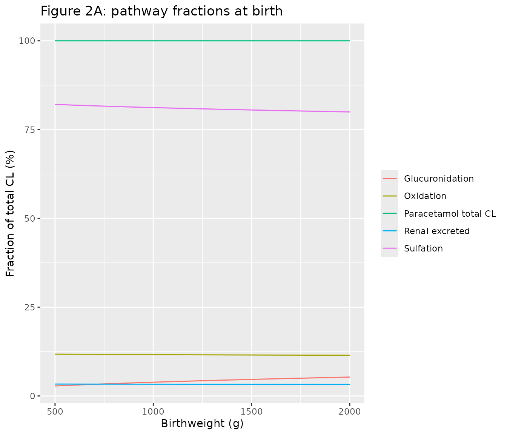
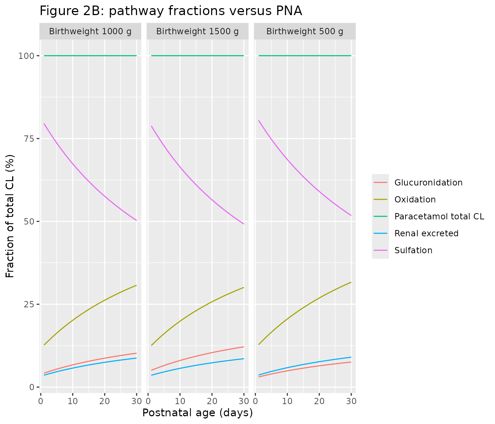
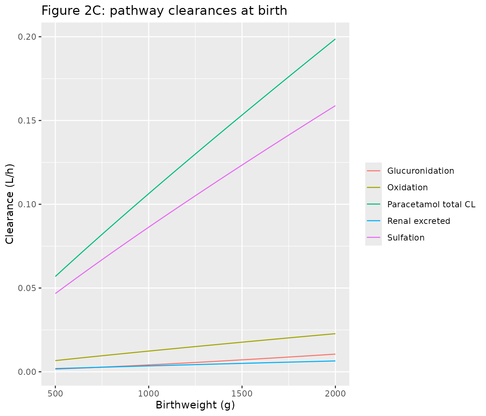
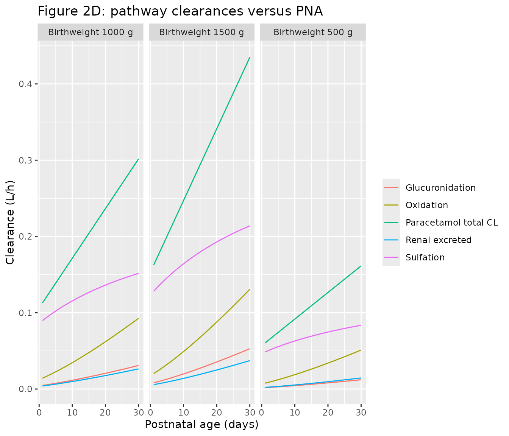
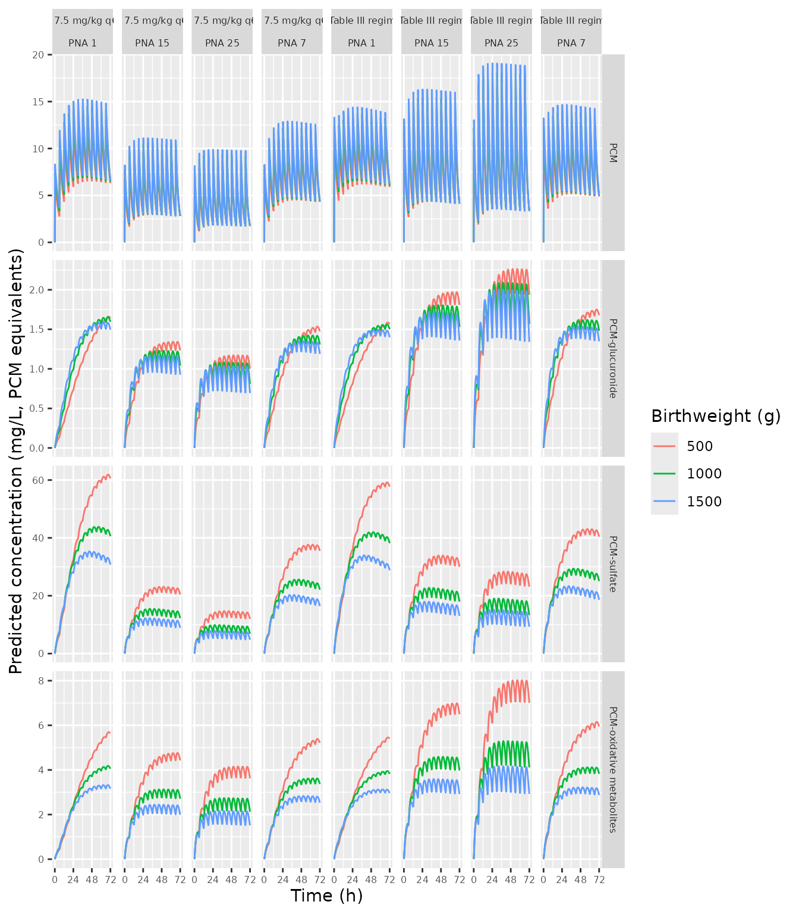
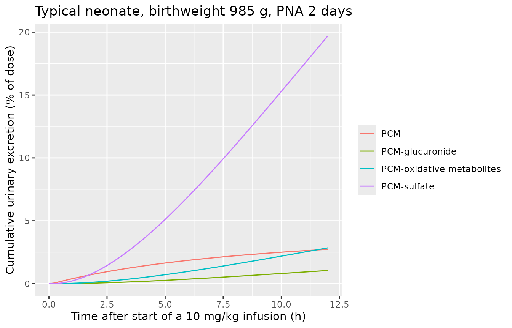

# Paracetamol (Wu 2023)

## Model and source

    #> ℹ parameter labels from comments will be replaced by 'label()'

- Citation: Wu Y, Voller S, Krekels EHJ, Roofthooft DWE, Simons SHP,
  Tibboel D, Flint RB, Knibbe CAJ (2023). Maturation of Paracetamol
  Elimination Routes in Preterm Neonates Born Below 32 Weeks of
  Gestation. Pharm Res 40(9):2155-2166.
  <doi:10.1007/s11095-023-03580-3>.

- Description: Parent-and-metabolites population PK model for
  intravenous paracetamol (PCM) and its glucuronide, sulfate and
  combined oxidative (cysteine + mercapturate) metabolites in plasma and
  urine of preterm neonates born below 32 weeks of gestation in their
  first 30 days of life (Wu 2023). Two-compartment plasma disposition
  for parent PCM; one-compartment disposition for each metabolite with
  volumes set as fractions of the PCM central volume; four cumulative
  urine compartments. Total PCM clearance scales with birthweight
  (power) and postnatal age (linear) and is partitioned into
  glucuronidation, sulfation, oxidation and unchanged renal excretion by
  three estimated clearance ratios against the unchanged-renal route
  (glucuronidation ratio rising with birthweight, sulfation ratio
  declining hyperbolically with postnatal age). The three metabolite
  renal clearances share one birthweight/postnatal-age relationship and
  one random effect. Urinary concentrations divide the excreted amount
  by the measured diaper urine volume times an estimated volume
  correction factor. Metabolite amounts and concentrations are in PCM
  equivalents.

- Article: <https://doi.org/10.1007/s11095-023-03580-3> (open access;
  the supplementary material holds the NONMEM control stream of the
  final model)

Wu 2023 quantifies how each elimination route of intravenous paracetamol
(PCM) matures in neonates born before 32 weeks of gestation. Total
clearance is driven by birthweight (prenatal maturation) and postnatal
age (PNA), not by current weight, and is split into glucuronidation,
sulfation, oxidation (the cysteine + mercapturate conjugates of NAPQI)
and unchanged renal excretion. For a typical neonate (birthweight 985 g,
PNA 5 days) total clearance is 0.137 L/h, three quarters of it by
sulfation; over the first month glucuronidation and oxidation clearance
rise about six-fold while sulfation rises by about 70%.

## Population

The analysis pooled two Dutch NICU datasets (Table I of the source): 60
preterm neonates from Flint et al. who received one 15-min intravenous
dose of 10, 15 or 20 mg/kg with rich plasma sampling and one diaper
urine collection (44 neonates contributed urine), and 83 neonates from
the DINO study who received a loading dose (28 of 83, median 19.0 mg/kg)
and maintenance doses of median 9.5 mg/kg about every 6 h with sparse
plasma sampling. The 143 neonates had gestational age 27.7 (24.0-31.9)
weeks, birthweight 985 (462-1,925) g, current weight 1,012 (462-1,959) g
and PNA 5 (0-30) days (median (range)); 47.6% were girls and 35% were
small for gestational age. Data were restricted to PNA up to 30 days.
534 plasma and 44 urine samples of PCM, PCM-glucuronide, PCM-sulfate,
PCM-cysteine and PCM-mercapturate were analysed; metabolite
concentrations were converted to PCM equivalents and cysteine +
mercapturate were summed into one oxidative-pathway analyte.

``` r

str(readModelDb("Wu_2023_paracetamol")()$population)
#> List of 12
#>  $ species       : chr "human"
#>  $ n_subjects    : int 143
#>  $ n_studies     : int 2
#>  $ age_range     : chr "Postnatal age 0-30 days at start of treatment (median 5); gestational age 24.0-31.9 weeks (median 27.7); postme"| __truncated__
#>  $ weight_range  : chr "Birthweight 462-1,925 g (median 985); current weight 462-1,959 g (median 1,012)"
#>  $ sex_female_pct: num 47.6
#>  $ race_ethnicity: chr NA
#>  $ disease_state : chr "Preterm neonates born below 32 weeks of gestation in Dutch level III NICUs receiving intravenous paracetamol fo"| __truncated__
#>  $ dose_range    : chr "Dataset 1: single 15-min IV infusion of 10, 15 or 20 mg/kg. Dataset 2 (DINO): IV loading dose median 19.0 mg/kg"| __truncated__
#>  $ regions       : chr "Netherlands"
#>  $ ga_range      : chr "24.0-31.9 weeks"
#>  $ notes         : chr "Table I. Dataset 1 (Flint et al., n = 60, rich sampling after one dose; plasma and one urine sample per neonate"| __truncated__
```

## Source trace

Every `ini()` value carries an in-file comment pointing at its source;
the table below collects them. Table II gives final estimates; the
supplement’s `$THETA` / `$OMEGA` blocks list initial values and were
used only for the model structure.

| Equation / parameter | Value | Source location |
|----|----|----|
| `lcl` (CLT at 985 g, PNA 5 d) | 0.137 L/h | Table II TVCLT |
| `e_wt_birth_cl` | 0.902 | Table II theta_BWb (CLT) |
| `e_pna_cl` | 0.0469 /day | Table II theta_PNA (CLT) |
| `lvc` (VP at 1,012 g) | 0.955 L | Table II TVVP |
| `e_wt_vc` | 0.836 | Table II theta_BWc |
| `lq` | 0.0494 L/h | Table II Qp |
| `lvp` | 0.244 L | Table II VPP |
| `lf_vol_gluc`, `lf_vol_sulf`, `lf_vol_cysmer` | 0.6, 0.326, 0.807 | Table II fVG, fVS, fVO |
| `lcle_gluc`, `lcle_sulf`, `lcle_cysmer` | 0.0425, 0.0256, 0.0498 L/h | Table II TVCLrG, TVCLrS, TVCLrO |
| `e_wt_birth_cle` | 1.62 | Table II renal-clearance theta_BWb |
| `e_pna_cle` | 0.0854 /day | Table II renal-clearance theta_PNA |
| `lclrat_gluc` | 1.16 | Table II TVR_FG |
| `e_wt_birth_clrat_gluc` | 0.479 | Table II theta_BWb on R_FG |
| `lclrat_sulf` | 24.5 | Table II TVR_FS |
| `lpna50_clrat_sulf` | 9.18 days | Table II theta_PNA50 |
| `lclrat_cysmer` | 3.51 | Table II R_FO |
| `lcorr_urine_vol` | 3.62 | Table II urine volume correction factor; Results |
| IIV CLT, VP, renal CL (shared), R_FG, R_FS, R_FO, correction factor | 30.9, 28.3, 37.6, 58.1, 44.5, 62.7, 138.4 CV% | Table II; footnote CV% = sqrt(exp(omega^2) - 1) |
| `expSd`, `expSd_gluc`, `expSd_sulf`, `expSd_cysmer` | 0.166, 0.325, 0.168, 0.208 | Table II plasma dataset 1 SD1 |
| `expSd_dino`, `expSd_gluc_dino`, `expSd_sulf_dino`, `expSd_cysmer_dino` | 0.345, 0.858, 0.325, 0.369 | Table II plasma dataset 2 SD1 |
| `addSd_sulf`, `addSd_cysmer` | 0.464, 0.0489 mg/L | Table II plasma dataset 1 SD2 |
| `expSd_urine` | 0.115 | Table II urine SD1 (shared by all compounds) |
| Pathway fractions FG, FS, FOX, FR | n/a | Methods Eqs. 1-5; Table II formation-clearance equations |
| R_FS = TVR_FS \* (1 - PNA / (PNA50 + PNA)) | n/a | Results Eq. 8; Table II |
| Covariate forms of CLT, VP, CLr | n/a | Table II equations; supplement `$PK` |
| ODE system, urine compartments | n/a | Fig. 1; supplement `$DES` |
| Urine scale UVOL x CF x exp(eta) | n/a | Results; supplement `$PK` S5-S8 |
| Residual error log(C) = log(IPRED) + SD x eps, SD = sqrt(SD1^2 + (SD2/IPRED)^2) | n/a | Methods Eq. 7; supplement `$ERROR` |

## Typical-value pathway clearances

The Results give total and pathway clearances for neonates of 500 and
1,500 g birthweight at PNA 1 and 30 days, and the percentage increases
with birthweight (500 to 1,500 g at birth) and with PNA (1 to 30 days at
985 g). Each model value below is rounded to the precision the paper
prints and must equal it.

``` r

mod <- readModelDb("Wu_2023_paracetamol")
mod_tv <- rxode2::zeroRe(mod)
#> ℹ parameter labels from comments will be replaced by 'label()'
#> Warning: No sigma parameters in the model

# One observation per (birthweight, PNA) pair; cl, cl_gluc, ... are algebraic
# outputs, so no dose is needed. Weights in kg, PNA in months (canonical units).
grid_events <- function(bw_g, pna_d) {
  tidyr::expand_grid(bw = bw_g, pna_grid = pna_d) |>
    mutate(
      id = row_number(), time = 0, evid = 0L, amt = 0, cmt = "central", dvid = 1L,
      WT_BIRTH = bw / 1000, WT = bw / 1000, PNA = pna_grid / 30.4375,
      STUDY_DINO = 0, URINE_VOL_INTERVAL = 20
    )
}
tv <- rxode2::rxSolve(mod_tv, grid_events(c(500, 985, 1500), c(0, 1, 5, 30)),
                      keep = c("bw", "pna_grid")) |>
  as.data.frame()
#> ℹ omega/sigma items treated as zero: 'etalcl', 'etalvc', 'etalcle', 'etalclrat_gluc', 'etalclrat_sulf', 'etalclrat_cysmer', 'etalcorr_urine_vol'
#> Warning: multi-subject simulation without without 'omega'

tv_at <- function(b, p, col) {
  v <- tv[[col]][tv$bw == b & tv$pna_grid == p]
  if (length(v) != 1L) stop("no unique row for bw ", b, ", PNA ", p)
  v
}

# Values as printed in the Results paragraph after Fig. 2.
claims <- tibble::tribble(
  ~bw,  ~pna_grid, ~route,      ~col,         ~paper,
  500,  1,    "total",     "cl",         "0.06",
  500,  30,   "total",     "cl",         "0.16",
  500,  1,    "glucuronidation", "cl_gluc", "0.0018",
  500,  30,   "glucuronidation", "cl_gluc", "0.012",
  500,  1,    "sulfation", "cl_sulf",    "0.049",
  500,  30,   "sulfation", "cl_sulf",    "0.084",
  500,  1,    "oxidation", "cl_cysmer",  "0.0077",
  500,  30,   "oxidation", "cl_cysmer",  "0.051",
  1500, 1,    "total",     "cl",         "0.16",
  1500, 30,   "total",     "cl",         "0.43",
  1500, 1,    "glucuronidation", "cl_gluc", "0.0082",
  1500, 30,   "glucuronidation", "cl_gluc", "0.053",
  1500, 1,    "sulfation", "cl_sulf",    "0.13",
  1500, 30,   "sulfation", "cl_sulf",    "0.21",
  1500, 1,    "oxidation", "cl_cysmer",  "0.02",
  1500, 30,   "oxidation", "cl_cysmer",  "0.13"
)
n_dec <- function(s) nchar(sub("^[^.]*\\.", "", s))
claims <- claims |>
  rowwise() |>
  mutate(
    model = tv_at(bw, pna_grid, col),
    rounded = round(model, n_dec(paper)),
    match = isTRUE(all.equal(rounded, as.numeric(paper)))
  ) |>
  ungroup()
claims |>
  dplyr::select(
    "Birthweight (g)" = bw, "PNA (days)" = pna_grid, "Route" = route,
    "Paper (L/h)" = paper, "Model (L/h)" = model, "Match at printed precision" = match
  ) |>
  knitr::kable(digits = 5)
```

| Birthweight (g) | PNA (days) | Route | Paper (L/h) | Model (L/h) | Match at printed precision |
|---:|---:|:---|:---|---:|:---|
| 500 | 1 | total | 0.06 | 0.06038 | TRUE |
| 500 | 30 | total | 0.16 | 0.16146 | TRUE |
| 500 | 1 | glucuronidation | 0.0018 | 0.00184 | TRUE |
| 500 | 30 | glucuronidation | 0.012 | 0.01221 | TRUE |
| 500 | 1 | sulfation | 0.049 | 0.04861 | TRUE |
| 500 | 30 | sulfation | 0.084 | 0.08359 | TRUE |
| 500 | 1 | oxidation | 0.0077 | 0.00772 | TRUE |
| 500 | 30 | oxidation | 0.051 | 0.05111 | TRUE |
| 1500 | 1 | total | 0.16 | 0.16265 | TRUE |
| 1500 | 30 | total | 0.43 | 0.43495 | TRUE |
| 1500 | 1 | glucuronidation | 0.0082 | 0.00824 | TRUE |
| 1500 | 30 | glucuronidation | 0.053 | 0.05289 | TRUE |
| 1500 | 1 | sulfation | 0.13 | 0.12823 | TRUE |
| 1500 | 30 | sulfation | 0.21 | 0.21396 | TRUE |
| 1500 | 1 | oxidation | 0.02 | 0.02037 | TRUE |
| 1500 | 30 | oxidation | 0.13 | 0.13083 | TRUE |

``` r

stopifnot(nrow(claims) == 16L, all(claims$match))
```

``` r

pct_up <- function(hi, lo) 100 * (hi / lo - 1)
increases <- tibble::tribble(
  ~claim,                                         ~paper, ~model,
  "Total CL, 500 -> 1,500 g at birth",            169,    pct_up(tv_at(1500, 0, "cl"), tv_at(500, 0, "cl")),
  "Glucuronidation, 500 -> 1,500 g at birth",     347,    pct_up(tv_at(1500, 0, "cl_gluc"), tv_at(500, 0, "cl_gluc")),
  "Oxidation, 500 -> 1,500 g at birth",           164,    pct_up(tv_at(1500, 0, "cl_cysmer"), tv_at(500, 0, "cl_cysmer")),
  "Sulfation, 500 -> 1,500 g at birth",           164,    pct_up(tv_at(1500, 0, "cl_sulf"), tv_at(500, 0, "cl_sulf")),
  "Total CL, PNA 1 -> 30 days (985 g)",           167,    pct_up(tv_at(985, 30, "cl"), tv_at(985, 1, "cl")),
  "Glucuronidation, PNA 1 -> 30 days (985 g)",    551,    pct_up(tv_at(985, 30, "cl_gluc"), tv_at(985, 1, "cl_gluc")),
  "Oxidation, PNA 1 -> 30 days (985 g)",          551,    pct_up(tv_at(985, 30, "cl_cysmer"), tv_at(985, 1, "cl_cysmer")),
  "Sulfation, PNA 1 -> 30 days (985 g)",          69,     pct_up(tv_at(985, 30, "cl_sulf"), tv_at(985, 1, "cl_sulf"))
)
increases |>
  dplyr::rename("Claim (abstract / Results)" = claim, "Paper (%)" = paper, "Model (%)" = model) |>
  knitr::kable(digits = 1)
```

| Claim (abstract / Results)                 | Paper (%) | Model (%) |
|:-------------------------------------------|----------:|----------:|
| Total CL, 500 -\> 1,500 g at birth         |       169 |     169.4 |
| Glucuronidation, 500 -\> 1,500 g at birth  |       347 |     347.2 |
| Oxidation, 500 -\> 1,500 g at birth        |       164 |     164.2 |
| Sulfation, 500 -\> 1,500 g at birth        |       164 |     164.2 |
| Total CL, PNA 1 -\> 30 days (985 g)        |       167 |     167.4 |
| Glucuronidation, PNA 1 -\> 30 days (985 g) |       551 |     550.7 |
| Oxidation, PNA 1 -\> 30 days (985 g)       |       551 |     550.7 |
| Sulfation, PNA 1 -\> 30 days (985 g)       |        69 |      69.1 |

``` r

stopifnot(all(abs(increases$model - increases$paper) < 1))
```

The abstract also states the pathway shares for the typical neonate
(birthweight 985 g, PNA 5 days): 5.3% glucuronidation, 73.7% sulfation,
16.3% oxidation and 4.6% unchanged renal excretion, and a total
clearance of 0.137 L/h.

``` r

shares <- tibble::tibble(
  route = c("glucuronidation", "sulfation", "oxidation", "unchanged renal"),
  paper = c(5.3, 73.7, 16.3, 4.6),
  model = 100 * c(tv_at(985, 5, "fm_gluc"), tv_at(985, 5, "fm_sulf"),
                  tv_at(985, 5, "fm_cysmer"), tv_at(985, 5, "fe"))
)
shares |>
  dplyr::rename("Route" = route, "Paper (%)" = paper, "Model (%)" = model) |>
  knitr::kable(digits = 2)
```

| Route           | Paper (%) | Model (%) |
|:----------------|----------:|----------:|
| glucuronidation |       5.3 |      5.39 |
| sulfation       |      73.7 |     73.67 |
| oxidation       |      16.3 |     16.30 |
| unchanged renal |       4.6 |      4.64 |

``` r

stopifnot(
  abs(tv_at(985, 5, "cl") - 0.137) < 1e-9,
  abs(sum(shares$model) - 100) < 1e-9,
  all(abs(shares$model - shares$paper) < 0.15)
)
```

The model gives 5.39% for glucuronidation where the abstract prints
5.3%; the other three shares match to the printed digit, and 100 -
73.7 - 16.3 - 4.6 = 5.4, so the abstract’s 5.3 is a rounding slip rather
than a model discrepancy.

## Replicate Figure 2

``` r

fig2_long <- function(d) {
  d |>
    transmute(
      bw, pna_grid,
      `Paracetamol total CL` = cl, Glucuronidation = cl_gluc, Sulfation = cl_sulf,
      Oxidation = cl_cysmer, `Renal excreted` = cl_renal
    ) |>
    pivot_longer(-c(bw, pna_grid), names_to = "route", values_to = "clearance") |>
    group_by(bw, pna_grid) |>
    mutate(fraction = 100 * clearance / clearance[route == "Paracetamol total CL"]) |>
    ungroup()
}
fig2_bw <- rxode2::rxSolve(mod_tv, grid_events(seq(500, 2000, by = 50), 0),
                           keep = c("bw", "pna_grid")) |>
  as.data.frame() |>
  fig2_long()
#> ℹ omega/sigma items treated as zero: 'etalcl', 'etalvc', 'etalcle', 'etalclrat_gluc', 'etalclrat_sulf', 'etalclrat_cysmer', 'etalcorr_urine_vol'
#> Warning: multi-subject simulation without without 'omega'
fig2_pna <- rxode2::rxSolve(mod_tv, grid_events(c(500, 1000, 1500), seq(1, 30, by = 0.5)),
                            keep = c("bw", "pna_grid")) |>
  as.data.frame() |>
  fig2_long()
#> ℹ omega/sigma items treated as zero: 'etalcl', 'etalvc', 'etalcle', 'etalclrat_gluc', 'etalclrat_sulf', 'etalclrat_cysmer', 'etalcorr_urine_vol'
#> Warning: multi-subject simulation without without 'omega'

ggplot(fig2_bw, aes(bw, fraction, colour = route)) +
  geom_line() +
  labs(x = "Birthweight (g)", y = "Fraction of total CL (%)", colour = NULL,
       title = "Figure 2A: pathway fractions at birth")
```



``` r

ggplot(fig2_pna, aes(pna_grid, fraction, colour = route)) +
  geom_line() +
  facet_wrap(~ paste("Birthweight", bw, "g")) +
  labs(x = "Postnatal age (days)", y = "Fraction of total CL (%)", colour = NULL,
       title = "Figure 2B: pathway fractions versus PNA")
```



``` r

ggplot(fig2_bw, aes(bw, clearance, colour = route)) +
  geom_line() +
  labs(x = "Birthweight (g)", y = "Clearance (L/h)", colour = NULL,
       title = "Figure 2C: pathway clearances at birth")
```



``` r

ggplot(fig2_pna, aes(pna_grid, clearance, colour = route)) +
  geom_line() +
  facet_wrap(~ paste("Birthweight", bw, "g")) +
  labs(x = "Postnatal age (days)", y = "Clearance (L/h)", colour = NULL,
       title = "Figure 2D: pathway clearances versus PNA")
```



Replicates Figure 2 of Wu 2023. As in the source, the sulfation share
falls from about 80% to about 50% over the first month while the
glucuronidation and oxidation shares rise; total clearance at 2,000 g
birthweight reaches about 0.2 L/h at birth and at 1,500 g about 0.43 L/h
by day 30.

## Virtual dosing scenarios

Figure 3 simulates three days of dosing for typical neonates of 500,
1,000 and 1,500 g birthweight starting at PNA 1, 7, 15 and 25 days:
panel A with 7.5 mg/kg every 6 h, panel B with the birthweight- and
PNA-based regimen of Table III (loading dose 12 mg/kg, then 7, 8.5, 11
or 14.5 mg/kg birthweight every 6 h for PNA 0-3, 4-9, 10-19 and 20-30
days). PNA advances with time during the simulation.

``` r

tab3 <- tibble::tibble(
  band = factor(c("0-3", "4-9", "10-19", "20-30"), levels = c("0-3", "4-9", "10-19", "20-30")),
  pna_lo = c(0, 4, 10, 20), pna_hi = c(3, 9, 19, 30),
  md = c(7, 8.5, 11, 14.5)
)

# One subject's three-day event table: 15-min infusions every 6 h, observations
# every 0.25 h. `ld` and `md` are mg/kg birthweight; WT is held at birthweight.
regimen_events <- function(id, bw, pna0, ld, md, obs = seq(0, 72, by = 0.25)) {
  dose_t <- seq(0, 66, by = 6)
  amt <- c(ld, rep(md, length(dose_t) - 1)) * bw / 1000
  bind_rows(
    tibble(id = id, time = dose_t, evid = 1L, amt = amt, rate = amt / 0.25,
           cmt = "central", dvid = NA_integer_),
    tibble(id = id, time = obs, evid = 0L, amt = 0, rate = 0,
           cmt = "central", dvid = 1L)
  ) |>
    mutate(
      bw = bw, pna0 = pna0,
      WT_BIRTH = bw / 1000, WT = bw / 1000, PNA = (pna0 + time / 24) / 30.4375,
      STUDY_DINO = 1, URINE_VOL_INTERVAL = 20
    ) |>
    arrange(id, time, desc(evid))
}
```

``` r

fig3_design <- tidyr::expand_grid(bw = c(500, 1000, 1500), pna0 = c(1, 7, 15, 25)) |>
  mutate(
    id = row_number(),
    band = cut(pna0, c(-Inf, 3, 9, 19, 30), labels = levels(tab3$band))
  ) |>
  left_join(tab3, by = "band")

fig3_events <- bind_rows(
  bind_rows(lapply(seq_len(nrow(fig3_design)), function(i) {
    with(fig3_design[i, ], regimen_events(id, bw, pna0, ld = 7.5, md = 7.5))
  })) |> mutate(panel = "A: 7.5 mg/kg q6h"),
  bind_rows(lapply(seq_len(nrow(fig3_design)), function(i) {
    with(fig3_design[i, ], regimen_events(id + 100L, bw, pna0, ld = 12, md = md))
  })) |> mutate(panel = "B: Table III regimen")
)

fig3_sim <- rxode2::rxSolve(mod_tv, fig3_events, keep = c("bw", "pna0", "panel")) |>
  as.data.frame()
#> ℹ omega/sigma items treated as zero: 'etalcl', 'etalvc', 'etalcle', 'etalclrat_gluc', 'etalclrat_sulf', 'etalclrat_cysmer', 'etalcorr_urine_vol'
#> Warning: multi-subject simulation without without 'omega'

fig3_long <- fig3_sim |>
  transmute(time, bw, pna0, panel,
            PCM = Cc, `PCM-glucuronide` = Cc_gluc, `PCM-sulfate` = Cc_sulf,
            `PCM-oxidative metabolites` = Cc_cysmer) |>
  pivot_longer(-c(time, bw, pna0, panel), names_to = "analyte", values_to = "conc") |>
  mutate(analyte = factor(analyte, levels = c("PCM", "PCM-glucuronide", "PCM-sulfate",
                                              "PCM-oxidative metabolites")))

ggplot(fig3_long, aes(time, conc, colour = factor(bw))) +
  geom_line() +
  facet_grid(analyte ~ panel + paste("PNA", pna0), scales = "free_y") +
  scale_x_continuous(breaks = c(0, 24, 48, 72)) +
  labs(x = "Time (h)", y = "Predicted concentration (mg/L, PCM equivalents)",
       colour = "Birthweight (g)") +
  theme(strip.text = element_text(size = 6), axis.text = element_text(size = 6))
```



Replicates Figure 3 of Wu 2023. Under 7.5 mg/kg every 6 h, PCM
concentrations fall as PNA increases, sulfate is highest in the youngest
and smallest neonates and the oxidative metabolites rise with PNA, as in
the source. The Table III regimen brings PCM exposure much closer
together across birthweight and PNA.

``` r

fig3_last <- fig3_sim |>
  filter(time >= 66) |>
  group_by(panel, bw, pna0) |>
  summarise(cav = mean(Cc), sulf = mean(Cc_sulf), ox = mean(Cc_cysmer), .groups = "drop")
spread <- fig3_last |>
  group_by(panel) |>
  summarise(cav_ratio = max(cav) / min(cav), .groups = "drop")
spread |>
  dplyr::rename("Panel" = panel, "Max / min PCM Cav, 66-72 h" = cav_ratio) |>
  knitr::kable(digits = 2)
```

| Panel                | Max / min PCM Cav, 66-72 h |
|:---------------------|---------------------------:|
| A: 7.5 mg/kg q6h     |                       2.49 |
| B: Table III regimen |                       1.22 |

``` r

a_pcm <- fig3_last |> filter(panel == "A: 7.5 mg/kg q6h")
stopifnot(
  # Fixed mg/kg dosing: exposure falls with PNA at every birthweight.
  all(sapply(c(500, 1000, 1500), function(b) {
    x <- a_pcm[a_pcm$bw == b, ]
    x$cav[x$pna0 == 25] < x$cav[x$pna0 == 1]
  })),
  # The Table III regimen narrows the spread across the 12 neonates.
  spread$cav_ratio[spread$panel == "B: Table III regimen"] <
    spread$cav_ratio[spread$panel == "A: 7.5 mg/kg q6h"],
  # Sulfate highest in the smallest, youngest neonate under 7.5 mg/kg.
  a_pcm$sulf[a_pcm$bw == 500 & a_pcm$pna0 == 1] == max(a_pcm$sulf)
)
```

## PKNCA validation of the Table III regimen

Table III was derived to give an average steady-state PCM concentration
of about 9 mg/L across the population. A stochastic cohort of 100
neonates per PNA band (birthweights drawn to resemble the 462-1,925 g
study range) receives the regimen for three days, and PKNCA computes the
average concentration over the last dosing interval (66-72 h).

``` r

rxode2::rxSetSeed(20231001)
set.seed(20231001)
n_per_band <- 100
cohort <- tab3 |>
  slice(rep(seq_len(n()), each = n_per_band)) |>
  mutate(
    id = row_number(),
    bw = pmin(pmax(round(exp(rnorm(n(), log(985), 0.35))), 462), 1925),
    pna0 = runif(n(), pna_lo, pna_hi)
  )
cohort_events <- bind_rows(lapply(seq_len(nrow(cohort)), function(i) {
  with(cohort[i, ], regimen_events(id, bw, pna0, ld = 12, md = md,
                                   obs = c(0, seq(66, 72, by = 0.25))))
})) |>
  left_join(cohort |> dplyr::select(id, band), by = "id")
stopifnot(!anyDuplicated(cohort_events[cohort_events$evid == 0L, c("id", "time")]))

sim <- rxode2::rxSolve(mod, cohort_events, keep = c("band", "bw")) |>
  as.data.frame()
#> ℹ parameter labels from comments will be replaced by 'label()'
```

``` r

conc <- sim |>
  filter(!is.na(Cc)) |>
  dplyr::select(id, time, Cc, band)
doses <- cohort_events |>
  filter(evid == 1L) |>
  dplyr::select(id, time, amt, band)

conc_obj <- PKNCA::PKNCAconc(conc, Cc ~ time | band + id)
dose_obj <- PKNCA::PKNCAdose(doses, amt ~ time | band + id)
intervals <- data.frame(start = 66, end = 72, cav = TRUE, cmax = TRUE, cmin = TRUE)
nca <- PKNCA::pk.nca(PKNCA::PKNCAdata(conc_obj, dose_obj, intervals = intervals))
summary(nca)
#>  start end  band   N        cmax        cmin         cav
#>     66  72   0-3 100 13.4 [23.7] 5.33 [51.7] 8.60 [33.2]
#>     66  72   4-9 100 13.5 [24.0] 4.43 [57.1] 7.99 [32.2]
#>     66  72 10-19 100 15.8 [23.3] 4.50 [64.6] 8.82 [33.5]
#>     66  72 20-30 100 18.1 [22.9] 3.21 [77.7] 8.41 [34.6]
#> 
#> Caption: cmax, cmin, cav: geometric mean and geometric coefficient of variation; N: number of subjects
```

The source gives no per-band NCA table; its stated design target is an
average steady-state PCM concentration “of around 9 mg/L” for every
band. The comparison below uses that target as the reference value.

``` r

reference <- tibble::tibble(band = levels(tab3$band), cav = 9)
cmp <- nlmixr2lib::ncaComparisonTable(
  nca, reference, by = "band", params = "cav",
  units = c(cav = "mg/L"), tolerance_pct = 20
)
knitr::kable(cmp)
```

| NCA parameter | band  | Reference | Simulated | % diff |
|:--------------|:------|:----------|:----------|:-------|
| Cavg (mg/L)   | 0-3   | 9         | 8.66      | -3.8%  |
| Cavg (mg/L)   | 4-9   | 9         | 8.19      | -9.0%  |
| Cavg (mg/L)   | 10-19 | 9         | 8.78      | -2.5%  |
| Cavg (mg/L)   | 20-30 | 9         | 8.04      | -10.6% |

``` r


cav_band <- as.data.frame(nca) |>
  filter(PPTESTCD == "cav") |>
  group_by(band) |>
  summarise(median_cav = median(PPORRES), .groups = "drop")
# The regimen targets the centre of the distribution; a mis-transcribed
# clearance, volume or covariate exponent moves the median by tens of percent.
stopifnot(nrow(cav_band) == 4L, all(abs(cav_band$median_cav / 9 - 1) < 0.25))
```

The median average concentration in each band falls somewhat below 9
mg/L because the simulation holds current weight at birthweight (the
source let it follow growth curves) and because three days of dosing are
not quite at steady state in the oldest bands; the paper’s own Figure 3B
likewise shows PCM troughs of roughly 4-6 mg/L and peaks of roughly
12-15 mg/L.

## Urine and mass balance

In dataset 1 one diaper urine sample per neonate was collected over up
to 12 h after the single dose. The model’s cumulative urine states hold
the excreted PCM and metabolite amounts; the observed urinary
concentration divides them by the recorded volume multiplied by the
estimated correction factor (3.62), because the volume recovered from a
diaper understates the volume voided.

``` r

urine_ev <- bind_rows(
  tibble(id = 1L, time = 0, evid = 1L, amt = 10 * 0.985, rate = 10 * 0.985 / 0.25,
         cmt = "central", dvid = NA_integer_),
  tibble(id = 1L, time = seq(0, 12, by = 0.25), evid = 0L, amt = 0, rate = 0,
         cmt = "central", dvid = 1L)
) |>
  mutate(WT_BIRTH = 0.985, WT = 0.985, PNA = 2 / 30.4375, STUDY_DINO = 0,
         URINE_VOL_INTERVAL = 15)
urine_sim <- rxode2::rxSolve(mod_tv, urine_ev, rtol = 1e-10, atol = 1e-12) |>
  as.data.frame()
#> ℹ omega/sigma items treated as zero: 'etalcl', 'etalvc', 'etalcle', 'etalclrat_gluc', 'etalclrat_sulf', 'etalclrat_cysmer', 'etalcorr_urine_vol'

dose_mg <- 10 * 0.985
mass <- urine_sim |>
  filter(time >= 0.25) |>
  mutate(total = central + peripheral1 + central_gluc + central_sulf + central_cysmer +
           urine + urine_gluc + urine_sulf + urine_cysmer)
# Every amount is PCM or PCM-equivalent, so the states must sum to the dose
# once the infusion has finished.
stopifnot(max(abs(mass$total / dose_mg - 1)) < 1e-6)

end12 <- urine_sim[urine_sim$time == 12, ]
tibble::tibble(
  Analyte = c("PCM", "PCM-glucuronide", "PCM-sulfate", "PCM-oxidative metabolites"),
  `Excreted by 12 h (% of dose)` = 100 * c(end12$urine, end12$urine_gluc,
                                           end12$urine_sulf, end12$urine_cysmer) / dose_mg,
  `Urine conc. at 12 h, 15 mL recovered (mg/L)` = c(end12$Curine, end12$Curine_gluc,
                                                   end12$Curine_sulf, end12$Curine_cysmer)
) |>
  knitr::kable(digits = 2)
```

| Analyte | Excreted by 12 h (% of dose) | Urine conc. at 12 h, 15 mL recovered (mg/L) |
|:---|---:|---:|
| PCM | 2.73 | 4.96 |
| PCM-glucuronide | 1.05 | 1.90 |
| PCM-sulfate | 19.69 | 35.71 |
| PCM-oxidative metabolites | 2.85 | 5.16 |

``` r

urine_sim |>
  transmute(time, PCM = urine, `PCM-glucuronide` = urine_gluc,
            `PCM-sulfate` = urine_sulf, `PCM-oxidative metabolites` = urine_cysmer) |>
  pivot_longer(-time, names_to = "analyte", values_to = "amount") |>
  ggplot(aes(time, 100 * amount / dose_mg, colour = analyte)) +
  geom_line() +
  labs(x = "Time after start of a 10 mg/kg infusion (h)",
       y = "Cumulative urinary excretion (% of dose)", colour = NULL,
       title = "Typical neonate, birthweight 985 g, PNA 2 days")
```



The urine states are cumulative from time zero. To reproduce a
collection that starts later than the dose, reset them at the start of
the collection interval with an `evid = 5`, `amt = 0` record on each
urine state.

## Assumptions and deviations

- **Current weight in the simulations.** The source simulated Figure 3
  and Table III with current weight following the Anchieta postnatal
  growth curves, which are not reproduced here; current weight is held
  at birthweight. This affects only the PCM central volume (and through
  it the metabolite volumes), not clearance, so the average
  concentrations are essentially unaffected while peaks in the older
  bands are somewhat higher than in the source figure.
- **Infusion duration.** Doses are given as 15-min infusions, the
  duration stated for dataset 1; the source does not state the duration
  used in its simulations or in the DINO study.
- **Units.** The paper works in grams and days. The model uses the
  package canonicals in kilograms (`WT_BIRTH`, `WT`) and months (`PNA`)
  and converts inside `model()` (`PNA * 30.4375` days, reference weights
  0.985 and 1.012 kg). The linear PNA coefficients therefore remain per
  day, as printed.
- **Shared renal random effect.** The three metabolite renal clearances
  share one random effect `etalcle` (supplement `ETA(3)` on CL2, CL4 and
  CL6), so Table II prints the same 37.6% CV for all three.
- **Residual error.** Methods Eq. 7 models log-transformed
  concentrations with SD = sqrt(SD1^2 + (SD2/IPRED)^2). The model
  computes that SD per record and passes it to `lnorm()`; `STUDY_DINO`
  selects the dataset-specific SD1 values, and the SD2 terms apply to
  dataset-1 sulfate and oxidative-metabolite data only. The SD2/IPRED
  term uses a 1e-6 mg/L floor on IPRED (the floor in the supplement’s
  `$ERROR` block) so a zero metabolite concentration at time zero does
  not divide by zero. One urine SD (0.115) is shared by all four urinary
  endpoints.
- **Urine correction factor.** Table II reports its variability as
  “inter-sample”; each neonate contributed one urine sample, so it is
  carried as a between-subject random effect on the correction factor.
- **Final versus initial estimates.** All values come from Table II. The
  supplement’s `$THETA` and `$OMEGA` blocks list initial estimates (for
  example R_FG 0.987 and its birthweight exponent 0.22, against final
  values of 1.16 and 0.479) and were used only to confirm the model
  structure.
- **Abstract rounding.** The abstract prints a 5.3% glucuronidation
  share for the typical neonate; the model gives 5.39%, and 100 minus
  the other three printed shares is 5.4%.
- No erratum or correction notice for this article was found (Europe PMC
  search on the DOI and title, checked 2026-10-27).
