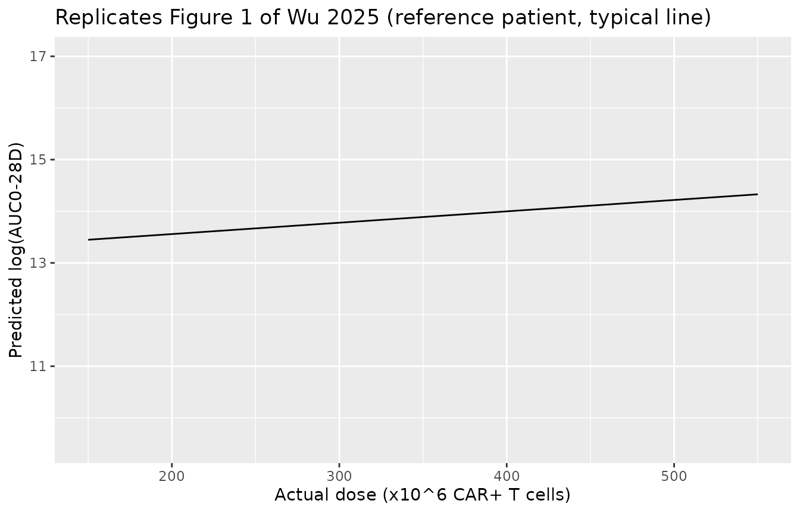
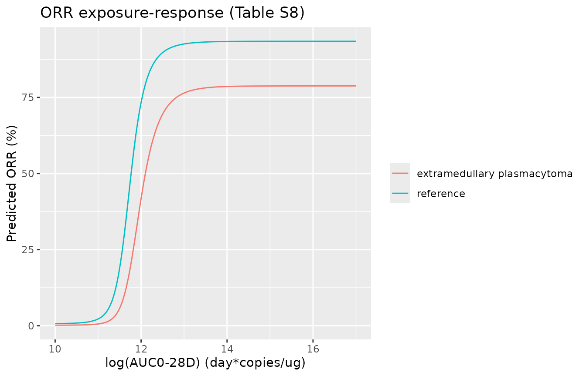
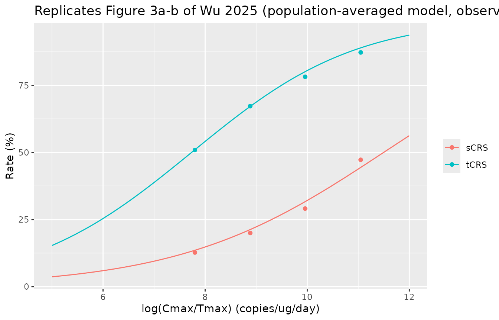
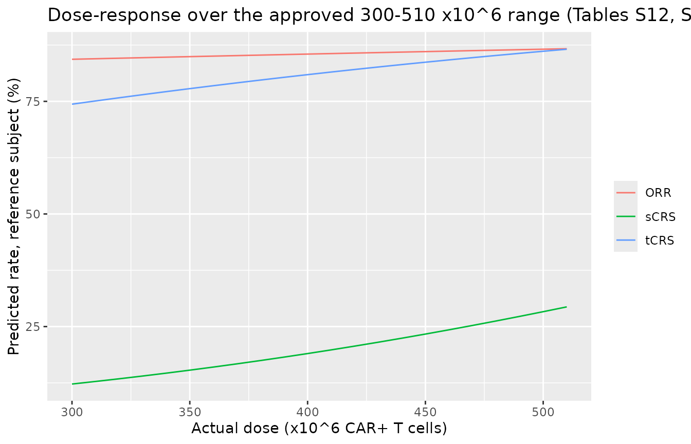

# Idecabtagene vicleucel dose-exposure and exposure-response in KarMMa-3 (Wu 2025)

## Models and source

Wu F, Zheng X, Burnett J, Masilamani M, Zhang W, Zhong X, Caia A, Cook
M, Piasecki J, Kondic A, Lamba M, Zhou J. Characterizing cellular
expansion of idecabtagene vicleucel and association with clinical
efficacy and safety in patients with triple-class-exposed
relapsed/refractory multiple myeloma. *J Clin Pharmacol.*
2025;65(11):1568-1576.
[doi:10.1002/jcph.70075](https://doi.org/10.1002/jcph.70075).

Idecabtagene vicleucel (ide-cel) is a BCMA-directed CAR T-cell product
given as one infusion. Wu 2025 summarised the in-vivo expansion of the
cells in the ide-cel arm of the phase 3 KarMMa-3 trial by
noncompartmental analysis of the peripheral-blood transgene level
(copies per microgram of genomic DNA, droplet digital PCR), and then
fitted a set of regressions:

| Model | Kind | End point | Exposure / driver | Source |
|----|----|----|----|----|
| `Wu_2025_idecabtageneVicleucel_auc` | linear regression | log(AUC0-28D) | actual dose | Table S4 |
| `Wu_2025_idecabtageneVicleucel_pfs` | Cox PH | progression-free survival | log2(AUC0-28D) | Table S7 |
| `Wu_2025_idecabtageneVicleucel_orr` | sigmoid Emax logistic | overall response (IRC) | log(AUC0-28D) | Table S8 |
| `Wu_2025_idecabtageneVicleucel_crs_anti_il6` | linear logistic | CRS requiring tocilizumab or siltuximab (tCRS) | log(Cmax/Tmax) | Table S10 |
| `Wu_2025_idecabtageneVicleucel_crs_corticosteroid` | linear logistic | CRS requiring corticosteroids (sCRS) | log(Cmax/Tmax) | Table S11 |
| `Wu_2025_idecabtageneVicleucel_dose_orr` | linear logistic | overall response (IRC) | actual dose | Table S12 |
| `Wu_2025_idecabtageneVicleucel_dose_pfs` | Cox PH | progression-free survival | actual dose | Table S13 |
| `Wu_2025_idecabtageneVicleucel_dose_crs_anti_il6` | linear logistic | tCRS | actual dose | Table S14 |
| `Wu_2025_idecabtageneVicleucel_dose_crs_corticosteroid` | linear logistic | sCRS | actual dose | Table S15 |

None of the models has a cellular kinetic layer or an ODE. The exposure
metrics are data columns: `AUC_IDECEL_DDPCR` (AUC0-28D, day\*copies/ug)
for efficacy and `EXPANSION_RATE_IDECEL` (Cmax/Tmax, copies/ug/day) for
safety, which the authors chose as an early exposure measure because CRS
starts within days. The dose models use the actual infused dose
`DOSE_IDECEL_MCELLS` (10^6 CAR+ T cells) as a covariate column, not as a
dosing event.

The library also carries the phase 2 KarMMa exposure-response models of
Connarn 2023 (`Connarn_2023_idecabtageneVicleucel_*`). Wu 2025 notes
that the two trials quantified the transgene with different
bioanalytical methods and does not compare their exposure values
directly. The two exposures therefore use separate columns: `AUC_IDECEL`
holds the KarMMa quantitative-PCR AUC0-28 for the Connarn models, and
`AUC_IDECEL_DDPCR` holds the KarMMa-3 droplet digital PCR AUC0-28D for
the Wu models, so a value measured with one assay is not fed to a model
fitted to the other.

``` r

mod_auc <- rxode2::rxode(readModelDb("Wu_2025_idecabtageneVicleucel_auc"))
mod_pfs <- rxode2::rxode(readModelDb("Wu_2025_idecabtageneVicleucel_pfs"))
mod_orr <- rxode2::rxode(readModelDb("Wu_2025_idecabtageneVicleucel_orr"))
mod_tcrs <- rxode2::rxode(readModelDb("Wu_2025_idecabtageneVicleucel_crs_anti_il6"))
mod_scrs <- rxode2::rxode(readModelDb("Wu_2025_idecabtageneVicleucel_crs_corticosteroid"))
mod_d_orr <- rxode2::rxode(readModelDb("Wu_2025_idecabtageneVicleucel_dose_orr"))
mod_d_pfs <- rxode2::rxode(readModelDb("Wu_2025_idecabtageneVicleucel_dose_pfs"))
mod_d_tcrs <- rxode2::rxode(readModelDb("Wu_2025_idecabtageneVicleucel_dose_crs_anti_il6"))
mod_d_scrs <- rxode2::rxode(readModelDb("Wu_2025_idecabtageneVicleucel_dose_crs_corticosteroid"))
```

## Population

KarMMa-3 (NCT03651128) randomised adults with triple-class-exposed
relapsed/refractory multiple myeloma after two to four prior regimens
2:1 to ide-cel or a standard regimen. In the ide-cel arm, 225 patients
were infused by the 1 March 2022 cellular-kinetic cutoff; 220 had
evaluable exposure parameters and form the dose-exposure and
exposure-response analysis set, while the exploratory dose-response
models use all 225. Table S3 describes the 220: median age 63 years
(range 30-81), median weight 83 kg (41.1-144), 37.7% female, 70% White,
31% / 37% / 31% with two / three / four prior regimens, 61.8%
triple-class refractory, 23.6% with extramedullary plasmacytoma, 61.4%
anti-CAR antibody positive after infusion, and 26% infused with
Formulation B.

``` r

str(mod_orr$population, max.level = 1)
#> List of 12
#>  $ species       : chr "human"
#>  $ n_subjects    : int 220
#>  $ n_studies     : int 1
#>  $ n_observations: chr "220 binary outcomes (180 responders, 81.8%; Table S6)"
#>  $ age_range     : chr "30-81 years (median 63; 43% aged 65 or older)"
#>  $ weight_range  : chr "41.1-144 kg (median 83)"
#>  $ sex_female_pct: num 37.7
#>  $ race_ethnicity: Named num [1:5] 70 7.3 2.3 0.9 19.5
#>   ..- attr(*, "names")= chr [1:5] "White" "Black" "Asian" "Other" ...
#>  $ disease_state : chr "Triple-class-exposed relapsed/refractory multiple myeloma after two to four prior regimens with progression wit"| __truncated__
#>  $ dose_range    : chr "Single IV infusion; target 150-450 x 10^6 CAR+ T cells (up to 540 x 10^6 permitted)"
#>  $ regions       : chr "International (KarMMa-3, NCT03651128)"
#>  $ notes         : chr "Ide-cel arm of KarMMa-3, CK data cutoff 1 March 2022. Observed ORR by AUC0-28D quartile (Figure S7): about 56%,"| __truncated__
```

## Source trace

Every coefficient is printed in a Supporting Information table. The
trailing comment on each `ini()` line in the model files names the table
row.

| Model | Parameters | Source |
|----|----|----|
| `_auc` | intercept 13.1186; dose 0.0022; log ferritin 0.0458; weight -0.0111; log sBCMA 0.1615; Formulation B -0.3939; 3 / 4 vs 2 prior regimens -0.1576 / -0.2029; log IL-15 0.5157; extramedullary plasmacytoma -0.5036; ADA +0.4621 | Table S4 |
| `_auc` | centring: ferritin 163 ug/L, sBCMA 144.5 ng/mL, IL-15 43 pg/mL, weight 75 kg | Table S5 note |
| `_pfs` | 14 log hazard ratios (log2 AUC0-28D -0.43, …) | Table S7 |
| `_orr` | E0 -5 (fixed), Emax 7.654, Hill 34.006, EC50 11.551, sex 0.121, Formulation B -0.19, prior regimens 0.03 / -0.005, extramedullary plasmacytoma -1.343 | Table S8; E0 fixed per Results |
| `_crs_anti_il6` | intercept -4.5924, log(Cmax/Tmax) 0.6551, Formulation B 0.0972, prior regimens -0.1757 / 0.3399, ADA -0.8765 | Table S10 |
| `_crs_corticosteroid` | intercept -6.1186, log(Cmax/Tmax) 0.506, formulation 0.277, prior regimens 0.4423 / 0.2028 | Table S11 |
| `_dose_orr` | 9 coefficients | Table S12 |
| `_dose_pfs` | 13 log hazard ratios | Table S13 |
| `_dose_crs_anti_il6` | 9 coefficients | Table S14 |
| `_dose_crs_corticosteroid` | 8 coefficients | Table S15 |
| logistic models | `addSd_prob_*` 0.001 (fixed) | not from the source (Bernoulli likelihood) |

| Equation | Source |
|----|----|
| `h(t) = h0(t) exp(b1 log2(AUC0-28D) + b2 COV)` | Methods, first equation |
| `logit(P) = b0 + b1 log(X) + b2 COV`, X = AUC0-28D (ORR) or Cmax/Tmax (tCRS, sCRS) | Methods, second equation |
| sigmoid Emax with E0 fixed at -5 for ORR | Results, ORR model |
| natural-log-transformed AUC0-28D in the dose-exposure model | Results, CK characterisation |

## Helper

A static model has no states and no doses, so every covariate row can be
an observation record of a single subject; `time` only orders the rows.

``` r

solve_static <- function(model, covs) {
  ev <- covs |> mutate(id = 1L, time = seq_len(n()), evid = 0L, amt = 0)
  out <- as.data.frame(rxode2::rxSolve(model, events = ev, returnType = "data.frame"))
  stopifnot(nrow(out) == nrow(covs))
  out
}

# Reference subject of every model: female, Formulation A, two prior
# regimens, no extramedullary plasmacytoma, ADA-negative, not triple-class
# refractory, no steroid or anti-CD38 in the last regimen, continuous
# covariates at their reference values.
ref_covs <- data.frame(
  SEXF = 1, FORM_IDECEL_B = 0, LINE_4L = 0, LINE_5L = 0, DIS_EMD = 0,
  ADA_POS = 0, REFRACTORY_TRIPLE_CLASS = 0, LAST_PRIOR_CORTICOSTEROID = 0,
  LAST_PRIOR_ANTICD38 = 0, WT = 75, FERRITIN_BL = 163, SBCMA = 144.5,
  IL15 = 43, TNFA = 27, SCD137 = 0.105, DOSE_IDECEL_MCELLS = 450,
  AUC_IDECEL_DDPCR = 1.3e6, EXPANSION_RATE_IDECEL = 1.35e4
)
with_ref <- function(...) {
  x <- data.frame(...)
  cbind(x, ref_covs[rep(1, nrow(x)), setdiff(names(ref_covs), names(x)), drop = FALSE])
}

# Expected value over the categorical covariates of the analysis set
# (Table S3), treated as independent: sex, formulation (57 / 216 with a
# known formulation were B), prior regimens 69 / 82 / 69, extramedullary
# plasmacytoma 52 / 220, post-infusion ADA 135 / 220.
cat_grid <- expand.grid(
  SEXF = 0:1, FORM_IDECEL_B = 0:1, nreg = 2:4, DIS_EMD = 0:1, ADA_POS = 0:1
) |>
  mutate(
    LINE_4L = as.integer(nreg == 3), LINE_5L = as.integer(nreg == 4),
    w = ifelse(SEXF == 1, 83 / 220, 137 / 220) *
      ifelse(FORM_IDECEL_B == 1, 57 / 216, 159 / 216) *
      c(69, 82, 69)[nreg - 1] / 220 *
      ifelse(DIS_EMD == 1, 52 / 220, 168 / 220) *
      ifelse(ADA_POS == 1, 135 / 220, 85 / 220)
  ) |>
  select(-nreg)
stopifnot(abs(sum(cat_grid$w) - 1) < 1e-12)

expected_prob <- function(model, output, exposure_col, exposure) {
  sapply(exposure, function(x) {
    covs <- cat_grid |> select(-w)
    covs[[exposure_col]] <- x
    covs <- cbind(covs, ref_covs[rep(1, nrow(covs)), setdiff(names(ref_covs), names(covs)), drop = FALSE])
    sum(solve_static(model, covs)[[output]] * cat_grid$w)
  })
}
```

## Gate 1: the dose-exposure model reproduces Table S5 and Figure 1

Table S5 prints, for each covariate of the dose-log(AUC0-28D) model, the
percent change in exposure at the 5th and 95th percentile of that
covariate relative to its reference value. Those percent changes depend
on the centring and on which logarithm is used, so reproducing them
confirms both.

``` r

s5 <- tribble(
  ~row, ~cov, ~value, ~published,
  "Ferritin 5th percentile", "FERRITIN_BL", 25.5, -8.144,
  "Ferritin 95th percentile", "FERRITIN_BL", 1836.25, 11.728,
  "Body weight 5th percentile", "WT", 54.97, 24.834,
  "Body weight 95th percentile", "WT", 115.845, -36.385,
  "Soluble BCMA 5th percentile", "SBCMA", 13.3, -31.967,
  "Soluble BCMA 95th percentile", "SBCMA", 487.4, 21.69,
  "IL-15 5th percentile", "IL15", 14, -43.936,
  "IL-15 95th percentile", "IL15", 100.4, 54.849,
  "Formulation B vs A", "FORM_IDECEL_B", 1, -32.557,
  "3 vs 2 prior regimens", "LINE_4L", 1, -14.58,
  "4 vs 2 prior regimens", "LINE_5L", 1, -18.366,
  "Extramedullary plasmacytoma", "DIS_EMD", 1, -39.567,
  "Post-infusion ADA positive", "ADA_POS", 1, 58.747
)
ref_auc <- solve_static(mod_auc, ref_covs)$auc0_28
s5$simulated <- sapply(seq_len(nrow(s5)), function(i) {
  covs <- ref_covs
  covs[[s5$cov[i]]] <- s5$value[i]
  100 * (solve_static(mod_auc, covs)$auc0_28 / ref_auc - 1)
})
s5 |>
  mutate(difference = simulated - published) |>
  select(-cov) |>
  rename(
    "Covariate level" = row, "Value" = value,
    "Published change (%)" = published, "Model change (%)" = simulated,
    "Difference (points)" = difference
  ) |>
  knitr::kable(digits = 3)
```

| Covariate level | Value | Published change (%) | Model change (%) | Difference (points) |
|:---|---:|---:|---:|---:|
| Ferritin 5th percentile | 25.500 | -8.144 | -8.145 | -0.001 |
| Ferritin 95th percentile | 1836.250 | 11.728 | 11.730 | 0.002 |
| Body weight 5th percentile | 54.970 | 24.834 | 24.899 | 0.065 |
| Body weight 95th percentile | 115.845 | -36.385 | -36.452 | -0.067 |
| Soluble BCMA 5th percentile | 13.300 | -31.967 | -31.973 | -0.006 |
| Soluble BCMA 95th percentile | 487.400 | 21.690 | 21.696 | 0.006 |
| IL-15 5th percentile | 14.000 | -43.936 | -43.937 | -0.001 |
| IL-15 95th percentile | 100.400 | 54.849 | 54.851 | 0.002 |
| Formulation B vs A | 1.000 | -32.557 | -32.558 | -0.001 |
| 3 vs 2 prior regimens | 1.000 | -14.580 | -14.581 | -0.001 |
| 4 vs 2 prior regimens | 1.000 | -18.366 | -18.364 | 0.002 |
| Extramedullary plasmacytoma | 1.000 | -39.567 | -39.565 | 0.002 |
| Post-infusion ADA positive | 1.000 | 58.747 | 58.740 | -0.007 |

``` r

# The coefficients are printed to four decimals, so the largest gap (body
# weight, -0.0111 per kg) is a rounding effect of under 0.1 point.
stopifnot(all(abs(s5$simulated - s5$published) < 0.1))
```

Figure 1 draws the dose-log(AUC0-28D) line for the reference patient; it
runs from about 13.5 at 170 x 10^6 cells to about 14.3 at 530 x 10^6
cells. The dose therefore enters uncentred, while every other covariate
is centred.

``` r

dose_grid <- seq(150, 550, by = 10)
fig1 <- solve_static(mod_auc, with_ref(DOSE_IDECEL_MCELLS = dose_grid))
fig1_ends <- fig1$lauc0_28[dose_grid %in% c(170, 530)]
fig1_ends
#> [1] 13.4926 14.2846
stopifnot(abs(fig1_ends - c(13.5, 14.3)) < 0.1)

ggplot(data.frame(dose = dose_grid, lauc = fig1$lauc0_28), aes(dose, lauc)) +
  geom_line() +
  coord_cartesian(ylim = c(9.5, 17)) +
  labs(
    x = "Actual dose (x10^6 CAR+ T cells)", y = "Predicted log(AUC0-28D)",
    title = "Replicates Figure 1 of Wu 2025 (reference patient, typical line)"
  )
```



The dose slope is 0.0022 per 10^6 cells, so the whole approved range of
300-510 x 10^6 cells moves the typical log(AUC0-28D) by 0.46, a 59%
change, which is smaller than the effect of a single categorical
covariate such as extramedullary plasmacytoma. This is the flat
dose-exposure relationship the paper uses to support the extended dose
range.

## Gate 2: the ORR sigmoid model reproduces the Figure S7 plateau

Table S8 prints back-transformed estimates (Emax 7.654, Hill 34.006,
EC50 11.551) next to 95% confidence intervals on the log scale
(log(7.654) = 2.035 lies in 1.9-2.17). The exposure is log(AUC0-28D), as
in the KarMMa model of Connarn 2023, so EC50 corresponds to an AUC0-28D
of about 10^{5} day\*copies/ug, and a Hill coefficient of 34 on that
scale makes the switch close to a step.

The model reads Emax as the increment on the logit,
`logit(P) = E0 + Emax * f`, so the reference-subject plateau is
`expit(-5 + 7.654)` = 93%. The alternative reading, Emax as the logit at
full effect, would put the plateau at `expit(7.654)` = 99.95%. The
Figure S7 VPC shows observed ORR of about 89%, 91% and 94% in AUC0-28D
quartiles 2-4, all far above EC50, with model-predicted medians near
91%; only the increment reading reproduces that.

``` r

# Representative log(AUC0-28D) of quartiles 2-4: log-midpoints of the
# Figure 2a / S7 quartile bounds (0.4-1.3, 1.3-2.7, 2.7-17.8 x 10^6).
q_lnauc <- c(Q2 = mean(log(c(0.4e6, 1.3e6))), Q3 = mean(log(c(1.3e6, 2.7e6))), Q4 = mean(log(c(2.7e6, 17.8e6))))
orr_pred <- 100 * expected_prob(mod_orr, "prob_orr_central", "AUC_IDECEL_DDPCR", exp(q_lnauc))
orr_obs <- c(Q2 = 89, Q3 = 91, Q4 = 94.5) # Figure S7 observed points, digitised
orr_alt <- 100 * sum(cat_grid$w * plogis(7.654 + 0.121 * (1 - cat_grid$SEXF) -
  0.19 * cat_grid$FORM_IDECEL_B + 0.03 * cat_grid$LINE_4L -
  0.005 * cat_grid$LINE_5L - 1.343 * cat_grid$DIS_EMD))
data.frame(
  quartile = names(q_lnauc), observed = orr_obs, model = orr_pred,
  emax_as_full_effect_logit = orr_alt, row.names = NULL
) |>
  rename(
    "AUC0-28D quartile" = quartile, "Observed ORR (%)" = observed,
    "Model, increment Emax (%)" = model,
    "Alternative, Emax as full-effect logit (%)" = emax_as_full_effect_logit
  ) |>
  knitr::kable(digits = 1)
```

| AUC0-28D quartile | Observed ORR (%) | Model, increment Emax (%) | Alternative, Emax as full-effect logit (%) |
|:---|---:|---:|---:|
| Q2 | 89.0 | 89.9 | 99.9 |
| Q3 | 91.0 | 90.2 | 99.9 |
| Q4 | 94.5 | 90.2 | 99.9 |

``` r

stopifnot(
  abs(mean(orr_pred) - mean(orr_obs)) < 4,
  orr_alt > 99
)
```

The lowest quartile (AUC0-28D below 0.4 x 10^6, observed ORR about 56%)
straddles EC50, so its predicted rate depends on how many of its
patients fall below 1.0 x 10^5, which the paper does not tabulate; it is
not gated here.

``` r

lnauc_grid <- seq(10, 17, by = 0.02)
orr_curve <- solve_static(mod_orr, with_ref(AUC_IDECEL_DDPCR = exp(lnauc_grid)))
orr_curve_emd <- solve_static(mod_orr, with_ref(AUC_IDECEL_DDPCR = exp(lnauc_grid), DIS_EMD = 1))
bind_rows(
  data.frame(lnauc = lnauc_grid, p = orr_curve$prob_orr_central, who = "reference"),
  data.frame(lnauc = lnauc_grid, p = orr_curve_emd$prob_orr_central, who = "extramedullary plasmacytoma")
) |>
  ggplot(aes(lnauc, 100 * p, colour = who)) +
  geom_line() +
  labs(
    x = "log(AUC0-28D) (day*copies/ug)", y = "Predicted ORR (%)", colour = NULL,
    title = "ORR exposure-response (Table S8)"
  )
```



## Gate 3: the CRS models reproduce the Figure 3 quartile rates

Figure 3a/3b and Figures S8-S9 report tCRS and sCRS by quartile of the
expansion rate Cmax/Tmax (quartile bounds 0-0.4, 0.4-1.3, 1.4-3.2 and
3.4-11.6 x 10^4 copies/ug/day; 55 patients each). Each quartile is
represented by the log-midpoint of its bounds, except quartile 1, whose
lower bound is not printed; its median log(Cmax/Tmax), 7.8, is read off
Figure 3. The categorical covariates are averaged over their Table S3
distribution.

``` r

q_ler <- c(Q1 = 7.8, Q2 = mean(log(c(4e3, 1.3e4))), Q3 = mean(log(c(1.4e4, 3.2e4))), Q4 = mean(log(c(3.4e4, 1.16e5))))
crs <- data.frame(
  quartile = names(q_ler),
  tcrs_obs = 100 * c(28, 37, 43, 48) / 55,
  tcrs_model = 100 * expected_prob(mod_tcrs, "prob_crs_anti_il6", "EXPANSION_RATE_IDECEL", exp(q_ler)),
  scrs_obs = 100 * c(7, 11, 16, 26) / 55,
  scrs_model = 100 * expected_prob(mod_scrs, "prob_crs_corticosteroid", "EXPANSION_RATE_IDECEL", exp(q_ler)),
  row.names = NULL
)
crs |>
  rename(
    "Cmax/Tmax quartile" = quartile, "tCRS observed (%)" = tcrs_obs,
    "tCRS model (%)" = tcrs_model, "sCRS observed (%)" = scrs_obs,
    "sCRS model (%)" = scrs_model
  ) |>
  knitr::kable(digits = 1)
```

| Cmax/Tmax quartile | tCRS observed (%) | tCRS model (%) | sCRS observed (%) | sCRS model (%) |
|:---|---:|---:|---:|---:|
| Q1 | 50.9 | 51.0 | 12.7 | 13.6 |
| Q2 | 67.3 | 67.2 | 20.0 | 21.3 |
| Q3 | 78.2 | 80.1 | 29.1 | 31.7 |
| Q4 | 87.3 | 89.0 | 47.3 | 44.4 |

``` r

# Observed quartile counts carry a binomial SE of 5-7 points with n = 55.
stopifnot(
  all(abs(crs$tcrs_model - crs$tcrs_obs) < 6),
  all(abs(crs$scrs_model - crs$scrs_obs) < 6)
)
```

``` r

ler_grid <- seq(5, 12, by = 0.05)
bind_rows(
  data.frame(ler = ler_grid, p = expected_prob(mod_tcrs, "prob_crs_anti_il6", "EXPANSION_RATE_IDECEL", exp(ler_grid)), endpoint = "tCRS"),
  data.frame(ler = ler_grid, p = expected_prob(mod_scrs, "prob_crs_corticosteroid", "EXPANSION_RATE_IDECEL", exp(ler_grid)), endpoint = "sCRS")
) |>
  ggplot(aes(ler, 100 * p, colour = endpoint)) +
  geom_line() +
  geom_point(
    data = crs |> select(quartile, tcrs_obs, scrs_obs) |>
      pivot_longer(-quartile, names_to = "endpoint", values_to = "pct") |>
      mutate(endpoint = ifelse(endpoint == "tcrs_obs", "tCRS", "sCRS"), ler = q_ler[quartile]),
    aes(ler, pct, colour = endpoint)
  ) +
  labs(
    x = "log(Cmax/Tmax) (copies/ug/day)", y = "Rate (%)", colour = NULL,
    title = "Replicates Figure 3a-b of Wu 2025 (population-averaged model, observed quartiles)"
  )
```



## Gate 4: the Cox models return the published hazard ratios

A Cox regression has no baseline hazard, so these models return the
relative hazard against their reference subject. For the AUC0-28D term
the reference is 1.3 x 10^6 day\*copies/ug, the median quartile boundary
in Figure 2a; moving it changes which subject has `hr = 1` but no hazard
ratio between subjects.

``` r

pfs_hr <- function(model, ...) solve_static(model, with_ref(...))$hr
hr_checks <- data.frame(
  contrast = c(
    "AUC0-28D doubled", "Post-infusion ADA positive", "Formulation B",
    "Triple-class refractory", "Soluble BCMA doubled",
    "Dose +100 x10^6 cells (dose model)", "TNF-alpha doubled (dose model)"
  ),
  model = c(
    pfs_hr(mod_pfs, AUC_IDECEL_DDPCR = 2.6e6), pfs_hr(mod_pfs, ADA_POS = 1),
    pfs_hr(mod_pfs, FORM_IDECEL_B = 1), pfs_hr(mod_pfs, REFRACTORY_TRIPLE_CLASS = 1),
    pfs_hr(mod_pfs, SBCMA = 289), pfs_hr(mod_d_pfs, DOSE_IDECEL_MCELLS = 550),
    pfs_hr(mod_d_pfs, TNFA = 54)
  ),
  published = exp(c(-0.43, -0.89, -0.67, 0.61, 0.28, -0.003 * 100, 0.406))
)
hr_checks |>
  rename("Contrast vs reference" = contrast, "Model HR" = model, "exp(Table S7 / S13 coefficient)" = published) |>
  knitr::kable(digits = 3)
```

| Contrast vs reference | Model HR | exp(Table S7 / S13 coefficient) |
|:---|---:|---:|
| AUC0-28D doubled | 0.651 | 0.651 |
| Post-infusion ADA positive | 0.411 | 0.411 |
| Formulation B | 0.512 | 0.512 |
| Triple-class refractory | 1.840 | 1.840 |
| Soluble BCMA doubled | 1.323 | 1.323 |
| Dose +100 x10^6 cells (dose model) | 0.741 | 0.741 |
| TNF-alpha doubled (dose model) | 1.501 | 1.501 |

``` r

stopifnot(all(abs(hr_checks$model / hr_checks$published - 1) < 1e-8))
```

Each doubling of AUC0-28D lowers the hazard of progression or death by
35%; over the interquartile range of AUC0-28D (0.4 to 2.7 x 10^6, Figure
2a) that is a hazard ratio of 0.31, consistent with the separation of
the lowest-quartile Kaplan-Meier curve in Figure 2a.

## Gate 5: the dose-response models are flat and reproduce the observed rates

The exploratory dose-response logistic models carry no exposure term, so
their population-averaged prediction at the KarMMa-3 doses must match
the observed event rates (for a fitted logistic regression with an
intercept, the mean fitted probability equals the observed rate). A
virtual cohort of 200 patients is drawn from the Table S3 distributions
(weight normal 83.1 +/- 18.3 kg truncated to 41-144 kg; soluble BCMA
log-normal with median 143 ng/mL and mean 184 ng/mL; doses uniform over
350-530 x 10^6 cells, the span of the Figure 1 scatter) and compared
with the analysis-set rates (ORR 180 / 220, tCRS 156 / 220, sCRS 60 /
220).

``` r

set.seed(20251106)
n <- 200
cohort <- data.frame(
  SEXF = rbinom(n, 1, 83 / 220),
  WT = pmin(pmax(rnorm(n, 83.1, 18.3), 41.1), 144),
  SBCMA = pmin(pmax(exp(rnorm(n, log(143), sqrt(2 * log(184 / 143)))), 1.8), 789),
  FORM_IDECEL_B = rbinom(n, 1, 57 / 216),
  nreg = sample(2:4, n, replace = TRUE, prob = c(69, 82, 69)),
  DIS_EMD = rbinom(n, 1, 52 / 220),
  ADA_POS = rbinom(n, 1, 135 / 220),
  DOSE_IDECEL_MCELLS = runif(n, 350, 530)
) |>
  mutate(LINE_4L = as.integer(nreg == 3), LINE_5L = as.integer(nreg == 4)) |>
  select(-nreg)
cohort_full <- cbind(cohort, ref_covs[rep(1, n), setdiff(names(ref_covs), names(cohort)), drop = FALSE])
dose_rates <- data.frame(
  endpoint = c("ORR", "tCRS", "sCRS"),
  observed = 100 * c(180, 156, 60) / 220,
  model = 100 * c(
    mean(solve_static(mod_d_orr, cohort_full)$prob_orr_central),
    mean(solve_static(mod_d_tcrs, cohort_full)$prob_crs_anti_il6),
    mean(solve_static(mod_d_scrs, cohort_full)$prob_crs_corticosteroid)
  )
)
dose_rates |>
  rename("End point" = endpoint, "Observed rate (%)" = observed, "Virtual-cohort mean (%)" = model) |>
  knitr::kable(digits = 1)
```

| End point | Observed rate (%) | Virtual-cohort mean (%) |
|:----------|------------------:|------------------------:|
| ORR       |              81.8 |                    79.3 |
| tCRS      |              70.9 |                    70.9 |
| sCRS      |              27.3 |                    27.3 |

``` r

stopifnot(all(abs(dose_rates$model - dose_rates$observed) < 8))
```

``` r

dgrid <- seq(300, 510, by = 10)
bind_rows(
  data.frame(dose = dgrid, p = solve_static(mod_d_orr, with_ref(DOSE_IDECEL_MCELLS = dgrid))$prob_orr_central, endpoint = "ORR"),
  data.frame(dose = dgrid, p = solve_static(mod_d_tcrs, with_ref(DOSE_IDECEL_MCELLS = dgrid))$prob_crs_anti_il6, endpoint = "tCRS"),
  data.frame(dose = dgrid, p = solve_static(mod_d_scrs, with_ref(DOSE_IDECEL_MCELLS = dgrid))$prob_crs_corticosteroid, endpoint = "sCRS")
) |>
  ggplot(aes(dose, 100 * p, colour = endpoint)) +
  geom_line() +
  labs(
    x = "Actual dose (x10^6 CAR+ T cells)", y = "Predicted rate, reference subject (%)",
    colour = NULL, title = "Dose-response over the approved 300-510 x10^6 range (Tables S12, S14, S15)"
  )
```



## PKNCA

Not applicable. These are static regressions on per-subject exposure
summaries that the authors computed by noncompartmental analysis of
observed transgene levels; no model in this paper predicts a transgene
time course, so there is nothing to submit to PKNCA. The library’s
mechanistic ide-cel model, `Singh_2021_idecabtageneVicleucel_human`,
simulates CAR T cells in cells rather than transgene copies per
microgram of DNA and cannot supply these exposure columns directly.

## Assumptions and deviations

- **PFS exposure-response model is the full model.** Table S7 prints the
  full multivariable Cox model. The Results state that backward
  elimination then removed last prior anti-CD38 therapy and baseline
  soluble CD137, but the refitted final coefficients are not printed
  anywhere, so the library carries the full model as published,
  including those two terms.
- **Emax is an increment on the logit.** The paper prints no sigmoid
  Emax equation. Gate 2 shows that only `logit(P) = E0 + Emax * f`
  reproduces the Figure S7 plateau.
- **Back-transformed Table S8 estimates.** Emax, Hill and EC50 are
  encoded as the natural logs of the printed estimates, the scale on
  which their printed 95% confidence intervals lie.
- **Cox reference values.** Continuous covariates of the Cox models are
  centred on the medians the paper reports (ferritin 163 ug/L and sBCMA
  144.5 ng/mL from Table S5; TNF-alpha 27 pg/mL and sCD137 0.105 ng/mL
  from Table S3). The AUC0-28D median is not printed; 1.3 x 10^6
  day\*copies/ug, the Q2/Q3 boundary of Figure 2a, is used. The dose Cox
  model is referenced to 450 x 10^6 cells and 75 kg. None of these
  choices changes a hazard ratio.
- **TNF-alpha in the dose PFS model is on the log2 scale.** Table S13
  labels the row ‘Baseline TNF-alpha (pg/mL)’ without a transform; per
  pg/mL the coefficient 0.406 would imply hazard ratios above 10^26
  across the observed range, and the same covariate is log2 in Table S7.
- **Centring of the dose-response logistic models.** The paper does not
  state it. The dose is uncentred (the intercept-plus-dose term
  reproduces the observed rates only that way), and body weight and log
  sBCMA are centred on 75 kg and 144.5 ng/mL, the reference values Table
  S5 gives for the dose-exposure model. Centring weight on the 83 kg
  median instead would move the logits by 0.15-0.20; Gate 5 cannot
  distinguish the two.
- **Formulation in the sCRS model.** Table S11 labels the row
  ‘Formulation (sLVV vs aLVV)’, while every other table and the Results
  compare Formulation B with A. The model reads it as the same
  Formulation B indicator.
- **Post-infusion ADA status is a post-baseline covariate** (positive at
  any visit after the infusion, mostly from month 3). The authors
  caution that it may mark longer follow-up rather than cause higher
  exposure, longer PFS or less tCRS; a simulation that draws it
  independently of outcome inherits that confounding.
- **Bernoulli likelihood.** The logistic models carry a fixed additive
  residual of 0.001 on the probability only so that rxode2 can attach an
  error model; it is not a published quantity. The dose-exposure
  regression’s residual standard deviation is not reported, so that
  model declares no endpoint.
- **Not extracted.** No regression was fitted for duration of response,
  MRD-negative complete response, all-grade or grade 3+ CRS,
  neurotoxicity or cytopenia (graphical analyses only, Figures 2-3).
