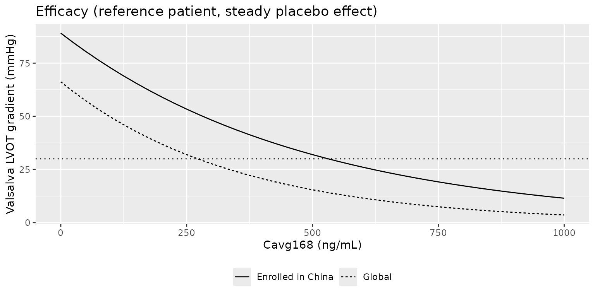
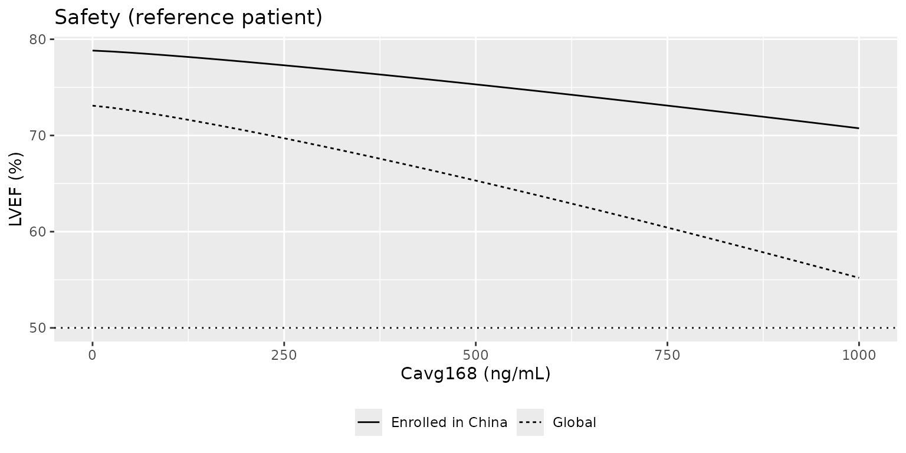
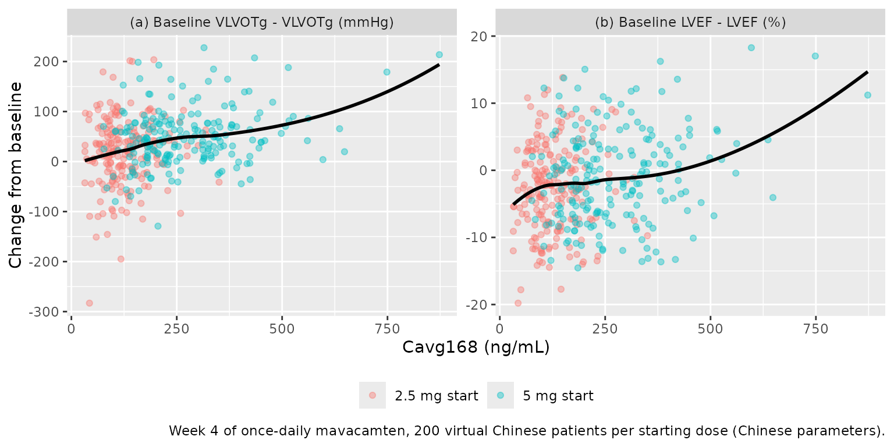

# Mavacamten exposure-response in Chinese patients for LVOT gradient and LVEF (Wu 2025)

## Model and source

Wu 2025 refitted the two mavacamten exposure-response (E-R) models of
Merali 2024 after adding 81 Chinese patients with obstructive
hypertrophic cardiomyopathy (HCM) from EXPLORER-CN: the Valsalva left
ventricular outflow tract gradient (VLVOTg, efficacy) and the left
ventricular ejection fraction (LVEF, safety). Both are driven by
Cavg168, the average mavacamten plasma concentration over the week
before the echocardiogram. The population PK model was tested for an
ethnicity effect, found none, and was kept unchanged; it is packaged as
`Chang_2024_mavacamten`. The models were then used to choose the
echocardiography-guided titration regimen for Chinese patients, which
starts at 2.5 mg once daily instead of the 5 mg of the US label.

- Citation: Wu X, Puli S, Chen N, Tian Z, Hsu P, Sun J, Lyu C, Merali S,
  Zhang J. Model-informed recommendation of mavacamten posology for
  Chinese adults with obstructive hypertrophic cardiomyopathy. CPT
  Pharmacometrics Syst Pharmacol. 2025;14(4):751.
  <doi:10.1002/psp4.13312>. PMID: 39871653. PMCID: PMC12001263.
- Efficacy model: Exposure-response (efficacy) model for the Valsalva
  left ventricular outflow tract (LVOT) peak gradient in adults with
  obstructive hypertrophic cardiomyopathy, refitted with Chinese
  EXPLORER-CN patients added to the Merali 2024 analysis set (Wu 2025).
  The gradient is the individual baseline value VLVOTg0, times an
  exponential placebo time course that declines to a fixed 85.1% of
  baseline, times exp(-kMAVA \* Cavg168), where Cavg168 (CAV) is the
  average mavacamten plasma concentration over the 168 h before the
  echocardiogram, supplied from a population PK model such as
  Chang_2024_mavacamten. The observed baseline gradient enters VLVOTg0
  and kMAVA, and baseline NT-proBNP enters VLVOTg0, as power terms;
  enrolment in China raises VLVOTg0 and lowers kMAVA. Correlated
  log-normal IIV on VLVOTg0 and kMAVA and an exponential residual error.
  The paired safety model is Wu_2025_mavacamten_lvef.
- Safety model: Exposure-response (safety) model for left ventricular
  ejection fraction (LVEF) in adults with hypertrophic cardiomyopathy
  given mavacamten or placebo, refitted with Chinese EXPLORER-CN
  patients added to the Merali 2024 analysis set (Wu 2025). LVEF is the
  individual baseline value LVEF0 times (1 - kMAVA \* Cavg168^qq), where
  Cavg168 (CAV) is the average mavacamten plasma concentration over the
  168 h before the echocardiogram, supplied from a population PK model
  such as Chang_2024_mavacamten; there is no placebo effect. The
  observed baseline LVEF, nonobstructive HCM, the
  septal-reduction-therapy patient type, female sex and enrolment in
  China enter LVEF0; the septal-reduction- therapy patient type and
  enrolment in China lower kMAVA. Log-normal IIV on LVEF0 and kMAVA and
  a log-normal residual error. The paired efficacy model is
  Wu_2025_mavacamten_lvot_gradient_valsalva.
- Article: <https://doi.org/10.1002/psp4.13312> (open access)

The two models are separate files because the authors fitted them
separately, to different analysis sets. The earlier fits are
`Merali_2024_mavacamten_lvot_gradient_valsalva` and
`Merali_2024_mavacamten_lvef`.

## Population

The VLVOTg model was fitted to the Merali 2024 analysis set (272
patients with obstructive HCM in PIONEER-HCM, EXPLORER-HCM, PIONEER-OLE
and the EXPLORER-LTE cohort of MAVA-LTE) plus 81 Chinese patients from
EXPLORER-CN (NCT05174416), who contributed 514 VLVOTg observations. The
LVEF model was fitted to the Merali 2024 LVEF set (331 patients,
including 59 with nonobstructive HCM from MAVERICK-HCM) plus the same 81
Chinese patients, who contributed 519 LVEF observations. 13% of the
EXPLORER-CN mavacamten group were CYP2C19 poor metabolizers. Wu 2025
does not tabulate the demographics of the pooled analysis sets; the
patient counts in the model metadata are the sums above.

The same information is available programmatically via
`readModelDb("Wu_2025_mavacamten_lvef")()$population`.

## Source trace

| Equation / parameter | Value | Source location |
|----|----|----|
| `VLVOTg = VLVOTg0 * PBO(t) * exp(-kMAVA * Cavg168)` | – | Table 2, model equations |
| `PBO(t) = PBOMAX + (1 - PBOMAX) * exp(-kPBO * t)` | – | Table 2, model equations |
| `lrbase` (VLVOTg0, ref.) | log(77.8) | Table 2, ‘Log(VLVOTg0.REF), log(mmHg)’ |
| `e_lvot_gradient_valsalva_bl_rbase` | 0.365 | Table 2, ‘Log(VLVOTg0) ~ log(VLVOTg0/74.1)’ |
| `e_ntprobnp_rbase` | 0.12 | Table 2, ‘Log(VLVOTg0) ~ log(NT-proBNP/674)’ |
| `e_region_china_rbase` (VLVOTg) | 0.297 | Table 2, ‘Log(VLVOTg0) ~ log(Chinese)’ |
| `lslope` (kMAVA, ref.) | log(0.00291) | Table 2, ‘Log(kMAVA.REF), log(1/(ng/mL))’ |
| `e_lvot_gradient_valsalva_bl_slope` | 0.31 | Table 2, ‘Log(kMAVA) ~ log(VLVOTg0/74.1)’ |
| `e_region_china_slope` (VLVOTg) | -0.351 | Table 2, ‘Chinese on kMAVA’ |
| `lkpbo` | log(0.178 /week) | Table 2, ‘kPBO, 1/wk’ |
| `pbomax` | 0.851 (fixed) | Table 2, ‘VLVOTgPBOMAX’, and footnote |
| `etalrbase`, `etalslope` | 37%, 65.8% CV; r = 0.449 | Table 2, IIV rows |
| `expSd_lvot_gradient_valsalva` | 0.434 | Table 2, ‘Residual SD (exponential error)’ |
| `LVEF = LVEF0 * (1 - kMAVA * Cavg168^qq)` | – | Table 2, model equations |
| `lrbase` (LVEF0, ref.) | log(73.1) | Table 2, ‘LVEF0.REF, %’ |
| `e_lvef_bl_rbase` | 0.315 | Table 2, ‘LVEF0 ~ log(LVEF0/72.82), %’ |
| `e_dis_hcm_nonobstructive_rbase` | -5.67 / 100 | Table 2, ‘LVEF0 ~ nonobstructive HCM, %’ |
| `e_sexf_rbase` | 2.12 / 100 | Table 2, ‘LVEF0 ~ female, %’ |
| `e_dis_hcm_srt_rbase` | -6.17 / 100 | Table 2, ‘LVEF0 ~ SRT, %’ |
| `e_region_china_rbase` (LVEF) | 7.54 / 100 | Table 2, ‘LVEF0 ~ Chinese, %’ |
| `lslope` (kMAVA, ref.) | log(0.0000615) | Table 2, ‘Log(kMAVA.REF), 1/(ng/mL)’ |
| `e_dis_hcm_srt_slope` | -46.9 / 100 | Table 2, ‘Log(kMAVA.REF) ~ SRT (%)’ |
| `e_region_china_slope` (LVEF) | -87.1 / 100 | Table 2, ‘Log(kMAVA.REF) ~ Chinese (%)’ |
| `pow` (qq) | 1.20 | Table 2, ‘qqREF’ |
| `etalrbase`, `etalslope` | SD 3.86 / 100; 76.2% CV | Table 2, IIV rows |
| `expSd_lvef` | 4.61 / 100 | Table 2, ‘Residual SD’ |
| Reference patient | VLVOTg 74.1 mmHg, NT-proBNP 674 pg/mL; male with obstructive HCM, LVEF 72.82%; not Chinese | Table 2 footnote and row labels |

## Reference-patient exposure-response curves

With the random effects removed, the efficacy model a long time after
baseline (placebo effect fully developed) and the safety model are
evaluated over a grid of Cavg168 values for the reference patient and
for the same patient enrolled in China.

``` r

mod_vlvotg <- readModelDb("Wu_2025_mavacamten_lvot_gradient_valsalva")
mod_lvef <- readModelDb("Wu_2025_mavacamten_lvef")

cav_grid <- seq(0, 1000, by = 25)
ref_grid <- tidyr::expand_grid(REGION_CHINA = c(0, 1), CAV = cav_grid) |>
  mutate(
    id = 1L, evid = 0L,
    LVOT_GRADIENT_VALSALVA_BL = 74.1, NTPROBNP = 0.674,
    LVEF_BL = 72.82, DIS_HCM_NONOBSTRUCTIVE = 0, DIS_HCM_SRT = 0, SEXF = 0,
    # The efficacy grid sits at week 1000, where the placebo effect has
    # reached PBOMAX; time does not enter the LVEF model, so the whole grid
    # is one typical patient observed at successive nominal times.
    time = 1000 + seq_len(n()) * 1e-6,
    population = ifelse(REGION_CHINA == 1, "Enrolled in China", "Global")
  ) |>
  as.data.frame()

sim_ref_v <- rxode2::rxSolve(rxode2::zeroRe(mod_vlvotg), ref_grid,
  keep = c("CAV", "population")
) |>
  as.data.frame()
#> ℹ parameter labels from comments will be replaced by 'label()'
#> ℹ omega/sigma items treated as zero: 'etalrbase', 'etalslope'
sim_ref_l <- rxode2::rxSolve(rxode2::zeroRe(mod_lvef), ref_grid,
  keep = c("CAV", "population")
) |>
  as.data.frame()
#> ℹ parameter labels from comments will be replaced by 'label()'
#> ℹ omega/sigma items treated as zero: 'etalrbase', 'etalslope'

ggplot(sim_ref_v, aes(CAV, lvot_gradient_valsalva, linetype = population)) +
  geom_line() +
  geom_hline(yintercept = 30, linetype = "dotted") +
  labs(
    x = "Cavg168 (ng/mL)", y = "Valsalva LVOT gradient (mmHg)", linetype = NULL,
    title = "Efficacy (reference patient, steady placebo effect)"
  ) +
  theme(legend.position = "bottom")
```



``` r

ggplot(sim_ref_l, aes(CAV, lvef, linetype = population)) +
  geom_line() +
  geom_hline(yintercept = 50, linetype = "dotted") +
  labs(
    x = "Cavg168 (ng/mL)", y = "LVEF (%)", linetype = NULL,
    title = "Safety (reference patient)"
  ) +
  theme(legend.position = "bottom")
```



At the same exposure a patient enrolled in China starts from a higher
gradient and a higher LVEF and responds less steeply on both endpoints.

### Closed-form checks

The model output for the reference patient is recomputed from the Table
2 values directly.

``` r

closed_v <- function(cn) {
  exp(log(77.8) + 0.297 * cn) * 0.851 *
    exp(-exp(log(0.00291) - 0.351 * cn) * cav_grid)
}
closed_l <- function(cn) {
  exp(log(73.1) + 0.0754 * cn) *
    (1 - exp(log(0.0000615) - 0.871 * cn) * cav_grid^1.20)
}

model_at <- function(sim, col, cn, cav) {
  sim[[col]][sim$population == ifelse(cn == 1, "Enrolled in China", "Global") &
    sim$CAV == cav]
}

checks <- data.frame(
  Check = c(
    "VLVOTg at Cavg168 = 400 ng/mL, global (mmHg)",
    "VLVOTg at Cavg168 = 400 ng/mL, China (mmHg)",
    "LVEF at Cavg168 = 400 ng/mL, global (%)",
    "LVEF at Cavg168 = 400 ng/mL, China (%)"
  ),
  Model = c(
    model_at(sim_ref_v, "lvot_gradient_valsalva", 0, 400),
    model_at(sim_ref_v, "lvot_gradient_valsalva", 1, 400),
    model_at(sim_ref_l, "lvef", 0, 400),
    model_at(sim_ref_l, "lvef", 1, 400)
  ),
  Reference = c(
    closed_v(0)[cav_grid == 400], closed_v(1)[cav_grid == 400],
    closed_l(0)[cav_grid == 400], closed_l(1)[cav_grid == 400]
  )
)
checks |>
  mutate(across(c(Model, Reference), \(x) signif(x, 4))) |>
  knitr::kable(caption = "Typical-value model output against the Table 2 closed form.")
```

| Check                                        | Model | Reference |
|:---------------------------------------------|------:|----------:|
| VLVOTg at Cavg168 = 400 ng/mL, global (mmHg) | 20.67 |     20.67 |
| VLVOTg at Cavg168 = 400 ng/mL, China (mmHg)  | 39.27 |     39.27 |
| LVEF at Cavg168 = 400 ng/mL, global (%)      | 67.14 |     67.14 |
| LVEF at Cavg168 = 400 ng/mL, China (%)       | 76.13 |     76.13 |

Typical-value model output against the Table 2 closed form. {.table}

``` r


# Same parameters on both sides (model vs. hand formula): differences are
# floating-point only.
v_glob <- sim_ref_v$lvot_gradient_valsalva[sim_ref_v$population == "Global"]
v_cn <- sim_ref_v$lvot_gradient_valsalva[sim_ref_v$population == "Enrolled in China"]
l_glob <- sim_ref_l$lvef[sim_ref_l$population == "Global"]
l_cn <- sim_ref_l$lvef[sim_ref_l$population == "Enrolled in China"]
stopifnot(
  all(abs(v_glob - closed_v(0)) < 1e-6 * closed_v(0)),
  all(abs(v_cn - closed_v(1)) < 1e-6 * closed_v(1)),
  all(abs(l_glob - closed_l(0)) < 1e-6),
  all(abs(l_cn - closed_l(1)) < 1e-6)
)
```

### Covariate effects

``` r

th_v <- rxode2::rxode(mod_vlvotg)$theta
#> ℹ parameter labels from comments will be replaced by 'label()'
th_l <- rxode2::rxode(mod_lvef)$theta
#> ℹ parameter labels from comments will be replaced by 'label()'
cov_tab <- tibble::tribble(
  ~Parameter, ~Contrast, ~Ratio,
  "VLVOTg0", "baseline VLVOTg 40 vs 74.1 mmHg", (40 / 74.1)^th_v[["e_lvot_gradient_valsalva_bl_rbase"]],
  "VLVOTg0", "baseline VLVOTg 120 vs 74.1 mmHg", (120 / 74.1)^th_v[["e_lvot_gradient_valsalva_bl_rbase"]],
  "VLVOTg0", "NT-proBNP 3000 vs 674 pg/mL", (3 / 0.674)^th_v[["e_ntprobnp_rbase"]],
  "VLVOTg0", "China vs global", exp(th_v[["e_region_china_rbase"]]),
  "kMAVA (VLVOTg)", "baseline VLVOTg 120 vs 74.1 mmHg", (120 / 74.1)^th_v[["e_lvot_gradient_valsalva_bl_slope"]],
  "kMAVA (VLVOTg)", "China vs global", exp(th_v[["e_region_china_slope"]]),
  "LVEF0", "baseline LVEF 60 vs 72.82%", (60 / 72.82)^th_l[["e_lvef_bl_rbase"]],
  "LVEF0", "nonobstructive HCM vs obstructive HCM", exp(th_l[["e_dis_hcm_nonobstructive_rbase"]]),
  "LVEF0", "SRT patient type vs obstructive HCM", exp(th_l[["e_dis_hcm_srt_rbase"]]),
  "LVEF0", "female vs male", exp(th_l[["e_sexf_rbase"]]),
  "LVEF0", "China vs global", exp(th_l[["e_region_china_rbase"]]),
  "kMAVA (LVEF)", "SRT patient type vs obstructive HCM", exp(th_l[["e_dis_hcm_srt_slope"]]),
  "kMAVA (LVEF)", "China vs global", exp(th_l[["e_region_china_slope"]])
)
cov_tab |>
  mutate(Ratio = signif(Ratio, 3)) |>
  knitr::kable(caption = "Typical-value ratios implied by the Table 2 covariate effects.")
```

| Parameter      | Contrast                              | Ratio |
|:---------------|:--------------------------------------|------:|
| VLVOTg0        | baseline VLVOTg 40 vs 74.1 mmHg       | 0.798 |
| VLVOTg0        | baseline VLVOTg 120 vs 74.1 mmHg      | 1.190 |
| VLVOTg0        | NT-proBNP 3000 vs 674 pg/mL           | 1.200 |
| VLVOTg0        | China vs global                       | 1.350 |
| kMAVA (VLVOTg) | baseline VLVOTg 120 vs 74.1 mmHg      | 1.160 |
| kMAVA (VLVOTg) | China vs global                       | 0.704 |
| LVEF0          | baseline LVEF 60 vs 72.82%            | 0.941 |
| LVEF0          | nonobstructive HCM vs obstructive HCM | 0.945 |
| LVEF0          | SRT patient type vs obstructive HCM   | 0.940 |
| LVEF0          | female vs male                        | 1.020 |
| LVEF0          | China vs global                       | 1.080 |
| kMAVA (LVEF)   | SRT patient type vs obstructive HCM   | 0.626 |
| kMAVA (LVEF)   | China vs global                       | 0.419 |

Typical-value ratios implied by the Table 2 covariate effects. {.table}

## Linking to the PK model: the first four weeks in Chinese patients

Every regimen Wu 2025 simulated has its first titration decision at week
4 or later, so up to week 4 the regimens differ only in their starting
dose. The paper gives two week-4 views of Chinese patients:

- **Figure S1** simulates the EXPLORER-CN regimen (2.5 mg start) in the
  EXPLORER-CN patient population with a representative CYP2C19
  distribution and overlays the observed EXPLORER-CN data. Read from the
  figure by the maintainers, the simulated week-4 VLVOTg has a median of
  about 69 mmHg (5th to 95th percentile about 17.5 to 174 mmHg; observed
  median about 74 mmHg) and the simulated week-4 LVEF a median of about
  80.5%.
- **Table S5** reports one week-4 value for all the 2.5 mg starts
  (EXPLORER-CN and CN echo-guided regimens \#2 to \#6) and one for the 5
  mg start of regimen \#1 (the US label regimen), from 4000 virtual
  patients “constructed using a similar distribution of covariates as
  the analysis set”:

| Week 4             | 2.5 mg start | 5 mg start |
|--------------------|--------------|------------|
| VLVOTg \<= 30 mmHg | 27.50%       | 47.38%     |
| VLVOTg \<= 50 mmHg | 54.98%       | 73.72%     |
| LVEF \<= 50%       | 0.10%        | 0.60%      |

This section rebuilds the week-4 snapshot for 200 virtual
EXPLORER-CN-like patients per starting dose: mavacamten once daily for 4
weeks with `Chang_2024_mavacamten`, Cavg168 from PKNCA over the last
week (hours 504 to 672), then both E-R models at week 4 with their
random effects and residual error, as in the paper’s simulations. The
two arms share the same virtual patients.

``` r

# Base R draws the covariates; rxode2 draws the random effects.
set.seed(20250127)
rxode2::rxSetSeed(20250127)
n_pat <- 200L

# CYP2C19: 13% poor metabolizers (EXPLORER-CN, Methods); the remaining 87%
# split in the proportions of the Merali 2024 Table S1 representative mix.
pheno_levels <- c("PM", "IM", "NM", "RM", "UM")
other <- c(20.9, 49.3, 22.8, 3.0)
pheno_prob <- c(0.13, 0.87 * other / sum(other))

patients <- tibble::tibble(
  pat = seq_len(n_pat),
  phenotype = factor(sample(pheno_levels, n_pat, replace = TRUE, prob = pheno_prob),
    levels = pheno_levels
  ),
  WT = pmin(pmax(rnorm(n_pat, 70, 12), 45), 120),
  CRCL = pmin(pmax(rnorm(n_pat, 94.5, 18), 30), 150),
  SEXF = rbinom(n_pat, 1, 0.408),
  # EXPLORER-CN observed baseline gradient read from Figure S1: median about
  # 104 mmHg, 5th-95th percentile about 50-167 mmHg (log-scale SD 0.37)
  LVOT_GRADIENT_VALSALVA_BL = rlnorm(n_pat, log(104), 0.37),
  # EXPLORER-CN observed baseline LVEF read from Figure S1: median about 79.3%,
  # 5th-95th percentile about 66.8-86.1% (SD 5.9); entry required LVEF >= 55%
  LVEF_BL = pmin(pmax(rnorm(n_pat, 79.3, 5.9), 55), 90),
  # NT-proBNP in ng/mL, log-normal around the 674 pg/mL reference (spread assumed)
  NTPROBNP = rlnorm(n_pat, log(0.674), 1)
)

cohort <- tidyr::expand_grid(dose = c(2.5, 5), patients) |>
  mutate(
    id = seq_len(n()),
    arm = factor(paste(dose, "mg start"), levels = c("2.5 mg start", "5 mg start")),
    CYP2C19_PM = as.integer(phenotype == "PM"),
    CYP2C19_IM = as.integer(phenotype == "IM"),
    CYP2C19_RM = as.integer(phenotype == "RM"),
    CYP2C19_UM = as.integer(phenotype == "UM"),
    CYP2C19_MISSING = 0L, DIS_HEALTHY = 0L, FED = 0L, FORM_SOLUTION = 0L,
    CONMED_OMEPRAZOLE = 0L, CONMED_ESOMEPRAZOLE = 0L, STUDY_MYK461014 = 0L,
    DOSE_MAVACAMTEN_MG = dose,
    REGION_CHINA = 1L, DIS_HCM_NONOBSTRUCTIVE = 0L, DIS_HCM_SRT = 0L
  )

pk_cov <- c(
  "WT", "CRCL", "SEXF", "CYP2C19_PM", "CYP2C19_IM", "CYP2C19_RM",
  "CYP2C19_UM", "CYP2C19_MISSING", "DIS_HEALTHY", "FED", "FORM_SOLUTION",
  "CONMED_OMEPRAZOLE", "CONMED_ESOMEPRAZOLE", "STUDY_MYK461014", "DOSE_MAVACAMTEN_MG"
)

dose_rows <- cohort |>
  select(id, dose, all_of(pk_cov)) |>
  tidyr::expand_grid(time = seq(0, 27 * 24, by = 24)) |>
  mutate(evid = 1L, amt = dose, cmt = "depot")
obs_rows <- cohort |>
  select(id, all_of(pk_cov)) |>
  tidyr::expand_grid(time = seq(504, 672, by = 2)) |>
  mutate(evid = 0L, amt = 0, cmt = "central")
pk_events <- bind_rows(dose_rows, obs_rows) |>
  select(id, time, evid, amt, cmt, all_of(pk_cov)) |>
  arrange(id, time, desc(evid)) |>
  as.data.frame()
```

``` r

mod_pk <- readModelDb("Chang_2024_mavacamten")
sim_pk <- rxode2::rxSolve(mod_pk, events = pk_events) |>
  as.data.frame() |>
  left_join(cohort |> select(id, arm), by = "id")
#> ℹ parameter labels from comments will be replaced by 'label()'
```

### PKNCA: Cavg168 at week 4

``` r

nca_conc <- sim_pk |>
  filter(!is.na(Cc)) |>
  select(id, time, Cc, arm)
nca_dose <- pk_events |>
  filter(evid == 1) |>
  select(id, time, amt) |>
  left_join(cohort |> select(id, arm), by = "id")

conc_obj <- PKNCA::PKNCAconc(nca_conc, Cc ~ time | arm + id)
dose_obj <- PKNCA::PKNCAdose(nca_dose, amt ~ time | arm + id)
intervals <- data.frame(start = 504, end = 672, cav = TRUE, cmax = TRUE, cmin = TRUE)
nca_res <- PKNCA::pk.nca(PKNCA::PKNCAdata(conc_obj, dose_obj, intervals = intervals))

cavg168 <- as.data.frame(nca_res$result) |>
  filter(PPTESTCD == "cav") |>
  select(id, arm, CAV = PPORRES)

cavg168 |>
  left_join(cohort |> select(id, phenotype), by = "id") |>
  group_by(arm, phenotype) |>
  summarise(
    n = n(),
    median = signif(median(CAV), 3),
    p05 = signif(quantile(CAV, 0.05), 3),
    p95 = signif(quantile(CAV, 0.95), 3),
    .groups = "drop"
  ) |>
  rename(
    "Starting dose" = arm,
    "CYP2C19 phenotype" = phenotype,
    "N" = n,
    "Median Cavg168 (ng/mL)" = median,
    "5th percentile" = p05,
    "95th percentile" = p95
  ) |>
  knitr::kable(caption = "Simulated Cavg168 over week 4 of once-daily mavacamten.")
```

| Starting dose | CYP2C19 phenotype | N | Median Cavg168 (ng/mL) | 5th percentile | 95th percentile |
|:---|:---|---:|---:|---:|---:|
| 2.5 mg start | PM | 23 | 182.0 | 103.0 | 319 |
| 2.5 mg start | IM | 33 | 132.0 | 64.6 | 225 |
| 2.5 mg start | NM | 92 | 98.4 | 41.3 | 200 |
| 2.5 mg start | RM | 44 | 108.0 | 73.2 | 248 |
| 2.5 mg start | UM | 8 | 53.7 | 35.7 | 116 |
| 5 mg start | PM | 23 | 382.0 | 202.0 | 632 |
| 5 mg start | IM | 33 | 259.0 | 149.0 | 461 |
| 5 mg start | NM | 92 | 220.0 | 122.0 | 429 |
| 5 mg start | RM | 44 | 224.0 | 104.0 | 505 |
| 5 mg start | UM | 8 | 187.0 | 105.0 | 348 |

Simulated Cavg168 over week 4 of once-daily mavacamten. {.table}

### Echocardiographic endpoints at week 4

Both E-R models are evaluated twice for the same patients and exposures:
with `REGION_CHINA = 1`, as the fitted model describes Chinese patients,
and with `REGION_CHINA = 0`, the reference (global) parameters.

``` r

er_events <- cohort |>
  left_join(cavg168 |> select(id, CAV), by = "id") |>
  mutate(time = 4, evid = 0L) |>
  select(
    id, time, evid, CAV, LVOT_GRADIENT_VALSALVA_BL, NTPROBNP, LVEF_BL,
    SEXF, DIS_HCM_NONOBSTRUCTIVE, DIS_HCM_SRT
  )
er_both <- bind_rows(
  er_events |> mutate(REGION_CHINA = 1L),
  er_events |> mutate(REGION_CHINA = 0L, id = id + nrow(cohort))
) |>
  as.data.frame()
er_key <- cohort |>
  select(id, arm) |>
  mutate(REGION_CHINA = 1L) |>
  bind_rows(cohort |> select(id, arm) |> mutate(id = id + nrow(cohort), REGION_CHINA = 0L)) |>
  mutate(parameters = ifelse(REGION_CHINA == 1, "Chinese (REGION_CHINA = 1)", "Global (REGION_CHINA = 0)")) |>
  select(id, arm, parameters)

rxode2::rxSetSeed(20250128)
sim_v4 <- rxode2::rxSolve(mod_vlvotg, er_both,
  keep = c("CAV", "LVOT_GRADIENT_VALSALVA_BL")
) |>
  as.data.frame() |>
  left_join(er_key, by = "id")
#> ℹ parameter labels from comments will be replaced by 'label()'
sim_l4 <- rxode2::rxSolve(mod_lvef, er_both, keep = c("CAV", "LVEF_BL")) |>
  as.data.frame() |>
  left_join(er_key, by = "id")
#> ℹ parameter labels from comments will be replaced by 'label()'
```

### Against Figure S1 (EXPLORER-CN, 2.5 mg start)

``` r

cn25_v <- sim_v4 |> filter(parameters == "Chinese (REGION_CHINA = 1)", arm == "2.5 mg start")
cn25_l <- sim_l4 |> filter(parameters == "Chinese (REGION_CHINA = 1)", arm == "2.5 mg start")
fig_s1 <- data.frame(
  Quantity = c(
    "VLVOTg median (mmHg)", "VLVOTg 5th percentile (mmHg)",
    "VLVOTg 95th percentile (mmHg)", "VLVOTg <= 30 mmHg (%)", "LVEF median (%)"
  ),
  Simulated = c(
    quantile(cn25_v$sim, c(0.5, 0.05, 0.95)), 100 * mean(cn25_v$sim <= 30),
    median(cn25_l$sim)
  ),
  `Figure S1 (read from the figure)` = c(69, 17.5, 174, NA, 80.5),
  check.names = FALSE
)
fig_s1 |>
  mutate(Simulated = signif(Simulated, 3)) |>
  knitr::kable(caption = "Week 4 of the 2.5 mg start in virtual Chinese patients against the simulated EXPLORER-CN percentiles of Wu 2025 Figure S1.")
```

| Quantity                      | Simulated | Figure S1 (read from the figure) |
|:------------------------------|----------:|---------------------------------:|
| VLVOTg median (mmHg)          |      74.2 |                             69.0 |
| VLVOTg 5th percentile (mmHg)  |      33.7 |                             17.5 |
| VLVOTg 95th percentile (mmHg) |     197.0 |                            174.0 |
| VLVOTg \<= 30 mmHg (%)        |       4.5 |                               NA |
| LVEF median (%)               |      81.0 |                             80.5 |

Week 4 of the 2.5 mg start in virtual Chinese patients against the
simulated EXPLORER-CN percentiles of Wu 2025 Figure S1. {.table}

``` r


stopifnot(
  # Medians are robust to the tails; a mis-transcribed VLVOTg0, kMAVA or
  # Chinese effect moves the gradient median by far more than 25%.
  abs(log(median(cn25_v$sim) / 69)) < 0.25,
  abs(median(cn25_l$sim) - 80.5) < 3
)
```

A log-normal week-4 distribution with the Figure S1 median and 5th and
95th percentiles puts about 12% of patients at or below 30 mmHg: closer
to the simulation here (4.5%, with a slightly narrower spread than
Figure S1) than to the 27.5% of Table S5.

### Against Table S5

``` r

week4 <- bind_rows(
  sim_v4 |> group_by(parameters, arm) |> reframe(
    endpoint = c("VLVOTg <= 30 mmHg (%)", "VLVOTg <= 50 mmHg (%)"),
    simulated = 100 * c(mean(sim <= 30), mean(sim <= 50))
  ),
  sim_l4 |> group_by(parameters, arm) |> reframe(
    endpoint = "LVEF <= 50% (%)", simulated = 100 * mean(sim <= 50)
  )
) |>
  mutate(arm = as.character(arm)) |>
  left_join(
    tibble::tribble(
      ~arm, ~endpoint, ~table_s5,
      "2.5 mg start", "VLVOTg <= 30 mmHg (%)", 27.50,
      "2.5 mg start", "VLVOTg <= 50 mmHg (%)", 54.98,
      "2.5 mg start", "LVEF <= 50% (%)", 0.10,
      "5 mg start", "VLVOTg <= 30 mmHg (%)", 47.38,
      "5 mg start", "VLVOTg <= 50 mmHg (%)", 73.72,
      "5 mg start", "LVEF <= 50% (%)", 0.60
    ),
    by = c("arm", "endpoint")
  )

week4 |>
  mutate(simulated = round(simulated, 1)) |>
  tidyr::pivot_wider(names_from = parameters, values_from = simulated) |>
  rename(
    "Starting dose" = arm, "Endpoint" = endpoint,
    "Table S5 (4000 patients)" = table_s5
  ) |>
  knitr::kable(caption = "Week-4 proportions (200 simulated patients per arm) against Wu 2025 Table S5.")
```

| Starting dose | Endpoint | Table S5 (4000 patients) | Chinese (REGION_CHINA = 1) | Global (REGION_CHINA = 0) |
|:---|:---|---:|---:|---:|
| 2.5 mg start | VLVOTg \<= 30 mmHg (%) | 27.50 | 4.5 | 20.0 |
| 2.5 mg start | VLVOTg \<= 50 mmHg (%) | 54.98 | 23.5 | 42.5 |
| 5 mg start | VLVOTg \<= 30 mmHg (%) | 47.38 | 19.0 | 46.0 |
| 5 mg start | VLVOTg \<= 50 mmHg (%) | 73.72 | 46.0 | 75.0 |
| 2.5 mg start | LVEF \<= 50% (%) | 0.10 | 0.0 | 0.0 |
| 5 mg start | LVEF \<= 50% (%) | 0.60 | 0.0 | 1.0 |

Week-4 proportions (200 simulated patients per arm) against Wu 2025
Table S5. {.table}

``` r


v_glob <- week4 |> filter(parameters == "Global (REGION_CHINA = 0)", endpoint != "LVEF <= 50% (%)")
v30_cn <- week4 |> filter(parameters == "Chinese (REGION_CHINA = 1)", endpoint == "VLVOTg <= 30 mmHg (%)")
lv <- week4 |> filter(endpoint == "LVEF <= 50% (%)")
stopifnot(
  # 200 patients give a binomial SE of about 3.5 points on a 50% proportion,
  # and the paper's virtual population is not reported; a mis-transcribed
  # VLVOTg0, kMAVA or residual SD moves these by tens of points.
  all(abs(v_glob$simulated - v_glob$table_s5) < 15),
  # Doubling the starting dose roughly doubles exposure and must raise the
  # responder fraction by well over the Monte Carlo noise.
  diff(v30_cn$simulated[order(v30_cn$arm)]) > 5,
  # LVEF at or below 50% is a sub-1% event at week 4: assert only that it
  # stays rare.
  all(lv$simulated < 5)
)
```

With the Chinese parameters the simulated proportions at or below 30 and
50 mmHg fall well short of Table S5, consistent with Figure S1; with the
global parameters they come within about ten points of Table S5. The
Table S5 virtual population was “constructed using a similar
distribution of covariates as the analysis set”, in which Chinese
patients are a minority, which may explain the difference; the paper
does not say how the Chinese effects were assigned in it.

The simulated change from baseline against Cavg168: VLVOTg falls steeply
over the week-4 exposure range while LVEF changes by a few points.

``` r

cfb <- bind_rows(
  sim_v4 |> filter(parameters == "Chinese (REGION_CHINA = 1)") |> transmute(CAV, arm,
    cfb = LVOT_GRADIENT_VALSALVA_BL - sim,
    endpoint = "(a) Baseline VLVOTg - VLVOTg (mmHg)"
  ),
  sim_l4 |> filter(parameters == "Chinese (REGION_CHINA = 1)") |> transmute(CAV, arm,
    cfb = LVEF_BL - sim,
    endpoint = "(b) Baseline LVEF - LVEF (%)"
  )
)
ggplot(cfb, aes(CAV, cfb, colour = arm)) +
  geom_point(alpha = 0.4) +
  geom_smooth(aes(group = 1), method = "loess", formula = y ~ x, se = FALSE, colour = "black") +
  facet_wrap(~endpoint, scales = "free_y") +
  labs(
    x = "Cavg168 (ng/mL)", y = "Change from baseline", colour = NULL,
    caption = "Week 4 of once-daily mavacamten, 200 virtual Chinese patients per starting dose (Chinese parameters)."
  ) +
  theme(legend.position = "bottom")
```



## Assumptions and deviations

- **Back-transformed ‘Log(…)’ rows.** Table 2 labels the reference
  values of VLVOTg0 and of both kMAVA parameters ‘Log(…)’ but prints
  77.8 mmHg, 0.00291 and 0.0000615, which are natural-scale values
  (Merali 2024 printed the same VLVOTg rows as logs, 4.22 and -5.66).
  Their logarithms are used.
- **Scale of the LVEF ‘%’ rows.** Table 2 is titled ‘(log-scale)’ and
  states that the models have log-normal random effects and residual
  error with log-transformed equations. The LVEF0 covariate effects
  (-5.67, 2.12, -6.17, 7.54), the kMAVA covariate effects (-46.9,
  -87.1), the LVEF0 random-effect SD (3.86) and the residual SD (4.61)
  carry a ‘%’ label. The maintainers read them as log-scale quantities
  times 100 and divide by 100, as for the Merali 2024 LVEF model; the
  baseline-LVEF exponent (0.315) is printed unscaled. Read as percent
  changes, the Chinese effect on kMAVA would be a factor of 0.129
  instead of exp(-0.871) = 0.419.
- **Baseline LVEF reference.** The covariate row centres baseline LVEF
  at 72.82%; the footnote’s ‘baseline LVEF of 74%’ repeats the Merali
  2024 reference and is not used.
- **Covariates dropped since Merali 2024.** The Wu 2025 LVEF model has
  no study (EXPLORER-HCM) effect and no baseline-LVEF effect on kMAVA
  and qq, although the footnote still describes the reference patient as
  an EXPLORER-HCM patient. The model follows Table 2.
- **No LVEF random-effect correlation.** Table 2 reports a correlation
  for the VLVOTg model only, so the LVEF random effects are independent.
- **IIV conversion.** The %CV rows are converted with omega^2 = log(1 +
  CV^2); the paper does not define its %CV.
- **‘Chinese’ covariate.** Methods call it ‘Chinese study population’
  and Table 1 lists it apart from race and ethnicity; every Chinese
  patient came from EXPLORER-CN, enrolled in China. It is encoded as the
  enrolment indicator `REGION_CHINA`, additive on the log-transformed
  parameter (Table 2 footnote), e.g. VLVOTg0 times exp(0.297).
- **SRT patient type.** Table 1 lists a three-level patient type (nHCM,
  oHCM, SRT) without defining SRT or naming the study that contributed
  it; it most plausibly denotes patients with obstructive HCM referred
  for septal reduction therapy. It is encoded as `DIS_HCM_SRT`, mutually
  exclusive with `DIS_HCM_NONOBSTRUCTIVE`.
- **Baseline covariates are observed values.** In the Table 2 covariate
  rows ‘VLVOTg0’ and ‘LVEF0’ denote the patient’s observed baseline,
  supplied as `LVOT_GRADIENT_VALSALVA_BL` and `LVEF_BL`; the model
  parameters VLVOTg0 and LVEF0 carry their own random effects.
- **Placebo time.** `t` is time in weeks from the patient’s baseline;
  the placebo time course multiplies the gradient for mavacamten and
  placebo patients alike.
- **Virtual cohort.** Wu 2025 does not tabulate the baseline covariates
  of EXPLORER-CN or the representative Chinese CYP2C19 distribution
  (from 250 participants prescreened in LB2001-101). Baseline VLVOTg and
  LVEF follow the observed EXPLORER-CN percentiles read from Figure S1;
  13% of patients are CYP2C19 poor metabolizers (Methods) and the rest
  are split in the Merali 2024 Table S1 proportions; sex follows the
  Merali 2024 analysis set; body weight is drawn around a rounded 70 kg
  (SD 12 kg), as the paper notes a lower body mass in Chinese patients
  but gives no values; eGFR follows the Chang 2024 PK population;
  NT-proBNP is drawn log-normally around the 674 pg/mL reference. The
  paper resampled observed patients instead.
- **Figure S1 against Table S5.** The two week-4 views of the 2.5 mg
  start disagree with each other: the Figure S1 percentiles imply
  roughly 12% of patients at or below 30 mmHg, Table S5 reports 27.5%.
  The model with `REGION_CHINA = 1` reproduces Figure S1; Table S5 is
  reproduced with the global parameters (`REGION_CHINA = 0`). No
  parameter was adjusted to match either.
- **Titration simulations not reproduced.** Figures 1 and 2 and the
  later weeks of Tables S5 and S6 come from 4000- and 5000-patient
  simulations of the titration rules of Table S4 over up to 108 weeks.
  Only the week-4 snapshot, before any titration step, is rebuilt here.
- **No erratum** for Wu 2025 was found on Europe PMC (checked
  2026-11-10).
