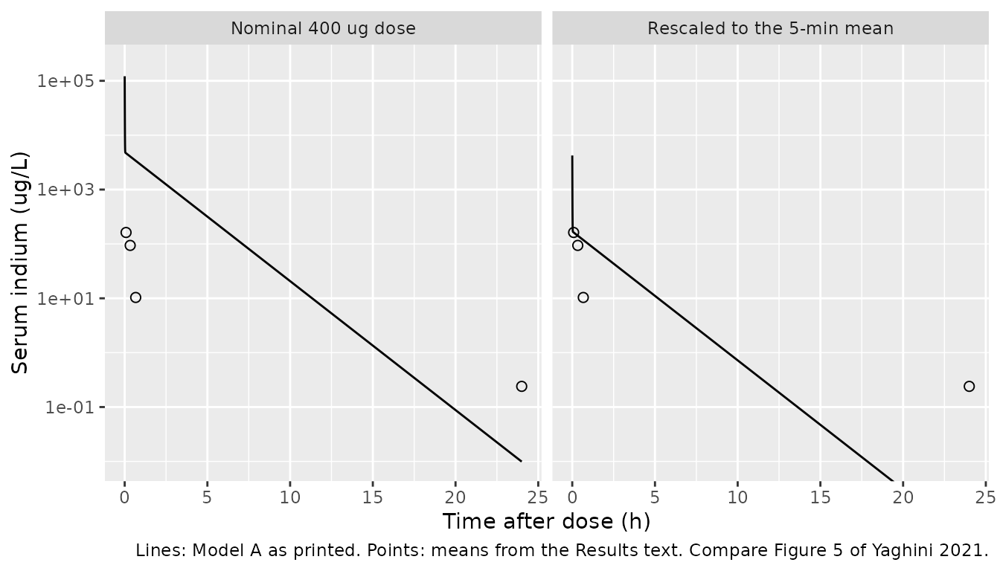
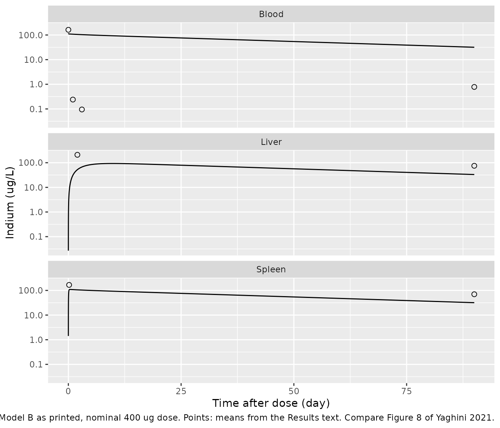

# Indium-based quantum dots (Yaghini 2021)

## Model and source

Yaghini et al. (2021) fitted two separate NONMEM models to indium
concentrations measured by ICP-MS after a single intravenous dose of
PEGylated, cadmium-free indium-phosphide quantum dots (bio CFQD) in
female Balb/c mice:

- **Model A** (`Yaghini_2021_quantumDot_blood_mouse`, Table 1, Figure
  5): a two-compartment model of serum indium over the first 24 h.
- **Model B** (`Yaghini_2021_quantumDot_organ_mouse`, Table 2, Figures
  1B and 8): a three-compartment model with blood, liver and spleen
  compartments over 90 days.

The authors describe the two as a two-step approach (“a distinct,
separate model was required to describe tissue disposition”), so they
are packaged as two model files.

- Citation: Yaghini E, Tacconi E, Pilling A, Rahman P, Broughton J,
  Naasani I, Keshtgar MRS, MacRobert A, Della Pasqua O. (2021).
  Population pharmacokinetic modelling of indium-based quantum dot
  nanoparticles: preclinical in vivo studies. Eur J Pharm Sci
  157:105639. <doi:10.1016/j.ejps.2020.105639>.
- Description (Model A): Preclinical (mouse, female Balb/c).
  Two-compartment population PK model with first-order elimination for
  indium-based, cadmium-free PEGylated quantum dots (bio CFQD, InP core)
  after a single IV bolus, fitted to serum indium concentrations over
  the first 24 h. No between-animal variability (destructive and sparse
  sampling). The printed parameters do not reproduce the paper’s own
  Figure 5 profile; see the vignette Errata. Companion organ-disposition
  model: modellib(‘Yaghini_2021_quantumDot_organ_mouse’).
- Description (Model B): Preclinical (mouse, female Balb/c).
  Three-compartment population PK model of blood, liver and spleen
  disposition of indium-based, cadmium-free PEGylated quantum dots (bio
  CFQD, InP core) after a single IV bolus, fitted to indium
  concentrations over 90 days. Blood is the central compartment with
  first-order elimination; liver and spleen exchange with blood through
  intercompartmental clearances. No between-animal variability
  (destructive sampling). The printed parameters do not reproduce the
  paper’s own Figure 8 blood profile and the residual-error magnitudes
  are not reported; see the vignette Errata. Companion 0-24 h blood
  model: modellib(‘Yaghini_2021_quantumDot_blood_mouse’).
- Article: <https://doi.org/10.1016/j.ejps.2020.105639> (open access,
  [PMC8214104](https://www.ncbi.nlm.nih.gov/pmc/articles/PMC8214104/))

**Read the Errata before using either model.** The printed parameter
tables are internally consistent in places (Table 2’s rate constants and
blood and liver half-lives follow exactly from its flows and volumes),
but neither table reproduces the paper’s own concentration-time figures.
Both models are packaged as printed.

## Population

Female Balb/c mice received 20 mg/kg quantum dots (200 uL in PBS) via
the tail vein. Nine groups of three mice were sacrificed at 5 min, 1 h,
4 h and 1, 3, 10, 30, 60 and 90 days for blood and organ collection, and
a separate set of three mice was sampled for serum at 5, 20, 40, 60 and
120 min (Methods 2.3). Indium was measured by ICP-MS in serum and in
nitric-acid digests of 0.1 g tissue (Methods 2.5). No body weights and
no analysis-dataset summary are reported. Figure 5 shows 21 serum
observations at 7 times (the serial set plus the 4 h and 24 h groups,
inferred 9 mice) for Model A; Figure 8 shows blood, liver and spleen
from the nine groups plus the serial set (inferred 30 mice) for Model B.
With destructive sampling and n = 3 per time, no between-animal
variability was estimated in either model. A rat toxicology arm (12 and
48 mg/kg) had no PK sampling.

``` r

str(readModelDb("Yaghini_2021_quantumDot_organ_mouse")()$population)
#> List of 7
#>  $ species       : chr "mouse (female Balb/c)"
#>  $ n_subjects    : int 30
#>  $ n_studies     : int 1
#>  $ sex_female_pct: num 100
#>  $ disease_state : chr "healthy"
#>  $ dose_range    : chr "single IV bolus of 20 mg/kg PEGylated bio CFQD quantum dots (200 uL in PBS via the tail vein)"
#>  $ notes         : chr "The analysis dataset is not tabulated. Nine biodistribution groups of 3 mice were sacrificed at 5 min, 1 h, 4 h"| __truncated__
```

## Source trace

| Equation / parameter | Value | Source location |
|----|----|----|
| Model A structure | 2-cmt, first-order elimination, IV bolus | Results 3.3 and Figure 1A |
| Model A `lcl` | log(0.0416 L/h) | Table 1, CL |
| Model A `lvc` | log(0.0027 L) | Table 1, V1 |
| Model A `lq` | log(0.498 L/h) | Table 1, Q |
| Model A `lvp` | log(0.068 L) | Table 1, V2 |
| Model A `propSd` | sqrt(0.0686) = 0.262 | Table 1, ‘Proportional error 0.0686’; read as a variance per Methods eq (2) |
| Model A `addSd` | sqrt(0.05) ng/L = 0.000224 ug/L | Table 1, ‘Additive error (ng/L) 0.05 (38%)’; read as a variance |
| Model B `d/dt(central)` | `k21*liver + k31*spleen - (k12 + k13 + kel)*central` | Eq (3) |
| Model B `d/dt(liver)` | `k12*central - k21*liver` | Eq (4) |
| Model B `d/dt(spleen)` | `k13*central - k31*spleen` | Eq (5) |
| Model B `k12`, `k21`, `k13`, `k31`, `kel` | `q/vc`, `q/vp`, `q2/vc`, `q2/vp2`, `cl/vc` | Eqs (6)-(10) |
| Model B `lcl` | log(0.0021 L/h) | Table 2, CL |
| Model B `lvc` | log(3.41 L) | Table 2, Vb |
| Model B `lq` | log(0.0018 L/h) | Table 2, QT1 (liver) |
| Model B `lvp` | log(0.13 L) | Table 2, VT1 (liver) |
| Model B `lq2` | log(0.1606 L/h) | Table 2, QT2 (spleen) |
| Model B `lvp2` | log(0.22 L) | Table 2, VT2 (spleen) |
| Model B residual errors | `fixed(0)` | Results: ‘proportional and additive error model’; values not printed |

QCO (1.07 L/h) and Vtot (3.65 L) are printed in Table 2 but enter the
model only through eqs (11)-(12) and the Figure 1B caption,
`QT = Fd * QCO` and `VT = FV * (Vtot - Vb)`. The flows and volumes they
produce are themselves printed, so the packaged model uses QT1, VT1, QT2
and VT2 directly.

## Internal consistency of Table 2

Table 2 prints the rate constants and half-lives that follow from its
flows and volumes. The packaged parameters reproduce all of them except
the spleen half-life, which matches in hours rather than the printed
days.

``` r

ui_b <- rxode2::rxode(readModelDb("Yaghini_2021_quantumDot_organ_mouse"))
th <- exp(ui_b$theta[c("lcl", "lvc", "lq", "lvp", "lq2", "lvp2")])
k <- c(
  K12 = th[["lq"]] / th[["lvc"]],
  K21 = th[["lq"]] / th[["lvp"]],
  K13 = th[["lq2"]] / th[["lvc"]],
  K31 = th[["lq2"]] / th[["lvp2"]],
  ke = th[["lcl"]] / th[["lvc"]]
)
table2_k <- c(K12 = 0.0005, K21 = 0.014, K13 = 0.047, K31 = 0.73, ke = 0.0006)

thalf <- tibble::tibble(
  quantity = c("Blood t1/2 (day)", "Liver t1/2 (day)", "Spleen t1/2 (day)", "Spleen t1/2 (h)"),
  derived = c(
    log(2) / k[["ke"]] / 24,
    log(2) / k[["K21"]] / 24,
    log(2) / k[["K31"]] / 24,
    log(2) / k[["K31"]]
  ),
  printed = c(47.0, 2.0, 1.0, 1.0)
)

tibble::tibble(
  quantity = paste(names(k), "(1/h)"),
  derived = k,
  printed = table2_k
) |>
  dplyr::bind_rows(thalf) |>
  dplyr::mutate(
    derived = vapply(derived, format, character(1), digits = 3),
    printed = vapply(printed, format, character(1), scientific = FALSE)
  ) |>
  dplyr::rename(
    "Quantity" = quantity,
    "From Table 2 flows and volumes" = derived,
    "Printed in Table 2" = printed
  ) |>
  knitr::kable(caption = "Table 2 rate constants and half-lives. The spleen row printed as days matches only in hours.")
```

| Quantity          | From Table 2 flows and volumes | Printed in Table 2 |
|:------------------|:-------------------------------|:-------------------|
| K12 (1/h)         | 0.000528                       | 0.0005             |
| K21 (1/h)         | 0.0138                         | 0.014              |
| K13 (1/h)         | 0.0471                         | 0.047              |
| K31 (1/h)         | 0.73                           | 0.73               |
| ke (1/h)          | 0.000616                       | 0.0006             |
| Blood t1/2 (day)  | 46.9                           | 47                 |
| Liver t1/2 (day)  | 2.09                           | 2                  |
| Spleen t1/2 (day) | 0.0396                         | 1                  |
| Spleen t1/2 (h)   | 0.95                           | 1                  |

Table 2 rate constants and half-lives. The spleen row printed as days
matches only in hours. {.table}

``` r


# The printed rate constants are the derived ones rounded to the precision shown.
stopifnot(
  all(abs(k / table2_k - 1) < 0.07),
  abs(thalf$derived[1] / 47.0 - 1) < 0.01,
  abs(thalf$derived[2] / 2.0 - 1) < 0.05,
  # Spleen: 0.95 h matches the printed '1.0' only as hours.
  abs(thalf$derived[4] / 1.0 - 1) < 0.06,
  thalf$derived[3] < 0.1
)
```

## Simulation

The paper reports the dose as 20 mg/kg of quantum dot. The analyte is
indium, whose mass fraction in the particle is not reported, and no body
weights are given. The simulations below use a nominal 400 ug dose (20
mg/kg x 20 g) into the central compartment; both models are linear, so
every concentration scales with this choice.

``` r

dose_ug <- 400

mod_a <- readModelDb("Yaghini_2021_quantumDot_blood_mouse")
mod_b <- readModelDb("Yaghini_2021_quantumDot_organ_mouse")

times_a <- sort(unique(c(0, seq(0.001, 0.1, by = 0.001), seq(0.1, 2, by = 0.01), seq(2, 24, by = 0.25))))
ev_a <- rxode2::et(amt = dose_ug, cmt = "central") |>
  rxode2::et(times_a, cmt = "central")
sim_a <- rxode2::rxSolve(mod_a, events = ev_a) |>
  as.data.frame() |>
  dplyr::mutate(id = 1L, model = "A")

times_b <- sort(unique(c(0, seq(1 / 60, 2, by = 1 / 60), seq(2, 48, by = 0.5), seq(48, 90 * 24, by = 6))))
# Multi-endpoint model (Cc, Cliver, Cspleen): observation rows carry dvid = 1
# and no cmt; every row returns all three outputs.
ev_b <- dplyr::bind_rows(
  data.frame(id = 1L, time = 0, amt = dose_ug, evid = 1L, cmt = "central", dvid = NA_integer_),
  data.frame(id = 1L, time = times_b, amt = 0, evid = 0L, cmt = NA_character_, dvid = 1L)
)
sim_b <- rxode2::rxSolve(mod_b, events = ev_b, rtol = 1e-10, atol = 1e-12) |>
  as.data.frame() |>
  dplyr::mutate(id = 1L, model = "B")
```

### Mass balance (Model B)

Only `kel` removes indium from the system, so the amount remaining in
the three compartments plus the amount eliminated (`CL` times the blood
AUC) must equal the dose at every time.

``` r

mb <- sim_b |>
  dplyr::arrange(time) |>
  dplyr::mutate(
    auc = c(0, cumsum(diff(time) * (head(Cc, -1) + tail(Cc, -1)) / 2)),
    eliminated = th[["lcl"]] * auc,
    total = central + liver + spleen + eliminated
  )
# Trapezoidal AUC on a 1-min to 6-h grid; measured max relative error ~2e-4.
stopifnot(max(abs(mb$total / dose_ug - 1)) < 2e-3)
```

## Replicate published figures

The paper’s Results text gives mean observed indium concentrations at
several times, which are overlaid below. Neither model reproduces them.

### Figure 5 (Model A, serum 0-24 h)

``` r

th_a <- exp(rxode2::rxode(mod_a)$theta[c("lcl", "lvc", "lq", "lvp")])
k10 <- th_a[["lcl"]] / th_a[["lvc"]]
k12_a <- th_a[["lq"]] / th_a[["lvc"]]
k21_a <- th_a[["lq"]] / th_a[["lvp"]]
lambda_a <- eigen(matrix(c(-(k10 + k12_a), k21_a, k12_a, -k21_a), 2, byrow = TRUE))$values
thalf_a_min <- sort(60 * log(2) / -lambda_a)
thalf_a_min
#> [1]  0.2012727 76.1585413
```

Table 1’s parameters give distribution and terminal half-lives of 0.2
and 76 min. Figure 5’s fitted line instead falls about 100-fold in the
first hour (a half-life of about 8 min) and then about 4-fold between 2
and 24 h (about 12 h). Because the dose units are unknown, the second
panel rescales the model profile to the observed 5-min mean so that only
the shape is compared.

``` r

obs_serum <- tibble::tribble(
  ~time, ~conc,
  5 / 60, 162.48,
  20 / 60, 93.93,
  40 / 60, 10.36,
  24, 0.24
)
c5_a <- sim_a$Cc[which.min(abs(sim_a$time - 5 / 60))]
fig5 <- dplyr::bind_rows(
  sim_a |> dplyr::transmute(time, Cc, panel = "Nominal 400 ug dose"),
  sim_a |> dplyr::transmute(time, Cc = Cc * 162.48 / c5_a, panel = "Rescaled to the 5-min mean")
) |>
  dplyr::filter(time > 0)
ggplot(fig5, aes(time, Cc)) +
  geom_line() +
  geom_point(data = obs_serum, aes(time, conc), shape = 1, size = 2) +
  facet_wrap(~panel) +
  scale_y_log10() +
  coord_cartesian(ylim = c(0.01, 2e5)) +
  labs(
    x = "Time after dose (h)", y = "Serum indium (ug/L)",
    caption = "Lines: Model A as printed. Points: means from the Results text. Compare Figure 5 of Yaghini 2021."
  )
```



### Figure 8 (Model B, blood, liver and spleen 0-90 days)

``` r

obs_organ <- tibble::tribble(
  ~time, ~conc, ~organ,
  5 / 60, 162.48, "Blood",
  24, 0.24, "Blood",
  72, 0.095, "Blood",
  90 * 24, 0.78, "Blood",
  48, 209.39, "Liver",
  90 * 24, 75.13, "Liver",
  4, 167.46, "Spleen",
  90 * 24, 69.98, "Spleen"
)
sim_b_long <- sim_b |>
  dplyr::select(time, Blood = Cc, Liver = Cliver, Spleen = Cspleen) |>
  tidyr::pivot_longer(-time, names_to = "organ", values_to = "conc") |>
  dplyr::filter(time > 0)
ggplot(sim_b_long, aes(time / 24, conc)) +
  geom_line() +
  geom_point(data = obs_organ, shape = 1, size = 2) +
  facet_wrap(~organ, ncol = 1) +
  scale_y_log10() +
  labs(
    x = "Time after dose (day)", y = "Indium (ug/L)",
    caption = "Lines: Model B as printed, nominal 400 ug dose. Points: means from the Results text. Compare Figure 8 of Yaghini 2021."
  )
```



``` r

pred_at <- function(sim, col, t) {
  sim[[col]][which.min(abs(sim$time - t))]
}
obs_organ |>
  dplyr::mutate(
    col = c(Blood = "Cc", Liver = "Cliver", Spleen = "Cspleen")[organ],
    predicted = mapply(function(cc, tt) pred_at(sim_b, cc, tt), col, time),
    ratio = predicted / conc
  ) |>
  dplyr::transmute(
    organ,
    time_h = round(time, 3),
    observed = conc,
    predicted = signif(predicted, 3),
    ratio = signif(ratio, 2)
  ) |>
  dplyr::rename(
    "Organ" = organ,
    "Time (h)" = time_h,
    "Observed mean (ug/L)" = observed,
    "Model B, 400 ug (ug/L)" = predicted,
    "Predicted / observed" = ratio
  ) |>
  knitr::kable(caption = "Model B predictions at the times for which the Results text gives observed means.")
```

| Organ | Time (h) | Observed mean (ug/L) | Model B, 400 ug (ug/L) | Predicted / observed |
|:---|---:|---:|---:|---:|
| Blood | 0.083 | 162.480 | 117.0 | 0.72 |
| Blood | 24.000 | 0.240 | 108.0 | 450.00 |
| Blood | 72.000 | 0.095 | 103.0 | 1100.00 |
| Blood | 2160.000 | 0.780 | 31.8 | 41.00 |
| Liver | 48.000 | 209.390 | 52.2 | 0.25 |
| Liver | 2160.000 | 75.130 | 33.1 | 0.44 |
| Spleen | 4.000 | 167.460 | 105.0 | 0.63 |
| Spleen | 2160.000 | 69.980 | 31.8 | 0.45 |

Model B predictions at the times for which the Results text gives
observed means. {.table}

At the nominal dose the spleen and late liver predictions are within a
few-fold of the observations, but blood stays near 100 ug/L for weeks,
40- to 1100-fold above the measured values. The structure forces this:
with uptake at `Q/Vb` and return at `Q/VT`, the liver and spleen
equilibrate at the blood concentration (tissue/blood ratio of 1), while
the data show tissue concentrations about 100-fold or more above blood.
No partition coefficient is reported.

## PKNCA validation

``` r

nca_in <- dplyr::bind_rows(
  sim_a |> dplyr::transmute(id, time, Cc, treatment = "Model A (0-24 h)"),
  sim_b |> dplyr::transmute(id, time, Cc, treatment = "Model B (0-90 d)")
) |>
  dplyr::filter(!is.na(Cc))
stopifnot(all(nca_in$Cc >= -1e-6 * max(nca_in$Cc)))
nca_in <- nca_in |> dplyr::mutate(Cc = pmax(Cc, 0))

dose_df <- tibble::tibble(
  id = 1L, time = 0, amt = dose_ug,
  treatment = c("Model A (0-24 h)", "Model B (0-90 d)")
)
conc_obj <- PKNCA::PKNCAconc(nca_in, Cc ~ time | treatment + id)
dose_obj <- PKNCA::PKNCAdose(dose_df, amt ~ time | treatment + id, route = "intravascular")
intervals <- data.frame(
  start = 0, end = Inf,
  cmax = TRUE, aucinf.obs = TRUE, half.life = TRUE
)
nca_res <- PKNCA::pk.nca(PKNCA::PKNCAdata(conc_obj, dose_obj, intervals = intervals))
nca_wide <- as.data.frame(nca_res) |>
  dplyr::select(treatment, PPTESTCD, PPORRES) |>
  tidyr::pivot_wider(names_from = PPTESTCD, values_from = PPORRES)

# AUC0-inf must equal Dose / CL for a linear model with elimination from the
# sampled compartment.
auc_expected <- c(
  "Model A (0-24 h)" = dose_ug / 0.0416,
  "Model B (0-90 d)" = dose_ug / 0.0021
)
auc_err <- nca_wide$aucinf.obs / auc_expected[nca_wide$treatment] - 1
stopifnot(all(abs(auc_err) < 0.05))
```

The AUC0-inf identity holds to 0.16%.

### Comparison against published half-lives

The paper reports a blood half-life for each model and no other NCA
quantity.

``` r

published <- tibble::tribble(
  ~treatment, ~half.life,
  "Model A (0-24 h)", 28 / 60,
  "Model B (0-90 d)", 47.0 * 24
)
cmp <- nlmixr2lib::ncaComparisonTable(
  simulated = nca_res,
  reference = published,
  by = "treatment",
  units = c(half.life = "h"),
  tolerance_pct = 20
)
knitr::kable(cmp, caption = "Simulated terminal half-life vs. Table 1 / Table 2. * differs by >20%.")
```

| NCA parameter | treatment        | Reference | Simulated | % diff    |
|:--------------|:-----------------|:----------|:----------|:----------|
| t½ (h)        | Model A (0-24 h) | 0.467     | 1.27      | +171.7%\* |
| t½ (h)        | Model B (0-90 d) | 1130      | 1240      | +9.6%     |

Simulated terminal half-life vs. Table 1 / Table 2. \* differs by \>20%.
{.table}

Model B’s simulated terminal half-life (51.5 days) is the slowest
eigenvalue of the three-compartment system and sits close to the printed
47 days, which is `log(2)/ke`. Model A’s simulated terminal half-life
(76.1 min) does not match the printed 28 min; no combination of the
Table 1 values gives 28 min.

## Assumptions and deviations

- **Neither model reproduces the paper’s own figures.** The maintainers
  packaged both tables as printed and kept the mismatch visible above
  rather than adjusting any value. In Model A, the Table 1 parameters
  give half-lives of about 0.2 and 76 min; Figure 5 needs roughly 8 min
  and 12 h. A search over CL/Q and V1/V2 swaps and minute, hour and day
  rescalings of CL and Q found no reading that reproduces Figure 5. In
  Model B, blood cannot fall from about 160 to 0.3 ug/L within 2 h when
  the total blood exit rate `k12 + k13 + ke` is 0.048 1/h, and the
  structure without a partition coefficient holds tissue and blood at
  equal concentrations.
- **Model B equations are written on amounts.** Eqs (3)-(5) are printed
  on concentrations `C1`-`C3` but use the `Q/Vb`, `Q/VT` rate constants
  of eqs (6)-(10), which give a mass-balanced system only when the
  states are amounts (NONMEM ADVAN6 integrates amounts). The
  concentration form as printed would put equilibrium tissue
  concentrations at `VT/Vb` times blood (26-fold below blood in the
  liver, 15-fold in the spleen), further from Figure 8.
- **Liver is compartment 2 and spleen compartment 3**, following eqs
  (4)-(5), the Table 2 tissue column, the Figure 1B caption and the data
  (the spleen peaks at 4 h, consistent with the fast `k31`; the liver at
  day 2, consistent with the slow `k21`). The Table 2 footnote’s ‘K21 =
  equilibration rate constant from spleen to blood’ swaps the organs and
  was not followed.
- **The spleen half-life is printed as 1.0 day** but `log(2)/K31` is
  0.95 h.
- **VT1 + VT2 = 0.35 L exceeds Vtot - Vb = 0.24 L**, so the volume
  fractions FV1 and FV2 of the Figure 1B caption sum to 1.46. Vb = 3.41
  L and Vtot = 3.65 L are also far larger than a mouse; they are
  apparent volumes on an unstated dose scale.
- **Dose units are not stated.** The dose is 20 mg/kg of quantum dot;
  the analyte is indium, whose fraction is unreported, and no body
  weights are given. The vignette uses a nominal 400 ug.
- **Model A residual error.** Table 1 prints ‘Proportional error 0.0686’
  and ‘Additive error (ng/L) 0.05 (38%)’ without a scale. The
  maintainers read both as NONMEM `$SIGMA` variances because Methods
  eq (2) defines epsilon by its variance sigma^2, and because the
  replicate spread around the Figure 5 curve (roughly 20% on the log
  scale, read off the figure) is closer to the variance reading’s SD of
  26% than to the 6.9% of the SD reading. The additive term is printed
  in ng/L while concentrations are in ug/L, so the SD is 0.000224 ug/L
  and effectively zero. The ‘(38%)’ is not explained.
- **Model B residual error** is described as ‘proportional and
  additive’, but no values are printed. All six residual parameters are
  `fixed(0)` placeholders.
- No correction notice for this article was found on 2026-10-16. The
  supplement contains only haematology and clinical-chemistry figures
  from the rat toxicology arm.
