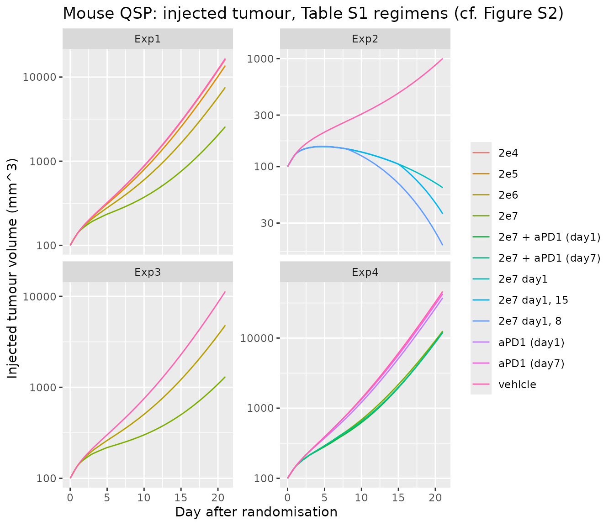
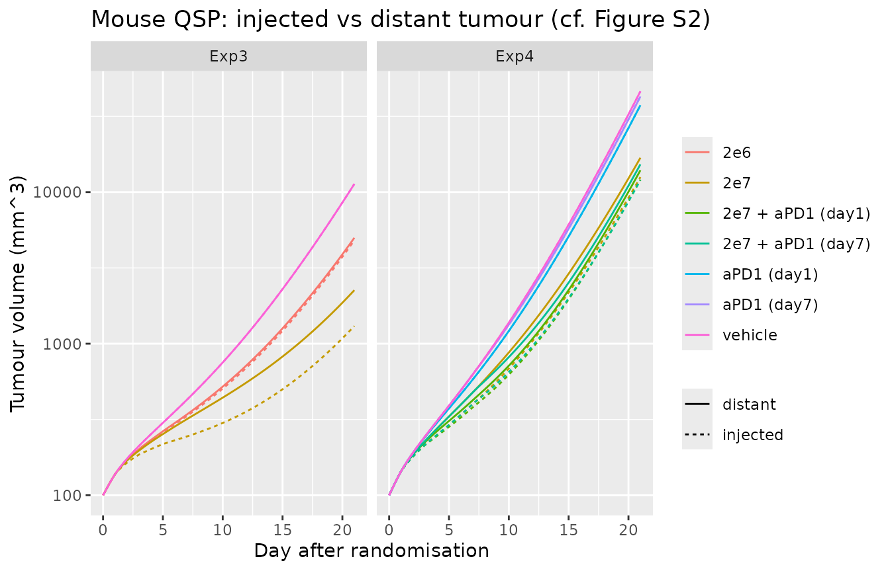
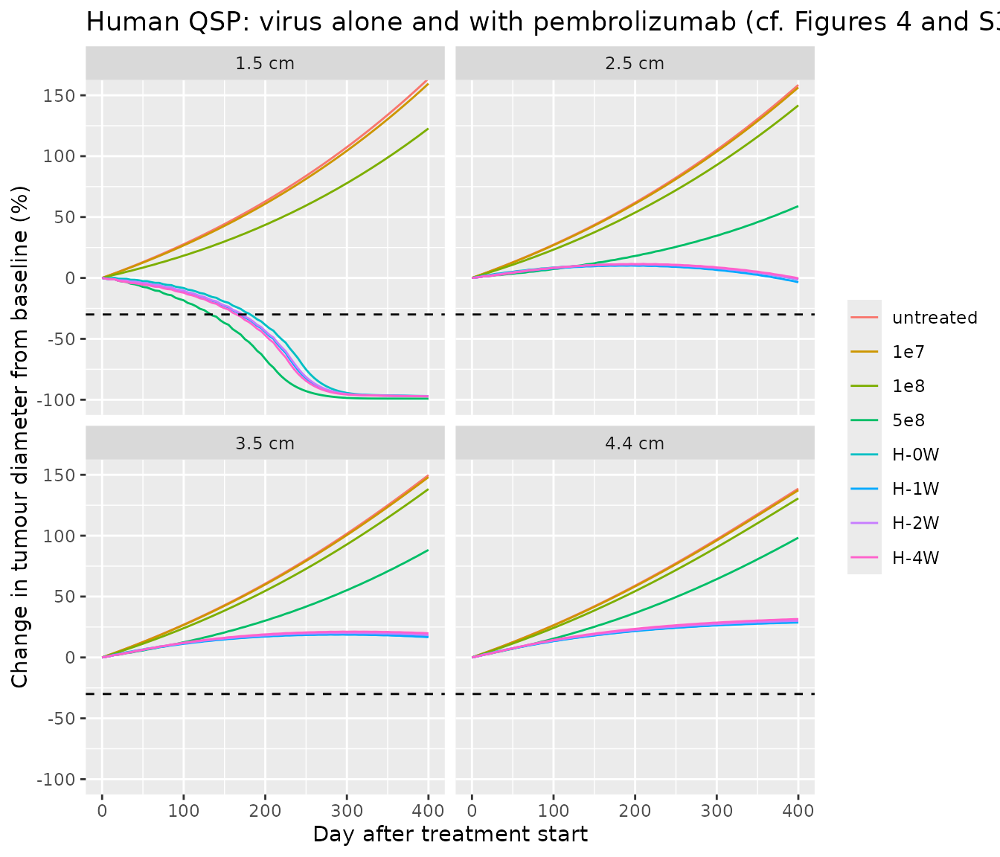

# Oncolytic virus + pembrolizumab QSP (Yamada 2025)

## The paper

Yamada et al. (2025) used a *multiple* model-informed drug-development
(MIDD) strategy to choose a first-in-human dosing regimen for an
intratumorally injected oncolytic vaccinia virus carrying interleukin-7
and interleukin-12 genes (hIL-7/mIL-12-VV in mice, hIL-7/hIL-12-VV in
humans) combined with an anti-PD-1 antibody (the murine surrogate
RMP1-14, clinically pembrolizumab). The paper develops four models:

1.  a **mouse preclinical QSP** model (10 ODEs) calibrated to four
    CT26.WT tumour-growth experiments;
2.  a **human clinical QSP** model built by extending the Wang et
    al. 2020 immune-oncology platform with the oncolytic-virus
    mechanism;
3.  a **mouse agent-based model** (ABM); and
4.  a **human ABM**.

The two QSP models are ordinary-differential-equation systems and are
packaged here:

- `Yamada_2025_oncolyticVirus_mouse_qsp`
- `Yamada_2025_oncolyticVirus_human_qsp`

The two ABMs are agent-based cell-cycle simulations (Physiomics’ Virtual
Tumour) whose tumour-growth engine is an ensemble of cell-cycle agents
with a proprietary volume algorithm rather than an ODE system; they are
not packaged (see *Assumptions and deviations*).

``` r

mod_mouse <- rxode2::rxode2(readModelDb("Yamada_2025_oncolyticVirus_mouse_qsp"))
mod_human <- rxode2::rxode2(readModelDb("Yamada_2025_oncolyticVirus_human_qsp"))
```

## Population

Both models are deterministic mechanism models: the authors generated
virtual subjects by sampling parameter ranges (preclinical fit / Latin
hypercube sampling), not by fitting inter-individual variability or
residual error, so the packaged models carry no etas and no error model.

- **Mouse QSP** was calibrated in NONMEM to four CT26.WT subcutaneous
  tumour-growth experiments in BALB/c mice (Exp1-Exp4, 19 conditions
  including 6 vehicle arms, 6-10 mice per arm; Supplementary Table S1).
  Tumour volumes were converted to cell counts assuming `1e6`
  cells/mm^3. Fourteen of the 28 parameters were estimated; the
  minimisation terminated before convergence and the authors used the
  terminated estimates (Supplementary Table S2).
- **Human QSP** inherits its immune-network parameters from the Wang
  2020 HER2-negative-breast-cancer model (Ref 4). 125 virtual-patient
  parameter sets were sampled from the Supplementary Table S6 ranges;
  100 reached a preselected baseline tumour diameter (uniform
  1.0-4.5 cm) within an 8000-day untreated run-in that started from
  `1e6` cancer cells. The viral infection rate constant was lowered
  relative to the mouse model to keep the single-agent objective
  response rate below 50%.

## Source trace

| Model element | Source |
|----|----|
| Mouse QSP ODEs (virus, tumour Ni/I, nTeff, dTeff, PD-L1, anti-PD-1 depot/central, distant tumour) | Supplement eqs 1-10 |
| Mouse QSP PD-L1 equation numerator (`dTeff`) | Kosinsky 2018 (Ref 3) eq 16; Table S2 `K_pdl` definition |
| Mouse QSP algebraic rules (TCD, DCm, Agsys, PD_L1free, ISC, IAR) | Supplementary Table S2 (Rules) |
| Mouse QSP 28 parameters, per-experiment growth rate `r` | Supplementary Table S2 |
| Mouse QSP baseline tumour volume (100 mm^3) | Supplementary Methods S1 (randomisation at \> 100 mm^3) |
| Mouse dosing regimens | Supplementary Table S1 |
| Human QSP reactions R1-R158 | Supplementary Table S3 |
| Human QSP rules (incl. `V_T.C1 = Cuit + Cit`, `IL7_act`, `IL12_act`) | Supplementary Table S4 |
| Human QSP fixed parameters, incl. pembrolizumab PK/binding and the oncolytic-virus block | Supplementary Table S5 |
| Human QSP virtual-population parameters (typical values used) | Supplementary Table S6 |
| Human QSP parameters not tabulated by Yamada (durvalumab, ipilimumab PK, `k_C1_therapy`) and initial species amounts | Wang 2020 (Ref 4) supplement / SBML deposit |
| Human run-in from `1e6` cells; dose volume by tumour size; regimens | Methods, “Human QSP Model Simulations” |

## Mouse preclinical QSP

The mouse model describes an injected tumour (`tumour_volume`, the sum
of noninfected and infected cells) and a distant noninjected tumour
(`tumour_volume_distant`). Virus is injected intratumorally (into
`virus`, pfu) and the anti-PD-1 antibody intraperitoneally (into
`mAbDep`, nmol; 100 ug of a ~150 kDa antibody is 0.667 nmol). The
tumour-growth rate constant `r` was fitted separately for each
experiment, so each experiment is simulated with its own value.

``` r

mab_nmol <- 100e-6 / 150000 * 1e9 # 100 ug anti-PD-1 -> nmol
r_exp <- c(Exp1 = 0.36, Exp2 = 0.284, Exp3 = 0.348, Exp4 = 0.394)
mab_d1 <- c(1, 3, 7, 10, 15, 17, 20, 23, 28, 31)
mab_d7 <- c(7, 10, 15, 17)

design <- list(
  list(exp = "Exp1", arm = "vehicle", vd = 0, vdays = c(1, 3, 5), mdays = NULL),
  list(exp = "Exp1", arm = "2e4", vd = 2e4, vdays = c(1, 3, 5), mdays = NULL),
  list(exp = "Exp1", arm = "2e5", vd = 2e5, vdays = c(1, 3, 5), mdays = NULL),
  list(exp = "Exp1", arm = "2e6", vd = 2e6, vdays = c(1, 3, 5), mdays = NULL),
  list(exp = "Exp1", arm = "2e7", vd = 2e7, vdays = c(1, 3, 5), mdays = NULL),
  list(exp = "Exp2", arm = "vehicle", vd = 0, vdays = 1, mdays = NULL),
  list(exp = "Exp2", arm = "2e7 day1", vd = 2e7, vdays = 1, mdays = NULL),
  list(exp = "Exp2", arm = "2e7 day1, 8", vd = 2e7, vdays = c(1, 8), mdays = NULL),
  list(exp = "Exp2", arm = "2e7 day1, 15", vd = 2e7, vdays = c(1, 15), mdays = NULL),
  list(exp = "Exp3", arm = "vehicle", vd = 0, vdays = c(1, 3, 5), mdays = NULL),
  list(exp = "Exp3", arm = "2e6", vd = 2e6, vdays = c(1, 3, 5), mdays = NULL),
  list(exp = "Exp3", arm = "2e7", vd = 2e7, vdays = c(1, 3, 5), mdays = NULL),
  list(exp = "Exp4", arm = "vehicle", vd = 0, vdays = c(1, 3, 7), mdays = NULL),
  list(exp = "Exp4", arm = "2e7", vd = 2e7, vdays = c(1, 3, 7), mdays = NULL),
  list(exp = "Exp4", arm = "aPD1 (day1)", vd = 0, vdays = NULL, mdays = mab_d1),
  list(exp = "Exp4", arm = "aPD1 (day7)", vd = 0, vdays = NULL, mdays = mab_d7),
  list(exp = "Exp4", arm = "2e7 + aPD1 (day1)", vd = 2e7, vdays = c(1, 3, 7), mdays = mab_d1),
  list(exp = "Exp4", arm = "2e7 + aPD1 (day7)", vd = 2e7, vdays = c(1, 3, 7), mdays = mab_d7)
)

solve_mouse <- function(d, tmax = 21) {
  ev <- rxode2::et(seq(0, tmax, by = 0.25), cmt = "tumNi")
  if (d$vd > 0) {
    ev <- rxode2::et(ev, time = d$vdays, amt = d$vd, cmt = "virus")
  }
  if (!is.null(d$mdays)) {
    ev <- rxode2::et(ev, time = d$mdays[d$mdays <= tmax], amt = mab_nmol, cmt = "mAbDep")
  }
  s <- rxode2::rxSolve(mod_mouse, ev, params = c(r = r_exp[[d$exp]]),
                       method = "liblsoda", returnType = "data.frame")
  data.frame(exp = d$exp, arm = d$arm, time = s$time,
             injected = s$tumour_volume, distant = s$tumour_volume_distant)
}
mouse_sim <- dplyr::bind_rows(lapply(design, solve_mouse))
```

``` r

ggplot(mouse_sim, aes(time, injected, colour = arm)) +
  geom_line() +
  facet_wrap(~exp, scales = "free_y") +
  scale_y_log10() +
  labs(x = "Day after randomisation", y = "Injected tumour volume (mm^3)",
       colour = NULL,
       title = "Mouse QSP: injected tumour, Table S1 regimens (cf. Figure S2)")
```



``` r

mouse_sim |>
  dplyr::filter(exp %in% c("Exp3", "Exp4")) |>
  tidyr::pivot_longer(c(injected, distant), names_to = "site",
                      values_to = "volume") |>
  ggplot(aes(time, volume, colour = arm, linetype = site)) +
  geom_line() +
  facet_wrap(~exp) +
  scale_y_log10() +
  labs(x = "Day after randomisation", y = "Tumour volume (mm^3)",
       colour = NULL, linetype = NULL,
       title = "Mouse QSP: injected vs distant tumour (cf. Figure S2)")
```



Volumes on day 14, when most vehicle arms are still within the measured
range:

``` r

d14 <- mouse_sim |>
  dplyr::filter(time == 14) |>
  dplyr::select(exp, arm, injected, distant)
d14 |>
  dplyr::rename("Experiment" = exp, "Arm" = arm,
                "Injected (mm^3)" = injected, "Distant (mm^3)" = distant) |>
  knitr::kable(digits = 0, caption = "Simulated tumour volume on day 14")
```

| Experiment | Arm               | Injected (mm^3) | Distant (mm^3) |
|:-----------|:------------------|----------------:|---------------:|
| Exp1       | vehicle           |            2298 |           2298 |
| Exp1       | 2e4               |            2258 |           2258 |
| Exp1       | 2e5               |            1987 |           1992 |
| Exp1       | 2e6               |            1314 |           1358 |
| Exp1       | 2e7               |             642 |            980 |
| Exp2       | vehicle           |             434 |            434 |
| Exp2       | 2e7 day1          |             112 |            154 |
| Exp2       | 2e7 day1, 8       |              81 |            142 |
| Exp2       | 2e7 day1, 15      |             112 |            154 |
| Exp3       | vehicle           |            1802 |           1802 |
| Exp3       | 2e6               |            1001 |           1037 |
| Exp3       | 2e7               |             443 |            717 |
| Exp4       | vehicle           |            4453 |           4453 |
| Exp4       | 2e7               |            1685 |           2232 |
| Exp4       | aPD1 (day1)       |            3753 |           3753 |
| Exp4       | aPD1 (day7)       |            4209 |           4209 |
| Exp4       | 2e7 + aPD1 (day1) |            1511 |           1741 |
| Exp4       | 2e7 + aPD1 (day7) |            1543 |           1957 |

Simulated tumour volume on day 14 {.table}

``` r

v14 <- function(e, a, site = "injected") d14[[site]][d14$exp == e & d14$arm == a]

# Exp1: tumour-growth inhibition is ordered by virus dose.
exp1 <- vapply(c("vehicle", "2e4", "2e5", "2e6", "2e7"),
               function(a) v14("Exp1", a), numeric(1))
stopifnot(all(diff(exp1) < 0))

# Exp3: the systemic dTeff pool slows the distant tumour as well, but less
# than the injected one.
stopifnot(
  v14("Exp3", "2e7", "distant") < v14("Exp3", "vehicle", "distant"),
  v14("Exp3", "2e7", "distant") > v14("Exp3", "2e7", "injected")
)

# Exp4: anti-PD-1 adds to the virus effect in both schedules.
stopifnot(
  v14("Exp4", "2e7 + aPD1 (day1)") < v14("Exp4", "2e7"),
  v14("Exp4", "2e7 + aPD1 (day7)") < v14("Exp4", "2e7")
)
```

The packaged model reproduces the dose-ordered response at the injected
tumour and a weaker abscopal effect at the distant tumour. With the
published parameter values the anti-PD-1-enhanced virus clearance is a
small effect (`Imax` = 0.139, a 13.9% increase), so in Exp4 the immune
benefit of the extra anti-PD-1 doses in the simultaneous arm (10 doses
from day 1, against 4 from day 7) outweighs it: on day 14 the
simultaneous arm is slightly smaller than the sequential arm at both
sites. The paper reports that its model favoured the sequential regimen
(Results, “Mouse QSP Modeling”); Figure S2, which shows that fit, is not
reproduced here, and the parameters were not tuned to recover it.

### Anti-PD-1 antibody pharmacokinetics (PKNCA)

The anti-PD-1 arm adds a first-order depot-to-central PK model. The
serum PK of a single 100 ug intraperitoneal dose is summarised with
PKNCA.

``` r

ev_pk <- rxode2::et(seq(0, 30, by = 0.25), cmt = "mAbC") |>
  rxode2::et(time = 0, amt = mab_nmol, cmt = "mAbDep")
pk <- rxode2::rxSolve(mod_mouse, ev_pk, returnType = "data.frame")
pk_in <- pk |>
  dplyr::mutate(conc = mAbC / 0.003, id = 1L, # nmol / Vd (L) = nM
                treatment = "anti-PD-1 100 ug IP") |>
  dplyr::filter(!is.na(conc))

o_conc <- PKNCA::PKNCAconc(pk_in, conc ~ time | treatment + id)
o_dose <- PKNCA::PKNCAdose(
  data.frame(time = 0, dose = mab_nmol, id = 1L,
             treatment = "anti-PD-1 100 ug IP"),
  dose ~ time | treatment + id
)
res <- PKNCA::pk.nca(PKNCA::PKNCAdata(
  o_conc, o_dose,
  intervals = data.frame(start = 0, end = 30, cmax = TRUE, tmax = TRUE,
                         auclast = TRUE, half.life = TRUE)
))
nca <- as.data.frame(res$result)
nca |>
  dplyr::select(PPTESTCD, PPORRES) |>
  dplyr::rename("NCA parameter" = PPTESTCD, "Value" = PPORRES) |>
  knitr::kable(digits = 3, caption = "Anti-PD-1 serum NCA (mouse QSP, nM and days)")
```

| NCA parameter       |    Value |
|:--------------------|---------:|
| auclast             | 1455.866 |
| cmax                |  205.957 |
| tmax                |    0.500 |
| tlast               |   30.000 |
| lambda.z            |    0.150 |
| r.squared           |    1.000 |
| adj.r.squared       |    1.000 |
| lambda.z.time.first |    0.750 |
| lambda.z.time.last  |   30.000 |
| lambda.z.n.points   |  118.000 |
| clast.pred          |    2.516 |
| half.life           |    4.621 |
| span.ratio          |    6.330 |

Anti-PD-1 serum NCA (mouse QSP, nM and days) {.table}

``` r


# Terminal half-life equals log(2) / kel_mAb (0.15/day) = 4.62 days.
hl <- nca$PPORRES[nca$PPTESTCD == "half.life"]
stopifnot(abs(hl / (log(2) / 0.15) - 1) < 0.02)
```

## Human clinical QSP

The human model grows a tumour from `1e6` cancer cells; therapy starts
once the tumour reaches its baseline diameter, with the node values at
that moment as the patient’s initial conditions (as in the paper). One
untreated run-in gives the initial conditions for four typical patients
at baseline diameters of 1.5, 2.5, 3.5 and 4.4 cm, one in each of the
paper’s dose-volume bands (1, 2, 4 and 6 mL of virus suspension). The
virus dose in pfu is the concentration (pfu/mL) times that volume.

``` r

human_ctl <- list(method = "cvode", maxsteps = 5e5, atol = 1e-9, rtol = 1e-9)
solve_human <- function(ev, inits = NULL) {
  rxode2::rxSolve(mod_human, ev, inits = inits, method = human_ctl$method,
                  maxsteps = human_ctl$maxsteps, atol = human_ctl$atol,
                  rtol = human_ctl$rtol, returnType = "data.frame")
}
runin <- solve_human(rxode2::et(seq(0, 3000, by = 2), cmt = "q_V_T_Cit"))

patients <- data.frame(
  patient = c("1.5 cm", "2.5 cm", "3.5 cm", "4.4 cm"),
  base_cm = c(1.5, 2.5, 3.5, 4.4),
  dose_mL = c(1, 2, 4, 6)
)
patients$t_base <- vapply(patients$base_cm, function(b) {
  runin$time[which(runin$tumour_diameter >= b)[1]]
}, numeric(1))
knitr::kable(
  patients |>
    dplyr::rename("Patient" = patient, "Baseline diameter (cm)" = base_cm,
                  "Virus volume (mL)" = dose_mL,
                  "Run-in time to baseline (days)" = t_base),
  caption = "Typical patients taken from the untreated run-in"
)
```

| Patient | Baseline diameter (cm) | Virus volume (mL) | Run-in time to baseline (days) |
|:---|---:|---:|---:|
| 1.5 cm | 1.5 | 1 | 884 |
| 2.5 cm | 2.5 | 2 | 1094 |
| 3.5 cm | 3.5 | 4 | 1234 |
| 4.4 cm | 4.4 | 6 | 1328 |

Typical patients taken from the untreated run-in {.table}

Arms: virus alone at 1e7, 1e8 or 5e8 pfu/mL every 2 weeks (Figure S3),
and 5e8 pfu/mL plus pembrolizumab 400 mg every 6 weeks starting 0, 1, 2
or 4 weeks after the first virus dose (H-0W to H-4W, Figure 4).

``` r

pembro_nmol <- 400 / 149000 * 1e6 # 400 mg pembrolizumab, MW ~149 kDa -> nmol
arms <- data.frame(
  arm = c("untreated", "1e7", "1e8", "5e8", "H-0W", "H-1W", "H-2W", "H-4W"),
  conc = c(0, 1e7, 1e8, 5e8, 5e8, 5e8, 5e8, 5e8),
  pembro_start = c(NA, NA, NA, NA, 0, 7, 14, 28)
)
horizon <- 400
run_arm <- function(p, a) {
  inits <- unlist(runin[runin$time == patients$t_base[p], mod_human$state])
  ev <- rxode2::et(seq(0, horizon, by = 5), cmt = "q_V_T_Cit")
  if (arms$conc[a] > 0) {
    ev <- rxode2::et(ev, time = seq(0, horizon, by = 14),
                     amt = arms$conc[a] * patients$dose_mL[p],
                     cmt = "q_V_T_Virus_T")
  }
  if (!is.na(arms$pembro_start[a])) {
    ev <- rxode2::et(ev, time = seq(arms$pembro_start[a], horizon, by = 42),
                     amt = pembro_nmol, cmt = "q_V_C_pembro")
  }
  s <- solve_human(ev, inits = inits)
  data.frame(patient = patients$patient[p], arm = arms$arm[a], time = s$time,
             diameter = s$tumour_diameter,
             pct_change = 100 * (s$tumour_diameter / s$tumour_diameter[1] - 1))
}
human_sim <- dplyr::bind_rows(lapply(seq_len(nrow(patients)), function(p) {
  dplyr::bind_rows(lapply(seq_len(nrow(arms)), function(a) run_arm(p, a)))
}))
human_sim$arm <- factor(human_sim$arm, levels = arms$arm)
```

``` r

ggplot(human_sim, aes(time, pct_change, colour = arm)) +
  geom_line() +
  geom_hline(yintercept = -30, linetype = "dashed") +
  facet_wrap(~patient) +
  coord_cartesian(ylim = c(-100, 150)) +
  labs(x = "Day after treatment start",
       y = "Change in tumour diameter from baseline (%)", colour = NULL,
       title = "Human QSP: virus alone and with pembrolizumab (cf. Figures 4 and S3)")
```



``` r

resp <- human_sim |>
  dplyr::filter(time %in% c(100, 365)) |>
  dplyr::select(patient, arm, time, pct_change) |>
  tidyr::pivot_wider(names_from = time, values_from = pct_change,
                     names_prefix = "day_")
resp |>
  dplyr::rename("Patient" = patient, "Arm" = arm,
                "Day 100 change (%)" = day_100,
                "Day 365 change (%)" = day_365) |>
  knitr::kable(digits = 1,
               caption = "Change in tumour diameter from baseline (RECIST response at <= -30%)")
```

| Patient | Arm       | Day 100 change (%) | Day 365 change (%) |
|:--------|:----------|-------------------:|-------------------:|
| 1.5 cm  | untreated |               27.7 |              142.5 |
| 1.5 cm  | 1e7       |               26.7 |              138.8 |
| 1.5 cm  | 1e8       |               18.4 |              105.7 |
| 1.5 cm  | 5e8       |              -18.4 |              -99.1 |
| 1.5 cm  | H-0W      |               -8.3 |              -96.7 |
| 1.5 cm  | H-1W      |              -10.7 |              -96.8 |
| 1.5 cm  | H-2W      |              -10.5 |              -96.8 |
| 1.5 cm  | H-4W      |              -12.1 |              -96.9 |
| 2.5 cm  | untreated |               27.3 |              138.6 |
| 2.5 cm  | 1e7       |               26.9 |              136.8 |
| 2.5 cm  | 1e8       |               23.3 |              123.4 |
| 2.5 cm  | 5e8       |                7.4 |               49.6 |
| 2.5 cm  | H-0W      |                8.6 |                3.0 |
| 2.5 cm  | H-1W      |                7.9 |                1.1 |
| 2.5 cm  | H-2W      |                8.4 |                3.0 |
| 2.5 cm  | H-4W      |                8.3 |                3.8 |
| 3.5 cm  | untreated |               27.0 |              132.2 |
| 3.5 cm  | 1e7       |               26.7 |              130.8 |
| 3.5 cm  | 1e8       |               24.0 |              121.6 |
| 3.5 cm  | 5e8       |               12.5 |               75.8 |
| 3.5 cm  | H-0W      |               11.6 |               18.6 |
| 3.5 cm  | H-1W      |               11.3 |               17.9 |
| 3.5 cm  | H-2W      |               11.8 |               19.5 |
| 3.5 cm  | H-4W      |               12.1 |               20.8 |
| 4.4 cm  | untreated |               26.5 |              123.9 |
| 4.4 cm  | 1e7       |               26.3 |              122.7 |
| 4.4 cm  | 1e8       |               24.3 |              116.3 |
| 4.4 cm  | 5e8       |               15.5 |               85.9 |
| 4.4 cm  | H-0W      |               13.6 |               28.5 |
| 4.4 cm  | H-1W      |               13.4 |               28.1 |
| 4.4 cm  | H-2W      |               13.9 |               29.4 |
| 4.4 cm  | H-4W      |               14.4 |               30.8 |

Change in tumour diameter from baseline (RECIST response at \<= -30%)
{.table}

``` r

chg <- function(p, a, day = "day_365") resp[[day]][resp$patient == p & resp$arm == a]

for (p in patients$patient) {
  # virus monotherapy is ordered by dose at every baseline size
  mono <- vapply(c("untreated", "1e7", "1e8", "5e8"), function(a) chg(p, a),
                 numeric(1))
  stopifnot(all(diff(mono) < 0))
  # the four pembrolizumab schedules end within 5 percentage points of each
  # other by day 365 (paper: no obvious difference between schedules)
  combo <- vapply(c("H-0W", "H-1W", "H-2W", "H-4W"), function(a) chg(p, a),
                  numeric(1))
  stopifnot(diff(range(combo)) < 5)
}

# Adding pembrolizumab improves day-365 control over the high virus dose alone
# for the patients who do not respond to the virus alone.
for (p in c("2.5 cm", "3.5 cm", "4.4 cm")) {
  stopifnot(chg(p, "H-0W") < chg(p, "5e8") - 20)
}

# The infected-cell / virus cascade engages after a single dose: infected
# cells appear (lysed within hours, Delta_I = 57.4/day, so the infected
# fraction stays small) and the cancer-cell count falls over the first days.
tx <- solve_human(
  rxode2::et(seq(0, 28, by = 1), cmt = "q_V_T_Cit") |>
    rxode2::et(time = 0, amt = 5e8, cmt = "q_V_T_Virus_T"),
  inits = unlist(runin[runin$time == patients$t_base[1], mod_human$state])
)
stopifnot(
  max(tx$infected_fraction) > 1e-4,
  min(tx$cancer_cells[tx$time <= 7]) < 0.95 * tx$cancer_cells[1]
)
```

The paper’s virtual population gave objective response rates of 0%, 2%
and 22% for virus alone at 1e7, 1e8 and 5e8 pfu/mL and 48% for every
combination schedule at day 365. The four typical patients here follow
the same pattern: virus alone is dose-ordered and shrinks only the
smallest tumour, while pembrolizumab adds a large benefit by day 365 for
the larger tumours and the four schedules end within a few percentage
points of each other. At day 100 the paper ranked the schedules 1 week
\>= 0 weeks \> 2 weeks \> 4 weeks by response rate; for the typical 1.5
cm patient here the early differences are within a few percentage points
and the later starts are marginally better, because the
pembrolizumab-enhanced virus clearance acts before the immune benefit
builds up. A response *rate* needs the Table S6 virtual population,
which is not reproduced (see below).

### Pembrolizumab pharmacokinetics (PKNCA)

``` r

base1 <- unlist(runin[runin$time == patients$t_base[1], mod_human$state])
pk_h <- solve_human(
  rxode2::et(seq(0, 42, by = 0.5), cmt = "q_V_C_pembro") |>
    rxode2::et(time = 0, amt = pembro_nmol, cmt = "q_V_C_pembro"),
  inits = base1
)
pk_hin <- pk_h |>
  dplyr::mutate(conc = Cc_pembrolizumab, id = 1L,
                treatment = "pembrolizumab 400 mg IV") |>
  dplyr::filter(!is.na(conc))
o_conc_h <- PKNCA::PKNCAconc(pk_hin, conc ~ time | treatment + id)
o_dose_h <- PKNCA::PKNCAdose(
  data.frame(time = 0, dose = pembro_nmol, id = 1L,
             treatment = "pembrolizumab 400 mg IV"),
  dose ~ time | treatment + id
)
res_h <- PKNCA::pk.nca(PKNCA::PKNCAdata(
  o_conc_h, o_dose_h,
  intervals = data.frame(start = 0, end = 42, cmax = TRUE, tmax = TRUE,
                         auclast = TRUE, half.life = TRUE)
))
nca_h <- as.data.frame(res_h$result)
nca_h |>
  dplyr::select(PPTESTCD, PPORRES) |>
  dplyr::rename("NCA parameter" = PPTESTCD, "Value" = PPORRES) |>
  knitr::kable(digits = 3, caption = "Pembrolizumab plasma NCA (human QSP, nM and days)")
```

| NCA parameter       |    Value |
|:--------------------|---------:|
| auclast             | 6305.782 |
| cmax                |  447.427 |
| tmax                |    0.000 |
| tlast               |   42.000 |
| lambda.z            |    0.016 |
| r.squared           |    1.000 |
| adj.r.squared       |    1.000 |
| lambda.z.time.first |   12.000 |
| lambda.z.time.last  |   42.000 |
| lambda.z.n.points   |   61.000 |
| clast.pred          |   95.107 |
| half.life           |   42.639 |
| span.ratio          |    0.704 |

Pembrolizumab plasma NCA (human QSP, nM and days) {.table}

``` r


# Cmax after the bolus is the dose over the 6 L central compartment.
cmax_h <- nca_h$PPORRES[nca_h$PPTESTCD == "cmax"]
stopifnot(abs(cmax_h / (pembro_nmol / 6) - 1) < 0.01)
```

## Assumptions and deviations

- **The two agent-based models are not packaged.** The mouse and human
  ABMs are Physiomics’ Virtual Tumour, an agent-based cell-cycle
  simulation whose tumour volume comes from a proprietary algorithm; it
  is not an ODE system and cannot be expressed in rxode2. Only the
  immune-system component of the ABM is an ODE set (Supplement eqs 1-12,
  Table S7), and it is driven by the cell count from the agent engine,
  so it is not a standalone model either.
- **Mouse QSP PD-L1 equation.** Supplement eq 6 is printed with `PDL1`
  in the numerator of the saturable term. The source model (Kosinsky
  2018, Ref 3, eq 16) and the definition of `K_pdl` (“sensitivity of
  PD-L1 expression up-regulation to dTeff count”, in cells) show that
  the numerator is the differentiated-effector-T-cell count; the
  packaged model uses `dTeff / (dTeff + K_pdl)`. Eq 2 likewise prints
  `T_eff` for the killing term, which is `dT_eff` in eqs 3 and 10 and in
  the source model.
- **Mouse QSP eradication threshold.** The infection flux
  `V_beta * Virus * Tum_ni / Tum_tot / 1e6` does not shrink with tumour
  size while noninfected cells dominate, so the injected tumour reaches
  zero in finite time and the `Tum_ni / Tum_tot` and `Tum_i / Tum_tot`
  ratios become infinitely stiff (the solver fails, for example, in the
  Exp2 day 1 + 8 arm). Below one tumour cell (`1e-6` mm^3) the packaged
  model freezes the two injected-tumour volumes and floors the ratio
  denominators at one cell. This changes nothing while the tumour is
  larger than one cell.
- **Mouse QSP growth rate.** `r` was fitted per experiment (0.36, 0.284,
  0.348 and 0.394 1/day for Exp1-Exp4). The model default is the Exp1
  value; this vignette overrides `r` for each experiment.
- **Mouse QSP control virus.** The unmodified control virus (Exp1) has
  no IL-7 or IL-12 genes, but the model ties IL-7 and IL-12 stimulation
  to infected cells, so it cannot distinguish the two viruses; the
  control-virus arm is not simulated.
- **Mouse QSP baseline and antibody dose.** Mice were randomised when
  the tumour exceeded 100 mm^3; the injected and distant tumours start
  at 100 mm^3 with the immune and virus states at rest. The 100 ug
  anti-PD-1 dose is converted to nmol with an assumed molecular weight
  of 150 kDa.
- **Mouse QSP fit did not converge.** The NONMEM minimisation terminated
  before convergence and the authors used the terminated estimates; the
  packaged values are those estimates.
- **Human QSP is an extension of Wang 2020.** The immune network, its
  parameters and the initial species amounts are inherited from the Wang
  2020 model (Ref 4), packaged separately as
  `Wang_2020_entinostat_nivolumab_ipilimumab_qsp`. The nivolumab arm is
  replaced by pembrolizumab (Table S5 parameters); the anti-PD-L1
  (durvalumab), anti-CTLA-4 (ipilimumab) and entinostat modules are
  carried over but not dosed in this paper. Values are converted to the
  model’s counts/litre/dm^2/day system as in the Wang 2020 translation;
  each `ini()` line’s comment records the tabulated value and unit.
  Where Yamada’s tables differ from Wang 2020, Yamada’s value is used
  (`k_C1_growth` = 0.0075 1/day from Table S6; `IC50_ENT_ArgI` = 3.74e-7
  M from Table S5). Parameters Yamada does not tabulate (durvalumab and
  ipilimumab PK, `k_C1_therapy`) and the initial species amounts come
  from Wang 2020.
- **Human QSP run-in.** The untreated run-in starts from `1e6` cancer
  cells (Methods), not from the single cell of the Wang 2020 platform.
  Yamada’s Table S5 still lists the Wang pre-treatment diameter of 0.1
  cm, which is not used.
- **Human QSP virus units.** `Virus_T` is held in molecule-equivalents,
  the unit of the Table S5 virus parameters (`Alpha` in molecule/cell,
  `Beta_infect` in cell/day/molecule); one pfu is taken as one
  molecule-equivalent, as in the mouse model, where the same parameters
  are in pfu. The dose in pfu is the concentration times the
  tumour-size-dependent volume (Methods).
- **Human QSP C2 tracker.** Table S3 reaction 155 defines a cancer-cell
  tracker `V_T.C2` without infection, while Table S4 also lists the rule
  `V_T.C2 = V_T.Cuit`. `C2` feeds back on nothing; the packaged model
  integrates reaction 155 as printed.
- **Human QSP virtual population.** The paper sampled 15 parameters from
  the Table S6 distributions by Latin hypercube; some entries are
  ambiguous as printed (the lognormal `k_C1_growth` has “mean 0.0075, SD
  1”; the `k_cln_ENT` range is given as \[6e-4, 1.22e-4\]). The packaged
  model carries the typical values, and this vignette uses four typical
  patients at different baseline diameters rather than the virtual
  population, so it checks the pattern of response, not the published
  response rates.
- **No NCA was reported in the paper** for either antibody; the PKNCA
  sections check the antibody PK sub-models against their own
  parameters.
