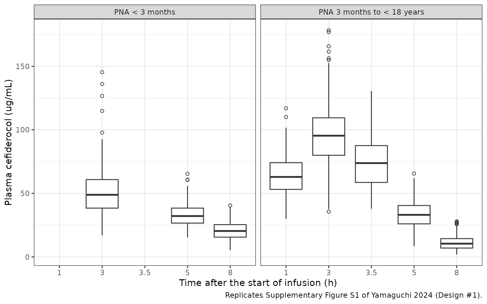
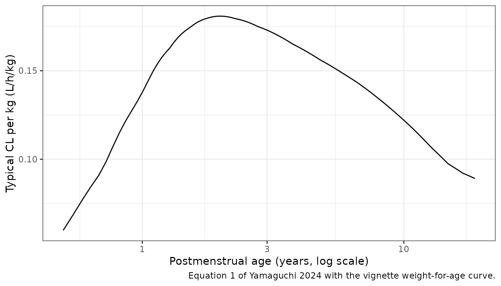

# Cefiderocol (Yamaguchi 2024)

## Model and source

- Citation: Yamaguchi D, Katsube T, Wajima T. Evaluation and
  optimization of sample size of neonates and infants for pediatric
  clinical studies on cefiderocol using a model-based approach.
  Pharmacol Res Perspect. 2024;12(5):e70001. <doi:10.1002/prp2.70001>.
  The pediatric model is that of Katsube T, Echols R, Wajima T.
  Prediction of cefiderocol pharmacokinetics and probability of target
  attainment in pediatric subjects for proposing dose regimens. IDWeek
  2019 abstract, Washington, DC; allometric exponents from Shimamura K,
  Wajima T, Yano Y. J Pharm Sci. 2007;96(11):3125-3139.
  <doi:10.1002/jps.20977>; maturation constants from Rhodin MM et
  al. Pediatr Nephrol. 2009;24(1):67-76.
  <doi:10.1007/s00467-008-0997-5>.
- Description: Two-compartment pediatric population PK model for
  intravenous cefiderocol from neonates to adults, with body-weight
  allometric scaling (beta-lactam class exponents 0.578 on CL and Q,
  0.677 on V1 and V2) and a sigmoidal postmenstrual-age renal-maturation
  function on CL (TM50 47.7 weeks, Hill 3.4); the simulation model of a
  stochastic simulation and estimation study of pediatric sample size
  (Yamaguchi 2024)
- Article: <https://doi.org/10.1002/prp2.70001> (open access;
  PMC11343721)

Yamaguchi 2024 is a stochastic simulation and estimation (SSE) study
that asks how many neonates and infants a pediatric cefiderocol trial
needs to estimate the pediatric PK parameters with acceptable precision.
The “true” model that generates every simulated dataset is the pediatric
cefiderocol PK model of Katsube 2019 (IDWeek abstract), printed in full
as Equations 1-4 and the “True Value” column of Table 4. That model is
what is packaged here: a two-compartment model whose CL, V1, Q and V2
scale with body weight using the beta-lactam class exponents of
Shimamura 2007 (0.578 for clearances, 0.677 for volumes), with the
Rhodin 2009 glomerular-filtration maturation function of postmenstrual
age on CL.

## Population

No pediatric subject was observed in the source. Each simulated design
contained virtual neonates, infants, toddlers, children and adolescents
(Groups 1-10 of Table 1; Groups A-J of Table 2), 1:1 female:male, with
gestational age (GA) and postnatal age (PNA) uniform within each group
and body weight generated from age by published weight-for-age
relationships, plus the observed plasma concentrations of 516 adults
(healthy subjects and patients) from five cefiderocol clinical studies
as Group 11. Dosing was a single 3-h infusion adjusted by PNA, GA and
body weight (Table S1). The model itself is the pediatric projection of
the adult cefiderocol popPK, so it is a prediction model for children
rather than a fit to pediatric data.

The same information is available programmatically:

``` r

str(rxode2::rxode(readModelDb("Yamaguchi_2024_cefiderocol"))$population)
#> ℹ parameter labels from comments will be replaced by 'label()'
#> List of 12
#>  $ species       : chr "human"
#>  $ n_subjects    : num 516
#>  $ n_studies     : num 5
#>  $ age_range     : chr "Neonates (gestational age 26 weeks or more, postnatal age from 0 days) to adults (18 to <93 years)"
#>  $ weight_range  : chr "Not reported; body weight was simulated from age (Sumpter and Holford 2011; Sy 2014)"
#>  $ sex_female_pct: num 50
#>  $ race_ethnicity: chr "Not reported"
#>  $ disease_state : chr "Pediatric patients with Gram-negative infections (planned pediatric trials NCT04335539, NCT04215991 and a neona"| __truncated__
#>  $ dose_range    : chr "Single 3-h IV infusion: 30-60 mg/kg by gestational and postnatal age below 3 months; 60 mg/kg (body weight <34 "| __truncated__
#>  $ regions       : chr "Not reported"
#>  $ pma_range     : chr "26 to <57 weeks across the neonate and infant groups (Yamaguchi 2024 Tables 1 and 2)"
#>  $ notes         : chr "No pediatric subject was observed. The model is the pediatric projection of the adult cefiderocol popPK (Kawagu"| __truncated__
```

## Source trace

| Equation / parameter | Value | Source location |
|----|----|----|
| `lcl` | log(0.508) L/h at 1 kg | Equation 1; Table 4 ‘True Value’ |
| `lvc` | log(0.460) L at 1 kg | Equation 2; Table 4 |
| `lq` | log(0.495) L/h at 1 kg | Equation 3; Table 4 |
| `lvp` | log(0.318) L at 1 kg | Equation 4; Table 4 |
| `e_wt_cl_q` | 0.578 (fixed) | Equations 1 and 3; Table 4 ‘Power on CL and Q’; from Shimamura 2007 (ref 21) |
| `e_wt_vc_vp` | 0.677 (fixed) | Equations 2 and 4; Table 4 ‘Power on V1 and V2’; from Shimamura 2007 |
| `tmat50` | 47.7 weeks (fixed) | Methods ‘Pharmacokinetic model’; Table 4 ‘TM50’; from Rhodin 2009 (refs 22-23) |
| `hill_mat` | 3.4 (fixed) | Methods ‘Pharmacokinetic model’; Table 4 ‘HILL’ |
| `etalcl`, `etalvc`, `etalvp` | 0.040 each | Methods (log-normal, 20% CV); Table 4 ‘BSV_CL’, ‘BSV_V1’, ‘BSV_V2’ |
| `propSd` | 0.20 | Table 4 ‘RUVprop’ = 0.040, read as a variance |
| CL = 0.508 x BW^0.578 x PMA^HILL / (PMA^HILL + TM50^HILL) | n/a | Equation 1 |
| V1 = 0.460 x BW^0.677; Q = 0.495 x BW^0.578; V2 = 0.318 x BW^0.677 | n/a | Equations 2-4 |
| Two-compartment disposition, IV infusion into central | n/a | Methods ‘Pharmacokinetic model’ and ‘Simulation’ |

## Virtual cohort

The cohort reproduces Design \#1 (Table 1, Groups 1-10), the design
shown in Supplementary Figure S1, at 30 subjects per neonate/infant
group and 50 per older group instead of the paper’s 3 and 6 per group
(times 300 datasets).

Body weight is generated from postmenstrual age. Up to 40 weeks the
median is an intrauterine birth-weight curve; after term it is a
sex-averaged weight-for-age median indexed by age since 40 weeks.
Individual weights are log-normal around the median with a 12% CV. See
“Assumptions and deviations” for why this differs from the paper’s
weight model.

``` r

set.seed(20241101)
rxode2::rxSetSeed(20241101)

# Sex-averaged median body weight (kg) by postmenstrual age (weeks).
# PMA <= 40: intrauterine growth; PMA > 40: weight-for-age at
# (PMA - 40) weeks of corrected age.
wt_ref <- tibble::tribble(
  ~pma_wk, ~wt_kg,
  24, 0.65, 26, 0.90, 28, 1.15, 30, 1.45, 32, 1.80, 34, 2.25,
  36, 2.75, 38, 3.15, 40, 3.50,
  40 + 4.35, 4.35, 40 + 8.7, 5.35, 40 + 13.0, 6.10, 40 + 26.1, 7.60,
  40 + 39.1, 8.55, 40 + 52.2, 9.25, 40 + 78.3, 10.6, 40 + 104.4, 11.85,
  40 + 156.5, 14.1, 40 + 208.7, 16.2, 40 + 260.9, 18.2, 40 + 313.1, 20.3,
  40 + 417.4, 25.5, 40 + 521.8, 32.0, 40 + 626.2, 40.5, 40 + 730.5, 50.0,
  40 + 834.9, 57.0, 40 + 939.2, 62.0
)
median_wt <- function(pma_wk) {
  exp(approx(wt_ref$pma_wk, log(wt_ref$wt_kg), xout = pma_wk, rule = 2)$y)
}

# Design #1 age groups (Table 1). PNA in days; GA in weeks.
groups <- tibble::tribble(
  ~group, ~ga_lo, ~ga_hi, ~pna_lo, ~pna_hi, ~n,
  1, 26, 32, 0, 14, 30,
  2, 26, 32, 14, 28, 30,
  3, 32, 37, 0, 14, 30,
  4, 32, 37, 14, 28, 30,
  5, 37, 40, 0, 28, 30,
  6, 26, 44, 28, 91.3, 30,
  7, 40, 40, 91.3, 730.5, 50,
  8, 40, 40, 730.5, 2191.5, 50,
  9, 40, 40, 2191.5, 4383, 50,
  10, 40, 40, 4383, 6574.5, 50
)

subj <- groups |>
  dplyr::rowwise() |>
  dplyr::reframe(
    group = group,
    GA = runif(n, ga_lo, ga_hi),
    PNA_d = runif(n, pna_lo, pna_hi)
  ) |>
  dplyr::mutate(
    id = dplyr::row_number(),
    PAGE = GA + PNA_d / 7,
    WT = median_wt(PAGE) * exp(rnorm(dplyr::n(), 0, sqrt(log(1 + 0.12^2)))),
    panel = ifelse(group <= 6, "PNA < 3 months", "PNA 3 months to < 18 years"),
    # Table S1 dosing, 3-h infusion
    dose_mg = dplyr::case_when(
      PNA_d < 61 & GA < 32 ~ 30 * WT,
      PNA_d < 61 ~ 40 * WT,
      PNA_d < 91.3 & GA < 32 ~ 40 * WT,
      PNA_d < 91.3 ~ 60 * WT,
      WT < 34 ~ 60 * WT,
      TRUE ~ 2000
    )
  )

subj |>
  dplyr::group_by(group) |>
  dplyr::summarise(
    n = dplyr::n(),
    `PMA (weeks)` = sprintf("%.1f-%.1f", min(PAGE), max(PAGE)),
    `Median WT (kg)` = round(median(WT), 2),
    `Median dose (mg)` = round(median(dose_mg))
  ) |>
  knitr::kable(caption = "Virtual Design #1 cohort.")
```

| group |   n | PMA (weeks) | Median WT (kg) | Median dose (mg) |
|------:|----:|:------------|---------------:|-----------------:|
|     1 |  30 | 26.7-32.6   |           1.51 |               45 |
|     2 |  30 | 28.7-35.7   |           1.97 |               59 |
|     3 |  30 | 32.2-38.3   |           2.49 |              100 |
|     4 |  30 | 34.5-40.8   |           3.14 |              126 |
|     5 |  30 | 37.2-43.7   |           3.57 |              143 |
|     6 |  30 | 31.7-50.4   |           3.91 |              162 |
|     7 |  50 | 55.8-139.2  |           9.35 |              561 |
|     8 |  50 | 149.2-350.1 |          15.51 |              931 |
|     9 |  50 | 357.1-660.3 |          29.31 |             1758 |
|    10 |  50 | 674.2-970.3 |          53.73 |             2000 |

Virtual Design \#1 cohort. {.table}

``` r

# Sampling: 3, 5, 8 h for Groups 1-8; 1, 3, 3.5, 5, 8 h for Groups 9-10
# (Table 1 note). A rich grid is added for NCA.
sparse_times <- function(group) if (group >= 9) c(1, 3, 3.5, 5, 8) else c(3, 5, 8)
rich_times <- sort(unique(c(seq(0, 3, by = 0.25), seq(3.5, 12, by = 0.5), seq(13, 48, by = 1))))

make_events <- function(s, obs_fun) {
  dose_rows <- s |>
    dplyr::transmute(
      id, time = 0, evid = 1L, amt = dose_mg, rate = dose_mg / 3,
      cmt = "central", WT, PAGE, group, panel
    )
  obs_rows <- s |>
    dplyr::rowwise() |>
    dplyr::reframe(
      id = id, time = obs_fun(group), evid = 0L, amt = 0, rate = 0,
      cmt = "central", WT = WT, PAGE = PAGE, group = group, panel = panel
    )
  dplyr::bind_rows(dose_rows, obs_rows) |>
    dplyr::arrange(id, time, dplyr::desc(evid)) |>
    as.data.frame()
}

ev_sparse <- make_events(subj, sparse_times)
ev_rich <- make_events(subj, function(g) rich_times)
stopifnot(!anyDuplicated(unique(ev_sparse[, c("id", "time", "evid")])))
```

## Simulation

``` r

mod <- readModelDb("Yamaguchi_2024_cefiderocol")
sim_sparse <- rxode2::rxSolve(mod, events = ev_sparse, keep = c("group", "panel")) |>
  as.data.frame()
#> ℹ parameter labels from comments will be replaced by 'label()'
sim_rich <- rxode2::rxSolve(
  mod |> rxode2::zeroRe("sigma"),
  events = ev_rich, keep = c("group", "panel")
) |>
  as.data.frame()
#> ℹ parameter labels from comments will be replaced by 'label()'
```

## Replicate Supplementary Figure S1

Supplementary Figure S1 shows box plots of the simulated concentrations
at each sampling time for Design \#1, split at PNA 3 months. Times 1 and
3.5 h are sampled only in Groups 9 and 10. The simulated observations
below include the proportional residual error (`sim` column).

``` r

# The sparse solve has no time-zero observation, so every row is a sample.
fig_s1 <- sim_sparse |>
  dplyr::mutate(
    panel = factor(panel, levels = c("PNA < 3 months", "PNA 3 months to < 18 years")),
    time_f = factor(time, levels = c(1, 3, 3.5, 5, 8))
  )

ggplot(fig_s1, aes(time_f, sim)) +
  geom_boxplot(outlier.shape = 1) +
  facet_wrap(~panel) +
  scale_x_discrete(drop = FALSE) +
  labs(
    x = "Time after the start of infusion (h)",
    y = "Plasma cefiderocol (ug/mL)",
    caption = "Replicates Supplementary Figure S1 of Yamaguchi 2024 (Design #1)."
  ) +
  theme_bw()
```



The medians are compared below with the medians read off Supplementary
Figure S1 by the maintainers (box centre lines; reading precision about
2 ug/mL).

``` r

published_s1 <- tibble::tribble(
  ~panel, ~time, ~median_pub,
  "PNA < 3 months", 3, 132,
  "PNA < 3 months", 5, 83,
  "PNA < 3 months", 8, 51,
  "PNA 3 months to < 18 years", 1, 61,
  "PNA 3 months to < 18 years", 3, 97,
  "PNA 3 months to < 18 years", 3.5, 71,
  "PNA 3 months to < 18 years", 5, 33,
  "PNA 3 months to < 18 years", 8, 11
)

s1_cmp <- fig_s1 |>
  dplyr::group_by(panel = as.character(panel), time) |>
  dplyr::summarise(median_sim = median(sim), .groups = "drop") |>
  dplyr::inner_join(published_s1, by = c("panel", "time")) |>
  dplyr::mutate(pct_diff = 100 * (median_sim / median_pub - 1))
stopifnot(nrow(s1_cmp) == nrow(published_s1))

s1_cmp |>
  dplyr::mutate(median_sim = round(median_sim, 1), pct_diff = round(pct_diff, 1)) |>
  dplyr::rename(
    "Panel" = panel, "Time (h)" = time,
    "Simulated median (ug/mL)" = median_sim,
    "Figure S1 median (ug/mL)" = median_pub,
    "Difference (%)" = pct_diff
  ) |>
  knitr::kable(caption = "Median concentrations: simulation vs Supplementary Figure S1.")
```

| Panel | Time (h) | Simulated median (ug/mL) | Figure S1 median (ug/mL) | Difference (%) |
|:---|---:|---:|---:|---:|
| PNA 3 months to \< 18 years | 1.0 | 62.9 | 61 | 3.1 |
| PNA 3 months to \< 18 years | 3.0 | 95.4 | 97 | -1.7 |
| PNA 3 months to \< 18 years | 3.5 | 73.8 | 71 | 3.9 |
| PNA 3 months to \< 18 years | 5.0 | 33.1 | 33 | 0.2 |
| PNA 3 months to \< 18 years | 8.0 | 10.4 | 11 | -5.4 |
| PNA \< 3 months | 3.0 | 48.9 | 132 | -63.0 |
| PNA \< 3 months | 5.0 | 32.1 | 83 | -61.3 |
| PNA \< 3 months | 8.0 | 20.4 | 51 | -60.0 |

Median concentrations: simulation vs Supplementary Figure S1. {.table}

The 3 months to \< 18 years panel is reproduced to within about 10% at
all five sampling times. The \< 3 months panel is not: the simulated
medians are about 60% lower than Figure S1 at 3, 5 and 8 h alike. That
panel cannot be produced by Equations 1-4 with the Table S1 doses. Its
3-h median of 132 ug/mL is well above dose / (V1 + V2), the
concentration the dose would give with no elimination at all, for the
typical subject of every neonatal and infant group (see the table
below). A uniform factor of about 2.6 at every time point would also
mean a neonatal AUC about 2.6 times that of older children, which
contradicts the paper’s statement that the Table S1 doses give
comparable drug exposure. The packaged model reproduces that statement
(next section). The neonatal panel is therefore listed as a known
deviation and is excluded from the gate below; it is shown in the table
above so the disagreement stays visible.

``` r

ceiling_tab <- sim_rich |>
  dplyr::distinct(id, group, vc, vp) |>
  dplyr::inner_join(
    ev_rich |> dplyr::filter(evid == 1) |> dplyr::select(id, amt),
    by = "id"
  ) |>
  dplyr::group_by(group) |>
  dplyr::summarise(ceiling = round(median(amt / (vc + vp)), 1), .groups = "drop")
ceiling_tab |>
  dplyr::rename("Group" = group, "Median dose / (V1 + V2) (ug/mL)" = ceiling) |>
  knitr::kable(caption = "No-elimination concentration ceiling by Design #1 group.")
```

| Group | Median dose / (V1 + V2) (ug/mL) |
|------:|--------------------------------:|
|     1 |                            43.2 |
|     2 |                            47.5 |
|     3 |                            66.0 |
|     4 |                            74.7 |
|     5 |                            78.9 |
|     6 |                            77.3 |
|     7 |                           154.1 |
|     8 |                           178.5 |
|     9 |                           214.8 |
|    10 |                           173.4 |

No-elimination concentration ceiling by Design \#1 group. {.table}

``` r

stopifnot(all(ceiling_tab$ceiling[ceiling_tab$group <= 6] < 132))
```

``` r

# Gate on the reproduced panel only. Centre and robust envelope over its
# five time points: a mis-transcribed coefficient, exponent or dose moves
# every median by tens of percent; the remaining spread comes from the
# weight-for-age curve, the cohort draw and the reading of the figure
# (about 2 ug/mL, i.e. up to ~20% at the 11 ug/mL 8-h median). Realised
# -5% to +4% (default threads) and -9% to +3% (2 threads, another seed).
older <- s1_cmp |> dplyr::filter(panel == "PNA 3 months to < 18 years")
stopifnot(
  nrow(older) == 5,
  abs(median(older$pct_diff)) < 10,
  quantile(abs(older$pct_diff), 0.9) < 20
)
```

## Maturation and size

Typical clearance across the age range, with the Rhodin 2009 maturation
fraction that multiplies it.

``` r

ui <- rxode2::rxode(mod)
#> ℹ parameter labels from comments will be replaced by 'label()'
th <- ui$theta
fmat_fun <- function(pma) pma^th[["hill_mat"]] / (pma^th[["hill_mat"]] + th[["tmat50"]]^th[["hill_mat"]])
# Deterministic checks of Equation 1 at fixed covariates.
stopifnot(
  abs(fmat_fun(47.7) - 0.5) < 1e-12,
  abs(exp(th[["lcl"]]) * 70^th[["e_wt_cl_q"]] * fmat_fun(40 + 52 * 30) - 5.92) < 0.01
)

typ <- tibble::tibble(PAGE = seq(26, 40 + 52 * 18, length.out = 400)) |>
  dplyr::mutate(
    WT = median_wt(PAGE),
    fmat = fmat_fun(PAGE),
    CL = exp(th[["lcl"]]) * WT^th[["e_wt_cl_q"]] * fmat
  )
ggplot(typ, aes(PAGE / 52.18, CL / WT)) +
  geom_line() +
  scale_x_log10() +
  labs(
    x = "Postmenstrual age (years, log scale)",
    y = "Typical CL per kg (L/h/kg)",
    caption = "Equation 1 of Yamaguchi 2024 with the vignette weight-for-age curve."
  ) +
  theme_bw()
```



## PKNCA validation

PKNCA on the rich-grid solve (between-subject variability, no residual
error), by age group. The paper reports no NCA, so the check is
internal: the per-subject AUC0-inf from PKNCA must equal dose / CL.

``` r

sim_nca <- sim_rich |>
  dplyr::filter(!is.na(Cc)) |>
  dplyr::mutate(Cc = pmax(Cc, 0)) |>
  dplyr::select(id, time, Cc, group)

sim_nca <- dplyr::bind_rows(
  sim_nca,
  sim_nca |> dplyr::distinct(id, group) |> dplyr::mutate(time = 0, Cc = 0)
) |>
  dplyr::distinct(id, group, time, .keep_all = TRUE) |>
  dplyr::arrange(id, group, time)

conc_obj <- PKNCA::PKNCAconc(sim_nca, Cc ~ time | group + id)
dose_df <- ev_rich |>
  dplyr::filter(evid == 1) |>
  dplyr::select(id, time, amt, rate, group) |>
  dplyr::mutate(duration = amt / rate)
dose_obj <- PKNCA::PKNCAdose(dose_df, amt ~ time | group + id, duration = "duration")

intervals <- data.frame(
  start = 0, end = Inf,
  cmax = TRUE, tmax = TRUE, aucinf.obs = TRUE, half.life = TRUE
)
nca_res <- PKNCA::pk.nca(PKNCA::PKNCAdata(conc_obj, dose_obj, intervals = intervals))

nca_tab <- as.data.frame(nca_res$result) |>
  dplyr::filter(PPTESTCD %in% c("cmax", "tmax", "aucinf.obs", "half.life")) |>
  dplyr::group_by(group, PPTESTCD) |>
  dplyr::summarise(median = signif(median(PPORRES, na.rm = TRUE), 3), .groups = "drop") |>
  tidyr::pivot_wider(names_from = PPTESTCD, values_from = median)

nca_tab |>
  dplyr::select(group, cmax, tmax, aucinf.obs, half.life) |>
  dplyr::rename(
    "Group" = group, "Cmax (ug/mL)" = cmax, "Tmax (h)" = tmax,
    "AUC0-inf (ug*h/mL)" = aucinf.obs, "t1/2 (h)" = half.life
  ) |>
  knitr::kable(caption = "Simulated single-dose NCA by Design #1 age group (medians).")
```

| Group | Cmax (ug/mL) | Tmax (h) | AUC0-inf (ug\*h/mL) | t1/2 (h) |
|------:|-------------:|---------:|--------------------:|---------:|
|     1 |         39.2 |        3 |                 414 |     7.08 |
|     2 |         41.6 |        3 |                 365 |     5.56 |
|     3 |         56.0 |        3 |                 461 |     5.01 |
|     4 |         59.4 |        3 |                 427 |     4.19 |
|     5 |         61.5 |        3 |                 401 |     3.70 |
|     6 |         56.0 |        3 |                 361 |     3.47 |
|     7 |         87.7 |        3 |                 350 |     1.86 |
|     8 |         96.3 |        3 |                 401 |     1.85 |
|     9 |        118.0 |        3 |                 482 |     1.88 |
|    10 |         96.3 |        3 |                 409 |     2.02 |

Simulated single-dose NCA by Design \#1 age group (medians). {.table}

``` r

auc_chk <- as.data.frame(nca_res$result) |>
  dplyr::filter(PPTESTCD == "aucinf.obs") |>
  dplyr::select(id, auc = PPORRES) |>
  dplyr::inner_join(
    sim_rich |> dplyr::distinct(id, cl),
    by = "id"
  ) |>
  dplyr::inner_join(dose_df |> dplyr::select(id, amt), by = "id") |>
  dplyr::mutate(pct_diff = 100 * (auc / (amt / cl) - 1))
stopifnot(nrow(auc_chk) == nrow(subj))
# Methods 'Simulation': the Table S1 doses 'would provide comparable drug
# exposure' across ages. Every group's median AUC0-inf must sit within 35% of
# the pooled median (realised -15% to +18% here; a 2.6-fold neonatal shift,
# as Figure S1's left panel would imply, fails it).
auc_grp <- nca_tab$aucinf.obs / median(auc_chk$auc)
stopifnot(length(auc_grp) == 10, all(abs(auc_grp - 1) < 0.35))
# Same drawn parameters on both sides: the difference is trapezoidal and
# extrapolation error only.
stopifnot(
  abs(median(auc_chk$pct_diff)) < 2,
  quantile(abs(auc_chk$pct_diff), 0.9) < 4
)
```

## Assumptions and deviations

- **Weight-for-age.** The paper generated body weight from age with the
  relationships of Sumpter and Holford 2011 and Sy 2014, whose
  coefficients are not reproduced in the paper. The vignette uses
  approximate sex-averaged median weights (an intrauterine growth curve
  to 40 weeks PMA, then weight-for-age medians) with a 12% CV. This
  affects only the virtual cohort, not the model.
- **Cohort size.** Design \#1 has 3 subjects per neonate/infant group
  and 6 per older group, repeated over 300 datasets. The vignette uses
  30 and 50 per group in a single draw. Group 5 GA (37 to \< 40 weeks)
  and the Group 6 PNA upper limit (91.3 days) were set so the PMA ranges
  match Table 1. GA was fixed at 40 weeks for Groups 7-10 (Table 1).
- **Supplementary Figure S1, PNA \< 3 months panel, not reproduced.**
  The simulated medians are about 60% below the figure at 3, 5 and 8 h,
  while the 3 months to \< 18 years panel agrees within about 10%. The
  figure’s neonatal medians exceed the no-elimination ceiling dose /
  (V1 + V2) of the model as printed, and imply a neonatal exposure about
  2.6 times that of older children, against the paper’s statement that
  the Table S1 doses give comparable exposure (which the packaged model
  reproduces). Whatever produced the figure panel (a different dose,
  weight model or parameterisation for the youngest subjects) is not
  described in the paper; the model follows Equations 1-4 and Table 4 as
  printed. A uniform reading error is excluded: the figure’s y-axis is
  linear with 50 ug/mL gridlines.
- **Residual error read as a variance.** Table 4 prints
  `RUVprop = 0.040` beside between-subject variances of 0.040 (20% CV),
  so it is read as sigma^2 = 0.04, a 20% proportional SD. That matches
  the adult cefiderocol model (20.5%, Kawaguchi 2021). Reading it as an
  SD of 0.04 would give a 4% residual error.
- **No variability on Q.** The paper puts between-subject variability on
  CL, V1 and V2 only.
- **What is fixed.** The allometric exponents (Shimamura 2007) and the
  maturation constants (Rhodin 2009) were taken from the literature and
  are wrapped in `fixed()`. The structural coefficients and the variance
  terms are the simulation model’s own values and are left estimable, as
  they were in the paper’s re-estimation step (Table 4).
- **Adult clearance.** Equation 1 gives a typical CL of 5.92 L/h for a
  70-kg adult (maturation fraction about 1), higher than the 4.04 L/h of
  the adult model (Kawaguchi 2021) at its reference creatinine clearance
  of 83 mL/min. Under the adult model’s creatinine-clearance exponent of
  0.682, 5.92 L/h corresponds to a creatinine clearance of about 145
  mL/min. The pediatric model has no renal-function covariate beyond
  maturation, so it describes children with age-appropriate renal
  function. Table S4 of the paper repeats the SSE with weight centred at
  70 kg and adult values (CL 4.04, V1 7.78, Q 6.19, V2 5.77); that is a
  sensitivity analysis and is not packaged.
- **Piecewise allometry (Design \#3).** The alternative model with
  separate pediatric exponents (0.75, 1) was used only to test whether a
  difference in allometric relationships could be detected, and is not
  packaged.
- No correction notice for this article was found in Europe PMC as of
  2026-10-30.
