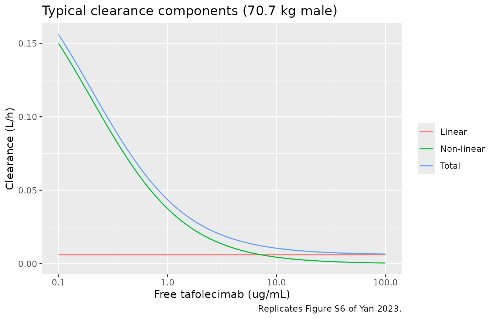
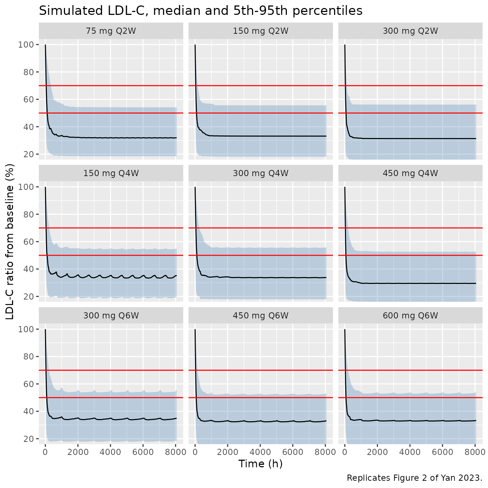
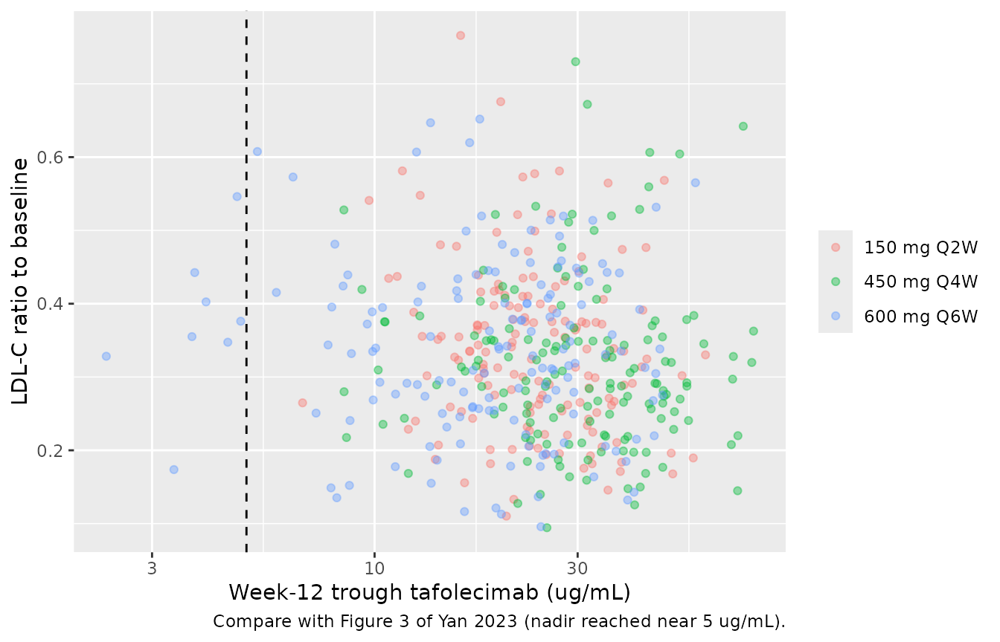
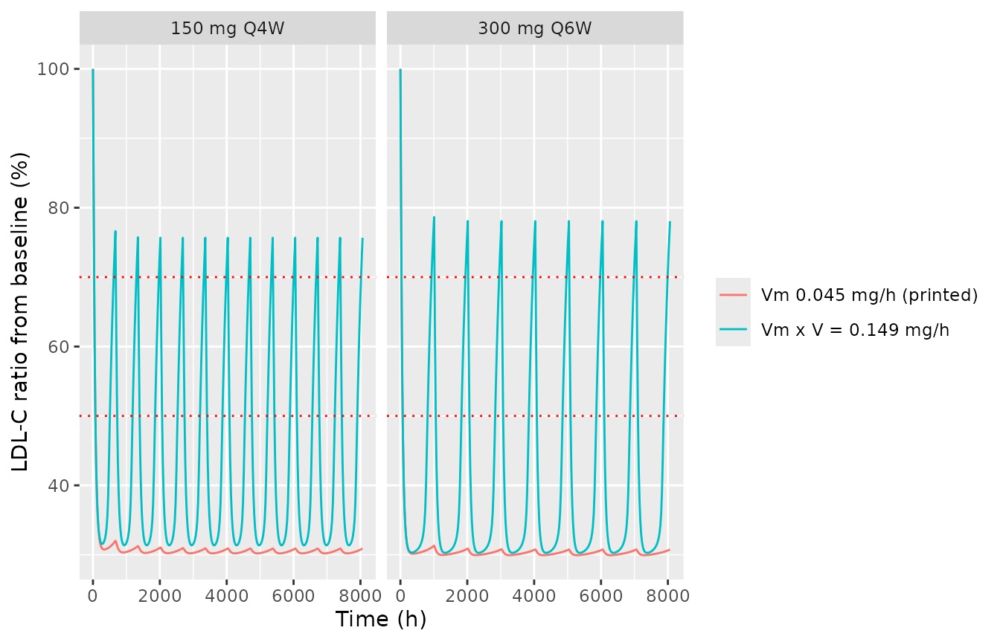

# Tafolecimab PK and LDL-C (Yan 2023)

## Model and source

- Citation: Yan S, Zhao X, Xie Q, Du W, Ma Q, Zhu T, Deng H, Qian L,
  Zheng S, Cui Y. Pharmacokinetic/LDL-C and exposure-response analysis
  of tafolecimab in Chinese hypercholesterolemia patients: Results from
  phase I, II, and III studies. Clin Transl Sci. 2023;16:2791-2803.
  <doi:10.1111/cts.13674>
- Article: [Clin Transl Sci 16:2791-2803
  (2023)](https://doi.org/10.1111/cts.13674) (open access)

Tafolecimab is a fully human IgG2 monoclonal antibody against PCSK9. Yan
et al. 2023 fitted a sequential population model to six Chinese studies
(phase I in healthy volunteers, phase IIa and four phase III studies).
The PK layer is a two-compartment model with first-order subcutaneous
absorption, a fixed bioavailability of 58%, and parallel linear and
Michaelis-Menten elimination from the central compartment (a
Michaelis-Menten approximation of target-mediated drug disposition). The
LDL cholesterol (LDL-C) layer is a type IV indirect response model in
which free tafolecimab stimulates the first-order loss of LDL-C through
a hyperbolic Emax function. The LDL-C parameters were estimated with the
PK parameters fixed (two-step procedure).

``` r

mod <- readModelDb("Yan_2023_tafolecimab")
ui <- rxode2::rxode2(mod)
#> ℹ parameter labels from comments will be replaced by 'label()'
ui
#>  ── rxode2-based free-form 4-cmt ODE model ────────────────────────────────────── 
#>  ── Initalization: ──  
#> Fixed Effects ($theta): 
#>                lka                lvc                lcl              lvmax 
#>         -4.6051702          1.1969482         -5.0994665         -3.1010928 
#>                lkm                 lq                lvp            lfdepot 
#>         -1.6094379         -4.5098600          0.5538851         -0.5447272 
#>            e_wt_ka          e_sexf_ka            e_wt_vc         e_pcsk9_vc 
#>         -0.7400000         -0.7300000          1.1500000          0.2200000 
#>          e_sexf_vc            e_wt_cl          e_sexf_cl             lrbase 
#>          0.2400000          1.4000000          0.3000000          4.6986605 
#>              lkout              lemax              lec50              lhill 
#>         -5.1159958          0.8671005         -0.6161861          0.0000000 
#>       e_ldlc_rbase        e_ldlc_kout e_dis_healthy_emax    e_dis_hefh_emax 
#>          0.9400000         -1.6300000         -0.0810000         -0.3700000 
#>    e_dis_hofh_emax        e_sexf_emax             propSd         propSd_ldl 
#>         -3.0700000         -0.1500000          0.3500000          0.2000000 
#> 
#> Omega ($omega): 
#>           etalka etalvc etalvmax etalcl etalrbase etalkout etalemax
#> etalka    0.3025 0.0000     0.00 0.0000  0.000000   0.0000   0.0000
#> etalvc    0.0000 0.1156     0.00 0.0000  0.000000   0.0000   0.0000
#> etalvmax  0.0000 0.0000     0.04 0.0000  0.000000   0.0000   0.0000
#> etalcl    0.0000 0.0000     0.00 0.1089  0.000000   0.0000   0.0000
#> etalrbase 0.0000 0.0000     0.00 0.0000  0.002116   0.0000   0.0000
#> etalkout  0.0000 0.0000     0.00 0.0000  0.000000   0.5476   0.0000
#> etalemax  0.0000 0.0000     0.00 0.0000  0.000000   0.0000   0.2601
#> attr(,"lotriLabels")
#> [1] "Table 2 'IIV_ka' SD 0.55"   "Table 2 'IIV_V' SD 0.34"   
#> [3] "Table 2 'IIV_Vm' SD 0.2"    "Table 2 'IIV_Cl' SD 0.33"  
#> [5] "Table 2 'IIV_R0' SD 0.046"  "Table 2 'IIV_kout' SD 0.74"
#> [7] "Table 2 'IIV_Emax' SD 0.51"
#> attr(,"lotriFix")
#>           etalka etalvc etalvmax etalcl etalrbase etalkout etalemax
#> etalka     FALSE  FALSE    FALSE  FALSE     FALSE    FALSE    FALSE
#> etalvc     FALSE  FALSE    FALSE  FALSE     FALSE    FALSE    FALSE
#> etalvmax   FALSE  FALSE    FALSE  FALSE     FALSE    FALSE    FALSE
#> etalcl     FALSE  FALSE    FALSE  FALSE     FALSE    FALSE    FALSE
#> etalrbase  FALSE  FALSE    FALSE  FALSE     FALSE    FALSE    FALSE
#> etalkout   FALSE  FALSE    FALSE  FALSE     FALSE    FALSE    FALSE
#> etalemax   FALSE  FALSE    FALSE  FALSE     FALSE    FALSE    FALSE
#> 
#> States ($state or $stateDf): 
#>   Compartment Number Compartment Name
#> 1                  1            depot
#> 2                  2          central
#> 3                  3      peripheral1
#> 4                  4              ldl
#>  ── Multiple Endpoint Model ($multipleEndpoint): ──  
#>   variable                cmt                dvid*
#> 1   Cc ~ …  cmt='Cc' or cmt=5  dvid='Cc' or dvid=1
#> 2  ldl ~ … cmt='ldl' or cmt=4 dvid='ldl' or dvid=2
#>   * If dvids are outside this range, all dvids are re-numered sequentially, ie 1,7, 10 becomes 1,2,3 etc
#> 
#>  ── μ-referencing ($muRefTable): ──  
#>    theta       eta level
#> 1    lka    etalka    id
#> 2    lvc    etalvc    id
#> 3    lcl    etalcl    id
#> 4  lvmax  etalvmax    id
#> 5 lrbase etalrbase    id
#> 6  lkout  etalkout    id
#> 7  lemax  etalemax    id
#> 
#>  ── Model (Normalized Syntax): ── 
#> function() {
#>     compartmentData <- list(depot = list(analyte = "tafolecimab", 
#>         units = "mg", specimen = "administration site", verified = TRUE), 
#>         central = list(analyte = "tafolecimab", units = "mg", 
#>             specimen = "serum", verified = TRUE), peripheral1 = list(analyte = "tafolecimab", 
#>             units = "mg", specimen = "serum", verified = TRUE), 
#>         ldl = list(analyte = "low-density lipoprotein cholesterol", 
#>             units = "mg/dL", specimen = "serum", verified = TRUE))
#>     covariateData <- list(WT = list(description = "Baseline body weight", 
#>         units = "kg", type = "continuous", reference_category = NULL, 
#>         notes = "Yan 2023 calls this BBWT. Time-fixed (baseline). Power effects (WT/70.7)^beta on ka (-0.74), central volume (1.15) and linear clearance (1.4), Table 2; 70.7 kg is the median of the pooled data set (Table 2 note, Table S1; range 41.2-123 kg).", 
#>         source_name = "BBWT"), SEXF = list(description = "Biological sex indicator", 
#>         units = "(binary)", type = "binary", reference_category = "0 (male)", 
#>         notes = "Yan 2023 codes SEX as M / F with male as the reference (Equation 5); SEXF = 1 for SEX = F. Exponential shifts exp(beta * SEXF): ka -0.73, central volume +0.24, linear clearance +0.3, LDL-C Emax -0.15 (Table 2). 414/1153 (35.9%) female (Table S1).", 
#>         source_name = "SEX"), PCSK9 = list(description = "Baseline unbound (free) serum PCSK9 concentration", 
#>         units = "ng/mL", type = "continuous", reference_category = NULL, 
#>         notes = "Yan 2023 calls this BPCSK9, measured by a ligand-binding assay that captures unbound PCSK9 on immobilized tafolecimab (Bioanalysis section). Power effect (PCSK9/775.762)^0.22 on the central volume (Table 2); 775.762 ng/mL is the pooled median (Table 2 note; Table S1 median 775.76, range 64.71-2454.06 ng/mL). Missing values were imputed with the median of the same study population.", 
#>         source_name = "BPCSK9"), LDLC = list(description = "Baseline serum LDL cholesterol concentration", 
#>         units = "mg/dL", type = "continuous", reference_category = NULL, 
#>         notes = "Yan 2023 calls this BLDLC. Time-fixed. Power effects (LDLC/112.1285)^beta on the indirect-response baseline R0 (0.94) and on kout (-1.63), Table 2; 112.1285 mg/dL is the pooled median (Table 2 note; Table S1 median 112.13, range 57.22-586.93 mg/dL). Dual role: it is the covariate that sets the individual baseline rbase, which is in turn the initial condition of the `ldl` state and anchors kin = kout * rbase.", 
#>         source_name = "BLDLC"), DIS_HEALTHY = list(description = "Healthy-volunteer indicator", 
#>         units = "(binary)", type = "binary", reference_category = "0 (non-familial hypercholesterolemia patient, when DIS_HEFH = 0 and DIS_HOFH = 0)", 
#>         notes = "One of three indicators derived from the four-level Yan 2023 DISEASE covariate (HV, non_FH, HeFH, HoFH); non_FH is the reference level, so at most one of DIS_HEALTHY, DIS_HEFH and DIS_HOFH is 1. Exponential shift exp(-0.081) on Emax (Table 2), giving Emax 2.19 in male HVs (Results). 44/1153 (3.8%), all in the phase I study (Table S1).", 
#>         source_name = "DISEASE"), DIS_HEFH = list(description = "Heterozygous familial hypercholesterolemia indicator", 
#>         units = "(binary)", type = "binary", reference_category = "0 (non-familial hypercholesterolemia patient, when DIS_HEALTHY = 0 and DIS_HOFH = 0)", 
#>         notes = "DISEASE = HeFH in Yan 2023. Exponential shift exp(-0.37) on Emax (Table 2), giving Emax 1.64 in male HeFH patients (Results). 187/1153 (16.2%) (Table S1).", 
#>         source_name = "DISEASE"), DIS_HOFH = list(description = "Homozygous familial hypercholesterolemia indicator", 
#>         units = "(binary)", type = "binary", reference_category = "0 (non-familial hypercholesterolemia patient, when DIS_HEALTHY = 0 and DIS_HEFH = 0)", 
#>         notes = "DISEASE = HoFH in Yan 2023. Exponential shift exp(-3.07) on Emax (Table 2), giving Emax 0.11 in male HoFH patients (Results). 18/1153 (1.6%), all in study NCT04031742 (Table S1).", 
#>         source_name = "DISEASE"))
#>     covariatesDataExcluded <- list(AGE = list(description = "Age", 
#>         units = "years", type = "continuous", notes = "Screened; not retained. Median 57 (18-76) years (Table S1)."), 
#>         ALB = list(description = "Serum albumin", units = "g/L", 
#>             type = "continuous", notes = "Screened; not retained. Median 45.91 g/L (Table S1)."), 
#>         AST = list(description = "Aspartate aminotransferase", 
#>             units = "U/L", type = "continuous", notes = "Screened; not retained. Median 22 U/L (Table S1)."), 
#>         BILI = list(description = "Total bilirubin", units = "umol/L", 
#>             type = "continuous", notes = "Screened as TBIL; not retained. Median 13 umol/L (Table S1)."), 
#>         CRCL = list(description = "Creatinine clearance", units = "mL/min", 
#>             type = "continuous", notes = "Screened as CLCR; not retained. Median 101.84 mL/min (Table S1)."), 
#>         ADA_POS = list(description = "Treatment-induced anti-drug antibody positive", 
#>             units = "(binary)", type = "binary", notes = "Screened as ADA; not retained. 118/1153 (10.2%) positive (Table S1)."), 
#>         CONMED_STATIN = list(description = "Concomitant statin", 
#>             units = "(binary)", type = "binary", notes = "Screened as STATIN (0 none, 2 moderate, 3 high intensity); not retained because almost all patients received a statin and BPCSK9 absorbs the statin-induced PCSK9 up-regulation (Discussion)."), 
#>         CONMED_EZE = list(description = "Concomitant ezetimibe", 
#>             units = "(binary)", type = "binary", notes = "Screened as EZETIMIBE; not retained. 142/1153 (12.3%) (Table S1)."))
#>     description <- "Sequential population PK/PD model for tafolecimab (anti-PCSK9 IgG2 monoclonal antibody) and serum LDL cholesterol in Chinese healthy volunteers and patients with non-familial, heterozygous familial or homozygous familial hypercholesterolemia (Yan 2023). Two-compartment PK with first-order SC absorption, fixed bioavailability, and parallel linear plus Michaelis-Menten (target-mediated approximation) elimination from the central compartment; a type IV (stimulation-of-loss) indirect response model links free tafolecimab concentration to LDL-C elimination. Body weight, sex and baseline unbound PCSK9 act on the PK, and baseline LDL-C, sex and disease type act on the LDL-C parameters."
#>     population <- list(species = "human", n_subjects = 1153L, 
#>         n_subjects_ldlc = 1149L, n_observations = "9527 tafolecimab concentrations; 12,007 LDL-C values", 
#>         n_studies = 6L, phases = "Phase I (NCT03366688), phase IIa (NCT03815812) and four phase III studies (NCT04031742, NCT04709536, NCT04289285, NCT04179669)", 
#>         age_range = "18-76 years", age_median = "57 years", weight_range = "41.2-123 kg", 
#>         weight_median = "70.7 kg", sex_female_pct = 35.9, race_ethnicity = "Chinese (all studies conducted in China)", 
#>         disease_state = "904 (78.4%) non-familial hypercholesterolemia, 187 (16.2%) heterozygous familial hypercholesterolemia, 18 (1.6%) homozygous familial hypercholesterolemia, 44 (3.8%) healthy volunteers.", 
#>         dose_range = "SC 25-600 mg single dose and IV 75 or 450 mg single dose (phase I); SC 75-600 mg every 2, 4, 6 or 8 weeks (phase II/III); pivotal regimens 150 mg Q2W, 450 mg Q4W and 600 mg Q6W.", 
#>         regions = "China", co_medication = "Statin 1102 (95.6%; moderate intensity 89.7%, high intensity 5.9%); ezetimibe 142 (12.3%).", 
#>         baseline_ldlc = "Median 112.13 mg/dL (57.22-586.93)", 
#>         baseline_pcsk9 = "Unbound PCSK9 median 775.76 ng/mL (64.71-2454.06)", 
#>         notes = "Baseline characteristics from Table S1 (median (min, max)). Concentrations below the LLOQ (0.4 ug/mL) were handled by the M4 method. The analyte is free (unbound) tafolecimab.")
#>     reference <- "Yan S, Zhao X, Xie Q, Du W, Ma Q, Zhu T, Deng H, Qian L, Zheng S, Cui Y. Pharmacokinetic/LDL-C and exposure-response analysis of tafolecimab in Chinese hypercholesterolemia patients: Results from phase I, II, and III studies. Clin Transl Sci. 2023;16:2791-2803. doi:10.1111/cts.13674"
#>     units <- list(time = "h", dosing = "mg", concentration = "mg/L")
#>     vignette <- "Yan_2023_tafolecimab"
#>     ini({
#>         lka <- -4.60517018598809
#>         label("Absorption rate constant ka for a 70.7 kg male (1/h)")
#>         lvc <- 1.19694818938897
#>         label("Central volume V for a 70.7 kg male at 775.762 ng/mL baseline PCSK9 (L)")
#>         lcl <- -5.09946650780287
#>         label("Linear clearance CL for a 70.7 kg male (L/h)")
#>         lvmax <- -3.10109278921182
#>         label("Michaelis-Menten maximum elimination rate Vm (mg/h)")
#>         lkm <- fix(-1.6094379124341)
#>         label("Michaelis-Menten constant Km (mg/L)")
#>         lq <- fix(-4.50986000618377)
#>         label("Intercompartmental clearance Q (L/h)")
#>         lvp <- fix(0.553885113226438)
#>         label("Peripheral volume V2 (L)")
#>         lfdepot <- fix(-0.544727175441672)
#>         label("SC bioavailability F (fraction)")
#>         e_wt_ka <- -0.74
#>         label("Power exponent of WT/70.7 kg on ka (unitless)")
#>         e_sexf_ka <- -0.73
#>         label("Exponential effect of female sex on ka (unitless)")
#>         e_wt_vc <- 1.15
#>         label("Power exponent of WT/70.7 kg on V (unitless)")
#>         e_pcsk9_vc <- 0.22
#>         label("Power exponent of baseline PCSK9/775.762 ng/mL on V (unitless)")
#>         e_sexf_vc <- 0.24
#>         label("Exponential effect of female sex on V (unitless)")
#>         e_wt_cl <- 1.4
#>         label("Power exponent of WT/70.7 kg on CL (unitless)")
#>         e_sexf_cl <- 0.3
#>         label("Exponential effect of female sex on CL (unitless)")
#>         lrbase <- 4.69866052907543
#>         label("Typical baseline LDL-C R0 at 112.1285 mg/dL observed baseline (mg/dL)")
#>         lkout <- -5.11599580975408
#>         label("First-order LDL-C loss rate kout at 112.1285 mg/dL baseline (1/h)")
#>         lemax <- 0.867100487683383
#>         label("Maximum stimulation of kout, Emax, male non-FH (unitless)")
#>         lec50 <- fix(-0.616186139423817)
#>         label("Free tafolecimab concentration at half-maximal effect EC50 (mg/L)")
#>         lhill <- fix(0)
#>         label("Hill coefficient gamma (unitless)")
#>         e_ldlc_rbase <- 0.94
#>         label("Power exponent of LDLC/112.1285 mg/dL on R0 (unitless)")
#>         e_ldlc_kout <- -1.63
#>         label("Power exponent of LDLC/112.1285 mg/dL on kout (unitless)")
#>         e_dis_healthy_emax <- -0.081
#>         label("Exponential effect of healthy-volunteer status on Emax (unitless)")
#>         e_dis_hefh_emax <- -0.37
#>         label("Exponential effect of HeFH on Emax (unitless)")
#>         e_dis_hofh_emax <- -3.07
#>         label("Exponential effect of HoFH on Emax (unitless)")
#>         e_sexf_emax <- -0.15
#>         label("Exponential effect of female sex on Emax (unitless)")
#>         propSd <- c(0, 0.35)
#>         label("Proportional residual error on tafolecimab concentration (fraction)")
#>         propSd_ldl <- c(0, 0.2)
#>         label("Proportional residual error on LDL-C (fraction)")
#>         etalka ~ 0.3025
#>         label("Table 2 'IIV_ka' SD 0.55")
#>         etalvc ~ 0.1156
#>         label("Table 2 'IIV_V' SD 0.34")
#>         etalvmax ~ 0.04
#>         label("Table 2 'IIV_Vm' SD 0.2")
#>         etalcl ~ 0.1089
#>         label("Table 2 'IIV_Cl' SD 0.33")
#>         etalrbase ~ 0.002116
#>         label("Table 2 'IIV_R0' SD 0.046")
#>         etalkout ~ 0.5476
#>         label("Table 2 'IIV_kout' SD 0.74")
#>         etalemax ~ 0.2601
#>         label("Table 2 'IIV_Emax' SD 0.51")
#>     })
#>     model({
#>         ka <- exp(lka + etalka) * (WT/70.7)^e_wt_ka * exp(e_sexf_ka * 
#>             SEXF)
#>         vc <- exp(lvc + etalvc) * (WT/70.7)^e_wt_vc * (PCSK9/775.762)^e_pcsk9_vc * 
#>             exp(e_sexf_vc * SEXF)
#>         cl <- exp(lcl + etalcl) * (WT/70.7)^e_wt_cl * exp(e_sexf_cl * 
#>             SEXF)
#>         vmax <- exp(lvmax + etalvmax)
#>         km <- exp(lkm)
#>         q <- exp(lq)
#>         vp <- exp(lvp)
#>         kel <- cl/vc
#>         k12 <- q/vc
#>         k21 <- q/vp
#>         rbase <- exp(lrbase + etalrbase) * (LDLC/112.1285)^e_ldlc_rbase
#>         kout <- exp(lkout + etalkout) * (LDLC/112.1285)^e_ldlc_kout
#>         emax <- exp(lemax + etalemax) * exp(e_sexf_emax * SEXF + 
#>             e_dis_healthy_emax * DIS_HEALTHY + e_dis_hefh_emax * 
#>             DIS_HEFH + e_dis_hofh_emax * DIS_HOFH)
#>         ec50 <- exp(lec50)
#>         hill <- exp(lhill)
#>         kin <- kout * rbase
#>         Cc <- central/vc
#>         d/dt(depot) <- -ka * depot
#>         d/dt(central) <- ka * depot - kel * central - vmax * 
#>             Cc/(km + Cc) - k12 * central + k21 * peripheral1
#>         d/dt(peripheral1) <- k12 * central - k21 * peripheral1
#>         d/dt(ldl) <- kin - kout * (1 + emax * Cc^hill/(Cc^hill + 
#>             ec50^hill)) * ldl
#>         ldl(0) <- rbase
#>         f(depot) <- exp(lfdepot)
#>         Cc ~ prop(propSd)
#>         ldl ~ prop(propSd_ldl)
#>     })
#> }
```

## Population

The analysis data set held 9527 tafolecimab concentrations from 1153
participants and 12,007 LDL-C values from 1149 participants (Results).
By Table S1: median age 57 (18-76) years, median body weight 70.7
(41.2-123) kg, 35.9% female, median baseline LDL-C 112.13 (57.22-586.93)
mg/dL and median baseline unbound PCSK9 775.76 (64.71-2454.06) ng/mL.
904 (78.4%) had non-familial hypercholesterolemia (non-FH), 187 (16.2%)
heterozygous familial hypercholesterolemia (HeFH), 18 (1.6%) homozygous
familial hypercholesterolemia (HoFH), and 44 (3.8%) were healthy
volunteers. 95.6% of participants received a statin and 12.3% ezetimibe.
Doses were 25-600 mg SC (single dose, or every 2, 4, 6 or 8 weeks) and
75 or 450 mg IV (single dose, phase I) (Table 1). All participants were
Chinese.

The same information is available as `ui$population`.

## Source trace

Every `ini()` value carries an in-file comment naming its location in
the paper.

| Element | Value | Source |
|----|----|----|
| ka | 0.01 1/h | Table 2 |
| V (central) | 3.31 L | Table 2 |
| CL (linear) | 0.0061 L/h | Table 2 |
| Vm | 0.045 mg/h | Table 2; amount rate in Equation 1 |
| Km | 0.2 mg/L (fixed) | Table 2 |
| Q | 0.011 L/h (fixed) | Table 2 |
| V2 (peripheral) | 1.74 L (fixed) | Table 2 |
| F (SC) | 0.58 (fixed) | Table 2 |
| WT on ka / V / CL | (WT/70.7)^-0.74 / ^1.15 / ^1.4 | Table 2 and its note |
| Female sex on ka / V / CL | exp(-0.73) / exp(0.24) / exp(0.3) | Table 2, Equation 5 |
| Baseline PCSK9 on V | (PCSK9/775.762)^0.22 | Table 2 and its note |
| R0 | 109.8 mg/dL, x (LDLC/112.1285)^0.94 | Table 2 and its note |
| kout | 0.006 1/h, x (LDLC/112.1285)^-1.63 | Table 2 and its note |
| Emax | 2.38; x exp(-0.15) female, exp(-0.081) HV, exp(-0.37) HeFH, exp(-3.07) HoFH | Table 2 and its note |
| EC50 | 0.54 mg/L (fixed) | Table 2 |
| Hill coefficient | 1 (fixed) | Table 2 |
| IIV (SD) ka, V, Vm, CL, R0, kout, Emax | 0.55, 0.34, 0.2, 0.33, 0.046, 0.74, 0.51 (squared for the variances) | Table 2 |
| Proportional residual error | PK 0.35; LDL-C 0.2 | Table 2 |
| PK ODEs (depot, central, peripheral, L = A/V) | – | Equation 1 |
| LDL-C ODE | dR/dt = kin - kout (1 + Emax L^gamma / (L^gamma + EC50^gamma)) R | Equation 2 |
| kin = kout R0 (drug-free steady state), R(0) = R0 | – | Equation 2, Figure 1 |

## Closed-form checks against the paper’s reported numbers

These quantities follow from the printed parameters without simulation,
and the paper quotes them in its Results. They are asserted.

``` r

p <- ui$theta

# Emax by sex and disease type, Results ('Final PopPK/LDL-C model').
emax_tbl <- tibble::tribble(
  ~group, ~paper,
  "male non-FH", 2.38,
  "female non-FH", 2.04,
  "male HV", 2.19,
  "male HeFH", 1.64,
  "male HoFH", 0.11
) |>
  mutate(
    model = exp(p[["lemax"]]) *
      c(
        1,
        exp(p[["e_sexf_emax"]]),
        exp(p[["e_dis_healthy_emax"]]),
        exp(p[["e_dis_hefh_emax"]]),
        exp(p[["e_dis_hofh_emax"]])
      )
  )
knitr::kable(emax_tbl |> dplyr::rename("Group" = group, "Paper Emax" = paper, "Model Emax" = model), digits = 3)
```

| Group         | Paper Emax | Model Emax |
|:--------------|-----------:|-----------:|
| male non-FH   |       2.38 |      2.380 |
| female non-FH |       2.04 |      2.048 |
| male HV       |       2.19 |      2.195 |
| male HeFH     |       1.64 |      1.644 |
| male HoFH     |       0.11 |      0.110 |

``` r


# kout at the 5th and 95th baseline LDL-C percentiles vs the median, Results.
kout_tbl <- tibble::tibble(
  BLDLC = c(76.6, 202.7),
  paper_pct = c(83.3, -61.7)
) |>
  mutate(model_pct = 100 * ((BLDLC / 112.1285)^p[["e_ldlc_kout"]] - 1))
knitr::kable(kout_tbl |> dplyr::rename("Baseline LDL-C (mg/dL)" = BLDLC, "Paper change in kout (%)" = paper_pct, "Model change in kout (%)" = model_pct), digits = 1)
```

| Baseline LDL-C (mg/dL) | Paper change in kout (%) | Model change in kout (%) |
|-----------------------:|-------------------------:|-------------------------:|
|                   76.6 |                     83.3 |                     86.1 |
|                  202.7 |                    -61.7 |                    -61.9 |

``` r


# Typical terminal half-life of the linear part (two-compartment beta phase).
kel <- exp(p[["lcl"]]) / exp(p[["lvc"]])
k12 <- exp(p[["lq"]]) / exp(p[["lvc"]])
k21 <- exp(p[["lq"]]) / exp(p[["lvp"]])
ssum <- kel + k12 + k21
beta <- (ssum - sqrt(ssum^2 - 4 * kel * k21)) / 2
thalf_d <- log(2) / beta / 24
c(typical_terminal_half_life_days = thalf_d, paper_geomean_days = 26.1)
#> typical_terminal_half_life_days              paper_geomean_days 
#>                        25.69154                        26.10000

stopifnot(
  all(abs(emax_tbl$model / emax_tbl$paper - 1) < 0.01),
  all(abs(kout_tbl$model_pct - kout_tbl$paper_pct) < 5),
  abs(thalf_d / 26.1 - 1) < 0.05
)
```

The typical linear terminal half-life (25.7 days for a 70.7 kg male)
agrees with the paper’s geometric-mean half-life of 26.1 days. The
model’s change in kout at the 5th baseline LDL-C percentile is a few
percentage points above the paper’s 83.3%; the 95th-percentile value
matches.

### Linear and non-linear clearance (Figure S6)

Figure S6 of the supplement plots the linear, non-linear and total
clearance against tafolecimab concentration. With Vm as an amount rate
(Equation 1), the non-linear clearance is Vm / (Km + C).

``` r

conc <- 10^seq(-1, 2, length.out = 200)
clr <- tibble(
  conc = conc,
  Linear = exp(p[["lcl"]]),
  `Non-linear` = exp(p[["lvmax"]]) / (exp(p[["lkm"]]) + conc)
) |>
  mutate(Total = Linear + `Non-linear`) |>
  pivot_longer(-conc, names_to = "component", values_to = "cl")
ggplot(clr, aes(conc, cl, colour = component)) +
  geom_line() +
  scale_x_log10() +
  labs(
    x = "Free tafolecimab (ug/mL)", y = "Clearance (L/h)", colour = NULL,
    title = "Typical clearance components (70.7 kg male)",
    caption = "Replicates Figure S6 of Yan 2023."
  )
```



## Virtual cohort

Covariates are drawn to resemble the pivotal phase III population
(studies 4-6 of Table S1). Table S1 reports only medians and ranges, so
log-normal spreads were chosen by the maintainers and truncated to the
observed ranges: body weight median 70.7 kg, baseline unbound PCSK9
median 775.76 ng/mL, baseline LDL-C median 112.13 mg/dL; 35.9% female;
18% HeFH and the rest non-FH (the pivotal-study split in Table S1). The
nine regimens are those of Figure 2, each given for 48 weeks, 150
participants per regimen.

``` r

set.seed(20231024)
rxode2::rxSetSeed(20231024)
n_per_arm <- 150

regimens <- tibble::tribble(
  ~treatment, ~amt, ~ii_wk,
  "75 mg Q2W", 75, 2,
  "150 mg Q2W", 150, 2,
  "300 mg Q2W", 300, 2,
  "150 mg Q4W", 150, 4,
  "300 mg Q4W", 300, 4,
  "450 mg Q4W", 450, 4,
  "300 mg Q6W", 300, 6,
  "450 mg Q6W", 450, 6,
  "600 mg Q6W", 600, 6
) |>
  mutate(
    treatment = factor(treatment, levels = treatment),
    ii = ii_wk * 168,
    ndose = 48 / ii_wk,
    tlast = (ndose - 1) * ii
  )

rlnorm_trunc <- function(n, median, sdlog, lo, hi) {
  pmin(pmax(rlnorm(n, log(median), sdlog), lo), hi)
}

cov <- tibble(id = seq_len(n_per_arm * nrow(regimens))) |>
  mutate(
    treatment = rep(regimens$treatment, each = n_per_arm),
    WT = rlnorm_trunc(n(), 70.7, 0.17, 41.2, 123),
    SEXF = rbinom(n(), 1, 0.359),
    PCSK9 = rlnorm_trunc(n(), 775.76, 0.4, 64.71, 2454.06),
    LDLC = rlnorm_trunc(n(), 112.13, 0.3, 57.22, 305.07),
    DIS_HEFH = rbinom(n(), 1, 0.18),
    DIS_HEALTHY = 0L,
    DIS_HOFH = 0L
  )

# Six-hourly sampling over the first dosing interval and from week 36 to the
# end of dosing at 8064 h (48 weeks), daily in between, plus a pre-dose sample
# at week 12.
wk12 <- 12 * 168
obs_times <- sort(unique(c(
  seq(0, 1008, by = 6),
  seq(1008, 6048, by = 24),
  seq(6048, 8064, by = 6),
  wk12 - 0.01
)))

doses <- cov |>
  inner_join(regimens, by = "treatment") |>
  group_by(id) |>
  reframe(time = seq(0, by = ii[1], length.out = ndose[1]), amt = amt[1]) |>
  mutate(evid = 1L, cmt = "depot", dvid = NA_integer_)
obs <- tidyr::crossing(id = cov$id, time = obs_times) |>
  mutate(amt = 0, evid = 0L, cmt = "central", dvid = 1L)
events <- bind_rows(doses, obs) |>
  left_join(cov, by = "id") |>
  arrange(id, time, desc(evid))
```

Observation rows sit on the `central` state with `dvid = 1`; rxode2
returns both `Cc` and the LDL-C state `ldl` on every row.

## Simulation

``` r

sim <- rxode2::rxSolve(mod, events, returnType = "data.frame", keep = "treatment") |>
  mutate(treatment = factor(treatment, levels = levels(regimens$treatment))) |>
  group_by(id) |>
  mutate(ldl_pct = 100 * ldl / ldl[time == 0][1]) |>
  ungroup()
#> ℹ parameter labels from comments will be replaced by 'label()'
```

### Figure 2: LDL-C percent of baseline

``` r

fig2 <- sim |>
  group_by(treatment, time) |>
  summarise(
    med = median(ldl_pct),
    lo = quantile(ldl_pct, 0.05),
    hi = quantile(ldl_pct, 0.95),
    .groups = "drop"
  )
ggplot(fig2, aes(time, med)) +
  geom_ribbon(aes(ymin = lo, ymax = hi), fill = "steelblue", alpha = 0.3) +
  geom_line() +
  geom_hline(yintercept = c(50, 70), colour = "red") +
  facet_wrap(~treatment, ncol = 3) +
  coord_cartesian(ylim = c(20, 100)) +
  labs(
    x = "Time (h)", y = "LDL-C ratio from baseline (%)",
    title = "Simulated LDL-C, median and 5th-95th percentiles",
    caption = "Replicates Figure 2 of Yan 2023."
  )
```



The model as printed gives near-maximal LDL-C suppression at trough for
every regimen. Figure 2 of the paper shows clear rebound at trough for
75 mg Q2W (median about 57%), 150 mg Q4W (about 77%), 300 mg Q6W (about
80%) and 450 mg Q6W (about 55%). See “Errata” below.

### Target attainment at week 12 (Table 3)

``` r

target <- sim |>
  filter(abs(time - (wk12 - 0.01)) < 1e-6) |>
  group_by(treatment) |>
  summarise(model_pct = 100 * mean(ldl_pct <= 50), .groups = "drop") |>
  inner_join(
    tibble::tibble(
      treatment = c("150 mg Q2W", "450 mg Q4W", "600 mg Q6W"),
      paper_pred = c(85, 85, 70),
      observed = c(63.64, 89.1, 64.61)
    ),
    by = "treatment"
  )
knitr::kable(
  target |>
    dplyr::rename(
      "Regimen" = treatment,
      "Simulated, >= 50% reduction (%)" = model_pct,
      "Paper predicted (%)" = paper_pred,
      "Observed (%)" = observed
    ),
  digits = 1
)
```

| Regimen | Simulated, \>= 50% reduction (%) | Paper predicted (%) | Observed (%) |
|:---|---:|---:|---:|
| 150 mg Q2W | 92.0 | 85 | 63.6 |
| 450 mg Q4W | 91.3 | 85 | 89.1 |
| 600 mg Q6W | 90.7 | 70 | 64.6 |

### Figure 3: trough concentration and LDL-C at week 12

``` r

wk12_pts <- sim |>
  filter(abs(time - (wk12 - 0.01)) < 1e-6, treatment %in% c("150 mg Q2W", "450 mg Q4W", "600 mg Q6W"))
ggplot(wk12_pts, aes(Cc, ldl_pct / 100, colour = treatment)) +
  geom_point(alpha = 0.4) +
  geom_vline(xintercept = 5, linetype = "dashed") +
  scale_x_log10() +
  labs(
    x = "Week-12 trough tafolecimab (ug/mL)", y = "LDL-C ratio to baseline",
    colour = NULL,
    caption = "Compare with Figure 3 of Yan 2023 (nadir reached near 5 ug/mL)."
  )
```



## PKNCA: first-dose and steady-state exposure (Table S2)

Table S2 reports exposures simulated from the individual (EBE)
parameters of the pivotal-study participants for 150 mg Q2W, 450 mg Q4W
and 600 mg Q6W. Here the first dosing interval and the second-to-last
dosing interval (ending on the last dose, after 42-46 weeks of dosing)
are taken as first-dose and steady state; the paper’s Cmin is compared
with the trough at the end of each interval (`ctrough`).

``` r

pk_regs <- regimens |> filter(treatment %in% c("150 mg Q2W", "450 mg Q4W", "600 mg Q6W"))
conc <- sim |>
  filter(!is.na(Cc), treatment %in% pk_regs$treatment) |>
  mutate(treatment = as.character(treatment)) |>
  select(id, time, Cc, treatment)
dose <- doses |>
  left_join(cov |> select(id, treatment), by = "id") |>
  filter(treatment %in% pk_regs$treatment) |>
  mutate(treatment = as.character(treatment)) |>
  select(id, time, amt, treatment)
intervals <- bind_rows(
  pk_regs |> transmute(treatment = as.character(treatment), start = 0, end = ii),
  pk_regs |> transmute(treatment = as.character(treatment), start = tlast - ii, end = tlast)
) |>
  mutate(cmax = TRUE, ctrough = start == 0, cmin = start > 0, tmax = TRUE, auclast = TRUE)

o_conc <- PKNCA::PKNCAconc(conc, Cc ~ time | treatment + id)
o_dose <- PKNCA::PKNCAdose(dose, amt ~ time | treatment + id)
nca <- PKNCA::pk.nca(PKNCA::PKNCAdata(o_conc, o_dose, intervals = intervals))

# PKNCA returns NA for ctrough in an interval that does not start at time 0,
# so the steady-state trough is taken as the interval minimum (cmin), which at
# steady state is the pre-dose concentration.
nca_res <- as.data.frame(nca$result) |>
  mutate(
    interval = ifelse(start == 0, "first dose", "steady state"),
    PPTESTCD = ifelse(PPTESTCD == "cmin", "ctrough", PPTESTCD)
  )
ar <- nca_res |>
  filter(PPTESTCD == "auclast") |>
  select(treatment, id, interval, PPORRES) |>
  pivot_wider(names_from = interval, values_from = PPORRES) |>
  transmute(treatment, id, interval = "steady state", PPTESTCD = "accumulation", PPORRES = `steady state` / `first dose`)
geomean <- function(x) exp(mean(log(x)))
sim_sum <- bind_rows(nca_res |> select(treatment, id, interval, PPTESTCD, PPORRES), ar) |>
  filter(!(PPTESTCD == "tmax" & interval == "steady state")) |>
  group_by(treatment, interval, PPTESTCD) |>
  summarise(PPORRES = if (PPTESTCD[1] == "tmax") median(PPORRES) else geomean(PPORRES), .groups = "drop")

ref <- tibble::tribble(
  ~treatment, ~interval, ~PPTESTCD, ~PPORRES,
  "150 mg Q2W", "first dose", "auclast", 1434.8,
  "150 mg Q2W", "first dose", "cmax", 6.33,
  "150 mg Q2W", "first dose", "ctrough", 1.13,
  "150 mg Q2W", "first dose", "tmax", 113,
  "150 mg Q2W", "steady state", "auclast", 3438,
  "150 mg Q2W", "steady state", "cmax", 13.1,
  "150 mg Q2W", "steady state", "ctrough", 4.79,
  "150 mg Q2W", "steady state", "accumulation", 2.4,
  "450 mg Q4W", "first dose", "auclast", 11314.9,
  "450 mg Q4W", "first dose", "cmax", 26.5,
  "450 mg Q4W", "first dose", "ctrough", 4.03,
  "450 mg Q4W", "first dose", "tmax", 162,
  "450 mg Q4W", "steady state", "auclast", 16832,
  "450 mg Q4W", "steady state", "cmax", 36.6,
  "450 mg Q4W", "steady state", "ctrough", 8.32,
  "450 mg Q4W", "steady state", "accumulation", 1.49,
  "600 mg Q6W", "first dose", "auclast", 18992.5,
  "600 mg Q6W", "first dose", "cmax", 37.1,
  "600 mg Q6W", "first dose", "ctrough", 0.618,
  "600 mg Q6W", "first dose", "tmax", 174,
  "600 mg Q6W", "steady state", "auclast", 21236.2,
  "600 mg Q6W", "steady state", "cmax", 40.3,
  "600 mg Q6W", "steady state", "ctrough", 0.91,
  "600 mg Q6W", "steady state", "accumulation", 1.12
)

cmp <- nlmixr2lib::ncaComparisonTable(
  sim_sum, ref,
  by = c("treatment", "interval"),
  units = c(auclast = "ug*h/mL", cmax = "ug/mL", ctrough = "ug/mL", tmax = "h")
)
knitr::kable(cmp, caption = "Geometric means (Tmax: median). Reference: Yan 2023 Table S2.")
```

| NCA parameter      | treatment  | interval     | Reference | Simulated | % diff     |
|:-------------------|:-----------|:-------------|:----------|:----------|:-----------|
| Cmax (ug/mL)       | 150 mg Q2W | first dose   | 6.33      | 9.97      | +57.5%\*   |
| Cmax (ug/mL)       | 150 mg Q2W | steady state | 13.1      | 35.1      | +167.7%\*  |
| Cmax (ug/mL)       | 450 mg Q4W | first dose   | 26.5      | 33.5      | +26.2%\*   |
| Cmax (ug/mL)       | 450 mg Q4W | steady state | 36.6      | 64.9      | +77.3%\*   |
| Cmax (ug/mL)       | 600 mg Q6W | first dose   | 37.1      | 44.3      | +19.4%     |
| Cmax (ug/mL)       | 600 mg Q6W | steady state | 40.3      | 65        | +61.3%\*   |
| Tmax (h)           | 150 mg Q2W | first dose   | 113       | 174       | +54.0%\*   |
| Tmax (h)           | 450 mg Q4W | first dose   | 162       | 186       | +14.8%     |
| Tmax (h)           | 600 mg Q6W | first dose   | 174       | 183       | +5.2%      |
| AUClast (ug\*h/mL) | 150 mg Q2W | first dose   | 1430      | 2640      | +83.7%\*   |
| AUClast (ug\*h/mL) | 150 mg Q2W | steady state | 3440      | 10800     | +212.7%\*  |
| AUClast (ug\*h/mL) | 450 mg Q4W | first dose   | 11300     | 16600     | +46.4%\*   |
| AUClast (ug\*h/mL) | 450 mg Q4W | steady state | 16800     | 34400     | +104.5%\*  |
| AUClast (ug\*h/mL) | 600 mg Q6W | first dose   | 19000     | 28400     | +49.3%\*   |
| AUClast (ug\*h/mL) | 600 mg Q6W | steady state | 21200     | 43300     | +104.1%\*  |
| Ctrough (ug/mL)    | 150 mg Q2W | first dose   | 1.13      | 7.52      | +565.2%\*  |
| Ctrough (ug/mL)    | 150 mg Q2W | steady state | 4.79      | 27.2      | +466.8%\*  |
| Ctrough (ug/mL)    | 450 mg Q4W | first dose   | 4.03      | 17.3      | +329.7%\*  |
| Ctrough (ug/mL)    | 450 mg Q4W | steady state | 8.32      | 34.3      | +312.1%\*  |
| Ctrough (ug/mL)    | 600 mg Q6W | first dose   | 0.618     | 13.7      | +2115.7%\* |
| Ctrough (ug/mL)    | 600 mg Q6W | steady state | 0.91      | 20.7      | +2178.5%\* |
| Rac                | 150 mg Q2W | steady state | 2.4       | 4.08      | +69.9%\*   |
| Rac                | 450 mg Q4W | steady state | 1.49      | 2.08      | +39.5%\*   |
| Rac                | 600 mg Q6W | steady state | 1.12      | 1.53      | +36.5%\*   |

Geometric means (Tmax: median). Reference: Yan 2023 Table S2. {.table}

``` r


ss_trough <- sim_sum |>
  filter(PPTESTCD == "ctrough", interval == "steady state") |>
  with(setNames(PPORRES, treatment))
```

- differs from reference by more than ±20%.

The model as printed predicts higher exposure than the paper’s own
EBE-based simulation in every row. The gap is smallest for the
first-dose Cmax and Tmax of the higher doses and grows with time below
the Michaelis-Menten Km range: troughs, steady-state AUC and
accumulation are several-fold higher, most of all the 600 mg Q6W
steady-state trough. These rows are not asserted; see “Errata”.

## Sensitivity: reading Vm as a concentration rate

Table 2 labels Vm in mg/h and Equation 1 subtracts
`Vm * (A/V) / (Km + A/V)` from the amount, so Vm is an amount rate, and
that is how the model encodes it. If Vm were instead a concentration
rate (mg/L/h, amount rate Vm x V), the typical non-linear elimination
would be 3.31-fold faster. The comparison below, for a typical 70.7 kg
male non-FH patient, shows that this reading reproduces the trough
rebound of Figure 2; it is shown only to document the discrepancy, and
the packaged model keeps the printed form.

``` r

typ <- rxode2::zeroRe(mod)
#> ℹ parameter labels from comments will be replaced by 'label()'
typ_events <- function(amt, ii_wk, label) {
  ii <- ii_wk * 168
  n <- 48 / ii_wk
  bind_rows(
    tibble(time = seq(0, by = ii, length.out = n), amt = amt, evid = 1L, cmt = "depot", dvid = NA_integer_),
    tibble(time = seq(0, 8064, by = 24), amt = 0, evid = 0L, cmt = "central", dvid = 1L)
  ) |>
    arrange(time, desc(evid)) |>
    mutate(id = 1L, treatment = label, WT = 70.7, SEXF = 0, PCSK9 = 775.762, LDLC = 112.1285, DIS_HEALTHY = 0, DIS_HEFH = 0, DIS_HOFH = 0)
}
run_typ <- function(ev, vm_label, lvmax) {
  rxode2::rxSolve(typ, ev, params = c(lvmax = lvmax), returnType = "data.frame", keep = "treatment") |>
    mutate(ldl_pct = 100 * ldl / ldl[time == 0][1], reading = vm_label)
}
sens <- bind_rows(lapply(
  list(typ_events(150, 4, "150 mg Q4W"), typ_events(300, 6, "300 mg Q6W")),
  function(ev) {
    bind_rows(
      run_typ(ev, "Vm 0.045 mg/h (printed)", log(0.045)),
      run_typ(ev, "Vm x V = 0.149 mg/h", log(0.045 * 3.31))
    )
  }
))
#> ℹ omega/sigma items treated as zero: 'etalka', 'etalvc', 'etalvmax', 'etalcl', 'etalrbase', 'etalkout', 'etalemax'
#> ℹ omega/sigma items treated as zero: 'etalka', 'etalvc', 'etalvmax', 'etalcl', 'etalrbase', 'etalkout', 'etalemax'
#> ℹ omega/sigma items treated as zero: 'etalka', 'etalvc', 'etalvmax', 'etalcl', 'etalrbase', 'etalkout', 'etalemax'
#> ℹ omega/sigma items treated as zero: 'etalka', 'etalvc', 'etalvmax', 'etalcl', 'etalrbase', 'etalkout', 'etalemax'
knitr::kable(
  sens |>
    filter(time >= 6048) |>
    group_by(treatment, reading) |>
    summarise(trough = max(ldl_pct), nadir = min(ldl_pct), .groups = "drop") |>
    dplyr::rename(
      "Regimen" = treatment, "Vm reading" = reading,
      "Week 36-48 maximum LDL-C (% of baseline)" = trough,
      "Week 36-48 minimum LDL-C (% of baseline)" = nadir
    ),
  digits = 1
)
```

| Regimen | Vm reading | Week 36-48 maximum LDL-C (% of baseline) | Week 36-48 minimum LDL-C (% of baseline) |
|:---|:---|---:|---:|
| 150 mg Q4W | Vm 0.045 mg/h (printed) | 30.9 | 30.2 |
| 150 mg Q4W | Vm x V = 0.149 mg/h | 75.7 | 31.4 |
| 300 mg Q6W | Vm 0.045 mg/h (printed) | 30.8 | 29.9 |
| 300 mg Q6W | Vm x V = 0.149 mg/h | 78.1 | 30.3 |

``` r

ggplot(sens, aes(time, ldl_pct, colour = reading)) +
  geom_line() +
  geom_hline(yintercept = c(50, 70), colour = "red", linetype = "dotted") +
  facet_wrap(~treatment) +
  labs(x = "Time (h)", y = "LDL-C ratio from baseline (%)", colour = NULL)
```



## Assumptions and deviations

- Covariate distributions of the virtual cohort are assumed log-normal
  with spreads chosen by the maintainers (Table S1 gives median and
  range only), truncated to the observed ranges. Healthy volunteers and
  HoFH patients are excluded, as in the pivotal studies.
- Baseline LDL-C (`LDLC`) enters twice, as in the paper: it scales the
  individual baseline R0 (which is the initial condition of the LDL-C
  state and anchors kin = kout x R0) and kout.
- Figure 2 and Table S2 were produced in the paper from the individual
  (EBE) parameters of the trial participants; here they come from a
  virtual cohort drawn from the population model, so the spread of the
  two is not directly comparable. The centre should be.
- SC doses go to `depot` with bioavailability 0.58; an IV dose (phase I
  only) would go to `central`.
- The four-level disease covariate (HV, non-FH, HeFH, HoFH; non-FH
  reference) is encoded as the three indicators `DIS_HEALTHY`,
  `DIS_HEFH` and `DIS_HOFH`.

## Errata

The printed PK parameters (Table 2, Equation 1, Figure S6) are mutually
consistent, and the closed-form checks above (Emax by group, the kout
percentile changes, the 26-day half-life) reproduce the paper. However,
everything the paper simulated from its final model shows faster
saturable elimination than the printed Michaelis-Menten term gives:

- Table S2 steady-state troughs and accumulation ratios are well below
  the values the printed model predicts (for example 450 mg Q4W
  steady-state trough 8.32 ug/mL in the paper against 34.3 ug/mL here;
  600 mg Q6W 0.91 ug/mL against 20.7 ug/mL).
- Figure 2 shows LDL-C rebound at trough for the lower-frequency and
  lower-dose regimens; the printed model keeps the trough concentration
  far above the 0.54 ug/mL EC50 and gives near-maximal suppression
  throughout.
- The proportion reaching \>= 50% LDL-C reduction at week 12 is higher
  here than the paper’s predicted 85%, 85% and 70% (Table 3), most
  clearly for 600 mg Q6W.

The class precedent points the same way: the Vm of alirocumab and
evolocumab is about 0.18 mg/h, four-fold the printed tafolecimab value,
while Vm x V (0.149 mg/h) sits with the class. Reading Vm as a
concentration rate moves the typical-subject LDL-C profiles towards
Figure 2 (sensitivity section above) but contradicts the printed
Equation 1 and Figure S6. No erratum to the paper was found (checked
2026-11-07). The packaged model therefore keeps Table 2 and Equation 1
as printed, and the exposure and target-attainment comparisons above are
reported without assertion.
