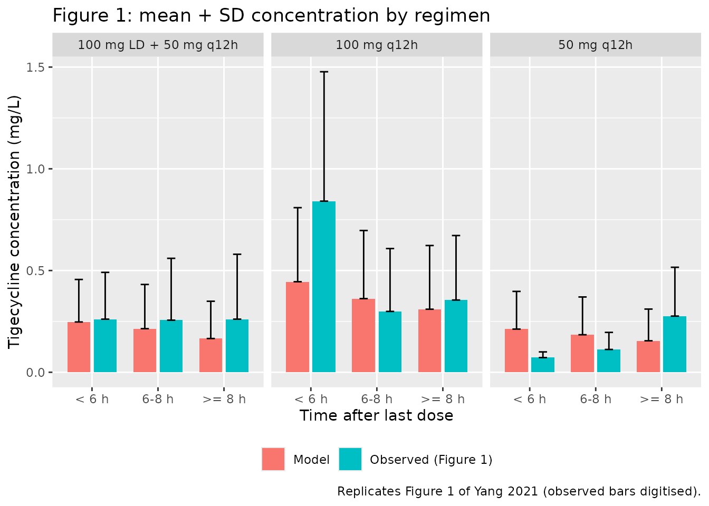
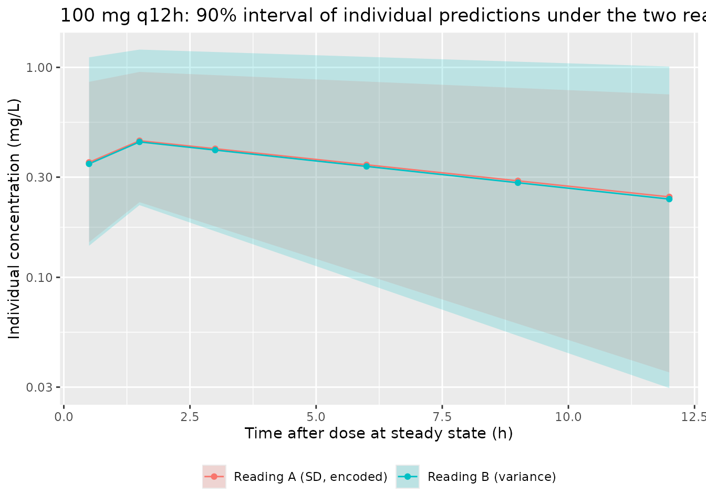

# Tigecycline (Yang 2021)

## Model and source

- Citation: Yang T, Mei H, Wang J, Cai Y. Therapeutic Drug Monitoring of
  Tigecycline in 67 Infected Patients and a Population
  Pharmacokinetics/Microbiological Evaluation of A. baumannii Study.
  Front Microbiol. 2021;12:678165. <doi:10.3389/fmicb.2021.678165>
- Description: One-compartment IV population PK model for tigecycline in
  Chinese adults with hospital-acquired pneumonia, complicated skin and
  skin-structure infection or complicated intra-abdominal infection,
  with blood urea nitrogen as a power covariate on clearance (Yang 2021)
- Article: <https://doi.org/10.3389/fmicb.2021.678165>
- Supplement (Data Sheet 1, Tables S1-S10, Figures S1-S5):
  <https://www.frontiersin.org/articles/10.3389/fmicb.2021.678165/full#supplementary-material>

The main article gives only the final clearance equation. The volume of
distribution, the between-subject variability and the residual error are
in Supplementary Table S10.

## Population

Yang and colleagues ran a therapeutic-drug-monitoring study at the PLA
General Hospital in Beijing between October 2018 and March 2019. They
enrolled 67 adults (over 18 years) treated with intravenous tigecycline
for hospital-acquired pneumonia, complicated skin and skin-structure
infection or complicated intra-abdominal infection. There were 50 men
and 17 women, with a mean age of 65.5 years (SD 23) and a mean weight of
64.83 kg (SD 14.96). Patients received one of three regimens (Table 1):

- 100 mg loading dose, then 50 mg every 12 h (24 patients);
- 100 mg every 12 h (29 patients);
- 50 mg every 12 h (14 patients).

At steady state, samples were drawn at one or more of 0, 0.5, 1.5, 3, 6,
9 and 12 h after a dose. Most were troughs. The study collected 186
concentrations, one of them below the 50 ng/mL limit of quantification.
The lung was the infection site in most of the 58 patients with outcome
data (Table 2). *Acinetobacter baumannii* was isolated in 24 of them,
alone or with *K. pneumoniae* or *E. coli*.

The sparse, trough-heavy data supported only a one-compartment model,
fitted in NONMEM 6. The covariates screened were sex, age, body weight,
direct and total bilirubin, albumin, ALT, AST, GGT, ALP, blood urea
nitrogen (BUN) and creatinine. Age and BUN both reduced the objective
function, but only BUN on clearance survived backward elimination.

The same information is available programmatically via
`readModelDb("Yang_2021_tigecycline")()$population`.

## Source trace

| Equation / parameter | Value | Source location |
|----|----|----|
| One-compartment IV model | n/a | Results, “Construction of the Base Model and Full Regression Model”; Supplement, “Compartment model selection” |
| `cl = exp(lcl + etalcl) * (BUN / 9)^e_bun_cl` | n/a | Results: “CL = 25.2 \* (BUN/9)^-0.271” |
| `lcl` | log(25.2) L/h | Table S10, CL = 25.2 L/h (RSE 7.9%) |
| `lvc` | log(417) L | Table S10, V = 417 L (RSE 33.3%) |
| `e_bun_cl` | -0.271 | Table S10, theta BUN (CL) = -0.271 (RSE 43.2%); same value in the Results equation |
| `etalcl` | 0.587^2 = 0.3446 | Table S10, eta (CL) = 0.587 (RSE 11.3%), read as an SD (see below) |
| `propSd` | 0.576 | Table S10, epsilon (prop) = 0.576 (RSE 10.5%), read as an SD; proportional error per Supplement “Base model” |
| Reference BUN | 9 mmol/L | Results equation; Table 5 footnote |

## Typical-value check against Table 5

The paper’s Table 5 reports the typical-value AUC0-24/MIC at steady
state for maintenance doses of 50 and 100 mg every 12 h. It does this in
four BUN strata (medians 4.7, 8.3, 14.5 and 34.2 mmol/L), using the
broth-microdilution MIC50 of 4 mg/L and MIC90 of 8 mg/L. At steady
state, AUC0-24 is twice the maintenance dose divided by CL. So Table 5
tests the clearance equation directly, including the sign of the BUN
exponent.

The model is solved with between-subject and residual variability
removed. It runs to steady state with 20 doses every 12 h, given as
1-hour infusions (the paper does not state the infusion time). PKNCA
computes AUC over the last 24 h.

``` r

strata <- tibble::tibble(
  stratum = c("Normal", "Compensated", "Decompensated", "Renal failure"),
  bun_range = c("1.8-7.5", "7.5-9", "9-20", "20-48.3"),
  BUN = c(4.7, 8.3, 14.5, 34.2)
)

tv_design <- tidyr::expand_grid(dose = c(50, 100), strata) |>
  dplyr::mutate(
    id = dplyr::row_number(),
    treatment = sprintf("%g mg q12h, BUN %.1f", dose, BUN)
  )

dose_times <- seq(0, 228, by = 12)
obs_times <- sort(unique(c(seq(216, 240, by = 0.25), 216.5, 217)))

tv_events <- dplyr::bind_rows(
  tidyr::expand_grid(tv_design, time = dose_times) |>
    dplyr::mutate(evid = 1L, amt = dose, dur = 1, cmt = "central"),
  tidyr::expand_grid(tv_design, time = obs_times) |>
    dplyr::mutate(evid = 0L, amt = 0, dur = 0, cmt = "central")
) |>
  dplyr::arrange(id, time, dplyr::desc(evid)) |>
  as.data.frame()
```

``` r

mod <- readModelDb("Yang_2021_tigecycline")
mod_typical <- rxode2::zeroRe(mod)
#> ℹ parameter labels from comments will be replaced by 'label()'
sim_tv <- rxode2::rxSolve(
  mod_typical,
  events = tv_events,
  keep = c("treatment", "dose", "BUN"),
  rtol = 1e-10, atol = 1e-12
) |>
  as.data.frame()
#> ℹ omega/sigma items treated as zero: 'etalcl'
#> Warning: multi-subject simulation without without 'omega'
```

``` r

conc_tv <- sim_tv |>
  dplyr::filter(!is.na(Cc)) |>
  dplyr::select(id, time, Cc, treatment)
dose_tv <- tv_events |>
  dplyr::filter(evid == 1) |>
  dplyr::select(id, time, amt, treatment)

nca_tv <- PKNCA::pk.nca(PKNCA::PKNCAdata(
  PKNCA::PKNCAconc(conc_tv, Cc ~ time | treatment + id),
  PKNCA::PKNCAdose(dose_tv, amt ~ time | treatment + id),
  intervals = data.frame(start = 216, end = 240, auclast = TRUE, cmax = TRUE, cmin = TRUE)
))

nca_wide <- as.data.frame(nca_tv) |>
  dplyr::select(treatment, PPTESTCD, PPORRES) |>
  tidyr::pivot_wider(names_from = PPTESTCD, values_from = PPORRES) |>
  dplyr::left_join(tv_design, by = "treatment")

# Closed-form identity: AUC0-24 at steady state = 2 * dose / CL. The only
# differences are the trapezoid on a 0.25-h grid and integrator error.
cl_tv <- exp(log(25.2)) * (nca_wide$BUN / 9)^-0.271
auc_closed <- 2 * nca_wide$dose / cl_tv
stopifnot(max(abs(nca_wide$auclast / auc_closed - 1)) < 0.005)
```

``` r

table5 <- tibble::tribble(
  ~dose, ~BUN, ~pub_mic50, ~pub_mic90,
  50,    4.7,  0.8,        0.4,
  50,    8.3,  0.95,       0.45,
  50,    14.5, 1.1,        0.55,
  50,    34.2, 1.4,        0.7,
  100,   4.7,  1.6,        0.8,
  100,   8.3,  1.9,        0.95,
  100,   14.5, 2.2,        1.1,
  100,   34.2, 2.75,       1.4
)

t5 <- nca_wide |>
  dplyr::inner_join(table5, by = c("dose", "BUN")) |>
  dplyr::mutate(
    sim_mic50 = auclast / 4,
    sim_mic90 = auclast / 8,
    pct_mic50 = 100 * (sim_mic50 / pub_mic50 - 1),
    pct_mic90 = 100 * (sim_mic90 / pub_mic90 - 1)
  )
stopifnot(nrow(t5) == 8L)

t5 |>
  dplyr::transmute(
    dose = paste(dose, "mg q12h"), stratum, bun_range, BUN,
    sim_mic50 = round(sim_mic50, 3), pub_mic50, pct_mic50 = round(pct_mic50, 1),
    sim_mic90 = round(sim_mic90, 3), pub_mic90, pct_mic90 = round(pct_mic90, 1)
  ) |>
  dplyr::rename(
    "Maintenance dose" = dose,
    "Renal grade" = stratum,
    "BUN range (mmol/L)" = bun_range,
    "BUN median (mmol/L)" = BUN,
    "AUC/MIC50 model (h)" = sim_mic50,
    "AUC/MIC50 Table 5 (h)" = pub_mic50,
    "MIC50 diff (%)" = pct_mic50,
    "AUC/MIC90 model (h)" = sim_mic90,
    "AUC/MIC90 Table 5 (h)" = pub_mic90,
    "MIC90 diff (%)" = pct_mic90
  ) |>
  knitr::kable(caption = "Steady-state AUC0-24/MIC from the typical-value model against Table 5 of Yang 2021.")
```

| Maintenance dose | Renal grade | BUN range (mmol/L) | BUN median (mmol/L) | AUC/MIC50 model (h) | AUC/MIC50 Table 5 (h) | MIC50 diff (%) | AUC/MIC90 model (h) | AUC/MIC90 Table 5 (h) | MIC90 diff (%) |
|:---|:---|:---|---:|---:|---:|---:|---:|---:|---:|
| 100 mg q12h | Decompensated | 9-20 | 14.5 | 2.258 | 2.20 | 2.6 | 1.129 | 1.10 | 2.6 |
| 100 mg q12h | Renal failure | 20-48.3 | 34.2 | 2.849 | 2.75 | 3.6 | 1.424 | 1.40 | 1.7 |
| 100 mg q12h | Normal | 1.8-7.5 | 4.7 | 1.664 | 1.60 | 4.0 | 0.832 | 0.80 | 4.0 |
| 100 mg q12h | Compensated | 7.5-9 | 8.3 | 1.941 | 1.90 | 2.2 | 0.971 | 0.95 | 2.2 |
| 50 mg q12h | Decompensated | 9-20 | 14.5 | 1.129 | 1.10 | 2.6 | 0.564 | 0.55 | 2.6 |
| 50 mg q12h | Renal failure | 20-48.3 | 34.2 | 1.424 | 1.40 | 1.7 | 0.712 | 0.70 | 1.7 |
| 50 mg q12h | Normal | 1.8-7.5 | 4.7 | 0.832 | 0.80 | 4.0 | 0.416 | 0.40 | 4.0 |
| 50 mg q12h | Compensated | 7.5-9 | 8.3 | 0.971 | 0.95 | 2.2 | 0.485 | 0.45 | 7.8 |

Steady-state AUC0-24/MIC from the typical-value model against Table 5 of
Yang 2021. {.table}

``` r

pct_all <- c(t5$pct_mic50, t5$pct_mic90)
# Deterministic comparison against values printed to two significant
# figures. The largest gap is the 50 mg / BUN 8.3 MIC90 cell: the model gives
# 0.485 h, and the table prints 0.45 h, which is half of its own 0.95 h MIC50
# cell rounded down. A positive exponent (+0.271) would invert the BUN trend
# and miss the outer strata by about 50%.
stopifnot(
  max(abs(pct_all)) < 10,
  abs(median(pct_all)) < 5
)
```

Fifteen of the 16 cells of Table 5 are reproduced within 5%. The model
is slightly above the table throughout, consistent with values rounded
down to two digits. The remaining cell (50 mg, BUN 8.3, MIC90) differs
by 7.8% because the table prints 0.45 h where half of its own 0.95 h
MIC50 cell would be 0.475 h. CL falls as BUN rises, so exposure is
highest in renal failure, as in the paper.

The comparison below repeats the check in terms of AUC0-24 itself. The
Table 5 MIC50 column is converted back to AUC by multiplying by 4 mg/L.

``` r

published_auc <- table5 |>
  dplyr::mutate(
    treatment = sprintf("%g mg q12h, BUN %.1f", dose, BUN),
    auclast = pub_mic50 * 4
  ) |>
  dplyr::select(treatment, auclast)

cmp <- nlmixr2lib::ncaComparisonTable(
  simulated = nca_tv,
  reference = published_auc,
  by = "treatment",
  params = "auclast",
  units = c(auclast = "mg*h/L"),
  tolerance_pct = 20
)
knitr::kable(cmp, caption = "Simulated vs. published steady-state AUC0-24 (Table 5 MIC50 column x 4 mg/L). * differs from reference by >20%.")
```

| NCA parameter     | treatment             | Reference | Simulated | % diff |
|:------------------|:----------------------|:----------|:----------|:-------|
| AUClast (mg\*h/L) | 50 mg q12h, BUN 4.7   | 3.2       | 3.33      | +4.0%  |
| AUClast (mg\*h/L) | 50 mg q12h, BUN 8.3   | 3.8       | 3.88      | +2.2%  |
| AUClast (mg\*h/L) | 50 mg q12h, BUN 14.5  | 4.4       | 4.52      | +2.6%  |
| AUClast (mg\*h/L) | 50 mg q12h, BUN 34.2  | 5.6       | 5.7       | +1.7%  |
| AUClast (mg\*h/L) | 100 mg q12h, BUN 4.7  | 6.4       | 6.66      | +4.0%  |
| AUClast (mg\*h/L) | 100 mg q12h, BUN 8.3  | 7.6       | 7.76      | +2.2%  |
| AUClast (mg\*h/L) | 100 mg q12h, BUN 14.5 | 8.8       | 9.03      | +2.6%  |
| AUClast (mg\*h/L) | 100 mg q12h, BUN 34.2 | 11        | 11.4      | +3.6%  |

Simulated vs. published steady-state AUC0-24 (Table 5 MIC50 column x 4
mg/L). \* differs from reference by \>20%. {.table}

Table 5 is labelled *f*AUC, but its values equal total (bound plus
unbound) dose/CL with no unbound fraction applied. The comparison above
therefore uses total AUC.

## Observed concentrations by regimen (Figure 1)

Figure 1 of the paper shows the observed mean (+SD) concentrations in
each regimen, binned by time after the last dose (\< 6 h, 6-8 h, \>= 8
h). The bar heights and error bars were digitised by the maintainers
from the published figure.

The virtual cohort has 200 patients per regimen, all at steady state,
each sampled at the protocol times of 0.5, 1.5, 3, 6, 9 and 12 h after a
dose. The paper does not report the BUN distribution. BUN is drawn
log-normally with a median of 8.3 mmol/L and a log-SD of 0.78, which
puts the 5th and 95th percentiles near 2.3 and 30 mmol/L, then clamped
to the observed 1.8-48.3 mmol/L range.

``` r

rxode2::rxSetSeed(20210616)
set.seed(20210616)

n_arm <- 200L
regimens <- tibble::tibble(
  regimen = c("100 mg LD + 50 mg q12h", "100 mg q12h", "50 mg q12h"),
  first_dose = c(100, 100, 50),
  maint_dose = c(50, 100, 50)
)

make_arm <- function(k, n, id_offset) {
  reg <- regimens[k, ]
  subj <- tibble::tibble(
    id = id_offset + seq_len(n),
    regimen = reg$regimen,
    BUN = pmin(pmax(stats::rlnorm(n, log(8.3), 0.78), 1.8), 48.3)
  )
  doses <- tidyr::expand_grid(subj, time = dose_times) |>
    dplyr::mutate(
      evid = 1L,
      amt = ifelse(time == 0, reg$first_dose, reg$maint_dose),
      dur = 1, cmt = "central"
    )
  obs <- tidyr::expand_grid(subj, time = 228 + c(0.5, 1.5, 3, 6, 9, 12)) |>
    dplyr::mutate(evid = 0L, amt = 0, dur = 0, cmt = "central")
  dplyr::bind_rows(doses, obs)
}

fig1_events <- dplyr::bind_rows(
  make_arm(1, n_arm, 0L),
  make_arm(2, n_arm, n_arm),
  make_arm(3, n_arm, 2L * n_arm)
) |>
  dplyr::arrange(id, time, dplyr::desc(evid)) |>
  as.data.frame()
stopifnot(!anyDuplicated(unique(fig1_events[, c("id", "time", "evid")])))
```

``` r

sim_fig1 <- rxode2::rxSolve(mod, events = fig1_events, keep = c("regimen", "BUN")) |>
  as.data.frame() |>
  dplyr::mutate(
    tad = time - 228,
    bin = dplyr::case_when(tad < 6 ~ "< 6 h", tad < 8 ~ "6-8 h", TRUE ~ ">= 8 h"),
    bin = factor(bin, levels = c("< 6 h", "6-8 h", ">= 8 h"))
  )
#> ℹ parameter labels from comments will be replaced by 'label()'

fig1_obs <- tibble::tribble(
  ~regimen,                 ~bin,     ~obs_mean, ~obs_sd,
  "100 mg LD + 50 mg q12h", "< 6 h",  0.261,     0.230,
  "100 mg LD + 50 mg q12h", "6-8 h",  0.256,     0.304,
  "100 mg LD + 50 mg q12h", ">= 8 h", 0.261,     0.319,
  "100 mg q12h",            "< 6 h",  0.841,     0.636,
  "100 mg q12h",            "6-8 h",  0.299,     0.309,
  "100 mg q12h",            ">= 8 h", 0.355,     0.317,
  "50 mg q12h",             "< 6 h",  0.072,     0.028,
  "50 mg q12h",             "6-8 h",  0.112,     0.084,
  "50 mg q12h",             ">= 8 h", 0.276,     0.240
) |>
  dplyr::mutate(bin = factor(bin, levels = levels(sim_fig1$bin)))

fig1_sim <- sim_fig1 |>
  dplyr::group_by(regimen, bin) |>
  dplyr::summarise(sim_mean = mean(sim), sim_sd = stats::sd(sim), .groups = "drop")

fig1_cmp <- dplyr::inner_join(fig1_obs, fig1_sim, by = c("regimen", "bin"))
stopifnot(nrow(fig1_cmp) == 9L)

fig1_cmp |>
  dplyr::mutate(dplyr::across(c(sim_mean, sim_sd), \(x) round(x, 3))) |>
  dplyr::rename(
    "Regimen" = regimen,
    "Time after dose" = bin,
    "Observed mean (mg/L)" = obs_mean,
    "Observed SD (mg/L)" = obs_sd,
    "Model mean (mg/L)" = sim_mean,
    "Model SD (mg/L)" = sim_sd
  ) |>
  knitr::kable(caption = "Mean (SD) concentration by regimen and time bin: digitised Figure 1 against the model (with between-subject and residual variability).")
```

| Regimen | Time after dose | Observed mean (mg/L) | Observed SD (mg/L) | Model mean (mg/L) | Model SD (mg/L) |
|:---|:---|---:|---:|---:|---:|
| 100 mg LD + 50 mg q12h | \< 6 h | 0.261 | 0.230 | 0.247 | 0.209 |
| 100 mg LD + 50 mg q12h | 6-8 h | 0.256 | 0.304 | 0.214 | 0.217 |
| 100 mg LD + 50 mg q12h | \>= 8 h | 0.261 | 0.319 | 0.166 | 0.183 |
| 100 mg q12h | \< 6 h | 0.841 | 0.636 | 0.445 | 0.364 |
| 100 mg q12h | 6-8 h | 0.299 | 0.309 | 0.362 | 0.335 |
| 100 mg q12h | \>= 8 h | 0.355 | 0.317 | 0.310 | 0.313 |
| 50 mg q12h | \< 6 h | 0.072 | 0.028 | 0.212 | 0.185 |
| 50 mg q12h | 6-8 h | 0.112 | 0.084 | 0.184 | 0.186 |
| 50 mg q12h | \>= 8 h | 0.276 | 0.240 | 0.155 | 0.156 |

Mean (SD) concentration by regimen and time bin: digitised Figure 1
against the model (with between-subject and residual variability).
{.table}

``` r

dplyr::bind_rows(
  fig1_cmp |> dplyr::transmute(regimen, bin, source = "Observed (Figure 1)", mean = obs_mean, sd = obs_sd),
  fig1_cmp |> dplyr::transmute(regimen, bin, source = "Model", mean = sim_mean, sd = sim_sd)
) |>
  ggplot(aes(bin, mean, fill = source)) +
  geom_col(position = position_dodge(width = 0.8), width = 0.7) +
  geom_errorbar(aes(ymin = mean, ymax = mean + sd), position = position_dodge(width = 0.8), width = 0.25) +
  facet_wrap(~regimen) +
  labs(
    x = "Time after last dose", y = "Tigecycline concentration (mg/L)", fill = NULL,
    title = "Figure 1: mean + SD concentration by regimen",
    caption = "Replicates Figure 1 of Yang 2021 (observed bars digitised)."
  ) +
  theme(legend.position = "bottom")
```



The model reproduces the overall concentration level of 0.1-0.4 mg/L and
the size of the spread: the model SD is close to its mean in every bin,
as the observed SD is. Several bin means differ, however. Most of the
gaps come from two features of the observed figure that a
one-compartment steady-state model cannot produce:

- In the 100 mg q12h arm, the \< 6 h mean (0.84 mg/L) is nearly twice
  the model’s (about 0.45 mg/L).
- Observed means are flat or *rising* toward the trough in the
  loading-dose arm (0.26 mg/L in every bin) and in the 50 mg q12h arm
  (0.07 mg/L at \< 6 h, 0.28 mg/L at \>= 8 h). Model concentrations fall
  over the dosing interval, so the model sits above the observed early
  bins of the 50 mg arm and below the observed \>= 8 h bins.

Both bins come from small, unbalanced subsets of patients (14 patients
received 50 mg q12h), and the paper’s Discussion notes that the varying
sampling times limit what the figure shows. The model was fitted to the
individual concentrations, not to these bin means. Figure 1 is therefore
shown for context and is not used as a gate.

## Variance or standard deviation? The two readings of Table S10

Table S10 prints “eta (CL) 0.587” and “epsilon (prop) 0.576” without
saying whether these are standard deviations or NONMEM variances (OMEGA
and SIGMA). The maintainers encoded the standard-deviation reading:

- **Reading A (encoded):** `etalcl` variance 0.587^2 = 0.345 (CV about
  64%), and `propSd` = 0.576.
- **Reading B (not encoded):** `etalcl` variance 0.587 (CV about 87%),
  and `propSd` = sqrt(0.576) = 0.759.

Two pieces of evidence favour reading A, but neither is decisive:

- **Standard errors.** The printed relative standard errors (11.3% and
  10.5%) are below the smallest value attainable for a variance
  estimated from 67 subjects. That floor is about sqrt(2/67) = 17%. For
  a standard deviation the floor is half that.
- **Observed spread.** The within-bin spread of Figure 1, compared
  below, sits closer to reading A.

The typical-value results above (Table 5, PKNCA) are identical under
both readings, because only the stochastic spread differs.

``` r

mod_B <- rxode2::ini(mod, etalcl ~ 0.587, propSd = sqrt(0.576))
#> ℹ parameter labels from comments will be replaced by 'label()'
#> ℹ change initial estimate of `etalcl` to `0.587`
#> ℹ change initial estimate of `propSd` to `0.758946638440411`

sim_B <- rxode2::rxSolve(mod_B, events = fig1_events, keep = c("regimen", "BUN")) |>
  as.data.frame() |>
  dplyr::mutate(
    tad = time - 228,
    bin = dplyr::case_when(tad < 6 ~ "< 6 h", tad < 8 ~ "6-8 h", TRUE ~ ">= 8 h"),
    bin = factor(bin, levels = levels(sim_fig1$bin))
  )

cv_cells <- function(s, label) {
  s |>
    dplyr::group_by(regimen, bin) |>
    dplyr::summarise(cv = stats::sd(sim) / mean(sim), .groups = "drop") |>
    dplyr::mutate(reading = label)
}

cv_tab <- dplyr::bind_rows(
  fig1_obs |> dplyr::transmute(regimen, bin, cv = obs_sd / obs_mean, reading = "Observed (Figure 1)"),
  cv_cells(sim_fig1, "Reading A (SD, encoded)"),
  cv_cells(sim_B, "Reading B (variance)")
)

cv_tab |>
  dplyr::group_by(reading) |>
  dplyr::summarise(
    `Median CV across the 9 cells (%)` = round(100 * stats::median(cv)),
    `Range (%)` = paste0(round(100 * min(cv)), "-", round(100 * max(cv))),
    .groups = "drop"
  ) |>
  dplyr::rename("Source" = reading) |>
  knitr::kable(caption = "Arithmetic CV of concentrations within each regimen x time bin.")
```

| Source                  | Median CV across the 9 cells (%) | Range (%) |
|:------------------------|---------------------------------:|:----------|
| Observed (Figure 1)     |                               88 | 39-122    |
| Reading A (SD, encoded) |                              101 | 82-111    |
| Reading B (variance)    |                              148 | 119-170   |

Arithmetic CV of concentrations within each regimen x time bin. {.table}

``` r

pi_band <- function(s, label) {
  s |>
    dplyr::filter(regimen == "100 mg q12h") |>
    dplyr::group_by(tad) |>
    dplyr::summarise(
      Q05 = stats::quantile(Cc, 0.05), Q50 = stats::quantile(Cc, 0.5), Q95 = stats::quantile(Cc, 0.95),
      .groups = "drop"
    ) |>
    dplyr::mutate(reading = label)
}

dplyr::bind_rows(
  pi_band(sim_fig1, "Reading A (SD, encoded)"),
  pi_band(sim_B, "Reading B (variance)")
) |>
  ggplot(aes(tad, Q50, colour = reading, fill = reading)) +
  geom_ribbon(aes(ymin = Q05, ymax = Q95), alpha = 0.2, colour = NA) +
  geom_line() +
  geom_point() +
  scale_y_log10() +
  labs(
    x = "Time after dose at steady state (h)", y = "Individual concentration (mg/L)",
    colour = NULL, fill = NULL,
    title = "100 mg q12h: 90% interval of individual predictions under the two readings"
  ) +
  theme(legend.position = "bottom")
```



The observed per-bin CVs come from small, mixed bins, so this comparison
cannot settle the question. The scale of Table S10 cannot be verified
from the published material. Users who prefer reading B can apply it
with `rxode2::ini(mod, etalcl ~ 0.587, propSd = sqrt(0.576))`, as above.

## Assumptions and deviations

- **Scale of the Table S10 variability terms.** Encoded as standard
  deviations (reading A). The section above gives the reasons and shows
  the alternative.
- **Infusion duration.** The paper does not state it. The simulations
  use 1 h, within the 30-60 minute infusion of the tigecycline label.
  AUC0-24 at steady state does not depend on the infusion time.
- **BUN distribution.** The paper does not report it. Figure 1 uses an
  assumed log-normal distribution (median 8.3 mmol/L, close to the 9
  mmol/L reference and the Table 5 compensated-stratum median), clamped
  to 1.8-48.3 mmol/L. The Table 5 check uses the printed stratum medians
  and does not depend on this assumption.
- **No IIV on V.** Table S10 reports between-subject variability on CL
  only, so V carries no eta.
- **Figure 1 values** were digitised by the maintainers from the
  published raster figure. The digitising resolution is about 0.003
  mg/L.
- **Table 5 label.** The table is headed *f*AUC0-24/MIC, but its numbers
  equal total AUC0-24/MIC (twice the maintenance dose over CL, divided
  by the MIC), with no unbound fraction applied. The comparison uses
  total AUC.
- **Reference BUN of 9 mmol/L.** This is the normalising value in the
  printed equation. It matches the upper bound of the paper’s
  compensated renal-insufficiency grade, and the paper does not say it
  is the cohort median.
- **Negative simulated observations.** A proportional residual error
  with SD 0.576 gives a small fraction of negative simulated
  observations (`sim`). The figure comparisons keep them so that the
  means and SDs stay unbiased.
- No erratum or correction notice for this article is linked in Europe
  PMC (checked 2026-10-16).
