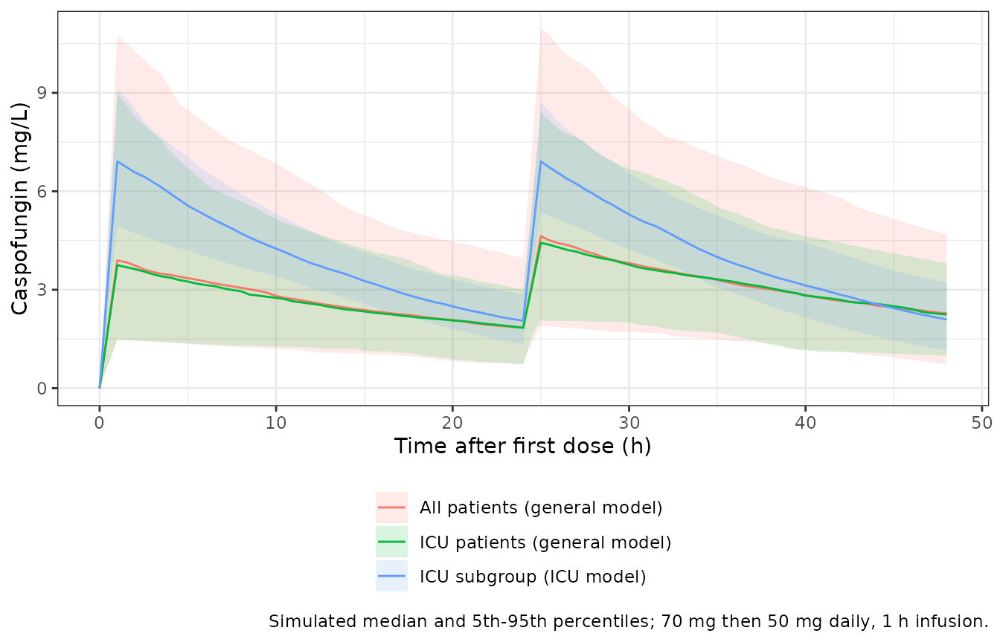
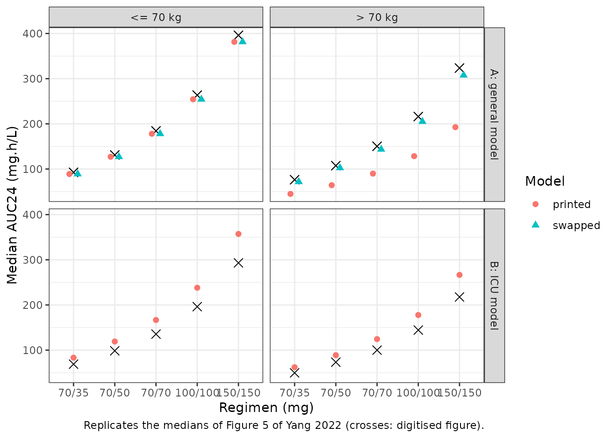

# Caspofungin (Yang 2022)

## Model and source

- Citation: Yang Q, Zhang T, Zhang Y, Sun D, Zheng X, Du Q, Wang X,
  Cheng X, Xing J, Dong Y. The recommended dosage regimen for
  caspofungin in patients with higher body weight or hypoalbuminaemia
  will result in low exposure: five years of data based on a population
  pharmacokinetic model and Monte-Carlo simulations. Front Pharmacol.
  2022;13:993330. <doi:10.3389/fphar.2022.993330>. PMCID: PMC9669616.
- Article: <https://doi.org/10.3389/fphar.2022.993330>
- Open-access full text:
  <https://www.ncbi.nlm.nih.gov/pmc/articles/PMC9669616/>

Yang 2022 fitted two separate one-compartment population PK models to
caspofungin concentrations, and both are in nlmixr2lib:

- `Yang_2022_caspofungin`: One-compartment population PK model for
  intravenous caspofungin in hospitalised Chinese adults with confirmed
  or probable candidiasis (ICU, solid-organ transplant, haematology and
  respiratory patients; the ‘general PPK model’ of Yang 2022). Clearance
  and volume each carry two dichotomised covariates, hypoalbuminaemia
  (serum albumin \< 35 g/L) and body weight \>= 70 kg, entering as (1 +
  theta x indicator) factors. Log-normal IIV on CL and V and a
  proportional residual error. A separately fitted ICU-subgroup model
  from the same paper is Yang_2022_caspofungin_icu.
- `Yang_2022_caspofungin_icu`: One-compartment population PK model for
  intravenous caspofungin in critically ill adults in the intensive care
  unit (the ‘ICU-subgroup PPK model’ of Yang 2022), pooling 51 ICU
  patients from Xi’an, China with 85 ICU patients digitised from seven
  published caspofungin studies. Clearance carries one dichotomised
  covariate, body weight \>= 70 kg, entering as a (1 + theta x
  indicator) factor; volume has no covariate. Log-normal IIV on CL and V
  and a proportional residual error. The general-population model from
  the same paper is Yang_2022_caspofungin.

Both models enter albumin and weight as yes/no indicators, never as
continuous values. The general model has

CL = 0.32 x (1 + 0.46 ALB\*) x (1 + 0.98 WT\*) x exp(eta_CL), V = 13.31
x (1 + 0.49 ALB\*) x (1 + 0.24 WT\*) x exp(eta_V),

with ALB\* = 1 for albumin \< 35 g/L and WT\* = 1 for weight \>= 70 kg.
The ICU model has CL = 0.42 x (1 + 0.34 WT\*) x exp(eta_CL) and V =
10.20 x exp(eta_V).

The paper then simulates the steady-state AUC over 24 h as AUC24 = Dose
/ CL and computes the probability of reaching the free AUC24/MIC targets
of 20 (*C. albicans*) and 7 (*C. parapsilosis*, *C. glabrata*), with 97%
protein binding.

**Read the weight coefficients with care.** As printed in Table 3, a
weight of 70 kg or more nearly doubles clearance (x 1.98) and raises
volume by 24%. The paper’s own simulations (Figure 5A, Table S1) and its
mean individual clearances (Table 4) all fit the opposite assignment, x
1.24 on clearance. The model file carries the printed values. The
section [Weight coefficients](#weight-coefficients) below runs both
readings against those outputs.

## Population

The general model used 921 plasma concentrations from 299 adults with
confirmed or probable candidiasis treated at the First Affiliated
Hospital of Xi’an Jiaotong University between June 2014 and June 2019
(Methods 2.1-2.3, Table 1). There were 51 ICU, 163 solid-organ
transplant, 42 haematology and 43 other patients. Mean age was 44 years
(18-99), mean weight 62.3 kg (30-100), 92 were women, and mean albumin
was 35.6 g/L (15.1-64.5), with 161 below 35 g/L. Caspofungin was given
as a 1 h intravenous infusion, mostly 70 mg on day 1 and then 50 mg
daily, with 70/35 mg in Child-Pugh B hepatic impairment and 70/70 mg
above 75 kg. Most samples were sparse therapeutic drug monitoring
samples (median three per patient).

The ICU model pooled the hospital’s 51 ICU patients with 85 ICU patients
whose concentrations the authors took from seven published studies
(Supplementary 3.1.2). The 136 patients had a mean age of 60.5 years and
a mean weight of 68.1 kg; the literature patients were heavier (78.7 kg)
than the hospital’s (60.7 kg). Mean albumin was 28.0 g/L, and 50 were on
continuous renal replacement therapy.

## Source trace

No control stream was published. The supplement holds text and the PTA
Tables S1 and S2 only.

| Model element | Value | Source location |
|----|----|----|
| One-compartment model, 1 h IV infusion | – | Methods 2.1 (‘intravenously over 1 h’); Results 3.2.1 |
| General: CL and V equations, ALB\* and WT\* definitions | – | Table 3, footnote c |
| General `lcl` (theta1) | 0.32 L/h | Table 3, final model |
| General `lvc` (theta2) | 13.31 L | Table 3 |
| General `e_alb_cl` (theta3) | 0.46 | Table 3 |
| General `e_alb_vc` (theta4) | 0.49 | Table 3 |
| General `e_wt_cl` (theta5) | 0.98 | Table 3 (see [Weight coefficients](#weight-coefficients)) |
| General `e_wt_vc` (theta6) | 0.24 | Table 3 |
| General `etalcl`, `etalvc` | 29.2%, 59.2% | Table 3, ‘Inter-individual variability (%)’ |
| General `propSd` | 0.193 | Table 3, ‘Proportional (%)’ 19.3 |
| ICU: CL and V equations | – | Table 3, footnote d |
| ICU `lcl` (theta1) | 0.42 L/h | Table 3, final model |
| ICU `lvc` (theta2) | 10.20 L | Table 3 |
| ICU `e_wt_cl` (theta3) | 0.34 | Table 3 |
| ICU `etalcl`, `etalvc` | 13.5%, 19.6% | Table 3 |
| ICU `propSd` | 0.243 | Table 3, ‘Proportional (%)’ 24.3 |
| AUC24 = Dose / CL; fAUC24/MIC targets; 97% binding | – | Methods 2.6 |

## Typical values

The covariate equations are checked against hand calculation, for both
models, in every albumin and weight category.

``` r

mod_gen <- readModelDb("Yang_2022_caspofungin")
mod_icu <- readModelDb("Yang_2022_caspofungin_icu")

# One observation per covariate combination; zeroRe() gives the typical values.
typical_values <- function(model, cov) {
  ev <- cov
  ev$id <- seq_len(nrow(ev))
  ev$time <- 0
  ev$evid <- 0
  ev$amt <- 0
  ev$cmt <- "central"
  # zeroRe() removes every eta, so rxSolve()'s 'without omega' warning is expected.
  out <- suppressWarnings(rxode2::rxSolve(rxode2::zeroRe(model), ev, returnType = "data.frame"))
  cbind(cov, cl = out$cl, vc = out$vc)
}

combos <- expand.grid(ALB = c(30, 40), WT = c(60, 80))
typ_gen <- typical_values(mod_gen, combos)
#> ℹ parameter labels from comments will be replaced by 'label()'
#> ℹ omega/sigma items treated as zero: 'etalcl', 'etalvc'
typ_icu <- typical_values(mod_icu, combos)
#> ℹ parameter labels from comments will be replaced by 'label()'
#> ℹ omega/sigma items treated as zero: 'etalcl', 'etalvc'

hand_cl <- with(combos, 0.32 * (1 + 0.46 * (ALB < 35)) * (1 + 0.98 * (WT >= 70)))
hand_vc <- with(combos, 13.31 * (1 + 0.49 * (ALB < 35)) * (1 + 0.24 * (WT >= 70)))
stopifnot(
  all(abs(typ_gen$cl - hand_cl) < 1e-10),
  all(abs(typ_gen$vc - hand_vc) < 1e-10),
  all(abs(typ_icu$cl - 0.42 * (1 + 0.34 * (combos$WT >= 70))) < 1e-10),
  all(abs(typ_icu$vc - 10.20) < 1e-10)
)

# The 70 kg threshold is inclusive (WT* = 1 at weight >= 70 kg).
edge <- typical_values(mod_gen, data.frame(ALB = 40, WT = c(69.9, 70)))
#> ℹ parameter labels from comments will be replaced by 'label()'
#> ℹ omega/sigma items treated as zero: 'etalcl', 'etalvc'
stopifnot(abs(edge$cl[2] / edge$cl[1] - 1.98) < 1e-10)

dplyr::bind_rows(
  dplyr::mutate(typ_gen, model = "General"),
  dplyr::mutate(typ_icu, model = "ICU subgroup")
) |>
  dplyr::mutate(
    ALB = ifelse(ALB < 35, "< 35 g/L", ">= 35 g/L"),
    WT = ifelse(WT >= 70, ">= 70 kg", "< 70 kg")
  ) |>
  dplyr::select(model, ALB, WT, cl, vc) |>
  dplyr::rename("Model" = model, "Albumin" = ALB, "Weight" = WT, "CL (L/h)" = cl, "V (L)" = vc) |>
  knitr::kable(digits = 3, caption = "Typical clearance and volume by covariate category (Table 3).")
```

| Model        | Albumin    | Weight    | CL (L/h) |  V (L) |
|:-------------|:-----------|:----------|---------:|-------:|
| General      | \< 35 g/L  | \< 70 kg  |    0.467 | 19.832 |
| General      | \>= 35 g/L | \< 70 kg  |    0.320 | 13.310 |
| General      | \< 35 g/L  | \>= 70 kg |    0.925 | 24.592 |
| General      | \>= 35 g/L | \>= 70 kg |    0.634 | 16.504 |
| ICU subgroup | \< 35 g/L  | \< 70 kg  |    0.420 | 10.200 |
| ICU subgroup | \>= 35 g/L | \< 70 kg  |    0.420 | 10.200 |
| ICU subgroup | \< 35 g/L  | \>= 70 kg |    0.563 | 10.200 |
| ICU subgroup | \>= 35 g/L | \>= 70 kg |    0.563 | 10.200 |

Typical clearance and volume by covariate category (Table 3). {.table}

## Virtual cohorts

Three cohorts of 200 subjects mirror the three groups of Table 4:

- all hospital patients, simulated with the general model: weight from
  Table 1 (62.3 +/- 11.5 kg, 30-100) and 161 of 299 hypoalbuminaemic;
- the hospital’s ICU patients, simulated with the general model: weight
  60.7 +/- 11.5 kg (30-86) and 44 of 51 hypoalbuminaemic (Supplementary
  3.4.1);
- the ICU subgroup, simulated with the ICU model: 51 of 136 drawn like
  the hospital’s ICU patients and 85 of 136 like the literature patients
  (78.7 +/- 6.1 kg, 48-139).

Only the albumin and weight categories enter the models, so albumin is
drawn uniformly within its category. Weights outside a cohort’s range
are redrawn, not clipped.

``` r

set.seed(2022)
rxode2::rxSetSeed(2022)
n_arm <- 200

draw_wt <- function(n, mu, sd, lo, hi) {
  out <- numeric(0)
  while (length(out) < n) {
    x <- rnorm(n, mu, sd)
    out <- c(out, x[x >= lo & x <= hi])
  }
  out[seq_len(n)]
}
draw_alb <- function(n, p_low) {
  low <- runif(n) < p_low
  ifelse(low, runif(n, 15.1, 35 - 1e-6), runif(n, 35, 64.5))
}

n_icu_hosp <- round(n_arm * 51 / 136)
subj <- dplyr::bind_rows(
  data.frame(
    group = "All patients (general model)",
    WT = draw_wt(n_arm, 62.3, 11.5, 30, 100), ALB = draw_alb(n_arm, 161 / 299)
  ),
  data.frame(
    group = "ICU patients (general model)",
    WT = draw_wt(n_arm, 60.7, 11.5, 30, 86), ALB = draw_alb(n_arm, 44 / 51)
  ),
  data.frame(
    group = "ICU subgroup (ICU model)",
    WT = c(
      draw_wt(n_icu_hosp, 60.7, 11.5, 30, 86),
      draw_wt(n_arm - n_icu_hosp, 78.7, 6.1, 48, 139)
    ),
    ALB = draw_alb(n_arm, 1)
  )
)
subj$id <- seq_len(nrow(subj))

subj |>
  dplyr::group_by(group) |>
  dplyr::summarise(
    mean_wt = mean(WT), pct_wt70 = 100 * mean(WT >= 70),
    pct_alb35 = 100 * mean(ALB < 35), .groups = "drop"
  ) |>
  dplyr::rename(
    "Cohort" = group, "Mean weight (kg)" = mean_wt,
    "Weight >= 70 kg (%)" = pct_wt70, "Albumin < 35 g/L (%)" = pct_alb35
  ) |>
  knitr::kable(digits = 1, caption = "Virtual cohorts.")
```

| Cohort | Mean weight (kg) | Weight \>= 70 kg (%) | Albumin \< 35 g/L (%) |
|:---|---:|---:|---:|
| All patients (general model) | 62.1 | 27.5 | 55 |
| ICU patients (general model) | 60.7 | 22.5 | 87 |
| ICU subgroup (ICU model) | 72.4 | 67.0 | 100 |

Virtual cohorts. {.table}

Each subject receives 70 mg on day 1 and then 50 mg daily for 28 days,
each as a 1 h infusion. With a volume IIV of 59%, the slowest subjects
have half-lives of several days, so steady state is assessed on day 28.

``` r

inf_dur <- 1
n_dose <- 28
tau <- 24
t_last <- (n_dose - 1) * tau
obs_times <- sort(unique(c(
  seq(0, 48, by = 0.5),
  seq(0, n_dose * tau, by = tau),
  t_last + seq(0, tau, by = 0.25)
)))

events <- dplyr::bind_rows(lapply(seq_len(nrow(subj)), function(i) {
  s <- subj[i, ]
  dose <- data.frame(
    id = s$id, time = (seq_len(n_dose) - 1) * tau, evid = 1,
    amt = c(70, rep(50, n_dose - 1)), cmt = "central"
  )
  dose$rate <- dose$amt / inf_dur
  obs <- data.frame(id = s$id, time = obs_times, evid = 0, amt = 0, rate = 0, cmt = "central")
  ev <- rbind(dose, obs)
  ev$WT <- s$WT
  ev$ALB <- s$ALB
  ev$group <- s$group
  ev[order(ev$time, -ev$evid), ]
}))
```

## Simulation

``` r

sim <- dplyr::bind_rows(
  rxode2::rxSolve(
    mod_gen, dplyr::filter(events, group != "ICU subgroup (ICU model)"),
    keep = "group", returnType = "data.frame"
  ),
  rxode2::rxSolve(
    mod_icu, dplyr::filter(events, group == "ICU subgroup (ICU model)"),
    keep = "group", returnType = "data.frame"
  )
)
#> ℹ parameter labels from comments will be replaced by 'label()'
#> ℹ parameter labels from comments will be replaced by 'label()'
```

``` r

sim |>
  dplyr::filter(time <= 48) |>
  dplyr::group_by(group, time) |>
  dplyr::summarise(
    med = median(Cc), lo = quantile(Cc, 0.05), hi = quantile(Cc, 0.95),
    .groups = "drop"
  ) |>
  ggplot(aes(time, med, colour = group, fill = group)) +
  geom_ribbon(aes(ymin = lo, ymax = hi), alpha = 0.15, colour = NA) +
  geom_line() +
  labs(
    x = "Time after first dose (h)", y = "Caspofungin (mg/L)", colour = NULL, fill = NULL,
    caption = "Simulated median and 5th-95th percentiles; 70 mg then 50 mg daily, 1 h infusion."
  ) +
  theme_bw() +
  theme(legend.position = "bottom", legend.direction = "vertical")
```



## PKNCA validation

``` r

conc <- sim |>
  dplyr::filter(!is.na(Cc)) |>
  dplyr::select(id, time, Cc, group)
dose <- events |>
  dplyr::filter(evid == 1) |>
  dplyr::select(id, time, amt, group)
conc_obj <- PKNCA::PKNCAconc(conc, Cc ~ time | group + id, concu = "mg/L", timeu = "h")
dose_obj <- PKNCA::PKNCAdose(dose, amt ~ time | group + id, doseu = "mg")
intervals <- data.frame(
  start = t_last, end = t_last + tau, cmax = TRUE, cmin = TRUE, auclast = TRUE
)
nca_res <- as.data.frame(PKNCA::pk.nca(PKNCA::PKNCAdata(conc_obj, dose_obj, intervals = intervals))$result)

nca_res |>
  dplyr::filter(PPTESTCD %in% c("cmax", "cmin", "auclast")) |>
  dplyr::group_by(group, PPTESTCD) |>
  dplyr::summarise(
    mean = mean(PPORRES), median = median(PPORRES),
    q05 = quantile(PPORRES, 0.05), q95 = quantile(PPORRES, 0.95), .groups = "drop"
  ) |>
  dplyr::mutate(parameter = nlmixr2lib::ncaParamLabel(PPTESTCD)) |>
  dplyr::select(group, parameter, mean, median, q05, q95) |>
  dplyr::rename(
    "Cohort" = group, "NCA parameter" = parameter, "Mean" = mean, "Median" = median,
    "5th percentile" = q05, "95th percentile" = q95
  ) |>
  knitr::kable(digits = 2, caption = "Simulated steady-state NCA, day 28 (Cmax, Cmin in mg/L; AUC in mg.h/L).")
```

| Cohort | NCA parameter | Mean | Median | 5th percentile | 95th percentile |
|:---|:---|---:|---:|---:|---:|
| All patients (general model) | AUClast | 112.23 | 108.97 | 44.53 | 197.20 |
| All patients (general model) | Cmax | 6.57 | 6.06 | 2.62 | 11.85 |
| All patients (general model) | Cmin | 3.30 | 3.08 | 0.84 | 6.44 |
| ICU patients (general model) | AUClast | 103.34 | 100.61 | 46.84 | 175.34 |
| ICU patients (general model) | Cmax | 6.03 | 5.84 | 3.10 | 10.04 |
| ICU patients (general model) | Cmin | 3.05 | 2.84 | 1.01 | 6.00 |
| ICU subgroup (ICU model) | AUClast | 99.76 | 95.71 | 74.04 | 135.20 |
| ICU subgroup (ICU model) | Cmax | 7.06 | 7.09 | 5.62 | 8.62 |
| ICU subgroup (ICU model) | Cmin | 2.20 | 2.10 | 1.12 | 3.46 |

Simulated steady-state NCA, day 28 (Cmax, Cmin in mg/L; AUC in mg.h/L).
{.table}

The paper’s AUC24 = Dose / CL is the steady-state AUC over one dosing
interval. The model’s individual clearances are checked against it on
day 28.

``` r

ind_cl <- sim |>
  dplyr::group_by(id) |>
  dplyr::summarise(cl = cl[1], .groups = "drop")
auc_ss <- nca_res |>
  dplyr::filter(PPTESTCD == "auclast") |>
  dplyr::left_join(ind_cl, by = "id") |>
  dplyr::mutate(ratio = PPORRES * cl / 50)
summary(auc_ss$ratio)
#>    Min. 1st Qu.  Median    Mean 3rd Qu.    Max. 
#>  0.9578  1.0000  1.0000  0.9998  1.0000  1.0000
# The individual clearance is the one used in the solve; a ratio below 1 can
# only come from a slow subject not yet at steady state on day 28.
stopifnot(
  abs(median(auc_ss$ratio) - 1) < 0.005,
  quantile(abs(auc_ss$ratio - 1), 0.9) < 0.02
)
```

### Comparison against Table 4

Table 4 gives the mean and SD of the individual (post hoc) AUC and CL in
each group. The patients’ AUCs used their actual maintenance doses,
mostly 50 mg.

``` r

published <- data.frame(
  group = c("All patients (general model)", "ICU patients (general model)", "ICU subgroup (ICU model)"),
  auclast = c(126.46, 101.46, 101.83)
)
sim_mean <- nca_res |>
  dplyr::filter(PPTESTCD == "auclast") |>
  dplyr::group_by(group) |>
  dplyr::summarise(auclast = mean(PPORRES), .groups = "drop")
cmp <- nlmixr2lib::ncaComparisonTable(
  simulated = sim_mean,
  reference = published,
  by = "group",
  params = "auclast",
  units = c(auclast = "mg*h/L"),
  tolerance_pct = 20
)
knitr::kable(cmp, caption = "Simulated vs published mean steady-state AUC24 (Table 4). * differs by >20%.")
```

| NCA parameter     | group                        | Reference | Simulated | % diff |
|:------------------|:-----------------------------|:----------|:----------|:-------|
| AUClast (mg\*h/L) | All patients (general model) | 126       | 112       | -11.3% |
| AUClast (mg\*h/L) | ICU patients (general model) | 101       | 103       | +1.9%  |
| AUClast (mg\*h/L) | ICU subgroup (ICU model)     | 102       | 99.8      | -2.0%  |

Simulated vs published mean steady-state AUC24 (Table 4). \* differs by
\>20%. {.table}

``` r


# Centre of the distribution (one value per subject): a mis-transcribed
# clearance or covariate moves the mean by far more than this.
cmp_chk <- dplyr::left_join(sim_mean, published, by = "group", suffix = c("_sim", "_pub"))
stopifnot(all(abs(cmp_chk$auclast_sim / cmp_chk$auclast_pub - 1) < 0.25))
```

The ICU model and the general model’s ICU group match Table 4. For all
patients the general model, as printed, gives a mean AUC about 11% below
Table 4; the next section compares this with the alternative reading of
the weight coefficient.

## Weight coefficients

Table 3 gives theta5 (weight on CL) = 0.98 and theta6 (weight on V) =
0.24, and the bootstrap means (1.02 and 0.23) agree. Three outputs in
the same paper instead fit 0.24 on clearance, as if theta5 and theta6
were swapped. The volume coefficient cannot be checked, because AUC24 =
Dose / CL does not depend on V. Below, “printed” is the model as shipped
and “swapped” is the same model with `e_wt_cl = 0.24` and
`e_wt_vc = 0.98`.

``` r

mod_swap <- rxode2::rxode2(mod_gen) |> rxode2::ini(e_wt_cl = 0.24, e_wt_vc = 0.98)
#> ℹ parameter labels from comments will be replaced by 'label()'
#> ℹ change initial estimate of `e_wt_cl` to `0.24`
#> ℹ change initial estimate of `e_wt_vc` to `0.98`
typ_swap <- typical_values(mod_swap, combos)
#> ℹ omega/sigma items treated as zero: 'etalcl', 'etalvc'
omega_cl <- function(model) sqrt(rxode2::rxode2(model)$omega["etalcl", "etalcl"])

# Median and probability of a log-normal clearance mixed over the albumin
# categories, without simulation.
mix_median <- function(cl_typ, w, sd) {
  f <- function(m) sum(w * pnorm((log(m) - log(cl_typ)) / sd)) - 0.5
  uniroot(f, range(cl_typ) * c(0.2, 5), tol = 1e-12)$root
}
mix_prob_below <- function(x, cl_typ, w, sd) sum(w * pnorm((log(x) - log(cl_typ)) / sd))

p_low_alb <- 161 / 299
med_cl <- function(typ, wt, sd) {
  sel <- typ[typ$WT == wt, ]
  mix_median(sel$cl[order(sel$ALB)], c(p_low_alb, 1 - p_low_alb), sd)
}
med_icu_cl <- function(wt) typ_icu$cl[typ_icu$WT == wt][1]
```

### Figure 5 (simulated steady-state AUC24)

The maintainers digitised the red median lines of Figure 5 from the
article’s full-resolution image. Both panels share one axis: 800 mg.h/L
at pixel row 47 and 100 mg.h/L at row 520.

``` r

px_to_auc <- function(y) 800 - (y - 47) * 700 / 473
fig5 <- data.frame(
  panel = rep(c("A: general model", "B: ICU model"), each = 10),
  wt_group = rep(rep(c("<= 70 kg", "> 70 kg"), each = 5), 2),
  dose = rep(c(35, 50, 70, 100, 150), 4),
  y_px = c(
    525, 499, 463, 409.5, 320, 536, 515, 486, 441.5, 369,
    541, 521, 496, 455, 389.5, 554, 538, 520, 490, 440.5
  )
)
fig5$auc_fig <- px_to_auc(fig5$y_px)
fig5$regimen <- factor(
  c("70/35", "70/50", "70/70", "100/100", "150/150")[match(fig5$dose, c(35, 50, 70, 100, 150))],
  levels = c("70/35", "70/50", "70/70", "100/100", "150/150")
)
```

The paper’s Monte-Carlo AUC is Dose / CL, so the median AUC is the
maintenance dose over the median clearance. The figure does not say
which albumin mix it used; the cohort’s 161 of 299 is assumed. The
weight groups use 60 and 80 kg.

``` r

sd_gen <- omega_cl(mod_gen)
#> ℹ parameter labels from comments will be replaced by 'label()'
sd_icu <- omega_cl(mod_icu)
#> ℹ parameter labels from comments will be replaced by 'label()'
model_cl <- data.frame(
  panel = c(rep("A: general model", 4), rep("B: ICU model", 2)),
  wt_group = c("<= 70 kg", "> 70 kg", "<= 70 kg", "> 70 kg", "<= 70 kg", "> 70 kg"),
  reading = c("printed", "printed", "swapped", "swapped", "printed", "printed"),
  med_cl = c(
    med_cl(typ_gen, 60, sd_gen), med_cl(typ_gen, 80, sd_gen),
    med_cl(typ_swap, 60, sd_gen), med_cl(typ_swap, 80, sd_gen),
    med_icu_cl(60), med_icu_cl(80)
  )
)
fig5_cmp <- dplyr::inner_join(fig5, model_cl, by = c("panel", "wt_group"), relationship = "many-to-many") |>
  dplyr::mutate(auc_model = dose / med_cl, pct_diff = 100 * (auc_model / auc_fig - 1))

fig5_cmp |>
  dplyr::select(panel, wt_group, regimen, reading, auc_fig, auc_model, pct_diff) |>
  tidyr::pivot_wider(names_from = reading, values_from = c(auc_model, pct_diff)) |>
  dplyr::select(panel, wt_group, regimen, auc_fig, auc_model_printed, pct_diff_printed, auc_model_swapped, pct_diff_swapped) |>
  dplyr::rename(
    "Panel" = panel, "Weight" = wt_group, "Regimen (mg)" = regimen,
    "Figure 5 median" = auc_fig, "Printed" = auc_model_printed, "Printed, % diff" = pct_diff_printed,
    "Swapped" = auc_model_swapped, "Swapped, % diff" = pct_diff_swapped
  ) |>
  knitr::kable(digits = 1, caption = "Median steady-state AUC24 (mg.h/L): Figure 5 against the model.")
```

| Panel | Weight | Regimen (mg) | Figure 5 median | Printed | Printed, % diff | Swapped | Swapped, % diff |
|:---|:---|:---|---:|---:|---:|---:|---:|
| A: general model | \<= 70 kg | 70/35 | 92.6 | 89.0 | -3.9 | 89.0 | -3.9 |
| A: general model | \<= 70 kg | 70/50 | 131.1 | 127.2 | -3.0 | 127.2 | -3.0 |
| A: general model | \<= 70 kg | 70/70 | 184.4 | 178.0 | -3.4 | 178.0 | -3.4 |
| A: general model | \<= 70 kg | 100/100 | 263.5 | 254.3 | -3.5 | 254.3 | -3.5 |
| A: general model | \<= 70 kg | 150/150 | 396.0 | 381.5 | -3.7 | 381.5 | -3.7 |
| A: general model | \> 70 kg | 70/35 | 76.3 | 45.0 | -41.1 | 71.8 | -6.0 |
| A: general model | \> 70 kg | 70/50 | 107.4 | 64.2 | -40.2 | 102.5 | -4.5 |
| A: general model | \> 70 kg | 70/70 | 150.3 | 89.9 | -40.2 | 143.6 | -4.5 |
| A: general model | \> 70 kg | 100/100 | 216.2 | 128.4 | -40.6 | 205.1 | -5.1 |
| A: general model | \> 70 kg | 150/150 | 323.5 | 192.7 | -40.4 | 307.6 | -4.9 |
| B: ICU model | \<= 70 kg | 70/35 | 68.9 | 83.3 | 20.9 | NA | NA |
| B: ICU model | \<= 70 kg | 70/50 | 98.5 | 119.0 | 20.8 | NA | NA |
| B: ICU model | \<= 70 kg | 70/70 | 135.5 | 166.7 | 23.0 | NA | NA |
| B: ICU model | \<= 70 kg | 100/100 | 196.2 | 238.1 | 21.4 | NA | NA |
| B: ICU model | \<= 70 kg | 150/150 | 293.1 | 357.1 | 21.8 | NA | NA |
| B: ICU model | \> 70 kg | 70/35 | 49.7 | 62.2 | 25.2 | NA | NA |
| B: ICU model | \> 70 kg | 70/50 | 73.4 | 88.8 | 21.1 | NA | NA |
| B: ICU model | \> 70 kg | 70/70 | 100.0 | 124.4 | 24.4 | NA | NA |
| B: ICU model | \> 70 kg | 100/100 | 144.4 | 177.7 | 23.1 | NA | NA |
| B: ICU model | \> 70 kg | 150/150 | 217.7 | 266.5 | 22.5 | NA | NA |

Median steady-state AUC24 (mg.h/L): Figure 5 against the model. {.table
style="width:100%;"}

``` r

ggplot(fig5_cmp, aes(regimen, auc_model, colour = reading, shape = reading)) +
  geom_point(aes(y = auc_fig), colour = "black", shape = 4, size = 3) +
  geom_point(position = position_dodge(width = 0.4), size = 2) +
  facet_grid(panel ~ wt_group) +
  labs(
    x = "Regimen (mg)", y = "Median AUC24 (mg.h/L)", colour = "Model", shape = "Model",
    caption = "Replicates the medians of Figure 5 of Yang 2022 (crosses: digitised figure)."
  ) +
  theme_bw()
```



``` r

gen <- dplyr::filter(fig5_cmp, panel == "A: general model")
icu <- dplyr::filter(fig5_cmp, panel == "B: ICU model")
# Deterministic: no random draws. Below 70 kg both readings are the same model.
stopifnot(
  all(abs(gen$pct_diff[gen$wt_group == "<= 70 kg"]) < 10),
  all(abs(gen$pct_diff[gen$wt_group == "> 70 kg" & gen$reading == "swapped"]) < 10),
  # The printed weight effect halves the heavy group's AUC against the figure.
  all(gen$pct_diff[gen$wt_group == "> 70 kg" & gen$reading == "printed"] < -30)
)
# ICU panel: the heavy-to-light AUC ratio is 1 / 1.34 in the model.
icu_ratio <- icu |>
  dplyr::select(wt_group, dose, auc_fig) |>
  tidyr::pivot_wider(names_from = wt_group, values_from = auc_fig) |>
  dplyr::mutate(ratio = `<= 70 kg` / `> 70 kg`)
icu_ratio
#> # A tibble: 5 × 4
#>    dose `<= 70 kg` `> 70 kg` ratio
#>   <dbl>      <dbl>     <dbl> <dbl>
#> 1    35       68.9      49.7  1.39
#> 2    50       98.5      73.4  1.34
#> 3    70      136.      100    1.36
#> 4   100      196.      144.   1.36
#> 5   150      293.      218.   1.35
stopifnot(abs(median(icu_ratio$ratio) / 1.34 - 1) < 0.05)
```

Below 70 kg the general model reproduces Figure 5A to within 4%. Above
70 kg the printed coefficient gives AUCs about 40% below the figure, and
the swapped reading reproduces it to within 6%. The figure’s
heavy-to-light AUC ratio is 1.22, close to the swapped 1.24 and far from
the printed 1.98.

In Figure 5B the ICU model’s weight effect is reproduced (heavy-to-light
ratio 1.36 in the figure, 1.34 in the model), but the model’s AUC is
about 22% above the figure in both weight groups: the figure implies a
median clearance of about 0.51 L/h below 70 kg, against the printed
theta1 of 0.42 L/h. The Discussion’s ‘typical CL 0.56 L/h in ICU
patients with WT \> 70 kg’ equals 0.42 x 1.34, which confirms the
printed theta1; the source of the offset in Figure 5B is not stated.

### Table S1 (probability of target attainment)

The PTA for *C. albicans* (free AUC24/MIC \>= 20, unbound fraction 0.03)
is the probability that CL \<= Dose x 0.03 / (20 x MIC). It is computed
without simulation for the 70/50 mg regimen.

``` r

pta_tab <- tidyr::expand_grid(wt = c(60, 80), mic = c(0.06, 0.12, 0.25)) |>
  dplyr::rowwise() |>
  dplyr::mutate(
    cl_max = 50 * 0.03 / (20 * mic),
    printed = 100 * mix_prob_below(
      cl_max, typ_gen$cl[typ_gen$WT == wt][order(typ_gen$ALB[typ_gen$WT == wt])],
      c(p_low_alb, 1 - p_low_alb), sd_gen
    ),
    swapped = 100 * mix_prob_below(
      cl_max, typ_swap$cl[typ_swap$WT == wt][order(typ_swap$ALB[typ_swap$WT == wt])],
      c(p_low_alb, 1 - p_low_alb), sd_gen
    )
  ) |>
  dplyr::ungroup()
pta_tab$table_s1 <- c(98.9, 89.1, 26.1, 99.5, 87.8, 2.3)
pta_tab |>
  dplyr::mutate(wt = ifelse(wt >= 70, "> 70 kg", "<= 70 kg"), mic = format(mic)) |>
  dplyr::select(wt, mic, table_s1, printed, swapped) |>
  dplyr::rename(
    "Weight" = wt, "MIC (mg/L)" = mic, "Table S1 PTA (%)" = table_s1,
    "Printed (%)" = printed, "Swapped (%)" = swapped
  ) |>
  knitr::kable(digits = 1, caption = "PTA, 70/50 mg, C. albicans: Table S1 against the model.")
```

| Weight    | MIC (mg/L) | Table S1 PTA (%) | Printed (%) | Swapped (%) |
|:----------|:-----------|-----------------:|------------:|------------:|
| \<= 70 kg | 0.06       |             98.9 |       100.0 |       100.0 |
| \<= 70 kg | 0.12       |             89.1 |        91.2 |        91.2 |
| \<= 70 kg | 0.25       |             26.1 |        22.2 |        22.2 |
| \> 70 kg  | 0.06       |             99.5 |        91.7 |        99.8 |
| \> 70 kg  | 0.12       |             87.8 |        26.8 |        76.1 |
| \> 70 kg  | 0.25       |              2.3 |         0.2 |         8.2 |

PTA, 70/50 mg, C. albicans: Table S1 against the model. {.table}

At an MIC of 0.12 mg/L the printed coefficient gives a PTA of about 27%
in patients above 70 kg, where Table S1 reports 87.8%; the swapped
reading gives about 76%. Table S1 itself is not monotone in places (for
example, its *C. parapsilosis* rows), so it is shown here but not used
as a check of the weight effect.

Below 70 kg the two readings agree, and the whole *C. albicans* block of
Table S1 there (five regimens, nine MICs) bears on how Table 3’s IIV
percentages are read. Reading 29.2% as a CV (the model) or as 100 x
omega gives a log-SD for CL of about 0.29; reading it as a variance
would give sqrt(0.292) = 0.54.

``` r

s1_light <- data.frame(
  dose = rep(c(35, 50, 70, 100, 150), each = 9),
  mic = rep(c(0.008, 0.015, 0.03, 0.06, 0.12, 0.25, 0.5, 1, 2), 5),
  pta = c(
    100, 100, 100, 95.9, 71.2, 0.9, 0, 0, 0,
    100, 100, 100, 98.9, 89.1, 26.1, 0, 0, 0,
    100, 100, 100, 99.1, 96.7, 71.3, 0.9, 0, 0,
    100, 100, 100, 99.7, 98.3, 88.8, 26.6, 0, 0,
    100, 100, 100, 99.7, 99.6, 97.7, 75.4, 2.6, 0
  )
)
light_cl <- typ_gen$cl[typ_gen$WT == 60][order(typ_gen$ALB[typ_gen$WT == 60])]
rmse_for <- function(sd) {
  pred <- mapply(
    function(d, m) 100 * mix_prob_below(d * 0.03 / (20 * m), light_cl, c(p_low_alb, 1 - p_low_alb), sd),
    s1_light$dose, s1_light$mic
  )
  sqrt(mean((pred - s1_light$pta)^2))
}
omega_readings <- data.frame(
  reading = c("CV (model)", "100 x omega", "variance"),
  sd_cl = c(sd_gen, 0.292, sqrt(0.292))
)
omega_readings$rmse <- vapply(omega_readings$sd_cl, rmse_for, numeric(1))
omega_readings |>
  dplyr::rename("Reading of 29.2%" = reading, "log-SD of CL" = sd_cl, "RMSE against Table S1 (PTA points)" = rmse) |>
  knitr::kable(digits = 3, caption = "Table S1, weight <= 70 kg, C. albicans: fit of each IIV reading.")
```

| Reading of 29.2% | log-SD of CL | RMSE against Table S1 (PTA points) |
|:-----------------|-------------:|-----------------------------------:|
| CV (model)       |        0.286 |                              3.252 |
| 100 x omega      |        0.292 |                              3.268 |
| variance         |        0.540 |                              6.081 |

Table S1, weight \<= 70 kg, C. albicans: fit of each IIV reading.
{.table}

``` r

# Deterministic: the variance reading fits Table S1 far worse.
stopifnot(omega_readings$rmse[3] > 1.5 * omega_readings$rmse[1])
```

The variance reading is ruled out. The CV and 100 x omega readings
differ by less than the precision of Table S1; the CV reading is kept.

### Table 4 (mean individual clearance and AUC)

Table 4 reports a mean individual CL of 0.42 L/h for all 299 patients
and 0.47 L/h for the hospital’s ICU patients, and mean AUCs of 126.46
and 101.46 mg.h/L. For a log-normal clearance, the expected mean CL is
the typical value times exp(omega^2 / 2), and the expected mean of 50 mg
/ CL is 50 mg times the mean of 1 / CL_typical times exp(omega^2 / 2),
each averaged over the covariate categories. The weight fractions are
25% for all patients (normal weights with the Table 1 mean and SD) and
15 of 51 for ICU patients (Supplementary 3.4.1).

``` r

cat_weights <- function(typ, p_alb, p_wt) {
  with(typ, ifelse(ALB < 35, p_alb, 1 - p_alb) * ifelse(WT >= 70, p_wt, 1 - p_wt))
}
expected_cl <- function(typ, p_alb, p_wt, sd) {
  sum(cat_weights(typ, p_alb, p_wt) * typ$cl) * exp(sd^2 / 2)
}
expected_auc <- function(typ, p_alb, p_wt, sd) {
  50 * sum(cat_weights(typ, p_alb, p_wt) / typ$cl) * exp(sd^2 / 2)
}
p_wt_all <- 1 - pnorm(70, 62.3, 11.5)
tab4 <- data.frame(
  group = c("All patients", "ICU patients"),
  published = c(0.42, 0.47),
  printed = c(
    expected_cl(typ_gen, 161 / 299, p_wt_all, sd_gen),
    expected_cl(typ_gen, 44 / 51, 15 / 51, sd_gen)
  ),
  swapped = c(
    expected_cl(typ_swap, 161 / 299, p_wt_all, sd_gen),
    expected_cl(typ_swap, 44 / 51, 15 / 51, sd_gen)
  ),
  published_auc = c(126.46, 101.46),
  printed_auc = c(
    expected_auc(typ_gen, 161 / 299, p_wt_all, sd_gen),
    expected_auc(typ_gen, 44 / 51, 15 / 51, sd_gen)
  ),
  swapped_auc = c(
    expected_auc(typ_swap, 161 / 299, p_wt_all, sd_gen),
    expected_auc(typ_swap, 44 / 51, 15 / 51, sd_gen)
  )
)
tab4 |>
  dplyr::rename(
    "Group" = group, "Table 4 CL (L/h)" = published,
    "Printed CL" = printed, "Swapped CL" = swapped,
    "Table 4 AUC (mg.h/L)" = published_auc,
    "Printed AUC" = printed_auc, "Swapped AUC" = swapped_auc
  ) |>
  knitr::kable(digits = 3, caption = "Mean CL and AUC (50 mg daily), general model: Table 4 against the model.")
```

| Group | Table 4 CL (L/h) | Printed CL | Swapped CL | Table 4 AUC (mg.h/L) | Printed AUC | Swapped AUC |
|:---|---:|---:|---:|---:|---:|---:|
| All patients | 0.42 | 0.518 | 0.441 | 126.46 | 118.331 | 128.579 |
| ICU patients | 0.47 | 0.600 | 0.499 | 101.46 | 101.274 | 111.782 |

Mean CL and AUC (50 mg daily), general model: Table 4 against the model.
{.table}

``` r

# Deterministic: for clearance, the swapped reading is the closer one in both groups.
stopifnot(all(abs(tab4$swapped - tab4$published) < abs(tab4$printed - tab4$published)))
```

The clearance column favours the swapped reading in both groups. The AUC
column is mixed: the swapped reading fits all patients better and the
printed reading fits the ICU patients better. The AUC column summarises
each patient’s actual dose, which this calculation does not reproduce.

The printed coefficient also implies a typical CL of 0.32 x 1.46 x 1.98
= 0.925 L/h for a heavy, hypoalbuminaemic patient, above the largest
individual CL in Table 4 (0.71 L/h).

The model keeps the printed values because no erratum or control stream
on record changes them. Users who want to reproduce the paper’s dosing
simulations can set `e_wt_cl = 0.24` and `e_wt_vc = 0.98` with `ini()`,
as above; the 0.98 on volume in that reading is inferred by symmetry and
cannot be checked against any published output.

## Assumptions and deviations

- **Weight coefficients (general model).** Table 3 is encoded as printed
  (`e_wt_cl = 0.98`, `e_wt_vc = 0.24`). Figure 5A, Table S1 and Table 4
  fit the swapped assignment; see [Weight
  coefficients](#weight-coefficients). No erratum had been published
  when this model was added (checked 2026-10).
- **Dichotomised covariates.** Albumin and weight enter only as
  indicators (albumin \< 35 g/L; weight \>= 70 kg), as in Table 3
  footnote c. The figures and supplementary tables label the groups \<=
  70 / \> 70 kg; the model follows the footnote’s \>= 70 kg.
- **Structure.** Results 3.2.1 calls the model ‘one-compartment … of
  first-order absorption and elimination’, but caspofungin was infused
  over 1 h and no absorption rate is reported. The model is a
  one-compartment model with infusion into `central`.
- **Residual error.** Methods 2.4 describes an exponential error model
  and Table 3 reports ‘Proportional (%)’. It is encoded as proportional,
  with the Table 3 percentage as the SD.
- **IIV scale.** Table 3 gives IIV in percent without a definition. It
  is read as a CV of a log-normal parameter, omega^2 = log(CV^2 + 1).
  Table S1 rules out reading it as a variance (see the PTA section);
  reading it as 100 x omega would give omega^2 of 0.085 and 0.350
  instead of 0.082 and 0.300 for CL and V in the general model; in the
  ICU model both readings round to 0.018 and 0.038.
- **ICU clearance.** Table 3 gives theta1 = 0.42 L/h and the Abstract
  0.40 L/h, which is the bootstrap mean. The table value is used; the
  Discussion’s 0.56 L/h above 70 kg (0.42 x 1.34) agrees with it.
- **ICU residual error.** The final estimate (24.3%) lies outside its
  own bootstrap 95% CI (28.6-34.1%). The estimate is used as printed.
- **Figure 5B.** The ICU panel implies a clearance about 22% above the
  ICU model’s theta1 in both weight groups (see above), and its boxes
  are wider than the model’s 13.5% IIV on CL would give: the
  interquartile ratio of the 150/150 mg box below 70 kg (about 360 / 234
  mg.h/L) corresponds to a log-SD near 0.3. The paper’s ICU simulation
  therefore differs from the printed ICU model in ways the paper does
  not describe; the model is encoded as printed.
- **Covariates held constant.** Albumin and weight were recorded over
  the course of treatment; the virtual cohorts hold them constant, and
  the model accepts time-varying columns.
- **Doses.** Every virtual subject receives 70 mg then 50 mg daily; the
  patients’ 70/35 and 70/70 mg adjustments are not reproduced.
- **Excluded covariates.** Cyclosporine, methylprednisolone, ICU status
  and others were significant in forward inclusion but removed in
  backward elimination (Table 2); they are listed under
  `covariatesDataExcluded` in the model files.
