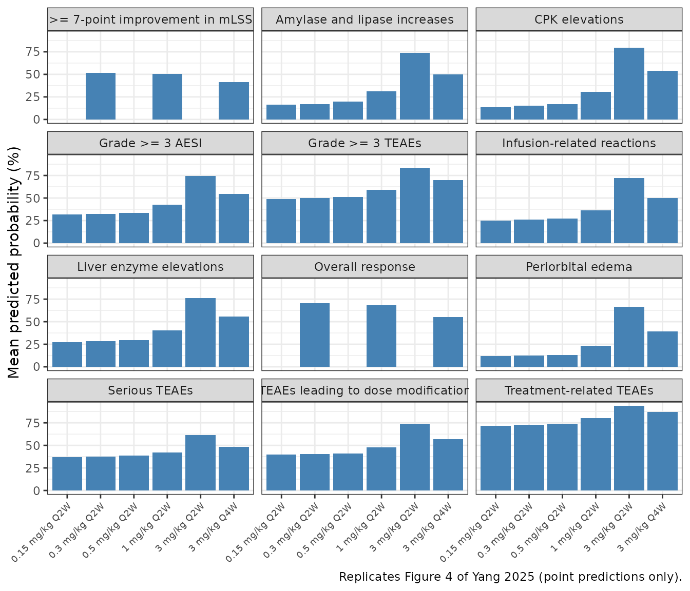
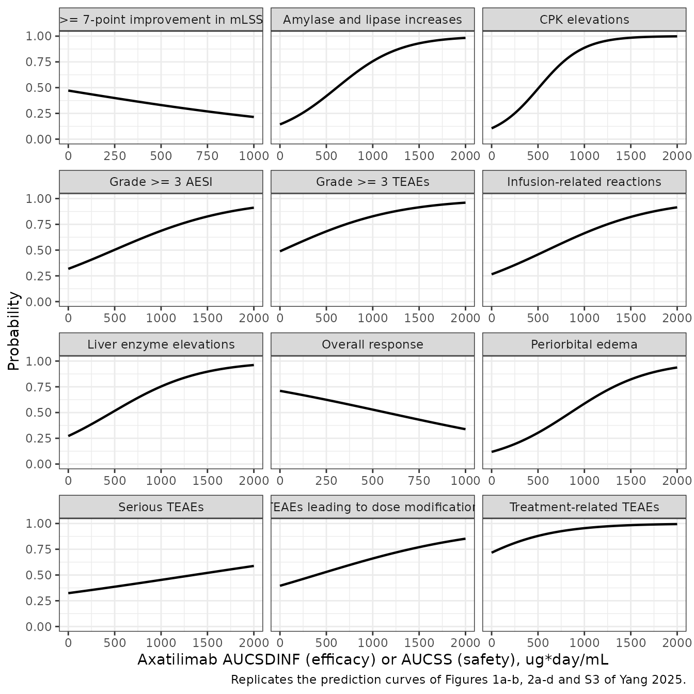

# Axatilimab exposure-response for efficacy and safety in cGVHD (Yang 2025)

## Model and source

Yang 2025 reports the exposure-response (E-R) analyses that support the
approved **axatilimab** regimen of 0.3 mg/kg IV every 2 weeks (Q2W) in
chronic graft-versus-host disease (cGVHD). Axatilimab is a humanized
IgG4 monoclonal antibody against the colony-stimulating factor 1
receptor (CSF-1R). The paper fits **twelve independent binomial logistic
regressions** with R’s `glm(family = binomial)`:

- two efficacy endpoints (overall response by Cycle 7 Day 1, and a \>=
  7-point improvement in the modified Lee Symptom Scale, mLSS) in 239
  AGAVE-201 patients, driven by the single-dose AUC from time 0 to
  infinity (`AUCSDINF`);
- ten safety endpoints in 278 patients pooled from SNDX-6352-0503 and
  AGAVE-201, driven by the steady-state AUC over a 4-week treatment
  cycle (`AUCSS`).

Duration of response (Cox model) and infections of unspecified etiology
had no significant exposure association; the paper prints no
coefficients for them, so they are not packaged.

- Article: <https://doi.org/10.1002/cpt.3731> (PMC12439004)
- Coefficients: Supplementary Tables S5 (efficacy) and S7 (safety); the
  analysis scripts are Supplementary Data S2 (safety) and S3 (efficacy).
- Upstream population PK/PD model (source of every exposure metric):
  <https://doi.org/10.1002/cpt.3503>, packaged as
  `modellib("Yang_2024_axatilimab")`.

Each model has no PK layer: the exposure metric is a data column
(`AUC_AXATILIMAB_SD` or `AUC_AXATILIMAB_SS`, in ug\*day/mL). The
probability output is `prob_<endpoint>` and the linear predictor
`logit_<endpoint>`.

``` r

stems <- c(
  orr = "Yang_2025_axatilimab_orr",
  mlss_improve7 = "Yang_2025_axatilimab_mlss_improve7",
  teae_grade3 = "Yang_2025_axatilimab_teae_grade3",
  teae_dosemod = "Yang_2025_axatilimab_teae_dosemod",
  aesi_grade3 = "Yang_2025_axatilimab_aesi_grade3",
  sae = "Yang_2025_axatilimab_sae",
  teae_drug_related = "Yang_2025_axatilimab_teae_drug_related",
  amylase_lipase_increase = "Yang_2025_axatilimab_amylase_lipase_increase",
  cpk_increase = "Yang_2025_axatilimab_cpk_increase",
  liver_enzyme_increase = "Yang_2025_axatilimab_liver_enzyme_increase",
  periorbital_edema = "Yang_2025_axatilimab_periorbital_edema",
  irr = "Yang_2025_axatilimab_irr"
)
endpoint_label <- c(
  orr = "Overall response",
  mlss_improve7 = ">= 7-point improvement in mLSS",
  teae_grade3 = "Grade >= 3 TEAEs",
  teae_dosemod = "TEAEs leading to dose modification",
  aesi_grade3 = "Grade >= 3 AESI",
  sae = "Serious TEAEs",
  teae_drug_related = "Treatment-related TEAEs",
  amylase_lipase_increase = "Amylase and lipase increases",
  cpk_increase = "CPK elevations",
  liver_enzyme_increase = "Liver enzyme elevations",
  periorbital_edema = "Periorbital edema",
  irr = "Infusion-related reactions"
)
efficacy <- c("orr", "mlss_improve7")
mods <- lapply(stems, function(s) rxode2::rxode2(readModelDb(s)))
```

## Population

The **efficacy** population is 239 AGAVE-201 patients (79, 81 and 79 on
0.3 mg/kg Q2W, 1 mg/kg Q2W and 3 mg/kg Q4W): median age 53 years (range
7-81), median weight 71.6 kg (18.1-151), 37.7% female, 82.8% White,
79.9% severe cGVHD, 32.2% with more than 4 involved organs (Table S2).
The **safety** population adds 39 SNDX-6352-0503 patients for 278 in
total (79, 107, 85, 6 and 2 on 0.3 mg/kg Q2W, 1 mg/kg Q2W, 3 mg/kg Q4W,
3 mg/kg Q2W and lower doses): median age 55 years, median weight 72.4
kg, 37.4% female, Karnofsky/Lansky score \<= 70 in 35.7% (Table S3). The
same information is in each model’s `population` metadata.

## Source trace

Every coefficient is a Table S5 / S7 “Estimate”; main-text Tables 1 and
2 print the same fits as odds ratios (per 50 ug\*day/mL for exposure).
The model equation, `logit(p) = alpha + sum(beta_k * X_k)`, is the
Supplemental Methods logistic-regression equation; median-centring of
the continuous covariates is in the Data S2 script
(`mutate(across(all_of(cont.predictors), ~ . - median(.)))`).

``` r

trace <- bind_rows(lapply(names(mods), function(ep) {
  ini <- mods[[ep]]$iniDf
  ini <- ini[!is.na(ini$ntheta) & !grepl("^addSd", ini$name), ]
  data.frame(
    endpoint = endpoint_label[[ep]],
    parameter = ini$name,
    value = signif(ini$est, 4),
    source = ifelse(ep %in% efficacy, "Yang 2025 Table S5", "Yang 2025 Table S7")
  )
}))
trace |>
  dplyr::rename(
    "Endpoint" = endpoint, "Parameter" = parameter,
    "Value" = value, "Source" = source
  ) |>
  knitr::kable()
```

| Endpoint | Parameter | Value | Source |
|:---|:---|---:|:---|
| Overall response | logit_ref | 0.899000 | Yang 2025 Table S5 |
| Overall response | e_auc_axatilimab_sd_logit | -0.001570 | Yang 2025 Table S5 |
| \>= 7-point improvement in mLSS | logit_ref | -0.114000 | Yang 2025 Table S5 |
| \>= 7-point improvement in mLSS | e_auc_axatilimab_sd_logit | -0.001180 | Yang 2025 Table S5 |
| \>= 7-point improvement in mLSS | e_cgvhd_organs_gt4_logit | 0.770000 | Yang 2025 Table S5 |
| Grade \>= 3 TEAEs | logit_ref | -0.048200 | Yang 2025 Table S7 |
| Grade \>= 3 TEAEs | e_auc_axatilimab_ss_logit | 0.001620 | Yang 2025 Table S7 |
| TEAEs leading to dose modification | logit_ref | -0.425000 | Yang 2025 Table S7 |
| TEAEs leading to dose modification | e_auc_axatilimab_ss_logit | 0.001090 | Yang 2025 Table S7 |
| Grade \>= 3 AESI | logit_ref | -0.763000 | Yang 2025 Table S7 |
| Grade \>= 3 AESI | e_auc_axatilimab_ss_logit | 0.001550 | Yang 2025 Table S7 |
| Serious TEAEs | logit_ref | -0.736000 | Yang 2025 Table S7 |
| Serious TEAEs | e_auc_axatilimab_ss_logit | 0.000546 | Yang 2025 Table S7 |
| Serious TEAEs | e_alb_logit | -0.096400 | Yang 2025 Table S7 |
| Serious TEAEs | e_ecog_ge2_logit | 0.687000 | Yang 2025 Table S7 |
| Treatment-related TEAEs | logit_ref | 0.927000 | Yang 2025 Table S7 |
| Treatment-related TEAEs | e_auc_axatilimab_ss_logit | 0.002120 | Yang 2025 Table S7 |
| Amylase and lipase increases | logit_ref | -1.790000 | Yang 2025 Table S7 |
| Amylase and lipase increases | e_auc_axatilimab_ss_logit | 0.002920 | Yang 2025 Table S7 |
| Amylase and lipase increases | e_lipase_logit | 0.013900 | Yang 2025 Table S7 |
| CPK elevations | logit_ref | -2.140000 | Yang 2025 Table S7 |
| CPK elevations | e_auc_axatilimab_ss_logit | 0.004200 | Yang 2025 Table S7 |
| CPK elevations | e_cpk_logit | 0.010200 | Yang 2025 Table S7 |
| Liver enzyme elevations | logit_ref | -0.985000 | Yang 2025 Table S7 |
| Liver enzyme elevations | e_auc_axatilimab_ss_logit | 0.002100 | Yang 2025 Table S7 |
| Periorbital edema | logit_ref | -2.010000 | Yang 2025 Table S7 |
| Periorbital edema | e_auc_axatilimab_ss_logit | 0.002360 | Yang 2025 Table S7 |
| Infusion-related reactions | logit_ref | -1.020000 | Yang 2025 Table S7 |
| Infusion-related reactions | e_auc_axatilimab_ss_logit | 0.001700 | Yang 2025 Table S7 |
| Infusion-related reactions | e_alt_logit | -0.017800 | Yang 2025 Table S7 |

## Structural verification against the published tables

These checks are deterministic: each evaluates the packaged model at
published covariate values, so there is no cohort and no random draw.

``` r

# One observation row per grid point on a single subject; the covariates are
# columns of the event table (a static model cannot take a params grid).
er_eval <- function(ep, covs) {
  covs <- as.data.frame(covs)
  ev <- data.frame(id = 1L, time = seq_len(nrow(covs)), amt = 0, evid = 0L)
  ev <- cbind(ev, covs)
  s <- as.data.frame(rxode2::rxSolve(mods[[ep]], events = ev, returnType = "data.frame"))
  stopifnot(nrow(s) == nrow(covs))
  s[[paste0("prob_", ep)]]
}
# Every covariate at its reference (centring) value; exposure supplied separately.
ref_covs <- list(ALB = 40, LIPASE = 33, CPK = 64, ALT = 30, ECOG_GE2 = 0, CGVHD_ORGANS_GT4 = 0)
needs <- function(ep) mods[[ep]]$allCovs
make_covs <- function(ep, auc, ...) {
  out <- data.frame(row = seq_along(auc))
  exp_col <- if (ep %in% efficacy) "AUC_AXATILIMAB_SD" else "AUC_AXATILIMAB_SS"
  out[[exp_col]] <- auc
  extra <- list(...)
  for (cn in setdiff(needs(ep), exp_col)) {
    out[[cn]] <- if (!is.null(extra[[cn]])) extra[[cn]] else ref_covs[[cn]]
  }
  out$row <- NULL
  out
}
```

### Check 1 – odds ratios per 50 ug\*day/mL

The exposure odds ratio is `exp(50 * slope)`; both columns are rounded
in the paper, so agreement is to the third decimal.

``` r

pub_or <- c(
  orr = 0.924, mlss_improve7 = 0.942, teae_grade3 = 1.086, teae_dosemod = 1.055,
  aesi_grade3 = 1.08, sae = 1.028, teae_drug_related = 1.112,
  amylase_lipase_increase = 1.157, cpk_increase = 1.235,
  liver_enzyme_increase = 1.109, periorbital_edema = 1.125, irr = 1.088
)
or_tab <- bind_rows(lapply(names(mods), function(ep) {
  p <- er_eval(ep, make_covs(ep, c(0, 50)))
  odds <- p / (1 - p)
  data.frame(endpoint = endpoint_label[[ep]], model_or = odds[2] / odds[1], published_or = pub_or[[ep]])
}))
or_tab |>
  mutate(model_or = round(model_or, 4)) |>
  dplyr::rename("Endpoint" = endpoint, "Model OR per 50" = model_or, "Published OR" = published_or) |>
  knitr::kable()
```

| Endpoint                           | Model OR per 50 | Published OR |
|:-----------------------------------|----------------:|-------------:|
| Overall response                   |          0.9245 |        0.924 |
| \>= 7-point improvement in mLSS    |          0.9427 |        0.942 |
| Grade \>= 3 TEAEs                  |          1.0844 |        1.086 |
| TEAEs leading to dose modification |          1.0560 |        1.055 |
| Grade \>= 3 AESI                   |          1.0806 |        1.080 |
| Serious TEAEs                      |          1.0277 |        1.028 |
| Treatment-related TEAEs            |          1.1118 |        1.112 |
| Amylase and lipase increases       |          1.1572 |        1.157 |
| CPK elevations                     |          1.2337 |        1.235 |
| Liver enzyme elevations            |          1.1107 |        1.109 |
| Periorbital edema                  |          1.1252 |        1.125 |
| Infusion-related reactions         |          1.0887 |        1.088 |

``` r

stopifnot(all(abs(or_tab$model_or - or_tab$published_or) < 0.003))
```

### Check 2 – covariate centring is pinned by the percentile odds ratios

Tables 1 and 2 print the odds ratio at the 5th and 95th percentiles of
each covariate relative to its median. Reproducing both percentiles with
one reference value proves the centring value (40 g/L albumin, 33 U/L
lipase, 64 U/L CPK, 30 U/L ALT). The exposure odds ratios at its
percentiles are relative to zero exposure (the exposure term is not
centred).

``` r

pct <- tribble(
  ~ep, ~cov, ~p05, ~p95, ~or05, ~or95,
  "sae", "ALB", 32.085, 47, 2.144, 0.509,
  "amylase_lipase_increase", "LIPASE", 11.85, 107.9, 0.748, 2.799,
  "cpk_increase", "CPK", 25.85, 224.45, 0.675, 5.21,
  "irr", "ALT", 11.85, 82.3, 1.368, 0.405,
  "orr", "AUC_AXATILIMAB_SD", 8.99, 714.525, 0.986, 0.325,
  "mlss_improve7", "AUC_AXATILIMAB_SD", 8.99, 715, 0.989, 0.427,
  "teae_grade3", "AUC_AXATILIMAB_SS", 18.876, 1442.416, 1.031, 10.023,
  "teae_dosemod", "AUC_AXATILIMAB_SS", 19.413, 1315.382, 1.022, 4.277,
  "aesi_grade3", "AUC_AXATILIMAB_SS", 18.197, 1333.464, 1.029, 8.015,
  "sae", "AUC_AXATILIMAB_SS", 18.197, 1112.353, 1.01, 1.817,
  "teae_drug_related", "AUC_AXATILIMAB_SS", 19.254, 1403.762, 1.042, 19.645,
  "amylase_lipase_increase", "AUC_AXATILIMAB_SS", 18.197, 1403.762, 1.055, 61.692,
  "cpk_increase", "AUC_AXATILIMAB_SS", 18.01, 1426.255, 1.079, 401.082,
  "liver_enzyme_increase", "AUC_AXATILIMAB_SS", 18.609, 1341.576, 1.04, 16.826,
  "periorbital_edema", "AUC_AXATILIMAB_SS", 18.197, 1233.407, 1.044, 18.541,
  "irr", "AUC_AXATILIMAB_SS", 18.272, 1339.036, 1.032, 9.749
)
pct_or <- function(ep, cov, x) {
  is_exp <- grepl("^AUC_", cov)
  base <- if (is_exp) 0 else ref_covs[[cov]]
  covs <- make_covs(ep, if (is_exp) c(base, x) else c(0, 0))
  if (!is_exp) covs[[cov]] <- c(base, x)
  p <- er_eval(ep, covs)
  (p[2] / (1 - p[2])) / (p[1] / (1 - p[1]))
}
pct$model05 <- mapply(pct_or, pct$ep, pct$cov, pct$p05)
pct$model95 <- mapply(pct_or, pct$ep, pct$cov, pct$p95)
pct |>
  mutate(endpoint = endpoint_label[ep], across(c(model05, model95), ~ signif(.x, 4))) |>
  select(endpoint, cov, or05, model05, or95, model95) |>
  dplyr::rename(
    "Endpoint" = endpoint, "Predictor" = cov, "Published OR 5th" = or05,
    "Model OR 5th" = model05, "Published OR 95th" = or95, "Model OR 95th" = model95
  ) |>
  knitr::kable()
```

| Endpoint | Predictor | Published OR 5th | Model OR 5th | Published OR 95th | Model OR 95th |
|:---|:---|---:|---:|---:|---:|
| Serious TEAEs | ALB | 2.144 | 2.1450 | 0.509 | 0.5093 |
| Amylase and lipase increases | LIPASE | 0.748 | 0.7453 | 2.799 | 2.8320 |
| CPK elevations | CPK | 0.675 | 0.6776 | 5.210 | 5.1380 |
| Infusion-related reactions | ALT | 1.368 | 1.3810 | 0.405 | 0.3942 |
| Overall response | AUC_AXATILIMAB_SD | 0.986 | 0.9860 | 0.325 | 0.3257 |
| \>= 7-point improvement in mLSS | AUC_AXATILIMAB_SD | 0.989 | 0.9894 | 0.427 | 0.4301 |
| Grade \>= 3 TEAEs | AUC_AXATILIMAB_SS | 1.031 | 1.0310 | 10.023 | 10.3500 |
| TEAEs leading to dose modification | AUC_AXATILIMAB_SS | 1.022 | 1.0210 | 4.277 | 4.1940 |
| Grade \>= 3 AESI | AUC_AXATILIMAB_SS | 1.029 | 1.0290 | 8.015 | 7.9000 |
| Serious TEAEs | AUC_AXATILIMAB_SS | 1.010 | 1.0100 | 1.817 | 1.8360 |
| Treatment-related TEAEs | AUC_AXATILIMAB_SS | 1.042 | 1.0420 | 19.645 | 19.6100 |
| Amylase and lipase increases | AUC_AXATILIMAB_SS | 1.055 | 1.0550 | 61.692 | 60.2800 |
| CPK elevations | AUC_AXATILIMAB_SS | 1.079 | 1.0790 | 401.082 | 399.5000 |
| Liver enzyme elevations | AUC_AXATILIMAB_SS | 1.040 | 1.0400 | 16.826 | 16.7300 |
| Periorbital edema | AUC_AXATILIMAB_SS | 1.044 | 1.0440 | 18.541 | 18.3700 |
| Infusion-related reactions | AUC_AXATILIMAB_SS | 1.032 | 1.0320 | 9.749 | 9.7410 |

``` r

# The published percentile ORs are medians of resampled fits, and the 95th
# percentile multiplies the rounding of the slope by ~1400, so a relative
# tolerance is used. A wrong centring value (e.g. 63 instead of 64 U/L CPK)
# or an uncentred covariate fails by far more.
stopifnot(
  all(abs(pct$model05 / pct$or05 - 1) < 0.02),
  all(abs(pct$model95 / pct$or95 - 1) < 0.05)
)
```

### Check 3 – predicted efficacy at the exposure percentiles (Table 1, Results)

The Results print the predicted probability of each efficacy response at
the median, 5th and 95th percentile of `AUCSDINF` (patients with 4 or
fewer involved organs for mLSS).

``` r

eff_pts <- data.frame(
  ep = rep(efficacy, each = 3),
  auc = c(64.0, 8.99, 714.525, 64.0, 8.99, 715),
  published = c(0.69, 0.708, 0.444, 0.454, 0.468, 0.277)
)
eff_pts$model <- unlist(lapply(efficacy, function(ep) {
  er_eval(ep, make_covs(ep, eff_pts$auc[eff_pts$ep == ep]))
}))
eff_pts |>
  mutate(endpoint = endpoint_label[ep], model = round(model, 4)) |>
  select(endpoint, auc, published, model) |>
  dplyr::rename(
    "Endpoint" = endpoint, "AUCSDINF (ug*day/mL)" = auc,
    "Published probability" = published, "Model probability" = model
  ) |>
  knitr::kable()
```

| Endpoint | AUCSDINF (ug\*day/mL) | Published probability | Model probability |
|:---|---:|---:|---:|
| Overall response | 64.000 | 0.690 | 0.6897 |
| Overall response | 8.990 | 0.708 | 0.7078 |
| Overall response | 714.525 | 0.444 | 0.4445 |
| \>= 7-point improvement in mLSS | 64.000 | 0.454 | 0.4528 |
| \>= 7-point improvement in mLSS | 8.990 | 0.468 | 0.4689 |
| \>= 7-point improvement in mLSS | 715.000 | 0.277 | 0.2773 |

``` r

stopifnot(all(abs(eff_pts$model - eff_pts$published) < 0.006))
```

### Check 4 – body-weight quartiles at 0.3 mg/kg Q2W (Figure 5)

The paper evaluates the final models at the median exposure of the first
and fourth body-weight quartiles (AUCSDINF 9.98 and 15.2 ug*day/mL;
AUCSS 18.3 and 29.8 ug*day/mL) and reports a CPK-elevation probability
of 0.113 versus 0.118 and a relative change below 0.4% for both efficacy
endpoints.

``` r

cpk_q <- er_eval("cpk_increase", make_covs("cpk_increase", c(18.3, 29.8)))
orr_q <- er_eval("orr", make_covs("orr", c(9.98, 15.2)))
mlss_q <- er_eval("mlss_improve7", make_covs("mlss_improve7", c(9.98, 15.2)))
data.frame(
  endpoint = c("CPK elevations", "Overall response", ">= 7-point improvement in mLSS"),
  q1 = round(c(cpk_q[1], orr_q[1], mlss_q[1]), 4),
  q4 = round(c(cpk_q[2], orr_q[2], mlss_q[2]), 4)
) |>
  mutate(relative_change_pct = round(100 * (q4 / q1 - 1), 2)) |>
  dplyr::rename(
    "Endpoint" = endpoint, "Weight Q1" = q1, "Weight Q4" = q4,
    "Relative change (%)" = relative_change_pct
  ) |>
  knitr::kable()
```

| Endpoint                        | Weight Q1 | Weight Q4 | Relative change (%) |
|:--------------------------------|----------:|----------:|--------------------:|
| CPK elevations                  |    0.1127 |    0.1177 |                4.44 |
| Overall response                |    0.7075 |    0.7058 |               -0.24 |
| \>= 7-point improvement in mLSS |    0.4686 |    0.4671 |               -0.32 |

``` r

stopifnot(
  abs(cpk_q[1] - 0.113) < 0.001, abs(cpk_q[2] - 0.118) < 0.001,
  abs(orr_q[2] / orr_q[1] - 1) < 0.004, abs(mlss_q[2] / mlss_q[1] - 1) < 0.004
)
```

## Exposure driver: the Yang 2024 population PK/PD model

The paper derived every exposure metric from the companion population
PK/PD model, which is packaged as `Yang_2024_axatilimab`. Two
vignette-local additions turn it into an exposure calculator: an `auc_c`
state that integrates `Cc` (mg*h/L; divided by 24 for ug*day/mL), and a
floor of zero on the concentration entering the Hill term, because the
solver can overshoot to a tiny negative concentration deep in the
terminal phase and a negative base raised to the Hill coefficient 2.5 is
`NaN`.

``` r

pk <- rxode2::rxode2(readModelDb("Yang_2024_axatilimab")) |>
  rxode2::model(Cc_nM <- max(Cc, 0) * 1000 / MW_PK) |>
  rxode2::model(d/dt(auc_c) <- Cc, append = Cp) |>
  rxode2::zeroRe()
#> ℹ parameter labels from comments will be replaced by 'label()'
pk_omega <- diag(rxode2::rxode2(readModelDb("Yang_2024_axatilimab"))$omega)
#> ℹ parameter labels from comments will be replaced by 'label()'
pk_covs <- c("WT", "CSF1", "CPK", "ADA_POS", "DIS_CANCER", "DIS_HEALTHY", names(pk_omega))

# Yang 2024 is a five-endpoint model, so observation rows must name the
# endpoint they belong to; cmt = "Cc" here selects the axatilimab-concentration
# endpoint (it is declared by the model's error lines, so no compartment slot
# is added). Doses go to the ODE state `central`.
# One dose list per subject; AUCSDINF = auc_c at 5 years after one dose,
# AUCSS = auc_c over the last 28 days of 104 weeks of dosing.
pk_events <- function(subj, single) {
  bind_rows(lapply(seq_len(nrow(subj)), function(i) {
    s <- subj[i, ]
    dose <- s$mgkg * s$WT
    if (single) {
      d_t <- 0
      o_t <- c(0, 5 * 365 * 24)
    } else {
      d_t <- seq(0, 728 * 24 - 1, by = s$ii * 24)
      o_t <- c(700, 728) * 24
    }
    ev <- data.frame(
      id = s$id, time = c(d_t, o_t), amt = c(rep(dose, length(d_t)), rep(0, length(o_t))),
      evid = c(rep(1L, length(d_t)), rep(0L, length(o_t))),
      cmt = c(rep("central", length(d_t)), rep("Cc", length(o_t)))
    )
    cbind(ev, s[rep(1, nrow(ev)), pk_covs, drop = FALSE])
  })) |>
    arrange(id, time, desc(evid))
}
pk_auc <- function(subj) {
  # A zeroRe() model solved for many subjects warns that no omega is present;
  # the etas are supplied as data columns, which is the intent.
  solve_one <- function(single) {
    suppressWarnings(rxode2::rxSolve(pk, pk_events(subj, single), returnType = "data.frame")) |>
      group_by(id) |>
      summarise(auc = (max(auc_c) - min(auc_c)) / 24, .groups = "drop")
  }
  subj |>
    left_join(solve_one(TRUE) |> rename(AUC_AXATILIMAB_SD = auc), by = "id") |>
    left_join(solve_one(FALSE) |> rename(AUC_AXATILIMAB_SS = auc), by = "id")
}
```

### Typical-patient exposure by body-weight quartile

The paper reports median AUCSDINF of 9.98 and 15.2 ug*day/mL
(body-weight quartile medians 53.6 and 94.8 kg) and median AUCSS of 18.3
and 29.8 ug*day/mL (53.8 and 97.6 kg) at 0.3 mg/kg Q2W. The typical
patient here is ADA-negative with the efficacy-population median
baseline CSF-1 of 584 pg/mL (Table S2) and all etas at zero.

``` r

typ <- data.frame(id = 1:4, WT = c(53.6, 94.8, 53.8, 97.6), mgkg = 0.3, ii = 14,
                  CSF1 = 584, CPK = 64, ADA_POS = 0, DIS_CANCER = 0, DIS_HEALTHY = 0)
for (nm in names(pk_omega)) typ[[nm]] <- 0
typ <- pk_auc(typ)
#> ℹ omega/sigma items treated as zero: 'etalvc', 'etalcl', 'etalvmax', 'etalbl_csf1', 'etalbl_ncmc', 'etalbl_ast', 'etalbl_cpk'
#> ℹ omega/sigma items treated as zero: 'etalvc', 'etalcl', 'etalvmax', 'etalbl_csf1', 'etalbl_ncmc', 'etalbl_ast', 'etalbl_cpk'
typ_cmp <- data.frame(
  metric = c("AUCSDINF Q1", "AUCSDINF Q4", "AUCSS Q1", "AUCSS Q4"),
  weight = typ$WT,
  published = c(9.98, 15.2, 18.3, 29.8),
  model = c(typ$AUC_AXATILIMAB_SD[1:2], typ$AUC_AXATILIMAB_SS[3:4])
) |>
  mutate(pct_diff = round(100 * (model / published - 1), 1), model = round(model, 2))
typ_cmp |>
  dplyr::rename(
    "Metric" = metric, "Weight (kg)" = weight, "Published median" = published,
    "Typical patient (model)" = model, "Difference (%)" = pct_diff
  ) |>
  knitr::kable()
```

| Metric | Weight (kg) | Published median | Typical patient (model) | Difference (%) |
|:---|---:|---:|---:|---:|
| AUCSDINF Q1 | 53.6 | 9.98 | 10.46 | 4.8 |
| AUCSDINF Q4 | 94.8 | 15.20 | 15.04 | -1.0 |
| AUCSS Q1 | 53.8 | 18.30 | 19.93 | 8.9 |
| AUCSS Q4 | 97.6 | 29.80 | 29.79 | 0.0 |

``` r

# The published values are medians over individual empirical Bayes estimates
# (a third of patients ADA-positive), the model value a single typical
# patient; a mis-scaled dose or unit would miss by a factor, not 30%.
stopifnot(all(abs(typ_cmp$pct_diff) < 30))
```

### PKNCA cross-check of the AUC accumulator

The `auc_c` state is an exact integral of the model concentration. As an
independent check, PKNCA computes AUC0-inf from a dense sampled profile
of typical patients after a single dose.

``` r

nca_subj <- data.frame(id = 1:3, WT = 72.4, mgkg = c(0.3, 1, 3), ii = 14, CSF1 = 584,
                       CPK = 64, ADA_POS = 0, DIS_CANCER = 0, DIS_HEALTHY = 0)
for (nm in names(pk_omega)) nca_subj[[nm]] <- 0
nca_subj$treatment <- paste(nca_subj$mgkg, "mg/kg single dose")
grid_h <- sort(unique(c(seq(0, 48, by = 2), seq(48, 24 * 120, by = 12), 24 * seq(120, 720, by = 10))))
nca_ev <- bind_rows(lapply(seq_len(nrow(nca_subj)), function(i) {
  s <- nca_subj[i, ]
  ev <- data.frame(
    id = s$id, time = c(0, grid_h), amt = c(s$mgkg * s$WT, rep(0, length(grid_h))),
    evid = c(1L, rep(0L, length(grid_h))), cmt = c("central", rep("Cc", length(grid_h)))
  )
  cbind(ev, s[rep(1, nrow(ev)), pk_covs, drop = FALSE])
}))
nca_sim <- suppressWarnings(rxode2::rxSolve(pk, nca_ev, returnType = "data.frame")) |>
  left_join(nca_subj[, c("id", "treatment")], by = "id") |>
  mutate(time_d = time / 24)
#> ℹ omega/sigma items treated as zero: 'etalvc', 'etalcl', 'etalvmax', 'etalbl_csf1', 'etalbl_ncmc', 'etalbl_ast', 'etalbl_cpk'
conc <- nca_sim |>
  dplyr::filter(!is.na(Cc)) |>
  select(id, treatment, time_d, Cc)
dose_df <- nca_subj |>
  transmute(id, treatment, time_d = 0, amt = mgkg * WT)
o_conc <- PKNCAconc(conc, Cc ~ time_d | treatment + id)
o_dose <- PKNCAdose(dose_df, amt ~ time_d | treatment + id)
o_data <- PKNCAdata(o_conc, o_dose,
  intervals = data.frame(start = 0, end = Inf, cmax = TRUE, aucinf.obs = TRUE, half.life = TRUE)
)
nca_res <- as.data.frame(pk.nca(o_data))
nca_auc <- nca_res |>
  dplyr::filter(PPTESTCD == "aucinf.obs") |>
  select(id, treatment, pknca = PPORRES) |>
  left_join(nca_sim |> group_by(id) |> summarise(accumulator = max(auc_c) / 24), by = "id") |>
  mutate(pct_diff = round(100 * (pknca / accumulator - 1), 2))
nca_auc |>
  select(treatment, pknca, accumulator, pct_diff) |>
  mutate(across(c(pknca, accumulator), ~ round(.x, 2))) |>
  dplyr::rename(
    "Treatment" = treatment, "PKNCA AUC0-inf (ug*day/mL)" = pknca,
    "Accumulator AUC (ug*day/mL)" = accumulator, "Difference (%)" = pct_diff
  ) |>
  knitr::kable()
```

| Treatment | PKNCA AUC0-inf (ug\*day/mL) | Accumulator AUC (ug\*day/mL) | Difference (%) |
|:---|---:|---:|---:|
| 0.3 mg/kg single dose | 12.64 | 12.66 | -0.16 |
| 1 mg/kg single dose | 84.30 | 84.32 | -0.03 |
| 3 mg/kg single dose | 457.83 | 457.81 | 0.00 |

``` r

# Same parameters on both sides; only trapezoidal error separates them.
stopifnot(all(abs(nca_auc$pct_diff) < 2))
```

## Virtual cohort and model-based regimen predictions (Figure 4)

The paper projected each regimen with 100 replicate populations of 500
patients whose covariates were bootstrapped from the study population.
Here 200 virtual patients per regimen are drawn from distributions
matched to Tables S2, S3 and 2. Their individual etas are drawn from the
Yang 2024 omega matrix with R’s random number generator and supplied as
data, so the cohort does not depend on the number of solver threads.

``` r

set.seed(20250619)
regimens <- data.frame(
  regimen = c("0.15 mg/kg Q2W", "0.3 mg/kg Q2W", "0.5 mg/kg Q2W", "1 mg/kg Q2W", "3 mg/kg Q2W", "3 mg/kg Q4W"),
  mgkg = c(0.15, 0.3, 0.5, 1, 3, 3),
  ii = c(14, 14, 14, 14, 14, 28)
)
n_per_arm <- 200
cohort <- regimens[rep(seq_len(nrow(regimens)), each = n_per_arm), ]
n <- nrow(cohort)
cohort$id <- seq_len(n)
cohort$WT <- pmin(pmax(exp(rnorm(n, log(72.4), 0.27)), 18.1), 151)
cohort$CSF1 <- exp(rnorm(n, log(584), 0.5))
cohort$CPK <- exp(rnorm(n, log(64), 0.65))
cohort$ALB <- pmin(pmax(rnorm(n, 40, 4.55), 22), 53)
cohort$LIPASE <- exp(rnorm(n, log(33), 0.67))
cohort$ALT <- exp(rnorm(n, log(30), 0.6))
cohort$ADA_POS <- rbinom(n, 1, 0.34)
cohort$ECOG_GE2 <- rbinom(n, 1, 0.357)
cohort$CGVHD_ORGANS_GT4 <- rbinom(n, 1, 0.322)
cohort$DIS_CANCER <- 0
cohort$DIS_HEALTHY <- 0
for (nm in names(pk_omega)) cohort[[nm]] <- rnorm(n, 0, sqrt(pk_omega[[nm]]))
cohort <- pk_auc(cohort)
#> ℹ omega/sigma items treated as zero: 'etalvc', 'etalcl', 'etalvmax', 'etalbl_csf1', 'etalbl_ncmc', 'etalbl_ast', 'etalbl_cpk'
#> ℹ omega/sigma items treated as zero: 'etalvc', 'etalcl', 'etalvmax', 'etalbl_csf1', 'etalbl_ncmc', 'etalbl_ast', 'etalbl_cpk'
stopifnot(!anyNA(cohort$AUC_AXATILIMAB_SD), !anyNA(cohort$AUC_AXATILIMAB_SS))
```

The efficacy regimens of AGAVE-201 give an AUCSDINF distribution to set
against the Table 1 median (5th, 95th percentile) of 64.0 (8.99, 714.5).

``` r

eff_reg <- c("0.3 mg/kg Q2W", "1 mg/kg Q2W", "3 mg/kg Q4W")
q_sd <- quantile(cohort$AUC_AXATILIMAB_SD[cohort$regimen %in% eff_reg], c(0.05, 0.5, 0.95))
data.frame(percentile = c("5th", "50th", "95th"), published = c(8.99, 64.0, 714.525), cohort = unname(round(q_sd, 1))) |>
  dplyr::rename("Percentile" = percentile, "Published AUCSDINF" = published, "Virtual cohort AUCSDINF" = cohort) |>
  knitr::kable()
```

| Percentile | Published AUCSDINF | Virtual cohort AUCSDINF |
|:-----------|-------------------:|------------------------:|
| 5th        |              8.990 |                     6.8 |
| 50th       |             64.000 |                    68.5 |
| 95th       |            714.525 |                   726.1 |

``` r

stopifnot(abs(q_sd[["50%"]] / 64.0 - 1) < 0.3)
```

``` r

pred_cols <- lapply(names(mods), function(ep) {
  cov_df <- cohort[, needs(ep), drop = FALSE]
  er_eval(ep, cov_df)
})
names(pred_cols) <- names(mods)
pred <- bind_cols(cohort["regimen"], as.data.frame(pred_cols)) |>
  pivot_longer(-regimen, names_to = "ep", values_to = "prob") |>
  dplyr::filter(!(ep %in% efficacy) | regimen %in% eff_reg) |>
  group_by(regimen, ep) |>
  summarise(mean_prob = mean(prob), .groups = "drop")

pred |>
  mutate(endpoint = endpoint_label[ep], mean_prob = round(100 * mean_prob, 1)) |>
  select(endpoint, regimen, mean_prob) |>
  pivot_wider(names_from = regimen, values_from = mean_prob) |>
  dplyr::rename("Endpoint" = endpoint) |>
  knitr::kable(caption = "Mean predicted probability (%) by regimen")
```

| Endpoint | 0.15 mg/kg Q2W | 0.3 mg/kg Q2W | 0.5 mg/kg Q2W | 1 mg/kg Q2W | 3 mg/kg Q2W | 3 mg/kg Q4W |
|:---|---:|---:|---:|---:|---:|---:|
| Grade \>= 3 AESI | 32.1 | 32.6 | 33.6 | 42.5 | 74.4 | 54.7 |
| Amylase and lipase increases | 16.3 | 17.0 | 20.0 | 31.3 | 73.9 | 50.0 |
| CPK elevations | 13.6 | 15.0 | 16.8 | 30.9 | 79.3 | 53.8 |
| Infusion-related reactions | 25.2 | 26.2 | 27.2 | 36.1 | 72.2 | 50.2 |
| Liver enzyme elevations | 27.5 | 28.2 | 29.5 | 40.4 | 76.3 | 55.5 |
| Periorbital edema | 12.0 | 12.4 | 13.2 | 23.4 | 66.5 | 39.1 |
| Serious TEAEs | 36.9 | 37.4 | 38.6 | 42.0 | 61.3 | 48.5 |
| TEAEs leading to dose modification | 39.7 | 40.2 | 40.9 | 47.7 | 73.9 | 57.0 |
| Treatment-related TEAEs | 72.0 | 72.7 | 73.9 | 80.2 | 93.6 | 87.1 |
| Grade \>= 3 TEAEs | 49.1 | 49.8 | 51.0 | 59.3 | 83.7 | 69.9 |
| \>= 7-point improvement in mLSS | NA | 51.8 | NA | 50.3 | NA | 41.4 |
| Overall response | NA | 70.7 | NA | 68.4 | NA | 54.9 |

Mean predicted probability (%) by regimen {.table style="width:100%;"}

``` r

ggplot(pred |> mutate(endpoint = endpoint_label[ep]),
       aes(x = factor(regimen, levels = regimens$regimen), y = 100 * mean_prob)) +
  geom_col(fill = "steelblue") +
  facet_wrap(~endpoint, ncol = 3) +
  labs(x = NULL, y = "Mean predicted probability (%)",
       caption = "Replicates Figure 4 of Yang 2025 (point predictions only).") +
  theme_bw() +
  theme(axis.text.x = element_text(angle = 45, hjust = 1, size = 7))
```



The paper quotes these regimen-level predictions in the text:

``` r

getp <- function(ep, reg) 100 * pred$mean_prob[pred$ep == ep & pred$regimen == reg]
reg_cmp <- data.frame(
  quantity = c(
    "Overall response, 0.3 mg/kg Q2W", ">= 7-point mLSS improvement, 0.3 mg/kg Q2W",
    "Overall response, 3 mg/kg Q4W minus 0.3 mg/kg Q2W",
    ">= 7-point mLSS improvement, 3 mg/kg Q4W minus 0.3 mg/kg Q2W",
    "CPK elevations, 0.15 mg/kg Q2W", "CPK elevations, 3 mg/kg Q2W"
  ),
  published = c(70.8, 53.2, -14.1, -9.9, 13.9, 81.7),
  model = c(
    getp("orr", "0.3 mg/kg Q2W"), getp("mlss_improve7", "0.3 mg/kg Q2W"),
    getp("orr", "3 mg/kg Q4W") - getp("orr", "0.3 mg/kg Q2W"),
    getp("mlss_improve7", "3 mg/kg Q4W") - getp("mlss_improve7", "0.3 mg/kg Q2W"),
    getp("cpk_increase", "0.15 mg/kg Q2W"), getp("cpk_increase", "3 mg/kg Q2W")
  )
) |>
  mutate(model = round(model, 1), diff = model - published)
reg_cmp |>
  dplyr::rename("Quantity (percentage points)" = quantity, "Published" = published,
                "Model" = model, "Difference" = diff) |>
  knitr::kable()
```

| Quantity (percentage points) | Published | Model | Difference |
|:---|---:|---:|---:|
| Overall response, 0.3 mg/kg Q2W | 70.8 | 70.7 | -0.1 |
| \>= 7-point mLSS improvement, 0.3 mg/kg Q2W | 53.2 | 51.8 | -1.4 |
| Overall response, 3 mg/kg Q4W minus 0.3 mg/kg Q2W | -14.1 | -15.8 | -1.7 |
| \>= 7-point mLSS improvement, 3 mg/kg Q4W minus 0.3 mg/kg Q2W | -9.9 | -10.4 | -0.5 |
| CPK elevations, 0.15 mg/kg Q2W | 13.9 | 13.6 | -0.3 |
| CPK elevations, 3 mg/kg Q2W | 81.7 | 79.3 | -2.4 |

``` r

# Cohort means, not extremes: the efficacy probabilities are flat at low
# exposure so the 0.3 mg/kg values hardly depend on the cohort; the 3 mg/kg
# CPK value depends on the right tail of AUCSS and gets a wider band.
stopifnot(
  abs(reg_cmp$diff[1]) < 3, abs(reg_cmp$diff[2]) < 4,
  abs(reg_cmp$diff[3]) < 4, abs(reg_cmp$diff[4]) < 4,
  abs(reg_cmp$diff[5]) < 4, abs(reg_cmp$diff[6]) < 12
)
```

## Exposure-response curves (Figures 1, 2 and S3)

Typical-patient curves (continuous covariates at their reference values,
binary covariates 0) over the exposure range the paper plots.

``` r

curve_df <- bind_rows(lapply(names(mods), function(ep) {
  grid <- if (ep %in% efficacy) seq(0, 1000, by = 10) else seq(0, 2000, by = 20)
  data.frame(endpoint = endpoint_label[[ep]], auc = grid, prob = er_eval(ep, make_covs(ep, grid)),
             metric = if (ep %in% efficacy) "AUCSDINF" else "AUCSS")
}))
ggplot(curve_df, aes(auc, prob)) +
  geom_line(linewidth = 0.8) +
  facet_wrap(~endpoint, ncol = 3, scales = "free_x") +
  scale_y_continuous(limits = c(0, 1)) +
  labs(x = "Axatilimab AUCSDINF (efficacy) or AUCSS (safety), ug*day/mL", y = "Probability",
       caption = "Replicates the prediction curves of Figures 1a-b, 2a-d and S3 of Yang 2025.") +
  theme_bw()
```



## Assumptions and deviations

- **No PK layer, no Bernoulli likelihood.** Each model is a
  typical-value probability. The `addSd_prob_*` residual is a fixed
  0.001 placeholder so rxode2 can attach an error model; it is not a
  published quantity. The paper’s glm has no random effects.
- **Exposure units.** Coefficients are per 1 ug*day/mL (Table S5 / S7
  print the per-unit estimate under a “50 ug/mL*d” row label; the odds
  ratio column is per 50 ug\*day/mL, as Check 1 confirms).
- **Covariate centring.** Albumin, lipase, CPK and ALT enter as
  deviations from the analysis-population median (40 g/L, 33 U/L, 64
  U/L, 30 U/L), as the analysis script does; the values are pinned by
  Check 2. The exposure term is not centred, so each intercept is the
  logit at zero exposure.
- **Karnofsky/Lansky score \<= 70 is carried as `ECOG_GE2`.** Under the
  Oken 1982 crosswalk a Karnofsky score of 60-70 is ECOG 2 (“unable to
  work”) and \<= 50 is ECOG \>= 3, matching the paper’s label “unable to
  work”.
- **Endpoint name mapping.** “TEAEs leading to dose modifications” in
  this paper includes dose interruptions as well as discontinuations and
  reductions; it is carried as `prob_teae_dosemod`.
- **Virtual cohort.** Covariate marginals are matched to Tables S2, S3
  and 2 (log-normal CSF-1, CPK, lipase and ALT; normal albumin;
  Bernoulli ADA, performance-status and organ-involvement indicators)
  and drawn independently, without the correlations of the real
  population. All regimens share the safety-population covariate
  distributions.
- **Exposure derivation.** The paper simulated AUCSS with each patient’s
  cycle-average dose up to the time of first event; the projections here
  and in the paper’s Figure 4 use the nominal regimen. AUCSS is the last
  28-day cycle after 104 weeks of dosing, which is close to, but for the
  slowest clearers not fully at, steady state. ADA status is
  time-invariant (1 if ever positive), as in the paper’s exposure
  derivation.

## Errata and source notes

- Table 2 labels the albumin row “ALB, U/L”; Table S7 and the Discussion
  give g/L, which is the only unit consistent with the printed median of
  40.
- Table S7 marks “Amylase and lipase elevations” with the dagger
  footnote (“Including hypersensitivity reactions”); the main-text Table
  2 marks it as a grouped adverse-event term, which is the intended
  footnote.
- The Discussion gives the CPK-elevation odds-ratio increase per 50
  ug*day/mL as 23.5%; Table 2 prints 1.235 (23.5%) and the Results
  23.8%. The model uses the Table S7 slope 0.0042 (exp(50* 0.0042) =
  1.234).
- Table S3 prints a median baseline CPK of 63.0 U/L over the 272
  patients with a value, while the Discussion and Table 2 use 64 U/L;
  both Table 2 percentile odds ratios are consistent with 64 only, so 64
  is the centring value (the analysis dataset imputed the missing
  values).
