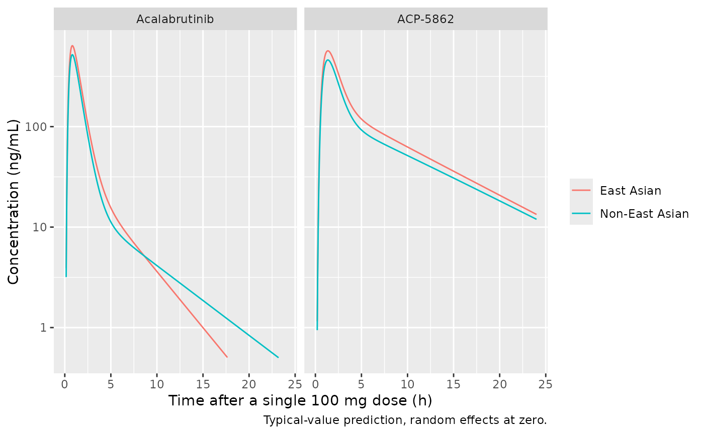
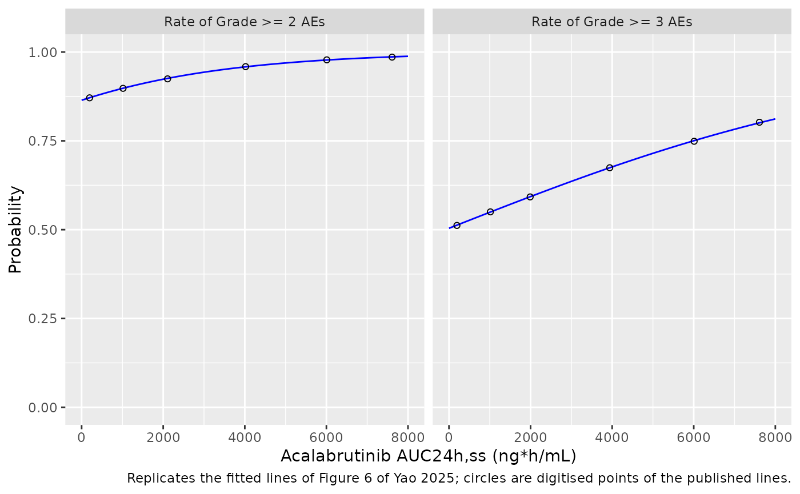

# Acalabrutinib and ACP-5862 in Chinese and White patients (Yao 2025)

## Model and source

- Citation: Yao T, Ding J, Sharma S, Li Y, Xu Q, Ma P. Assessment of
  ethnic differences in pharmacokinetics and clinical responses of
  acalabrutinib between Chinese and White patients with B-cell
  malignancies. Br J Clin Pharmacol. 2025;91(7):2008-2019.
  <doi:10.1002/bcp.70018>
- Article: <https://doi.org/10.1002/bcp.70018> (open access)

Yao 2025 adds a Chinese phase 1/2 study (NCT03932331, n = 105) and a
Japanese phase 1 study (NCT03198650, n = 6) to the global acalabrutinib
/ ACP-5862 population PK dataset and re-estimates the existing Edlund
2022 model (`modellib("Edlund_2022_acalabrutinib")`) with one addition:
an East Asian race effect on the relative bioavailability F1 (+22.6%)
and on the peripheral volume of acalabrutinib (-38.1%). It then relates
the model-predicted steady-state exposures to efficacy (Chinese patients
only; graphical) and to safety (476 patients; logistic regression). The
paper contributes three models:

| Model | Content |
|----|----|
| `Yao_2025_acalabrutinib` | Joint acalabrutinib / ACP-5862 population PK model (Table 3) |
| `Yao_2025_acalabrutinib_teae_grade2` | Logistic regression of any grade \>= 2 adverse event on acalabrutinib AUC24h,ss (Figure 6, left) |
| `Yao_2025_acalabrutinib_teae_grade3` | Logistic regression of any grade \>= 3 adverse event on acalabrutinib AUC24h,ss (Figure 6, right) |

The PK model is a joint parent-metabolite model: acalabrutinib is
absorbed through a dosing depot, five transit compartments and an
absorption depot, distributes into two compartments, and is cleared at
CL/F, of which the fraction `fm = 0.4` forms ACP-5862, which itself has
two-compartment disposition (Figure 1).

## Population

The PK dataset held 11152 acalabrutinib and 3367 ACP-5862 concentrations
from 14 clinical trials: 138 healthy subjects and 686 patients with
B-cell malignancies. By race (Figure 3 caption) there were 622 White,
105 Chinese, 6 Japanese, 47 Black or African American and 44 other
subjects. The paper reports demographics only for the Chinese cohort
(Tables 1 and 2): 75 men and 30 women, mean age 60.5 years, mean weight
65.9 kg, mean creatinine clearance 74.7 mL/min; CLL 64, MCL 34, FL 4,
SLL 2 and DLBCL 1; ECOG 0 / 1 / 2 in 66 / 35 / 4 patients; one PPI user.

The exposure-safety analysis pooled 476 patients from six global studies
and the China study (Supplementary Table S1): 440 received 100 mg BID,
and the others 100-250 mg QD or 200 mg BID.

The same information is available programmatically via
`readModelDb("Yao_2025_acalabrutinib")()$population`.

## Source trace

Every `ini()` value carries an in-file comment pointing at its source.
The table collects them.

| Equation / parameter | Value | Source location |
|----|----|----|
| `lcl` (CL/F) | log(130.3) L/h | Table 3 |
| `lvc` (Vc/F) | log(28.8) L | Table 3 |
| `lq` (Q/F) | log(19.5) L/h | Table 3 |
| `lvp` (Vp/F) | log(105.6) L | Table 3 |
| `lka` (Ka) | log(1.4) 1/h | Table 3 |
| `lmtt` (MTT) | log(0.4) h | Table 3 |
| `ntr` | 5 (not estimated) | Methods “Pop-PK analysis”; Figure 1 |
| `lfdepot` (F1) | log(1) (reference) | No F1 row in Table 3; F1 carries BOV and covariates only |
| `fm` | 0.4 (not estimated) | Methods “Pop-PK analysis” |
| `lcl_acp` (CLM/F) | log(21.5) L/h | Table 3 |
| `lvc_acp` (VcM/F) | log(24.3) L | Table 3 |
| `lq_acp` (QM/F) | log(21.1) L/h | Table 3 |
| `lvp_acp` (VpM/F) | log(90.9) L | Table 3 |
| `e_dis_healthy_cl`, `e_dis_healthy_vp` | 0.645, -0.424 | Table 3 (HEALTHGP rows); Results “Covariates analysis result” |
| `e_ecog_ge2_cl` | -0.128 | Table 3 (CL/F_ECOG2+) |
| `e_conmed_ppi_fdepot` | -0.307 | Table 3 (F1_PPI) |
| `e_race_asian_northeast_vp`, `e_race_asian_northeast_fdepot` | -0.381, 0.226 | Table 3 (EASTASIA rows); Results “Effect of race covariate” |
| `etalcl`, `etalvc`, `etalvp` | 0.0524, 2.34, 0.121 | Table 3 BSV 23.2, 306, 35.9 (CV%) |
| `etalcl_acp`, `etalvc_acp`, `etalq_acp`, `etalvp_acp` | 0.0173, 0.131, 0.329, 0.0824 | Table 3 BSV 13.2, 37.4, 62.4, 29.3 (CV%) |
| `etaiov_mtt_1..4` | 0.941 | Table 3 BOV MTT 125 (CV%); four occasions (footnote a) |
| `etaiov_fdepot_1..4` | 0.247 | Table 3 BOV F1 52.9 (CV%) |
| `expSdIntensive`, `expSdSparse` | 0.641, 0.925 | Table 3 RE parent, rich and sparse (SD) |
| `expSdIntensive_acp`, `expSdSparse_acp` | 0.36, 0.401 | Table 3 RE metabolite, rich and sparse (SD) |
| Covariate form `TVP * (1 + Pcov)` | n/a | Methods equation; Table 3 footnote b |
| Transit chain, absorption depot, `ktr = (ntr + 1) / mtt` | n/a | Figure 1 and its legend |
| Molar formation `fm * CL/F * Cp` into ACP-5862 | n/a | Methods; MW acalabrutinib 465.5 (Methods “E-R analyses”) |
| Log-scale residual error, rich vs sparse | n/a | Methods “Pop-PK analysis” |
| `logit_ref`, `e_auc_logit` (grade \>= 2) | 1.851, 0.0003197 per ng\*h/mL | Figure 6 left panel, digitised fitted line (P = 0.12) |
| `logit_ref`, `e_auc_logit` (grade \>= 3) | 0.0157, 0.0001807 per ng\*h/mL | Figure 6 right panel, digitised fitted line (P = 0.051) |

## Simulation design

The exposures of Figure 3 are steady-state AUC24h,ss and Cmax,ss at 100
mg BID. Two cohorts of 200 patients (ECOG 0-1, no PPI) are simulated: a
non-East Asian reference and an East Asian cohort that differs only in
`RACE_ASIAN_NORTHEAST`. The same random effects are used in both cohorts
(common random numbers), so the cohort difference is the race effect
alone.

Following the procedure of the Edlund 2022 analysis that this model
extends, **each dose draws its own F1 and MTT** from the
between-occasion distributions: every record stays on `OCC = 1` and
`etaiov_mtt_1` / `etaiov_fdepot_1` are supplied as event-table columns
that change at every dose. All random effects are drawn in R and passed
with `omega = NA`, so the cohort is identical on every machine.
AUC24h,ss is the AUC over a 7-day steady-state window divided by 7, and
Cmax,ss the mean of the 14 per-dose maxima.

``` r

mod <- readModelDb("Yao_2025_acalabrutinib")
ui <- rxode2::rxode2(mod)
#> ℹ parameter labels from comments will be replaced by 'label()'
#> Warning: some etas defaulted to non-mu referenced, possible parsing error: etaiov_mtt_1, etaiov_mtt_2, etaiov_mtt_3, etaiov_mtt_4, etaiov_fdepot_1, etaiov_fdepot_2, etaiov_fdepot_3, etaiov_fdepot_4
#> as a work-around try putting the mu-referenced expression on a simple line
om <- ui$omega

n_sub <- 200
tau <- 12
n_run_in <- 6 # three days of BID dosing to reach steady state
n_window <- 14 # a 7-day steady-state window
t_win <- c(n_run_in * tau, (n_run_in + n_window) * tau)
dose_times <- (seq_len(n_run_in + n_window + 1) - 1) * tau

set.seed(20250226)
# Between-subject etas: Latin-hypercube quantiles so every marginal is
# reproduced exactly at n = 200 while the etas stay mutually independent.
lhs <- function(v) sqrt(v) * qnorm((sample.int(n_sub) - 0.5) / n_sub)
bsv_names <- c("etalcl", "etalvc", "etalvp", "etalcl_acp", "etalvc_acp",
               "etalq_acp", "etalvp_acp")
subj <- tibble(id = seq_len(n_sub))
for (nm in bsv_names) subj[[nm]] <- lhs(om[nm, nm])

# One BOV draw per dose and subject.
dose_iov <- expand.grid(dose_k = seq_along(dose_times), id = seq_len(n_sub)) |>
  as_tibble() |>
  mutate(
    time = dose_times[dose_k],
    etaiov_mtt_1 = rnorm(n(), 0, sqrt(om["etaiov_mtt_1", "etaiov_mtt_1"])),
    etaiov_fdepot_1 = rnorm(n(), 0, sqrt(om["etaiov_fdepot_1", "etaiov_fdepot_1"]))
  )

# Dense (0.1 h) over the first 4 h after each dose, where the peak lies,
# 0.5 h over the rest of the interval.
tad_grid <- c(seq(0, 4, by = 0.1), seq(4.5, tau - 0.5, by = 0.5))
obs_times <- c(as.vector(outer(tad_grid, seq(t_win[1], t_win[2] - tau, by = tau), "+")),
               t_win[2])

make_arm <- function(arm, east_asian, id_offset) {
  doses <- dose_iov |>
    mutate(evid = 1L, amt = 100, cmt = "depot", dvid = NA_integer_)
  obs <- expand.grid(time = obs_times, id = seq_len(n_sub)) |>
    as_tibble() |>
    mutate(evid = 0L, amt = 0, cmt = "central", dvid = 1L)
  bind_rows(doses, obs) |>
    arrange(id, time, desc(evid)) |>
    group_by(id) |>
    tidyr::fill(dose_k, etaiov_mtt_1, etaiov_fdepot_1) |>
    ungroup() |>
    left_join(subj, by = "id") |>
    mutate(
      id = id + id_offset, arm = arm, OCC = 1L, SAMPLE_INTENSIVE = 1L,
      DIS_HEALTHY = 0L, ECOG_GE2 = 0L, CONMED_PPI = 0L,
      RACE_ASIAN_NORTHEAST = east_asian
    )
}

arms <- c("Non-East Asian", "East Asian")
events <- bind_rows(
  make_arm(arms[1], 0L, 0L),
  make_arm(arms[2], 1L, n_sub)
)
stopifnot(!anyDuplicated(events[, c("id", "time", "evid")]))
```

``` r

sim <- suppressWarnings(rxode2::rxSolve(
  mod, events = events, omega = NA, returnType = "data.frame",
  keep = c("arm", "dose_k"), addDosing = FALSE
))
#> ℹ parameter labels from comments will be replaced by 'label()'
sim <- sim |> mutate(arm = factor(arm, levels = arms))

# Harness check: the per-subject etas supplied on the event rows reach the
# model, and the race effect multiplies F1 by exactly 1.226.
par_i <- sim |>
  group_by(id) |>
  slice(1) |>
  ungroup()
stopifnot(
  max(abs(par_i$cl / (130.3 * exp(par_i$etalcl)) - 1)) < 1e-8,
  max(abs(par_i$vp / (105.6 * exp(par_i$etalvp) *
    (1 - 0.381)^(par_i$arm == "East Asian")) - 1)) < 1e-8
)
f_ratio <- sim |>
  filter(time == t_win[1]) |>
  select(arm, id, fdepot) |>
  mutate(sid = (id - 1L) %% n_sub) |>
  select(-id) |>
  pivot_wider(names_from = arm, values_from = fdepot)
stopifnot(max(abs(f_ratio$`East Asian` / f_ratio$`Non-East Asian` - 1.226)) < 1e-8)
```

## Typical-value profiles

A single 100 mg dose for a typical non-East Asian and a typical East
Asian patient, all random effects at zero. The East Asian profile is
higher through the higher F1; its smaller peripheral volume makes the
acalabrutinib distribution phase shorter.

``` r

ev_typ <- bind_rows(
  tibble(time = 0, amt = 100, evid = 1L, cmt = "depot", dvid = NA_integer_),
  tibble(time = seq(0, 24, by = 0.05), amt = 0, evid = 0L, cmt = "central",
         dvid = 1L)
)
ev_typ <- bind_rows(
  ev_typ |> mutate(id = 1L, RACE_ASIAN_NORTHEAST = 0L, group = "Non-East Asian"),
  ev_typ |> mutate(id = 2L, RACE_ASIAN_NORTHEAST = 1L, group = "East Asian")
) |>
  mutate(DIS_HEALTHY = 0L, ECOG_GE2 = 0L, CONMED_PPI = 0L, OCC = 1L,
         SAMPLE_INTENSIVE = 1L)
sim_typ <- suppressWarnings(rxode2::rxSolve(
  mod, events = ev_typ, omega = NA, returnType = "data.frame",
  keep = "group", addDosing = FALSE
))

sim_typ |>
  select(time, group, Acalabrutinib = Cc, `ACP-5862` = Cc_acp) |>
  pivot_longer(c(Acalabrutinib, `ACP-5862`), names_to = "analyte", values_to = "conc") |>
  ggplot(aes(time, conc, colour = group)) +
  geom_line() +
  facet_wrap(~analyte) +
  scale_y_log10(limits = c(0.5, NA)) +
  labs(x = "Time after a single 100 mg dose (h)", y = "Concentration (ng/mL)",
       colour = NULL, caption = "Typical-value prediction, random effects at zero.")
#> Warning in scale_y_log10(limits = c(0.5, NA)): log-10 transformation introduced
#> infinite values.
#> Warning: Removed 143 rows containing missing values or values outside the scale range
#> (`geom_line()`).
```



## PKNCA validation

PKNCA computes the AUC over the whole 7-day window per subject, analyte
and cohort from the simulated profile, sampled every 0.25 h over the
first 2 h after each dose and every 0.5 h otherwise. Cmax,ss is the mean
of the 14 per-dose maxima on the 0.1 h simulation grid.

``` r

conc_long <- sim |>
  filter(!is.na(Cc)) |>
  select(id, time, dose_k, arm, Acalabrutinib = Cc, `ACP-5862` = Cc_acp) |>
  pivot_longer(c(Acalabrutinib, `ACP-5862`), names_to = "analyte", values_to = "Cc") |>
  mutate(treatment = paste(arm, analyte, sep = " | "))

conc_nca <- conc_long |>
  mutate(tad = (time - t_win[1]) %% tau) |>
  filter(abs(time * 2 - round(time * 2)) < 1e-6 |
    (tad < 2 + 1e-6 & abs(time * 4 - round(time * 4)) < 1e-6)) |>
  select(id, time, Cc, treatment)
stopifnot(all(conc_nca |> group_by(id, treatment) |>
  summarise(t0 = min(time), t1 = max(time), .groups = "drop") |>
  with(t0 == t_win[1] & t1 == t_win[2])))

dose_df <- events |>
  filter(evid == 1, time >= t_win[1], time < t_win[2]) |>
  select(id, time, amt, arm) |>
  tidyr::expand_grid(analyte = c("Acalabrutinib", "ACP-5862")) |>
  mutate(treatment = paste(arm, analyte, sep = " | ")) |>
  select(-arm, -analyte)

intervals <- data.frame(start = t_win[1], end = t_win[2], auclast = TRUE)
# One PKNCA call per cohort and analyte keeps each call at 200 subjects.
nca_one <- function(trt) {
  conc_obj <- PKNCA::PKNCAconc(filter(conc_nca, treatment == trt), Cc ~ time | treatment + id)
  dose_obj <- PKNCA::PKNCAdose(filter(dose_df, treatment == trt), amt ~ time | treatment + id)
  res <- PKNCA::pk.nca(PKNCA::PKNCAdata(conc_obj, dose_obj, intervals = intervals))
  as.data.frame(res$result)
}
nca_res <- bind_rows(lapply(unique(conc_nca$treatment), nca_one))

auc_ss <- nca_res |>
  filter(PPTESTCD == "auclast") |>
  transmute(treatment, id, PPTESTCD = "auc24ss", value = PPORRES / (n_window / 2))
cmax_ss <- conc_long |>
  filter(time < t_win[2]) |>
  group_by(treatment, id, dose_k) |>
  summarise(cmax = max(Cc), .groups = "drop_last") |>
  summarise(value = mean(cmax), n_int = n(), .groups = "drop") |>
  mutate(PPTESTCD = "cmaxss")
stopifnot(all(cmax_ss$n_int == n_window))
ss <- bind_rows(auc_ss, select(cmax_ss, -n_int)) |>
  separate(treatment, c("arm", "analyte"), sep = " \\| ")
stopifnot(nrow(ss) == n_sub * 2 * 2 * 2, !anyNA(ss$value))
```

### Comparison against Figure 3

Figure 3 shows box plots of the empirical-Bayes AUC24h,ss and Cmax,ss at
100 mg BID by race. The medians below were digitised from the figure by
the maintainers (White for the non-East Asian cohort, Chinese for the
East Asian one). Figure 3 is built from the post hoc estimates of the
824 analysed subjects, which carry their own covariates and are shrunk
towards the typical values (BOV shrinkage about 45%), whereas the
simulation draws full between-occasion variability for reference
patients; the simulated medians are therefore expected to sit somewhat
above the figure.

``` r

published <- tribble(
  ~arm,             ~analyte,        ~PPTESTCD, ~PPORRES,
  "Non-East Asian", "Acalabrutinib", "auc24ss",  1462,
  "Non-East Asian", "Acalabrutinib", "cmaxss",   431,
  "Non-East Asian", "ACP-5862",      "auc24ss",  3645,
  "Non-East Asian", "ACP-5862",      "cmaxss",   459,
  "East Asian",     "Acalabrutinib", "auc24ss",  1869,
  "East Asian",     "Acalabrutinib", "cmaxss",   552,
  "East Asian",     "ACP-5862",      "auc24ss",  4447,
  "East Asian",     "ACP-5862",      "cmaxss",   555
)

# auc24ss / cmaxss are not PKNCA codes (they are window averages), so the
# helper keeps the codes as labels; relabel them here.
cmp <- suppressWarnings(nlmixr2lib::ncaComparisonTable(
  simulated = ss |> transmute(arm, analyte, PPTESTCD, PPORRES = value),
  reference = published,
  by = c("arm", "analyte"),
  units = c(auc24ss = "ng*h/mL", cmaxss = "ng/mL"),
  tolerance_pct = 20
))
cmp[[1]] <- sub("^cmaxss", "Cmax,ss", sub("^auc24ss", "AUC24h,ss", cmp[[1]]))
stopifnot(nrow(cmp) == 8, !any(grepl("auc24ss|cmaxss", cmp[[1]])))
knitr::kable(cmp, caption = paste(
  "Median simulated exposure vs the Figure 3 medians (digitised), 100 mg BID.",
  "* differs from the reference by > 20%."
))
```

| NCA parameter        | arm            | analyte       | Reference | Simulated | % diff |
|:---------------------|:---------------|:--------------|:----------|:----------|:-------|
| AUC24h,ss (ng\*h/mL) | Non-East Asian | Acalabrutinib | 1460      | 1690      | +15.6% |
| AUC24h,ss (ng\*h/mL) | Non-East Asian | ACP-5862      | 3640      | 4340      | +19.0% |
| AUC24h,ss (ng\*h/mL) | East Asian     | Acalabrutinib | 1870      | 2070      | +10.9% |
| AUC24h,ss (ng\*h/mL) | East Asian     | ACP-5862      | 4450      | 5320      | +19.5% |
| Cmax,ss (ng/mL)      | Non-East Asian | Acalabrutinib | 431       | 503       | +16.7% |
| Cmax,ss (ng/mL)      | Non-East Asian | ACP-5862      | 459       | 509       | +10.9% |
| Cmax,ss (ng/mL)      | East Asian     | Acalabrutinib | 552       | 617       | +11.7% |
| Cmax,ss (ng/mL)      | East Asian     | ACP-5862      | 555       | 624       | +12.5% |

Median simulated exposure vs the Figure 3 medians (digitised), 100 mg
BID. \* differs from the reference by \> 20%. {.table
style="width:100%;"}

``` r


med <- ss |>
  group_by(arm, analyte, PPTESTCD) |>
  summarise(sim = median(value), .groups = "drop") |>
  left_join(published, by = c("arm", "analyte", "PPTESTCD")) |>
  mutate(pct = 100 * (sim / PPORRES - 1))
# Structural: a mis-transcribed clearance, fm, molar factor, F1 or BOV
# variance moves these medians by tens of percent. The cohort is drawn in R
# with omega = NA, so it is identical on every machine.
stopifnot(all(abs(med$pct) < 30))
```

The simulated medians are 11-20% above the Figure 3 medians in both
cohorts and for both analytes, the direction expected from the shrinkage
of the empirical-Bayes estimates behind the figure. The offset is about
the same in the two cohorts, so the cohort contrast, which is what the
paper’s race analysis is about, is unaffected.

### East Asian vs non-East Asian exposure

The paper reports that the geometric means of AUC24h,ss and Cmax,ss of
both analytes were 28% higher in Chinese than in White patients. In the
model the only exposure-changing race effect is the 22.6% higher F1; the
smaller acalabrutinib peripheral volume changes the shape of the profile
but not the AUC. With common random numbers, the simulated per-subject
AUC ratio is therefore 1.226 for both analytes, and the empirical-Bayes
ratio of the paper also carries the differences in the individual
estimates of the two populations.

``` r

ratio <- ss |>
  mutate(sid = (id - 1L) %% n_sub) |>
  select(-id) |>
  pivot_wider(names_from = arm, values_from = value) |>
  mutate(ratio = `East Asian` / `Non-East Asian`)
fig3_ratio <- published |>
  pivot_wider(names_from = arm, values_from = PPORRES) |>
  transmute(analyte, PPTESTCD, fig3_median_ratio = `East Asian` / `Non-East Asian`)
ratio_tab <- ratio |>
  group_by(analyte, PPTESTCD) |>
  summarise(sim_gmr = exp(mean(log(ratio))), .groups = "drop") |>
  left_join(fig3_ratio, by = c("analyte", "PPTESTCD")) |>
  mutate(
    PPTESTCD = recode(PPTESTCD, auc24ss = "AUC24h,ss", cmaxss = "Cmax,ss"),
    paper_gmr = 1.28
  )
stopifnot(!anyNA(ratio_tab$fig3_median_ratio))
ratio_tab |>
  rename("Analyte" = analyte, "Metric" = PPTESTCD,
         "Simulated geometric mean ratio" = sim_gmr,
         "Reported ratio (Results)" = paper_gmr,
         "Figure 3 median ratio" = fig3_median_ratio) |>
  knitr::kable(digits = 3, caption = "East Asian / non-East Asian exposure ratio, 100 mg BID.")
```

| Analyte | Metric | Simulated geometric mean ratio | Figure 3 median ratio | Reported ratio (Results) |
|:---|:---|---:|---:|---:|
| ACP-5862 | AUC24h,ss | 1.226 | 1.220 | 1.28 |
| ACP-5862 | Cmax,ss | 1.226 | 1.209 | 1.28 |
| Acalabrutinib | AUC24h,ss | 1.226 | 1.278 | 1.28 |
| Acalabrutinib | Cmax,ss | 1.226 | 1.281 | 1.28 |

East Asian / non-East Asian exposure ratio, 100 mg BID. {.table}

``` r


auc_ratio <- ratio |> filter(PPTESTCD == "auc24ss")
# The AUC ratio is exact in closed form (same drawn parameters on both
# sides), so only numerical error separates it from 1.226.
stopifnot(
  abs(median(auc_ratio$ratio) - 1.226) < 0.01,
  all(abs(ratio_tab$sim_gmr - 1.28) < 0.1)
)
```

### Closed-form check on the simulated AUC

For a linear model, the steady-state AUC over the window equals the dose
delivered in the window divided by clearance. Per subject, AUC24h,ss for
acalabrutinib is `2 * 100 mg * mean(F1) / CL * 1000`, and for ACP-5862
`fm * (MW_ACP / MW_acalabrutinib) * 2 * 100 mg * mean(F1) / CLM * 1000`,
with `mean(F1)` taken over the doses of the window. Both sides use the
same drawn parameters, so the difference is trapezoidal and window-edge
error only.

``` r

f_win <- events |>
  filter(evid == 1, time >= t_win[1], time < t_win[2]) |>
  group_by(id) |>
  summarise(mean_f = mean(exp(etaiov_fdepot_1) * 1.226^RACE_ASIAN_NORTHEAST),
            .groups = "drop")
cf <- ss |>
  filter(PPTESTCD == "auc24ss") |>
  left_join(par_i |> select(id, cl, cl_acp), by = "id") |>
  left_join(f_win, by = "id") |>
  mutate(
    expected = ifelse(analyte == "Acalabrutinib",
                      2 * 100 * mean_f / cl * 1000,
                      0.4 * (481.52 / 465.52) * 2 * 100 * mean_f / cl_acp * 1000),
    pct_diff = 100 * (value / expected - 1)
  )
cf |>
  group_by(analyte) |>
  summarise(median_pct = median(pct_diff), q90_abs_pct = quantile(abs(pct_diff), 0.9)) |>
  knitr::kable(digits = 2, caption = "Simulated vs closed-form AUC24h,ss, both cohorts.")
```

| analyte       | median_pct | q90_abs_pct |
|:--------------|-----------:|------------:|
| ACP-5862      |      -0.18 |        2.25 |
| Acalabrutinib |      -1.14 |        4.34 |

Simulated vs closed-form AUC24h,ss, both cohorts. {.table}

``` r

stopifnot(
  abs(median(cf$pct_diff)) < 2,
  quantile(abs(cf$pct_diff), 0.9) < 5
)
```

## Exposure-safety models (Figure 6)

The two logistic regressions take acalabrutinib AUC24h,ss as a data
column. The paper prints no coefficients; the maintainers digitised each
fitted line of Figure 6 (pixel columns over AUC 195-7650 ng\*h/mL) and
fitted a straight line on the logit scale, which reproduces every
digitised point within 0.003 in probability. The check below compares
the packaged models with a subset of those digitised points.

``` r

er_eval <- function(model_name, output, auc) {
  ev <- data.frame(id = 1L, time = seq_along(auc), amt = 0, evid = 0L,
                   AUC_ACALABRUTINIB = auc)
  s <- as.data.frame(rxode2::rxSolve(readModelDb(model_name), events = ev,
                                     returnType = "data.frame"))
  stopifnot(nrow(s) == length(auc))
  s[[output]]
}

digitised <- tribble(
  ~endpoint,   ~auc, ~p_fig,
  "Grade >= 2", 195,  0.8711,
  "Grade >= 2", 1015, 0.8978,
  "Grade >= 2", 2107, 0.9245,
  "Grade >= 2", 4020, 0.9589,
  "Grade >= 2", 6010, 0.9780,
  "Grade >= 2", 7610, 0.9857,
  "Grade >= 3", 195,  0.5119,
  "Grade >= 3", 1015, 0.5501,
  "Grade >= 3", 1990, 0.5922,
  "Grade >= 3", 3941, 0.6743,
  "Grade >= 3", 6010, 0.7488,
  "Grade >= 3", 7610, 0.8023
)
er_models <- tribble(
  ~endpoint,    ~model,                                ~output,
  "Grade >= 2", "Yao_2025_acalabrutinib_teae_grade2", "prob_teae_grade2",
  "Grade >= 3", "Yao_2025_acalabrutinib_teae_grade3", "prob_teae_grade3"
)
digitised <- digitised |>
  group_by(endpoint) |>
  mutate(p_model = er_eval(er_models$model[er_models$endpoint == endpoint[1]],
                           er_models$output[er_models$endpoint == endpoint[1]],
                           auc)) |>
  ungroup()
stopifnot(max(abs(digitised$p_model - digitised$p_fig)) < 0.01)

grid <- seq(0, 8000, by = 50)
curves <- bind_rows(lapply(seq_len(nrow(er_models)), function(i) {
  tibble(endpoint = er_models$endpoint[i], auc = grid,
         p = er_eval(er_models$model[i], er_models$output[i], grid))
}))
ggplot(curves, aes(auc, p)) +
  geom_line(colour = "blue") +
  geom_point(data = digitised, aes(auc, p_fig), shape = 1) +
  facet_wrap(~endpoint, labeller = labeller(endpoint = function(x) paste("Rate of", x, "AEs"))) +
  coord_cartesian(ylim = c(0, 1)) +
  labs(x = "Acalabrutinib AUC24h,ss (ng*h/mL)", y = "Probability",
       caption = "Replicates the fitted lines of Figure 6 of Yao 2025; circles are digitised points of the published lines.")
```



### Predicted adverse-event risk in the simulated cohorts

Applying the two regressions to the simulated AUC24h,ss of the two
cohorts shows what the 22.6% higher East Asian exposure implies for
safety: a difference of about one to two percentage points, consistent
with the paper’s conclusion that the higher exposure in Chinese patients
is not a safety concern.

``` r

auc_sim <- ss |> filter(analyte == "Acalabrutinib", PPTESTCD == "auc24ss")
risk <- auc_sim |>
  mutate(
    p_grade2 = er_eval("Yao_2025_acalabrutinib_teae_grade2", "prob_teae_grade2", value),
    p_grade3 = er_eval("Yao_2025_acalabrutinib_teae_grade3", "prob_teae_grade3", value),
    arm = factor(arm, levels = arms)
  ) |>
  group_by(arm) |>
  summarise(median_auc = median(value), mean_p_grade2 = mean(p_grade2),
            mean_p_grade3 = mean(p_grade3), .groups = "drop")
risk |>
  rename("Cohort" = arm, "Median AUC24h,ss (ng*h/mL)" = median_auc,
         "Mean P(grade >= 2 AE)" = mean_p_grade2,
         "Mean P(grade >= 3 AE)" = mean_p_grade3) |>
  knitr::kable(digits = 3, caption = "Predicted adverse-event probability, 100 mg BID.")
```

| Cohort | Median AUC24h,ss (ng\*h/mL) | Mean P(grade \>= 2 AE) | Mean P(grade \>= 3 AE) |
|:---|---:|---:|---:|
| Non-East Asian | 1689.917 | 0.918 | 0.584 |
| East Asian | 2071.879 | 0.926 | 0.601 |

Predicted adverse-event probability, 100 mg BID. {.table}

``` r

stopifnot(
  all(diff(risk$mean_p_grade2) > 0 & diff(risk$mean_p_grade2) < 0.03),
  all(diff(risk$mean_p_grade3) > 0 & diff(risk$mean_p_grade3) < 0.05)
)
```

## Assumptions and deviations

- **Variance scale.** Table 3 prints the BSV and BOV magnitudes with the
  parameter units (“BSV CL/F (L/h) 23.2”), but the values are
  coefficients of variation in percent, as in the Edlund 2022 model that
  Yao 2025 re-estimates (Edlund 2022: 23.8, 270, 33.7 … CV%). The
  maintainers converted each to a log-normal variance with
  `omega^2 = log(1 + CV^2)`, the same convention as
  `Edlund_2022_acalabrutinib`.
- **Covariate form.** The Methods give `P = TVP x (1 + Pcov) x exp(eta)`
  for categorical covariates; Table 3 footnote b (“Relative change (1 +
  estimate)”) is printed on the HEALTHGP, ECOG and PPI rows but not on
  the EASTASIA rows. The EASTASIA rows use the same form, which the
  Results confirm (“Vp/F was 38% lower and F was 23% higher”).
- **East Asian indicator.** EASTASIA covers the 105 Chinese and 6
  Japanese patients and is encoded with `RACE_ASIAN_NORTHEAST`; no
  Korean subjects are described in the dataset. The few Asian subjects
  of the global studies fall in the non-East Asian reference as far as
  the paper describes.
- **Structure carried over.** Yao 2025 states that it used the
  structure, random-effect models and covariate structure of the
  existing global model. The details not repeated in Yao 2025 are taken
  from Edlund 2022: the absorption depot between the transit chain and
  the central compartment, `ktr = (Ntr + 1) / MTT`, the four occasions
  (three rich occasions plus one lumped sparse occasion, here `OCC` 1-4;
  Table 3 footnote a confirms four occasions), and the molar formation
  of ACP-5862 (formation flux scaled by 481.52 / 465.52 to stay in mg).
- **F1.** Table 3 has no typical F1; F1 is a relative bioavailability
  fixed at 1 for the reference, carrying the PPI and race effects and
  BOV.
- **Per-dose BOV in the exposure simulation.** Each dose receives a
  fresh F1 and MTT draw by changing `etaiov_*_1` at every dose on
  `OCC = 1`. Users simulating the four analysis occasions should instead
  supply `OCC` 1-4. Because rxode2 has no `| OCC` random-effect level,
  the occasion etas are expanded with indicators; rxode2 therefore warns
  that these etas are not mu-referenced, which only affects the speed of
  a future estimation run, not simulation.
- **Residual error.** The rich and sparse residual SDs are selected by
  `SAMPLE_INTENSIVE`. Below-LLOQ handling (M3) is an estimation feature
  and is not part of the model.
- **Figure 3 comparison.** Figure 3 shows empirical-Bayes exposures of
  the real subjects (with their own PPI and ECOG status and shrunk BOV),
  so it is not a like-for-like target for a simulated reference cohort;
  its medians were digitised and serve as an order-of-magnitude check.
  No published parameter was changed to close the gap.
- **Exposure-safety coefficients.** No coefficient of the Figure 6
  regressions is printed in the paper or its supplement. The intercepts
  and slopes were recovered from the figure image (a 709 x 341 pixel
  raster), so they are approximate; the grade \>= 2 line runs close to a
  probability of 1, where the logit is most sensitive to a pixel of
  error. Neither slope is statistically significant (P = 0.12 and
  0.051). The placeholder residual SD of the two logistic models is not
  from the source; the source likelihood is Bernoulli.
- **Exposure metric.** `AUC_ACALABRUTINIB` is the parent-drug AUC24h,ss
  from the post hoc estimates of the population PK model; it can be
  computed from `Yao_2025_acalabrutinib` as
  `1000 * daily dose * F1 / CL/F`. The ACP-5862 and total-active-moiety
  exposures of the paper were evaluated only graphically (box plots), as
  were the exposure-efficacy relationships (Figures 4 and 5); no model
  was fitted to them.
- No erratum or correction notice for the article was found in Europe
  PMC as of 2026-11-05.
