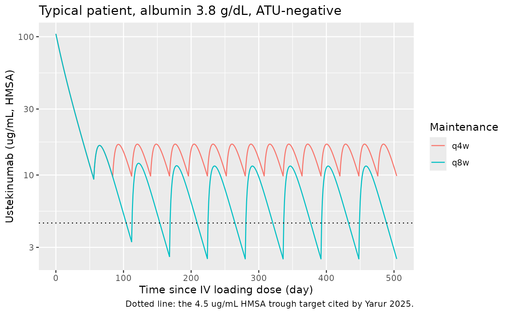
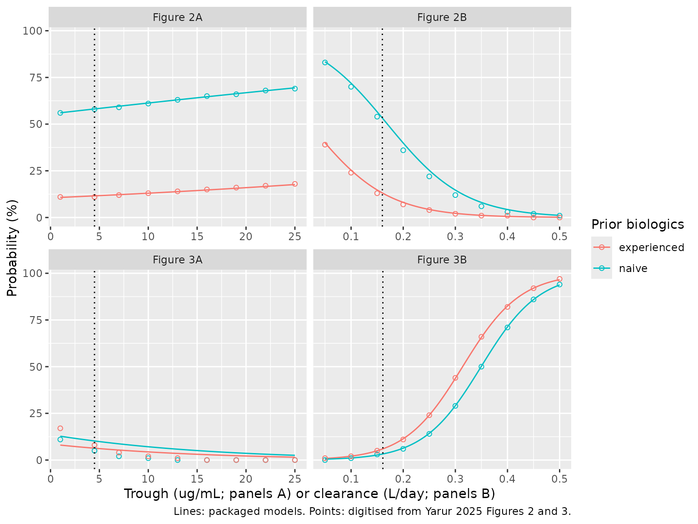

# Ustekinumab PK and clearance-response in inflammatory bowel disease (Yarur 2025)

``` r

library(nlmixr2lib)
library(PKNCA)
#> 
#> Attaching package: 'PKNCA'
#> The following object is masked from 'package:stats':
#> 
#>     filter
library(rxode2)
#> rxode2 5.1.8 using 2 threads (see ?getRxThreads)
#>   no cache: create with `rxCreateCache()`
library(dplyr)
#> 
#> Attaching package: 'dplyr'
#> The following objects are masked from 'package:stats':
#> 
#>     filter, lag
#> The following objects are masked from 'package:base':
#> 
#>     intersect, setdiff, setequal, union
library(tidyr)
library(ggplot2)
```

## Model and source

Yarur 2025 contributes **six** models to the library: one population PK
model (the “Final Bayesian Priors” column of Table 1) and five
independently fitted logistic exposure-response (ER) models from
Supplementary Table S1. All six share this vignette.

    #> ℹ parameter labels from comments will be replaced by 'label()'

- **Citation:** Yarur AJ, Dervieux T, Ungaro R, Spencer EA, Bruss A,
  Nunez L, Berens B, Vermeire S, Wang Z, Panetta JC, Dreesen E,
  Dubinsky MC. Ustekinumab Drug Clearance Is Better Associated with
  Disease Control than Serum Trough Concentrations in a Prospective
  Cohort of Inflammatory Bowel Disease. Pharmaceutics. 2025;17(2):187.
  <doi:10.3390/pharmaceutics17020187>. Model structure from Wang Z,
  Verstockt B, Sabino J, Vermeire S, Ferrante M, Declerck P, Dreesen E.
  Br J Clin Pharmacol. 2022;88(1):323-335. <doi:10.1111/bcp.14971>.

- **Description (population PK):** Two-compartment population PK model
  with first-order subcutaneous absorption for ustekinumab in adults and
  adolescents with inflammatory bowel disease, with concentrations
  measured by the drug-tolerant homogeneous mobility shift assay (HMSA)
  (Yarur 2025). This is the ‘Final Bayesian Priors’ model of Table 1:
  the Wang 2022 Crohn’s disease model structure re-fitted to HMSA
  re-assayed samples (albumin power effect on CL), plus an
  antibodies-to-ustekinumab (ATU) effect on CL estimated from a clinical
  PK-laboratory database, with between-subject variability on CL only.
  The paper used it, with every parameter fixed, to obtain
  empirical-Bayes clearances for the Yarur_2025_ustekinumab\_\*
  exposure-response models.

- **Article:** <https://doi.org/10.3390/pharmaceutics17020187> (open
  access)

- **Supplement:** Table S1, “Estimates from logistic regression models”,
  <https://www.mdpi.com/article/10.3390/pharmaceutics17020187/s1>.

- **Upstream model structure:** Wang Z et al. Br J Clin Pharmacol
  2022;88(1):323-335, <https://doi.org/10.1111/bcp.14971>.

| Model | Endpoint | Regressors | Source |
|----|----|----|----|
| `Yarur_2025_ustekinumab` | serum ustekinumab (HMSA) | albumin, ATU on CL | Table 1, “Final Bayesian Priors” |
| `Yarur_2025_ustekinumab_clinbiorem_time` | clinical and biochemical remission | prior biologics, time | Table S1, row 1 |
| `Yarur_2025_ustekinumab_clinbiorem_ctrough` | clinical and biochemical remission | prior biologics, trough | Table S1, row 2; Figure 2A |
| `Yarur_2025_ustekinumab_clinbiorem_cl` | clinical and biochemical remission | prior biologics, clearance | Table S1, row 3; Figure 2B |
| `Yarur_2025_ustekinumab_ehi50_ctrough` | EHI \> 50 points | prior biologics, trough | Table S1, row 4; Figure 3A |
| `Yarur_2025_ustekinumab_ehi50_cl` | EHI \> 50 points | prior biologics, clearance | Table S1, row 5; Figure 3B |

### How the paper built the PK model

Ustekinumab concentrations in this study were measured with a
drug-tolerant homogeneous mobility shift assay (HMSA), which reads about
1.5-fold higher than the solid-phase ELISA used by the earlier Wang 2022
Crohn’s disease popPK study. The authors therefore (1) re-assayed the
Wang 2022 training samples (308 concentrations, 65 patients) with the
HMSA and re-fitted the same model structure in NONMEM 7.5; (2) fixed
that fit and estimated an antibodies-to-ustekinumab (ATU) effect on
clearance from 11,372 clinical PK-laboratory specimens; and (3) fixed
every parameter as a Bayesian prior to obtain individual clearances for
the 83-patient prospective cohort in Monolix. `Yarur_2025_ustekinumab`
is the model of step 3.

The prospective-cohort clearances then entered mixed-effects logistic
regressions of each outcome on one PK metric (trough or clearance) or on
time, each with prior biologic exposure as a covariate:
`logit(P) = theta_pop + theta_prior * PRIOR_BIO + theta_x * x`.

## Population

The PK model’s structural and albumin parameters come from 65 adults
with Crohn’s disease in the Wang 2022 training cohort; Yarur 2025 does
not reprint their demographics. The ER models were fitted to the
prospective two-centre US cohort (Table 4): 83 patients (52% female,
median age 42 years, IQR 28-57; 78 Crohn’s disease and 5 ulcerative
colitis), all on ustekinumab maintenance for at least 16 weeks after a
weight-based IV loading dose, followed over 312 dose cycles (median 3
per patient). 77 cycles were on every-4-week dosing and the rest mostly
on every-8-week dosing (median inter-dose interval 56 days, IQR 42-56).
Median albumin was 3.8 g/dL (IQR 3.5-4.1); 89% (74/83) had prior
biologic exposure; no sample was ATU-positive.

``` r

str(pk_ui$population)
#> List of 8
#>  $ species       : chr "human"
#>  $ n_subjects    : int 65
#>  $ n_studies     : int 1
#>  $ n_observations: chr "308 HMSA re-assayed serum concentrations (training cohort); ATU effect from 11,372 PK-laboratory specimens"
#>  $ disease_state : chr "Crohn's disease (training cohort); the Bayesian application cohort had Crohn's disease (78/83) or ulcerative colitis (5/83)"
#>  $ dose_range    : chr "IV weight-based loading dose then 90 mg SC every 8 weeks (training cohort); 90 mg SC every 4-8 weeks maintenanc"| __truncated__
#>  $ regions       : chr "Belgium (training cohort, Wang 2022); United States (application cohort and PK-laboratory database)"
#>  $ notes         : chr "The structural and albumin parameters were estimated on 308 samples from 65 Crohn's disease patients of the Wan"| __truncated__
```

## Source trace

Every [`ini()`](https://nlmixr2.github.io/rxode2/reference/ini.html)
entry carries an in-file comment naming its source. The table collects
them.

| Model / parameter | Value | Source location |
|----|----|----|
| PK `lka` | `log(0.142)` fixed, 1/day | Table 1, Ka (all columns) |
| PK `lfdepot` | `log(0.735)` fixed | Table 1, Bioavailability, Final Bayesian Priors |
| PK `lcl` | `log(0.161)` fixed, L/day | Table 1, CL_pop |
| PK `lvc` | `log(3.72)` fixed, L | Table 1, V1_pop |
| PK `lq` | `log(0.0322)` fixed, L/day | Table 1, Q |
| PK `lvp` | `log(0.393)` fixed, L | Table 1, V2 |
| PK `e_ada_cl` | 0.566 fixed | Table 1, effect of ATU on CL; footnote covariate model 1 |
| PK `e_alb_cl` | -0.887 fixed | Table 1, effect of ALB on CL; footnote covariate model 2 |
| PK `etalcl` | variance 0.0924 (30.4%) fixed | Table 1, IIV of CL |
| PK `propSd` | 0.11 fixed | Table 1, Proportional error 11.0% |
| PK `addSd` | 0.495 ug/mL fixed | Table 1, Additive error |
| PK `cl` equation | `CLpop * (ALB_gdL / 4.0)^beta_ALB * exp(beta_ATU * ATU)` | Table 1 footnote |
| PK structure | 2-compartment, first-order SC absorption with F | Methods 2.3, Table 1 |
| clinbiorem_time | 0.006, -2.48, +0.0024 /day | Table S1 row 1 |
| clinbiorem_ctrough | 0.22, -2.36, +0.024 per ug/mL | Table S1 row 2 |
| clinbiorem_cl | 2.29, -2.02, -13.5 per L/day | Table S1 row 3 |
| ehi50_ctrough | -1.85, -0.52, -0.072 per ug/mL | Table S1 row 4 |
| ehi50_cl | -6.29, +0.639, +18.0 per L/day | Table S1 row 5 |
| logistic link | `logit(P) = theta_pop + cov1*theta_cov1 + cov2*theta_cov2` | Table S1 footnote |

## Population PK simulation

### Virtual cohort

The cohort mimics the prospective maintenance population: an IV loading
dose of 390 mg (the label dose for 55-85 kg) on day 0, then 90 mg SC
from week 8 every 8 weeks or, in a quarter of the patients (matching 77
of 312 cycles), every 4 weeks. Albumin is drawn from a normal
distribution matching the Table 4 median and IQR (3.8 g/dL; IQR 3.5-4.1,
so SD about 0.44 g/dL) and held constant; everyone is ATU-negative, as
in the study.

``` r

set.seed(20251025)
rxode2::rxSetSeed(20251025)

n_q8w <- 150L
n_q4w <- 50L
t_end <- 504

make_arm <- function(n, regimen, tau, id_offset) {
  alb_gdl <- pmin(pmax(rnorm(n, 3.8, 0.44), 2.5), 5.0)
  subj <- tibble(
    id = id_offset + seq_len(n),
    regimen = regimen,
    ALB = 10 * alb_gdl,
    ADA_POS = 0L
  )
  sc_times <- seq(56, t_end - tau, by = tau)
  doses <- bind_rows(
    tibble(time = 0, amt = 390, cmt = "central"),
    tibble(time = sc_times, amt = 90, cmt = "depot")
  )
  obs <- tibble(time = seq(0, t_end, by = 1), amt = 0, cmt = "central")
  tidyr::expand_grid(subj, bind_rows(
    mutate(doses, evid = 1L),
    mutate(obs, evid = 0L)
  )) |>
    arrange(id, time, desc(evid))
}

events <- bind_rows(
  make_arm(n_q8w, "q8w", 56, 0L),
  make_arm(n_q4w, "q4w", 28, n_q8w)
)
stopifnot(!anyDuplicated(events[events$evid == 1, c("id", "time")]))
```

### Simulation

``` r

sim <- rxode2::rxSolve(
  pk_ui,
  events = events,
  keep = c("regimen", "ALB")
) |>
  as.data.frame()
```

### Typical concentration-time profile

``` r

pk_typ <- pk_ui |> rxode2::zeroRe()
ev_typ <- events |>
  filter(id %in% c(1L, n_q8w + 1L)) |>
  mutate(ALB = 38)
sim_typ <- rxode2::rxSolve(pk_typ, events = ev_typ, keep = "regimen") |>
  as.data.frame()
#> ℹ omega/sigma items treated as zero: 'etalcl'
#> Warning: multi-subject simulation without without 'omega'

ggplot(sim_typ, aes(time, Cc, colour = regimen)) +
  geom_line() +
  geom_hline(yintercept = 4.5, linetype = "dotted") +
  scale_y_log10() +
  labs(
    x = "Time since IV loading dose (day)",
    y = "Ustekinumab (ug/mL, HMSA)",
    colour = "Maintenance",
    title = "Typical patient, albumin 3.8 g/dL, ATU-negative",
    caption = "Dotted line: the 4.5 ug/mL HMSA trough target cited by Yarur 2025."
  )
```



### Steady-state troughs and clearance against Table 4

Table 4 reports the observed troughs and the Bayesian clearances over
all 312 cycles. The simulated troughs are the pre-dose concentrations of
the last maintenance interval, pooled with the same 1:3 mix of
every-4-week and every-8-week dosing.

``` r

troughs <- sim |>
  filter(time == t_end) |>
  select(id, regimen, Ctrough = Cc, cl)

trough_summary <- troughs |>
  summarise(
    `Median Ctrough (ug/mL)` = median(Ctrough),
    `Q1 Ctrough` = quantile(Ctrough, 0.25),
    `Q3 Ctrough` = quantile(Ctrough, 0.75),
    `Median CL (L/day)` = median(cl),
    `Q1 CL` = quantile(cl, 0.25),
    `Q3 CL` = quantile(cl, 0.75)
  ) |>
  mutate(Source = "Simulated (pooled 1:3 q4w:q8w)")

published_t4 <- tibble(
  Source = "Observed, Yarur 2025 Table 4",
  `Median Ctrough (ug/mL)` = 5.0, `Q1 Ctrough` = 3.0, `Q3 Ctrough` = 8.7,
  `Median CL (L/day)` = 0.157, `Q1 CL` = 0.120, `Q3 CL` = 0.190
)

bind_rows(published_t4, trough_summary) |>
  relocate(Source) |>
  knitr::kable(digits = 3, caption = "Trough concentrations and clearance: simulated vs. Table 4.")
```

| Source | Median Ctrough (ug/mL) | Q1 Ctrough | Q3 Ctrough | Median CL (L/day) | Q1 CL | Q3 CL |
|:---|---:|---:|---:|---:|---:|---:|
| Observed, Yarur 2025 Table 4 | 5.000 | 3.000 | 8.700 | 0.157 | 0.120 | 0.190 |
| Simulated (pooled 1:3 q4w:q8w) | 3.215 | 2.006 | 6.275 | 0.169 | 0.139 | 0.211 |

Trough concentrations and clearance: simulated vs. Table 4. {.table
style="width:100%;"}

``` r


troughs |>
  group_by(regimen) |>
  summarise(
    `Median Ctrough (ug/mL)` = median(Ctrough),
    `% above 4.5 ug/mL` = 100 * mean(Ctrough > 4.5),
    .groups = "drop"
  ) |>
  knitr::kable(digits = 2, caption = "Simulated steady-state troughs by maintenance interval.")
```

| regimen | Median Ctrough (ug/mL) | % above 4.5 ug/mL |
|:--------|-----------------------:|------------------:|
| q4w     |                   8.34 |             96.00 |
| q8w     |                   2.63 |             19.33 |

Simulated steady-state troughs by maintenance interval. {.table}

The simulated clearance matches the cohort’s Bayesian clearances
closely; its spread is wider, as expected, because the observed values
are empirical-Bayes estimates from one trough per cycle and shrink
towards the typical value.

The simulated troughs are **lower** than the observed ones (a typical
every-8-week patient with albumin 3.8 g/dL reaches about 2.5 ug/mL).
This is a property of the published model applied to this cohort, not of
the transcription: the cohort’s median Bayesian clearance (0.157 L/day)
is already below the typical value the prior predicts at the cohort’s
median albumin (0.161 x (3.8/4.0)^-0.887 = 0.169 L/day), i.e. the
measured troughs pulled the individual clearances down, and
empirical-Bayes shrinkage limits how far. The dosing mix is also only
approximated: Table 4 gives an inter-dose interval IQR of 42-56 days, so
some cycles were on 6-week dosing, which the 1:3 mix ignores.

``` r

pooled_med <- median(troughs$Ctrough)
cl_med <- median(troughs$cl)
stopifnot(
  # Clearance: tests CL_pop and the albumin exponent directly against the
  # cohort's Bayesian estimates.
  abs(cl_med / 0.157 - 1) < 0.15,
  # Trough: only a coarse guard against unit or bioavailability errors
  # (a mg-vs-ug or F slip moves it several-fold); see the text for why the
  # model sits below the observed median.
  pooled_med > 0.4 * 5.0,
  pooled_med < 1.2 * 5.0
)
```

### Covariate effects

``` r

cl_rel <- tibble(
  ALB_gdL = c(3.0, 3.5, 4.0, 4.5)
) |>
  mutate(
    `CL (L/day), ATU-negative` = 0.161 * (ALB_gdL / 4.0)^-0.887,
    `CL (L/day), ATU-positive` = `CL (L/day), ATU-negative` * exp(0.566)
  )
knitr::kable(cl_rel, digits = 3, caption = "Typical clearance by albumin and ATU status (Table 1 footnote).")
```

| ALB_gdL | CL (L/day), ATU-negative | CL (L/day), ATU-positive |
|--------:|-------------------------:|-------------------------:|
|     3.0 |                    0.208 |                    0.366 |
|     3.5 |                    0.181 |                    0.319 |
|     4.0 |                    0.161 |                    0.284 |
|     4.5 |                    0.145 |                    0.255 |

Typical clearance by albumin and ATU status (Table 1 footnote). {.table}

``` r


# Results 3.1: 'UST clearance was 1.76X higher in positive ATU specimens'
stopifnot(abs(exp(0.566) - 1.76) < 0.005)
```

## PKNCA validation

The paper reports no NCA beyond the trough, so PKNCA is run on the last
steady-state dosing interval of each regimen and the pooled minimum
concentration is compared with the Table 4 median trough.

``` r

sim_nca <- sim |>
  filter(!is.na(Cc)) |>
  select(id, time, Cc, regimen)

dose_df <- events |>
  filter(evid == 1) |>
  select(id, time, amt, regimen)

conc_obj <- PKNCA::PKNCAconc(sim_nca, Cc ~ time | regimen + id)
dose_obj <- PKNCA::PKNCAdose(dose_df, amt ~ time | regimen + id)

intervals <- data.frame(
  regimen = c("q8w", "q4w"),
  start = c(t_end - 56, t_end - 28),
  end = c(t_end, t_end),
  cmax = TRUE,
  tmax = TRUE,
  cmin = TRUE,
  cav = TRUE
)
nca_res <- PKNCA::pk.nca(PKNCA::PKNCAdata(conc_obj, dose_obj, intervals = intervals))

nca_res$result |>
  filter(PPTESTCD %in% c("cmax", "tmax", "cmin", "cav")) |>
  group_by(regimen, PPTESTCD) |>
  summarise(median = median(PPORRES), .groups = "drop") |>
  tidyr::pivot_wider(names_from = PPTESTCD, values_from = median) |>
  rename(
    "Regimen" = regimen,
    "Cmax (ug/mL)" = cmax,
    "Tmax (day)" = tmax,
    "Cmin (ug/mL)" = cmin,
    "Cav (ug/mL)" = cav
  ) |>
  knitr::kable(digits = 2, caption = "Simulated steady-state NCA (median per regimen).")
```

| Regimen | Cav (ug/mL) | Cmax (ug/mL) | Cmin (ug/mL) | Tmax (day) |
|:--------|------------:|-------------:|-------------:|-----------:|
| q4w     |       12.45 |        15.17 |         8.34 |          8 |
| q8w     |        7.21 |        11.81 |         2.63 |         11 |

Simulated steady-state NCA (median per regimen). {.table}

``` r

sim_pooled <- nca_res$result |>
  filter(PPTESTCD == "cmin") |>
  mutate(group = "All cycles (1:3 q4w:q8w)") |>
  select(group, PPTESTCD, PPORRES)

published_nca <- tibble(group = "All cycles (1:3 q4w:q8w)", cmin = 5.0)

cmp <- nlmixr2lib::ncaComparisonTable(
  simulated = sim_pooled,
  reference = published_nca,
  by = "group",
  units = c(cmin = "ug/mL"),
  tolerance_pct = 20
)
knitr::kable(cmp, caption = "Simulated steady-state Cmin vs. the Table 4 median trough. * differs by >20%.")
```

| NCA parameter | group                    | Reference | Simulated | % diff   |
|:--------------|:-------------------------|:----------|:----------|:---------|
| Cmin (ug/mL)  | All cycles (1:3 q4w:q8w) | 5         | 3.21      | -35.7%\* |

Simulated steady-state Cmin vs. the Table 4 median trough. \* differs by
\>20%. {.table}

The Cmin row is expected to be flagged: as explained above, the model
under-predicts this cohort’s observed troughs, and the cohort’s own
Bayesian clearances show the same shift. No parameter was adjusted.

## Exposure-response models

``` r

er_names <- c(
  "Yarur_2025_ustekinumab_clinbiorem_time",
  "Yarur_2025_ustekinumab_clinbiorem_ctrough",
  "Yarur_2025_ustekinumab_clinbiorem_cl",
  "Yarur_2025_ustekinumab_ehi50_ctrough",
  "Yarur_2025_ustekinumab_ehi50_cl"
)
er_mods <- lapply(er_names, function(n) rxode2::rxode(readModelDb(n)))
names(er_mods) <- sub("^Yarur_2025_ustekinumab_", "", er_names)

# One subject per grid row (rxSolve drops the id column for single-subject
# solves); observations at a single time.
er_solve <- function(key, grid, time = 0) {
  ev <- grid |>
    mutate(id = row_number(), time = time, amt = 0, evid = 0L)
  out <- paste0("prob_", sub("_.*", "", key))
  s <- as.data.frame(rxode2::rxSolve(er_mods[[key]], events = ev))
  stopifnot(nrow(s) == nrow(grid))
  grid[[out]] <- s[[out]][order(s$id)]
  grid
}
prior_lab <- function(x) ifelse(x == 1, "experienced", "naive")
```

### Remission at the median follow-up (Results 3.3)

``` r

time_chk <- er_solve(
  "clinbiorem_time",
  tibble(PRIOR_BIO = c(0L, 1L)),
  time = 279
) |>
  mutate(Published = c(0.66, 0.14), `Prior biologics` = prior_lab(PRIOR_BIO))
#> Warning: multi-subject simulation without without 'omega'
time_chk |>
  select(`Prior biologics`, Model = prob_clinbiorem, Published) |>
  knitr::kable(digits = 3, caption = "Probability of clinical and biochemical remission at 279 days (Results 3.3).")
```

| Prior biologics | Model | Published |
|:----------------|------:|----------:|
| naive           | 0.663 |      0.66 |
| experienced     | 0.141 |      0.14 |

Probability of clinical and biochemical remission at 279 days (Results
3.3). {.table}

``` r

stopifnot(all(abs(time_chk$prob_clinbiorem - time_chk$Published) < 0.01))
```

### Figures 2 and 3

The published curves were digitised by the maintainers (read-off
precision about 2 percentage points) and overlaid as points on the model
curves.

``` r

x_conc <- c(1, 4.5, 7, 10, 13, 16, 19, 22, 25)
x_cl <- seq(0.05, 0.5, by = 0.05)
digitised <- bind_rows(
  tibble(panel = "Figure 2A", x = x_conc, PRIOR_BIO = 0L, pct = c(56, 58, 59, 61, 63, 65, 66, 68, 69)),
  tibble(panel = "Figure 2A", x = x_conc, PRIOR_BIO = 1L, pct = c(11, 11, 12, 13, 14, 15, 16, 17, 18)),
  tibble(panel = "Figure 2B", x = x_cl, PRIOR_BIO = 0L, pct = c(83, 70, 54, 36, 22, 12, 6, 3, 2, 1)),
  tibble(panel = "Figure 2B", x = x_cl, PRIOR_BIO = 1L, pct = c(39, 24, 13, 7, 4, 2, 1, 1, 0, 0)),
  tibble(panel = "Figure 3A", x = x_conc, PRIOR_BIO = 0L, pct = c(11, 5, 2, 1, 0, 0, 0, 0, 0)),
  tibble(panel = "Figure 3A", x = x_conc, PRIOR_BIO = 1L, pct = c(17, 8, 4, 2, 1, 0, 0, 0, 0)),
  tibble(panel = "Figure 3B", x = x_cl, PRIOR_BIO = 0L, pct = c(0, 1, 3, 6, 14, 29, 50, 71, 86, 94)),
  tibble(panel = "Figure 3B", x = x_cl, PRIOR_BIO = 1L, pct = c(1, 2, 5, 11, 24, 44, 66, 82, 92, 97))
)

panel_model <- c(
  "Figure 2A" = "clinbiorem_ctrough", "Figure 2B" = "clinbiorem_cl",
  "Figure 3A" = "ehi50_ctrough", "Figure 3B" = "ehi50_cl"
)
panel_cov <- c(
  "Figure 2A" = "CTROUGH", "Figure 2B" = "CL_INDIV",
  "Figure 3A" = "CTROUGH", "Figure 3B" = "CL_INDIV"
)

predict_panel <- function(panel, x, prior) {
  grid <- tibble(x = x, PRIOR_BIO = prior)
  grid[[panel_cov[[panel]]]] <- x
  res <- er_solve(panel_model[[panel]], grid)
  prob_col <- grep("^prob_", names(res), value = TRUE)
  tibble(panel = panel, x = res$x, PRIOR_BIO = res$PRIOR_BIO, model_pct = 100 * res[[prob_col]])
}

curves <- bind_rows(lapply(names(panel_model), function(p) {
  xr <- if (panel_cov[[p]] == "CTROUGH") seq(1, 25, length.out = 97) else seq(0.05, 0.5, length.out = 91)
  bind_rows(predict_panel(p, xr, 0L), predict_panel(p, xr, 1L))
}))
#> Warning: multi-subject simulation without without 'omega'
#> Warning: multi-subject simulation without without 'omega'
#> Warning: multi-subject simulation without without 'omega'
#> Warning: multi-subject simulation without without 'omega'
#> Warning: multi-subject simulation without without 'omega'
#> Warning: multi-subject simulation without without 'omega'
#> Warning: multi-subject simulation without without 'omega'
#> Warning: multi-subject simulation without without 'omega'

at_points <- bind_rows(lapply(names(panel_model), function(p) {
  d <- filter(digitised, panel == p)
  predict_panel(p, d$x, d$PRIOR_BIO)
})) |>
  left_join(digitised, by = c("panel", "x", "PRIOR_BIO"))
#> Warning: multi-subject simulation without without 'omega'
#> Warning: multi-subject simulation without without 'omega'
#> Warning: multi-subject simulation without without 'omega'
#> Warning: multi-subject simulation without without 'omega'
```

``` r

# Replicates Figures 2A, 2B, 3A and 3B of Yarur 2025.
ggplot(curves, aes(x, model_pct, colour = prior_lab(PRIOR_BIO))) +
  geom_line() +
  geom_point(data = digitised, aes(y = pct), shape = 1) +
  geom_vline(
    data = tibble(panel = names(panel_model), v = c(4.5, 0.16, 4.5, 0.161)),
    aes(xintercept = v), linetype = "dotted"
  ) +
  facet_wrap(~panel, scales = "free_x") +
  labs(
    x = "Trough (ug/mL; panels A) or clearance (L/day; panels B)",
    y = "Probability (%)",
    colour = "Prior biologics",
    caption = "Lines: packaged models. Points: digitised from Yarur 2025 Figures 2 and 3."
  )
```



``` r

agreement <- at_points |>
  mutate(diff = model_pct - pct) |>
  group_by(panel) |>
  summarise(
    `Max abs. difference (pct points)` = max(abs(diff)),
    `Mean difference (pct points)` = mean(diff),
    .groups = "drop"
  )
knitr::kable(agreement, digits = 1, caption = "Packaged models vs. digitised published curves.")
```

| panel     | Max abs. difference (pct points) | Mean difference (pct points) |
|:----------|---------------------------------:|-----------------------------:|
| Figure 2A |                              0.6 |                          0.0 |
| Figure 2B |                              3.9 |                          1.2 |
| Figure 3A |                              9.0 |                          2.4 |
| Figure 3B |                              0.5 |                          0.1 |

Packaged models vs. digitised published curves. {.table}

``` r


ok <- agreement$`Max abs. difference (pct points)`[agreement$panel != "Figure 3A"]
# Typical-value curves have no random component, so the only error is
# digitising precision.
stopifnot(all(ok < 5))
```

Figures 2A, 2B and 3B are reproduced to within digitising precision,
which confirms the Table S1 transcription and the uncentred, linear form
of the regressors. **Figure 3A is not reproduced** (see the next
section).

## Assumptions and deviations

- **Final model choice.** Table 1 has four columns. The library model is
  the “Final Bayesian Priors” column, the one the paper actually used:
  it carries the ATU effect and has no between-subject variability on
  bioavailability (the HMSA training-cohort column had 20.3%; the final
  column marks it “NA”). The ELISA and HMSA training-cohort columns are
  intermediate refits and are not packaged.
- **Absorption rate.** Methods 2.3 says absorption “was fixed to 0.2”;
  Table 1 gives Ka = 0.142 1/day (fixed) in all four columns. The
  maintainers used the tabulated 0.142. Methods 2.3 and Results 3.1 also
  disagree on the ELISA clearance (0.215 vs. 0.235 L/day in Table 1);
  that value is not used here.
- **IIV scale.** Table 1 reports “IIV of CL 30.4%”. The maintainers read
  it as the standard deviation of the log-normal random effect (variance
  0.304^2 = 0.0924), which is how Monolix, where the prior was applied,
  takes the value. Under the alternative reading as a geometric CV the
  variance would be log(1 + 0.304^2) = 0.0884; the difference does not
  affect any check here.
- **Combined residual error.** The paper says only “a combined additive
  and residual error model”. The library uses nlmixr2’s default
  combination of the additive (0.495 ug/mL) and proportional (11.0%)
  components.
- **Model structure from Wang 2022.** Yarur 2025 states that the HMSA
  refit used “the same model structure initially reported” by Wang 2022,
  and Table 1 lists every parameter that was estimated. The packaged
  model is built from Table 1 alone; Wang 2022 (subscription-only) was
  not consulted.
- **Albumin units.** The canonical `ALB` column is g/L; the model
  converts to the paper’s g/dL before applying the 4.0 g/dL reference.
- **IV loading dose.** The paper says only “weight-based IV loading
  infusion”. The simulation uses 390 mg (the label dose for 55-85 kg)
  for everyone, dosed into `central` without bioavailability.
- **Observed troughs are higher than the model predicts.** The simulated
  pooled steady-state trough is below the Table 4 median of 5.0 ug/mL.
  The cohort’s Bayesian clearances (median 0.157 L/day, below the 0.169
  L/day the prior predicts at albumin 3.8 g/dL) show the same direction.
  The parameters are reproduced as published.
- **Exposure-response random effects.** The logistic models were fitted
  as mixed-effects models in Monolix, but no between-subject variance is
  reported. The packaged ER models are typical-value models, which is
  what Figures 2 and 3 and the Results 3.3 probabilities show.
- **Placeholder residual.** Each ER model carries
  `addSd_prob_* = fixed(0.001)` on the probability because the source
  likelihood is Bernoulli; it has no source value.
- **Figure 3A does not match Table S1.** With the Table S1 coefficients
  (intercept -1.85, prior biologics -0.52, trough slope -0.072 per
  ug/mL) the model gives a shallow decline from 13% to 2.5% over 1-25
  ug/mL with biologic-experienced patients *below* naive ones. Figure 3A
  instead falls to about 0% by 13 ug/mL (a slope of roughly -0.25 per
  ug/mL) and places experienced patients *above* naive ones, which would
  need a positive prior biologics coefficient. The printed p-value
  (0.001) is also inconsistent with -0.072 +/- 0.045 (a Wald test gives
  about 0.11). The maintainers kept the tabulated coefficients unchanged
  rather than re-deriving them from the figure; treat
  `Yarur_2025_ustekinumab_ehi50_ctrough` with caution. The other four ER
  models reproduce their figures or text values.
- **Time regressor.** In `Yarur_2025_ustekinumab_clinbiorem_time` the
  regressor is the model time in days from study baseline; Results 3.3
  evaluates the model at 279 days, the median follow-up from baseline.
- **Clearance and trough regressors are per-cycle values.** `CL_INDIV`
  is the empirical-Bayes clearance for the dose cycle and `CTROUGH` is
  the measured HMSA trough; both enter linearly and uncentred.
- **Errata.** No correction notice was found for this article on the
  publisher page or in Europe PMC as of 2026-11-02.
