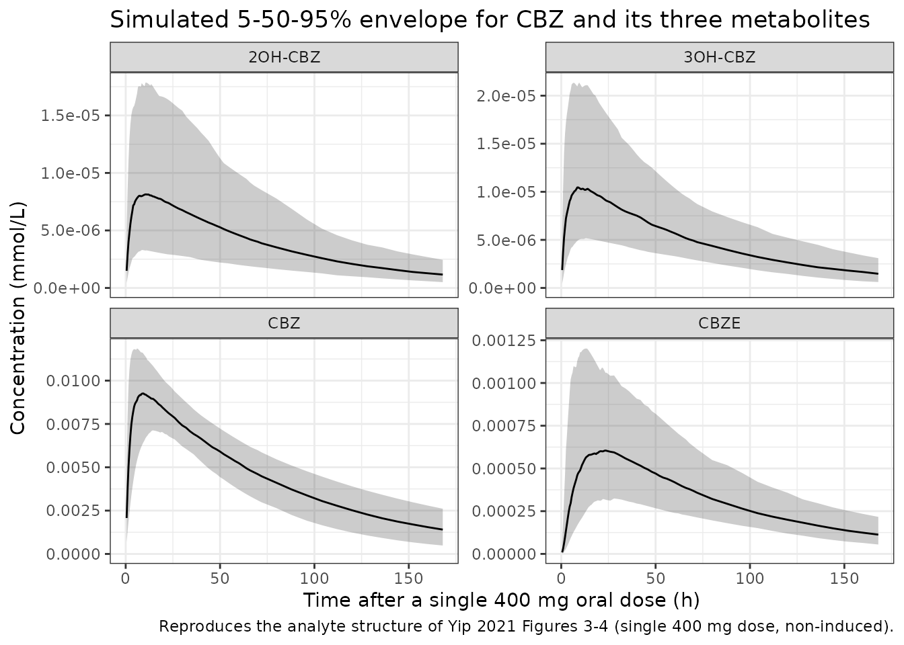

# Carbamazepine (Yip 2021)

## Model and source

    #> ℹ parameter labels from comments will be replaced by 'label()'

- Citation: Yip VLM, Pertinez H, Meng X, Maggs JL, Carr DF, Park BK,
  Marson AG, Pirmohamed M. Evaluation of clinical and genetic factors in
  the population pharmacokinetics of carbamazepine. Br J Clin Pharmacol.
  2021;87(6):2572-2588. <doi:10.1111/bcp.14667>
- Description: Simultaneous parent + three-metabolite population PK
  model for carbamazepine (CBZ) and its metabolites
  carbamazepine-10,11-epoxide (CBZE), 2-hydroxycarbamazepine (2OH-CBZ)
  and 3-hydroxycarbamazepine (3OH-CBZ) in healthy adult volunteers and
  adults with epilepsy (Yip 2021). One-compartment parent with
  first-order absorption and elimination feeding three metabolite
  compartments that share one apparent volume of distribution (an
  identifiability assumption); total apparent parent clearance
  partitioned via a fixed metabolite fraction into CBZE, 2OH-CBZ and
  3OH-CBZ formation. Covariates: binary enzyme-autoinduction status (\>=
  14 days of dosing) on total clearance and on 2OH-CBZ elimination,
  phenytoin coadministration and total daily carbamazepine dose on total
  clearance, and the EPHX1 rs2234922 homozygous-variant (416G/G)
  genotype on CBZE elimination. Concentrations are molar (mmol/L); all
  clearances and volumes are apparent (CL/F, V/F) because no intravenous
  data were available.
- Article: <https://doi.org/10.1111/bcp.14667>

## Population

Yip 2021 fit a simultaneous parent-plus-three-metabolite population PK
model to 80 adults studied in two UK trials: PICME I (8 healthy male
volunteers given a single 400 mg oral immediate-release carbamazepine
dose with rich sampling to 72 h) and PICME II (epilepsy patients – an
autoinduction group of 3 patients titrated from 200 mg once daily to 200
mg AM / 400 mg PM over 42 days, and a maintenance group of 69 patients
on stable therapy, 819 +/- 367 mg/day, with sparse sampling). In total
248 sets of carbamazepine (CBZ) + metabolite assays were used. The three
metabolites modelled are the active, chemically reactive
carbamazepine-10,11-epoxide (CBZE), 2-hydroxycarbamazepine (2OH-CBZ) and
3-hydroxycarbamazepine (3OH-CBZ). Age ranged 21.7-75.8 years (mean 45.8)
and weight 39.0-140.5 kg (mean 80.8); see Yip 2021 Table 3 for the full
demographics and Table 4 for the genotype distribution.

The same metadata is available programmatically via
`readModelDb("Yip_2021_carbamazepine")()$population`.

## Model structure

A one-compartment parent (first-order absorption and elimination) feeds
three metabolite compartments that share a single apparent volume of
distribution V2 (an identifiability assumption; Yip 2021 Methods 2.8).
The total apparent parent clearance CLTOT is partitioned (Eqs 6-8) into
formation of the three metabolites: a fraction `1 - FM1 = 0.36` forms
CBZE and `FM1/2 = 0.32` each forms 2OH-CBZ and 3OH-CBZ, with FM1 fixed
at 0.64 for identifiability. Each metabolite is eliminated first-order
(CL2E, CL3E, CL4E). The absorption rate is constrained above the parent
elimination rate via `KA = CLTOT/V1 + KAstar` (Eq 9) to avoid flip-flop.
Concentrations are molar (mmol/L); a carbamazepine dose in mg is
converted with the molecular weight 236.27 g/mol.

Covariates in the final model: a binary enzyme-autoinduction status on
CLTOT (x1.73) and on 2OH-CBZ elimination clearance (x1.63); phenytoin
coadministration (x1.93) and total daily dose (an additive log term) on
CLTOT; and the EPHX1 rs2234922 homozygous-variant (416G/G) genotype on
CBZE elimination clearance (x0.502).

## Source trace

The per-parameter origin is recorded as an in-file comment next to each
`ini()` entry in `inst/modeldb/specificDrugs/Yip_2021_carbamazepine.R`.
The table below collects them in one place for review. All point
estimates are from Yip 2021 Table 5.

| Equation / parameter | Value | Source location |
|----|----|----|
| `lcl` (CLTOT, total apparent clearance) | 1.96 L/h | Table 5 |
| `lvc` (V1, parent central volume) | 161 L | Table 5 |
| `lkastar` (KAstar absorption offset) | 0.409 /h | Table 5; Eq 9 |
| `lfm1` (FM1, fraction to hydroxy metabolites) | 0.64 (FIXED) | Table 5 + Methods 2.8 |
| `lcl_cbze` (CL2E, CBZE elimination) | 9.71 L/h | Table 5 |
| `lcl_2oh` (CL3E, 2OH-CBZ elimination) | 726 L/h | Table 5 |
| `lcl_3oh` (CL4E, 3OH-CBZ elimination) | 543 L/h | Table 5 |
| `lvc_met` (V2, shared metabolite volume) | 39.2 L | Table 5 |
| `e_autoind_cl` (autoinduction on CLTOT) | 1.73 | Table 5; Eq 17 |
| `e_autoind_cl_2oh` (autoinduction on CL3E) | 1.63 | Table 5; Eq 18 |
| `e_pht_cl` (phenytoin on CLTOT) | 1.93 | Table 5; Eq 17 |
| `e_dose_cl` (daily dose on CLTOT, additive ln term) | 1.36 | Table 5; Eqs 13, 17 |
| `e_ephx1_hom_cl_cbze` (EPHX1 416G/G on CBZE elim) | 0.502 | Table 5; see Errata re Eq 18 |
| IIV CV% (Table 5) | CLTOT 25.3, FM1 6.3, CL2E 27.9, CL3E 42.3, CL4E 34.5, KASTAR 75.3, V1 13.6, V2 149.7 | Table 5; converted via omega^2 = log(1 + CV^2) |
| Exponential residual SD | CBZ 0.221, CBZE 0.310, 2OH-CBZ 0.297, 3OH-CBZ 0.362 | Table 5 |
| `d/dt(central)` + 3 metabolite ODEs | n/a | Eqs 1-9, Figure 2 |

## Virtual cohort

Original observed data are not publicly available. The cohort simulated
here reproduces the PICME I design – a single 400 mg oral
immediate-release dose in non-induced, phenytoin-free, EPHX1 wild-type
subjects – with between-subject variability on all structural
parameters. Carbamazepine molecular weight 236.27 g/mol is used to
convert the 400 mg dose to 1.693 mmol.

``` r

set.seed(20260829L)

mw_cbz <- 236.27
dose_mg <- 400
dose_mmol <- dose_mg / mw_cbz

# Observation grid: dense through absorption / distribution, then out to
# 336 h (about 6 parent half-lives) so AUCinf extrapolation is small.
obs_times <- sort(unique(c(
  seq(0, 24, by = 0.5),
  seq(26, 72, by = 2),
  seq(80, 336, by = 8)
)))

# Build one arm as a self-contained event table. This is a four-endpoint model
# (Cc, Cc_cbze, Cc_2oh, Cc_3oh), so observation rows carry the ODE state name
# `central` plus `dvid = 1L` (NOT `cmt = "Cc"`, which would target an auto-
# injected endpoint slot); rxode2 still returns every observable as a column at
# those rows. Dose rows carry `dvid = NA_integer_`.
make_arm <- function(n, autoind, pht, ephx_hom, dose_mgd,
                     dose_amt = dose_mmol, id_offset = 0L) {
  ids <- id_offset + seq_len(n)
  covs <- function(k) {
    tibble(
      AUTOIND_STATUS = autoind,
      CONMED_PHT = pht,
      SNP_EPHX1_RS2234922_HOM = ephx_hom,
      DOSE_CBZ_MGD = dose_mgd
    )[rep(1, k), ]
  }
  dose_rows <- bind_cols(
    tibble(
      id = ids, time = 0, evid = 1L, amt = dose_amt,
      cmt = "depot", dvid = NA_integer_
    ),
    covs(n)
  )
  obs_rows <- bind_cols(
    tibble(
      id = rep(ids, each = length(obs_times)),
      time = rep(obs_times, times = n),
      evid = 0L, amt = NA_real_, cmt = "central", dvid = 1L
    ),
    covs(n * length(obs_times))
  )
  bind_rows(dose_rows, obs_rows) |>
    arrange(id, time, desc(evid))
}

n_sub <- 200L
events <- make_arm(
  n = n_sub, autoind = 0, pht = 0, ephx_hom = 0, dose_mgd = 400
)
stopifnot(!anyDuplicated(unique(events[, c("id", "time", "evid")])))
```

## Simulation

``` r

mod <- readModelDb("Yip_2021_carbamazepine")

# useLinCmt = FALSE: this is a multi-output, multi-state model; the explicit
# ODE path is the validation (default since the 2026-09-24 rxode2 build).
sim <- rxode2::rxSolve(mod, events = events, useLinCmt = FALSE) |>
  as.data.frame() |>
  as_tibble()
#> ℹ parameter labels from comments will be replaced by 'label()'
```

## Replicate the four-analyte concentration-time profiles (Figures 3-4)

Yip 2021 Figures 3 (goodness-of-fit) and 4 (prediction-corrected VPC)
show the CBZ, CBZE, 2OH-CBZ and 3OH-CBZ concentration-time behaviour in
mmol/L. The prediction interval below is the simulated 5th-50th-95th
percentile envelope for each analyte after a single 400 mg dose.

``` r

sim_long <- sim |>
  filter(time > 0) |>
  select(id, time, Cc, Cc_cbze, Cc_2oh, Cc_3oh) |>
  pivot_longer(
    c(Cc, Cc_cbze, Cc_2oh, Cc_3oh),
    names_to = "analyte", values_to = "conc"
  ) |>
  mutate(analyte = recode(analyte,
    Cc = "CBZ", Cc_cbze = "CBZE",
    Cc_2oh = "2OH-CBZ", Cc_3oh = "3OH-CBZ"
  ))

vpc <- sim_long |>
  filter(conc > 0) |>
  group_by(analyte, time) |>
  summarise(
    Q05 = quantile(conc, 0.05, na.rm = TRUE),
    Q50 = quantile(conc, 0.50, na.rm = TRUE),
    Q95 = quantile(conc, 0.95, na.rm = TRUE),
    .groups = "drop"
  )

ggplot(vpc, aes(time, Q50)) +
  geom_ribbon(aes(ymin = Q05, ymax = Q95), alpha = 0.25) +
  geom_line() +
  facet_wrap(~analyte, scales = "free_y") +
  scale_x_continuous(limits = c(0, 168)) +
  labs(
    x = "Time after a single 400 mg oral dose (h)",
    y = "Concentration (mmol/L)",
    title = "Simulated 5-50-95% envelope for CBZ and its three metabolites",
    caption = "Reproduces the analyte structure of Yip 2021 Figures 3-4 (single 400 mg dose, non-induced)."
  ) +
  theme_bw()
#> Warning: Removed 84 rows containing missing values or values outside the scale range
#> (`geom_ribbon()`).
#> Warning: Removed 84 rows containing missing values or values outside the scale range
#> (`geom_line()`).
```



## Closed-form validation of the clearance partition and covariate effects

For a single oral dose with complete (apparent) bioavailability, the
parent AUC to infinity equals `Dose / CLTOT` independent of absorption
rate, and by mass balance each metabolite’s AUC to infinity equals
`(formation fraction x Dose) / (metabolite elimination clearance)`.
These identities let the simulated NCA pin every structural and
covariate value exactly, with no tuning. The checks below use
typical-value simulations (`zeroRe()`), so any discrepancy is pure
numerical-integration error.

``` r

mod_typ <- mod |> rxode2::zeroRe()
#> ℹ parameter labels from comments will be replaced by 'label()'

solve_typ <- function(autoind, pht, ephx_hom, dose_mgd) {
  ev <- make_arm(
    n = 1, autoind = autoind, pht = pht, ephx_hom = ephx_hom,
    dose_mgd = dose_mgd
  )
  rxode2::rxSolve(mod_typ, events = ev, useLinCmt = FALSE) |>
    as.data.frame() |>
    as_tibble()
}

# AUCinf of a single analyte from a typical-value profile, via PKNCA.
aucinf_of <- function(df, conc_col) {
  d <- df |>
    transmute(id = 1L, time = time, conc = .data[[conc_col]]) |>
    filter(!is.na(conc))
  d <- bind_rows(tibble(id = 1L, time = 0, conc = 0), d) |>
    distinct(id, time, .keep_all = TRUE) |>
    arrange(time)
  co <- PKNCA::PKNCAconc(d, conc ~ time | id)
  do <- PKNCA::PKNCAdose(
    data.frame(id = 1L, time = 0, amt = dose_mmol), amt ~ time | id
  )
  iv <- data.frame(start = 0, end = Inf, aucinf.obs = TRUE)
  res <- PKNCA::pk.nca(PKNCA::PKNCAdata(co, do, intervals = iv))
  r <- as.data.frame(res$result)
  r$PPORRES[r$PPTESTCD == "aucinf.obs"]
}

# Reference (non-induced, no PHT, wild-type, 400 mg/day) --------------------
ref <- solve_typ(autoind = 0, pht = 0, ephx_hom = 0, dose_mgd = 400)
#> ℹ omega/sigma items treated as zero: 'etalcl', 'etalfm1', 'etalcl_cbze', 'etalcl_2oh', 'etalcl_3oh', 'etalkastar', 'etalvc', 'etalvc_met'

fm1 <- 0.64
auc_parent_obs <- aucinf_of(ref, "Cc")
auc_cbze_obs <- aucinf_of(ref, "Cc_cbze")
auc_2oh_obs <- aucinf_of(ref, "Cc_2oh")
auc_3oh_obs <- aucinf_of(ref, "Cc_3oh")

auc_parent_cf <- dose_mmol / 1.96
auc_cbze_cf <- (1 - fm1) * dose_mmol / 9.71
auc_2oh_cf <- (fm1 / 2) * dose_mmol / 726
auc_3oh_cf <- (fm1 / 2) * dose_mmol / 543

closed_form <- tibble(
  Analyte = c("CBZ (parent)", "CBZE", "2OH-CBZ", "3OH-CBZ"),
  `Closed form` = c(auc_parent_cf, auc_cbze_cf, auc_2oh_cf, auc_3oh_cf),
  `Simulated NCA` = c(auc_parent_obs, auc_cbze_obs, auc_2oh_obs, auc_3oh_obs)
) |>
  mutate(`% diff` = 100 * (`Simulated NCA` - `Closed form`) / `Closed form`)

knitr::kable(
  closed_form,
  caption = "AUCinf (mmol*h/L) after a single 400 mg dose: closed-form mass balance vs simulated NCA.",
  digits = 6
)
```

| Analyte      | Closed form | Simulated NCA |    % diff |
|:-------------|------------:|--------------:|----------:|
| CBZ (parent) |    0.863764 |      0.863687 | -0.008927 |
| CBZE         |    0.062767 |      0.062772 |  0.006662 |
| 2OH-CBZ      |    0.000746 |      0.000746 | -0.003593 |
| 3OH-CBZ      |    0.000998 |      0.000998 | -0.002397 |

AUCinf (mmol\*h/L) after a single 400 mg dose: closed-form mass balance
vs simulated NCA. {.table}

``` r


# Numerical-integration / tail-extrapolation error only (measured <= 0.01%);
# a mis-transcribed clearance, fraction or dose would move these by tens of
# percent.
stopifnot(all(abs(closed_form$`% diff`) < 0.5))
```

``` r

# Each covariate is a power-of-binary (or additive-ln) multiplier whose effect
# on an AUC is an exact ratio under the mass-balance identities above.
auc_parent <- function(df) aucinf_of(df, "Cc")
auc_cbze <- function(df) aucinf_of(df, "Cc_cbze")

# Autoinduction raises CLTOT 1.73x, so parent AUC falls to 1/1.73 (ratio 1.73).
induced <- solve_typ(autoind = 1, pht = 0, ephx_hom = 0, dose_mgd = 400)
#> ℹ omega/sigma items treated as zero: 'etalcl', 'etalfm1', 'etalcl_cbze', 'etalcl_2oh', 'etalcl_3oh', 'etalkastar', 'etalvc', 'etalvc_met'
ratio_autoind <- auc_parent(ref) / auc_parent(induced)

# Phenytoin raises CLTOT 1.93x.
pht <- solve_typ(autoind = 0, pht = 1, ephx_hom = 0, dose_mgd = 400)
#> ℹ omega/sigma items treated as zero: 'etalcl', 'etalfm1', 'etalcl_cbze', 'etalcl_2oh', 'etalcl_3oh', 'etalkastar', 'etalvc', 'etalvc_met'
ratio_pht <- auc_parent(ref) / auc_parent(pht)

# Total daily dose enters CLTOT additively as ln((DOSE/400)^1.36). At
# DOSE = 800, CLTOT = 1.96 + ln((800/400)^1.36) = 1.96 + 1.36*ln(2).
dose800 <- solve_typ(autoind = 0, pht = 0, ephx_hom = 0, dose_mgd = 800)
#> ℹ omega/sigma items treated as zero: 'etalcl', 'etalfm1', 'etalcl_cbze', 'etalcl_2oh', 'etalcl_3oh', 'etalkastar', 'etalvc', 'etalvc_met'
cltot_800 <- 1.96 + 1.36 * log(2)
ratio_dose_cf <- cltot_800 / 1.96
ratio_dose_obs <- auc_parent(ref) / auc_parent(dose800)

# EPHX1 416G/G lowers CBZE elimination clearance to 0.502x, so CBZE AUC rises
# to 1/0.502 = 1.992.
ephx <- solve_typ(autoind = 0, pht = 0, ephx_hom = 1, dose_mgd = 400)
#> ℹ omega/sigma items treated as zero: 'etalcl', 'etalfm1', 'etalcl_cbze', 'etalcl_2oh', 'etalcl_3oh', 'etalkastar', 'etalvc', 'etalvc_met'
ratio_ephx_cbze <- auc_cbze(ephx) / auc_cbze(ref)

ratios <- tibble(
  Effect = c(
    "Autoinduction on CLTOT (parent AUC ratio)",
    "Phenytoin on CLTOT (parent AUC ratio)",
    "Daily dose 800 vs 400 mg on CLTOT (parent AUC ratio)",
    "EPHX1 416G/G on CBZE elimination (CBZE AUC ratio)"
  ),
  Expected = c(1.73, 1.93, ratio_dose_cf, 1 / 0.502),
  Simulated = c(ratio_autoind, ratio_pht, ratio_dose_obs, ratio_ephx_cbze)
) |>
  mutate(`% diff` = 100 * (Simulated - Expected) / Expected)

knitr::kable(
  ratios,
  caption = "Covariate multipliers recovered as exact AUC ratios (typical-value simulation).",
  digits = 4
)
```

| Effect | Expected | Simulated | % diff |
|:---|---:|---:|---:|
| Autoinduction on CLTOT (parent AUC ratio) | 1.730 | 1.7302 | 0.0107 |
| Phenytoin on CLTOT (parent AUC ratio) | 1.930 | 1.9303 | 0.0132 |
| Daily dose 800 vs 400 mg on CLTOT (parent AUC ratio) | 1.481 | 1.4811 | 0.0074 |
| EPHX1 416G/G on CBZE elimination (CBZE AUC ratio) | 1.992 | 1.9920 | -0.0009 |

Covariate multipliers recovered as exact AUC ratios (typical-value
simulation). {.table}

``` r


# Same drawn (typical) parameters on both sides, so only numerical error
# separates them (measured <= 0.013%).
stopifnot(all(abs(ratios$`% diff`) < 0.5))
```

## PKNCA on the stochastic cohort

Yip 2021 does not report a non-compartmental analysis, so the NCA below
characterises the simulated 400 mg single-dose cohort for all four
analytes. The parent terminal half-life recovers `log(2) * V1 / CLTOT`.

``` r

sim_nca <- sim |>
  filter(!is.na(Cc)) |>
  select(id, time, Cc, Cc_cbze, Cc_2oh, Cc_3oh)

# Guarantee a time = 0 row per subject (pre-dose extravascular conc = 0).
zero_rows <- sim_nca |>
  distinct(id) |>
  mutate(time = 0, Cc = 0, Cc_cbze = 0, Cc_2oh = 0, Cc_3oh = 0)

sim_nca <- bind_rows(sim_nca, zero_rows) |>
  distinct(id, time, .keep_all = TRUE) |>
  arrange(id, time)

dose_df <- events |>
  filter(evid == 1L) |>
  select(id, time, amt)
dose_obj <- PKNCA::PKNCAdose(dose_df, amt ~ time | id)

intervals <- data.frame(
  start = 0, end = Inf,
  cmax = TRUE, tmax = TRUE, aucinf.obs = TRUE, half.life = TRUE
)

nca_one <- function(conc_col) {
  co <- PKNCA::PKNCAconc(sim_nca, stats::as.formula(paste(conc_col, "~ time | id")))
  res <- PKNCA::pk.nca(PKNCA::PKNCAdata(co, dose_obj, intervals = intervals))
  as.data.frame(res$result) |>
    group_by(PPTESTCD) |>
    summarise(median = median(PPORRES, na.rm = TRUE), .groups = "drop") |>
    pivot_wider(names_from = PPTESTCD, values_from = median) |>
    mutate(Analyte = conc_col)
}

nca_tab <- bind_rows(lapply(
  c("Cc", "Cc_cbze", "Cc_2oh", "Cc_3oh"), nca_one
)) |>
  mutate(Analyte = recode(Analyte,
    Cc = "CBZ", Cc_cbze = "CBZE", Cc_2oh = "2OH-CBZ", Cc_3oh = "3OH-CBZ"
  )) |>
  select(Analyte, cmax, tmax, aucinf.obs, half.life)

knitr::kable(
  nca_tab,
  caption = "Simulated NCA (cohort medians) after a single 400 mg oral dose.",
  digits = 5
)
```

| Analyte |    cmax |  tmax | aucinf.obs | half.life |
|:--------|--------:|------:|-----------:|----------:|
| CBZ     | 0.00945 |  8.75 |    0.86950 |  55.96536 |
| CBZE    | 0.00064 | 19.00 |    0.06493 |  56.97512 |
| 2OH-CBZ | 0.00001 |  9.00 |    0.00076 |  55.96621 |
| 3OH-CBZ | 0.00001 |  9.00 |    0.00094 |  55.96653 |

Simulated NCA (cohort medians) after a single 400 mg oral dose. {.table}

``` r


# Parent terminal half-life should recover log(2) * V1 / CLTOT = 56.9 h. This
# is a cohort median (measured 56.0 h), so the bound allows for which subjects
# are drawn; a wrong V1 or CLTOT shifts it by tens of percent.
hl_parent_cf <- log(2) * 161 / 1.96
hl_parent_sim <- nca_tab$half.life[nca_tab$Analyte == "CBZ"]
stopifnot(abs(hl_parent_sim - hl_parent_cf) / hl_parent_cf < 0.10)
```

## Assumptions and deviations

- **EPHX1 covariate placed on CBZE elimination (CL2E), not CL3E.** The
  printed Equation 18 of Yip 2021 attaches the EPHX1 416G/G (EPHXAGHOM)
  effect to CL3E (the 2OH-CBZ elimination clearance). Every other
  statement of the result places it on CBZE elimination: Table 5 reads
  `Cov.Eff.(EPHXAGHOM on CL2E) 0.502`, Table 6 reads
  `EPHXAGHOM on CL2E`, Methods 2.8 states the EPHX genotypes were
  “investigated for potential effects on CL2E as these genes are
  specifically associated with the metabolic clearance of CBZE”, and the
  Discussion states “their clearance of CBZE was reduced by
  approximately 50%”. The maintainers encode the effect on CBZE
  elimination (CL2E) and treat the “CL3E” in Equation 18 as a
  transcription artifact. CL3E carries only the autoinduction effect
  (Equation 11).

- **Total daily dose enters clearance additively on the log scale.**
  Equations 13 and 17 add `ln((DOSE/400)^1.36)` to the typical CLTOT
  rather than multiplying by a power term. This is reproduced exactly;
  the term vanishes at the 400 mg/day reference dose.

- **IIV reported as CV%, converted to log-normal variance.** Table 5
  gives interindividual variability as a percentage for each log-normal
  random effect; the model stores `omega^2 = log(1 + CV^2)`. The
  CV%-vs-apparent-CV convention is not stated in the paper; the
  mathematically exact log-normal conversion is used. This mainly
  affects V2, whose 149.7% CV is poorly estimated (ETA-shrinkage 64%);
  its large nominal IIV is retained for fidelity but contributes little
  information.

- **FM1 fixed at 0.64 with a small estimated IIV.** FM1 is fixed to 0.64
  for identifiability (36% of CBZ converts primarily to CBZE, from prior
  mass balance), but Table 5 still reports a 6.3% IIV on it
  (ETA-shrinkage 65%). The typical value is wrapped in `fixed()` while
  the small IIV is retained.

- **Mole-for-mole metabolite stoichiometry.** All analytes are modelled
  in molar units, so each formation flux carries parent moles into
  metabolite moles 1:1 with no molecular-weight correction, matching the
  paper’s molar parameterisation.

- **Apparent (CL/F, V/F) parameters.** No intravenous data were
  available, so every clearance and volume is apparent; absolute
  bioavailability is not identifiable and is treated as 1.

- **Interoccasion variability omitted.** Yip 2021 attempted IOV but it
  “failed to produce acceptable fittings”, so none is implemented.

- **No correction notice.** No erratum or corrigendum to Yip 2021 was
  located as of the maintainers’ literature check (2026-10-16); the
  single internal inconsistency (Equation 18) is resolved above from the
  paper’s own tables and text.
