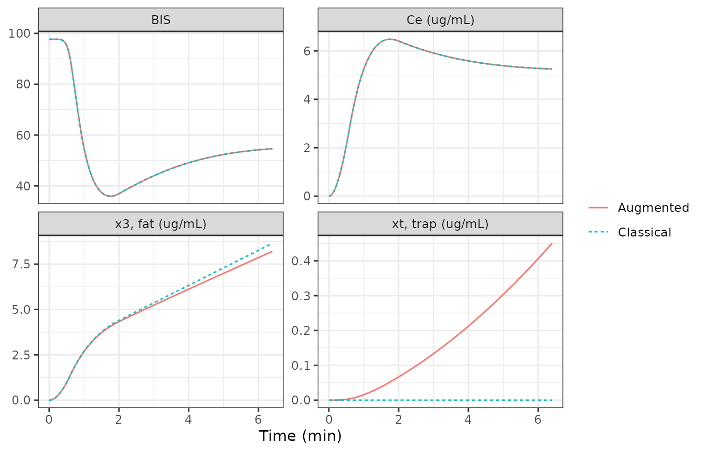
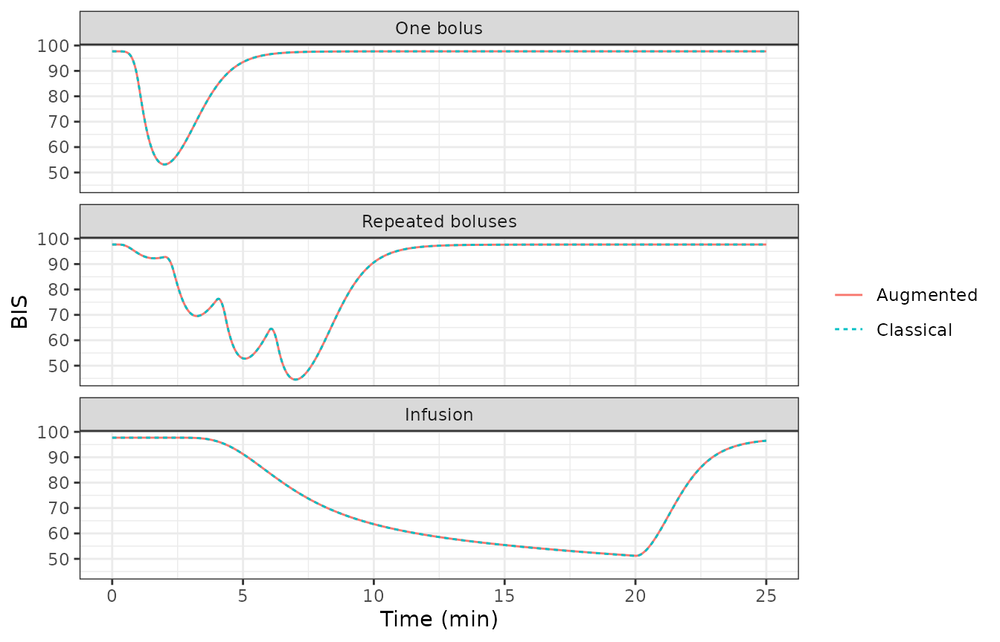
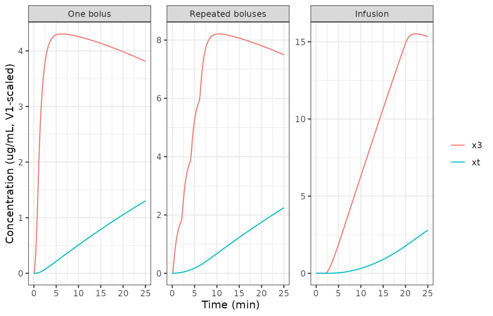
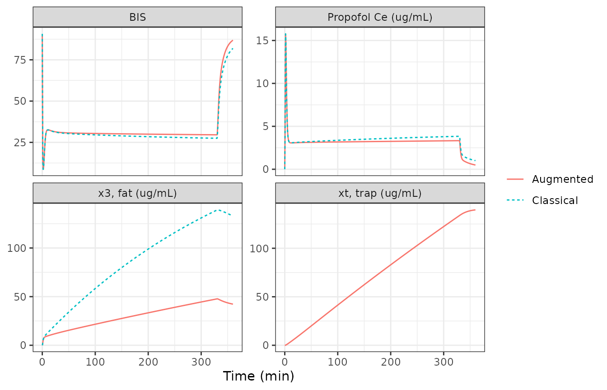

# Propofol + remifentanil with a fat trap compartment, BIS (Ynineb 2025)

## Model and source

Ynineb et al. (2025) propose two extensions of the classical
three-compartment propofol model to describe slow release of propofol
from adipose tissue in obese patients: an **augmented** model in which
the fat compartment exchanges with a “trap” sub-compartment whose size
and exchange clearance depend on body mass index (BMI), and a
**fractional-order** model in which only the fat-to-blood flux follows a
partial Caputo derivative. Both feed an effect-site compartment and a
Bispectral Index (BIS) model, alone (propofol only) or in a Greco
response surface with remifentanil.

The augmented model is a system of ordinary differential equations and
is the model packaged here. The fractional-order model is not: a Caputo
or Riemann-Liouville derivative depends on the whole concentration
history through a power-law convolution kernel, which has no exact
ordinary differential equation form, so it is not encoded (see
*Assumptions and deviations*). The classical three-compartment model,
which the paper uses as the reference, is recovered from the packaged
model by switching the trap off.

- Article: <https://doi.org/10.1038/s41598-025-10172-1> (Scientific
  Reports 15:26234; PMCID PMC12276283)
- Companion paper by the same group that prints the Schnider propofol
  covariate equations, the James lean-body-mass formulas and the same
  trap model: <https://doi.org/10.1016/j.jare.2025.06.047> (Journal of
  Advanced Research 82:535-561; PMCID PMC13001178)

``` r

mod <- rxode2::rxode2(readModelDb("Ynineb_2025_propofol_remifentanil"))
```

- Citation: Ynineb AR, Yumuk E, Copot D, Ayvaz B, Khoumeri B, Ben Othman
  G, Mihai MD, Birs IR, Muresan CI, Ionescu CM. (2025). Modeling drug
  retention as memory effects in obese patients using fractional and
  augmented models. Scientific Reports 15:26234.
  <doi:10.1038/s41598-025-10172-1>. PMCID: PMC12276283. Schnider
  propofol covariate equations and the James lean-body-mass formulas as
  printed in the companion paper: Ynineb AR, Yumuk E, Copot D, et
  al. (2026). Pharmacokinetic modelling during long-term anesthesia:
  minimizing the gap. Journal of Advanced Research 82:535-561.
  <doi:10.1016/j.jare.2025.06.047>. PMCID: PMC13001178.
- Description: Augmented propofol pharmacokinetic-pharmacodynamic model
  with a body-mass-index-driven fat ‘trap’ compartment, plus classical
  remifentanil pharmacokinetics and a Greco response-surface model for
  the Bispectral Index (BIS) under total intravenous anesthesia (Ynineb
  2025). Propofol follows the Schnider three-compartment model (blood,
  muscle, fat; covariates age, weight, height and James lean body mass)
  in which the fat compartment exchanges with a trap sub-compartment of
  volume V3 \* BMI / 100 at clearance Cl3 / Risk, where Risk is a
  three-term sum-of-sines function of BMI. Each drug drives its own
  effect compartment; BIS = E0 - Emax \* I^gamma / (1 + I^gamma) with I
  = Ce_propofol / C50p + Ce_remifentanil / C50r + interaction term. No
  parameter was estimated in the source: the PK parameters come from the
  Schnider (propofol) and Minto (remifentanil) models and the PD
  parameters are patient-specific values identified in earlier work by
  the same group. Defaults are those of the paper’s clinical case
  (VitalDB patient 5428), including that patient’s propofol ke0 of 1.2
  1/min (0.456 1/min for the paper’s other patient); the remifentanil PK
  is fixed at that patient’s printed values because the source does not
  print the Minto covariate equations. The paper’s alternative
  fractional-order (partial Caputo) fat-release model is not
  representable as an ordinary differential equation and is not encoded.

No parameter was estimated in the source. The pharmacokinetic parameters
are those of the Schnider (propofol) and Minto (remifentanil) models,
and the pharmacodynamic parameters are patient-specific values
identified with a genetic algorithm in the group’s earlier work. The
packaged defaults are those of the paper’s clinical case, VitalDB
patient 5428; the simulations of patient 21 below override the
pharmacodynamic parameters and the propofol ke0 with that patient’s
values.

## Population

The paper evaluates the models on two patients:

- **Patient 21** of a 70-patient Ghent University Hospital database
  (Table 4): female, 62 years, 168 cm, 88 kg, BMI 31.2 kg/m^2, lean body
  mass 54 kg, hysterectomy, propofol only. PD: C50 = 5.6 ug/mL, gamma =
  3.7, E0 = 97.7.
- **Patient 5428** of the public VitalDB database (Table 7): male, 61
  years, 166 cm, 81 kg, BMI 29.4 kg/m^2, lean body mass 58.62 kg,
  abdominal aortic aneurysm repair, propofol plus remifentanil. PD: C50p
  = 4.8053 ug/mL, C50r = 6, gamma = 1.6305, Gamma = 0, E0 = 90.72.

``` r

pt21 <- data.frame(AGE = 62, WT = 88, HT = 168, SEXF = 1)
pt5428 <- data.frame(AGE = 61, WT = 81, HT = 166, SEXF = 0)

# Patient 21 PD (Table 4) and propofol ke0 (Table 5); Emax is set equal to
# E0 as in the packaged model.
pd21 <- c(
  lke0 = log(0.456),
  le0 = log(97.7), lemax = log(97.7),
  lec50 = log(5.6), lhill = log(3.7)
)

# The classical three-compartment model: a very large trap risk drives the
# trap clearance Cl3 / R, and so k3t and kt3, to zero.
no_trap <- c(risk_a1 = 1e9)
```

## Source trace

| Model element | Value(s) | Source |
|----|----|----|
| Three-compartment propofol / remifentanil structure | Eq. 1, micro-constants Eq. 2 | Ynineb 2025, Methods |
| Trap compartment and modified fat equation | Eqs. 3, 7a-7d | Ynineb 2025, Methods |
| `k3t = Clt / Vt`, `kt3 = Clt / V3` | Eq. 4 | Ynineb 2025 |
| `Vt = V3 * BMI / 100`, `Clt = Cl3 / R` | Eq. 5 | Ynineb 2025 |
| `R = sum a_i sin(b_i BMI + c_i)`; `risk_a1`..`risk_c3` | Eq. 6, Table 3 | Ynineb 2025 (also companion Table A.6) |
| Schnider `lcl`, `e_wt_cl`, `e_lbm_cl`, `e_ht_cl`, `lvc`, `lq`, `e_age_q`, `lvp`, `e_age_vp`, `lq2`, `lvp2` | Cl1 = 1.89 + 0.0456 (WT - 77) - 0.0681 (LBM - 59) + 0.0264 (HT - 177); V1 = 4.27; Cl2 = 1.29 - 0.024 (AGE - 53); V2 = 18.9 - 0.391 (AGE - 53); Cl3 = 0.836; V3 = 238 | Companion Eq. 6; reproduces Tables 5 and 8 |
| James lean body mass | female 1.07 WT - 148 (WT/HT)^2; male 1.1 WT - 128 (WT/HT)^2 | Companion Eqs. 7-8 |
| `lke0` (propofol k1e = ke0) | 1.2 1/min (patient 5428); 0.456 1/min (patient 21) | Table 8, row 1; Table 5 |
| Remifentanil `lcl_remifentanil`, `lq_remifentanil`, `lq2_remifentanil`, `lvp_remifentanil`, `lvp2_remifentanil`, `lke0_remifentanil` | 2.329, 1.4179, 0.0523 L/min; 8.5082, 5.42 L; 0.448 1/min | Table 8, row 2 (patient 5428) |
| `lvc_remifentanil` | 4.9385 L = Cl1 / k10 | Table 8, row 2 (printed V1 = 4.27 is the propofol value) |
| Effect compartment | Eq. 24 | Ynineb 2025 |
| BIS = E0 - Emax I^gamma / (1 + I^gamma) | Eq. 25 | Ynineb 2025 |
| Greco interaction `I` | Eq. 27 | Ynineb 2025 (C50 subscript corrected, see below) |
| `le0`, `lec50`, `lec50_remifentanil`, `lhill`, `greco_int` | 90.72, 4.8053 ug/mL, 6, 1.6305, 0 | Table 7 (patient 5428) |
| `lemax` | = E0 | Not printed; back-solved below from Figs. 4-5 and Table 6 |

## Closed-form check of the printed patient parameters

Tables 5 and 8 print every clearance, volume and rate constant the paper
used for the two patients. The model derives them from age, weight,
height and sex; a single solve exposes the derived values.

``` r

derived <- function(cov, params = NULL) {
  ev <- data.frame(id = 1, time = c(0, 1), evid = c(1, 0), amt = c(1, 0), cmt = "central")
  ev <- cbind(ev, cov[rep(1, nrow(ev)), ], row.names = NULL)
  s <- as.data.frame(rxode2::rxSolve(mod, events = ev, params = params))
  s[nrow(s), ]
}
d21 <- derived(pt21, pd21)
d5428 <- derived(pt5428)

cmp_names <- c(
  "k10", "k12", "k13", "k21", "k31", "k3t", "kt3", "ke0",
  "Cl1", "Cl2", "Cl3", "R", "Clt", "V1", "V2", "V3", "Vt"
)
model_vals <- function(d) {
  c(
    d$kel, d$k12, d$k13, d$k21, d$k31, d$k3t, d$kt3, d$ke0,
    d$cl, d$q, d$q2, d$risk, d$cl_deep, d$vc, d$vp, d$vp2, d$vp2_deep
  )
}
table5 <- c(
  0.5842, 0.2515, 0.1958, 0.0698, 0.0035, 0.0138, 0.0043, 0.456,
  2.4945, 1.074, 0.836, 0.8147, 1.0261, 4.27, 15.381, 238, 74.256
)
table8_prop <- c(
  0.4233, 0.2571, 0.1958, 0.0696, 0.0035, 0.045, 0.0132, 1.2,
  1.8076, 1.098, 0.836, 0.2654, 3.1502, 4.27, 15.772, 238, 69.959
)
chk <- bind_rows(
  data.frame(patient = "21 (Table 5)", parameter = cmp_names, model = model_vals(d21), paper = table5),
  data.frame(patient = "5428 propofol (Table 8)", parameter = cmp_names, model = model_vals(d5428), paper = table8_prop)
) |>
  mutate(pct_diff = 100 * (model - paper) / paper)

chk |>
  mutate(model = round(model, 5), pct_diff = round(pct_diff, 2)) |>
  rename("Patient" = patient, "Parameter" = parameter, "Model" = model, "Paper" = paper, "% difference" = pct_diff) |>
  knitr::kable()
```

| Patient                 | Parameter |     Model |    Paper | % difference |
|:------------------------|:----------|----------:|---------:|-------------:|
| 21 (Table 5)            | k10       |   0.59133 |   0.5842 |         1.22 |
| 21 (Table 5)            | k12       |   0.25152 |   0.2515 |         0.01 |
| 21 (Table 5)            | k13       |   0.19578 |   0.1958 |        -0.01 |
| 21 (Table 5)            | k21       |   0.06983 |   0.0698 |         0.04 |
| 21 (Table 5)            | k31       |   0.00351 |   0.0035 |         0.36 |
| 21 (Table 5)            | k3t       |   0.01404 |   0.0138 |         1.74 |
| 21 (Table 5)            | kt3       |   0.00438 |   0.0043 |         1.80 |
| 21 (Table 5)            | ke0       |   0.45600 |   0.4560 |         0.00 |
| 21 (Table 5)            | Cl1       |   2.52499 |   2.4945 |         1.22 |
| 21 (Table 5)            | Cl2       |   1.07400 |   1.0740 |         0.00 |
| 21 (Table 5)            | Cl3       |   0.83600 |   0.8360 |         0.00 |
| 21 (Table 5)            | R         |   0.80242 |   0.8147 |        -1.51 |
| 21 (Table 5)            | Clt       |   1.04184 |   1.0261 |         1.53 |
| 21 (Table 5)            | V1        |   4.27000 |   4.2700 |         0.00 |
| 21 (Table 5)            | V2        |  15.38100 |  15.3810 |         0.00 |
| 21 (Table 5)            | V3        | 238.00000 | 238.0000 |         0.00 |
| 21 (Table 5)            | Vt        |  74.20635 |  74.2560 |        -0.07 |
| 5428 propofol (Table 8) | k10       |   0.42333 |   0.4233 |         0.01 |
| 5428 propofol (Table 8) | k12       |   0.25714 |   0.2571 |         0.02 |
| 5428 propofol (Table 8) | k13       |   0.19578 |   0.1958 |        -0.01 |
| 5428 propofol (Table 8) | k21       |   0.06962 |   0.0696 |         0.02 |
| 5428 propofol (Table 8) | k31       |   0.00351 |   0.0035 |         0.36 |
| 5428 propofol (Table 8) | k3t       |   0.04503 |   0.0450 |         0.06 |
| 5428 propofol (Table 8) | kt3       |   0.01324 |   0.0132 |         0.27 |
| 5428 propofol (Table 8) | ke0       |   1.20000 |   1.2000 |         0.00 |
| 5428 propofol (Table 8) | Cl1       |   1.80763 |   1.8076 |         0.00 |
| 5428 propofol (Table 8) | Cl2       |   1.09800 |   1.0980 |         0.00 |
| 5428 propofol (Table 8) | Cl3       |   0.83600 |   0.8360 |         0.00 |
| 5428 propofol (Table 8) | R         |   0.26538 |   0.2654 |        -0.01 |
| 5428 propofol (Table 8) | Clt       |   3.15019 |   3.1502 |         0.00 |
| 5428 propofol (Table 8) | V1        |   4.27000 |   4.2700 |         0.00 |
| 5428 propofol (Table 8) | V2        |  15.77200 |  15.7720 |         0.00 |
| 5428 propofol (Table 8) | V3        | 238.00000 | 238.0000 |         0.00 |
| 5428 propofol (Table 8) | Vt        |  69.95936 |  69.9590 |         0.00 |

Patient 5428 is reproduced to the printed precision. Two roundings in
the paper’s handling of patient 21 explain every difference in that
patient’s rows:

- **Lean body mass.** The James formula gives 53.55 kg; Table 4 prints
  54 kg and Table 5’s Cl1 = 2.4945 is computed from that rounded value.
  The model uses the formula, so Cl1 and k10 are about 1.2% higher.
- **BMI.** The model computes BMI from weight and height (31.179
  kg/m^2); the paper evaluated the risk function at the printed 31.2 for
  patient 21 but at the unrounded 29.395 for patient 5428 (at the
  printed 29.4 its Clt would be 3.1497, not 3.1502). The sum of sines is
  steep in BMI, so for patient 21 R, Clt, k3t and kt3 move by about
  1.5-1.8%. Evaluated at the BMI the paper used, the risk function
  reproduces both tables exactly (next chunk).

The propofol ke0 differs between the patients in the source (0.456 1/min
in Table 5, 1.2 1/min in Table 8); each row above uses that patient’s
value.

``` r

risk_fun <- function(bmi) {
  27.4472 * sin(0.0033 * bmi - 0.0570) +
    0.8002 * sin(0.5390 * bmi - 4.2180) +
    0.4815 * sin(0.7595 * bmi - 6.2212)
}
bmi_used <- c(31.2, pt5428$WT / (pt5428$HT / 100)^2)
risk_check <- data.frame(
  patient = c("21", "5428"),
  BMI = bmi_used,
  R_formula = risk_fun(bmi_used),
  R_paper = c(0.8147, 0.2654)
) |>
  mutate(Clt_formula = 0.836 / R_formula, Clt_paper = c(1.0261, 3.1502))
knitr::kable(risk_check, digits = 4)
```

| patient |     BMI | R_formula | R_paper | Clt_formula | Clt_paper |
|:--------|--------:|----------:|--------:|------------:|----------:|
| 21      | 31.2000 |    0.8147 |  0.8147 |      1.0261 |    1.0261 |
| 5428    | 29.3947 |    0.2654 |  0.2654 |      3.1502 |    3.1502 |

``` r


# The same algebra, evaluated where the paper evaluated it, is exact.
stopifnot(
  all(abs(risk_check$R_formula - risk_check$R_paper) < 5e-4),
  all(abs(risk_check$Clt_formula - risk_check$Clt_paper) < 5e-4)
)

# Every parameter that does not depend on the rounded LBM / BMI matches the
# printed tables to their printed precision.
exact_rows <- chk |>
  filter(!parameter %in% c("k10", "Cl1", "R", "Clt", "k3t", "kt3", "Vt"))
stopifnot(all(abs(exact_rows$pct_diff) < 1.5))
# The rounding-sensitive rows stay within a few percent.
stopifnot(all(abs(chk$pct_diff) < 6))
```

The remifentanil row of Table 8 is encoded directly. Its rate constants
are reproduced from the encoded clearances and volumes:

``` r

remi <- data.frame(
  parameter = c("k10", "k12", "k13", "k21", "k31", "ke0"),
  model = c(
    d5428$kel_remifentanil, d5428$k12_remifentanil, d5428$k13_remifentanil,
    d5428$k21_remifentanil, d5428$k31_remifentanil, d5428$ke0_remifentanil
  ),
  paper = c(0.4716, 0.2871, 0.0106, 0.1667, 0.0096, 0.448)
) |>
  mutate(pct_diff = 100 * (model - paper) / paper)
knitr::kable(remi, digits = 4)
```

| parameter |  model |  paper | pct_diff |
|:----------|-------:|-------:|---------:|
| k10       | 0.4716 | 0.4716 |   0.0001 |
| k12       | 0.2871 | 0.2871 |   0.0040 |
| k13       | 0.0106 | 0.0106 |  -0.0919 |
| k21       | 0.1667 | 0.1667 |  -0.0294 |
| k31       | 0.0096 | 0.0096 |   0.5151 |
| ke0       | 0.4480 | 0.4480 |   0.0000 |

``` r

stopifnot(all(abs(remi$pct_diff) < 1))
```

## Patient 21: induction protocol (Figures 4 to 6)

Propofol 120 mg over 0.6 min (200 mg/min), then 230 ug/kg/min (20.24
mg/min) from 2 to 6.4 min.

``` r

make_events <- function(doses, obs, cov, id = 1) {
  d <- data.frame(id = id, time = doses$time, evid = 1, amt = doses$amt, rate = doses$rate, cmt = doses$cmt)
  o <- data.frame(id = id, time = obs, evid = 0, amt = 0, rate = 0, cmt = "central")
  ev <- rbind(d, o)
  ev <- ev[order(ev$time, -ev$evid), ]
  cbind(ev, cov[rep(1, nrow(ev)), ], row.names = NULL)
}
solve_model <- function(ev, params = NULL) {
  as.data.frame(rxode2::rxSolve(mod, events = ev, params = params, returnType = "data.frame"))
}
```

``` r

siso_doses <- data.frame(
  time = c(0, 2), amt = c(120, 0.230 * 88 * 4.4),
  rate = c(200, 0.230 * 88), cmt = "central"
)
ev_siso <- make_events(siso_doses, seq(0, 6.4, by = 0.01), pt21)
siso <- bind_rows(
  solve_model(ev_siso, pd21) |> mutate(model = "Augmented"),
  solve_model(ev_siso, c(pd21, no_trap)) |> mutate(model = "Classical")
) |>
  mutate(x3 = peripheral2 / vc, xt = peripheral2_deep / vc)

siso |>
  select(time, model, BIS, effect, x3, xt) |>
  pivot_longer(c(BIS, effect, x3, xt)) |>
  mutate(name = factor(name,
    levels = c("BIS", "effect", "x3", "xt"),
    labels = c("BIS", "Ce (ug/mL)", "x3, fat (ug/mL)", "xt, trap (ug/mL)")
  )) |>
  ggplot(aes(time, value, colour = model, linetype = model)) +
  geom_line() +
  facet_wrap(~name, scales = "free_y") +
  labs(x = "Time (min)", y = NULL, colour = NULL, linetype = NULL) +
  theme_bw()
```



Replicates Figures 4, 5 and 6 of Ynineb 2025 (augmented and classical
curves). The paper reports that “all models rise to a similar peak near
6-7 ug/mL at around 2 min” and that BIS falls from about 100 to 40-50;
the trap concentration keeps rising while the BIS and effect-site curves
of the classical and augmented models coincide over this short protocol.

``` r

siso_aug <- siso |> filter(model == "Augmented")
siso_cls <- siso |> filter(model == "Classical")
ce_peak <- max(siso_aug$effect)
t_peak <- siso_aug$time[which.max(siso_aug$effect)]
c(Ce_peak = ce_peak, t_peak = t_peak, BIS_nadir = min(siso_aug$BIS))
#>   Ce_peak    t_peak BIS_nadir 
#>   6.48106   1.76000  35.95751
stopifnot(
  ce_peak > 6, ce_peak < 7, t_peak > 1.5, t_peak < 2.2,
  # Trap has no visible effect on BIS within 6.4 min (Fig. 4).
  max(abs(siso_aug$BIS - siso_cls$BIS)) < 0.1,
  # ... but the trap is filling (Fig. 6, bottom).
  all(diff(siso_aug$xt) >= 0)
)
```

### Emax

Tables 4 and 7 print C50, gamma and E0 but no Emax. Figures 4 and 5 show
the BIS and effect-site curves of patient 21 for the same simulation, so
each time point gives one equation in Emax. Read from the figures by the
maintainers: at the effect-site peak (about 6.5 ug/mL at 1.75 min) BIS
is about 35.5, and at 6.3 min (about 5.57 ug/mL) BIS is about 49.3.

``` r

emax_from <- function(ce, bis, e0 = 97.7, c50 = 5.6, g = 3.7) {
  f <- (ce / c50)^g / (1 + (ce / c50)^g)
  (e0 - bis) / f
}
emax_read <- c(peak = emax_from(6.5, 35.5), plateau = emax_from(5.57, 49.3))
emax_read
#>     peak  plateau 
#> 98.03494 97.77156
stopifnot(all(abs(emax_read - 97.7) < 2))
```

Both readings give Emax within 1% of E0 = 97.7, against 100 for the
other common convention; the protocol comparison below confirms it
independently. Emax is therefore set equal to E0 for both patients.

## Patient 21: three dosing protocols (Table 6, Figures 7 to 9)

- **One bolus:** 100 mg over 1 min.
- **Repeated boluses:** four 48 mg boluses, each over 20 s, every 2 min.
- **Infusion:** from 2 to 20 min. The text gives 215 ug/kg/min (18.9
  mg/min for 88 kg), but Table 6 reports 371.52 mg in total, i.e. 20.64
  mg/min over 18 min, and Figure 7 plots about 21 mg/min; the Table 6
  rate is used.

``` r

protocols <- list(
  "One bolus" = data.frame(time = 0, amt = 100, rate = 100, cmt = "central"),
  "Repeated boluses" = data.frame(time = c(0, 2, 4, 6), amt = 48, rate = 48 * 3, cmt = "central"),
  "Infusion" = data.frame(time = 2, amt = 371.52, rate = 371.52 / 18, cmt = "central")
)
grid <- seq(0, 25, by = 0.01)
prot_sim <- bind_rows(lapply(names(protocols), function(p) {
  ev <- make_events(protocols[[p]], grid, pt21)
  bind_rows(
    solve_model(ev, pd21) |> mutate(model = "Augmented"),
    solve_model(ev, c(pd21, no_trap)) |> mutate(model = "Classical")
  ) |> mutate(protocol = p)
})) |>
  mutate(protocol = factor(protocol, levels = names(protocols)))

ggplot(prot_sim, aes(time, BIS, colour = model, linetype = model)) +
  geom_line() +
  facet_wrap(~protocol, ncol = 1) +
  labs(x = "Time (min)", colour = NULL, linetype = NULL) +
  theme_bw()
```



Replicates Figure 7 of Ynineb 2025 (classical and augmented curves).

The paper integrated the equations with a forward Euler scheme at a 5 s
step (Methods; Results, “sampling period of 5 s”). That step is coarse
relative to the 0.456 1/min effect-site rate and the 0.58 1/min
elimination rate, so the published nadirs differ from an accurate ODE
solution by up to about 2 BIS units. To separate the model from the
integrator, the chunk below re-runs the paper’s Euler scheme twice: on
the micro-constants printed in Table 5, and on the micro-constants that
the packaged model derives for patient 21 (which differ slightly because
the model computes lean body mass and BMI instead of using the rounded
table values).

``` r

euler_bis <- function(d, u, tmax, h = 5 / 60, e0 = 97.7, emax = 97.7, c50 = 5.6, g = 3.7) {
  n <- round(tmax / h)
  x <- c(0, 0, 0, 0)
  xe <- 0
  bis <- numeric(n)
  for (i in seq_len(n)) {
    t <- (i - 1) * h
    dx <- c(
      -(d$kel + d$k12 + d$k13) * x[1] + d$k21 * x[2] + d$k31 * x[3] + u(t) / d$vc,
      d$k12 * x[1] - d$k21 * x[2],
      d$k13 * x[1] - d$k31 * x[3] - d$k3t * x[3] + d$kt3 * x[4],
      d$k3t * x[3] - d$kt3 * x[4]
    )
    x <- x + h * dx
    xe <- xe + h * d$ke0 * (x[1] - xe)
    bis[i] <- e0 - emax * (xe / c50)^g / (1 + (xe / c50)^g)
  }
  min(bis)
}
u_fun <- list(
  "One bolus" = function(t) if (t < 1) 100 else 0,
  "Repeated boluses" = function(t) if (t < 8 && (t %% 2) < 0.33) 144 else 0,
  "Infusion" = function(t) if (t >= 2 && t < 20) 371.52 / 18 else 0
)
tab6 <- data.frame(
  protocol = names(protocols),
  paper_nadir = c(50.35, 43.2, 50.6),
  paper_total_mg = c(100, 192, 371.52)
)
table5_k <- list(
  kel = 0.5842, k12 = 0.2515, k13 = 0.1958, k21 = 0.0698, k31 = 0.0035,
  k3t = 0.0138, kt3 = 0.0043, ke0 = 0.456, vc = 4.27
)
tab6$euler_table5 <- sapply(names(protocols), function(p) euler_bis(table5_k, u_fun[[p]], 25))
tab6$euler_nadir <- sapply(names(protocols), function(p) euler_bis(d21, u_fun[[p]], 25))
tab6$ode_nadir <- sapply(names(protocols), function(p) {
  min(prot_sim$BIS[prot_sim$protocol == p & prot_sim$model == "Augmented"])
})
tab6$classical_ode_nadir <- sapply(names(protocols), function(p) {
  min(prot_sim$BIS[prot_sim$protocol == p & prot_sim$model == "Classical"])
})
tab6 |>
  rename(
    "Protocol" = protocol, "Table 6 BIS nadir" = paper_nadir,
    "Total drug (mg)" = paper_total_mg, "Euler 5 s, Table 5 constants" = euler_table5,
    "Euler 5 s, model constants" = euler_nadir,
    "rxode2 ODE, augmented" = ode_nadir, "rxode2 ODE, classical" = classical_ode_nadir
  ) |>
  knitr::kable(digits = 2)
```

| Protocol | Table 6 BIS nadir | Total drug (mg) | Euler 5 s, Table 5 constants | Euler 5 s, model constants | rxode2 ODE, augmented | rxode2 ODE, classical |
|:---|---:|---:|---:|---:|---:|---:|
| One bolus | 50.35 | 100.00 | 50.36 | 50.76 | 53.17 | 53.17 |
| Repeated boluses | 43.20 | 192.00 | 43.19 | 43.76 | 44.52 | 44.52 |
| Infusion | 50.60 | 371.52 | 50.42 | 51.13 | 51.21 | 51.14 |

``` r


stopifnot(
  # The paper's integrator on the paper's parameters reproduces Table 6.
  all(abs(tab6$euler_table5 - tab6$paper_nadir) < 0.5),
  # On the model's parameters it differs only by the LBM / BMI rounding.
  all(abs(tab6$euler_nadir - tab6$paper_nadir) < 1),
  # The accurate ODE solution adds the integration error.
  all(abs(tab6$ode_nadir - tab6$paper_nadir) < 3.5),
  # Classical and augmented models agree over 25 min, as Table 6 reports.
  all(abs(tab6$ode_nadir - tab6$classical_ode_nadir) < 0.15)
)
```

The Euler re-run on Table 5’s micro-constants reproduces all three Table
6 nadirs to within 0.2 BIS units. It used Emax = E0; with Emax = 100 the
bolus nadir would be about 1 BIS unit lower, so this is the second,
independent check on the Emax convention. On the model’s own
micro-constants the same scheme lands within 0.6 BIS units. The ODE
solution is the one the packaged model returns; the paper’s integration
error is largest for the single bolus, where the effect-site peak is
sharpest.

``` r

prot_sim |>
  filter(model == "Augmented") |>
  mutate(x3 = peripheral2 / vc, xt = peripheral2_deep / vc) |>
  select(time, protocol, x3, xt) |>
  pivot_longer(c(x3, xt), names_to = "state") |>
  ggplot(aes(time, value, colour = state)) +
  geom_line() +
  facet_wrap(~protocol, scales = "free_y") +
  labs(x = "Time (min)", y = "Concentration (ug/mL, V1-scaled)", colour = NULL) +
  theme_bw()
```



Replicates Figure 8 of Ynineb 2025: the trap concentration accumulates
steadily, most during the continuous infusion.

## Patient 5428: long anesthesia with remifentanil

The paper’s clinical case uses the propofol and remifentanil infusion
record of VitalDB case 5428 over a 350 min abdominal aortic aneurysm
repair. That record is not reproduced in the paper, so this section uses
an illustrative total intravenous anesthesia protocol with the packaged
(patient 5428) parameters: propofol 2 mg/kg over 1 min then 100
ug/kg/min, and remifentanil 1 ug/kg over 1 min then 0.15 ug/kg/min, both
stopped at 330 min.

``` r

wt <- pt5428$WT
miso_doses <- data.frame(
  time = c(0, 1, 0, 1),
  amt = c(2 * wt, 0.1 * wt * 329, 1 * wt, 0.15 * wt * 329),
  rate = c(2 * wt, 0.1 * wt, 1 * wt, 0.15 * wt),
  cmt = c("central", "central", "central_remifentanil", "central_remifentanil")
)
ev_miso <- make_events(miso_doses, seq(0, 360, by = 0.5), pt5428)
miso <- bind_rows(
  solve_model(ev_miso) |> mutate(model = "Augmented"),
  solve_model(ev_miso, no_trap) |> mutate(model = "Classical")
) |>
  mutate(x3 = peripheral2 / vc, xt = peripheral2_deep / vc)

miso |>
  select(time, model, BIS, effect, x3, xt) |>
  pivot_longer(c(BIS, effect, x3, xt)) |>
  filter(!(name == "xt" & model == "Classical")) |>
  mutate(name = factor(name,
    levels = c("BIS", "effect", "x3", "xt"),
    labels = c("BIS", "Propofol Ce (ug/mL)", "x3, fat (ug/mL)", "xt, trap (ug/mL)")
  )) |>
  ggplot(aes(time, value, colour = model, linetype = model)) +
  geom_line() +
  facet_wrap(~name, scales = "free_y") +
  labs(x = "Time (min)", y = NULL, colour = NULL, linetype = NULL) +
  theme_bw()
```



Qualitatively replicates Figures 10 to 12 of Ynineb 2025. As the trap
fills, the augmented model’s effect-site concentration falls below the
classical model’s during maintenance, and the trap concentration
overtakes the fat concentration, here at about 35 min (the paper reports
“around the 40-min mark” for the VitalDB dosing record).

``` r

aug <- miso |> filter(model == "Augmented")
cls <- miso |> filter(model == "Classical")
t_cross <- aug$time[which(aug$xt > aug$x3 & aug$time > 0)[1]]
ce_330 <- c(
  augmented = aug$effect[aug$time == 329.5],
  classical = cls$effect[cls$time == 329.5]
)
list(trap_exceeds_fat_at_min = t_cross, propofol_Ce_at_329.5_min = ce_330)
#> $trap_exceeds_fat_at_min
#> [1] 35
#> 
#> $propofol_Ce_at_329.5_min
#> augmented classical 
#>  3.329232  3.839041
stopifnot(
  # Deterministic structural check: the trap is an additional sink during
  # maintenance, so it lowers the effect-site concentration.
  ce_330[["augmented"]] < ce_330[["classical"]],
  t_cross > 10, t_cross < 120
)
```

## PKNCA of the patient 21 protocols

The paper reports no NCA. Propofol plasma exposure over the 25 min of
each Table 6 protocol (augmented model) is summarised for reference.

``` r

nca_conc <- prot_sim |>
  filter(model == "Augmented", !is.na(Cc)) |>
  filter(abs(time - round(time * 4) / 4) < 1e-8) |>
  mutate(id = 1, treatment = as.character(protocol)) |>
  select(id, treatment, time, Cc) |>
  distinct()
nca_dose <- bind_rows(lapply(names(protocols), function(p) {
  protocols[[p]] |> mutate(id = 1, treatment = p)
})) |>
  select(id, treatment, time, amt)

conc_obj <- PKNCA::PKNCAconc(nca_conc, Cc ~ time | treatment + id)
dose_obj <- PKNCA::PKNCAdose(nca_dose, amt ~ time | treatment + id)
intervals <- data.frame(start = 0, end = 25, cmax = TRUE, tmax = TRUE, auclast = TRUE)
nca_res <- PKNCA::pk.nca(PKNCA::PKNCAdata(conc_obj, dose_obj, intervals = intervals))
as.data.frame(nca_res$result) |>
  select(treatment, PPTESTCD, PPORRES) |>
  pivot_wider(names_from = PPTESTCD, values_from = PPORRES) |>
  rename("Protocol" = treatment, "Cmax (ug/mL)" = cmax, "Tmax (min)" = tmax, "AUC0-25 (ug*min/mL)" = auclast) |>
  knitr::kable(digits = 2)
```

| Protocol         | AUC0-25 (ug\*min/mL) | Cmax (ug/mL) | Tmax (min) |
|:-----------------|---------------------:|-------------:|-----------:|
| Infusion         |                96.37 |         5.55 |       20.0 |
| One bolus        |                27.81 |        14.61 |        1.0 |
| Repeated boluses |                51.71 |         9.57 |        6.5 |

## Assumptions and deviations

- **Fractional-order model not encoded.** The partial Caputo model (Eq.
  21, fractional order alpha31 on the fat-to-blood flux only) needs the
  entire concentration history through a power-law kernel and cannot be
  written as ordinary differential equations. Approximating the kernel
  by a sum of exponentials would be a method the paper does not use, so
  the fractional rows of Tables 6, 9, 10 and 12 are not reproduced. With
  alpha31 = 1 it reduces to the classical model, which is available here
  by switching the trap off.
- **Schnider equations from the companion paper.** The source computes
  propofol parameters “based on the Schnider model” without printing it.
  The covariate equations and the James lean-body-mass formulas are
  taken from the same group’s companion paper (Ynineb, J Adv Res 2026,
  Eqs. 6-8), and they reproduce Tables 5 and 8 (closed-form check
  above).
- **Lean body mass and BMI are computed, not read.** The model derives
  LBM (James) and BMI from WT, HT and SEXF; for patient 21 the paper
  used the rounded table values (LBM 54 kg, BMI 31.2), which moves Cl1
  by about 1.2% and the trap parameters by under 2%.
- **Emax = E0.** Emax is not printed for either patient. The value E0 is
  supported by the paired Figure 4-5 readings and by the Table 6 nadirs,
  and is assumed for patient 5428 too.
- **Remifentanil PK is patient 5428’s.** Neither the source nor the
  companion paper prints the Minto covariate equations, so the
  remifentanil parameters are fixed at Table 8’s patient-specific values
  and do not respond to the covariates. Table 8 prints remifentanil V1 =
  4.27 L, the propofol value repeated; V1 = Cl1 / k10 = 4.9385 L from
  the same row is used, and it also reproduces k12 and k13.
- **Remifentanil units.** The source does not state remifentanil dose or
  C50 units. Doses in ug and C50r = 6 ng/mL are assumed (concentration
  ug/L).
- **Greco equation.** Eq. 27 as printed divides both effect-site
  concentrations by C50 of drug 2; the Greco model, and the interaction
  term of the same equation, divide each drug by its own C50, which is
  used here. Gamma = 0 for patient 5428, so the interaction term is
  inactive at the defaults.
- **Propofol ke0 is patient-specific.** Table 8 prints k1e = ke0 = 1.2
  1/min for patient 5428, against the Schnider 0.456 1/min of Table 5
  for patient 21; the source gives no reason. The default is patient
  5428’s 1.2, consistent with the other defaults, and the patient 21
  simulations override it with 0.456.
- **State scaling.** The paper writes the states as concentrations, but
  its equations conserve mass only for amounts divided by V1. The
  model’s states are amounts; the paper’s fat and trap curves are
  `peripheral2 / vc` and `peripheral2_deep / vc`.
- **Patient 21 infusion rate.** Table 6’s total of 371.52 mg over 18 min
  (20.64 mg/min) is used instead of the text’s 215 ug/kg/min, which
  gives 18.9 mg/min and would not match Table 6.
- **No variability.** The source reports no between-subject or residual
  variability; the model is deterministic.
