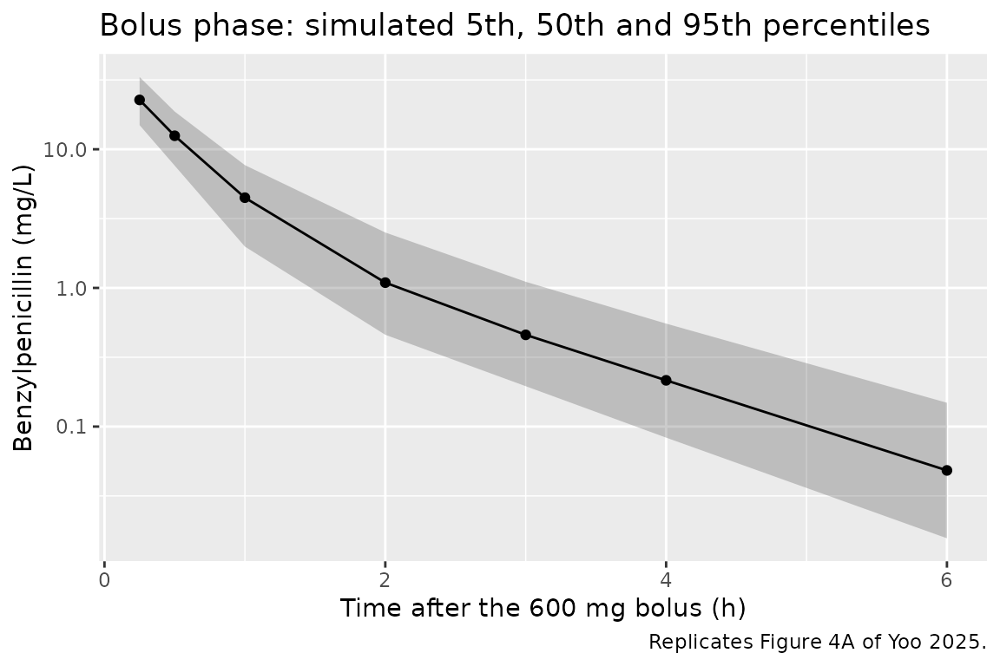
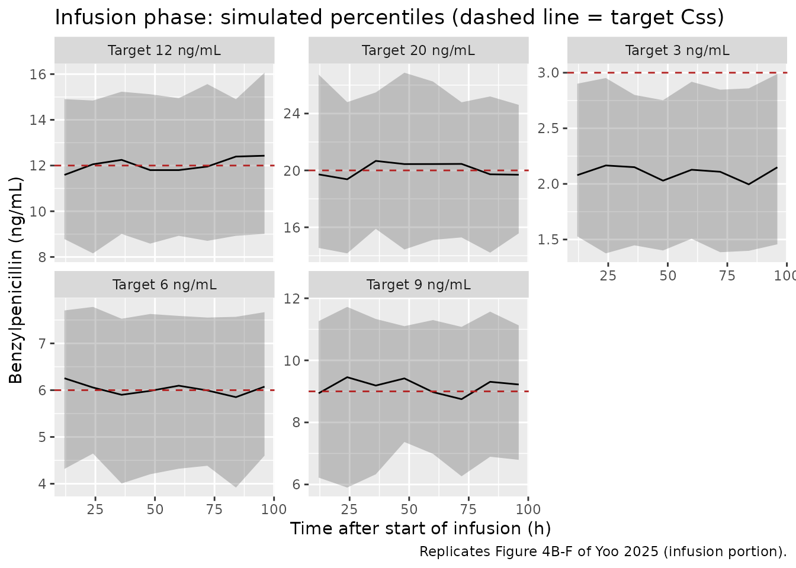
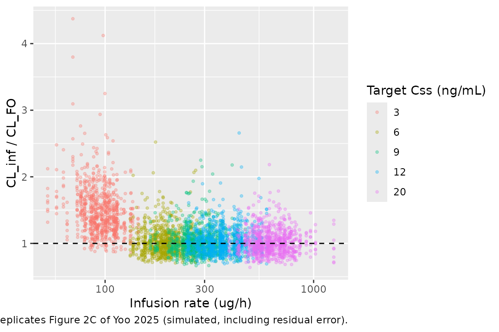

# Benzylpenicillin (Yoo 2025)

## Model and source

- Citation: Yoo O, Salman S, Hla TK, Osowicki J, Page-Sharp M, Marsh JA,
  Barr R, Azzopardi K, Morici M, Batty KT, Enkel SL, Kado J, Hatchuel L,
  Fulurija A, McCarthy JS, Snelling T, Steer AC, Carapetis J, Manning L.
  Population pharmacokinetics of penicillin G: insights into increased
  clearance at low concentrations to guide development of improved
  long-acting formulations for syphilis and prevention of rheumatic
  fever. Antimicrob Agents Chemother. 2025;69(7):e00269-25.
  <doi:10.1128/aac.00269-25>
- Description: Two-compartment population PK model for intravenous
  benzylpenicillin (penicillin G) in healthy adult volunteers of the
  CHIPS human-challenge trial (Yoo 2025), fitted jointly to a 600 mg IV
  bolus and to low-dose continuous IV infusions targeting 3-20 ng/mL;
  clearance is proportional to cystatin-C-based eGFR in absolute mL/min,
  the central volume is 1.96-fold larger during continuous infusion, and
  clearance rises by an additive 12.1 L/h during infusion at the 3 ng/mL
  target
- Article: <https://doi.org/10.1128/aac.00269-25> (open access,
  PMC12217478)

Yoo 2025 analysed the pharmacokinetic run-in and the infusion phase of
the CHIPS controlled human pharyngitis challenge trial. Every
participant first received a single 600 mg intravenous benzylpenicillin
dose over 3 minutes; 7-35 days later, participants were randomized to a
loading dose plus a continuous infusion individualized to a target
steady-state concentration (Css) of 3, 6, 9, 12 or 20 ng/mL, the
infusion rate being the target Css multiplied by the participant’s
clearance from the bolus (the paper’s equation 1,
`Infusion rate = Clearance x Css`). Both phases were fitted jointly with
a two-compartment model in NONMEM 7.5.1 (FOCE-I). The final model (Table
4) has three non-standard features:

- clearance is proportional to the cystatin-C-based CKD-EPI 2012 eGFR in
  **absolute** mL/min (eGFR in mL/min/1.73 m^2 multiplied by the
  Mosteller body-surface area over 1.73), with no body-weight effect on
  CL;
- the central volume is 1.96-fold larger during continuous infusion than
  during the bolus (`REGIMEN_CONTINF`);
- clearance rises by an additive 12.1 L/h, with 42.9% inter-individual
  variability, on the infusion records of the 3 ng/mL target arm only
  (`DOSE_LOW`). This is the paper’s headline finding: at that target,
  the measured concentrations fell below the concentration the bolus
  clearance predicted.

## Population

Seventy-two healthy adult volunteers (42% female, median age 25 years,
range 18-38; median weight 69 kg, range 50-107; median BSA 1.79 m^2;
median serum creatinine 70 umol/L and cystatin C 0.59 mg/L; Table 1)
contributed 504 bolus samples (0.25, 0.5, 1, 2, 3, 4 and 6 h post-dose).
Forty-seven of them received a continuous infusion and contributed 389
samples drawn every 12 h; Table 2 lists 10, 9, 10, 9 and 9 participants
in the 3, 6, 9, 12 and 20 ng/mL arms. The trial ran in Perth, Australia,
between August 2022 and July 2023. Race and ethnicity are not reported.

The same information is available programmatically via
`readModelDb("Yoo_2025_benzylpenicillin")()$population`.

## Source trace

| Equation / parameter | Value | Source location |
|----|----|----|
| `lcl` (CL at eGFRcys = 60 mL/min) | log(13.3) L/h | Table 4, `CL = theta x eGFRcys/60`, theta = 13.3 (RSE 2%) |
| `lvc` (Vc, bolus phase, 70 kg) | log(14.6) L | Table 4 |
| `lq` (Q, 70 kg) | log(5.34) L/h | Table 4 |
| `lvp` (Vp, 70 kg) | log(5.77) L | Table 4 |
| `e_wt_vc`, `e_wt_vp` | 1 (fixed) | Methods, ‘Population pharmacokinetic analysis’ (allometry applied a priori) |
| `e_wt_q` | 0.75 (fixed) | Methods, ‘Population pharmacokinetic analysis’ |
| `e_regimen_continf_vc` | 1.96 | Table 4 `Ratio,Vc`; `Vc,Linf = Vc x Ratio,Vc` |
| `e_dose_low_cl` | 12.1 L/h | Table 4 `Difference,CL,Css3`; `CL_Css3 = CL + Difference` |
| `etalcl` | 0.144^2 | Table 4 IIV CL 14.4% (shrinkage 6%) |
| `etalvc` | 0.169^2 | Table 4 IIV VC 16.9% (shrinkage 22%) |
| `etalvp` | 0.137^2 | Table 4 IIV Vp 13.7% (shrinkage 15%) |
| `etae_dose_low_cl` | 0.429^2 | Table 4 IIV Difference,CL,Css3 42.9% (shrinkage 69%) |
| `propSd` | 0.165 | Table 4 ‘Proportional error (%)’ 16.5% (shrinkage 10%) |
| `CRCL = eGFRcys x BSA / 1.73` | n/a | Methods, ‘Benzylpenicillin clearance predictor’ |
| `BSA = sqrt(height x weight / 3600)` | n/a | Methods, equation 2 (Mosteller) |
| Two-compartment ODEs, first-order elimination | n/a | Results and Methods, ‘Population pharmacokinetic analysis’ |

## Virtual cohort

The observed data are not public. The cohort below draws body weight,
height, age, sex and cystatin C to match Table 1, then computes the
Mosteller BSA, the CKD-EPI 2012 cystatin C eGFR and its absolute-mL/min
form, which is the model’s `CRCL` column. One hundred subjects are
assigned to each of the five target arms.

The random effects are drawn here in R rather than by `rxSolve()`, for
two reasons. The trial set each participant’s infusion rate from that
participant’s own bolus clearance, so the rate has to be known before
the solve. And drawing the etas with
[`set.seed()`](https://rdrr.io/r/base/Random.html) makes every
clearance-based check below identical on every machine; only the
residual error is left to rxode2’s random-number stream.

``` r

set.seed(20250520)

n_per_arm <- 100
arms <- c(3, 6, 9, 12, 20)
n_sub <- n_per_arm * length(arms)

# Log-normal draw with reject-and-redraw inside the observed range; the
# range is a definition of the cohort, so values are never clamped.
rlnorm_range <- function(n, median, cv, lo, hi) {
  x <- rlnorm(n, log(median), sqrt(log(cv^2 + 1)))
  bad <- x < lo | x > hi
  while (any(bad)) {
    x[bad] <- rlnorm(sum(bad), log(median), sqrt(log(cv^2 + 1)))
    bad <- x < lo | x > hi
  }
  x
}

# CKD-EPI cystatin C age-sex equation (Inker 2012), mL/min/1.73 m^2.
egfr_cys_2012 <- function(scys, age, sexf) {
  133 * pmin(scys / 0.8, 1)^-0.499 * pmax(scys / 0.8, 1)^-1.328 *
    0.996^age * ifelse(sexf == 1, 0.932, 1)
}

cohort <- tibble(
  id = seq_len(n_sub),
  arm = rep(arms, each = n_per_arm),
  WT = rlnorm_range(n_sub, 69, 0.18, 50, 107),
  HT = rlnorm_range(n_sub, 170, 0.06, 144, 192),
  AGE = rlnorm_range(n_sub, 25, 0.19, 18, 38),
  SEXF = rbinom(n_sub, 1, 0.42),
  CYSC = rlnorm_range(n_sub, 0.59, 0.168, 0.39, 0.87)
) |>
  mutate(
    BSA = sqrt(HT * WT / 3600),
    EGFR_CYS = egfr_cys_2012(CYSC, AGE, SEXF),
    CRCL = EGFR_CYS * BSA / 1.73
  )

# Individual random effects on the SD scale of Table 4 (see Assumptions).
omega_sd <- c(etalcl = 0.144, etalvc = 0.169, etalvp = 0.137, etae_dose_low_cl = 0.429)
etas <- as_tibble(lapply(omega_sd, function(s) rnorm(n_sub, 0, s))) |>
  mutate(id = cohort$id, .before = 1)

cohort <- cohort |>
  left_join(etas, by = "id") |>
  mutate(
    # Bolus-phase individual clearance (L/h) and the trial's infusion rate,
    # equation 1: rate = CL x Css. Css in ng/mL = ug/L; rate in mg/h.
    cl_bolus = 13.3 * exp(etalcl) * CRCL / 60,
    rate_mg_h = cl_bolus * arm / 1000
  )

cohort |>
  summarise(
    `Weight (kg)` = median(WT), `Height (cm)` = median(HT),
    `BSA (m^2)` = median(BSA), `Cystatin C (mg/L)` = median(CYSC),
    `eGFRcys (mL/min/1.73 m^2)` = median(EGFR_CYS),
    `CRCL (mL/min)` = median(CRCL)
  ) |>
  knitr::kable(digits = 2, caption = "Virtual-cohort medians.")
```

| Weight (kg) | Height (cm) | BSA (m^2) | Cystatin C (mg/L) | eGFRcys (mL/min/1.73 m^2) | CRCL (mL/min) |
|---:|---:|---:|---:|---:|---:|
| 68.38 | 169.42 | 1.8 | 0.6 | 134.66 | 140.34 |

Virtual-cohort medians. {.table}

The cohort’s median BSA lands within 0.03 m^2 of Table 1, and its median
infusion rate per arm can be set beside Table 2:

``` r

table2_rate <- tibble(
  arm = arms,
  table2_median_rate = c(80.3, 220.4, 347.1, 367.5, 592.4)
)
rate_cmp <- cohort |>
  group_by(arm) |>
  summarise(sim_median_rate = median(rate_mg_h) * 1000, .groups = "drop") |>
  left_join(table2_rate, by = "arm") |>
  mutate(pct_diff = 100 * (sim_median_rate / table2_median_rate - 1))
rate_cmp |>
  rename(
    "Target Css (ng/mL)" = arm,
    "Simulated median rate (ug/h)" = sim_median_rate,
    "Table 2 median rate (ug/h)" = table2_median_rate,
    "% difference" = pct_diff
  ) |>
  knitr::kable(digits = 1, caption = "Infusion rate = bolus clearance x target Css, by arm.")
```

| Target Css (ng/mL) | Simulated median rate (ug/h) | Table 2 median rate (ug/h) | % difference |
|---:|---:|---:|---:|
| 3 | 96.2 | 80.3 | 19.8 |
| 6 | 194.0 | 220.4 | -12.0 |
| 9 | 279.5 | 347.1 | -19.5 |
| 12 | 366.0 | 367.5 | -0.4 |
| 20 | 613.3 | 592.4 | 3.5 |

Infusion rate = bolus clearance x target Css, by arm. {.table}

``` r


stopifnot(
  abs(median(cohort$BSA) - 1.79) < 0.03,
  # Rates scale with the target by construction; this pins the clearance
  # magnitude. Table 2's arms differ from each other by up to 44% in
  # rate / Css, so the band is the across-arm spread, not a tight match.
  all(abs(rate_cmp$pct_diff) < 30)
)
```

## Simulation

Each subject receives the 600 mg bolus over 3 minutes at time 0 and
starts a 96-hour infusion at day 14 (336 h), long after the bolus has
cleared. The two indicator covariates are 0 during the bolus phase;
during the infusion `REGIMEN_CONTINF = 1` for every arm and
`DOSE_LOW = 1` for the 3 ng/mL arm. Both are written on every row,
including the observation rows.

``` r

t_inf <- 336
dur_inf <- 96
bolus_times <- c(0, 0.05, 0.1, 0.15, 0.25, 0.5, 1, 2, 3, 4, 6, 8, 10, 12)
paper_bolus_times <- c(0.25, 0.5, 1, 2, 3, 4, 6)
inf_times <- t_inf + seq(12, dur_inf, by = 12)

dose_rows <- bind_rows(
  cohort |> transmute(id, time = 0, evid = 1L, amt = 600, rate = 600 / 0.05),
  cohort |> transmute(id, time = t_inf, evid = 1L, amt = rate_mg_h * dur_inf, rate = rate_mg_h)
)
obs_rows <- tidyr::expand_grid(id = cohort$id, time = c(bolus_times, inf_times)) |>
  mutate(evid = 0L, amt = 0, rate = 0)

events <- bind_rows(dose_rows, obs_rows) |>
  left_join(cohort |> select(id, arm, WT, CRCL), by = "id") |>
  mutate(
    cmt = "central",
    phase = ifelse(time >= t_inf, "infusion", "bolus"),
    REGIMEN_CONTINF = as.integer(time >= t_inf),
    DOSE_LOW = as.integer(time >= t_inf & arm == 3)
  ) |>
  arrange(id, time, desc(evid)) |>
  as.data.frame()

stopifnot(!anyDuplicated(events[, c("id", "time", "evid")]))
```

``` r

mod <- readModelDb("Yoo_2025_benzylpenicillin")
# The fixed effects come from ini(); the per-subject etas drawn above are
# supplied through `params`, so the model's omega is zeroed and only the
# proportional residual error is simulated by rxode2.
mod_fixed_eta <- rxode2::zeroRe(mod, which = "omega")
#> ℹ parameter labels from comments will be replaced by 'label()'
eta_params <- cohort |> select(id, all_of(names(omega_sd))) |> as.data.frame()

sim <- suppressWarnings(rxode2::rxSolve(
  mod_fixed_eta, events = events, params = eta_params,
  keep = c("arm", "phase"), returnType = "data.frame"
))
```

## Replicate published figures

### Figure 4A: bolus phase

``` r

sim |>
  filter(phase == "bolus", time %in% paper_bolus_times) |>
  group_by(time) |>
  summarise(
    Q05 = quantile(sim, 0.05), Q50 = quantile(sim, 0.50), Q95 = quantile(sim, 0.95),
    .groups = "drop"
  ) |>
  ggplot(aes(time, Q50)) +
  geom_ribbon(aes(ymin = Q05, ymax = Q95), alpha = 0.25) +
  geom_line() +
  geom_point() +
  scale_y_log10() +
  labs(
    x = "Time after the 600 mg bolus (h)", y = "Benzylpenicillin (mg/L)",
    title = "Bolus phase: simulated 5th, 50th and 95th percentiles",
    caption = "Replicates Figure 4A of Yoo 2025."
  )
```



### Figure 4B-F: continuous infusion by target

``` r

sim |>
  filter(phase == "infusion") |>
  mutate(time_inf = time - t_inf, conc_ng = sim * 1000) |>
  group_by(arm, time_inf) |>
  summarise(
    Q05 = quantile(conc_ng, 0.05), Q50 = quantile(conc_ng, 0.50), Q95 = quantile(conc_ng, 0.95),
    .groups = "drop"
  ) |>
  ggplot(aes(time_inf, Q50)) +
  geom_ribbon(aes(ymin = Q05, ymax = Q95), alpha = 0.25) +
  geom_line() +
  geom_hline(aes(yintercept = arm), linetype = "dashed", colour = "firebrick") +
  facet_wrap(~ paste("Target", arm, "ng/mL"), scales = "free_y") +
  labs(
    x = "Time after start of infusion (h)", y = "Benzylpenicillin (ng/mL)",
    title = "Infusion phase: simulated percentiles (dashed line = target Css)",
    caption = "Replicates Figure 4B-F of Yoo 2025 (infusion portion)."
  )
```



The 3 ng/mL arm sits below its target while the other four sit on
theirs: the rate was set from the bolus clearance, and only that arm’s
infusion clearance is higher.

### Figures 1 and 2: infusion clearance relative to bolus clearance

The paper computes an observed infusion clearance as rate / measured Css
(equation 1) and normalizes it by the bolus clearance.

``` r

cl_ratio <- sim |>
  filter(phase == "infusion") |>
  left_join(cohort |> select(id, cl_bolus, rate_mg_h), by = "id") |>
  mutate(cl_inf_obs = rate_mg_h / sim, ratio = cl_inf_obs / cl_bolus)

ggplot(cl_ratio, aes(rate_mg_h * 1000, ratio, colour = factor(arm))) +
  geom_point(alpha = 0.3, size = 0.8) +
  geom_hline(yintercept = 1, linetype = "dashed") +
  scale_x_log10() +
  labs(
    x = "Infusion rate (ug/h)", y = "CL_inf / CL_FO",
    colour = "Target Css (ng/mL)",
    caption = "Replicates Figure 2C of Yoo 2025 (simulated, including residual error)."
  )
```



``` r

# Structural ratio without residual error: CL_inf / CL_bolus from the
# individual parameters. Arms 6-20 are 1 by construction; the 3 ng/mL arm
# is 1 + 12.1 * exp(eta) / CL_bolus.
struct_ratio <- sim |>
  filter(phase == "infusion", time == t_inf + dur_inf) |>
  left_join(cohort |> select(id, cl_bolus), by = "id") |>
  mutate(ratio = cl / cl_bolus) |>
  group_by(arm) |>
  summarise(
    median_ratio = median(ratio), p05 = quantile(ratio, 0.05), p95 = quantile(ratio, 0.95),
    .groups = "drop"
  )
knitr::kable(struct_ratio, digits = 2, caption = "Infusion-phase CL relative to bolus CL, by arm.")
```

| arm | median_ratio |  p05 |  p95 |
|----:|-------------:|-----:|-----:|
|   3 |          1.4 | 1.17 | 1.79 |
|   6 |          1.0 | 1.00 | 1.00 |
|   9 |          1.0 | 1.00 | 1.00 |
|  12 |          1.0 | 1.00 | 1.00 |
|  20 |          1.0 | 1.00 | 1.00 |

Infusion-phase CL relative to bolus CL, by arm. {.table}

``` r


ratio_3 <- struct_ratio$median_ratio[struct_ratio$arm == 3]
stopifnot(
  # The etas are drawn in R, so these are the same on every machine.
  abs(struct_ratio$median_ratio[struct_ratio$arm != 3] - 1) < 1e-8,
  # 12.1 L/h on a median bolus CL of about 31 L/h.
  ratio_3 > 1.25, ratio_3 < 1.55,
  # 42.9% IIV on the step: 12.1 * exp(1.645 * 0.429) = 24.4 L/h at the 95th
  # percentile of the step alone.
  struct_ratio$p95[struct_ratio$arm == 3] > 1.6,
  struct_ratio$p95[struct_ratio$arm == 3] < 2.1
)
obs_ratio_3 <- cl_ratio$ratio[cl_ratio$arm == 3]
```

The median 3 ng/mL subject clears benzylpenicillin about 40% faster
during the infusion than after the bolus, and the structural 95th
percentile is 1.79. Residual error spreads the ratio computed from
simulated observations further: 7.5% of the 3 ng/mL samples exceed 2,
the region Figures 1 and 2D of the paper show for that arm.

## Analytical checks

Two identities that use the same drawn parameters on both sides, so they
must hold to numerical precision.

``` r

# Steady state of a constant-rate infusion: Css = rate / CL.
ss <- sim |>
  filter(phase == "infusion", time == t_inf + dur_inf) |>
  left_join(cohort |> select(id, rate_mg_h), by = "id") |>
  mutate(rel_err = Cc / (rate_mg_h / cl) - 1)

# Bolus mass balance on a dense typical-value solve: CL * AUC(0-inf) = dose.
typ <- tibble(WT = 70, CRCL = 140)
ev_typ <- rxode2::et(amt = 600, rate = 600 / 0.05, cmt = "central") |>
  rxode2::et(c(seq(0, 1, by = 0.005), seq(1.01, 48, by = 0.01)))
sim_typ <- rxode2::rxSolve(
  rxode2::zeroRe(mod), ev_typ,
  params = c(CRCL = 140, WT = 70, REGIMEN_CONTINF = 0, DOSE_LOW = 0),
  returnType = "data.frame", atol = 1e-12, rtol = 1e-10
)
#> ℹ parameter labels from comments will be replaced by 'label()'
#> ℹ omega/sigma items treated as zero: 'etalcl', 'etalvc', 'etalvp', 'etae_dose_low_cl'
auc_typ <- sum(diff(sim_typ$time) * (head(sim_typ$Cc, -1) + tail(sim_typ$Cc, -1)) / 2)
cl_typ <- 13.3 * 140 / 60

c(
  max_ss_rel_err = max(abs(ss$rel_err)),
  cl_times_auc_over_dose = cl_typ * auc_typ / 600
)
#>         max_ss_rel_err cl_times_auc_over_dose 
#>           8.724191e-07           1.000003e+00
stopifnot(
  max(abs(ss$rel_err)) < 1e-4,
  abs(cl_typ * auc_typ / 600 - 1) < 1e-3
)
```

## PKNCA validation

NCA of the bolus phase, per randomized arm. The grid adds 0.05, 0.1,
0.15, 8, 10 and 12 h to the paper’s sampling times so that AUC(0-inf) is
not dominated by trapezoidal error on the 3-minute peak.

``` r

sim_nca <- sim |>
  filter(phase == "bolus", !is.na(Cc)) |>
  mutate(treatment = paste(arm, "ng/mL")) |>
  select(id, time, Cc, treatment)

sim_nca <- bind_rows(
  sim_nca,
  sim_nca |> distinct(id, treatment) |> mutate(time = 0, Cc = 0)
) |>
  distinct(id, treatment, time, .keep_all = TRUE) |>
  arrange(id, treatment, time)

dose_df <- events |>
  filter(evid == 1, time == 0) |>
  mutate(treatment = paste(arm, "ng/mL"), duration = 0.05) |>
  select(id, time, amt, duration, treatment)

conc_obj <- PKNCA::PKNCAconc(sim_nca, Cc ~ time | treatment + id)
dose_obj <- PKNCA::PKNCAdose(dose_df, amt ~ time | treatment + id,
                             route = "intravascular", duration = "duration")
intervals <- data.frame(
  start = 0, end = Inf,
  cmax = TRUE, tmax = TRUE, aucinf.obs = TRUE, half.life = TRUE, cl.obs = TRUE
)
nca_res <- PKNCA::pk.nca(PKNCA::PKNCAdata(conc_obj, dose_obj, intervals = intervals))
summary(nca_res)
#>  start end treatment   N        cmax                    tmax     half.life
#>      0 Inf  12 ng/mL 100 39.3 [24.3] 0.0500 [0.0500, 0.0500] 0.969 [0.136]
#>      0 Inf  20 ng/mL 100 38.6 [20.4] 0.0500 [0.0500, 0.0500] 0.980 [0.131]
#>      0 Inf   3 ng/mL 100 39.7 [20.1] 0.0500 [0.0500, 0.0500] 0.950 [0.130]
#>      0 Inf   6 ng/mL 100 37.8 [22.6] 0.0500 [0.0500, 0.0500] 0.964 [0.162]
#>      0 Inf   9 ng/mL 100 37.0 [21.9] 0.0500 [0.0500, 0.0500] 0.981 [0.135]
#>   aucinf.obs      cl.obs
#>  19.7 [21.4] 30.5 [21.4]
#>  19.4 [19.9] 30.9 [19.9]
#>  19.2 [18.1] 31.2 [18.1]
#>  18.8 [17.9] 31.9 [17.9]
#>  19.5 [20.4] 30.8 [20.4]
#> 
#> Caption: cmax, aucinf.obs, cl.obs: geometric mean and geometric coefficient of variation; tmax: median and range; half.life: arithmetic mean and standard deviation; N: number of subjects
```

### Comparison against the paper

Yoo 2025 reports no NCA table. The closest published quantity is the
bolus-derived clearance that set each arm’s infusion rate: by equation
1, the Table 2 median rate divided by the target Css is the arm’s median
bolus clearance. Since the randomization assigned arms independently of
clearance, every simulated arm has the same clearance distribution, and
the spread of the Table 2 references (27-39 L/h) is the sampling
variability of arms of 9-10 participants.

``` r

published <- tibble(
  treatment = paste(arms, "ng/mL"),
  cl.obs = c(80.3, 220.4, 347.1, 367.5, 592.4) / arms
)
cmp <- nlmixr2lib::ncaComparisonTable(
  simulated = nca_res,
  reference = published,
  by = "treatment",
  params = "cl.obs",
  units = c(cl.obs = "L/h"),
  tolerance_pct = 20
)
knitr::kable(cmp, caption = "Simulated bolus CL (PKNCA dose / AUC0-inf) vs. Table 2 median rate / target Css. * differs by >20%. 'CL/F' is total CL here: the dose is intravenous.")
```

| NCA parameter | treatment | Reference | Simulated | % diff   |
|:--------------|:----------|:----------|:----------|:---------|
| CL/F (L/h)    | 3 ng/mL   | 26.8      | 31.7      | +18.3%   |
| CL/F (L/h)    | 6 ng/mL   | 36.7      | 31.9      | -13.1%   |
| CL/F (L/h)    | 9 ng/mL   | 38.6      | 30.7      | -20.5%\* |
| CL/F (L/h)    | 12 ng/mL  | 30.6      | 30.2      | -1.5%    |
| CL/F (L/h)    | 20 ng/mL  | 29.6      | 30.3      | +2.1%    |

Simulated bolus CL (PKNCA dose / AUC0-inf) vs. Table 2 median rate /
target Css. \* differs by \>20%. ‘CL/F’ is total CL here: the dose is
intravenous. {.table}

``` r


cl_sim <- as.data.frame(nca_res) |> filter(PPTESTCD == "cl.obs")
# Pooled Table 2 reference: the arm mean rates divided by the target Css
# (29.0, 36.4, 37.8, 30.3, 32.0 L/h), weighted by the 10, 9, 10, 9 and 9
# participants per arm, give a mean bolus clearance of 33.1 L/h.
table2_mean_cl <- weighted.mean(c(87.1, 218.3, 340.6, 364.1, 640.3) / arms, c(10, 9, 10, 9, 9))
stopifnot(
  abs(mean(cl_sim$PPORRES) / table2_mean_cl - 1) < 0.15
)
```

The 6 and 9 ng/mL arms of the trial happened to enrol faster clearers
(medians 36.7 and 38.6 L/h) than the 3, 12 and 20 ng/mL arms (26.8-30.6
L/h); a single cohort-wide clearance distribution cannot reproduce that
between-arm spread, and the comparison flags it where it exceeds 20%.
The pooled check is the structural one: the simulated mean bolus
clearance is 31.7 L/h against 33.1 L/h from Table 2.

### Scale of the inter-individual variability

``` r

# Robust CV (IQR / 1.349 / median) of rate / target Css per Table 2 arm,
# which is the empirical spread of individual bolus clearance.
table2_iqr <- tibble(
  arm = arms,
  q1 = c(60.4, 180.4, 287.9, 339.4, 514.3),
  q3 = c(108.2, 232.7, 384.7, 393.8, 620.6),
  med = c(80.3, 220.4, 347.1, 367.5, 592.4)
) |>
  mutate(robust_cv = (q3 - q1) / 1.349 / med)

robust_cv <- function(x) unname(diff(quantile(x, c(0.25, 0.75))) / 1.349 / median(x))
var_log_crcl <- var(log(cohort$CRCL))
iiv_cmp <- tibble(
  quantity = c(
    "Table 2, median of the five arms",
    "Model, omega read as SD (14.4% CV)",
    "Model, omega read as variance (sqrt(0.144) = 38% CV)"
  ),
  robust_cv = c(
    median(table2_iqr$robust_cv),
    robust_cv(cohort$cl_bolus),
    sqrt(0.144 + var_log_crcl)
  )
)
knitr::kable(iiv_cmp, digits = 3, caption = "Between-subject spread of bolus clearance.")
```

| quantity                                             | robust_cv |
|:-----------------------------------------------------|----------:|
| Table 2, median of the five arms                     |     0.176 |
| Model, omega read as SD (14.4% CV)                   |     0.200 |
| Model, omega read as variance (sqrt(0.144) = 38% CV) |     0.399 |

Between-subject spread of bolus clearance. {.table}

``` r

stopifnot(
  abs(robust_cv(cohort$cl_bolus) - median(table2_iqr$robust_cv)) < 0.08,
  sqrt(0.144 + var_log_crcl) > 2 * median(table2_iqr$robust_cv)
)
```

Reading the Table 4 IIV percentages as the SD of eta reproduces the
spread of the Table 2 infusion rates; reading them as variances would
double it.

## Assumptions and deviations

- **IIV and residual-error scale.** The Table 4 footnote says
  “inter-individual variability and residual error are presented as 100%
  x variability estimate”. The maintainers read the percentages as the
  standard deviation of eta (CV%), so `omega^2 = (value/100)^2`. The
  check above supports this: the spread of the Table 2 infusion rates,
  which were set from each participant’s bolus clearance, matches the SD
  reading and is about half of what the variance reading gives. The same
  group’s benzathine penicillin G analyses (Kado 2020, Kado 2023) report
  CV% the same way.
- **Residual error.** The model was fitted to log-transformed
  concentrations with an additive error, which is proportional error on
  the linear scale; Table 4 labels the row “Proportional error (%)”. It
  is encoded as `propSd = 0.165`.
- **Clearance covariate.** `CRCL` here is the cystatin-C CKD-EPI 2012
  eGFR converted to absolute mL/min with the Mosteller BSA, as the
  Methods describe; it is not BSA-normalized. Equation 2 prints as
  `BSA = Height x Weight / 3600` in the extracted text; the square root
  is restored, because only the Mosteller form reproduces Table 1
  (height 170 cm and weight 71 kg give 1.83 m^2 against the tabulated
  mean 1.80).
- **The “23 L/h” sentence in the Discussion.** The Discussion states a
  predicted total clearance of 23 L/h “for BSA of 1.73 m^2 and eGFRcys
  of 60 mL/min”. Table 4 gives `CL = 13.3 x eGFRcys / 60`, which is 13.3
  L/h at 60 mL/min; 23 L/h equals 13.3 x 1.73 and is taken to be a slip.
  Table 4 governs. The cohort-level clearance it implies (about 31 L/h
  at the cohort’s 140 mL/min) agrees with the Table 2 rates and with the
  29 +/- 6 L/h the Discussion cites from an earlier study in healthy
  volunteers.
- **Where the clearance step applies.** `DOSE_LOW` is 1 only on the
  infusion records of the 3 ng/mL arm, not on those participants’ bolus
  records. The paper ties the step to the low plasma concentration and
  to the target-Css category, and its exploratory analysis compares
  infusion clearance with the bolus clearance of the same participants;
  the bolus phase never comes near 3 ng/mL.
- **Log-normal IIV on the clearance step.** Table 4 reports the IIV of
  `Difference,CL,Css3` as a percentage; it is encoded as a log-normal
  eta on the 12.1 L/h step. Its shrinkage is 69%.
- **No covariance between etas.** Table 4 reports none; omega is
  diagonal.
- **Loading dose omitted.** The trial gave a loading dose before each
  infusion, calculated from the bolus estimates, but the paper does not
  give the formula. The terminal half-life is about one hour, so the
  simulated concentrations reach steady state long before the first
  12-hour sample, and the loading dose would not change them.
- **Virtual cohort.** Weight, height, age and cystatin C are drawn
  independently as log-normal variables with the Table 1 medians and
  coefficients of variation, redrawn into the observed ranges; sex is
  Bernoulli with 42% female. Height is not correlated with sex or
  weight, which slightly narrows the BSA distribution.
- **Participant counts.** Table 2 lists 10, 9, 10, 9 and 9 infusion
  participants (47); the Results text lists 9, 9, 8, 8 and 9. The
  simulation uses 100 virtual subjects per arm, so the difference does
  not affect it.
