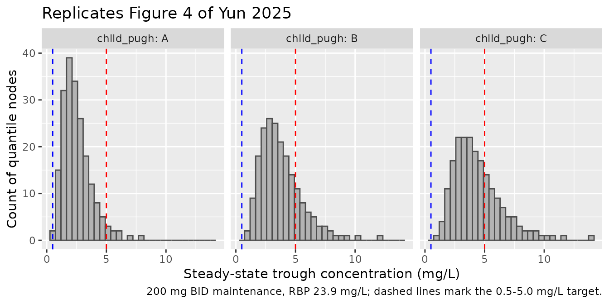
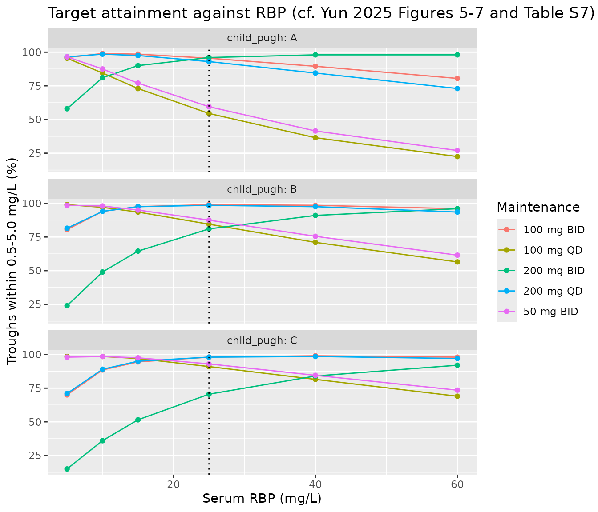

# Voriconazole (Yun 2025)

## Model and source

- Citation: Yun J, Bai H, Wang Z, Ma Y, Liu W. Serum retinol binding
  protein as a novel marker for clearance and dosage optimization:
  pharmacokinetics study of voriconazole in a cirrhosis population.
  Front Pharmacol. 2025;16:1543323. <doi:10.3389/fphar.2025.1543323>
- Description: One-compartment population pharmacokinetic model with
  fixed first-order absorption and linear elimination for voriconazole
  in Chinese adults with liver cirrhosis (Yun 2025); clearance is
  reduced in Child-Pugh B and C relative to Child-Pugh A and scales as a
  power function of serum retinol-binding protein (RBP4) normalised to
  the cohort median of 23.9 mg/L.
- Article: <https://doi.org/10.3389/fphar.2025.1543323>

``` r

mod <- rxode2::rxode2(readModelDb("Yun_2025_voriconazole"))
#> ℹ parameter labels from comments will be replaced by 'label()'
mod
#>  ── rxode2-based free-form 2-cmt ODE model ────────────────────────────────────── 
#>  ── Initalization: ──  
#> Fixed Effects ($theta): 
#>             lka             lcl             lvc e_hepimp_mod_cl e_hepimp_sev_cl 
#>      0.09531018      1.94017947      6.61338422     -0.39600995     -0.54300452 
#>       e_rbp4_cl          propSd           addSd 
#>      0.42800000      0.36100000      0.63400000 
#> 
#> Omega ($omega): 
#>        etalcl
#> etalcl 0.1912
#> attr(,"lotriLabels")
#> [1] "Yun 2025 Table 2: IIV of CL = 45.9% (95% CI 31.1-58); log(1 + 0.459^2)"
#> attr(,"lotriFix")
#>        etalcl
#> etalcl  FALSE
#> 
#> States ($state or $stateDf): 
#>   Compartment Number Compartment Name
#> 1                  1            depot
#> 2                  2          central
#>  ── μ-referencing ($muRefTable): ──  
#>   theta    eta level                                              covariates
#> 1   lcl etalcl    id HEPIMP_SEV*e_hepimp_sev_cl + HEPIMP_MOD*e_hepimp_mod_cl
#> 
#>  ── Model (Normalized Syntax): ── 
#> function() {
#>     compartmentData <- list(depot = list(analyte = "voriconazole", 
#>         units = "mg", specimen = "administration site", verified = TRUE), 
#>         central = list(analyte = "voriconazole", units = "mg", 
#>             specimen = "plasma", verified = TRUE))
#>     covariateData <- list(RBP4 = list(description = "Serum retinol-binding protein (RBP4) concentration", 
#>         units = "mg/L", type = "continuous", reference_category = NULL, 
#>         notes = "Power effect on clearance, (RBP4 / 23.9)^0.428, where 23.9 mg/L is the cohort median (Yun 2025 Supplementary Table S1; Discussion 'the median concentration was 23.9 mg/L'). Cohort mean (SD) 27.1 (24.9) mg/L, range 2.50-137 mg/L; 7 of 78 patients (9.0%) had no RBP value and the paper does not state how they were imputed. RBP is synthesised by hepatocytes and falls with cirrhosis severity (median 31.8 / 26.4 / 6.4 mg/L in Child-Pugh A / B / C, Supplementary Table S6), so it acts as a quantitative liver-function marker alongside the categorical Child-Pugh grade.", 
#>         source_name = "RBP"), HEPIMP_MOD = list(description = "Child-Pugh class B (moderate hepatic impairment) indicator", 
#>         units = "(binary)", type = "binary", reference_category = "0 (Child-Pugh A or C; Child-Pugh A is the model reference when HEPIMP_MOD = HEPIMP_SEV = 0)", 
#>         notes = "Child-Pugh classification scheme (Yun 2025 Methods 2.3: score from hepatic encephalopathy, ascites, serum bilirubin, serum albumin and prothrombin time). Every subject had cirrhosis, so the reference category is Child-Pugh A, not normal hepatic function. Multiplicative factor 0.673 on CL (Table 2 'Child-Pugh B on CL'). 20 of 78 patients (25.6%) were Child-Pugh B.", 
#>         source_name = "Child-Pugh classification = B"), HEPIMP_SEV = list(description = "Child-Pugh class C (severe hepatic impairment) indicator", 
#>         units = "(binary)", type = "binary", reference_category = "0 (Child-Pugh A or B; Child-Pugh A is the model reference when HEPIMP_MOD = HEPIMP_SEV = 0)", 
#>         notes = "Child-Pugh classification scheme. Multiplicative factor 0.581 on CL (Table 2 'Child-Pugh C on CL'). 28 of 78 patients (35.9%) were Child-Pugh C. HEPIMP_MOD and HEPIMP_SEV are mutually exclusive.", 
#>         source_name = "Child-Pugh classification = C"))
#>     covariatesDataExcluded <- list(WT = list(description = "Body weight", 
#>         units = "kg", type = "continuous", notes = "Table S4 model13 (CLWT), dOFV -1.657, not significant. Cohort median 63.0 kg (41.0-120), Table S1."), 
#>         AGE = list(description = "Age", units = "years", type = "continuous", 
#>             notes = "Table S4 model11 (CLAGE), dOFV -4.073, not significant. Cohort median 55.5 years (27.0-91.0), Table S1."), 
#>         HT = list(description = "Height", units = "cm", type = "continuous", 
#>             notes = "Table S4 model12 (CLHT), dOFV -1.41, not significant."), 
#>         BMI = list(description = "Body mass index", units = "kg/m^2", 
#>             type = "continuous", notes = "Table S4 model08 (CLBMI), dOFV -1.349, not significant."), 
#>         BSA = list(description = "Body surface area", units = "m^2", 
#>             type = "continuous", notes = "Table S4 model09 (CLBSA), dOFV -1.488, not significant."), 
#>         CRP = list(description = "C-reactive protein", units = "mg/L", 
#>             type = "continuous", notes = "Table S4 model14 (CLCRP), dOFV -0.001, not significant."), 
#>         WBC = list(description = "White blood cell count", units = "10^9 cells/L", 
#>             type = "continuous", notes = "Table S4 model15 (CLWBC), dOFV -0.847, not significant."), 
#>         HGB = list(description = "Hemoglobin", units = "g/L", 
#>             type = "continuous", notes = "Table S4 model16 (CLHb), dOFV -3.271, not significant."), 
#>         PROCALCITONIN = list(description = "Procalcitonin", units = "ug/L", 
#>             type = "continuous", notes = "Table S4 model17 (CLPCT), dOFV -1.279, not significant."), 
#>         ALB = list(description = "Serum albumin", units = "g/L", 
#>             type = "continuous", notes = "Table S4 model18 (CLALB), dOFV -0.106, not significant."), 
#>         ALT = list(description = "Alanine aminotransferase", 
#>             units = "U/L", type = "continuous", notes = "Table S4 model19 (CLALT), dOFV -0.206, not significant."), 
#>         AST = list(description = "Aspartate aminotransferase", 
#>             units = "U/L", type = "continuous", notes = "Table S4 model20 (CLAST), dOFV -6.008, not significant."), 
#>         TBILI = list(description = "Total bilirubin", units = "umol/L", 
#>             type = "continuous", notes = "Table S4 model21 (CLTBIL), significant in the forward step (dOFV -8.935) but not retained once RBP was in the model (model33, dOFV -0.481)."), 
#>         DBIL = list(description = "Direct bilirubin", units = "umol/L", 
#>             type = "continuous", notes = "Table S4 model22 (CLDBIL), significant in the forward step (dOFV -11.246) but not retained once RBP was in the model (model34, dOFV -1.187)."), 
#>         ALP = list(description = "Alkaline phosphatase", units = "U/L", 
#>             type = "continuous", notes = "Table S4 model24 (CLALP), dOFV -0.289, not significant."), 
#>         TBA = list(description = "Total serum bile acids", units = "umol/L", 
#>             type = "continuous", notes = "Table S4 model25 (CLTBA), significant in the forward step (dOFV -28.24) but not retained once RBP was in the model (model35, dOFV -5.695)."), 
#>         GGT = list(description = "Gamma-glutamyl transpeptidase", 
#>             units = "U/L", type = "continuous", notes = "Table S4 model23 (CLGGT), dOFV -2.556, not significant."), 
#>         CREAT = list(description = "Serum creatinine", units = "umol/L", 
#>             type = "continuous", notes = "Table S4 model26 (CLCREAT), dOFV -0.116, not significant."), 
#>         CRCL = list(description = "Creatinine clearance", units = "mL/min", 
#>             type = "continuous", notes = "Table S4 model10 (CLCRCL), dOFV -1.164, not significant; eGFR (model27) was likewise not significant."), 
#>         CONMED_PPI = list(description = "Concomitant proton-pump inhibitor", 
#>             units = "(binary)", type = "binary", notes = "Table S4 model29 (CLPPI), dOFV +0.305, not significant. 48 of 78 patients (61.5%) received a PPI (Table S1)."), 
#>         TX_LIVER = list(description = "Liver transplant recipient", 
#>             units = "(binary)", type = "binary", notes = "Screened as 'After liver transplantation' (Methods 2.3) and not retained. 11 of 78 patients (14.1%) were post-transplant (Table S1)."))
#>     description <- "One-compartment population pharmacokinetic model with fixed first-order absorption and linear elimination for voriconazole in Chinese adults with liver cirrhosis (Yun 2025); clearance is reduced in Child-Pugh B and C relative to Child-Pugh A and scales as a power function of serum retinol-binding protein (RBP4) normalised to the cohort median of 23.9 mg/L."
#>     population <- list(species = "human", n_subjects = 78L, n_studies = 1L, 
#>         n_observations = 151L, age_range = "27-91 years", age_median = "55.5 years", 
#>         weight_range = "41-120 kg", weight_median = "63.0 kg", 
#>         sex_female_pct = 26.9, race_ethnicity = c(Chinese = 100), 
#>         disease_state = "Adults with liver cirrhosis treated with voriconazole for fungal infection: Child-Pugh A 30 (38.5%), B 20 (25.6%), C 28 (35.9%); 11 (14.1%) after liver transplantation; 8 (10.3%) on concomitant antituberculosis drugs.", 
#>         dose_range = "Voriconazole 100-400 mg q12h in the first 24 h and 100-200 mg q12h maintenance (Yun 2025 Table 1); route not tabulated.", 
#>         regions = "Single centre: Beijing You'An Hospital, Capital Medical University, Beijing, China.", 
#>         notes = "Retrospective therapeutic-drug-monitoring study, September 2022 to August 2024. 151 steady-state trough concentrations (0.1-15 mg/L UPLC-MS/MS assay; BLQ excluded) from 78 patients. External validation in 22 further patients (48 troughs). Model built in NONMEM 7.5.0 with PsN 5.2.6; covariates entered at p < 0.01 and retained at p < 0.001.")
#>     reference <- "Yun J, Bai H, Wang Z, Ma Y, Liu W. Serum retinol binding protein as a novel marker for clearance and dosage optimization: pharmacokinetics study of voriconazole in a cirrhosis population. Front Pharmacol. 2025;16:1543323. doi:10.3389/fphar.2025.1543323"
#>     units <- list(time = "h", dosing = "mg", concentration = "mg/L")
#>     vignette <- "Yun_2025_voriconazole"
#>     ini({
#>         lka <- fix(0.0953101798043249)
#>         label("Absorption rate constant (1/h)")
#>         lcl <- 1.94017947434633
#>         label("Clearance for Child-Pugh A at RBP4 = 23.9 mg/L (L/h)")
#>         lvc <- 6.61338421837956
#>         label("Central volume of distribution (L)")
#>         e_hepimp_mod_cl <- -0.396009949337409
#>         label("Log-scale CL shift for Child-Pugh B vs A (unitless)")
#>         e_hepimp_sev_cl <- -0.543004522130226
#>         label("Log-scale CL shift for Child-Pugh C vs A (unitless)")
#>         e_rbp4_cl <- 0.428
#>         label("Power exponent of RBP4 / 23.9 on CL (unitless)")
#>         propSd <- c(0, 0.361)
#>         label("Proportional residual error (fraction)")
#>         addSd <- c(0, 0.634)
#>         label("Additive residual error (mg/L)")
#>         etalcl ~ 0.1912
#>         label("Yun 2025 Table 2: IIV of CL = 45.9% (95% CI 31.1-58); log(1 + 0.459^2)")
#>     })
#>     model({
#>         ka <- exp(lka)
#>         cl <- exp(lcl + e_hepimp_mod_cl * HEPIMP_MOD + e_hepimp_sev_cl * 
#>             HEPIMP_SEV + etalcl) * (RBP4/23.9)^e_rbp4_cl
#>         vc <- exp(lvc)
#>         d/dt(depot) <- -ka * depot
#>         d/dt(central) <- ka * depot - (cl/vc) * central
#>         Cc <- central/vc
#>         Cc ~ add(addSd) + prop(propSd)
#>     })
#> }
```

## Population

Yun 2025 is a single-centre, retrospective therapeutic-drug-monitoring
study at Beijing You’An Hospital (Capital Medical University), a
specialist liver-disease hospital. Patients with recorded voriconazole
plasma concentrations between September 2022 and August 2024 were
included; concentrations below the 0.1 mg/L quantification limit were
excluded (Yun 2025 Section 2.1).

The model was fitted to 151 steady-state trough concentrations from 78
adults with liver cirrhosis: 57 (73.1%) male, mean age 54.4 (SD 14.0)
years, mean body weight 64.9 (SD 14.3) kg. Child-Pugh class was A in 30
(38.5%), B in 20 (25.6%) and C in 28 (35.9%) patients; 11 (14.1%) were
liver-transplant recipients, 48 (61.5%) received a proton-pump inhibitor
and 8 (10.3%) antituberculosis drugs. Serum retinol-binding protein
(RBP) had mean 27.1 (SD 24.9) mg/L, median 23.9 mg/L, range 2.5-137 mg/L
(Section 3.1; Supplementary Table S1). RBP falls with cirrhosis
severity: median 31.8, 26.4 and 6.4 mg/L in Child-Pugh A, B and C
(Supplementary Table S6). Maintenance doses were 100-200 mg every 12
hours, with or without a 400 mg q12h loading day (Table 1).

The same information is available programmatically via
`rxode2::rxode2(readModelDb("Yun_2025_voriconazole"))$population`.

## Source trace

| Quantity | Value | Source location |
|----|----|----|
| Structure: one compartment, first-order absorption, linear elimination | – | Abstract; Section 3.3; Supplementary Table S4 (model01 vs model03) |
| `ka` (fixed) | 1.1 1/h | Table 2; Section 3.3 (fixed from Shi et al. 2019); Supplementary Table S3 |
| `CL` (Child-Pugh A, RBP 23.9 mg/L) | 6.96 L/h | Table 2; Section 3.3 equation |
| `Vc` | 745 L | Table 2; Section 3.3 equation |
| Child-Pugh B on CL | 0.673 | Table 2; Section 3.3 equation |
| Child-Pugh C on CL | 0.581 | Table 2; Section 3.3 equation |
| RBP exponent on CL, `(RBP/23.9)^0.428` | 0.428 | Table 2; Section 3.3 equation; median 23.9 mg/L from Supplementary Table S1 |
| IIV on CL | 45.9% CV -\> omega^2 = 0.1912 | Table 2 ‘IIV of CL’ |
| No IIV on Vc | – | Supplementary Table S4 model02 (‘model01-IIVVC’), parent of the final model28 |
| F = 1 | – | Supplementary Table S4 model04 (‘+F’, not significant) |
| Proportional residual error | 36.1% | Table 2 ‘RSV_CV’ |
| Additive residual error | 0.634 mg/L | Table 2 ‘RSV_SD’ |
| Covariate form `P = PTV * (COV/COVmed)^theta`; categorical `P = PTV * theta` | – | Section 2.5 |
| Target-attainment simulations | – | Section 3.5; Figures 4-7; Supplementary Tables S5 and S7 |

## Virtual cohort

Every validation target in Yun 2025 is a Monte Carlo distribution of the
steady-state trough concentration for a Child-Pugh class and a regimen.
Rather than draw random subjects, each arm below is a deterministic grid
of 200 quantiles of the clearance random effect,
`etalcl = qnorm((i - 0.5) / 200) * sqrt(0.1912)`, passed as a data
column to the model with its random effects otherwise zeroed. The grid
is a quadrature of the population distribution: it needs no
random-number generator, so the percentages below are the same on every
machine and every rxode2 build.

The slowest-clearing nodes (Child-Pugh C, low RBP) have half-lives of
several hundred hours, so the steady-state solve is given a larger ODE
step budget (`maxsteps = 5e5`; the default leaves those nodes unsolved).
Every simulated trough is checked against the closed-form steady-state
solution of the same one-compartment model.

``` r

n_nodes <- 200
omega_cl <- 0.1912 # Table 2 'IIV of CL' 45.9% CV, back-transformed

regimens <- tibble::tibble(
  regimen = c("200 mg BID", "100 mg BID", "50 mg BID", "200 mg QD", "100 mg QD"),
  amt = c(200, 100, 50, 200, 100),
  ii = c(12, 12, 12, 24, 24)
)

make_arms <- function(rbp) {
  tidyr::expand_grid(child_pugh = c("A", "B", "C"), regimens, RBP4 = rbp) |>
    mutate(
      arm = row_number(),
      HEPIMP_MOD = as.integer(child_pugh == "B"),
      HEPIMP_SEV = as.integer(child_pugh == "C")
    )
}

# One steady-state dose (ss = 1) into the oral depot per subject; the trough is
# read at the end of that dosing interval, on the ODE state 'central'.
make_trough_events <- function(arms, omega = omega_cl) {
  subj <- tidyr::expand_grid(arms, node = seq_len(n_nodes)) |>
    mutate(
      id = row_number(),
      rbp_arm = RBP4,
      etalcl = qnorm((node - 0.5) / n_nodes) * sqrt(omega)
    )
  doses <- subj |> mutate(time = 0, evid = 1L, ss = 1L, cmt = "depot")
  obs <- subj |> mutate(time = ii, amt = NA_real_, ii = 0, evid = 0L, ss = 0L, cmt = "central")
  bind_rows(doses, obs) |>
    arrange(id, time, desc(evid)) |>
    select(id, time, amt, ii, ss, evid, cmt, etalcl, HEPIMP_MOD, HEPIMP_SEV, RBP4,
           child_pugh, regimen, rbp_arm)
}

solve_troughs <- function(events) {
  # Supplying etalcl as data overrides the zeroed random effect; rxode2 warns
  # about a multi-subject simulation without omega, which is intended here.
  sim <- withCallingHandlers(
    rxode2::rxSolve(
      rxode2::zeroRe(mod), events,
      keep = c("child_pugh", "regimen", "rbp_arm"),
      maxSS = 20000, maxsteps = 5e5, returnType = "data.frame"
    ),
    warning = function(w) {
      if (grepl("omega", conditionMessage(w))) invokeRestart("muffleWarning")
    }
  )
  stopifnot(!anyNA(sim$Cc))

  # Closed-form steady-state trough of a one-compartment model with first-order
  # absorption, from the same parameters: a check on the ODE steady-state solve.
  doses <- events |> dplyr::filter(evid == 1) |> select(id, amt, ii, etalcl, HEPIMP_MOD, HEPIMP_SEV, RBP4)
  closed <- doses |>
    mutate(
      cl = 6.96 * 0.673^HEPIMP_MOD * 0.581^HEPIMP_SEV * (RBP4 / 23.9)^0.428 * exp(etalcl),
      k = cl / 745, ka = 1.1,
      cmin_closed = amt * ka / (745 * (ka - k)) *
        (exp(-k * ii) / (1 - exp(-k * ii)) - exp(-ka * ii) / (1 - exp(-ka * ii)))
    )
  chk <- sim |> select(id, Cc) |> left_join(closed |> select(id, cmin_closed), by = "id")
  stopifnot(max(abs(chk$Cc / chk$cmin_closed - 1)) < 1e-3)
  sim
}

attainment <- function(sim, ...) {
  sim |>
    group_by(...) |>
    summarise(
      below = 100 * mean(Cc < 0.5),
      within = 100 * mean(Cc >= 0.5 & Cc <= 5),
      above = 100 * mean(Cc > 5),
      .groups = "drop"
    )
}
```

## Replication of Supplementary Table S5 (Child-Pugh grade and regimen)

Table S5 reports the percentage of simulated steady-state troughs below,
inside and above the 0.5-5.0 mg/L target for each Child-Pugh grade and
maintenance regimen. The paper does not state which RBP value was used
for this table; the reference value of the covariate model, the cohort
median of 23.9 mg/L, is used here.

``` r

sim_s5 <- make_arms(23.9) |> make_trough_events() |> solve_troughs()
#> ℹ omega/sigma items treated as zero: 'etalcl'
model_s5 <- attainment(sim_s5, child_pugh, regimen)

paper_s5 <- tibble::tribble(
  ~child_pugh, ~regimen, ~paper_below, ~paper_within, ~paper_above,
  "A", "200 mg BID", 0, 95.9, 4.1,
  "A", "100 mg BID", 5.2, 94.8, 0,
  "A", "50 mg BID", 38.6, 61.4, 0,
  "A", "200 mg QD", 5.6, 94.3, 0.1,
  "A", "100 mg QD", 42.2, 57.8, 0,
  "B", "200 mg BID", 0, 79.9, 20.1,
  "B", "100 mg BID", 0.3, 99, 0.7,
  "B", "50 mg BID", 10.5, 89.5, 0,
  "B", "200 mg QD", 1.2, 98.1, 0.7,
  "B", "100 mg QD", 13.1, 86.9, 0.1,
  "C", "200 mg BID", 0, 68.5, 31.5,
  "C", "100 mg BID", 0.1, 98.3, 1.6,
  "C", "50 mg BID", 5, 94.9, 0.1,
  "C", "200 mg QD", 0.3, 98.2, 1.5,
  "C", "100 mg QD", 9.5, 90.5, 0
)

cmp_s5 <- paper_s5 |>
  left_join(model_s5, by = c("child_pugh", "regimen")) |>
  mutate(diff_within = within - paper_within, diff_above = above - paper_above)

cmp_s5 |>
  transmute(
    child_pugh, regimen,
    below = sprintf("%.1f (%.1f)", below, paper_below),
    within = sprintf("%.1f (%.1f)", within, paper_within),
    above = sprintf("%.1f (%.1f)", above, paper_above)
  ) |>
  dplyr::rename(
    "Child-Pugh" = child_pugh, "Regimen" = regimen,
    "< 0.5 mg/L, % model (paper)" = below,
    "0.5-5.0 mg/L, % model (paper)" = within,
    "> 5.0 mg/L, % model (paper)" = above
  ) |>
  knitr::kable(caption = "Steady-state trough target attainment at RBP 23.9 mg/L: model vs Yun 2025 Supplementary Table S5.")
```

| Child-Pugh | Regimen | \< 0.5 mg/L, % model (paper) | 0.5-5.0 mg/L, % model (paper) | \> 5.0 mg/L, % model (paper) |
|:---|:---|:---|:---|:---|
| A | 200 mg BID | 0.0 (0.0) | 96.0 (95.9) | 4.0 (4.1) |
| A | 100 mg BID | 4.0 (5.2) | 96.0 (94.8) | 0.0 (0.0) |
| A | 50 mg BID | 38.5 (38.6) | 61.5 (61.4) | 0.0 (0.0) |
| A | 200 mg QD | 6.5 (5.6) | 93.5 (94.3) | 0.0 (0.1) |
| A | 100 mg QD | 44.0 (42.2) | 56.0 (57.8) | 0.0 (0.0) |
| B | 200 mg BID | 0.0 (0.0) | 79.5 (79.9) | 20.5 (20.1) |
| B | 100 mg BID | 0.5 (0.3) | 98.5 (99.0) | 1.0 (0.7) |
| B | 50 mg BID | 11.5 (10.5) | 88.5 (89.5) | 0.0 (0.0) |
| B | 200 mg QD | 1.0 (1.2) | 98.0 (98.1) | 1.0 (0.7) |
| B | 100 mg QD | 14.5 (13.1) | 85.5 (86.9) | 0.0 (0.1) |
| C | 200 mg BID | 0.0 (0.0) | 69.0 (68.5) | 31.0 (31.5) |
| C | 100 mg BID | 0.0 (0.1) | 98.0 (98.3) | 2.0 (1.6) |
| C | 50 mg BID | 6.5 (5.0) | 93.5 (94.9) | 0.0 (0.1) |
| C | 200 mg QD | 0.5 (0.3) | 97.5 (98.2) | 2.0 (1.5) |
| C | 100 mg QD | 8.0 (9.5) | 92.0 (90.5) | 0.0 (0.0) |

Steady-state trough target attainment at RBP 23.9 mg/L: model vs Yun
2025 Supplementary Table S5. {.table}

``` r


# The paper's percentages come from 1,000 random replicates per regimen, so each
# carries a Monte Carlo standard error of up to about 1.6 percentage points.
# A mis-transcribed CL, Child-Pugh factor or IIV variance moves these cells by
# 5-20 points.
stopifnot(
  max(abs(cmp_s5$diff_within)) < 4,
  max(abs(cmp_s5$diff_above)) < 4,
  median(abs(cmp_s5$diff_within)) < 1.5
)
```

The model reproduces all 15 rows of Table S5 to within the Monte Carlo
error of the paper’s own simulation. The agreement holds for the
individual prediction without residual error (`Cc`). Section 2.7 states
that residual variability was included in the simulations, but the
tabulated percentages are consistent only with the residual-free trough,
as the next chunk shows by adding the Table 2 residual error to the same
quadrature nodes. It also repeats the comparison with Table 2’s ‘IIV of
CL’ (45.9%) read as the standard deviation of eta rather than as a
coefficient of variation.

``` r

# Residual error is integrated with a 7-point Gauss-Hermite rule at every
# quadrature node, so this comparison is deterministic as well.
gh <- list(x = c(-2.651961, -1.673552, -0.8162879, 0, 0.8162879, 1.673552, 2.651961),
           w = c(0.0009717812, 0.05451558, 0.4256073, 0.8102646, 0.4256073, 0.05451558, 0.0009717812) / sqrt(pi))
with_ruv <- sim_s5 |>
  tidyr::expand_grid(k = seq_along(gh$x)) |>
  mutate(
    w = gh$w[k],
    dv = Cc + sqrt(0.634^2 + (0.361 * Cc)^2) * sqrt(2) * gh$x[k]
  ) |>
  group_by(child_pugh, regimen) |>
  summarise(within_ruv = 100 * sum(w * (dv >= 0.5 & dv <= 5)) / sum(w), .groups = "drop")

sim_sd <- make_arms(23.9) |> make_trough_events(omega = 0.459^2) |> solve_troughs()
#> ℹ omega/sigma items treated as zero: 'etalcl'
with_sd <- attainment(sim_sd, child_pugh, regimen) |> select(child_pugh, regimen, within_sd = within)

alt <- cmp_s5 |>
  select(child_pugh, regimen, paper_within, within) |>
  left_join(with_ruv, by = c("child_pugh", "regimen")) |>
  left_join(with_sd, by = c("child_pugh", "regimen"))

alt |>
  mutate(across(c(within, within_ruv, within_sd), ~ round(.x, 1))) |>
  dplyr::rename(
    "Child-Pugh" = child_pugh, "Regimen" = regimen, "Paper (%)" = paper_within,
    "Model, no RUV (%)" = within, "Model + RUV (%)" = within_ruv,
    "Model, IIV as SD (%)" = within_sd
  ) |>
  knitr::kable(caption = "Troughs within 0.5-5.0 mg/L under alternative readings of Table 2.")
```

| Child-Pugh | Regimen | Paper (%) | Model, no RUV (%) | Model + RUV (%) | Model, IIV as SD (%) |
|:---|:---|---:|---:|---:|---:|
| A | 200 mg BID | 95.9 | 96.0 | 85.2 | 95.0 |
| A | 100 mg BID | 94.8 | 96.0 | 77.8 | 95.5 |
| A | 50 mg BID | 61.4 | 61.5 | 55.7 | 61.0 |
| A | 200 mg QD | 94.3 | 93.5 | 76.1 | 92.5 |
| A | 100 mg QD | 57.8 | 56.0 | 53.1 | 56.0 |
| B | 200 mg BID | 79.9 | 79.5 | 72.2 | 78.5 |
| B | 100 mg BID | 99.0 | 98.5 | 85.5 | 98.5 |
| B | 50 mg BID | 89.5 | 88.5 | 70.6 | 87.0 |
| B | 200 mg QD | 98.1 | 98.0 | 84.6 | 98.0 |
| B | 100 mg QD | 86.9 | 85.5 | 69.0 | 84.5 |
| C | 200 mg BID | 68.5 | 69.0 | 64.2 | 68.0 |
| C | 100 mg BID | 98.3 | 98.0 | 86.4 | 97.5 |
| C | 50 mg BID | 94.9 | 93.5 | 74.6 | 92.5 |
| C | 200 mg QD | 98.2 | 97.5 | 85.8 | 97.0 |
| C | 100 mg QD | 90.5 | 92.0 | 73.6 | 91.0 |

Troughs within 0.5-5.0 mg/L under alternative readings of Table 2.
{.table}

``` r


err <- alt |>
  summarise(
    no_ruv = mean(abs(within - paper_within)),
    ruv = mean(abs(within_ruv - paper_within)),
    iiv_sd = mean(abs(within_sd - paper_within))
  )
knitr::kable(round(err, 2), caption = "Mean absolute difference from Table S5 (percentage points).")
```

| no_ruv |  ruv | iiv_sd |
|-------:|-----:|-------:|
|   0.79 | 12.9 |   1.19 |

Mean absolute difference from Table S5 (percentage points). {.table}

``` r

stopifnot(err$no_ruv < err$ruv, err$no_ruv < err$iiv_sd)
```

Adding the residual error moves the attainment by up to about 20 points
and is clearly not what Table S5 tabulates. Reading the IIV as a
standard deviation changes the attainment by only about one point, so
Table S5 cannot strongly discriminate between the two IIV readings.

## Replication of Figure 4 (200 mg BID by Child-Pugh grade)

``` r

sim_s5 |>
  filter(regimen == "200 mg BID") |>
  ggplot(aes(Cc)) +
  geom_histogram(bins = 30, fill = "grey70", colour = "grey30") +
  geom_vline(xintercept = 0.5, linetype = "dashed", colour = "blue") +
  geom_vline(xintercept = 5, linetype = "dashed", colour = "red") +
  facet_wrap(~child_pugh, labeller = label_both) +
  labs(
    x = "Steady-state trough concentration (mg/L)", y = "Count of quantile nodes",
    title = "Replicates Figure 4 of Yun 2025",
    caption = "200 mg BID maintenance, RBP 23.9 mg/L; dashed lines mark the 0.5-5.0 mg/L target."
  )
```



As in Figure 4, exposure rises from Child-Pugh A to C, and at 200 mg BID
about one fifth of Child-Pugh B and one third of Child-Pugh C troughs
exceed 5 mg/L.

## Exposure in relation to RBP (Figures 5-7, Supplementary Table S7)

Supplementary Table S7 splits the simulation at RBP 25 mg/L, but the
paper does not say which RBP values were simulated inside each stratum,
so its cells cannot be reproduced number for number. The sweep below
shows target attainment across the observed RBP range, and the check
that follows tests the dose recommendations in the abstract at one value
below the cut-point (10 mg/L) and one above it (40 mg/L).

``` r

rbp_grid <- c(5, 10, 15, 25, 40, 60)
sim_rbp <- make_arms(rbp_grid) |> make_trough_events() |> solve_troughs()
#> ℹ omega/sigma items treated as zero: 'etalcl'
#> [====|====|====|====|====|====|====|====|====|====] 0:01:46
model_rbp <- attainment(sim_rbp, child_pugh, regimen, rbp_arm)

ggplot(model_rbp, aes(rbp_arm, within, colour = regimen)) +
  geom_line() +
  geom_point() +
  geom_vline(xintercept = 25, linetype = "dotted") +
  facet_wrap(~child_pugh, labeller = label_both, ncol = 1) +
  labs(
    x = "Serum RBP (mg/L)", y = "Troughs within 0.5-5.0 mg/L (%)", colour = "Maintenance",
    title = "Target attainment against RBP (cf. Yun 2025 Figures 5-7 and Table S7)"
  )
```



``` r

best_regimen <- model_rbp |>
  filter(rbp_arm %in% c(10, 40)) |>
  mutate(daily_mg = c(`200 mg BID` = 400, `100 mg BID` = 200, `50 mg BID` = 100,
                      `200 mg QD` = 200, `100 mg QD` = 100)[regimen]) |>
  group_by(child_pugh, rbp_arm, daily_mg) |>
  summarise(within = mean(within), .groups = "drop") |>
  group_by(child_pugh, rbp_arm) |>
  slice_max(within, n = 1, with_ties = FALSE) |>
  ungroup()

best_regimen |>
  mutate(within = round(within, 1)) |>
  dplyr::rename(
    "Child-Pugh" = child_pugh, "RBP (mg/L)" = rbp_arm,
    "Best daily dose (mg)" = daily_mg, "Within target (%)" = within
  ) |>
  knitr::kable(caption = "Daily dose with the highest target attainment, averaged over BID and QD schedules.")
```

| Child-Pugh | RBP (mg/L) | Best daily dose (mg) | Within target (%) |
|:-----------|-----------:|---------------------:|------------------:|
| A          |         10 |                  200 |              98.8 |
| A          |         40 |                  400 |              98.0 |
| B          |         10 |                  100 |              97.5 |
| B          |         40 |                  200 |              98.0 |
| C          |         10 |                  100 |              98.5 |
| C          |         40 |                  200 |              98.8 |

Daily dose with the highest target attainment, averaged over BID and QD
schedules. {.table}

``` r


pick <- function(cp, rbp) best_regimen$daily_mg[best_regimen$child_pugh == cp & best_regimen$rbp_arm == rbp]
# Yun 2025 abstract: RBP >= 25 mg/L -> 400 mg/d (Child-Pugh A), 200 mg/d (B);
# RBP < 25 mg/L -> 200 mg/d (A), 100 mg/d (C), and 200 or 100 mg/d (B).
stopifnot(
  pick("A", 40) == 400,
  pick("B", 40) == 200,
  pick("A", 10) == 200,
  pick("C", 10) == 100,
  pick("B", 10) %in% c(100, 200)
)
```

The model reproduces every RBP-stratified dose recommendation in the
abstract: at RBP 40 mg/L the best daily doses are 400 mg for Child-Pugh
A and 200 mg for Child-Pugh B, and at RBP 10 mg/L they are 200 mg for
Child-Pugh A and 100 mg for Child-Pugh C, with Child-Pugh B well served
by either 100 or 200 mg/day.

## PKNCA check of steady-state exposure

For a linear one-compartment model the steady-state area under the curve
over one dosing interval equals `Dose / CL` exactly. A dense
typical-value profile over one 12-hour interval at 200 mg BID is
analysed with PKNCA and compared with that closed form for each
Child-Pugh grade.

``` r

nca_arms <- tibble::tibble(
  id = 1:3, child_pugh = c("A", "B", "C"),
  HEPIMP_MOD = c(0L, 1L, 0L), HEPIMP_SEV = c(0L, 0L, 1L), RBP4 = 23.9
)
nca_events <- bind_rows(
  nca_arms |> mutate(time = 0, amt = 200, ii = 12, ss = 1L, evid = 1L, cmt = "depot"),
  tidyr::expand_grid(nca_arms, time = seq(0, 12, by = 0.1)) |>
    mutate(amt = NA_real_, ii = 0, ss = 0L, evid = 0L, cmt = "central")
) |>
  arrange(id, time, desc(evid)) |>
  select(id, time, amt, ii, ss, evid, cmt, HEPIMP_MOD, HEPIMP_SEV, RBP4, child_pugh)

nca_sim <- rxode2::rxSolve(
  rxode2::zeroRe(mod), nca_events,
  keep = "child_pugh", maxSS = 20000, maxsteps = 5e5, returnType = "data.frame"
)
#> ℹ omega/sigma items treated as zero: 'etalcl'
#> Warning: multi-subject simulation without without 'omega'

conc_obj <- PKNCA::PKNCAconc(
  nca_sim |> dplyr::filter(!is.na(Cc)) |> select(id, time, Cc, child_pugh),
  Cc ~ time | child_pugh + id
)
dose_obj <- PKNCA::PKNCAdose(
  nca_events |> dplyr::filter(evid == 1) |> select(id, time, amt, child_pugh),
  amt ~ time | child_pugh + id
)
intervals <- data.frame(start = 0, end = 12, auclast = TRUE, cmax = TRUE, cmin = TRUE)
nca_res <- PKNCA::pk.nca(PKNCA::PKNCAdata(conc_obj, dose_obj, intervals = intervals))

cl_typ <- 6.96 * c(A = 1, B = 0.673, C = 0.581)
nca_tab <- as.data.frame(nca_res$result) |>
  select(child_pugh, PPTESTCD, PPORRES) |>
  tidyr::pivot_wider(names_from = PPTESTCD, values_from = PPORRES) |>
  mutate(auc_closed = 200 / cl_typ[child_pugh], pct_diff = 100 * (auclast / auc_closed - 1))

nca_tab |>
  mutate(across(c(cmax, cmin, auclast, auc_closed), ~ signif(.x, 4)), pct_diff = round(pct_diff, 3)) |>
  dplyr::rename(
    "Child-Pugh" = child_pugh, "Cmax,ss (mg/L)" = cmax, "Cmin,ss (mg/L)" = cmin,
    "AUCtau PKNCA (mg*h/L)" = auclast, "Dose/CL (mg*h/L)" = auc_closed, "Difference (%)" = pct_diff
  ) |>
  knitr::kable(caption = "Typical-value steady-state exposure at 200 mg BID, RBP 23.9 mg/L.")
```

| Child-Pugh | AUCtau PKNCA (mg\*h/L) | Cmax,ss (mg/L) | Cmin,ss (mg/L) | Dose/CL (mg\*h/L) | Difference (%) |
|:---|---:|---:|---:|---:|---:|
| A | 28.74 | 2.477 | 2.282 | 28.74 | -0.002 |
| B | 42.70 | 3.640 | 3.445 | 42.70 | -0.002 |
| C | 49.46 | 4.204 | 4.009 | 49.46 | -0.002 |

Typical-value steady-state exposure at 200 mg BID, RBP 23.9 mg/L.
{.table}

``` r


# Same parameters on both sides; the only difference is trapezoidal error on a
# 0.1 h grid over an almost flat profile.
stopifnot(all(abs(nca_tab$pct_diff) < 0.5))
```

With a half-life of 74 h for a typical Child-Pugh A patient, the
steady-state profile is nearly flat over a 12-hour interval, which is
why Yun 2025 found trough concentrations insensitive to the fixed `ka`
(Supplementary Table S3) and why once-daily and twice-daily schedules of
the same daily dose give similar target attainment (Table 4).

## Assumptions and deviations

- **IIV on Vc omitted.** The Section 3.3 equation prints
  `Vc = 745 * exp(eta_VC)`, but Supplementary Table S4 shows the
  inter-individual variability on Vc was removed at model02
  (`model01-IIVVC`, change in OFV 0.001), and the final model28 is built
  on model02 via model07. Table 2 reports no Vc variability, so none is
  included.
- **IIV on CL as a coefficient of variation.** Table 2 reports ‘IIV of
  CL’ as 45.9 (95% CI 31.1-58) without stating the scale. It is read as
  a CV and converted with `omega^2 = log(1 + 0.459^2) = 0.1912`. On the
  variance scale the midpoint of the confidence interval is 0.1912 under
  this reading and 0.2166 (against an estimate of 0.2107) if 0.459 were
  the standard deviation of eta. The Table S5 replication fits slightly
  better under the CV reading (mean absolute difference 0.8 versus 1.2
  percentage points), a margin comparable to the Monte Carlo error of
  the paper’s own simulation, so it supports the choice without settling
  it.
- **Inter-occasion variability not included.** Section 2.7 mentions IOV
  in the simulations, but no IOV estimate is reported anywhere in the
  paper or supplement.
- **Residual error.** Table 2 gives proportional (36.1%) and additive
  (0.634 mg/L) components; they are encoded as a combined additive plus
  proportional error. The target-attainment tables are reproduced by the
  residual-free individual prediction, as discussed above.
- **Bioavailability and route.** F is 1 (adding F was not significant,
  Table S4 model04). The paper does not tabulate route; oral doses go to
  `depot` and intravenous doses to `central`.
- **RBP reference value and missing data.** The RBP reference of 23.9
  mg/L is the cohort median (Table S1 and Discussion). Seven of 78
  patients (9.0%) had no RBP measurement, and the paper does not say how
  they were handled.
- **RBP strata in Table S7.** The RBP values simulated inside the \< 25
  and \>= 25 mg/L strata are not reported, so Table S7 is checked only
  through the dose recommendations it supports, at 10 and 40 mg/L.
- **Table 4 and the external validation.** Table 4 compares once- and
  twice-daily schedules with a statistic that is not defined in the
  paper, and the external-validation prediction errors (Table 3) need
  individual patient data; neither is replicated.
- **Child-Pugh reference.** The whole cohort had cirrhosis, so the
  model’s reference category (`HEPIMP_MOD = HEPIMP_SEV = 0`) is
  Child-Pugh A, not normal hepatic function. The model should not be
  used to extrapolate to patients without cirrhosis.
