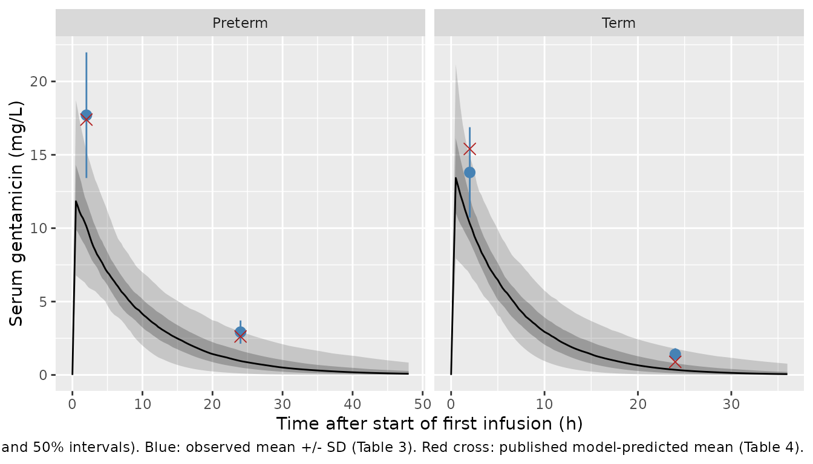

# Gentamicin (Zazo 2022)

## Model and source

- Citation: Zazo H, Lagarejos E, Prado-Velasco M, Sanchez-Herrero S,
  Serna J, Rueda-Ferreiro A, Martin-Suarez A, Calvo MV, Perez-Blanco JS,
  Lanao JM. Physiologically-based pharmacokinetic modelling and dosing
  evaluation of gentamicin in neonates using PhysPK. Front Pharmacol.
  2022;13:977372. <doi:10.3389/fphar.2022.977372>.
- Description (preterm): PBPK (minimal, PhysPK / EcosimPro). Gentamicin
  in preterm neonates (gestational age 32-37 weeks, postnatal age \< 1
  week) after a 30-min intravenous infusion. Serum (volume of
  distribution Vd) is connected to a well-stirred heart chamber perfused
  at cardiac output, a flow-limited eliminating kidney (elimination flow
  = TBW \* GFR \* 0.79, i.e. glomerular filtration net of 21% tubular
  reabsorption) and a flow-limited rest-of-tissues compartment. Built
  entirely from literature values with no fitting; between-subject
  variability is the authors’ log-normal Monte Carlo over GFR, Vd,
  cardiac output and kidney blood flow. CAUTION: the printed model does
  not reproduce the paper’s own concentrations. Clearance matches the
  paper’s Table 4, but simulated serum concentrations at 2 h are 30-40%
  below the published predictions (Table 4, Figure 2), because the
  printed serum Vd caps the peak at dose/Vd. The printed serum equation
  (Eq. 5) is also not mass-conserving and is encoded here in corrected
  form, and the heart-chamber volume is not reported and is a maintainer
  assumption. See the vignette Errata before use. Companion model for
  term neonates: Zazo_2022_gentamicin_term.
- Description (term): PBPK (minimal, PhysPK / EcosimPro). Gentamicin in
  term neonates (gestational age \> 37 weeks, postnatal age \< 1 week)
  after a 30-min intravenous infusion. Serum (volume of distribution Vd)
  is connected to a well-stirred heart chamber perfused at cardiac
  output, a flow-limited eliminating kidney (elimination flow = TBW \*
  GFR \* 0.79, i.e. glomerular filtration net of 21% tubular
  reabsorption) and a flow-limited rest-of-tissues compartment. Built
  entirely from literature values with no fitting; between-subject
  variability is the authors’ log-normal Monte Carlo over GFR, Vd,
  cardiac output and kidney blood flow. CAUTION: the printed model does
  not reproduce the paper’s own concentrations. Clearance matches the
  paper’s Table 4, but simulated serum concentrations at 2 h are 30-40%
  below the published predictions (Table 4, Figure 2), because the
  printed serum Vd caps the peak at dose/Vd. The printed serum equation
  (Eq. 5) is also not mass-conserving and is encoded here in corrected
  form, and the heart-chamber volume is not reported and is a maintainer
  assumption. See the vignette Errata before use. Companion model for
  preterm neonates: Zazo_2022_gentamicin_preterm.
- Article: <https://doi.org/10.3389/fphar.2022.977372> (open access)

Zazo et al. built a minimal physiologically based PK (PBPK) model of
gentamicin in neonates in the PhysPK / EcosimPro platform. It has four
states: serum, a well-stirred heart chamber perfused by the cardiac
output, a flow-limited kidney that eliminates the drug, and a
flow-limited “rest of tissues” pool. Every parameter came from the
literature; nothing was fitted. Between-subject variability is a
log-normal Monte Carlo over body weight, glomerular filtration rate
(GFR), serum volume of distribution, cardiac output and kidney blood
flow. The authors used one structure with two sets of physiological
values, one for preterm and one for term neonates, so the package ships
two model files that share this vignette.

**Read the Errata section before using these models.** Built from the
printed equations and tables, the model reproduces the paper’s clearance
but not its concentrations. Simulated serum concentrations at 2 h are
roughly 30-40% below the paper’s own predictions in Table 4 and Figure
2.

## Population

Source paper Table 3: 47 neonates in the first week of life, treated at
the University Hospital of Salamanca (Spain) between 1999 and 2003 and
monitored by routine TDM, with 91 serum samples taken 2 and 24 h after
the start of the infusion.

- Preterm (gestational age 32-37 weeks, n = 31): body weight 1.96 +/-
  0.41 kg, postnatal age 3.03 +/- 1.02 days, dose 5.74 +/- 0.80 mg/kg
  every 48 h.
- Term (gestational age 38-39 weeks, n = 16): body weight 3.09 +/- 0.23
  kg, postnatal age 2.94 +/- 0.85 days, dose 6.64 +/- 0.22 mg/kg every
  36 h.

These patients validated the model; they were not used to fit it. Sex
distribution is not reported. The same information is available
programmatically, e.g.
`readModelDb("Zazo_2022_gentamicin_preterm")()$population`.

## Source trace

| Equation / parameter | Preterm | Term | Source location |
|----|----|----|----|
| `d/dt(heart_chamber)` | – | – | Eq. 1 |
| `d/dt(kidney)` | – | – | Eq. 2 |
| `qe <- WT * gfr * 0.79` | – | – | Eq. 3 (21% tubular reabsorption) |
| `d/dt(other)` | – | – | Eq. 4 |
| `d/dt(central)` | – | – | Eq. 5, corrected (see Errata) |
| `cl <- q_kidney * qe / (q_kidney + qe)` | – | – | steady-state clearance of the Eq. 2-3 kidney; compared with Table 4 CL |
| `lvc` (serum Vd, L/kg) | median of 0.52 +/- 0.16 | median of 0.46 +/- 0.14 | Table 2 |
| `lgfr` (mL/min/kg) | median of 1.31 +/- 0.53 (= 1.21) | median of 1.72 +/- 0.70 (= 1.59) | Table 2; medians quoted in the Discussion |
| `lqc` (cardiac output, mL/min/kg) | median of 172 +/- 50.6 | same | Table 2 |
| `lq_kidney` (mL/min/kg) | median of 9.35, CV 20% | same | Table 1; CV in section 2.1.3 |
| `lq_other` (mL/min/kg) | 217 | same | Table 1 |
| `lv_kidney` (mL) | 0.03 | same | Table 1 |
| `lv_other` (mL) | 0.87 | same | Table 1 |
| `lkp_kidney` | 10.0 | same | Table 1 |
| `lkp_other` | 1.00 | same | Table 1 |
| `lv_heart_chamber` (mL) | 5 | same | **not in the paper**; assumed by the maintainers |
| `etalvc` | CV 30.8% | CV 30.4% | Table 2 SD / mean |
| `etalgfr` | CV 40.5% | CV 40.7% | Table 2 SD / mean (section 2.1.3: 40%) |
| `etalq_kidney` | CV 20% | same | section 2.1.3 |
| `etalqc` | CV 29.4% | same | Table 2 SD / mean (section 2.1.3: 24%) |
| `WT` (body weight, kg) | 1.73 +/- 0.35 | 3.56 +/- 0.72 | Table 2 (Monte Carlo); CV 20% in section 2.1.3 |

Each Monte Carlo parameter is reported as an arithmetic mean +/- SD of a
log-normal distribution. The `ini()` value is the log-normal median,
`mean / sqrt(1 + CV^2)`, and the variance is `omega^2 = log(1 + CV^2)`.
The paper confirms this reading for GFR: the Discussion quotes the
implemented GFR values as 1.21 and 1.59 mL/min/kg. Those are exactly the
log-normal medians of Table 2’s 1.31 +/- 0.53 and 1.72 +/- 0.70. The 40%
CV in the text would instead give 1.60 for term neonates.

## Structural checks

``` r

mod_pre <- readModelDb("Zazo_2022_gentamicin_preterm")
mod_term <- readModelDb("Zazo_2022_gentamicin_term")
typ_pre <- rxode2::zeroRe(mod_pre)
#> ℹ parameter labels from comments will be replaced by 'label()'
typ_term <- rxode2::zeroRe(mod_term)
#> ℹ parameter labels from comments will be replaced by 'label()'
```

### Mass balance of the corrected serum equation

With filtration switched off (`lgfr` set to a negligible value), the
four states must hold the whole dose forever. Both sides of the check
come from the same solve, so a tight bound applies.

``` r

ev_mb <- rxode2::et(amt = 6 * 1.96, dur = 0.5, cmt = "central") |>
  rxode2::et(c(1, 6, 24))
no_elim <- typ_pre |> rxode2::ini(lgfr = log(1e-12))
#> ℹ change initial estimate of `lgfr` to `-27.6310211159285`
mb <- rxode2::rxSolve(no_elim, ev_mb, params = c(WT = 1.96),
                      rtol = 1e-10, atol = 1e-12) |>
  as.data.frame() |>
  mutate(total = central + heart_chamber + kidney + other)
#> ℹ omega/sigma items treated as zero: 'etalvc', 'etalgfr', 'etalq_kidney', 'etalqc'
knitr::kable(mb[, c("time", "central", "heart_chamber", "kidney", "other", "total")],
             digits = 6, caption = "Amounts (mg) with elimination switched off; dose 11.76 mg.")
```

| time |  central | heart_chamber |   kidney |    other | total |
|-----:|---------:|--------------:|---------:|---------:|------:|
|    1 | 11.68598 |      0.059982 | 0.003599 | 0.010437 | 11.76 |
|    6 | 11.68598 |      0.059982 | 0.003599 | 0.010437 | 11.76 |
|   24 | 11.68598 |      0.059982 | 0.003599 | 0.010437 | 11.76 |

Amounts (mg) with elimination switched off; dose 11.76 mg. {.table}

``` r

stopifnot(max(abs(mb$total / (6 * 1.96) - 1)) < 1e-6)
```

The serum equation as printed (Eq. 5) has no `-(Qk + Qr) * Cb` term. The
tissues take up drug from serum (Eqs. 2 and 4) and return it, but the
serum never loses what they take up, so every pass through a tissue
creates drug. Replacing the corrected line with the printed one shows
the consequence:

``` r

literal <- typ_pre |>
  rxode2::model(d/dt(central) <- qc * c_heart_chamber + q_kidney * c_kidney / kp_kidney +
                  q_other * c_other / kp_other - qc * Cc)
ev_lit <- rxode2::et(amt = 6 * 1.96, dur = 0.5, cmt = "central") |>
  rxode2::et(c(0.25, 0.5, 1))
lit <- suppressWarnings(rxode2::rxSolve(literal, ev_lit, params = c(WT = 1.96))) |>
  as.data.frame()
#> ℹ omega/sigma items treated as zero: 'etalvc', 'etalgfr', 'etalq_kidney', 'etalqc'
cor <- rxode2::rxSolve(typ_pre, ev_lit, params = c(WT = 1.96)) |> as.data.frame()
#> ℹ omega/sigma items treated as zero: 'etalvc', 'etalgfr', 'etalq_kidney', 'etalqc'
knitr::kable(
  data.frame(time = cor$time, corrected = cor$Cc, printed = lit$Cc),
  digits = 2, format.args = list(big.mark = ","),
  caption = "Typical preterm serum concentration (mg/L), corrected vs. printed Eq. 5."
)
```

| time | corrected |      printed |
|-----:|----------:|-------------:|
| 0.25 |      5.92 | 7.630600e+02 |
| 0.50 |     11.69 | 6.574143e+05 |
| 1.00 |     11.10 | 4.868502e+11 |

Typical preterm serum concentration (mg/L), corrected vs. printed Eq. 5.
{.table}

``` r

stopifnot(all(lit$Cc[lit$time == 1] > 100 * cor$Cc[cor$time == 1]))
```

### Peak bound

Gentamicin is infused into serum and the tissues are tiny (see Errata),
so the serum concentration can never exceed dose / Vd. Table 2 sets Vd
at 0.52 L/kg (preterm) and 0.46 L/kg (term), which caps the peak after 6
mg/kg near 11.5 and 13 mg/L. The paper’s Table 4 mean C2h of 17.4 and
15.4 mg/L sit above that cap.

``` r

peak_tbl <- bind_rows(lapply(list(list("Preterm", typ_pre, 1.96), list("Term", typ_term, 3.09)), function(g) {
  ev <- rxode2::et(amt = 6 * g[[3]], dur = 0.5, cmt = "central") |> rxode2::et(seq(0, 4, by = 0.05))
  s <- rxode2::rxSolve(g[[2]], ev, params = c(WT = g[[3]])) |> as.data.frame()
  vd <- exp(rxode2::rxode(g[[2]])$theta[["lvc"]]) * g[[3]]
  data.frame(group = g[[1]], cmax = max(s$Cc), bound = 6 * g[[3]] / vd)
}))
#> ℹ omega/sigma items treated as zero: 'etalvc', 'etalgfr', 'etalq_kidney', 'etalqc'
#> ℹ omega/sigma items treated as zero: 'etalvc', 'etalgfr', 'etalq_kidney', 'etalqc'
knitr::kable(peak_tbl, digits = 2,
             caption = "Typical-value peak (mg/L) vs. dose / Vd at the Table 3 mean weight.")
```

| group   |  cmax | bound |
|:--------|------:|------:|
| Preterm | 11.69 | 12.07 |
| Term    | 13.08 | 13.63 |

Typical-value peak (mg/L) vs. dose / Vd at the Table 3 mean weight.
{.table}

``` r

stopifnot(all(peak_tbl$cmax <= peak_tbl$bound * (1 + 1e-6)))
```

### Heart-chamber volume sensitivity

The paper does not print the heart-chamber volume `Vh`; it is a built-in
value of the PhysPK platform. The models carry an assumed 5 mL. Varying
it 100-fold shows how little it matters:

``` r

vh_tbl <- bind_rows(lapply(c(0.5, 5, 50), function(vh) {
  bind_rows(lapply(list(list("Preterm", typ_pre, 1.96), list("Term", typ_term, 3.09)), function(g) {
    m <- g[[2]] |> rxode2::ini(lv_heart_chamber = log(vh))
    ev <- rxode2::et(amt = 6 * g[[3]], dur = 0.5, cmt = "central") |> rxode2::et(c(2, 24))
    s <- suppressMessages(rxode2::rxSolve(m, ev, params = c(WT = g[[3]]))) |> as.data.frame()
    data.frame(group = g[[1]], vh_mL = vh, C2h = s$Cc[s$time == 2], C24h = s$Cc[s$time == 24])
  }))
}))
#> ℹ change initial estimate of `lv_heart_chamber` to `-0.693147180559945`
#> ℹ change initial estimate of `lv_heart_chamber` to `-0.693147180559945`
#> ℹ change initial estimate of `lv_heart_chamber` to `1.6094379124341`
#> ℹ change initial estimate of `lv_heart_chamber` to `1.6094379124341`
#> ℹ change initial estimate of `lv_heart_chamber` to `3.91202300542815`
#> ℹ change initial estimate of `lv_heart_chamber` to `3.91202300542815`
vh_tbl <- vh_tbl |>
  group_by(group) |>
  mutate(C2h_change_pct = 100 * (C2h / C2h[vh_mL == 5] - 1),
         C24h_change_pct = 100 * (C24h / C24h[vh_mL == 5] - 1)) |>
  ungroup()
knitr::kable(vh_tbl, digits = 2,
             caption = "Typical-value C2h and C24h (mg/L) by assumed heart-chamber volume.")
```

| group   | vh_mL |   C2h | C24h | C2h_change_pct | C24h_change_pct |
|:--------|------:|------:|-----:|---------------:|----------------:|
| Preterm |   0.5 | 10.04 | 1.00 |           0.38 |           -0.68 |
| Term    |   0.5 | 10.46 | 0.38 |           0.24 |           -0.85 |
| Preterm |   5.0 | 10.00 | 1.01 |           0.00 |            0.00 |
| Term    |   5.0 | 10.44 | 0.38 |           0.00 |            0.00 |
| Preterm |  50.0 |  9.64 | 1.08 |          -3.62 |            6.58 |
| Term    |  50.0 | 10.19 | 0.42 |          -2.38 |            8.48 |

Typical-value C2h and C24h (mg/L) by assumed heart-chamber volume.
{.table}

From 0.5 to 5 mL, C2h and C24h move by under 1%. A 50 mL chamber, close
to half of a preterm neonate’s total blood volume, moves C2h by under 5%
and C24h by under 15%. Even then, none of the concentration gap in the
comparison below is closed.

## Virtual cohorts

The paper’s Monte Carlo drew 1,000 virtual patients per group with body
weight from Table 2. The cohorts below use 200 per group. The Figure 2
and Table 5 cohorts follow the paper’s Monte Carlo, with weight drawn
log-normally from Table 2. The Table 4 clearance comparison uses the
observed Table 3 weights, because the paper compares predicted with
observed patient clearance (see Errata).

``` r

rxode2::rxSetSeed(20221)
set.seed(20221)

draw_lognormal <- function(n, mean, sd) {
  cv <- sd / mean
  mean / sqrt(1 + cv^2) * exp(rnorm(n, 0, sqrt(log(1 + cv^2))))
}

make_cohort <- function(n, wt_mean, wt_sd, dose_mgkg, obs_times, id_offset) {
  subj <- tibble(id = id_offset + seq_len(n), WT = draw_lognormal(n, wt_mean, wt_sd))
  dose <- subj |> mutate(time = 0, evid = 1L, amt = dose_mgkg * WT, dur = 0.5, cmt = "central")
  obs <- subj |>
    tidyr::crossing(time = obs_times) |>
    mutate(evid = 0L, amt = 0, dur = NA_real_, cmt = "central")
  bind_rows(dose, obs) |> arrange(id, time, desc(evid))
}

grid <- seq(0, 72, by = 0.25)
n_arm <- 200L

cohorts <- tibble::tribble(
  ~group,    ~regimen,              ~dose, ~tau, ~wt_mean, ~wt_sd, ~offset,
  "Preterm", "Extended 6 mg/kg q48h",  6,  48,   1.73,     0.35,      0L,
  "Preterm", "Conventional 4 mg/kg q24h", 4, 24, 1.73,     0.35,    200L,
  "Term",    "Extended 6 mg/kg q36h",  6,  36,   3.56,     0.72,    400L,
  "Term",    "Conventional 4 mg/kg q24h", 4, 24, 3.56,     0.72,    600L,
  "Preterm", "Patients (Table 3 weight)", 6, 48, 1.96,     0.41,    800L,
  "Term",    "Patients (Table 3 weight)", 6, 36, 3.09,     0.23,   1000L
)

events <- bind_rows(lapply(seq_len(nrow(cohorts)), function(i) {
  cohorts[i, ] |>
    with(make_cohort(n_arm, wt_mean, wt_sd, dose, grid, offset)) |>
    mutate(group = cohorts$group[i], regimen = cohorts$regimen[i], tau = cohorts$tau[i])
}))
stopifnot(!anyDuplicated(unique(events[, c("id", "time", "evid")])))
```

## Simulation

Each group is solved with its own model file. Only the first dosing
interval is used: the paper’s samples (2 and 24 h after the first dose)
and its VPC cover the first interval.

``` r

sim <- bind_rows(
  rxode2::rxSolve(mod_pre, events = filter(events, group == "Preterm"),
                  keep = c("group", "regimen", "tau", "WT")) |> as.data.frame(),
  rxode2::rxSolve(mod_term, events = filter(events, group == "Term"),
                  keep = c("group", "regimen", "tau", "WT")) |> as.data.frame()
)
#> ℹ parameter labels from comments will be replaced by 'label()'
#> ℹ parameter labels from comments will be replaced by 'label()'
stopifnot(!anyNA(sim$Cc))
```

## Figure 2: visual predictive check

``` r

observed <- tibble::tribble(
  ~group,    ~time, ~mean, ~sd,
  "Preterm",     2, 17.7,  4.28,
  "Preterm",    24, 2.92,  0.79,
  "Term",        2, 13.8,  3.08,
  "Term",       24, 1.41,  0.41
)
published_pred <- tibble::tribble(
  ~group,    ~time, ~mean,
  "Preterm",     2, 17.4,
  "Preterm",    24, 2.62,
  "Term",        2, 15.4,
  "Term",       24, 0.89
)

vpc <- sim |>
  filter(grepl("Extended", regimen), time <= tau) |>
  group_by(group, time) |>
  summarise(q05 = quantile(Cc, 0.05), q25 = quantile(Cc, 0.25), q50 = median(Cc),
            q75 = quantile(Cc, 0.75), q95 = quantile(Cc, 0.95), .groups = "drop")

ggplot(vpc, aes(time, q50)) +
  geom_ribbon(aes(ymin = q05, ymax = q95), alpha = 0.2) +
  geom_ribbon(aes(ymin = q25, ymax = q75), alpha = 0.3) +
  geom_line() +
  geom_pointrange(data = observed, aes(y = mean, ymin = mean - sd, ymax = mean + sd),
                  colour = "steelblue") +
  geom_point(data = published_pred, aes(y = mean), shape = 4, size = 3, colour = "firebrick") +
  facet_wrap(~group, scales = "free_x") +
  labs(x = "Time after start of first infusion (h)", y = "Serum gentamicin (mg/L)",
       caption = paste("Replicates Figure 2 of Zazo 2022 (6 mg/kg; 90% and 50% intervals).",
                       "Blue: observed mean +/- SD (Table 3). Red cross: published",
                       "model-predicted mean (Table 4)."))
```



The simulated median peaks near 11-13 mg/L at the end of the infusion.
The paper’s Figure 2 median peaks at about 22 mg/L. The observed 2-h
concentrations (blue) sit well above the simulated median: the printed
model does not reproduce its own VPC.

## Table 4: concentrations and clearance

``` r

cl_cmp <- sim |>
  filter(regimen == "Patients (Table 3 weight)") |>
  group_by(group) |>
  summarise(
    C2h = mean(Cc[time == 2]),
    C24h = mean(Cc[time == 24]),
    CL = mean(cl[time == 0]),
    .groups = "drop"
  ) |>
  mutate(source = "Simulated (Table 3 weights)")

mc_conc <- sim |>
  filter(grepl("Extended", regimen)) |>
  group_by(group) |>
  summarise(C2h = mean(Cc[time == 2]), C24h = mean(Cc[time == 24]),
            CL = mean(cl[time == 0]), .groups = "drop") |>
  mutate(source = "Simulated (Table 2 weights)")

pub4 <- tibble::tribble(
  ~group,    ~C2h, ~C24h, ~CL,
  "Preterm", 17.4, 2.62,  0.11,
  "Term",    15.4, 0.89,  0.23
) |> mutate(source = "Published prediction (Table 4)")
obs4 <- tibble::tribble(
  ~group,    ~C2h, ~C24h, ~CL,
  "Preterm", 17.7, 2.92,  0.09,
  "Term",    13.8, 1.41,  0.19
) |> mutate(source = "Observed (Table 4)")

bind_rows(cl_cmp, mc_conc, pub4, obs4) |>
  arrange(group, source) |>
  dplyr::rename("Group" = group, "Source" = source, "C2h (mg/L)" = C2h,
                "C24h (mg/L)" = C24h, "CL (L/h)" = CL) |>
  knitr::kable(digits = 3, caption = "Mean values, simulated vs. Zazo 2022 Table 4.")
```

| Group   | C2h (mg/L) | C24h (mg/L) | CL (L/h) | Source                         |
|:--------|-----------:|------------:|---------:|:-------------------------------|
| Preterm |     17.700 |       2.920 |    0.090 | Observed (Table 4)             |
| Preterm |     17.400 |       2.620 |    0.110 | Published prediction (Table 4) |
| Preterm |     10.325 |       1.184 |    0.093 | Simulated (Table 2 weights)    |
| Preterm |     10.181 |       1.242 |    0.110 | Simulated (Table 3 weights)    |
| Term    |     13.800 |       1.410 |    0.190 | Observed (Table 4)             |
| Term    |     15.400 |       0.890 |    0.230 | Published prediction (Table 4) |
| Term    |     10.611 |       0.565 |    0.250 | Simulated (Table 2 weights)    |
| Term    |     10.386 |       0.600 |    0.220 | Simulated (Table 3 weights)    |

Mean values, simulated vs. Zazo 2022 Table 4. {.table
style="width:100%;"}

``` r


# Clearance reproduces Table 4. CL is an algebraic function of the drawn
# physiology, so the 200-subject mean has a sampling SE near 3%; a
# mis-transcribed GFR, kidney flow or reabsorption factor moves it by far more.
cl_ratio <- cl_cmp$CL / pub4$CL[match(cl_cmp$group, pub4$group)]
stopifnot(all(abs(cl_ratio - 1) < 0.2))
```

Clearance reproduces Table 4 to within about 10%. That is the model’s
reusable result: a flow-limited kidney with elimination flow
`TBW * GFR * 0.79` predicts neonatal gentamicin clearance from GFR
alone. The concentrations do not reproduce. Simulated C2h is about 40%
(preterm) and a third (term) below the published predictions, and below
the observed means. C24h is also below the published predictions. This
is a known deviation of the printed model, not a simulation artifact
(see the peak bound above), so no assertion is placed on it.

## PKNCA validation

``` r

sim_nca <- sim |>
  filter(regimen == "Patients (Table 3 weight)", !is.na(Cc)) |>
  select(id, time, Cc, group)
sim_nca <- bind_rows(sim_nca, sim_nca |> distinct(id, group) |> mutate(time = 0, Cc = 0)) |>
  distinct(id, group, time, .keep_all = TRUE) |>
  arrange(id, group, time)

dose_df <- events |>
  filter(evid == 1, regimen == "Patients (Table 3 weight)") |>
  select(id, time, amt, group)

conc_obj <- PKNCA::PKNCAconc(sim_nca, Cc ~ time | group + id)
dose_obj <- PKNCA::PKNCAdose(dose_df, amt ~ time | group + id, route = "intravascular",
                             duration = 0.5)
intervals <- data.frame(start = 0, end = Inf, cmax = TRUE, tmax = TRUE,
                        aucinf.obs = TRUE, half.life = TRUE, cl.obs = TRUE)
nca_res <- PKNCA::pk.nca(PKNCA::PKNCAdata(conc_obj, dose_obj, intervals = intervals))

published_nca <- tibble::tribble(
  ~group,    ~cl.obs,
  "Preterm", 0.11,
  "Term",    0.23
)
cmp <- nlmixr2lib::ncaComparisonTable(
  simulated = nca_res,
  reference = published_nca,
  by = "group",
  units = c(cl.obs = "L/h"),
  tolerance_pct = 20
)
knitr::kable(cmp, caption = "PKNCA clearance (dose / AUC0-inf) vs. Table 4 predicted CL. * differs by >20%.")
```

| NCA parameter | group   | Reference | Simulated | % diff |
|:--------------|:--------|:----------|:----------|:-------|
| CL/F (L/h)    | Preterm | 0.11      | 0.104     | -5.1%  |
| CL/F (L/h)    | Term    | 0.23      | 0.211     | -8.1%  |

PKNCA clearance (dose / AUC0-inf) vs. Table 4 predicted CL. \* differs
by \>20%. {.table}

The paper reports no Cmax, AUC or half-life, so clearance is the only
NCA quantity with a published counterpart. The full PKNCA summary
follows for reference:

``` r

knitr::kable(summary(nca_res), caption = "PKNCA summary, 6 mg/kg single dose, Table 3 weights.")
```

| start | end | group | N | cmax | tmax | half.life | aucinf.obs | cl.obs |
|---:|---:|:---|:---|:---|:---|:---|:---|:---|
| 0 | Inf | Preterm | 200 | 11.7 \[32.3\] | 0.500 \[0.500, 0.500\] | 7.55 \[3.92\] | 116 \[39.3\] | 0.0996 \[46.3\] |
| 0 | Inf | Term | 200 | 13.1 \[30.3\] | 0.500 \[0.500, 0.500\] | 5.08 \[2.60\] | 89.0 \[36.8\] | 0.206 \[37.6\] |

PKNCA summary, 6 mg/kg single dose, Table 3 weights. {.table}

## Table 5: probability of target attainment

The target criteria come from source paper section 2.5, with MIC 1 mg/L.
The efficacy targets are Cmax/MIC \>= 8 and time above MIC \>= 60% of
the dosing interval. The toxicity targets are Cmin \>= 2 mg/L and Cmax
\>= 25 mg/L. All four are evaluated over the first dosing interval.

``` r

pta <- sim |>
  filter(!grepl("Patients", regimen), time <= tau) |>
  group_by(group, regimen, id) |>
  summarise(cmax = max(Cc), cmin = Cc[time == tau[1]],
            tmic = mean(Cc[time < tau[1]] > 1), .groups = "drop") |>
  group_by(group, regimen) |>
  summarise(`Cmax/MIC >= 8` = 100 * mean(cmax >= 8),
            `T>MIC >= 60%` = 100 * mean(tmic >= 0.6),
            `Cmin >= 2 mg/L` = 100 * mean(cmin >= 2),
            `Cmax >= 25 mg/L` = 100 * mean(cmax >= 25),
            .groups = "drop") |>
  mutate(source = "Simulated")
pub5 <- tibble::tribble(
  ~group,    ~regimen,                    ~`Cmax/MIC >= 8`, ~`T>MIC >= 60%`, ~`Cmin >= 2 mg/L`, ~`Cmax >= 25 mg/L`,
  "Preterm", "Conventional 4 mg/kg q24h", 10.8,             87.9,            5.0,               0.0,
  "Preterm", "Extended 6 mg/kg q48h",     99.9,             70.7,            5.9,               6.9,
  "Term",    "Conventional 4 mg/kg q24h", 32.3,             61.2,            0.4,               0.0,
  "Term",    "Extended 6 mg/kg q36h",     99.8,             54.9,            1.8,               6.5
) |> mutate(source = "Published (Table 5)")
bind_rows(pta, pub5) |>
  arrange(group, regimen, source) |>
  knitr::kable(digits = 1, caption = "PTA (%) at MIC 1 mg/L, simulated vs. Zazo 2022 Table 5.")
```

| group | regimen | Cmax/MIC \>= 8 | T\>MIC \>= 60% | Cmin \>= 2 mg/L | Cmax \>= 25 mg/L | source |
|:---|:---|---:|---:|---:|---:|:---|
| Preterm | Conventional 4 mg/kg q24h | 10.8 | 87.9 | 5.0 | 0.0 | Published (Table 5) |
| Preterm | Conventional 4 mg/kg q24h | 44.5 | 82.0 | 6.0 | 0.0 | Simulated |
| Preterm | Extended 6 mg/kg q48h | 99.9 | 70.7 | 5.9 | 6.9 | Published (Table 5) |
| Preterm | Extended 6 mg/kg q48h | 90.0 | 30.0 | 0.0 | 2.0 | Simulated |
| Term | Conventional 4 mg/kg q24h | 32.3 | 61.2 | 0.4 | 0.0 | Published (Table 5) |
| Term | Conventional 4 mg/kg q24h | 57.5 | 50.5 | 1.0 | 0.0 | Simulated |
| Term | Extended 6 mg/kg q36h | 99.8 | 54.9 | 1.8 | 6.5 | Published (Table 5) |
| Term | Extended 6 mg/kg q36h | 94.5 | 27.5 | 0.0 | 0.5 | Simulated |

PTA (%) at MIC 1 mg/L, simulated vs. Zazo 2022 Table 5. {.table}

The extended-regimen attainments follow the concentration shortfall.
Only neonates with a low drawn Vd reach the 25 mg/L toxicity threshold,
a few percent at most against about 7% in Table 5. Time above MIC is
also well below the published value. The conventional regimen goes the
other way: the model’s Cmax/MIC \>= 8 attainment is higher than Table
5’s. Errata item 7 explains why no linear model with log-normally
distributed peaks can match Table 5 in full.

## Assumptions and deviations

### Errata in the source

1.  **Eq. 5 is not mass-conserving as printed.** The serum equation
    `Vd dCb/dt = G P(t) + Qh Ch + sum(Qi Ci / Pi) - Qh Cb` omits the
    `-sum(Qi) Cb` outflow to the kidney and rest of tissues that Eqs. 2
    and 4 take up. The models encode the corrected form. PhysPK
    generates the blood connections itself (section 2.2), so the printed
    equation is a summary of that code, not the code itself. The
    correction is the only reading in which the model conserves drug
    mass (see the mass-balance check above).
2.  **Concentrations do not reproduce.** With the printed values,
    simulated C2h is about 30-40% below the paper’s Table 4 predictions
    and its Figure 2 VPC median. Serum Vd from Table 2 (0.52 / 0.46
    L/kg) bounds the peak at dose / Vd, roughly 11.5 / 13 mg/L after 6
    mg/kg. The Figure 2 peak of about 22 mg/L implies an apparent volume
    near 0.27 L/kg. No reading of the organ-volume units closes the gap.
    Larger tissue volumes only lower the peak further. Halving Vd alone,
    with clearance held at its Table 4 value, collapses C24h far below
    the observed values. The maintainers ship the printed values
    unchanged and do not tune them. The PhysPK model file is not
    published, and no supplement accompanies the article.
3.  **Organ-volume units in Table 1.** Table 1 labels its organ volumes
    “(ml)” with values 0.03 (kidney) and 0.87 (rest of tissues). Read
    literally these are far below neonatal physiology, and they look
    like L/kg or fractions of body weight. They are encoded as printed
    (mL), which leaves the tissues with negligible drug-holding
    capacity. Reading them as L or L/kg lowers the simulated peak
    further, so the literal reading is also the one closest to the
    published concentrations. To test another reading, override
    `lv_kidney` / `lv_other` with
    [`rxode2::ini()`](https://nlmixr2.github.io/rxode2/reference/ini.html).
4.  **Kidney blood flow.** Section 2.1.3 says the kidney flow is in
    Table 2, but Table 2 has no such row. The models use Table 1’s 9.35
    mL/min/kg with the 20% CV stated in section 2.1.3. Table 1’s
    rest-of-tissues flow (217 mL/min/kg) also exceeds the cardiac output
    (172 mL/min/kg). In this topology the heart chamber is a parallel
    recirculation loop, so the tissue flows are not drawn from the
    cardiac output, and the printed values are used as they are.
5.  **Cardiac-output variability.** Section 2.1.3 gives the
    cardiac-output CV as 24%. Table 2 gives 172 +/- 50.6 mL/min/kg, a CV
    of 29.4%. The models use Table 2, which is the table of implemented
    values. For GFR, the Discussion’s 1.21 / 1.59 medians match Table
    2’s SD (1.59) better than the text’s 40% CV (1.60). Cardiac output
    only drives the heart-chamber loop, so the choice has no visible
    effect on serum concentrations.
6.  **Term dose range.** Table 3 prints the term dose range as “6.99 -
    6.21” mg/kg, reversed relative to the other rows. It is shown as
    printed in the population metadata.
7.  **Table 5 peak attainments contradict each other.** The model is
    linear, so a neonate’s peak after 6 mg/kg is 1.5 times its peak
    after 4 mg/kg. For preterm neonates, Table 5 has 89.2% of 4 mg/kg
    peaks below 8 mg/L and 99.9% of 6 mg/kg peaks at or above 8 mg/L.
    That puts 4 mg/kg peaks at or above 5.3 mg/L in 99.9% of neonates.
    So 89% of the 4 mg/kg peaks must lie between 5.3 and 8 mg/L. Yet
    6.9% of 6 mg/kg peaks reach 25 mg/L, which needs a 4 mg/kg peak of
    16.7 mg/L or more. A log-normal peak that fits the first two figures
    puts essentially no neonate above 16.7 mg/L. No single log-normal
    peak distribution satisfies all three figures, so the comparison
    above is descriptive only.

### Non-paper-derived values

- **Heart-chamber volume `Vh` = 5 mL** is assumed by the maintainers.
  The paper uses `Vh` in Eq. 1 but never gives a value (it is a PhysPK
  built-in). The sensitivity table above shows that a 0.5-50 mL range
  leaves the conclusions unchanged.
- **No residual error.** The paper’s Monte Carlo varied physiology only,
  so `propSd` is held at zero.

### Other modelling choices

- The 30-min infusion pulse `G P(t)` of Eq. 5 is supplied by the dosing
  record (`dur = 0.5`, `cmt = "central"`) rather than written into the
  ODE.
- Body weight is a covariate (`WT`), not a random effect. The paper’s
  log-normal TBW draw (Table 2, CV 20%) is reproduced in the virtual
  cohort.
- The paper notes that the Monte Carlo draws were uncorrelated; the
  models carry a diagonal OMEGA.
- The PTA comparison uses the first dosing interval. The paper does not
  say whether Table 5 used the first interval or steady state.
- The paper also estimated GFR with the PhysPK estimation module (1.176
  +/- 0.037 and 1.324 +/- 0.054 mL/min/kg). Those values were a software
  check and are not part of the model.
