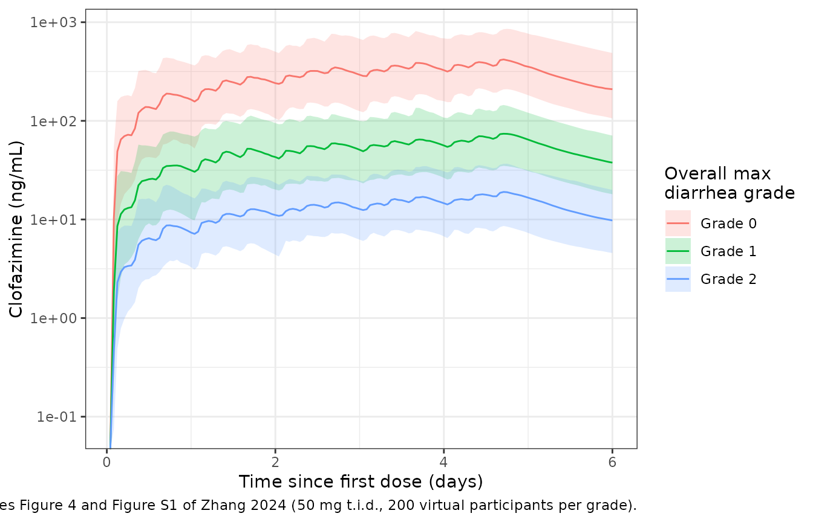
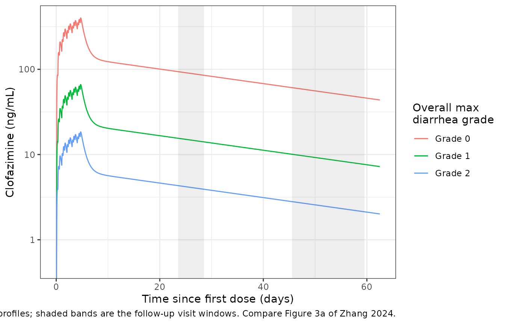

# Clofazimine (Zhang 2024)

## Model and source

- Citation: Zhang CX, Conrad TM, Hermann D, Gordon MA, Houpt E, Iroh Tam
  PY, Jere KC, Nedi W, Operario DJ, Phulusa J, Quinnan GV Jr, Sawyer LA,
  Barrett LK, Thole H, Toto N, Van Voorhis WC, Arnold SLM. Clofazimine
  pharmacokinetics in HIV-infected adults with diarrhea: Implications of
  diarrheal disease on absorption of orally administered therapeutics.
  CPT Pharmacometrics Syst Pharmacol. 2024;13(3):410-423.
  <doi:10.1002/psp4.13092>
- Description: Two-compartment population PK model for oral clofazimine
  in HIV-infected adults with and without cryptosporidiosis-associated
  diarrhea: first-order absorption with a lag time, linear elimination,
  relative bioavailability fixed at 1 in participants without diarrhea
  and reduced by the participant’s overall maximum diarrhea grade over
  the study (grade 1 and grade 2 shifts on log F), inter-individual
  variability on ka, V/F, Q/F and F, and inter-occasion (per study day)
  variability on F.
- Article: <https://doi.org/10.1002/psp4.13092> (open access,
  PMC10941540)
- Supplement: Appendix S1 (Figures S1-S4, Tables S1-S2) at the article
  page

Clofazimine was studied as a treatment for cryptosporidiosis in a phase
IIa trial (NCT03341767) in HIV-infected adults in Blantyre, Malawi.
Zhang et al. used the trial’s pharmacokinetic substudy to ask how
diarrhea changes the absorption of an orally administered drug. The
answer was large: the participant’s highest diarrhea grade over the five
dosing days was the only covariate retained, and it lowered the relative
bioavailability about 6-fold (grade 1, mild) and 22-fold (grade 2,
severe).

## Population

The model was fitted in Phoenix NLME (FOCE-ELS) to 428 plasma
concentrations from the 23 participants who received clofazimine (Table
2):

- **Part A** (n = 12): HIV-infected, Cryptosporidium-positive by qPCR,
  with at least 14 days of diarrhea at enrolment. Median age 40.5 years
  (range 30-51), median weight 45.45 kg (36.6-52), 4 women; median CD4
  count 23 cells/uL and median HIV viral load about 140,000 copies/mL.
  Only 9 of the 12 had diarrhea during the dosing period.
- **Part B** (n = 11): HIV-infected, without cryptosporidiosis or
  diarrhea, matched to Part A on age, sex and weight. Median age 43
  years (31-64), median weight 47 kg (41-53), 4 women; median CD4 count
  419 cells/uL.

Overall maximum diarrhea grade over the study was 0 in 14 participants,
1 in 8 and 2 in one (all grade 1 and 2 participants were in Part A).
Clofazimine was given orally with food at about 5 a.m., 11 a.m. and 6
p.m. for 5 days: 50 mg per dose below 50 kg body weight (20
participants) and 100 mg at or above 50 kg (3 participants).

The same information is available programmatically via
`readModelDb("Zhang_2024_clofazimine")()$population`.

## Source trace

Every `ini()` value carries an in-file comment pointing to its source in
`inst/modeldb/specificDrugs/Zhang_2024_clofazimine.R`. The table below
collects them.

| Equation / parameter | Value | Source location |
|----|----|----|
| `lka` (ka) | log(0.625 1/h) | Table 3, final model |
| `ltlag` (Tlag) | log(1.83 h) | Table 3, final model |
| `lfdepot` (F, diarrhea-free) | fixed(log(1)) | Table 3 (‘1 (fixed)’); Methods, structural model |
| `lcl` (CL/F) | log(3.71 L/h) | Table 3, final model |
| `lvc` (V/F) | log(473 L) | Table 3, final model |
| `lq` (Q/F) | log(18.2 L/h) | Table 3, final model |
| `lvp` (V2/F) | log(3434 L) | Table 3, final model |
| `e_diarrhea_max_grade_1_fdepot` | -1.80 | Table 3 ‘Overall max diarrhea grade = 1’; Results (Frel 0.165) |
| `e_diarrhea_max_grade_2_fdepot` | -3.08 | Table 3 ‘Overall max diarrhea grade = 2’; Results (Frel 0.0460) |
| `etalka` | 149% CV -\> 1.169 | Table 3 ‘IIV on ka’ |
| `etalvc` | 3.46% CV -\> 0.00120 | Table 3 ‘IIV on V/F’ |
| `etalq` | 45.0% CV -\> 0.184 | Table 3 ‘IIV on Q/F’ |
| `etalfdepot` | 37.5% CV -\> 0.132 | Table 3 ‘IIV on F’ |
| `etaiov_fdepot_1` … `_5` | 36.8% CV -\> 0.127 | Table 3 ‘Interoccasion variability on F’ |
| `addSd` | 0.00268 mg/L | Table 3 ‘sigma’ |
| `propSd` | fixed(0) | Equation 1 has a proportional term; no value reported |
| Two-compartment model with lag and first-order absorption | n/a | Results, Structural PK model; Table S1 model 5 |
| `F = 1 x exp(eta_F + theta1 (grade = 1) + theta2 (grade = 2))` | n/a | Equation 6 |
| `Par_i = theta_pop x exp(eta_i)` | n/a | Equation 2 |
| `Cobs = Cpred + Cpred x eps1 + eps2` | n/a | Equation 1 |

## Virtual cohort

The individual data are not public. The virtual cohort reproduces the
study design of Figure 1b: one arm per overall maximum diarrhea grade,
50 mg three times daily for 5 days, with the day of each dose carried as
the occasion (`OCC`) for the inter-occasion variability on F. Time zero
is the first dose at about 5 a.m. on day 1, so the daily doses fall at
0, 6 and 13 h after the day’s first dose.

The PK samples of Figure 1b are flagged so the NCA can use the trial’s
own sampling times: day 1 pre-dose, 2, 3 and 4 h after the first dose
and before the second and third doses; before every dose on days 2, 3
and 5; 2, 3 and 4 h after the first dose on day 5; and one sample on the
morning of day 6 (120 h). A 1-h grid is added for the plots.

``` r

dose_mg <- 50
dose_times <- as.vector(outer(c(0, 6, 13), 24 * (0:4), "+"))
sample_times <- sort(unique(c(
  0, 2, 3, 4, 6, 13, # day 1
  24, 30, 37, 48, 54, 61, # days 2-3, pre-dose
  96, 98, 99, 100, 102, 109, # day 5
  120 # day 6
)))
grid_times <- sort(unique(c(seq(0, 144, by = 1), sample_times)))

grades <- tibble(
  grade = factor(c("Grade 0", "Grade 1", "Grade 2")),
  DIARRHEA_MAX_GRADE_1 = c(0L, 1L, 0L),
  DIARRHEA_MAX_GRADE_2 = c(0L, 0L, 1L)
)

# One arm per grade; `id_offset` keeps subject IDs disjoint across arms.
make_cohort <- function(n, arm, obs_times, id_offset = 0L) {
  ids <- id_offset + seq_len(n)
  doses <- tidyr::expand_grid(id = ids, time = dose_times) |>
    mutate(evid = 1L, amt = dose_mg, cmt = "depot")
  obs <- tidyr::expand_grid(id = ids, time = obs_times) |>
    mutate(evid = 0L, amt = 0, cmt = "central")
  bind_rows(doses, obs) |>
    mutate(
      # Occasion = study day (visit) of the record; F is evaluated on the dose
      # records, which all fall on days 1-5.
      OCC = pmin(floor(time / 24) + 1, 8),
      grade = arm$grade,
      DIARRHEA_MAX_GRADE_1 = arm$DIARRHEA_MAX_GRADE_1,
      DIARRHEA_MAX_GRADE_2 = arm$DIARRHEA_MAX_GRADE_2
    ) |>
    arrange(id, time, desc(evid))
}

n_per_arm <- 200L
events <- bind_rows(lapply(seq_len(nrow(grades)), function(i) {
  make_cohort(n_per_arm, grades[i, ], grid_times,
    id_offset = (i - 1L) * n_per_arm
  )
}))
stopifnot(!anyDuplicated(events[, c("id", "time", "evid")]))
```

## Simulation

``` r

mod <- readModelDb("Zhang_2024_clofazimine")
rxode2::rxSetSeed(20240105)
sim <- rxode2::rxSolve(mod, events = events, keep = "grade") |>
  as.data.frame() |>
  mutate(Cc_ng = 1000 * Cc) # mg/L -> ng/mL
#> ℹ parameter labels from comments will be replaced by 'label()'
#> Warning: some etas defaulted to non-mu referenced, possible parsing error: etaiov_fdepot_1, etaiov_fdepot_2, etaiov_fdepot_3, etaiov_fdepot_4, etaiov_fdepot_5
#> as a work-around try putting the mu-referenced expression on a simple line
```

Typical-value profiles (all random effects set to zero), one subject per
grade, run through the two follow-up visits (19-24 and 41-55 days after
the last dose):

``` r

mod_typical <- mod |> rxode2::zeroRe()
#> ℹ parameter labels from comments will be replaced by 'label()'
#> Warning: some etas defaulted to non-mu referenced, possible parsing error: etaiov_fdepot_1, etaiov_fdepot_2, etaiov_fdepot_3, etaiov_fdepot_4, etaiov_fdepot_5
#> as a work-around try putting the mu-referenced expression on a simple line
#> Warning: some etas defaulted to non-mu referenced, possible parsing error: etaiov_fdepot_1, etaiov_fdepot_2, etaiov_fdepot_3, etaiov_fdepot_4, etaiov_fdepot_5
#> as a work-around try putting the mu-referenced expression on a simple line
long_times <- sort(unique(c(seq(0, 144, by = 0.5), seq(150, 1500, by = 6))))
events_typical <- bind_rows(lapply(seq_len(nrow(grades)), function(i) {
  make_cohort(1L, grades[i, ], long_times, id_offset = i - 1L)
}))
sim_typical <- rxode2::rxSolve(mod_typical, events = events_typical, keep = "grade") |>
  as.data.frame() |>
  mutate(Cc_ng = 1000 * Cc)
#> ℹ omega/sigma items treated as zero: 'etalka', 'etalvc', 'etalq', 'etalfdepot', 'etaiov_fdepot_1', 'etaiov_fdepot_2', 'etaiov_fdepot_3', 'etaiov_fdepot_4', 'etaiov_fdepot_5'
#> Warning: multi-subject simulation without without 'omega'
```

## Replicate published figures

### Concentration-time profiles by overall maximum diarrhea grade (Figure 4 and Figure S1)

Figure 4 plots the observed concentrations by overall maximum diarrhea
grade, and Figure S1 the grade-stratified prediction-corrected VPCs.
Below are the simulated median and 90% prediction interval for each
grade over the first six days; the separation of roughly an order of
magnitude between grades 0 and 1, and again between grades 1 and 2, is
the feature Figure 4 shows.

``` r

vpc <- sim |>
  filter(time > 0) |>
  group_by(grade, time) |>
  summarise(
    q05 = quantile(Cc_ng, 0.05), q50 = median(Cc_ng), q95 = quantile(Cc_ng, 0.95),
    .groups = "drop"
  )
ggplot(vpc, aes(time / 24, q50, colour = grade, fill = grade)) +
  geom_ribbon(aes(ymin = q05, ymax = q95), alpha = 0.2, colour = NA) +
  geom_line() +
  scale_y_log10() +
  labs(
    x = "Time since first dose (days)", y = "Clofazimine (ng/mL)",
    colour = "Overall max\ndiarrhea grade", fill = "Overall max\ndiarrhea grade",
    caption = "Replicates Figure 4 and Figure S1 of Zhang 2024 (50 mg t.i.d., 200 virtual participants per grade)."
  ) +
  theme_bw()
#> Warning in scale_y_log10(): log-10 transformation introduced infinite values.
#> log-10 transformation introduced infinite values.
#> log-10 transformation introduced infinite values.
#> log-10 transformation introduced infinite values.
```



### Whole-study typical profile (Figure 3a)

Figure 3a spans the follow-up visits. Clofazimine’s terminal half-life
of about 35 days means concentrations at the final visit are still a
sizeable fraction of the day-5 peak.

``` r

ggplot(filter(sim_typical, time > 0), aes(time / 24, Cc_ng, colour = grade)) +
  geom_line() +
  annotate("rect",
    xmin = (109 + 19 * 24) / 24, xmax = (109 + 24 * 24) / 24,
    ymin = 0, ymax = Inf, alpha = 0.1
  ) +
  annotate("rect",
    xmin = (109 + 41 * 24) / 24, xmax = (109 + 55 * 24) / 24,
    ymin = 0, ymax = Inf, alpha = 0.1
  ) +
  scale_y_log10() +
  labs(
    x = "Time since first dose (days)", y = "Clofazimine (ng/mL)",
    colour = "Overall max\ndiarrhea grade",
    caption = paste(
      "Typical-value profiles; shaded bands are the follow-up visit windows.",
      "Compare Figure 3a of Zhang 2024."
    )
  ) +
  theme_bw()
#> Warning in scale_y_log10(): log-10 transformation introduced infinite values.
#> log-10 transformation introduced infinite values.
#> log-10 transformation introduced infinite values.
```



### Terminal half-life and bioavailability contrasts

The Discussion reports a terminal half-life of 35.3 days. The closed
form of the two-compartment terminal rate constant from the Table 3
typical values reproduces it. Because the model is linear, typical-value
exposure scales exactly with F, so the grade 1 and grade 2 AUC ratios
must equal the reported relative bioavailabilities exp(-1.80) = 0.165
and exp(-3.08) = 0.0460.

``` r

kel <- 3.71 / 473
k12 <- 18.2 / 473
k21 <- 18.2 / 3434
s <- kel + k12 + k21
beta <- (s - sqrt(s^2 - 4 * kel * k21)) / 2
t_half_days <- log(2) / beta / 24
t_half_days
#> [1] 35.29555

auc_typical <- sim_typical |>
  filter(time <= 120) |>
  group_by(grade) |>
  summarise(auc = sum(diff(time) * (head(Cc, -1) + tail(Cc, -1)) / 2)) |>
  mutate(ratio_to_grade0 = auc / auc[grade == "Grade 0"])
auc_typical
#> # A tibble: 3 × 3
#>   grade     auc ratio_to_grade0
#>   <fct>   <dbl>           <dbl>
#> 1 Grade 0 32.9           1     
#> 2 Grade 1  5.44          0.165 
#> 3 Grade 2  1.51          0.0460

stopifnot(
  abs(t_half_days / 35.3 - 1) < 0.01,
  # Same parameters on both sides of the ratio: pure numerical error.
  abs(auc_typical$ratio_to_grade0[2] / exp(-1.80) - 1) < 1e-4,
  abs(auc_typical$ratio_to_grade0[3] / exp(-3.08) - 1) < 1e-4
)
```

## PKNCA validation against Table S2

Table S2 reports dose-normalized NCA (Cmax and AUC per mg of the single
dose) for day 1 (0-24 h) and day 5 (96-120 h) by overall maximum
diarrhea grade, as arithmetic means. The simulated NCA uses only the
Figure 1b sampling times listed above, so it carries the same
sparse-sampling character as the observed NCA.

``` r

conc_nca <- sim |>
  filter(time %in% sample_times, !is.na(Cc)) |>
  mutate(Cc_dn = Cc_ng / dose_mg) |> # ng/mL per mg
  select(id, grade, time, Cc_dn)
dose_nca <- events |>
  filter(evid == 1) |>
  distinct(id, grade, time) |>
  mutate(amt = 1)

o_conc <- PKNCA::PKNCAconc(conc_nca, Cc_dn ~ time | grade + id)
o_dose <- PKNCA::PKNCAdose(dose_nca, amt ~ time | grade + id)
intervals <- data.frame(
  start = c(0, 96), end = c(24, 120),
  cmax = TRUE, tmax = TRUE, auclast = TRUE
)
nca_res <- PKNCA::pk.nca(PKNCA::PKNCAdata(o_conc, o_dose, intervals = intervals))

# Table S2 reports arithmetic means, so the simulated summary is the mean too
# (ncaComparisonTable() would otherwise pool by median). PKNCA reports Tmax
# relative to the interval start; Table S2 reports it from the first dose.
sim_mean <- as.data.frame(nca_res$result) |>
  filter(PPTESTCD %in% c("cmax", "tmax", "auclast")) |>
  mutate(
    PPORRES = ifelse(PPTESTCD == "tmax", PPORRES + start, PPORRES),
    group = paste0(grade, ", day ", ifelse(start == 0, 1, 5))
  ) |>
  group_by(group, PPTESTCD) |>
  summarise(PPORRES = mean(PPORRES), .groups = "drop")

table_s2 <- tibble(
  group = paste0(rep(c("Grade 0", "Grade 1", "Grade 2"), each = 2), ", day ", c(1, 5)),
  cmax = c(3.99, 10.8, 0.755, 1.58, 0.0828, 0.472),
  tmax = c(15.0, 103, 22.1, 102, 12.1, 98.9),
  auclast = c(60.1, 195.7, 10.8, 32.6, 1.24, 10.5)
)
cmp <- nlmixr2lib::ncaComparisonTable(
  sim_mean, table_s2,
  by = "group",
  units = c(cmax = "ng/mL/mg", tmax = "h", auclast = "ng*h/mL/mg")
)
cmp |>
  dplyr::rename("Grade and study day" = group) |>
  knitr::kable(caption = paste(
    "Simulated arithmetic means (200 virtual participants per grade) against",
    "Table S2 (observed means; n = 14, 8 and 1 for grades 0, 1 and 2).",
    "AUC is AUC0-24 on day 1 and AUC96-120 on day 5; Tmax is from the first dose."
  ))
```

| NCA parameter         | Grade and study day | Reference | Simulated | % diff    |
|:----------------------|:--------------------|:----------|:----------|:----------|
| Cmax (ng/mL/mg)       | Grade 0, day 1      | 3.99      | 3.68      | -7.8%     |
| Cmax (ng/mL/mg)       | Grade 0, day 5      | 10.8      | 8.61      | -20.2%\*  |
| Cmax (ng/mL/mg)       | Grade 1, day 1      | 0.755     | 0.695     | -8.0%     |
| Cmax (ng/mL/mg)       | Grade 1, day 5      | 1.58      | 1.47      | -6.8%     |
| Cmax (ng/mL/mg)       | Grade 2, day 1      | 0.0828    | 0.17      | +104.8%\* |
| Cmax (ng/mL/mg)       | Grade 2, day 5      | 0.472     | 0.375     | -20.6%\*  |
| Tmax (h)              | Grade 0, day 1      | 15        | 22.5      | +50.1%\*  |
| Tmax (h)              | Grade 0, day 5      | 103       | 106       | +3.4%     |
| Tmax (h)              | Grade 1, day 1      | 22.1      | 23.3      | +5.6%     |
| Tmax (h)              | Grade 1, day 5      | 102       | 107       | +4.6%     |
| Tmax (h)              | Grade 2, day 1      | 12.1      | 22.6      | +86.5%\*  |
| Tmax (h)              | Grade 2, day 5      | 98.9      | 106       | +7.3%     |
| AUClast (ng\*h/mL/mg) | Grade 0, day 1      | 60.1      | 59.5      | -1.0%     |
| AUClast (ng\*h/mL/mg) | Grade 0, day 5      | 196       | 192       | -1.7%     |
| AUClast (ng\*h/mL/mg) | Grade 1, day 1      | 10.8      | 11.1      | +2.4%     |
| AUClast (ng\*h/mL/mg) | Grade 1, day 5      | 32.6      | 32.9      | +0.8%     |
| AUClast (ng\*h/mL/mg) | Grade 2, day 1      | 1.24      | 2.73      | +120.3%\* |
| AUClast (ng\*h/mL/mg) | Grade 2, day 5      | 10.5      | 8.4       | -20.0%    |

Simulated arithmetic means (200 virtual participants per grade) against
Table S2 (observed means; n = 14, 8 and 1 for grades 0, 1 and 2). AUC is
AUC0-24 on day 1 and AUC96-120 on day 5; Tmax is from the first dose.
{.table style="width:100%;"}

``` r

attr(cmp, "footnote")
#> [1] "* differs from reference by more than ±20%."
```

``` r

chk <- sim_mean |>
  inner_join(
    tidyr::pivot_longer(table_s2, -group, names_to = "PPTESTCD", values_to = "ref"),
    by = c("group", "PPTESTCD")
  ) |>
  # Grade 2 is a single participant; Tmax is driven by the sparse sample times.
  filter(!grepl("Grade 2", group), PPTESTCD %in% c("cmax", "auclast")) |>
  mutate(pct_diff = 100 * (PPORRES / ref - 1))
chk
#> # A tibble: 8 × 5
#>   group          PPTESTCD PPORRES     ref pct_diff
#>   <chr>          <chr>      <dbl>   <dbl>    <dbl>
#> 1 Grade 0, day 1 auclast   59.5    60.1     -1.04 
#> 2 Grade 0, day 1 cmax       3.68    3.99    -7.80 
#> 3 Grade 0, day 5 auclast  192.    196.      -1.69 
#> 4 Grade 0, day 5 cmax       8.61   10.8    -20.2  
#> 5 Grade 1, day 1 auclast   11.1    10.8      2.39 
#> 6 Grade 1, day 1 cmax       0.695   0.755   -7.97 
#> 7 Grade 1, day 5 auclast   32.9    32.6      0.830
#> 8 Grade 1, day 5 cmax       1.47    1.58    -6.83
stopifnot(
  # Centre: a mis-transcribed clearance, volume or grade effect on F moves
  # every exposure metric by tens of percent or more.
  abs(median(chk$pct_diff)) < 20,
  # Envelope: the Table S2 means come from 8-14 participants with 47-71% CVs.
  max(abs(chk$pct_diff)) < 40
)
```

The day-1 and day-5 exposures for grades 0 and 1 agree with Table S2;
the AUCs are within a few percent. Day-1 Tmax can only take the sampled
values (the last two day-1 samples are at 13 and 24 h), and with three
doses a day most virtual participants peak at the 24-h sample, whereas
the observed grade 0 mean of 15 h shows that many observed participants
peaked at 13 h. The grade 2 rows compare a single observed participant
with the model’s grade-2 population mean and are expected to differ:
that participant’s individual random effects are not known, and the
model’s grade 2 effect was estimated from that participant’s whole
profile rather than from these two summary numbers.

## Assumptions and deviations

- **Proportional residual error not reported.** Equation 1 is a combined
  proportional and additive model, but Table 3 prints a single sigma
  (0.00268). In a Phoenix additive-plus-multiplicative model with a
  single reported sigma this is the additive SD, here in mg/L (2.68
  ng/mL; the assay range was 1-1000 ng/mL). The proportional SD is not
  given anywhere in the paper or supplement and is fixed to 0
  (`propSd = fixed(0)`), so simulations that include residual error
  under-represent the variability at high concentrations.
- **IIV variances.** Table 3 reports IIV and IOV as %CV. The variances
  use omega^2 = log(1 + CV^2), the exact log-normal relationship; the
  paper does not state which conversion its CVs used.
- **Inter-occasion variability on F.** The paper defines eight
  occasions, one per PK visit (days 1-6 and two follow-up visits). F
  only acts on doses, which all fall on days 1-5, so only occasions 1-5
  can change a prediction; these carry a shared variance
  (`etaiov_fdepot_1` to `_5`). Any other `OCC` value switches the
  occasion effect off. `OCC` must be set on the dose records.
- **Overall maximum diarrhea grade** is a subject-level, time-fixed
  summary of all stool assessments during the study (before each dose on
  days 1-5 and once on day 6). It is encoded with the level indicators
  `DIARRHEA_MAX_GRADE_1` and `DIARRHEA_MAX_GRADE_2` (reference: grade
  0). Because the grade is known only after the dosing period ends, the
  model describes the association reported by the paper and is not a
  prospective dose-adjustment rule. The grade 2 effect rests on a single
  participant.
- **Day-6 sample time.** Figure 1b does not show the day-6 sample time;
  the virtual sampling places it at 120 h (the morning of day 6) to
  close the day-5 96-120 h AUC interval used by Table S2.
- **Dose.** The virtual cohort uses 50 mg per dose throughout (20 of the
  23 participants). The model is linear, so dose-normalized results do
  not depend on this choice.
- **NCA on individual predictions.** The simulated NCA uses the model
  prediction without residual error; with an additive SD of 2.68 ng/mL
  the residual error would add substantial noise to the grade 2
  concentrations.
- **Screened covariates not retained** (HIV viral load, CD4 count, age
  and body weight) are documented in `covariatesDataExcluded`; the paper
  reports no coefficient for them in the final model.
