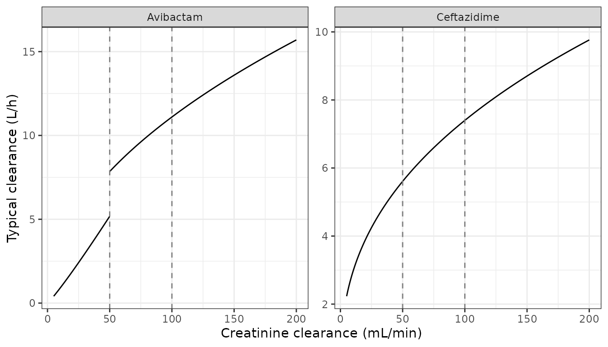
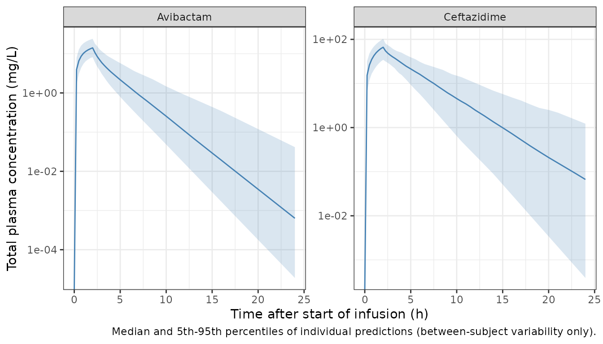

# Ceftazidime and avibactam (Zhou 2016)

## Model and source

Zhou W, Johnson TN, Xu H, Cheung SYA, Bui KH, Li J, Al-Huniti N, Zhou D.
“Predictive Performance of Physiologically Based Pharmacokinetic and
Population Pharmacokinetic Modeling of Renally Cleared Drugs in
Children.” *CPT Pharmacometrics Syst Pharmacol* 2016;5(9):475-483.
[doi:10.1002/psp4.12101](https://doi.org/10.1002/psp4.12101).

Zhou 2016 asks how well adult models predict the clearance of renally
eliminated drugs in children. It takes two routes:

- **PBPK** in Simcyp 14.1 for nine drugs. These are platform models
  whose physiology lives in the Simcyp pediatric database; the paper
  prints only drug-specific inputs (Supplementary Table S2), so they are
  not reproducible outside that platform and are not part of the
  library.
- **Population PK**: adult models taken from the literature for five
  drugs, stripped of covariates that do not carry over to children, and
  simulated in pediatric virtual cohorts. Supplementary Table S4
  tabulates all five.

Two of the five are in the library under Zhou 2016’s name, both from the
same original analysis (Li J, Knebel W, Riggs M, Zhou D, Nichols WW, Das
S; ICAAC 2012, Zhou 2016 reference 31):

- `Zhou_2016_avibactam`
- `Zhou_2016_ceftazidime`

That original analysis exists only as a conference abstract, so Zhou
2016 Table S4 is the only available full parameter set for it. The other
three rows of Table S4 are left to their primary publications:

- Meropenem (Li 2006) is already in the library as `Li_2006_meropenem`.
- The pregabalin (Bockbrader 2011) and vancomycin (Dolton 2010) rows
  cannot be read as printed. Pregabalin repeats the meropenem residual
  error character for character, and both rows have lost the exponent
  formatting of their covariate terms.

Both models are linear two-compartment models with zero-order IV
infusion into the central compartment. Creatinine clearance (CRCL) on
clearance is the only covariate. Zhou 2016 removed the age and disease
effects of the original model before simulating (“Age and disease
effects removed for simulations”, Table S4).

``` r

modAvi <- readModelDb("Zhou_2016_avibactam")
modCaz <- readModelDb("Zhou_2016_ceftazidime")
uiAvi <- rxode2::rxode(modAvi)
#> ℹ parameter labels from comments will be replaced by 'label()'
uiCaz <- rxode2::rxode(modCaz)
#> ℹ parameter labels from comments will be replaced by 'label()'
```

## Population

Zhou 2016 does not report the size or demographics of the original adult
analysis. Its title places the cohort as healthy subjects plus adults
with complicated intra-abdominal infection (cIAI). With the disease
effect removed, the models describe the reference group of that fit. The
adult study that Zhou 2016 simulated to check the models (Supplementary
Table S1) was 16 healthy males aged 22-46 years. They received avibactam
500 mg and ceftazidime 2000 mg as 2-hour IV infusions. The pediatric
evaluation (Supplementary Table S1) covered 32 hospitalized children
aged 3 months to 18 years, dosed at 12.5 mg/kg avibactam (maximum 500
mg) and 50 mg/kg ceftazidime (maximum 2000 mg) by 2-hour infusion.

## Source trace

All values are from Zhou 2016 Supplementary Table S4 (“Summary of POPPK
models”).

``` r

tribble(
  ~Quantity, ~Avibactam, ~Ceftazidime, ~`Model element`,
  "CL at CRCL = 100 mL/min (L/h)", "11.1", "7.4", "lcl",
  "V1 (L)", "12.9", "13.3", "lvc",
  "Q (L/h)", "6.1", "20.5", "lq",
  "V2 (L)", "7.1", "9.0", "lvp",
  "CRCL exponent on (CRCL/100)", "1.1 (CRCL < 50); 0.5 (CRCL > 50)", "0.4", "e_crcl_cl*",
  "IIV CL (% CV)", "36.7", "35.8", "etalcl",
  "IIV V1 (% CV)", "52.4", "70.2", "etalvc",
  "CL-V1 omega block", "36.7%", "47.5%", "etalcl + etalvc",
  "Proportional error", "26.5%", "41.3%", "propSd",
  "Additive error", "14.5 ng/mL", "79.2 ng/mL", "addSd (mg/L)",
  "Structure", "2 CMT, IV", "2 CMT, IV", "model()"
) |>
  knitr::kable(caption = "Source trace: every ini() value against Zhou 2016 Supplementary Table S4.")
```

| Quantity | Avibactam | Ceftazidime | Model element |
|:---|:---|:---|:---|
| CL at CRCL = 100 mL/min (L/h) | 11.1 | 7.4 | lcl |
| V1 (L) | 12.9 | 13.3 | lvc |
| Q (L/h) | 6.1 | 20.5 | lq |
| V2 (L) | 7.1 | 9.0 | lvp |
| CRCL exponent on (CRCL/100) | 1.1 (CRCL \< 50); 0.5 (CRCL \> 50) | 0.4 | e_crcl_cl\* |
| IIV CL (% CV) | 36.7 | 35.8 | etalcl |
| IIV V1 (% CV) | 52.4 | 70.2 | etalvc |
| CL-V1 omega block | 36.7% | 47.5% | etalcl + etalvc |
| Proportional error | 26.5% | 41.3% | propSd |
| Additive error | 14.5 ng/mL | 79.2 ng/mL | addSd (mg/L) |
| Structure | 2 CMT, IV | 2 CMT, IV | model() |

Source trace: every ini() value against Zhou 2016 Supplementary Table
S4. {.table}

The IIV column is the log-scale omega standard deviation times 100. The
meropenem row of the same table settles this. Its IIV entries (34.3,
37.8, 53.9 and 31.9) are exactly the square roots of the omega variances
of the independently transcribed `Li_2006_meropenem` model, and its
structural values and residual error match that model too.

``` r

ref <- data.frame(
  zhou_cv = c(34.3, 37.8, 53.9, 31.9),
  li2006_variance = c(0.118, 0.143, 0.290, 0.102)
)
# Both sides are rounded (variances to 3 decimals, CVs to 1), so require the
# CV rounding interval to overlap the interval implied by the variance.
stopifnot(all(
  100 * sqrt(ref$li2006_variance - 0.0005) <= ref$zhou_cv + 0.05 &
    100 * sqrt(ref$li2006_variance + 0.0005) >= ref$zhou_cv - 0.05
))
```

## Clearance as a function of renal function

``` r

crclGrid <- c(seq(5, 49.9, by = 0.1), seq(50, 200, by = 0.1))
clCurve <- bind_rows(
  data.frame(
    drug = "Avibactam", CRCL = crclGrid,
    CL = 11.1 * (crclGrid / 100)^ifelse(crclGrid < 50, 1.1, 0.5)
  ),
  data.frame(drug = "Ceftazidime", CRCL = crclGrid, CL = 7.4 * (crclGrid / 100)^0.4)
)

ggplot(clCurve, aes(CRCL, CL, group = interaction(drug, CRCL < 50))) +
  geom_line() +
  facet_wrap(~drug, scales = "free_y") +
  geom_vline(xintercept = c(50, 100), linetype = "dashed", colour = "grey50") +
  labs(x = "Creatinine clearance (mL/min)", y = "Typical clearance (L/h)") +
  theme_bw()
```



As printed, the avibactam exponent switches at 50 mL/min while both arms
keep the same reference of 100 mL/min, so typical clearance jumps at the
switch. The deterministic typical-value solve below confirms that the
model file produces this curve, and that the solved clearance equals
Dose / AUC.

``` r

crclProbe <- c(30, 49.9, 50, 100, 150)
probeEvents <- function(dose) {
  rxode2::et(amt = dose, rate = dose / 2, cmt = "central") |>
    rxode2::et(seq(0, 72, by = 0.25)) |>
    as.data.frame() |>
    select(-any_of("id")) |>
    tidyr::crossing(CRCL = crclProbe) |>
    mutate(id = match(CRCL, crclProbe)) |>
    arrange(id, time, desc(evid))
}
typAvi <- rxode2::rxSolve(rxode2::zeroRe(modAvi), probeEvents(500), returnType = "data.frame")
#> ℹ parameter labels from comments will be replaced by 'label()'
#> ℹ omega/sigma items treated as zero: 'etalcl', 'etalvc'
#> Warning: multi-subject simulation without without 'omega'
typCaz <- rxode2::rxSolve(rxode2::zeroRe(modCaz), probeEvents(2000), returnType = "data.frame")
#> ℹ parameter labels from comments will be replaced by 'label()'
#> ℹ omega/sigma items treated as zero: 'etalcl', 'etalvc'
#> Warning: multi-subject simulation without without 'omega'

typCl <- bind_rows(
  typAvi |> group_by(id) |> slice(1) |> ungroup() |>
    transmute(drug = "Avibactam", CRCL = crclProbe[id], cl),
  typCaz |> group_by(id) |> slice(1) |> ungroup() |>
    transmute(drug = "Ceftazidime", CRCL = crclProbe[id], cl)
) |>
  mutate(expected = ifelse(
    drug == "Avibactam",
    11.1 * (CRCL / 100)^ifelse(CRCL < 50, 1.1, 0.5),
    7.4 * (CRCL / 100)^0.4
  ))

typCl |>
  mutate(across(c(cl, expected), \(x) signif(x, 4))) |>
  rename(`CRCL (mL/min)` = CRCL, `Model CL (L/h)` = cl, `Table S4 CL (L/h)` = expected) |>
  knitr::kable(caption = "Typical clearance from the model file against the Table S4 equation.")
```

| drug        | CRCL (mL/min) | Model CL (L/h) | Table S4 CL (L/h) |
|:------------|--------------:|---------------:|------------------:|
| Avibactam   |          30.0 |          2.952 |             2.952 |
| Avibactam   |          49.9 |          5.167 |             5.167 |
| Avibactam   |          50.0 |          7.849 |             7.849 |
| Avibactam   |         100.0 |         11.100 |            11.100 |
| Avibactam   |         150.0 |         13.590 |            13.590 |
| Ceftazidime |          30.0 |          4.572 |             4.572 |
| Ceftazidime |          49.9 |          5.604 |             5.604 |
| Ceftazidime |          50.0 |          5.608 |             5.608 |
| Ceftazidime |         100.0 |          7.400 |             7.400 |
| Ceftazidime |         150.0 |          8.703 |             8.703 |

Typical clearance from the model file against the Table S4 equation.
{.table}

``` r


stopifnot(
  all(abs(typCl$cl / typCl$expected - 1) < 1e-8),
  # The avibactam jump at the 50 mL/min switch, as printed
  abs(typCl$cl[typCl$drug == "Avibactam" & typCl$CRCL == 50] /
    typCl$cl[typCl$drug == "Avibactam" & typCl$CRCL == 49.9] - 1.52) < 0.01
)
```

## Adult validation cohort

The cohort mirrors the adult study Zhou 2016 simulated (Supplementary
Table S1): healthy adults aged 22-46 years given one 2-hour infusion of
avibactam 500 mg or ceftazidime 2000 mg. Zhou 2016 does not print the
adult CRCL distribution it used, so CRCL is drawn log-normally around a
median of 110 mL/min with a 20% CV. That is a typical healthy
young-adult value; see *Assumptions and deviations*. Each drug gets 200
virtual subjects.

``` r

# rxSetSeed() fixes rxode2's draws (the etas); set.seed() fixes the cohort.
set.seed(20160827)
rxode2::rxSetSeed(20160827)
nSub <- 200
cohort <- data.frame(
  id = seq_len(nSub),
  CRCL = 110 * exp(rnorm(nSub, 0, sqrt(log(1 + 0.2^2))))
)

obsTimes <- sort(unique(c(seq(0, 4, by = 0.25), seq(4.5, 12, by = 0.5), seq(13, 24, by = 1))))

makeEvents <- function(dose, drug) {
  rxode2::et(amt = dose, rate = dose / 2, cmt = "central") |>
    rxode2::et(obsTimes) |>
    as.data.frame() |>
    select(-any_of("id")) |>
    tidyr::crossing(id = cohort$id) |>
    left_join(cohort, by = "id") |>
    mutate(drug = drug) |>
    arrange(id, time, desc(evid))
}
evAvi <- makeEvents(500, "Avibactam")
evCaz <- makeEvents(2000, "Ceftazidime")

simAvi <- rxode2::rxSolve(modAvi, evAvi, returnType = "data.frame", keep = "drug")
#> ℹ parameter labels from comments will be replaced by 'label()'
simCaz <- rxode2::rxSolve(modCaz, evCaz, returnType = "data.frame", keep = "drug")
#> ℹ parameter labels from comments will be replaced by 'label()'

sim <- bind_rows(simAvi, simCaz) |>
  mutate(id = as.integer(as.character(id)))
stopifnot(nrow(sim) > 0, all(is.finite(sim$Cc)), all(is.finite(sim$sim)))
```

``` r

sim |>
  group_by(drug, time) |>
  summarise(
    med = median(Cc), lo = quantile(Cc, 0.05), hi = quantile(Cc, 0.95),
    .groups = "drop"
  ) |>
  ggplot(aes(time, med)) +
  geom_ribbon(aes(ymin = lo, ymax = hi), alpha = 0.2, fill = "steelblue") +
  geom_line(colour = "steelblue") +
  facet_wrap(~drug, scales = "free_y") +
  scale_y_log10() +
  labs(
    x = "Time after start of infusion (h)",
    y = "Total plasma concentration (mg/L)",
    caption = "Median and 5th-95th percentiles of individual predictions (between-subject variability only)."
  ) +
  theme_bw()
#> Warning in scale_y_log10(): log-10 transformation introduced infinite values.
#> log-10 transformation introduced infinite values.
#> log-10 transformation introduced infinite values.
#> log-10 transformation introduced infinite values.
```



Zhou 2016 shows concentration-time profiles only for pregabalin (Figure
4), so these profiles have no published counterpart. Figure 2 of the
paper reports the avibactam and ceftazidime results only as
predicted/observed clearance ratios.

## PKNCA validation

The NCA uses the individual predictions (`Cc`), so residual error does
not enter the clearance estimate.

``` r

concNca <- sim |>
  filter(!is.na(Cc)) |>
  transmute(id, time, Cc, drug)
doseNca <- bind_rows(evAvi, evCaz) |>
  filter(evid == 1) |>
  transmute(id, time, amt, dur = 2, drug)

concObj <- PKNCA::PKNCAconc(concNca, Cc ~ time | drug + id, concu = "mg/L", timeu = "h")
doseObj <- PKNCA::PKNCAdose(doseNca, amt ~ time | drug + id, doseu = "mg", route = "intravascular", duration = "dur")
intervals <- data.frame(
  start = 0, end = Inf,
  cmax = TRUE, tmax = TRUE, aucinf.obs = TRUE, cl.obs = TRUE, half.life = TRUE
)
ncaRes <- PKNCA::pk.nca(PKNCA::PKNCAdata(concObj, doseObj, intervals = intervals))
ncaLong <- as.data.frame(ncaRes$result) |>
  filter(PPTESTCD %in% c("cmax", "tmax", "aucinf.obs", "cl.obs", "half.life"))

ncaLong |>
  group_by(drug, PPTESTCD) |>
  summarise(
    Median = median(PPORRES, na.rm = TRUE),
    P05 = quantile(PPORRES, 0.05, na.rm = TRUE),
    P95 = quantile(PPORRES, 0.95, na.rm = TRUE),
    .groups = "drop"
  ) |>
  mutate(
    # IV dosing: PKNCA's cl.obs is systemic clearance, not CL/F
    Parameter = sub("CL/F", "CL", nlmixr2lib::ncaParamLabel(PPTESTCD), fixed = TRUE),
    across(c(Median, P05, P95), \(x) signif(x, 3))
  ) |>
  select(Drug = drug, Parameter, Median, P05, P95) |>
  knitr::kable(caption = "Simulated single-dose NCA by drug (adult validation cohort).")
```

| Drug        | Parameter    | Median |    P05 |    P95 |
|:------------|:-------------|-------:|-------:|-------:|
| Avibactam   | AUC0-∞ (obs) |  40.00 |  21.40 |  81.30 |
| Avibactam   | CL           |  12.50 |   6.15 |  23.40 |
| Avibactam   | Cmax         |  14.10 |   8.15 |  24.00 |
| Avibactam   | t½           |   1.62 |   1.23 |   2.73 |
| Avibactam   | Tmax         |   2.00 |   2.00 |   2.00 |
| Ceftazidime | AUC0-∞ (obs) | 263.00 | 152.00 | 471.00 |
| Ceftazidime | CL           |   7.60 |   4.25 |  13.20 |
| Ceftazidime | Cmax         |  66.30 |  34.40 | 103.00 |
| Ceftazidime | t½           |   2.20 |   1.28 |   3.99 |
| Ceftazidime | Tmax         |   2.00 |   2.00 |   2.00 |

Simulated single-dose NCA by drug (adult validation cohort). {.table}

Each subject’s NCA clearance must equal that subject’s own model
clearance. Both sides use the same drawn parameters, so any difference
is numerical error and the bound is tight.

``` r

clCheck <- ncaLong |>
  filter(PPTESTCD == "cl.obs") |>
  select(drug, id, nca_cl = PPORRES) |>
  left_join(sim |> group_by(drug, id) |> slice(1) |> ungroup() |> select(drug, id, cl), by = c("drug", "id"))
stopifnot(nrow(clCheck) == 2 * nSub, all(abs(clCheck$nca_cl / clCheck$cl - 1) < 0.02))
```

## Comparison against the published adult values

Zhou 2016 Table 1 pools published adult studies into a median clearance:
avibactam 12.5 L/h (range 9.4-13.9) and ceftazidime 6.9 L/h (range
6.6-6.9). It also gives a volume of distribution at steady state of
0.22-0.35 L/kg (avibactam) and 0.24-0.26 L/kg (ceftazidime). The
simulated median clearance is compared with the pooled median below.

``` r

refTable1 <- data.frame(drug = c("Avibactam", "Ceftazidime"), cl.obs = c(12.5, 6.9))
cmp <- nlmixr2lib::ncaComparisonTable(
  ncaLong |> select(drug, PPTESTCD, PPORRES),
  refTable1,
  by = "drug",
  params = "cl.obs",
  units = c(cl.obs = "L/h")
)
cmp |>
  mutate(`NCA parameter` = sub("CL/F", "CL", `NCA parameter`, fixed = TRUE)) |>
  rename(Drug = drug) |>
  knitr::kable(caption = "Simulated median clearance against the pooled adult median of Zhou 2016 Table 1.")
```

| NCA parameter | Drug        | Reference | Simulated | % diff |
|:--------------|:------------|:----------|:----------|:-------|
| CL (L/h)      | Avibactam   | 12.5      | 12.5      | -0.1%  |
| CL (L/h)      | Ceftazidime | 6.9       | 7.6       | +10.2% |

Simulated median clearance against the pooled adult median of Zhou 2016
Table 1. {.table}

``` r


pctDiff <- ncaLong |>
  filter(PPTESTCD == "cl.obs") |>
  group_by(drug) |>
  summarise(sim = median(PPORRES), .groups = "drop") |>
  left_join(refTable1, by = "drug") |>
  mutate(pct = 100 * (sim - cl.obs) / cl.obs)
# The reference is a literature median and the simulated CRCL distribution is
# assumed, so assert on the centre with room for that assumption: a
# mis-transcribed clearance or exponent would move it far more than this.
stopifnot(all(abs(pctDiff$pct) < 20))
```

The simulated median clearance matches the pooled adult median for
avibactam and is about 10% higher for ceftazidime. Zhou 2016 Table S5
reports PopPK predicted/observed adult clearance ratios of 1.05
(avibactam) and 0.81 (ceftazidime). Those ratios are against the single
adult study of Supplementary Table S1, not the Table 1 pooled median, so
they are not comparable number for number.

The model volume at steady state is V1 + V2 = 20.0 L (avibactam) and
22.3 L (ceftazidime), taken from the parameters. The NCA table leaves
out Vss because the infusion-duration correction to the mean residence
time matters here: a 2-hour infusion adds about CL x 1 h to an
uncorrected estimate. That is 0.29 and 0.32 L/kg at 70 kg. The avibactam
value lies inside the Table 1 range, and the ceftazidime value lies
above the 0.24-0.26 L/kg pooled range.

## Pediatric predictions in the paper

Zhou 2016 used these models to predict clearance in children. Because
neither model carries body weight, the predictions are driven only by
CRCL. CRCL was estimated with the Schwartz equation for infants and the
Rhodin equation from 2 years of age, in 1,000 virtual children per age
group built from CDC growth charts. The paper prints neither the
estimating-equation inputs (serum creatinine, height) nor the observed
pediatric clearances, which appear only as ratios. The pediatric step is
therefore summarized here, not re-simulated.

``` r

tribble(
  ~`Age group`, ~`Avibactam PopPK`, ~`Avibactam PBPK`, ~`Ceftazidime PopPK`, ~`Ceftazidime PBPK`,
  "Adults", "1.05 (0.45)", "1.11 (0.33)", "0.81 (0.34)", "0.97 (0.30)",
  "Infants", "0.90 (0.52)", "0.98 (0.54)", "1.06 (0.55)", "1.17 (0.58)",
  "Young children", "0.64 (0.36)", "0.77 (0.41)", "1.50 (0.73)", "1.48 (0.67)",
  "School aged", "0.68 (0.38)", "0.86 (0.41)", "1.33 (0.64)", "1.29 (0.52)",
  "Adolescents", "0.66 (0.45)", "0.83 (0.50)", "1.41 (0.87)", "1.33 (0.70)"
) |>
  knitr::kable(caption = "Predicted/observed mean clearance ratio (Ratio SD) by age group, Zhou 2016 Supplementary Table S5.")
```

| Age group | Avibactam PopPK | Avibactam PBPK | Ceftazidime PopPK | Ceftazidime PBPK |
|:---|:---|:---|:---|:---|
| Adults | 1.05 (0.45) | 1.11 (0.33) | 0.81 (0.34) | 0.97 (0.30) |
| Infants | 0.90 (0.52) | 0.98 (0.54) | 1.06 (0.55) | 1.17 (0.58) |
| Young children | 0.64 (0.36) | 0.77 (0.41) | 1.50 (0.73) | 1.48 (0.67) |
| School aged | 0.68 (0.38) | 0.86 (0.41) | 1.33 (0.64) | 1.29 (0.52) |
| Adolescents | 0.66 (0.45) | 0.83 (0.50) | 1.41 (0.87) | 1.33 (0.70) |

Predicted/observed mean clearance ratio (Ratio SD) by age group, Zhou
2016 Supplementary Table S5. {.table}

All PopPK ratios fall inside the twofold window that Zhou 2016 uses as
its success criterion.

## Assumptions and deviations

- **Secondary source.** Every value is Zhou 2016’s transcription of the
  Li 2012 ICAAC model, not the original authors’ table. The original
  analysis was never published in full. If it is, it should be extracted
  under its own author name. The later ceftazidime-avibactam models in
  the library (`Li_2019_ceftazidime`, `Li_2019_avibactam`,
  `Franzese_2022_*`) are separate, larger analyses, not the same model.
- **Covariates removed by Zhou 2016.** The original model’s age and
  disease (cIAI) effects were removed before Zhou 2016 simulated. Their
  forms and estimates are not printed and are recorded only in
  `covariatesDataExcluded`.
- **CL-V1 omega block.** Table S4 gives the CL-V1 block as a percentage
  (“Omega block between CL-V1 36.7%” for avibactam, 47.5% for
  ceftazidime). The models read it as a correlation coefficient, which
  is how PsN-style summary tables usually print off-diagonal OMEGA
  elements. The alternative reading treats the percentage as the square
  root of the covariance times
  100. That gives correlations of 0.70 (avibactam) and 0.90
       (ceftazidime), where these models use 0.367 and 0.475. Neither
       reading changes typical values or the distribution of CL alone.
       For avibactam the printed 36.7% equals the CL IIV, which may be a
       coincidence or a transcription slip.
- **Avibactam CRCL switch.** The exponent of (CRCL/100) is 1.1 below 50
  mL/min and 0.5 above, encoded literally. With a shared reference of
  100 mL/min the typical clearance jumps by about 52% at 50 mL/min. The
  table does not say whether the original model also had this jump, or a
  re-centred and continuous hinge.
- **Residual error units.** Table S4 gives the additive errors in ng/mL.
  They are converted to mg/L (0.0145 and 0.0792) to match the dosing and
  concentration units.
- **CRCL definition.** The CRCL is raw mL/min, as implied by the 100
  mL/min reference with no BSA term. The adult estimating equation is
  not stated.
- **Validation cohort.** Zhou 2016 does not print the adult CRCL
  distribution it simulated. The log-normal median of 110 mL/min and 20%
  CV used here is an assumption. Sex and body weight do not enter either
  model, so they are not simulated.
